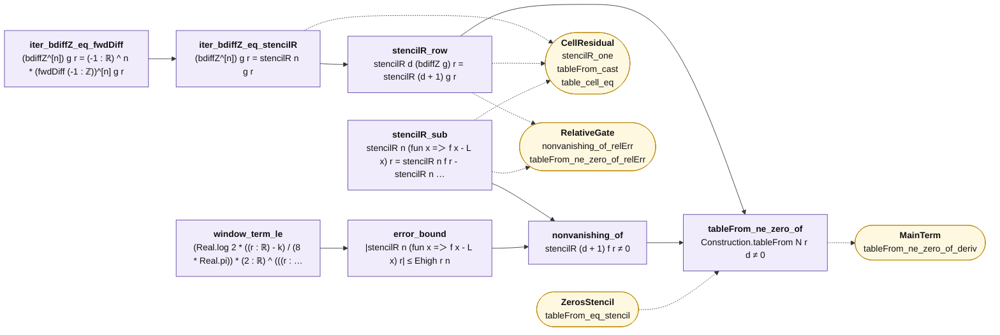

# `lean/Nonvanishing.lean`

Nonvanishing — the arrow of O67's conditional theorem, in the house pattern. `papers/The-Four-Zeros.md` § I states: under RH, `cell(r,d) ≠ 0` for every `r ≥ R(d)`, which with O43's census makes the four zeros complete at every depth `d ≤ 15`. The proof has two analytic inputs and one arithmetic gap condition; everything joining them is algebra. Following `Chain.lean`'s design — take the antecedents as HYPOTHESES, prove the arrows, let the kernel check that the "therefore" is real — this module proves the joins:

8 theorems, 5 definitions, 268 lines. Arrows are Lean's own record of what each proof uses.

**Imports:** [`Zeros`](../lean/Zeros.md), [`ZerosStencil`](../lean/ZerosStencil.md)  
**Imported by:** [`MainTerm`](../lean/MainTerm.md), [`RelativeGate`](../lean/RelativeGate.md)

## The picture



An arrow A → B reads "A is used in the proof of B". Green: counting, integers only. Violet: shape, analysis with no ζ. Blue: reads ζ. A name ending in ■ is an end: nothing else uses it. Red: contains `sorry`. Yellow: theorems in another file, counted; a dotted arrow crosses files. Definitions are not drawn; they are listed below the diagram.

## Definitions

<a name="Nonvanishing-bdiffZ"></a>
### `Nonvanishing.bdiffZ`

def · line 52

Backward differencing on ℤ-indexed real sequences — `Chain.bdiff`'s twin one level down (ℤ index, ℝ values).

- **Is:** `` bdiffZ (g : ℤ → ℝ) : ℤ → ℝ := fun x => g x - g (x - 1) ``
- **Used by 18:** [`Expansion.tableFrom_ne_zero_of_li`](../lean/Expansion.md#Expansion-tableFrom_ne_zero_of_li), [`Interpolant.tableFrom_ne_zero_of_relErr_liRow`](../lean/Interpolant.md#Interpolant-tableFrom_ne_zero_of_relErr_liRow), [`MainTerm.tableFrom_ne_zero_of_deriv`](../lean/MainTerm.md#MainTerm-tableFrom_ne_zero_of_deriv), [`Nonvanishing.iter_bdiffZ_eq_fwdDiff`](#Nonvanishing-iter_bdiffZ_eq_fwdDiff), [`Nonvanishing.iter_bdiffZ_eq_stencilR`](#Nonvanishing-iter_bdiffZ_eq_stencilR), [`Nonvanishing.stencilR_row`](#Nonvanishing-stencilR_row), [`Nonvanishing.tableFrom_ne_zero_of`](#Nonvanishing-tableFrom_ne_zero_of), [`RelativeGate.tableFrom_ne_zero_of_relErr`](../lean/RelativeGate.md#RelativeGate-tableFrom_ne_zero_of_relErr), [`RelativeLi.tableFrom_ne_zero_of_powerSaving`](../lean/RelativeLi.md#RelativeLi-tableFrom_ne_zero_of_powerSaving), [`RelativeLi.tableFrom_ne_zero_of_relErr_li`](../lean/RelativeLi.md#RelativeLi-tableFrom_ne_zero_of_relErr_li), [`RelativeLi.tableFrom_ne_zero_of_relErr_li'`](../lean/RelativeLi.md#RelativeLi-tableFrom_ne_zero_of_relErr_li-), [`RouteCell.cell_ne_zero_of_route`](../lean/RouteCell.md#RouteCell-cell_ne_zero_of_route), [`Schoenfeld.tableFrom_ne_zero_of_schoenfeld`](../lean/Schoenfeld.md#Schoenfeld-tableFrom_ne_zero_of_schoenfeld), [`CellResidual.stencilR_one`](../lean_stage3/CellResidual.md#CellResidual-stencilR_one), [`CellResidual.tableFrom_cast`](../lean_stage3/CellResidual.md#CellResidual-tableFrom_cast), [`CellResidual.table_cell_eq`](../lean_stage3/CellResidual.md#CellResidual-table_cell_eq), [`TableDepths.cell_ne_zero_gen`](../lean_stage3/TableDepths.md#TableDepths-cell_ne_zero_gen), [`TableRoute.cell_ne_zero_of_RH`](../lean_stage3/TableRoute.md#TableRoute-cell_ne_zero_of_RH)

<a name="Nonvanishing-stencilR"></a>
### `Nonvanishing.stencilR`

def · line 56

The real alternating binomial stencil of order `n` on `g`, read at `r` downward. The ℝ twin of `Zeros.stencil`.

- **Is:** `` stencilR (n : ℕ) (g : ℤ → ℝ) (r : ℤ) : ℝ := ∑ k ∈ range (n + 1), (-1 : ℝ) ^ k * (n.choose k) * g (r - k) ``
- **Used by 22:** [`MainTerm.stencilR_eq_iter`](../lean/MainTerm.md#MainTerm-stencilR_eq_iter), [`MainTerm.stencilR_ge_of`](../lean/MainTerm.md#MainTerm-stencilR_ge_of), [`Nonvanishing.error_bound`](#Nonvanishing-error_bound), [`Nonvanishing.iter_bdiffZ_eq_stencilR`](#Nonvanishing-iter_bdiffZ_eq_stencilR), [`Nonvanishing.nonvanishing_of`](#Nonvanishing-nonvanishing_of), [`Nonvanishing.stencilR_row`](#Nonvanishing-stencilR_row), [`Nonvanishing.stencilR_sub`](#Nonvanishing-stencilR_sub), [`Nonvanishing.tableFrom_ne_zero_of`](#Nonvanishing-tableFrom_ne_zero_of), [`RelativeGate.nonvanishing_of_relErr`](../lean/RelativeGate.md#RelativeGate-nonvanishing_of_relErr), [`RelativeGate.relError_bound`](../lean/RelativeGate.md#RelativeGate-relError_bound), [`RelativeGate.tableFrom_ne_zero_of_relErr`](../lean/RelativeGate.md#RelativeGate-tableFrom_ne_zero_of_relErr), [`CellResidual.cellResid`](../lean_stage3/CellResidual.md#CellResidual-cellResid), [`CellResidual.cells_of_schoenfeldWeak`](../lean_stage3/CellResidual.md#CellResidual-cells_of_schoenfeldWeak), [`CellResidual.stencilR_abs_le`](../lean_stage3/CellResidual.md#CellResidual-stencilR_abs_le), [`CellResidual.stencilR_one`](../lean_stage3/CellResidual.md#CellResidual-stencilR_one), [`CellResidual.step_le`](../lean_stage3/CellResidual.md#CellResidual-step_le), [`CellResidual.tableFrom_cast`](../lean_stage3/CellResidual.md#CellResidual-tableFrom_cast), [`CellResidual.table_cell_eq`](../lean_stage3/CellResidual.md#CellResidual-table_cell_eq), [`CellResidual.table_cell_resid`](../lean_stage3/CellResidual.md#CellResidual-table_cell_resid), [`PiFixedRow.table_cell_fixed_row`](../lean_stage3/PiFixedRow.md#PiFixedRow-table_cell_fixed_row), [`PiZeros.stencilR_cast`](../lean_stage3/PiZeros.md#PiZeros-stencilR_cast), [`PiZeros.table_cell_eq_zero_sum`](../lean_stage3/PiZeros.md#PiZeros-table_cell_eq_zero_sum)

<a name="Nonvanishing-Ehigh"></a>
### `Nonvanishing.Ehigh`

def · line 109

The error ceiling: `(log 2 · r / 8π) · 2^(r/2) · (1 + 2^(−1/2))^(n)`.

- **Is:** `` Ehigh (r : ℤ) (n : ℕ) : ℝ := (Real.log 2 * r / (8 * Real.pi)) * (2 : ℝ) ^ ((r : ℝ) / 2) * (1 + (2 : ℝ) ^ (-(1 : ℝ) / 2)) ^ n ``
- **Used by 6:** [`Expansion.tableFrom_ne_zero_of_li`](../lean/Expansion.md#Expansion-tableFrom_ne_zero_of_li), [`MainTerm.tableFrom_ne_zero_of_deriv`](../lean/MainTerm.md#MainTerm-tableFrom_ne_zero_of_deriv), [`Nonvanishing.error_bound`](#Nonvanishing-error_bound), [`Nonvanishing.nonvanishing_of`](#Nonvanishing-nonvanishing_of), [`Nonvanishing.tableFrom_ne_zero_of`](#Nonvanishing-tableFrom_ne_zero_of), [`Schoenfeld.tableFrom_ne_zero_of_schoenfeld`](../lean/Schoenfeld.md#Schoenfeld-tableFrom_ne_zero_of_schoenfeld)

<a name="Nonvanishing-StmtSchoenfeldWindow"></a>
### `Nonvanishing.StmtSchoenfeldWindow`

def · line 117

Schoenfeld on the window, as a statement: each of the `n+1` values the stencil reads obeys the RH bound at `x = 2^(r−k)`, where `√x = 2^((r−k)/2)` and `log x = (r−k)·log 2`. This is the hypothesis Schoenfeld's theorem would discharge; it is not discharged here.

- **Is:** `` StmtSchoenfeldWindow (f L : ℤ → ℝ) (r : ℤ) (n : ℕ) : Prop := ∀ k ∈ range (n + 1), |f (r - k) - L (r - k)| ≤ (Real.log 2 * ((r : ℝ) - k) / (8 * Real.pi)) * (2 : ℝ) ^ (((r : ℝ) - k) / 2) ``
- **Used by 7:** [`Expansion.tableFrom_ne_zero_of_li`](../lean/Expansion.md#Expansion-tableFrom_ne_zero_of_li), [`MainTerm.tableFrom_ne_zero_of_deriv`](../lean/MainTerm.md#MainTerm-tableFrom_ne_zero_of_deriv), [`Nonvanishing.error_bound`](#Nonvanishing-error_bound), [`Nonvanishing.nonvanishing_of`](#Nonvanishing-nonvanishing_of), [`Nonvanishing.tableFrom_ne_zero_of`](#Nonvanishing-tableFrom_ne_zero_of), [`RelativeGate.schoenfeldWindow_relErr`](../lean/RelativeGate.md#RelativeGate-schoenfeldWindow_relErr), [`Schoenfeld.window_of_global`](../lean/Schoenfeld.md#Schoenfeld-window_of_global)

<a name="Nonvanishing-Mlow"></a>
### `Nonvanishing.Mlow`

def · line 178

The main-term floor `0.5 · 2^(r−d−1) · (log 2)^d / r`. O67's step 3.

- **Is:** `` Mlow (r : ℤ) (d : ℕ) : ℝ := (1 / 2) * (2 : ℝ) ^ ((r : ℝ) - d - 1) * Real.log 2 ^ d / r ``
- **Used by 11:** [`Expansion.hD_of_window`](../lean/Expansion.md#Expansion-hD_of_window), [`Expansion.tableFrom_ne_zero_of_li`](../lean/Expansion.md#Expansion-tableFrom_ne_zero_of_li), [`MainTerm.tableFrom_ne_zero_of_deriv`](../lean/MainTerm.md#MainTerm-tableFrom_ne_zero_of_deriv), [`Nonvanishing.nonvanishing_of`](#Nonvanishing-nonvanishing_of), [`Nonvanishing.tableFrom_ne_zero_of`](#Nonvanishing-tableFrom_ne_zero_of), [`RelativeGate.nonvanishing_of_relErr`](../lean/RelativeGate.md#RelativeGate-nonvanishing_of_relErr), [`RelativeGate.relGate_iff`](../lean/RelativeGate.md#RelativeGate-relGate_iff), [`RelativeGate.tableFrom_ne_zero_of_relErr`](../lean/RelativeGate.md#RelativeGate-tableFrom_ne_zero_of_relErr), [`RelativeLi.tableFrom_ne_zero_of_relErr_li`](../lean/RelativeLi.md#RelativeLi-tableFrom_ne_zero_of_relErr_li), [`RelativeLi.tableFrom_ne_zero_of_relErr_li'`](../lean/RelativeLi.md#RelativeLi-tableFrom_ne_zero_of_relErr_li-), [`Schoenfeld.tableFrom_ne_zero_of_schoenfeld`](../lean/Schoenfeld.md#Schoenfeld-tableFrom_ne_zero_of_schoenfeld)

## Theorems

<a name="Nonvanishing-iter_bdiffZ_eq_fwdDiff"></a>
### `Nonvanishing.iter_bdiffZ_eq_fwdDiff`

line 61

**Shape.** Uses real or complex analysis; nothing in it or beneath it reads ζ.

**Why.** Backward differencing is `(−1)·fwdDiff` at step `−1` — the ℝ copy of `Zeros.tableFrom_eq_fwdDiff`'s bridge.

**Proves**

```lean
(bdiffZ^[n]) g r = (-1 : ℝ) ^ n * (fwdDiff (-1 : ℤ))^[n] g r
```

**Needs** (its hypotheses)

  - `` g : ℤ → ℝ ``
  - `` r : ℤ ``
  - `` n : ℕ ``

**Stated with:** [`Nonvanishing.bdiffZ`](#Nonvanishing-bdiffZ)

**Fed by:** no theorem of this repo; it stands on Mathlib and the definitions below.

**Feeds** (1 that use it)

  - [`Nonvanishing.iter_bdiffZ_eq_stencilR`](#Nonvanishing-iter_bdiffZ_eq_stencilR) — `` (bdiffZ^[n]) g r = stencilR n g r ``

<a name="Nonvanishing-iter_bdiffZ_eq_stencilR"></a>
### `Nonvanishing.iter_bdiffZ_eq_stencilR`

line 77

**Shape.** Uses real or complex analysis; nothing in it or beneath it reads ζ.

**Why.** `n` differences are the stencil. `Zeros.tableFrom_eq_stencil` transplanted to ℝ: Mathlib's `fwdDiff_iter_eq_sum_shift` does the binomial bookkeeping.

**Proves**

```lean
(bdiffZ^[n]) g r = stencilR n g r
```

**Needs** (its hypotheses)

  - `` g : ℤ → ℝ ``
  - `` r : ℤ ``
  - `` n : ℕ ``

**Stated with:** [`Nonvanishing.bdiffZ`](#Nonvanishing-bdiffZ), [`Nonvanishing.stencilR`](#Nonvanishing-stencilR)

**Fed by** (1 theorem its proof uses)

  - [`Nonvanishing.iter_bdiffZ_eq_fwdDiff`](#Nonvanishing-iter_bdiffZ_eq_fwdDiff) — `` (bdiffZ^[n]) g r = (-1 : ℝ) ^ n * (fwdDiff (-1 : ℤ))^[n] g r ``

**Feeds** (2 that use it)

  - [`Nonvanishing.stencilR_row`](#Nonvanishing-stencilR_row) — `` stencilR d (bdiffZ g) r = stencilR (d + 1) g r ``
  - [`CellResidual.stencilR_one`](../lean_stage3/CellResidual.md#CellResidual-stencilR_one) (CellResidual) — `` stencilR 1 g r = g r - g (r - 1) ``

<a name="Nonvanishing-stencilR_row"></a>
### `Nonvanishing.stencilR_row`

line 94

**Shape.** Uses real or complex analysis; nothing in it or beneath it reads ζ.

**Why.** The Pascal step. The depth-`d` stencil on the row `x ↦ g(x) − g(x−1)` is the depth-`(d+1)` stencil on `g`. One more iterate, nothing else.

**Proves**

```lean
stencilR d (bdiffZ g) r = stencilR (d + 1) g r
```

**Needs** (its hypotheses)

  - `` d : ℕ ``
  - `` g : ℤ → ℝ ``
  - `` r : ℤ ``

**Stated with:** [`Nonvanishing.bdiffZ`](#Nonvanishing-bdiffZ), [`Nonvanishing.stencilR`](#Nonvanishing-stencilR)

**Fed by** (1 theorem its proof uses)

  - [`Nonvanishing.iter_bdiffZ_eq_stencilR`](#Nonvanishing-iter_bdiffZ_eq_stencilR) — `` (bdiffZ^[n]) g r = stencilR n g r ``

**Feeds** (3 that use it)

  - [`Nonvanishing.tableFrom_ne_zero_of`](#Nonvanishing-tableFrom_ne_zero_of) — `` Construction.tableFrom N r d ≠ 0 ``
  - [`RelativeGate.tableFrom_ne_zero_of_relErr`](../lean/RelativeGate.md#RelativeGate-tableFrom_ne_zero_of_relErr) (RelativeGate) — `` Construction.tableFrom N r d ≠ 0 ``
  - [`CellResidual.tableFrom_cast`](../lean_stage3/CellResidual.md#CellResidual-tableFrom_cast) (CellResidual) — `` ((Construction.tableFrom N r d : ℤ) : ℝ) = stencilR (d + 1) f r ``

<a name="Nonvanishing-stencilR_sub"></a>
### `Nonvanishing.stencilR_sub`

line 100

**Shape.** Uses real or complex analysis; nothing in it or beneath it reads ζ.

**Why.** Linearity. Splitting `π = li + (π − li)` under the stencil.

**Proves**

```lean
stencilR n (fun x => f x - L x) r = stencilR n f r - stencilR n L r
```

**Needs** (its hypotheses)

  - `` n : ℕ ``
  - `` f L : ℤ → ℝ ``
  - `` r : ℤ ``

**Stated with:** [`Nonvanishing.stencilR`](#Nonvanishing-stencilR)

**Fed by:** no theorem of this repo; it stands on Mathlib and the definitions below.

**Feeds** (3 that use it)

  - [`Nonvanishing.nonvanishing_of`](#Nonvanishing-nonvanishing_of) — `` stencilR (d + 1) f r ≠ 0 ``
  - [`RelativeGate.nonvanishing_of_relErr`](../lean/RelativeGate.md#RelativeGate-nonvanishing_of_relErr) (RelativeGate) — `` stencilR (d + 1) f r ≠ 0 ``
  - [`CellResidual.table_cell_eq`](../lean_stage3/CellResidual.md#CellResidual-table_cell_eq) (CellResidual) — `` ((Construction.tableFrom TableRoute.rowN r d : ℤ) : ℝ) - stencilR (d + 1) (fun m : ℤ => Stage3.Li ((2 : ℝ) ^ (m : ℝ))) r = cellResid 1 r d ``

<a name="Nonvanishing-window_term_le"></a>
### `Nonvanishing.window_term_le`

line 125

**Shape.** Uses real or complex analysis; nothing in it or beneath it reads ζ.

**Why.** Each windowed Schoenfeld bound is at most the top-of-window bound times `2^(−k/2)`: `(r−k) ≤ r` handles the linear factor and `rpow_add` splits the power. Needs `0 ≤ r − k` inside the window, supplied by `hr`.

**Proves**

```lean
(Real.log 2 * ((r : ℝ) - k) / (8 * Real.pi)) * (2 : ℝ) ^ (((r : ℝ) - k) / 2) ≤ (Real.log 2 * r / (8 * Real.pi)) * (2 : ℝ) ^ ((r : ℝ) / 2) * ((2 : ℝ) ^ (-(1 : ℝ) / 2)) ^ k
```

**Needs** (its hypotheses)

  - `` hr : (n : ℤ) ≤ r ``
  - `` k : ℕ ``
  - `` hk : k ∈ range (n + 1) ``

**Fed by:** no theorem of this repo; it stands on Mathlib.

**Feeds** (1 that use it)

  - [`Nonvanishing.error_bound`](#Nonvanishing-error_bound) — `` |stencilR n (fun x => f x - L x) r| ≤ Ehigh r n ``

<a name="Nonvanishing-error_bound"></a>
### `Nonvanishing.error_bound`

line 152

**Shape.** Uses real or complex analysis; nothing in it or beneath it reads ζ.

**Why.** The error bound. Triangle inequality, the per-term comparison, and the binomial theorem `Σ C(n,k) t^k = (1+t)^n` at `t = 2^(−1/2)`.

**Proves**

```lean
|stencilR n (fun x => f x - L x) r| ≤ Ehigh r n
```

**Needs** (its hypotheses)

  - `` hr : (n : ℤ) ≤ r ``
  - `` hS : StmtSchoenfeldWindow f L r n ``

**Stated with:** [`Nonvanishing.Ehigh`](#Nonvanishing-Ehigh), [`Nonvanishing.StmtSchoenfeldWindow`](#Nonvanishing-StmtSchoenfeldWindow), [`Nonvanishing.stencilR`](#Nonvanishing-stencilR)

**Fed by** (1 theorem its proof uses)

  - [`Nonvanishing.window_term_le`](#Nonvanishing-window_term_le) — `` (Real.log 2 * ((r : ℝ) - k) / (8 * Real.pi)) * (2 : ℝ) ^ (((r : ℝ) - k) / 2) ≤ (Real.log 2 * r / (8 * Real.pi)) * (2 : ℝ) ^ ((r : ℝ) / 2) * ((2 : ℝ) ^… ``

**Feeds** (1 that use it)

  - [`Nonvanishing.nonvanishing_of`](#Nonvanishing-nonvanishing_of) — `` stencilR (d + 1) f r ≠ 0 ``

<a name="Nonvanishing-nonvanishing_of"></a>
### `Nonvanishing.nonvanishing_of`

line 185

**Shape.** Uses real or complex analysis; nothing in it or beneath it reads ζ.

**Why.** The arrow. If Schoenfeld holds on the window (`hS`), the smooth main term clears its floor (`hM` — stage 2's target), and the floor beats the error ceiling (`hgap` — O67's `r ≥ R(d)` table), then the depth-`(d+1)` stencil of the counting function does not vanish.

**Proves**

```lean
stencilR (d + 1) f r ≠ 0
```

**Needs** (its hypotheses)

  - `` hr : ((d + 1 : ℕ) : ℤ) ≤ r ``
  - `` hS : StmtSchoenfeldWindow f L r (d + 1) ``
  - `` hM : Mlow r d ≤ |stencilR (d + 1) L r| ``
  - `` hgap : Ehigh r (d + 1) < Mlow r d ``

**Stated with:** [`Nonvanishing.Ehigh`](#Nonvanishing-Ehigh), [`Nonvanishing.Mlow`](#Nonvanishing-Mlow), [`Nonvanishing.StmtSchoenfeldWindow`](#Nonvanishing-StmtSchoenfeldWindow), [`Nonvanishing.stencilR`](#Nonvanishing-stencilR)

**Fed by** (2 theorems its proof uses)

  - [`Nonvanishing.error_bound`](#Nonvanishing-error_bound) — `` |stencilR n (fun x => f x - L x) r| ≤ Ehigh r n ``
  - [`Nonvanishing.stencilR_sub`](#Nonvanishing-stencilR_sub) — `` stencilR n (fun x => f x - L x) r = stencilR n f r - stencilR n L r ``

**Feeds** (1 that use it)

  - [`Nonvanishing.tableFrom_ne_zero_of`](#Nonvanishing-tableFrom_ne_zero_of) — `` Construction.tableFrom N r d ≠ 0 ``

<a name="Nonvanishing-tableFrom_ne_zero_of"></a>
### `Nonvanishing.tableFrom_ne_zero_of`

line 201

**Shape.** Uses real or complex analysis; nothing in it or beneath it reads ζ.

**Why.** Onto the integer table. If the integer row is the backward difference of a counting function `f` across the window a cell reads (cast to ℝ), then the cell's vanishing is the depth-`(d+1)` stencil of `f` vanishing — so the arrow above forbids it. The cast bridge is `Zeros.tableFrom_eq_stencil` plus `push_cast`.

**Proves**

```lean
Construction.tableFrom N r d ≠ 0
```

**Needs** (its hypotheses)

  - `` hrow : ∀ k ∈ range (d + 2), ((N (r - k) : ℤ) : ℝ) = bdiffZ f (r - k) ``
  - `` hr : ((d + 1 : ℕ) : ℤ) ≤ r ``
  - `` hS : StmtSchoenfeldWindow f L r (d + 1) ``
  - `` hM : Mlow r d ≤ |stencilR (d + 1) L r| ``
  - `` hgap : Ehigh r (d + 1) < Mlow r d ``

**Stated with:** [`Construction.tableFrom`](../lean/Construction.md#Construction-tableFrom), [`Nonvanishing.Ehigh`](#Nonvanishing-Ehigh), [`Nonvanishing.Mlow`](#Nonvanishing-Mlow), [`Nonvanishing.StmtSchoenfeldWindow`](#Nonvanishing-StmtSchoenfeldWindow), [`Nonvanishing.bdiffZ`](#Nonvanishing-bdiffZ), [`Nonvanishing.stencilR`](#Nonvanishing-stencilR)

**Fed by** (3 theorems its proof uses)

  - [`Nonvanishing.nonvanishing_of`](#Nonvanishing-nonvanishing_of) — `` stencilR (d + 1) f r ≠ 0 ``
  - [`Nonvanishing.stencilR_row`](#Nonvanishing-stencilR_row) — `` stencilR d (bdiffZ g) r = stencilR (d + 1) g r ``
  - [`Zeros.tableFrom_eq_stencil`](../lean/ZerosStencil.md#Zeros-tableFrom_eq_stencil) (ZerosStencil) — `` Construction.tableFrom N r d = stencil d (fun k => N (r - k)) ``

**Definitions its proof touches:** [`Zeros.stencil`](../lean/ZerosStencil.md#Zeros-stencil)

**Feeds** (1 that use it)

  - [`MainTerm.tableFrom_ne_zero_of_deriv`](../lean/MainTerm.md#MainTerm-tableFrom_ne_zero_of_deriv) (MainTerm) — `` Construction.tableFrom N r d ≠ 0 ``

