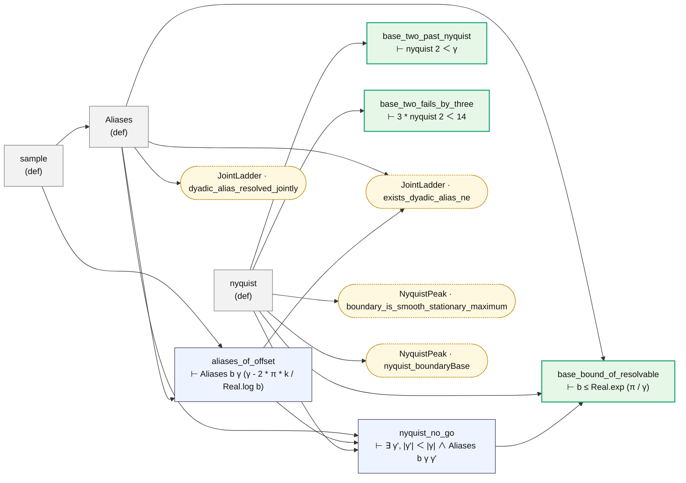

# `lean/Nyquist.lean`

**What it does** (its own header): Nyquist — why an entire family of integer-base approaches must fail, rather than merely happening to.

**Imports:** nothing in this tree.
**Imported by:** [`JointLadder`](../lean/JointLadder.md), [`NyquistPeak`](../lean/NyquistPeak.md).

Blue: theorem. Green: a theorem nothing else uses (an end). Dashed white: connects to nothing. Grey: definition. Red: contains `sorry`. Yellow: in another file. An arrow A → B reads "A is used by B".

## Every declaration

| declaration | proves (output) | needs (input) | why (its own docstring) | uses | used by |
|---|---|---|---|---|---|
| `Nyquist.sample` def, line 56 | ℝ | b : ℝ; r : ℤ | The rungs of a `b`-adic ladder, in `log x`: sampling at `x = b^r` puts the samples at `r * log b`. | — | `Nyquist.Aliases`, `Nyquist.aliases_of_offset` |
| `Nyquist.Aliases` def, line 62 | Prop | b γ γ' : ℝ | Indistinguishable frequencies. `γ` and `γ'` alias on the `b`-adic ladder when their modes agree at every rung. No measurement on the ladder can separate them, because the ladder never evaluates anything else. | `Nyquist.sample` | `JointLadder.dyadic_alias_resolved_jointly`, `JointLadder.exists_dyadic_alias_ne`, `Nyquist.aliases_of_offset`, `Nyquist.base_bound_of_resolvable`, `Nyquist.nyquist_no_go` |
| `Nyquist.aliases_of_offset` theorem, line 68 | Aliases b γ (γ - 2 * π * k / Real.log b) | b γ : ℝ; k : ℤ; hb : Real.log b ≠ 0 | The aliasing offset. Shifting a frequency by `2πk / log b` changes nothing the ladder can see. | `Nyquist.Aliases`, `Nyquist.sample` | `JointLadder.exists_dyadic_alias_ne`, `Nyquist.nyquist_no_go` |
| `Nyquist.nyquist` def, line 84 | ℝ | b : ℝ | The Nyquist frequency of a `b`-adic ladder: the highest frequency the rungs can carry without ambiguity. | — | `Nyquist.base_bound_of_resolvable`, `Nyquist.base_two_fails_by_three`, `Nyquist.base_two_past_nyquist`, `Nyquist.nyquist_no_go`, `NyquistPeak.boundary_is_smooth_stationary_maximum`, `NyquistPeak.nyquist_boundaryBase` |
| `Nyquist.nyquist_no_go` theorem, line 91 | ∃ γ', \|γ'\| &lt; \|γ\| ∧ Aliases b γ γ' | b γ : ℝ; hb : 1 &lt; b; hγ : nyquist b &lt; γ | THE NO-GO. Past the Nyquist frequency there is always a frequency of strictly smaller modulus that the ladder cannot distinguish from `γ`. So `γ` is not identifiable from `b`-adic samples — not because the measurement is noisy, but because a different answer fits the same data exactly. | `Nyquist.Aliases`, `Nyquist.aliases_of_offset`, `Nyquist.nyquist` | `Nyquist.base_bound_of_resolvable` |
| `Nyquist.base_bound_of_resolvable` theorem, line 110 | b ≤ Real.exp (π / γ) | b γ : ℝ; hb : 1 &lt; b; hγ : 0 &lt; γ; hres : ∀ γ', \|γ'\| &lt; \|γ\| → ¬ Aliases b γ γ' | Entry 26's inequality, as the contrapositive. If no smaller-modulus frequency aliases with `γ` — that is, if `γ` really is identifiable from the ladder — then the base is bounded: `b ≤ exp(π/γ)`. For `γ₁` this is the recorded `1.2489`. | `Nyquist.Aliases`, `Nyquist.nyquist`, `Nyquist.nyquist_no_go` | — |
| `Nyquist.base_two_past_nyquist` theorem, line 131 | nyquist 2 &lt; γ | γ : ℝ; hγ : 14 ≤ γ | Base 2 is past its own Nyquist frequency at every `γ ≥ 14`, and `γ₁ = 14.134…` is such a `γ`. So by `nyquist_no_go`, no dyadic ladder identifies it. | `Nyquist.nyquist` | — |
| `Nyquist.base_two_fails_by_three` theorem, line 143 | 3 * nyquist 2 &lt; 14 | — | Entry 26's "fails by a factor of three", proved. Three times base 2's Nyquist frequency still does not reach 14, so `γ₁` sits past it with a factor to spare. | `Nyquist.nyquist` | — |
