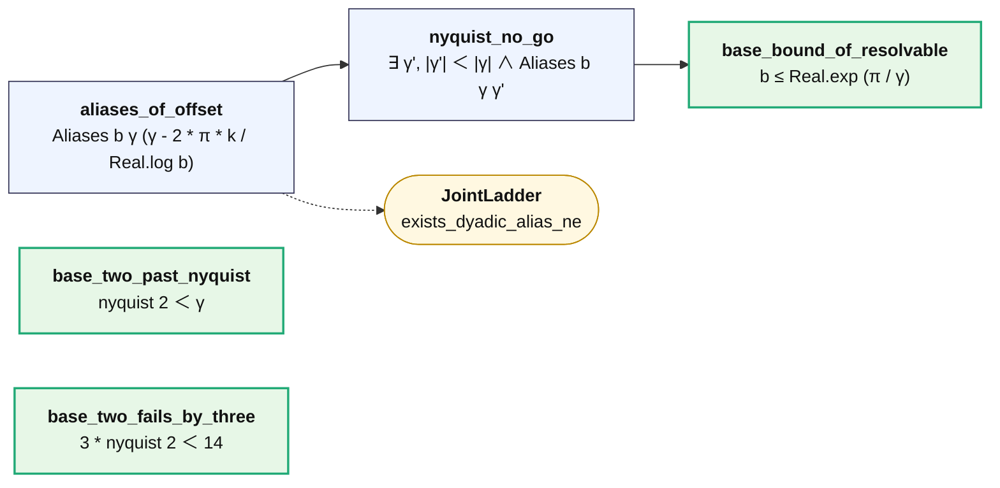

# `lean/Nyquist.lean`

Nyquist — why an entire family of integer-base approaches must fail, rather than merely happening to.

5 theorems, 3 definitions, 182 lines. Arrows are Lean's own record of what each proof uses.

**Imports:** nothing in this tree  
**Imported by:** [`JointLadder`](../lean/JointLadder.md), [`NyquistPeak`](../lean/NyquistPeak.md)

## The picture



An arrow A → B reads "A is used in the proof of B". Blue: theorem. Green: a theorem nothing else uses (an end). Dashed: connects to nothing. Red: contains `sorry`. Yellow: theorems in another file, counted; a dotted arrow crosses files. Definitions are not drawn; they are listed below the diagram.

## Definitions

<a name="Nyquist-sample"></a>
### `Nyquist.sample`

def · line 56

The rungs of a `b`-adic ladder, in `log x`: sampling at `x = b^r` puts the samples at `r * log b`.

- **Is:** `` sample (b : ℝ) (r : ℤ) : ℝ := (r : ℝ) * Real.log b ``
- **Used by 2:** [`Nyquist.Aliases`](#Nyquist-Aliases), [`Nyquist.aliases_of_offset`](#Nyquist-aliases_of_offset)

<a name="Nyquist-Aliases"></a>
### `Nyquist.Aliases`

def · line 62

Indistinguishable frequencies. `γ` and `γ'` alias on the `b`-adic ladder when their modes agree at every rung. No measurement on the ladder can separate them, because the ladder never evaluates anything else.

- **Is:** `` Aliases (b γ γ' : ℝ) : Prop := ∀ r : ℤ, Complex.exp ((γ * sample b r : ℝ) * Complex.I) = Complex.exp ((γ' * sample b r : ℝ) * Complex.I) ``
- **Built from:** [`Nyquist.sample`](#Nyquist-sample)
- **Used by 5:** [`JointLadder.dyadic_alias_resolved_jointly`](../lean/JointLadder.md#JointLadder-dyadic_alias_resolved_jointly), [`JointLadder.exists_dyadic_alias_ne`](../lean/JointLadder.md#JointLadder-exists_dyadic_alias_ne), [`Nyquist.aliases_of_offset`](#Nyquist-aliases_of_offset), [`Nyquist.base_bound_of_resolvable`](#Nyquist-base_bound_of_resolvable), [`Nyquist.nyquist_no_go`](#Nyquist-nyquist_no_go)

<a name="Nyquist-nyquist"></a>
### `Nyquist.nyquist`

def · line 84

The Nyquist frequency of a `b`-adic ladder: the highest frequency the rungs can carry without ambiguity.

- **Is:** `` nyquist (b : ℝ) : ℝ := π / Real.log b ``
- **Used by 6:** [`Nyquist.base_bound_of_resolvable`](#Nyquist-base_bound_of_resolvable), [`Nyquist.base_two_fails_by_three`](#Nyquist-base_two_fails_by_three), [`Nyquist.base_two_past_nyquist`](#Nyquist-base_two_past_nyquist), [`Nyquist.nyquist_no_go`](#Nyquist-nyquist_no_go), [`NyquistPeak.boundary_is_smooth_stationary_maximum`](../lean/NyquistPeak.md#NyquistPeak-boundary_is_smooth_stationary_maximum), [`NyquistPeak.nyquist_boundaryBase`](../lean/NyquistPeak.md#NyquistPeak-nyquist_boundaryBase)

## Theorems

<a name="Nyquist-aliases_of_offset"></a>
### `Nyquist.aliases_of_offset`

line 68

**Why.** The aliasing offset. Shifting a frequency by `2πk / log b` changes nothing the ladder can see.

**Proves**

```lean
Aliases b γ (γ - 2 * π * k / Real.log b)
```

**Needs** (its hypotheses)

  - `` b γ : ℝ ``
  - `` k : ℤ ``
  - `` hb : Real.log b ≠ 0 ``

**Stated with:** [`Nyquist.Aliases`](#Nyquist-Aliases)

**Fed by:** no theorem of this repo; it stands on Mathlib and the definitions below.

**Definitions its proof touches:** [`Nyquist.sample`](#Nyquist-sample)

**Feeds** (2 that use it)

  - [`JointLadder.exists_dyadic_alias_ne`](../lean/JointLadder.md#JointLadder-exists_dyadic_alias_ne) (JointLadder) — `` ∃ γ' : ℝ, γ' ≠ γ ∧ Nyquist.Aliases 2 γ γ' ``
  - [`Nyquist.nyquist_no_go`](#Nyquist-nyquist_no_go) — `` ∃ γ', |γ'| < |γ| ∧ Aliases b γ γ' ``

<a name="Nyquist-nyquist_no_go"></a>
### `Nyquist.nyquist_no_go`

line 91

**Why.** THE NO-GO. Past the Nyquist frequency there is always a frequency of strictly smaller modulus that the ladder cannot distinguish from `γ`. So `γ` is not identifiable from `b`-adic samples — not because the measurement is noisy, but because a different answer fits the same data exactly.

**Proves**

```lean
∃ γ', |γ'| < |γ| ∧ Aliases b γ γ'
```

**Needs** (its hypotheses)

  - `` b γ : ℝ ``
  - `` hb : 1 < b ``
  - `` hγ : nyquist b < γ ``

**Stated with:** [`Nyquist.Aliases`](#Nyquist-Aliases), [`Nyquist.nyquist`](#Nyquist-nyquist)

**Fed by** (1 theorem its proof uses)

  - [`Nyquist.aliases_of_offset`](#Nyquist-aliases_of_offset) — `` Aliases b γ (γ - 2 * π * k / Real.log b) ``

**Feeds** (1 that use it)

  - [`Nyquist.base_bound_of_resolvable`](#Nyquist-base_bound_of_resolvable) — `` b ≤ Real.exp (π / γ) ``

<a name="Nyquist-base_bound_of_resolvable"></a>
### `Nyquist.base_bound_of_resolvable`

line 110

**Why.** Entry 26's inequality, as the contrapositive. If no smaller-modulus frequency aliases with `γ` — that is, if `γ` really is identifiable from the ladder — then the base is bounded: `b ≤ exp(π/γ)`. For `γ₁` this is the recorded `1.2489`.

**Proves**

```lean
b ≤ Real.exp (π / γ)
```

**Needs** (its hypotheses)

  - `` b γ : ℝ ``
  - `` hb : 1 < b ``
  - `` hγ : 0 < γ ``
  - `` hres : ∀ γ', |γ'| < |γ| → ¬ Aliases b γ γ' ``

**Stated with:** [`Nyquist.Aliases`](#Nyquist-Aliases)

**Fed by** (1 theorem its proof uses)

  - [`Nyquist.nyquist_no_go`](#Nyquist-nyquist_no_go) — `` ∃ γ', |γ'| < |γ| ∧ Aliases b γ γ' ``

**Definitions its proof touches:** [`Nyquist.nyquist`](#Nyquist-nyquist)

**Feeds:** nothing. It is an end.

<a name="Nyquist-base_two_past_nyquist"></a>
### `Nyquist.base_two_past_nyquist`

line 131

**Why.** Base 2 is past its own Nyquist frequency at every `γ ≥ 14`, and `γ₁ = 14.134…` is such a `γ`. So by `nyquist_no_go`, no dyadic ladder identifies it.

**Proves**

```lean
nyquist 2 < γ
```

**Needs** (its hypotheses)

  - `` γ : ℝ ``
  - `` hγ : 14 ≤ γ ``

**Stated with:** [`Nyquist.nyquist`](#Nyquist-nyquist)

**Fed by:** no theorem of this repo; it stands on Mathlib and the definitions below.

**Feeds:** nothing. It is an end.

<a name="Nyquist-base_two_fails_by_three"></a>
### `Nyquist.base_two_fails_by_three`

line 143

**Why.** Entry 26's "fails by a factor of three", proved. Three times base 2's Nyquist frequency still does not reach 14, so `γ₁` sits past it with a factor to spare.

**Proves**

```lean
3 * nyquist 2 < 14
```

**Stated with:** [`Nyquist.nyquist`](#Nyquist-nyquist)

**Fed by:** no theorem of this repo; it stands on Mathlib and the definitions below.

**Feeds:** nothing. It is an end.

