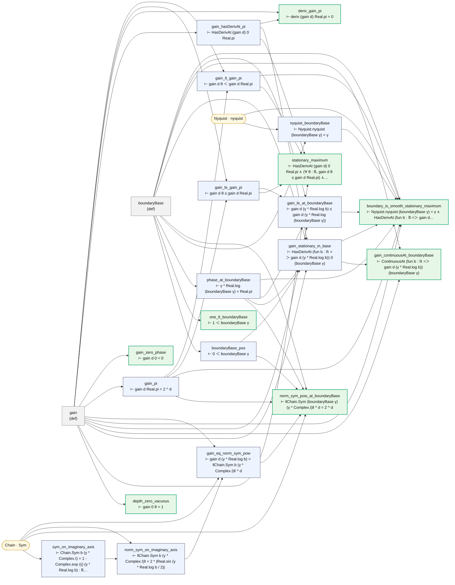

# `lean/NyquistPeak.lean`

**What it does** (its own header): NyquistPeak — the difference filter's gain at frequency `γ` is stationary, and maximal, exactly at the Nyquist boundary `b* = exp(π/γ)`.

**Imports:** [`Chain`](../lean/Chain.md), [`Nyquist`](../lean/Nyquist.md).
**Imported by:** nothing.

Blue: theorem. Green: a theorem nothing else uses (an end). Dashed white: connects to nothing. Grey: definition. Red: contains `sorry`. Yellow: in another file. An arrow A → B reads "A is used by B".

## Every declaration

| declaration | proves (output) | needs (input) | why (its own docstring) | uses | used by |
|---|---|---|---|---|---|
| `NyquistPeak.gain` def, line 68 | ℝ | d : ℕ; θ : ℝ | The gain of the depth-`d` difference filter, as a function of phase. `θ = γ · log b` is the phase one rung of a `b`-ladder advances a mode of frequency `γ`. The definition is written in the prereg's own form; that it is `Chain.Sym`'s modulus is proved, not assumed — see `gain_eq_norm_sym_pow`. | — | `NyquistPeak.boundary_is_smooth_stationary_maximum`, `NyquistPeak.depth_zero_vacuous`, `NyquistPeak.deriv_gain_pi`, `NyquistPeak.gain_continuousAt_boundaryBase`, `NyquistPeak.gain_eq_norm_sym_pow`, `NyquistPeak.gain_hasDerivAt_pi`, `NyquistPeak.gain_le_at_boundaryBase`, `NyquistPeak.gain_le_gain_pi`, `NyquistPeak.gain_lt_gain_pi`, `NyquistPeak.gain_pi`, `NyquistPeak.gain_stationary_in_base`, `NyquistPeak.gain_zero_phase`, `NyquistPeak.stationary_maximum` |
| `NyquistPeak.sym_on_imaginary_axis` theorem, line 76 | Chain.Sym b (γ * Complex.I) = 1 - Complex.exp (((-(γ * Real.log b) : ℝ) : ℂ) * Complex.I) | hb : 0 &lt; b; γ : ℝ | The symbol on the imaginary axis is `1 − e^(−iθ)` with `θ = γ log b`. | `Chain.Sym` | `NyquistPeak.norm_sym_on_imaginary_axis` |
| `NyquistPeak.norm_sym_on_imaginary_axis` theorem, line 91 | ‖Chain.Sym b (γ * Complex.I)‖ = 2 * \|Real.sin (γ * Real.log b / 2)\| | hb : 0 &lt; b; γ : ℝ | The prereg's formula, derived. `‖Chain.Sym b (γ i)‖ = 2 \|sin(θ/2)\|` with `θ = γ log b`. `preregs/dense_boundary_scan_v1_20260827.md` line 44 writes it `\|1 − e^{iθ}\|`; this is that modulus, computed from the tree's own symbol rather than restated as a definition. | `Chain.Sym`, `NyquistPeak.sym_on_imaginary_axis` | `NyquistPeak.gain_eq_norm_sym_pow` |
| `NyquistPeak.gain_eq_norm_sym_pow` theorem, line 114 | gain d (γ * Real.log b) = ‖Chain.Sym b (γ * Complex.I)‖ ^ d | hb : 0 &lt; b; γ : ℝ; d : ℕ | The depth-`d` gain is the symbol's modulus to the `d`. This is the link that makes everything below a statement about the object the tree already has. | `Chain.Sym`, `NyquistPeak.gain`, `NyquistPeak.norm_sym_on_imaginary_axis` | `NyquistPeak.norm_sym_pow_at_boundaryBase` |
| `NyquistPeak.gain_pi` theorem, line 121 | gain d Real.pi = 2 ^ d | d : ℕ | The gain at phase `π` is `2^d` — the ceiling of the band. | `NyquistPeak.gain` | `NyquistPeak.boundary_is_smooth_stationary_maximum`, `NyquistPeak.gain_le_gain_pi`, `NyquistPeak.gain_lt_gain_pi`, `NyquistPeak.norm_sym_pow_at_boundaryBase` |
| `NyquistPeak.gain_zero_phase` theorem, line 128 | gain d 0 = 0 | hd : d ≠ 0 | The gain at phase `0` is `0` at every positive depth: the smooth term, having `γ = 0`, is annihilated outright. `Chain.C2_floor_attained` is the critical-line counterpart. This is also the witness that `π` is a strict maximum rather than a plateau. | `NyquistPeak.gain` | — |
| `NyquistPeak.gain_hasDerivAt_pi` theorem, line 135 | HasDerivAt (gain d) 0 Real.pi | d : ℕ | HALF ONE — the derivative vanishes at `θ = π`. `2\|sin(θ/2)\|` is smooth on a neighbourhood of `π` (the absolute value is inert there, since `sin` is non-negative on `(0, π)`), and its derivative carries a factor `cos(π/2) = 0`. | `NyquistPeak.gain` | `NyquistPeak.deriv_gain_pi`, `NyquistPeak.gain_stationary_in_base`, `NyquistPeak.stationary_maximum` |
| `NyquistPeak.deriv_gain_pi` theorem, line 155 | deriv (gain d) Real.pi = 0 | d : ℕ | The same, in `deriv` form. | `NyquistPeak.gain`, `NyquistPeak.gain_hasDerivAt_pi` | — |
| `NyquistPeak.gain_le_gain_pi` theorem, line 160 | gain d θ ≤ gain d Real.pi | d : ℕ; θ : ℝ | HALF TWO — `π` is a maximum. Global, not merely local: no phase anywhere reaches a larger gain. | `NyquistPeak.gain`, `NyquistPeak.gain_pi` | `NyquistPeak.gain_le_at_boundaryBase`, `NyquistPeak.stationary_maximum` |
| `NyquistPeak.gain_lt_gain_pi` theorem, line 170 | gain d θ &lt; gain d Real.pi | hd : d ≠ 0; hθ : \|Real.sin (θ / 2)\| ≠ 1 | The maximum is STRICT. At every phase off the peak the gain is strictly smaller, so the stationary point of `gain_hasDerivAt_pi` cannot be a minimum or an inflection. `d ≠ 0` is load-bearing and not a vacuity guard: at `d = 0` the statement is false, since `gain 0` is constant. | `NyquistPeak.gain`, `NyquistPeak.gain_pi` | `NyquistPeak.boundary_is_smooth_stationary_maximum`, `NyquistPeak.stationary_maximum` |
| `NyquistPeak.depth_zero_vacuous` theorem, line 182 | gain 0 θ = 1 | θ : ℝ | The degeneracy the depth hypothesis closes. At `d = 0` the gain is the constant `1`, so `gain_hasDerivAt_pi` — which is true at every depth — says nothing there: every phase is stationary and every phase is a maximum. `#guard_msgs` cannot catch that; a vacuous theorem has an ordinary axiom list. Same shape as `Chain.period_vacuous_at_one`. | `NyquistPeak.gain` | — |
| `NyquistPeak.stationary_maximum` theorem, line 186 | HasDerivAt (gain d) 0 Real.pi ∧ (∀ θ : ℝ, gain d θ ≤ gain d Real.pi) ∧ (∀ θ : ℝ, \|Real.sin (θ / 2)\| ≠ 1 → gain d θ &lt; gain d Real.pi) | hd : d ≠ 0 | § 5.1 in phase coordinates, as one object. Stationary at `π`, and a strict global maximum there. | `NyquistPeak.gain`, `NyquistPeak.gain_hasDerivAt_pi`, `NyquistPeak.gain_le_gain_pi`, `NyquistPeak.gain_lt_gain_pi` | — |
| `NyquistPeak.boundaryBase` def, line 202 | ℝ | γ : ℝ | The Nyquist boundary base at frequency `γ`. `Nyquist.nyquist` maps it back to `γ`; see `nyquist_boundaryBase`. | — | `NyquistPeak.boundaryBase_pos`, `NyquistPeak.boundary_is_smooth_stationary_maximum`, `NyquistPeak.gain_continuousAt_boundaryBase`, `NyquistPeak.gain_le_at_boundaryBase`, `NyquistPeak.gain_stationary_in_base`, `NyquistPeak.norm_sym_pow_at_boundaryBase`, `NyquistPeak.nyquist_boundaryBase`, `NyquistPeak.one_lt_boundaryBase`, `NyquistPeak.phase_at_boundaryBase` |
| `NyquistPeak.boundaryBase_pos` theorem, line 205 | 0 &lt; boundaryBase γ | γ : ℝ | The boundary base is positive. | `NyquistPeak.boundaryBase` | `NyquistPeak.gain_stationary_in_base`, `NyquistPeak.norm_sym_pow_at_boundaryBase` |
| `NyquistPeak.one_lt_boundaryBase` theorem, line 209 | 1 &lt; boundaryBase γ | hγ : 0 &lt; γ | At a positive frequency the boundary base exceeds `1`, so it lies in the range `Nyquist.base_bound_of_resolvable` speaks about. | `NyquistPeak.boundaryBase` | — |
| `NyquistPeak.phase_at_boundaryBase` theorem, line 218 | γ * Real.log (boundaryBase γ) = Real.pi | hγ : γ ≠ 0 | The boundary base puts the phase exactly at `π`. `γ ≠ 0` is load-bearing and its failure makes the statement false, not vacuous: at `γ = 0` Lean's `π/0` is `0`, so `boundaryBase 0 = 1` and the phase is `0`, where `gain_zero_phase` says the gain vanishes. | `NyquistPeak.boundaryBase` | `NyquistPeak.boundary_is_smooth_stationary_maximum`, `NyquistPeak.gain_le_at_boundaryBase`, `NyquistPeak.gain_stationary_in_base`, `NyquistPeak.norm_sym_pow_at_boundaryBase` |
| `NyquistPeak.nyquist_boundaryBase` theorem, line 225 | Nyquist.nyquist (boundaryBase γ) = γ | hγ : 0 &lt; γ | `b*` is exactly the base whose Nyquist frequency is `γ`. This is the weld to `lean/Nyquist.lean`: `Nyquist.base_bound_of_resolvable` caps a base that resolves `γ` at `exp(π/γ)`, and that cap is this base. | `Nyquist.nyquist`, `NyquistPeak.boundaryBase` | `NyquistPeak.boundary_is_smooth_stationary_maximum` |
| `NyquistPeak.norm_sym_pow_at_boundaryBase` theorem, line 233 | ‖Chain.Sym (boundaryBase γ) (γ * Complex.I)‖ ^ d = 2 ^ d | d : ℕ; hγ : γ ≠ 0 | The gain at `b*` is the ceiling `2^d`, and it is the symbol's own modulus that reaches it. | `Chain.Sym`, `NyquistPeak.boundaryBase`, `NyquistPeak.boundaryBase_pos`, `NyquistPeak.gain_eq_norm_sym_pow`, `NyquistPeak.gain_pi`, `NyquistPeak.phase_at_boundaryBase` | — |
| `NyquistPeak.gain_stationary_in_base` theorem, line 241 | HasDerivAt (fun b : ℝ =&gt; gain d (γ * Real.log b)) 0 (boundaryBase γ) | d : ℕ; hγ : γ ≠ 0 | HALF ONE, in the scanned coordinate. Sweeping the base through `b*` at fixed frequency `γ`, the `γ` gain has slope exactly zero. This is the statement the dense boundary scan's `no_step` was predicted from: the ingredient does not step at `b*` because it does not even tilt there. | `NyquistPeak.boundaryBase`, `NyquistPeak.boundaryBase_pos`, `NyquistPeak.gain`, `NyquistPeak.gain_hasDerivAt_pi`, `NyquistPeak.phase_at_boundaryBase` | `NyquistPeak.boundary_is_smooth_stationary_maximum`, `NyquistPeak.gain_continuousAt_boundaryBase` |
| `NyquistPeak.gain_continuousAt_boundaryBase` theorem, line 252 | ContinuousAt (fun b : ℝ =&gt; gain d (γ * Real.log b)) (boundaryBase γ) | d : ℕ; hγ : γ ≠ 0 | Not a discontinuity. Differentiability at `b*` gives continuity there, which is the negative half of the prereg's claim. | `NyquistPeak.boundaryBase`, `NyquistPeak.gain`, `NyquistPeak.gain_stationary_in_base` | — |
| `NyquistPeak.gain_le_at_boundaryBase` theorem, line 258 | gain d (γ * Real.log b) ≤ gain d (γ * Real.log (boundaryBase γ)) | d : ℕ; hγ : γ ≠ 0; b : ℝ | HALF TWO, in the scanned coordinate. No base anywhere gives a larger `γ` gain than `b*` does. | `NyquistPeak.boundaryBase`, `NyquistPeak.gain`, `NyquistPeak.gain_le_gain_pi`, `NyquistPeak.phase_at_boundaryBase` | `NyquistPeak.boundary_is_smooth_stationary_maximum` |
| `NyquistPeak.boundary_is_smooth_stationary_maximum` theorem, line 274 | Nyquist.nyquist (boundaryBase γ) = γ ∧ HasDerivAt (fun b : ℝ =&gt; gain d (γ * Real.log b)) 0 (boundaryBase γ) ∧ (∀ b : ℝ, gain d (γ * Real.log b) ≤ gain d (γ * Real.log (boundaryBase γ))) ∧ (∀ b : ℝ, \|Real.sin (γ * Real.log b / 2)\| ≠ 1 → gain d (γ * Real.log b) &lt; gain d (γ * Real.log (boundaryBase γ))) ∧ gain d (γ * Real.log (boundaryBase γ)) = 2 ^ d | hγ : 0 &lt; γ; hd : d ≠ 0 | § 5.1, as the prereg states it. For a positive frequency `γ` and a positive depth `d`: `b* = exp(π/γ)` is the base whose Nyquist frequency is `γ`; the `γ` gain is differentiable there with derivative zero; and it is a global maximum over all bases. So `b*` is a smooth stationary maximum of the `γ` response, and nothing in the gain steps across it. | `Nyquist.nyquist`, `NyquistPeak.boundaryBase`, `NyquistPeak.gain`, `NyquistPeak.gain_le_at_boundaryBase`, `NyquistPeak.gain_lt_gain_pi`, `NyquistPeak.gain_pi`, `NyquistPeak.gain_stationary_in_base`, `NyquistPeak.nyquist_boundaryBase`, `NyquistPeak.phase_at_boundaryBase` | — |
