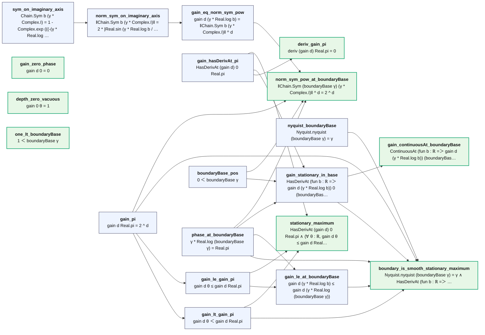

# `lean/NyquistPeak.lean`

NyquistPeak — the difference filter's gain at frequency `γ` is stationary, and maximal, exactly at the Nyquist boundary `b* = exp(π/γ)`.

20 theorems, 2 definitions, 382 lines. Arrows are Lean's own record of what each proof uses.

**Imports:** [`Chain`](../lean/Chain.md), [`Nyquist`](../lean/Nyquist.md)  
**Imported by:** nothing

## The picture



An arrow A → B reads "A is used in the proof of B". Blue: theorem. Green: a theorem nothing else uses (an end). Dashed: connects to nothing. Red: contains `sorry`. Yellow: theorems in another file, counted; a dotted arrow crosses files. Definitions are not drawn; they are listed below the diagram.

## Definitions

<a name="NyquistPeak-gain"></a>
### `NyquistPeak.gain`

def · line 68

The gain of the depth-`d` difference filter, as a function of phase. `θ = γ · log b` is the phase one rung of a `b`-ladder advances a mode of frequency `γ`. The definition is written in the prereg's own form; that it is `Chain.Sym`'s modulus is proved, not assumed — see `gain_eq_norm_sym_pow`.

- **Is:** `` gain (d : ℕ) (θ : ℝ) : ℝ := (2 * |Real.sin (θ / 2)|) ^ d ``
- **Used by 14:** [`NyquistPeak.boundary_is_smooth_stationary_maximum`](#NyquistPeak-boundary_is_smooth_stationary_maximum), [`NyquistPeak.depth_zero_vacuous`](#NyquistPeak-depth_zero_vacuous), [`NyquistPeak.deriv_gain_pi`](#NyquistPeak-deriv_gain_pi), [`NyquistPeak.gain_continuousAt_boundaryBase`](#NyquistPeak-gain_continuousAt_boundaryBase), [`NyquistPeak.gain_eq_norm_sym_pow`](#NyquistPeak-gain_eq_norm_sym_pow), [`NyquistPeak.gain_hasDerivAt_pi`](#NyquistPeak-gain_hasDerivAt_pi), [`NyquistPeak.gain_le_at_boundaryBase`](#NyquistPeak-gain_le_at_boundaryBase), [`NyquistPeak.gain_le_gain_pi`](#NyquistPeak-gain_le_gain_pi), [`NyquistPeak.gain_lt_gain_pi`](#NyquistPeak-gain_lt_gain_pi), [`NyquistPeak.gain_pi`](#NyquistPeak-gain_pi), [`NyquistPeak.gain_stationary_in_base`](#NyquistPeak-gain_stationary_in_base), [`NyquistPeak.gain_zero_phase`](#NyquistPeak-gain_zero_phase), [`NyquistPeak.norm_sym_pow_at_boundaryBase`](#NyquistPeak-norm_sym_pow_at_boundaryBase), [`NyquistPeak.stationary_maximum`](#NyquistPeak-stationary_maximum)

<a name="NyquistPeak-boundaryBase"></a>
### `NyquistPeak.boundaryBase`

def · line 202

The Nyquist boundary base at frequency `γ`. `Nyquist.nyquist` maps it back to `γ`; see `nyquist_boundaryBase`.

- **Is:** `` boundaryBase (γ : ℝ) : ℝ := Real.exp (Real.pi / γ) ``
- **Used by 9:** [`NyquistPeak.boundaryBase_pos`](#NyquistPeak-boundaryBase_pos), [`NyquistPeak.boundary_is_smooth_stationary_maximum`](#NyquistPeak-boundary_is_smooth_stationary_maximum), [`NyquistPeak.gain_continuousAt_boundaryBase`](#NyquistPeak-gain_continuousAt_boundaryBase), [`NyquistPeak.gain_le_at_boundaryBase`](#NyquistPeak-gain_le_at_boundaryBase), [`NyquistPeak.gain_stationary_in_base`](#NyquistPeak-gain_stationary_in_base), [`NyquistPeak.norm_sym_pow_at_boundaryBase`](#NyquistPeak-norm_sym_pow_at_boundaryBase), [`NyquistPeak.nyquist_boundaryBase`](#NyquistPeak-nyquist_boundaryBase), [`NyquistPeak.one_lt_boundaryBase`](#NyquistPeak-one_lt_boundaryBase), [`NyquistPeak.phase_at_boundaryBase`](#NyquistPeak-phase_at_boundaryBase)

## Theorems

<a name="NyquistPeak-sym_on_imaginary_axis"></a>
### `NyquistPeak.sym_on_imaginary_axis`

line 76

**Why.** The symbol on the imaginary axis is `1 − e^(−iθ)` with `θ = γ log b`.

**Proves**

```lean
Chain.Sym b (γ * Complex.I) = 1 - Complex.exp (((-(γ * Real.log b) : ℝ) : ℂ) * Complex.I)
```

**Needs** (its hypotheses)

  - `` hb : 0 < b ``
  - `` γ : ℝ ``

**Stated with:** [`Chain.Sym`](../lean/Chain.md#Chain-Sym)

**Fed by:** no theorem of this repo; it stands on Mathlib and the definitions below.

**Feeds** (1 that use it)

  - [`NyquistPeak.norm_sym_on_imaginary_axis`](#NyquistPeak-norm_sym_on_imaginary_axis) — `` ‖Chain.Sym b (γ * Complex.I)‖ = 2 * |Real.sin (γ * Real.log b / 2)| ``

<a name="NyquistPeak-norm_sym_on_imaginary_axis"></a>
### `NyquistPeak.norm_sym_on_imaginary_axis`

line 91

**Why.** The prereg's formula, derived. `‖Chain.Sym b (γ i)‖ = 2 |sin(θ/2)|` with `θ = γ log b`. `preregs/dense_boundary_scan_v1_20260827.md` line 44 writes it `|1 − e^{iθ}|`; this is that modulus, computed from the tree's own symbol rather than restated as a definition.

**Proves**

```lean
‖Chain.Sym b (γ * Complex.I)‖ = 2 * |Real.sin (γ * Real.log b / 2)|
```

**Needs** (its hypotheses)

  - `` hb : 0 < b ``
  - `` γ : ℝ ``

**Stated with:** [`Chain.Sym`](../lean/Chain.md#Chain-Sym)

**Fed by** (1 theorem its proof uses)

  - [`NyquistPeak.sym_on_imaginary_axis`](#NyquistPeak-sym_on_imaginary_axis) — `` Chain.Sym b (γ * Complex.I) = 1 - Complex.exp (((-(γ * Real.log b) : ℝ) : ℂ) * Complex.I) ``

**Feeds** (1 that use it)

  - [`NyquistPeak.gain_eq_norm_sym_pow`](#NyquistPeak-gain_eq_norm_sym_pow) — `` gain d (γ * Real.log b) = ‖Chain.Sym b (γ * Complex.I)‖ ^ d ``

<a name="NyquistPeak-gain_eq_norm_sym_pow"></a>
### `NyquistPeak.gain_eq_norm_sym_pow`

line 114

**Why.** The depth-`d` gain is the symbol's modulus to the `d`. This is the link that makes everything below a statement about the object the tree already has.

**Proves**

```lean
gain d (γ * Real.log b) = ‖Chain.Sym b (γ * Complex.I)‖ ^ d
```

**Needs** (its hypotheses)

  - `` hb : 0 < b ``
  - `` γ : ℝ ``
  - `` d : ℕ ``

**Stated with:** [`Chain.Sym`](../lean/Chain.md#Chain-Sym), [`NyquistPeak.gain`](#NyquistPeak-gain)

**Fed by** (1 theorem its proof uses)

  - [`NyquistPeak.norm_sym_on_imaginary_axis`](#NyquistPeak-norm_sym_on_imaginary_axis) — `` ‖Chain.Sym b (γ * Complex.I)‖ = 2 * |Real.sin (γ * Real.log b / 2)| ``

**Feeds** (1 that use it)

  - [`NyquistPeak.norm_sym_pow_at_boundaryBase`](#NyquistPeak-norm_sym_pow_at_boundaryBase) — `` ‖Chain.Sym (boundaryBase γ) (γ * Complex.I)‖ ^ d = 2 ^ d ``

<a name="NyquistPeak-gain_pi"></a>
### `NyquistPeak.gain_pi`

line 121

**Why.** The gain at phase `π` is `2^d` — the ceiling of the band.

**Proves**

```lean
gain d Real.pi = 2 ^ d
```

**Needs** (its hypotheses)

  - `` d : ℕ ``

**Stated with:** [`NyquistPeak.gain`](#NyquistPeak-gain)

**Fed by:** no theorem of this repo; it stands on Mathlib and the definitions below.

**Feeds** (4 that use it)

  - [`NyquistPeak.boundary_is_smooth_stationary_maximum`](#NyquistPeak-boundary_is_smooth_stationary_maximum) — `` Nyquist.nyquist (boundaryBase γ) = γ ∧ HasDerivAt (fun b : ℝ => gain d (γ * Real.log b)) 0 (boundaryBase γ) ∧ (∀ b : ℝ, gain d (γ * Real.log b) ≤ gain… ``
  - [`NyquistPeak.gain_le_gain_pi`](#NyquistPeak-gain_le_gain_pi) — `` gain d θ ≤ gain d Real.pi ``
  - [`NyquistPeak.gain_lt_gain_pi`](#NyquistPeak-gain_lt_gain_pi) — `` gain d θ < gain d Real.pi ``
  - [`NyquistPeak.norm_sym_pow_at_boundaryBase`](#NyquistPeak-norm_sym_pow_at_boundaryBase) — `` ‖Chain.Sym (boundaryBase γ) (γ * Complex.I)‖ ^ d = 2 ^ d ``

<a name="NyquistPeak-gain_zero_phase"></a>
### `NyquistPeak.gain_zero_phase`

line 128

**Why.** The gain at phase `0` is `0` at every positive depth: the smooth term, having `γ = 0`, is annihilated outright. `Chain.C2_floor_attained` is the critical-line counterpart. This is also the witness that `π` is a strict maximum rather than a plateau.

**Proves**

```lean
gain d 0 = 0
```

**Needs** (its hypotheses)

  - `` hd : d ≠ 0 ``

**Stated with:** [`NyquistPeak.gain`](#NyquistPeak-gain)

**Fed by:** no theorem of this repo; it stands on Mathlib and the definitions below.

**Feeds:** nothing. It is an end.

<a name="NyquistPeak-gain_hasDerivAt_pi"></a>
### `NyquistPeak.gain_hasDerivAt_pi`

line 135

**Why.** HALF ONE — the derivative vanishes at `θ = π`. `2|sin(θ/2)|` is smooth on a neighbourhood of `π` (the absolute value is inert there, since `sin` is non-negative on `(0, π)`), and its derivative carries a factor `cos(π/2) = 0`.

**Proves**

```lean
HasDerivAt (gain d) 0 Real.pi
```

**Needs** (its hypotheses)

  - `` d : ℕ ``

**Stated with:** [`NyquistPeak.gain`](#NyquistPeak-gain)

**Fed by:** no theorem of this repo; it stands on Mathlib and the definitions below.

**Feeds** (3 that use it)

  - [`NyquistPeak.deriv_gain_pi`](#NyquistPeak-deriv_gain_pi) — `` deriv (gain d) Real.pi = 0 ``
  - [`NyquistPeak.gain_stationary_in_base`](#NyquistPeak-gain_stationary_in_base) — `` HasDerivAt (fun b : ℝ => gain d (γ * Real.log b)) 0 (boundaryBase γ) ``
  - [`NyquistPeak.stationary_maximum`](#NyquistPeak-stationary_maximum) — `` HasDerivAt (gain d) 0 Real.pi ∧ (∀ θ : ℝ, gain d θ ≤ gain d Real.pi) ∧ (∀ θ : ℝ, |Real.sin (θ / 2)| ≠ 1 → gain d θ < gain d Real.pi) ``

<a name="NyquistPeak-deriv_gain_pi"></a>
### `NyquistPeak.deriv_gain_pi`

line 155

**Why.** The same, in `deriv` form.

**Proves**

```lean
deriv (gain d) Real.pi = 0
```

**Needs** (its hypotheses)

  - `` d : ℕ ``

**Stated with:** [`NyquistPeak.gain`](#NyquistPeak-gain)

**Fed by** (1 theorem its proof uses)

  - [`NyquistPeak.gain_hasDerivAt_pi`](#NyquistPeak-gain_hasDerivAt_pi) — `` HasDerivAt (gain d) 0 Real.pi ``

**Feeds:** nothing. It is an end.

<a name="NyquistPeak-gain_le_gain_pi"></a>
### `NyquistPeak.gain_le_gain_pi`

line 160

**Why.** HALF TWO — `π` is a maximum. Global, not merely local: no phase anywhere reaches a larger gain.

**Proves**

```lean
gain d θ ≤ gain d Real.pi
```

**Needs** (its hypotheses)

  - `` d : ℕ ``
  - `` θ : ℝ ``

**Stated with:** [`NyquistPeak.gain`](#NyquistPeak-gain)

**Fed by** (1 theorem its proof uses)

  - [`NyquistPeak.gain_pi`](#NyquistPeak-gain_pi) — `` gain d Real.pi = 2 ^ d ``

**Feeds** (2 that use it)

  - [`NyquistPeak.gain_le_at_boundaryBase`](#NyquistPeak-gain_le_at_boundaryBase) — `` gain d (γ * Real.log b) ≤ gain d (γ * Real.log (boundaryBase γ)) ``
  - [`NyquistPeak.stationary_maximum`](#NyquistPeak-stationary_maximum) — `` HasDerivAt (gain d) 0 Real.pi ∧ (∀ θ : ℝ, gain d θ ≤ gain d Real.pi) ∧ (∀ θ : ℝ, |Real.sin (θ / 2)| ≠ 1 → gain d θ < gain d Real.pi) ``

<a name="NyquistPeak-gain_lt_gain_pi"></a>
### `NyquistPeak.gain_lt_gain_pi`

line 170

**Why.** The maximum is STRICT. At every phase off the peak the gain is strictly smaller, so the stationary point of `gain_hasDerivAt_pi` cannot be a minimum or an inflection. `d ≠ 0` is load-bearing and not a vacuity guard: at `d = 0` the statement is false, since `gain 0` is constant.

**Proves**

```lean
gain d θ < gain d Real.pi
```

**Needs** (its hypotheses)

  - `` hd : d ≠ 0 ``
  - `` hθ : |Real.sin (θ / 2)| ≠ 1 ``

**Stated with:** [`NyquistPeak.gain`](#NyquistPeak-gain)

**Fed by** (1 theorem its proof uses)

  - [`NyquistPeak.gain_pi`](#NyquistPeak-gain_pi) — `` gain d Real.pi = 2 ^ d ``

**Feeds** (2 that use it)

  - [`NyquistPeak.boundary_is_smooth_stationary_maximum`](#NyquistPeak-boundary_is_smooth_stationary_maximum) — `` Nyquist.nyquist (boundaryBase γ) = γ ∧ HasDerivAt (fun b : ℝ => gain d (γ * Real.log b)) 0 (boundaryBase γ) ∧ (∀ b : ℝ, gain d (γ * Real.log b) ≤ gain… ``
  - [`NyquistPeak.stationary_maximum`](#NyquistPeak-stationary_maximum) — `` HasDerivAt (gain d) 0 Real.pi ∧ (∀ θ : ℝ, gain d θ ≤ gain d Real.pi) ∧ (∀ θ : ℝ, |Real.sin (θ / 2)| ≠ 1 → gain d θ < gain d Real.pi) ``

<a name="NyquistPeak-depth_zero_vacuous"></a>
### `NyquistPeak.depth_zero_vacuous`

line 182

**Why.** The degeneracy the depth hypothesis closes. At `d = 0` the gain is the constant `1`, so `gain_hasDerivAt_pi` — which is true at every depth — says nothing there: every phase is stationary and every phase is a maximum. `#guard_msgs` cannot catch that; a vacuous theorem has an ordinary axiom list. Same shape as `Chain.period_vacuous_at_one`.

**Proves**

```lean
gain 0 θ = 1
```

**Needs** (its hypotheses)

  - `` θ : ℝ ``

**Stated with:** [`NyquistPeak.gain`](#NyquistPeak-gain)

**Fed by:** no theorem of this repo; it stands on Mathlib and the definitions below.

**Feeds:** nothing. It is an end.

<a name="NyquistPeak-stationary_maximum"></a>
### `NyquistPeak.stationary_maximum`

line 186

**Why.** § 5.1 in phase coordinates, as one object. Stationary at `π`, and a strict global maximum there.

**Proves**

```lean
HasDerivAt (gain d) 0 Real.pi ∧ (∀ θ : ℝ, gain d θ ≤ gain d Real.pi) ∧ (∀ θ : ℝ, |Real.sin (θ / 2)| ≠ 1 → gain d θ < gain d Real.pi)
```

**Needs** (its hypotheses)

  - `` hd : d ≠ 0 ``

**Stated with:** [`NyquistPeak.gain`](#NyquistPeak-gain)

**Fed by** (3 theorems its proof uses)

  - [`NyquistPeak.gain_hasDerivAt_pi`](#NyquistPeak-gain_hasDerivAt_pi) — `` HasDerivAt (gain d) 0 Real.pi ``
  - [`NyquistPeak.gain_le_gain_pi`](#NyquistPeak-gain_le_gain_pi) — `` gain d θ ≤ gain d Real.pi ``
  - [`NyquistPeak.gain_lt_gain_pi`](#NyquistPeak-gain_lt_gain_pi) — `` gain d θ < gain d Real.pi ``

**Feeds:** nothing. It is an end.

<a name="NyquistPeak-boundaryBase_pos"></a>
### `NyquistPeak.boundaryBase_pos`

line 205

**Why.** The boundary base is positive.

**Proves**

```lean
0 < boundaryBase γ
```

**Needs** (its hypotheses)

  - `` γ : ℝ ``

**Stated with:** [`NyquistPeak.boundaryBase`](#NyquistPeak-boundaryBase)

**Fed by:** no theorem of this repo; it stands on Mathlib and the definitions below.

**Feeds** (2 that use it)

  - [`NyquistPeak.gain_stationary_in_base`](#NyquistPeak-gain_stationary_in_base) — `` HasDerivAt (fun b : ℝ => gain d (γ * Real.log b)) 0 (boundaryBase γ) ``
  - [`NyquistPeak.norm_sym_pow_at_boundaryBase`](#NyquistPeak-norm_sym_pow_at_boundaryBase) — `` ‖Chain.Sym (boundaryBase γ) (γ * Complex.I)‖ ^ d = 2 ^ d ``

<a name="NyquistPeak-one_lt_boundaryBase"></a>
### `NyquistPeak.one_lt_boundaryBase`

line 209

**Why.** At a positive frequency the boundary base exceeds `1`, so it lies in the range `Nyquist.base_bound_of_resolvable` speaks about.

**Proves**

```lean
1 < boundaryBase γ
```

**Needs** (its hypotheses)

  - `` hγ : 0 < γ ``

**Stated with:** [`NyquistPeak.boundaryBase`](#NyquistPeak-boundaryBase)

**Fed by:** no theorem of this repo; it stands on Mathlib and the definitions below.

**Feeds:** nothing. It is an end.

<a name="NyquistPeak-phase_at_boundaryBase"></a>
### `NyquistPeak.phase_at_boundaryBase`

line 218

**Why.** The boundary base puts the phase exactly at `π`. `γ ≠ 0` is load-bearing and its failure makes the statement false, not vacuous: at `γ = 0` Lean's `π/0` is `0`, so `boundaryBase 0 = 1` and the phase is `0`, where `gain_zero_phase` says the gain vanishes.

**Proves**

```lean
γ * Real.log (boundaryBase γ) = Real.pi
```

**Needs** (its hypotheses)

  - `` hγ : γ ≠ 0 ``

**Stated with:** [`NyquistPeak.boundaryBase`](#NyquistPeak-boundaryBase)

**Fed by:** no theorem of this repo; it stands on Mathlib and the definitions below.

**Feeds** (4 that use it)

  - [`NyquistPeak.boundary_is_smooth_stationary_maximum`](#NyquistPeak-boundary_is_smooth_stationary_maximum) — `` Nyquist.nyquist (boundaryBase γ) = γ ∧ HasDerivAt (fun b : ℝ => gain d (γ * Real.log b)) 0 (boundaryBase γ) ∧ (∀ b : ℝ, gain d (γ * Real.log b) ≤ gain… ``
  - [`NyquistPeak.gain_le_at_boundaryBase`](#NyquistPeak-gain_le_at_boundaryBase) — `` gain d (γ * Real.log b) ≤ gain d (γ * Real.log (boundaryBase γ)) ``
  - [`NyquistPeak.gain_stationary_in_base`](#NyquistPeak-gain_stationary_in_base) — `` HasDerivAt (fun b : ℝ => gain d (γ * Real.log b)) 0 (boundaryBase γ) ``
  - [`NyquistPeak.norm_sym_pow_at_boundaryBase`](#NyquistPeak-norm_sym_pow_at_boundaryBase) — `` ‖Chain.Sym (boundaryBase γ) (γ * Complex.I)‖ ^ d = 2 ^ d ``

<a name="NyquistPeak-nyquist_boundaryBase"></a>
### `NyquistPeak.nyquist_boundaryBase`

line 225

**Why.** `b*` is exactly the base whose Nyquist frequency is `γ`. This is the weld to `lean/Nyquist.lean`: `Nyquist.base_bound_of_resolvable` caps a base that resolves `γ` at `exp(π/γ)`, and that cap is this base.

**Proves**

```lean
Nyquist.nyquist (boundaryBase γ) = γ
```

**Needs** (its hypotheses)

  - `` hγ : 0 < γ ``

**Stated with:** [`Nyquist.nyquist`](../lean/Nyquist.md#Nyquist-nyquist), [`NyquistPeak.boundaryBase`](#NyquistPeak-boundaryBase)

**Fed by:** no theorem of this repo; it stands on Mathlib and the definitions below.

**Feeds** (1 that use it)

  - [`NyquistPeak.boundary_is_smooth_stationary_maximum`](#NyquistPeak-boundary_is_smooth_stationary_maximum) — `` Nyquist.nyquist (boundaryBase γ) = γ ∧ HasDerivAt (fun b : ℝ => gain d (γ * Real.log b)) 0 (boundaryBase γ) ∧ (∀ b : ℝ, gain d (γ * Real.log b) ≤ gain… ``

<a name="NyquistPeak-norm_sym_pow_at_boundaryBase"></a>
### `NyquistPeak.norm_sym_pow_at_boundaryBase`

line 233

**Why.** The gain at `b*` is the ceiling `2^d`, and it is the symbol's own modulus that reaches it.

**Proves**

```lean
‖Chain.Sym (boundaryBase γ) (γ * Complex.I)‖ ^ d = 2 ^ d
```

**Needs** (its hypotheses)

  - `` d : ℕ ``
  - `` hγ : γ ≠ 0 ``

**Stated with:** [`Chain.Sym`](../lean/Chain.md#Chain-Sym), [`NyquistPeak.boundaryBase`](#NyquistPeak-boundaryBase)

**Fed by** (4 theorems its proof uses)

  - [`NyquistPeak.boundaryBase_pos`](#NyquistPeak-boundaryBase_pos) — `` 0 < boundaryBase γ ``
  - [`NyquistPeak.gain_eq_norm_sym_pow`](#NyquistPeak-gain_eq_norm_sym_pow) — `` gain d (γ * Real.log b) = ‖Chain.Sym b (γ * Complex.I)‖ ^ d ``
  - [`NyquistPeak.gain_pi`](#NyquistPeak-gain_pi) — `` gain d Real.pi = 2 ^ d ``
  - [`NyquistPeak.phase_at_boundaryBase`](#NyquistPeak-phase_at_boundaryBase) — `` γ * Real.log (boundaryBase γ) = Real.pi ``

**Definitions its proof touches:** [`NyquistPeak.gain`](#NyquistPeak-gain)

**Feeds:** nothing. It is an end.

<a name="NyquistPeak-gain_stationary_in_base"></a>
### `NyquistPeak.gain_stationary_in_base`

line 241

**Why.** HALF ONE, in the scanned coordinate. Sweeping the base through `b*` at fixed frequency `γ`, the `γ` gain has slope exactly zero. This is the statement the dense boundary scan's `no_step` was predicted from: the ingredient does not step at `b*` because it does not even tilt there.

**Proves**

```lean
HasDerivAt (fun b : ℝ => gain d (γ * Real.log b)) 0 (boundaryBase γ)
```

**Needs** (its hypotheses)

  - `` d : ℕ ``
  - `` hγ : γ ≠ 0 ``

**Stated with:** [`NyquistPeak.boundaryBase`](#NyquistPeak-boundaryBase), [`NyquistPeak.gain`](#NyquistPeak-gain)

**Fed by** (3 theorems its proof uses)

  - [`NyquistPeak.boundaryBase_pos`](#NyquistPeak-boundaryBase_pos) — `` 0 < boundaryBase γ ``
  - [`NyquistPeak.gain_hasDerivAt_pi`](#NyquistPeak-gain_hasDerivAt_pi) — `` HasDerivAt (gain d) 0 Real.pi ``
  - [`NyquistPeak.phase_at_boundaryBase`](#NyquistPeak-phase_at_boundaryBase) — `` γ * Real.log (boundaryBase γ) = Real.pi ``

**Feeds** (2 that use it)

  - [`NyquistPeak.boundary_is_smooth_stationary_maximum`](#NyquistPeak-boundary_is_smooth_stationary_maximum) — `` Nyquist.nyquist (boundaryBase γ) = γ ∧ HasDerivAt (fun b : ℝ => gain d (γ * Real.log b)) 0 (boundaryBase γ) ∧ (∀ b : ℝ, gain d (γ * Real.log b) ≤ gain… ``
  - [`NyquistPeak.gain_continuousAt_boundaryBase`](#NyquistPeak-gain_continuousAt_boundaryBase) — `` ContinuousAt (fun b : ℝ => gain d (γ * Real.log b)) (boundaryBase γ) ``

<a name="NyquistPeak-gain_continuousAt_boundaryBase"></a>
### `NyquistPeak.gain_continuousAt_boundaryBase`

line 252

**Why.** Not a discontinuity. Differentiability at `b*` gives continuity there, which is the negative half of the prereg's claim.

**Proves**

```lean
ContinuousAt (fun b : ℝ => gain d (γ * Real.log b)) (boundaryBase γ)
```

**Needs** (its hypotheses)

  - `` d : ℕ ``
  - `` hγ : γ ≠ 0 ``

**Stated with:** [`NyquistPeak.boundaryBase`](#NyquistPeak-boundaryBase), [`NyquistPeak.gain`](#NyquistPeak-gain)

**Fed by** (1 theorem its proof uses)

  - [`NyquistPeak.gain_stationary_in_base`](#NyquistPeak-gain_stationary_in_base) — `` HasDerivAt (fun b : ℝ => gain d (γ * Real.log b)) 0 (boundaryBase γ) ``

**Feeds:** nothing. It is an end.

<a name="NyquistPeak-gain_le_at_boundaryBase"></a>
### `NyquistPeak.gain_le_at_boundaryBase`

line 258

**Why.** HALF TWO, in the scanned coordinate. No base anywhere gives a larger `γ` gain than `b*` does.

**Proves**

```lean
gain d (γ * Real.log b) ≤ gain d (γ * Real.log (boundaryBase γ))
```

**Needs** (its hypotheses)

  - `` d : ℕ ``
  - `` hγ : γ ≠ 0 ``
  - `` b : ℝ ``

**Stated with:** [`NyquistPeak.boundaryBase`](#NyquistPeak-boundaryBase), [`NyquistPeak.gain`](#NyquistPeak-gain)

**Fed by** (2 theorems its proof uses)

  - [`NyquistPeak.gain_le_gain_pi`](#NyquistPeak-gain_le_gain_pi) — `` gain d θ ≤ gain d Real.pi ``
  - [`NyquistPeak.phase_at_boundaryBase`](#NyquistPeak-phase_at_boundaryBase) — `` γ * Real.log (boundaryBase γ) = Real.pi ``

**Feeds** (1 that use it)

  - [`NyquistPeak.boundary_is_smooth_stationary_maximum`](#NyquistPeak-boundary_is_smooth_stationary_maximum) — `` Nyquist.nyquist (boundaryBase γ) = γ ∧ HasDerivAt (fun b : ℝ => gain d (γ * Real.log b)) 0 (boundaryBase γ) ∧ (∀ b : ℝ, gain d (γ * Real.log b) ≤ gain… ``

<a name="NyquistPeak-boundary_is_smooth_stationary_maximum"></a>
### `NyquistPeak.boundary_is_smooth_stationary_maximum`

line 274

**Why.** § 5.1, as the prereg states it. For a positive frequency `γ` and a positive depth `d`: `b* = exp(π/γ)` is the base whose Nyquist frequency is `γ`; the `γ` gain is differentiable there with derivative zero; and it is a global maximum over all bases. So `b*` is a smooth stationary maximum of the `γ` response, and nothing in the gain steps across it.

**Proves**

```lean
Nyquist.nyquist (boundaryBase γ) = γ ∧ HasDerivAt (fun b : ℝ => gain d (γ * Real.log b)) 0 (boundaryBase γ) ∧ (∀ b : ℝ, gain d (γ * Real.log b) ≤ gain d (γ * Real.log (boundaryBase γ))) ∧ (∀ b : ℝ, |Real.sin (γ * Real.log b / 2)| ≠ 1 → gain d (γ * Real.log b) < gain d (γ * Real.log (boundaryBase γ))) ∧ gain d (γ * Real.log (boundaryBase γ)) = 2 ^ d
```

**Needs** (its hypotheses)

  - `` hγ : 0 < γ ``
  - `` hd : d ≠ 0 ``

**Stated with:** [`Nyquist.nyquist`](../lean/Nyquist.md#Nyquist-nyquist), [`NyquistPeak.boundaryBase`](#NyquistPeak-boundaryBase), [`NyquistPeak.gain`](#NyquistPeak-gain)

**Fed by** (6 theorems its proof uses)

  - [`NyquistPeak.gain_le_at_boundaryBase`](#NyquistPeak-gain_le_at_boundaryBase) — `` gain d (γ * Real.log b) ≤ gain d (γ * Real.log (boundaryBase γ)) ``
  - [`NyquistPeak.gain_lt_gain_pi`](#NyquistPeak-gain_lt_gain_pi) — `` gain d θ < gain d Real.pi ``
  - [`NyquistPeak.gain_pi`](#NyquistPeak-gain_pi) — `` gain d Real.pi = 2 ^ d ``
  - [`NyquistPeak.gain_stationary_in_base`](#NyquistPeak-gain_stationary_in_base) — `` HasDerivAt (fun b : ℝ => gain d (γ * Real.log b)) 0 (boundaryBase γ) ``
  - [`NyquistPeak.nyquist_boundaryBase`](#NyquistPeak-nyquist_boundaryBase) — `` Nyquist.nyquist (boundaryBase γ) = γ ``
  - [`NyquistPeak.phase_at_boundaryBase`](#NyquistPeak-phase_at_boundaryBase) — `` γ * Real.log (boundaryBase γ) = Real.pi ``

**Feeds:** nothing. It is an end.

