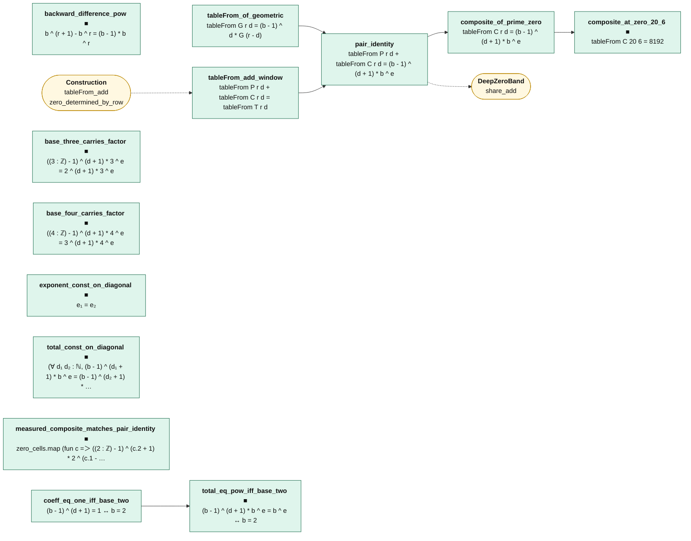

# `lean/PairIdentity.lean`

PairIdentity — the complementary pair, and why base two is singular. Encodes statement **I1** of `papers/Euler-Factor-Chain.md` § I ("The complementary pair"):

13 theorems, 2 definitions, 405 lines. Arrows are Lean's own record of what each proof uses.

**Imports:** [`Construction`](../lean/Construction.md)  
**Imported by:** [`DeepZeroBand`](../lean/DeepZeroBand.md), [`ZeroCells`](../lean/ZeroCells.md)

## The picture



An arrow A → B reads "A is used in the proof of B". Green: counting, integers only. Violet: shape, analysis with no ζ. Blue: reads ζ. A name ending in ■ is an end: nothing else uses it. Red: contains `sorry`. Yellow: theorems in another file, counted; a dotted arrow crosses files. Definitions are not drawn; they are listed below the diagram.

## Definitions

<a name="PairIdentity-zero_cells"></a>
### `PairIdentity.zero_cells`

def · line 304

The four exact zeros of the dyadic prime table, `(r, d)`, `r ≤ 62`, `d ≤ 61`. `results/O16_run2.log`; same list as `Zeros.measured_zeros` and `Construction.measured_zeros`.

- **Is:** `` zero_cells : List (ℕ × ℕ) := [(2, 1), (4, 1), (8, 3), (20, 6)] ``
- **Used by 4:** [`PairIdentity.measured_composite_matches_pair_identity`](#PairIdentity-measured_composite_matches_pair_identity), [`ZeroCells.all_four_have_length_four`](../lean/ZeroCells.md#ZeroCells-all_four_have_length_four), [`ZeroCells.pairIdentity_all_vanish`](../lean/ZeroCells.md#ZeroCells-pairIdentity_all_vanish), [`ZeroCells.pairIdentity_eq`](../lean/ZeroCells.md#ZeroCells-pairIdentity_eq)

<a name="PairIdentity-measured_composite_at_zeros"></a>
### `PairIdentity.measured_composite_at_zeros`

def · line 309

The composite arm at those four cells, read from `papers/The-Four-Zeros.md` § E2: "At the four zeros the composite arm therefore carries the whole term: `1, 4, 16, 8192`."

- **Is:** `` measured_composite_at_zeros : List ℤ := [1, 4, 16, 8192] ``
- **Used by 1:** [`PairIdentity.measured_composite_matches_pair_identity`](#PairIdentity-measured_composite_matches_pair_identity)

## Theorems

<a name="PairIdentity-backward_difference_pow"></a>
### `PairIdentity.backward_difference_pow`

line 70

**Counting.** Integers only: nothing in its statement or proof, or in anything it rests on, uses analysis or ζ.

**Why.** The same step inside ℤ, where the table lives: `(1 − b⁻¹)·b^(r) = (b−1)·b^(r−1)`. One backward difference of a geometric row multiplies it by `b − 1` and drops the exponent by one.

**Proves**

```lean
b ^ (r + 1) - b ^ r = (b - 1) * b ^ r
```

**Needs** (its hypotheses)

  - `` b : ℤ ``
  - `` r : ℕ ``

**Fed by:** no theorem of this repo; it stands on Mathlib.

**Feeds:** nothing. It connects to nothing.

<a name="PairIdentity-tableFrom_of_geometric"></a>
### `PairIdentity.tableFrom_of_geometric`

line 86

**Counting.** Integers only: nothing in its statement or proof, or in anything it rests on, uses analysis or ζ.

**Why.** The collapse. If the row steps by `b` across the window a cell reads, then `d` backward differences leave `(b−1)^d` times the bottom entry of that window. Iterating `backward_difference_pow`; the whole index difficulty is that each difference moves the window's bottom down by one.

**Proves**

```lean
tableFrom G r d = (b - 1) ^ d * G (r - d)
```

**Needs** (its hypotheses)

  - `` b : ℤ ``
  - `` G : ℤ → ℤ ``
  - `` r : ℤ ``
  - `` d : ℕ ``
  - `` hG : ∀ k : ℕ, k < d → G (r - k) = b * G (r - k - 1) ``

**Stated with:** [`Construction.tableFrom`](../lean/Construction.md#Construction-tableFrom)

**Fed by:** no theorem of this repo; it stands on Mathlib and the definitions below.

**Feeds** (1 that use it)

  - [`PairIdentity.pair_identity`](#PairIdentity-pair_identity) — `` tableFrom P r d + tableFrom C r d = (b - 1) ^ (d + 1) * b ^ e ``

<a name="PairIdentity-tableFrom_add_window"></a>
### `PairIdentity.tableFrom_add_window`

line 121

**Counting.** Integers only: nothing in its statement or proof, or in anything it rests on, uses analysis or ζ.

**Why.** Linearity, localised. If two rows partition a third across the window a cell reads, the two tables sum to the third table at that cell. `Construction.tableFrom_add` gives that the table of a sum is the sum of tables; `Construction.zero_determined_by_row` gives that agreement on the window is all a cell can see.

**Proves**

```lean
tableFrom P r d + tableFrom C r d = tableFrom T r d
```

**Needs** (its hypotheses)

  - `` P C T : ℤ → ℤ ``
  - `` r : ℤ ``
  - `` d : ℕ ``
  - `` h : ∀ k : ℕ, k ≤ d → P (r - k) + C (r - k) = T (r - k) ``

**Stated with:** [`Construction.tableFrom`](../lean/Construction.md#Construction-tableFrom)

**Fed by** (2 theorems its proof uses)

  - [`Construction.tableFrom_add`](../lean/Construction.md#Construction-tableFrom_add) (Construction) — `` tableFrom (fun x => N x + M x) r d = tableFrom N r d + tableFrom M r d ``
  - [`Construction.zero_determined_by_row`](../lean/Construction.md#Construction-zero_determined_by_row) (Construction) — `` tableFrom N r d = tableFrom M r d ``

**Feeds** (1 that use it)

  - [`PairIdentity.pair_identity`](#PairIdentity-pair_identity) — `` tableFrom P r d + tableFrom C r d = (b - 1) ^ (d + 1) * b ^ e ``

<a name="PairIdentity-pair_identity"></a>
### `PairIdentity.pair_identity`

line 140

**Counting.** Integers only: nothing in its statement or proof, or in anything it rests on, uses analysis or ζ.

**Why.** I1, the pair identity. Let `P` and `C` be any two rows that partition each rung: at rung `r − k` the two counts sum to `(b−1)·b^(r−k−1)`, the number of integers the rung holds. Then at every cell the differenced arms sum to

**Proves**

```lean
tableFrom P r d + tableFrom C r d = (b - 1) ^ (d + 1) * b ^ e
```

**Needs** (its hypotheses)

  - `` b : ℤ ``
  - `` P C : ℤ → ℤ ``
  - `` r : ℤ ``
  - `` d e : ℕ ``
  - `` hr : r = (d : ℤ) + 1 + e ``
  - `` hpair : ∀ k : ℕ, k ≤ d → P (r - k) + C (r - k) = (b - 1) * b ^ (e + (d - k)) ``

**Stated with:** [`Construction.tableFrom`](../lean/Construction.md#Construction-tableFrom)

**Fed by** (2 theorems its proof uses)

  - [`PairIdentity.tableFrom_add_window`](#PairIdentity-tableFrom_add_window) — `` tableFrom P r d + tableFrom C r d = tableFrom T r d ``
  - [`PairIdentity.tableFrom_of_geometric`](#PairIdentity-tableFrom_of_geometric) — `` tableFrom G r d = (b - 1) ^ d * G (r - d) ``

**Feeds** (2 that use it)

  - [`DeepZeroBand.share_add`](../lean/DeepZeroBand.md#DeepZeroBand-share_add) (DeepZeroBand) — `` share P r d e + share C r d e = 1 ``
  - [`PairIdentity.composite_of_prime_zero`](#PairIdentity-composite_of_prime_zero) — `` tableFrom C r d = (b - 1) ^ (d + 1) * b ^ e ``

<a name="PairIdentity-composite_of_prime_zero"></a>
### `PairIdentity.composite_of_prime_zero`

line 172

**Counting.** Integers only: nothing in its statement or proof, or in anything it rests on, uses analysis or ζ.

**Why.** I5, the pole. Where the prime arm vanishes the composite arm carries the whole total — it has nowhere else to go. This is the identity read at a zero, and it is the only sense in which a zero says anything about the composite side.

**Proves**

```lean
tableFrom C r d = (b - 1) ^ (d + 1) * b ^ e
```

**Needs** (its hypotheses)

  - `` b : ℤ ``
  - `` P C : ℤ → ℤ ``
  - `` r : ℤ ``
  - `` d e : ℕ ``
  - `` hr : r = (d : ℤ) + 1 + e ``
  - `` hpair : ∀ k : ℕ, k ≤ d → P (r - k) + C (r - k) = (b - 1) * b ^ (e + (d - k)) ``
  - `` hzero : tableFrom P r d = 0 ``

**Stated with:** [`Construction.tableFrom`](../lean/Construction.md#Construction-tableFrom)

**Fed by** (1 theorem its proof uses)

  - [`PairIdentity.pair_identity`](#PairIdentity-pair_identity) — `` tableFrom P r d + tableFrom C r d = (b - 1) ^ (d + 1) * b ^ e ``

**Feeds** (1 that use it)

  - [`PairIdentity.composite_at_zero_20_6`](#PairIdentity-composite_at_zero_20_6) — `` tableFrom C 20 6 = 8192 ``

<a name="PairIdentity-coeff_eq_one_iff_base_two"></a>
### `PairIdentity.coeff_eq_one_iff_base_two`

line 189

**Counting.** Integers only: nothing in its statement or proof, or in anything it rests on, uses analysis or ζ.

**Why.** The corollary. For integer `b ≥ 2`, the coefficient `(b−1)^(d+1)` is `1` exactly when `b = 2`. Every other base carries a factor strictly greater than one, at every depth.

**Proves**

```lean
(b - 1) ^ (d + 1) = 1 ↔ b = 2
```

**Needs** (its hypotheses)

  - `` hb : 2 ≤ b ``
  - `` d : ℕ ``

**Fed by:** no theorem of this repo; it stands on Mathlib.

**Feeds** (1 that use it)

  - [`PairIdentity.total_eq_pow_iff_base_two`](#PairIdentity-total_eq_pow_iff_base_two) — `` (b - 1) ^ (d + 1) * b ^ e = b ^ e ↔ b = 2 ``

<a name="PairIdentity-total_eq_pow_iff_base_two"></a>
### `PairIdentity.total_eq_pow_iff_base_two`

line 221

**Counting.** Integers only: nothing in its statement or proof, or in anything it rests on, uses analysis or ζ.

**Why.** The corollary, in the identity's own terms. The cell total is a bare power of the base — no `(b−1)` factor anywhere — exactly in base two. So base two is the only grid on which a vanished prime arm leaves the composite arm sitting on a power of the base itself.

**Proves**

```lean
(b - 1) ^ (d + 1) * b ^ e = b ^ e ↔ b = 2
```

**Needs** (its hypotheses)

  - `` hb : 2 ≤ b ``
  - `` d e : ℕ ``

**Fed by** (1 theorem its proof uses)

  - [`PairIdentity.coeff_eq_one_iff_base_two`](#PairIdentity-coeff_eq_one_iff_base_two) — `` (b - 1) ^ (d + 1) = 1 ↔ b = 2 ``

**Feeds:** nothing. It is an end.

<a name="PairIdentity-base_three_carries_factor"></a>
### `PairIdentity.base_three_carries_factor`

line 235

**Counting.** Integers only: nothing in its statement or proof, or in anything it rests on, uses analysis or ζ.

**Why.** Base three does carry the factor: the total at `(r,d)` is `2^(d+1)·3^(r−1−d)`, never a bare power of three.

**Proves**

```lean
((3 : ℤ) - 1) ^ (d + 1) * 3 ^ e = 2 ^ (d + 1) * 3 ^ e
```

**Needs** (its hypotheses)

  - `` d e : ℕ ``

**Fed by:** no theorem of this repo; it stands on Mathlib.

**Feeds:** nothing. It connects to nothing.

<a name="PairIdentity-base_four_carries_factor"></a>
### `PairIdentity.base_four_carries_factor`

line 239

**Counting.** Integers only: nothing in its statement or proof, or in anything it rests on, uses analysis or ζ.

**Why.** Base four likewise: `3^(d+1)·4^(r−1−d)`.

**Proves**

```lean
((4 : ℤ) - 1) ^ (d + 1) * 4 ^ e = 3 ^ (d + 1) * 4 ^ e
```

**Needs** (its hypotheses)

  - `` d e : ℕ ``

**Fed by:** no theorem of this repo; it stands on Mathlib.

**Feeds:** nothing. It connects to nothing.

<a name="PairIdentity-exponent_const_on_diagonal"></a>
### `PairIdentity.exponent_const_on_diagonal`

line 255

**Counting.** Integers only: nothing in its statement or proof, or in anything it rests on, uses analysis or ζ.

**Why.** Along a diagonal the pair identity's exponent is fixed. `hdiag` is `r − d` constant; `h₁` and `h₂` are the index convention, which pins `e = r − 1 − d`.

**Proves**

```lean
e₁ = e₂
```

**Needs** (its hypotheses)

  - `` h₁ : r₁ = (d₁ : ℤ) + 1 + e₁ ``
  - `` h₂ : r₂ = (d₂ : ℤ) + 1 + e₂ ``
  - `` hdiag : r₁ - (d₁ : ℤ) = r₂ - (d₂ : ℤ) ``

**Fed by:** no theorem of this repo; it stands on Mathlib.

**Feeds:** nothing. It connects to nothing.

<a name="PairIdentity-total_const_on_diagonal"></a>
### `PairIdentity.total_const_on_diagonal`

line 269

**Counting.** Integers only: nothing in its statement or proof, or in anything it rests on, uses analysis or ζ.

**Why.** The diagonal is the trend's own level set, and only at `b = 2`. Fix a diagonal — equivalently, fix `e` — and ask whether the cell total is the same at every depth along it. It is, exactly in base two.

**Proves**

```lean
(∀ d₁ d₂ : ℕ, (b - 1) ^ (d₁ + 1) * b ^ e = (b - 1) ^ (d₂ + 1) * b ^ e) ↔ b = 2
```

**Needs** (its hypotheses)

  - `` hb : 2 ≤ b ``
  - `` e : ℕ ``

**Fed by:** no theorem of this repo; it stands on Mathlib.

**Feeds:** nothing. It connects to nothing.

<a name="PairIdentity-measured_composite_matches_pair_identity"></a>
### `PairIdentity.measured_composite_matches_pair_identity`

line 315

**Counting.** Integers only: nothing in its statement or proof, or in anything it rests on, uses analysis or ζ.

**Why.** The falsifier. Evaluating `(b−1)^(d+1)·b^(r−1−d)` at `b = 2` and the four measured zero cells reproduces the measured composite arm exactly. The formula is derived above from the partition alone; the four values were measured. They agree.

**Proves**

```lean
zero_cells.map (fun c => ((2 : ℤ) - 1) ^ (c.2 + 1) * 2 ^ (c.1 - 1 - c.2)) = measured_composite_at_zeros
```

**Stated with:** [`PairIdentity.measured_composite_at_zeros`](#PairIdentity-measured_composite_at_zeros), [`PairIdentity.zero_cells`](#PairIdentity-zero_cells)

**Fed by:** no theorem of this repo; it stands on Mathlib and the definitions below.

**Feeds:** nothing. It is an end.

<a name="PairIdentity-composite_at_zero_20_6"></a>
### `PairIdentity.composite_at_zero_20_6`

line 323

**Counting.** Integers only: nothing in its statement or proof, or in anything it rests on, uses analysis or ζ.

**Why.** The deep zero, stated through the identity rather than through arithmetic. Given that the prime arm vanishes at `(20,6)` — which is measured, not proved — the partition forces the composite arm to be `8192`, which is what § E2 records.

**Proves**

```lean
tableFrom C 20 6 = 8192
```

**Needs** (its hypotheses)

  - `` P C : ℤ → ℤ ``
  - `` hpair : ∀ k : ℕ, k ≤ 6 → P (20 - k) + C (20 - k) = ((2 : ℤ) - 1) * 2 ^ (13 + (6 - k)) ``
  - `` hzero : tableFrom P 20 6 = 0 ``

**Stated with:** [`Construction.tableFrom`](../lean/Construction.md#Construction-tableFrom)

**Fed by** (1 theorem its proof uses)

  - [`PairIdentity.composite_of_prime_zero`](#PairIdentity-composite_of_prime_zero) — `` tableFrom C r d = (b - 1) ^ (d + 1) * b ^ e ``

**Feeds:** nothing. It is an end.

