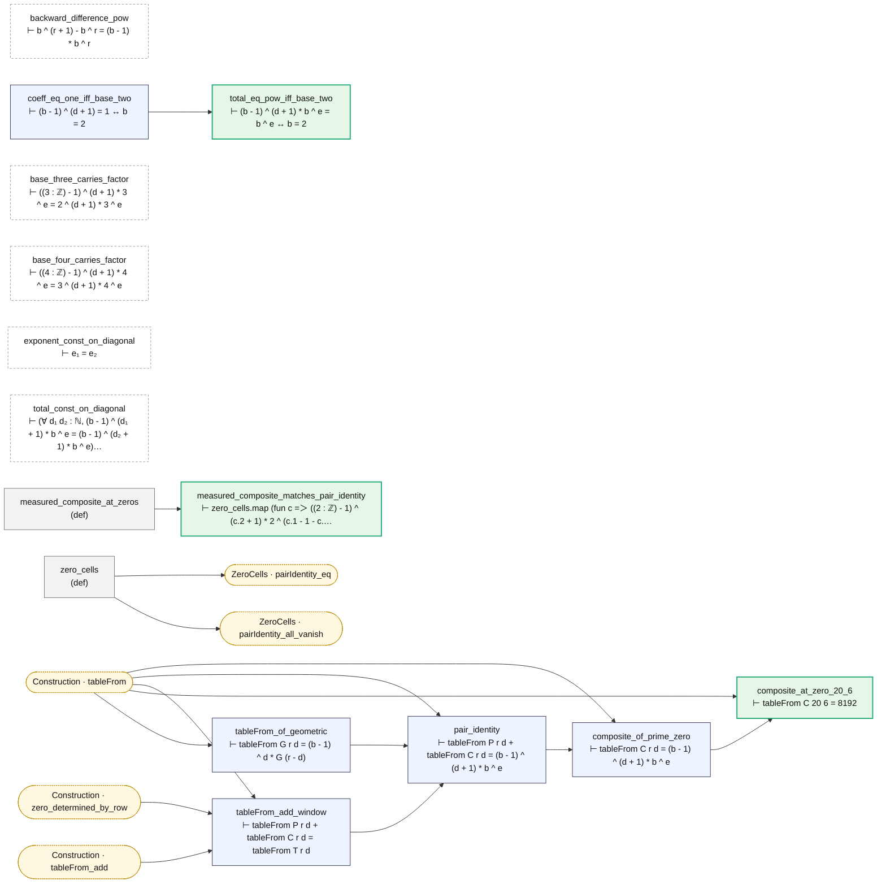

# `lean/PairIdentity.lean`

**What it does** (its own header): PairIdentity — the complementary pair, and why base two is singular. Encodes statement **I1** of `papers/Euler-Factor-Chain.md` § I ("The complementary pair"):

**Imports:** [`Construction`](../lean/Construction.md).
**Imported by:** [`ZeroCells`](../lean/ZeroCells.md).

Blue: theorem. Green: a theorem nothing else uses (an end). Dashed white: connects to nothing. Grey: definition. Red: contains `sorry`. Yellow: in another file. An arrow A → B reads "A is used by B".

## Every declaration

| declaration | proves (output) | needs (input) | why (its own docstring) | uses | used by |
|---|---|---|---|---|---|
| `PairIdentity.backward_difference_pow` theorem, line 70 | b ^ (r + 1) - b ^ r = (b - 1) * b ^ r | b : ℤ; r : ℕ | The same step inside ℤ, where the table lives: `(1 − b⁻¹)·b^(r) = (b−1)·b^(r−1)`. One backward difference of a geometric row multiplies it by `b − 1` and drops the exponent by one. | — | — |
| `PairIdentity.tableFrom_of_geometric` theorem, line 86 | tableFrom G r d = (b - 1) ^ d * G (r - d) | b : ℤ; G : ℤ → ℤ; r : ℤ; d : ℕ; hG : ∀ k : ℕ, k &lt; d → G (r - k) = b * G (r - k - 1) | The collapse. If the row steps by `b` across the window a cell reads, then `d` backward differences leave `(b−1)^d` times the bottom entry of that window. Iterating `backward_difference_pow`; the whole index difficulty is that each difference moves the window's bottom down by one. | `Construction.tableFrom` | `PairIdentity.pair_identity` |
| `PairIdentity.tableFrom_add_window` theorem, line 121 | tableFrom P r d + tableFrom C r d = tableFrom T r d | P C T : ℤ → ℤ; r : ℤ; d : ℕ; h : ∀ k : ℕ, k ≤ d → P (r - k) + C (r - k) = T (r - k) | Linearity, localised. If two rows partition a third across the window a cell reads, the two tables sum to the third table at that cell. `Construction.tableFrom_add` gives that the table of a sum is the sum of tables; `Construction.zero_determined_by_row` gives that agreement on the window is all a cell can see. | `Construction.tableFrom`, `Construction.tableFrom_add`, `Construction.zero_determined_by_row` | `PairIdentity.pair_identity` |
| `PairIdentity.pair_identity` theorem, line 140 | tableFrom P r d + tableFrom C r d = (b - 1) ^ (d + 1) * b ^ e | b : ℤ; P C : ℤ → ℤ; r : ℤ; d e : ℕ; hr : r = (d : ℤ) + 1 + e; hpair : ∀ k : ℕ, k ≤ d → P (r - k) + C (r - k) = (b - 1) * b ^ (e + (d - k)) | I1, the pair identity. Let `P` and `C` be any two rows that partition each rung: at rung `r − k` the two counts sum to `(b−1)·b^(r−k−1)`, the number of integers the rung holds. Then at every cell the differenced arms sum to | `Construction.tableFrom`, `PairIdentity.tableFrom_add_window`, `PairIdentity.tableFrom_of_geometric` | `PairIdentity.composite_of_prime_zero` |
| `PairIdentity.composite_of_prime_zero` theorem, line 172 | tableFrom C r d = (b - 1) ^ (d + 1) * b ^ e | b : ℤ; P C : ℤ → ℤ; r : ℤ; d e : ℕ; hr : r = (d : ℤ) + 1 + e; hpair : ∀ k : ℕ, k ≤ d → P (r - k) + C (r - k) = (b - 1) * b ^ (e + (d - k)); hzero : tableFrom P r d = 0 | I5, the pole. Where the prime arm vanishes the composite arm carries the whole total — it has nowhere else to go. This is the identity read at a zero, and it is the only sense in which a zero says anything about the composite side. | `Construction.tableFrom`, `PairIdentity.pair_identity` | `PairIdentity.composite_at_zero_20_6` |
| `PairIdentity.coeff_eq_one_iff_base_two` theorem, line 189 | (b - 1) ^ (d + 1) = 1 ↔ b = 2 | hb : 2 ≤ b; d : ℕ | The corollary. For integer `b ≥ 2`, the coefficient `(b−1)^(d+1)` is `1` exactly when `b = 2`. Every other base carries a factor strictly greater than one, at every depth. | — | `PairIdentity.total_eq_pow_iff_base_two` |
| `PairIdentity.total_eq_pow_iff_base_two` theorem, line 221 | (b - 1) ^ (d + 1) * b ^ e = b ^ e ↔ b = 2 | hb : 2 ≤ b; d e : ℕ | The corollary, in the identity's own terms. The cell total is a bare power of the base — no `(b−1)` factor anywhere — exactly in base two. So base two is the only grid on which a vanished prime arm leaves the composite arm sitting on a power of the base itself. | `PairIdentity.coeff_eq_one_iff_base_two` | — |
| `PairIdentity.base_three_carries_factor` theorem, line 235 | ((3 : ℤ) - 1) ^ (d + 1) * 3 ^ e = 2 ^ (d + 1) * 3 ^ e | d e : ℕ | Base three does carry the factor: the total at `(r,d)` is `2^(d+1)·3^(r−1−d)`, never a bare power of three. | — | — |
| `PairIdentity.base_four_carries_factor` theorem, line 239 | ((4 : ℤ) - 1) ^ (d + 1) * 4 ^ e = 3 ^ (d + 1) * 4 ^ e | d e : ℕ | Base four likewise: `3^(d+1)·4^(r−1−d)`. | — | — |
| `PairIdentity.exponent_const_on_diagonal` theorem, line 255 | e₁ = e₂ | h₁ : r₁ = (d₁ : ℤ) + 1 + e₁; h₂ : r₂ = (d₂ : ℤ) + 1 + e₂; hdiag : r₁ - (d₁ : ℤ) = r₂ - (d₂ : ℤ) | Along a diagonal the pair identity's exponent is fixed. `hdiag` is `r − d` constant; `h₁` and `h₂` are the index convention, which pins `e = r − 1 − d`. | — | — |
| `PairIdentity.total_const_on_diagonal` theorem, line 269 | (∀ d₁ d₂ : ℕ, (b - 1) ^ (d₁ + 1) * b ^ e = (b - 1) ^ (d₂ + 1) * b ^ e) ↔ b = 2 | hb : 2 ≤ b; e : ℕ | The diagonal is the trend's own level set, and only at `b = 2`. Fix a diagonal — equivalently, fix `e` — and ask whether the cell total is the same at every depth along it. It is, exactly in base two. | — | — |
| `PairIdentity.zero_cells` def, line 304 | List (ℕ × ℕ) | — | The four exact zeros of the dyadic prime table, `(r, d)`, `r ≤ 62`, `d ≤ 61`. `results/O16_run2.log`; same list as `Zeros.measured_zeros` and `Construction.measured_zeros`. | — | `ZeroCells.pairIdentity_all_vanish`, `ZeroCells.pairIdentity_eq` |
| `PairIdentity.measured_composite_at_zeros` def, line 309 | List ℤ | — | The composite arm at those four cells, read from `papers/The-Four-Zeros.md` § E2: "At the four zeros the composite arm therefore carries the whole term: `1, 4, 16, 8192`." | — | `PairIdentity.measured_composite_matches_pair_identity` |
| `PairIdentity.measured_composite_matches_pair_identity` theorem, line 315 | zero_cells.map (fun c =&gt; ((2 : ℤ) - 1) ^ (c.2 + 1) * 2 ^ (c.1 - 1 - c.2)) = measured_composite_at_zeros | — | The falsifier. Evaluating `(b−1)^(d+1)·b^(r−1−d)` at `b = 2` and the four measured zero cells reproduces the measured composite arm exactly. The formula is derived above from the partition alone; the four values were measured. They agree. | `PairIdentity.measured_composite_at_zeros` | — |
| `PairIdentity.composite_at_zero_20_6` theorem, line 323 | tableFrom C 20 6 = 8192 | P C : ℤ → ℤ; hpair : ∀ k : ℕ, k ≤ 6 → P (20 - k) + C (20 - k) = ((2 : ℤ) - 1) * 2 ^ (13 + (6 - k)); hzero : tableFrom P 20 6 = 0 | The deep zero, stated through the identity rather than through arithmetic. Given that the prime arm vanishes at `(20,6)` — which is measured, not proved — the partition forces the composite arm to be `8192`, which is what § E2 records. | `Construction.tableFrom`, `PairIdentity.composite_of_prime_zero` | — |
