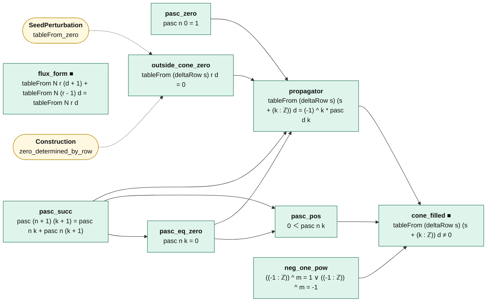

# `lean/Propagation.lean`

Propagation — the recurrence as transport: the light cone, and the propagator. `papers/Depth-as-Time.md` reads depth as time. Take that literally: with `d` as time and `r` as space, the recurrence

9 theorems, 2 definitions, 248 lines. Arrows are Lean's own record of what each proof uses.

**Imports:** [`Construction`](../lean/Construction.md), [`SeedPerturbation`](../lean/SeedPerturbation.md)  
**Imported by:** nothing

## The picture



An arrow A → B reads "A is used in the proof of B". Green: counting, integers only. Violet: shape, analysis with no ζ. Blue: reads ζ. A name ending in ■ is an end: nothing else uses it. Red: contains `sorry`. Yellow: theorems in another file, counted; a dotted arrow crosses files. Definitions are not drawn; they are listed below the diagram.

## Definitions

<a name="Propagation-pasc"></a>
### `Propagation.pasc`

def · line 57

Binomial coefficients by the Pascal recurrence, ℤ-valued. Core has no `Nat.choose`; defining it this way makes Pascal's identity definitional.

- **Is:** `` pasc : ℕ → ℕ → ℤ | _, 0 => 1 | 0, _ + 1 => 0 | n + 1, k + 1 => pasc n k + pasc n (k + 1) ``
- **Used by 6:** [`Propagation.cone_filled`](#Propagation-cone_filled), [`Propagation.pasc_eq_zero`](#Propagation-pasc_eq_zero), [`Propagation.pasc_pos`](#Propagation-pasc_pos), [`Propagation.pasc_succ`](#Propagation-pasc_succ), [`Propagation.pasc_zero`](#Propagation-pasc_zero), [`Propagation.propagator`](#Propagation-propagator)

<a name="Propagation-deltaRow"></a>
### `Propagation.deltaRow`

def · line 105

A unit disturbance at rung `s`: the delta row.

- **Is:** `` deltaRow (s : ℤ) : ℤ → ℤ := fun x => if x = s then 1 else 0 ``
- **Used by 3:** [`Propagation.cone_filled`](#Propagation-cone_filled), [`Propagation.outside_cone_zero`](#Propagation-outside_cone_zero), [`Propagation.propagator`](#Propagation-propagator)

## Theorems

<a name="Propagation-pasc_zero"></a>
### `Propagation.pasc_zero`

line 63

**Counting.** Integers only: nothing in its statement or proof, or in anything it rests on, uses analysis or ζ.

**Why.** The left edge of the triangle is all ones.

**Proves**

```lean
pasc n 0 = 1
```

**Needs** (its hypotheses)

  - `` n : ℕ ``

**Stated with:** [`Propagation.pasc`](#Propagation-pasc)

**Fed by:** no theorem of this repo; it stands on Mathlib and the definitions below.

**Feeds** (1 that use it)

  - [`Propagation.propagator`](#Propagation-propagator) — `` tableFrom (deltaRow s) (s + (k : ℤ)) d = (-1) ^ k * pasc d k ``

<a name="Propagation-pasc_succ"></a>
### `Propagation.pasc_succ`

line 66

**Counting.** Integers only: nothing in its statement or proof, or in anything it rests on, uses analysis or ζ.

**Why.** Pascal's identity — definitional, because `pasc` is defined by it.

**Proves**

```lean
pasc (n + 1) (k + 1) = pasc n k + pasc n (k + 1)
```

**Needs** (its hypotheses)

  - `` n k : ℕ ``

**Stated with:** [`Propagation.pasc`](#Propagation-pasc)

**Fed by:** no theorem of this repo; it stands on Mathlib and the definitions below.

**Feeds** (3 that use it)

  - [`Propagation.pasc_eq_zero`](#Propagation-pasc_eq_zero) — `` pasc n k = 0 ``
  - [`Propagation.pasc_pos`](#Propagation-pasc_pos) — `` 0 < pasc n k ``
  - [`Propagation.propagator`](#Propagation-propagator) — `` tableFrom (deltaRow s) (s + (k : ℤ)) d = (-1) ^ k * pasc d k ``

<a name="Propagation-pasc_eq_zero"></a>
### `Propagation.pasc_eq_zero`

line 69

**Counting.** Integers only: nothing in its statement or proof, or in anything it rests on, uses analysis or ζ.

**Why.** Above the diagonal the binomial vanishes.

**Proves**

```lean
pasc n k = 0
```

**Needs** (its hypotheses)

  - `` h : n < k ``

**Stated with:** [`Propagation.pasc`](#Propagation-pasc)

**Fed by** (1 theorem its proof uses)

  - [`Propagation.pasc_succ`](#Propagation-pasc_succ) — `` pasc (n + 1) (k + 1) = pasc n k + pasc n (k + 1) ``

**Feeds** (2 that use it)

  - [`Propagation.pasc_pos`](#Propagation-pasc_pos) — `` 0 < pasc n k ``
  - [`Propagation.propagator`](#Propagation-propagator) — `` tableFrom (deltaRow s) (s + (k : ℤ)) d = (-1) ^ k * pasc d k ``

<a name="Propagation-pasc_pos"></a>
### `Propagation.pasc_pos`

line 83

**Counting.** Integers only: nothing in its statement or proof, or in anything it rests on, uses analysis or ζ.

**Why.** On and below the diagonal it is positive — this is what "no lacunae" rests on: the propagator never vanishes inside its cone.

**Proves**

```lean
0 < pasc n k
```

**Needs** (its hypotheses)

  - `` h : k ≤ n ``

**Stated with:** [`Propagation.pasc`](#Propagation-pasc)

**Fed by** (2 theorems its proof uses)

  - [`Propagation.pasc_eq_zero`](#Propagation-pasc_eq_zero) — `` pasc n k = 0 ``
  - [`Propagation.pasc_succ`](#Propagation-pasc_succ) — `` pasc (n + 1) (k + 1) = pasc n k + pasc n (k + 1) ``

**Feeds** (1 that use it)

  - [`Propagation.cone_filled`](#Propagation-cone_filled) — `` tableFrom (deltaRow s) (s + (k : ℤ)) d ≠ 0 ``

<a name="Propagation-outside_cone_zero"></a>
### `Propagation.outside_cone_zero`

line 111

**Counting.** Integers only: nothing in its statement or proof, or in anything it rests on, uses analysis or ζ.

**Why.** Outside the forward cone, nothing. A source at `s` does not reach a cell whose window `[r−d, r]` misses `s` — the range of influence is bounded by speed 1. Downstream (`r < s`) and past the cone's left edge (`s < r−d`) the cell is zero.

**Proves**

```lean
tableFrom (deltaRow s) r d = 0
```

**Needs** (its hypotheses)

  - `` s r : ℤ ``
  - `` d : ℕ ``
  - `` h : r < s ∨ s < r - (d : ℤ) ``

**Stated with:** [`Construction.tableFrom`](../lean/Construction.md#Construction-tableFrom), [`Propagation.deltaRow`](#Propagation-deltaRow)

**Fed by** (2 theorems its proof uses)

  - [`Construction.zero_determined_by_row`](../lean/Construction.md#Construction-zero_determined_by_row) (Construction) — `` tableFrom N r d = tableFrom M r d ``
  - [`SeedPerturbation.tableFrom_zero`](../lean/SeedPerturbation.md#SeedPerturbation-tableFrom_zero) (SeedPerturbation) — `` tableFrom (fun _ : ℤ => (0 : ℤ)) r d = 0 ``

**Feeds** (1 that use it)

  - [`Propagation.propagator`](#Propagation-propagator) — `` tableFrom (deltaRow s) (s + (k : ℤ)) d = (-1) ^ k * pasc d k ``

<a name="Propagation-propagator"></a>
### `Propagation.propagator`

line 125

**Counting.** Integers only: nothing in its statement or proof, or in anything it rests on, uses analysis or ζ.

**Why.** Inside the cone, the propagator. At offset `k ≤ d` from the source the cell is exactly `(−1)^k · C(d,k)`: the Green's function of the evolution is the alternating binomial row — the stencil, read as a propagator.

**Proves**

```lean
tableFrom (deltaRow s) (s + (k : ℤ)) d = (-1) ^ k * pasc d k
```

**Needs** (its hypotheses)

  - `` s : ℤ ``
  - `` d k : ℕ ``
  - `` hk : k ≤ d ``

**Stated with:** [`Construction.tableFrom`](../lean/Construction.md#Construction-tableFrom), [`Propagation.deltaRow`](#Propagation-deltaRow), [`Propagation.pasc`](#Propagation-pasc)

**Fed by** (4 theorems its proof uses)

  - [`Propagation.outside_cone_zero`](#Propagation-outside_cone_zero) — `` tableFrom (deltaRow s) r d = 0 ``
  - [`Propagation.pasc_eq_zero`](#Propagation-pasc_eq_zero) — `` pasc n k = 0 ``
  - [`Propagation.pasc_succ`](#Propagation-pasc_succ) — `` pasc (n + 1) (k + 1) = pasc n k + pasc n (k + 1) ``
  - [`Propagation.pasc_zero`](#Propagation-pasc_zero) — `` pasc n 0 = 1 ``

**Feeds** (1 that use it)

  - [`Propagation.cone_filled`](#Propagation-cone_filled) — `` tableFrom (deltaRow s) (s + (k : ℤ)) d ≠ 0 ``

<a name="Propagation-neg_one_pow"></a>
### `Propagation.neg_one_pow`

line 170

**Counting.** Integers only: nothing in its statement or proof, or in anything it rests on, uses analysis or ζ.

**Why.** `(−1)^m` is `1` or `−1`. Stated here because core carries no pow lemmas.

**Proves**

```lean
((-1 : ℤ)) ^ m = 1 ∨ ((-1 : ℤ)) ^ m = -1
```

**Needs** (its hypotheses)

  - `` m : ℕ ``

**Fed by:** no theorem of this repo; it stands on Mathlib.

**Feeds** (1 that use it)

  - [`Propagation.cone_filled`](#Propagation-cone_filled) — `` tableFrom (deltaRow s) (s + (k : ℤ)) d ≠ 0 ``

<a name="Propagation-cone_filled"></a>
### `Propagation.cone_filled`

line 182

**Counting.** Integers only: nothing in its statement or proof, or in anything it rests on, uses analysis or ζ.

**Why.** No lacunae. Strictly inside the forward cone the disturbance is felt at EVERY cell — the propagator never vanishes there. Discrete 1+1 transport fills its cone, where the 3+1 wave equation would leave the interior silent.

**Proves**

```lean
tableFrom (deltaRow s) (s + (k : ℤ)) d ≠ 0
```

**Needs** (its hypotheses)

  - `` s : ℤ ``
  - `` d k : ℕ ``
  - `` hk : k ≤ d ``

**Stated with:** [`Construction.tableFrom`](../lean/Construction.md#Construction-tableFrom), [`Propagation.deltaRow`](#Propagation-deltaRow)

**Fed by** (3 theorems its proof uses)

  - [`Propagation.neg_one_pow`](#Propagation-neg_one_pow) — `` ((-1 : ℤ)) ^ m = 1 ∨ ((-1 : ℤ)) ^ m = -1 ``
  - [`Propagation.pasc_pos`](#Propagation-pasc_pos) — `` 0 < pasc n k ``
  - [`Propagation.propagator`](#Propagation-propagator) — `` tableFrom (deltaRow s) (s + (k : ℤ)) d = (-1) ^ k * pasc d k ``

**Definitions its proof touches:** [`Propagation.pasc`](#Propagation-pasc)

**Feeds:** nothing. It is an end.

<a name="Propagation-flux_form"></a>
### `Propagation.flux_form`

line 195

**Counting.** Integers only: nothing in its statement or proof, or in anything it rests on, uses analysis or ζ.

**Why.** The flux form. The recurrence rearranged as a conservation step: what the cell holds at time `d+1` plus what flowed left is what it held at `d`. Definitional — recorded so the transport reading has its conservation law stated. The interval form (a sum at time `d+1` telescoping to boundary terms) is `Isogeny.telescope`, on the Mathlib side.

**Proves**

```lean
tableFrom N r (d + 1) + tableFrom N (r - 1) d = tableFrom N r d
```

**Needs** (its hypotheses)

  - `` N : ℤ → ℤ ``
  - `` r : ℤ ``
  - `` d : ℕ ``

**Stated with:** [`Construction.tableFrom`](../lean/Construction.md#Construction-tableFrom)

**Fed by:** no theorem of this repo; it stands on Mathlib and the definitions below.

**Feeds:** nothing. It is an end.

