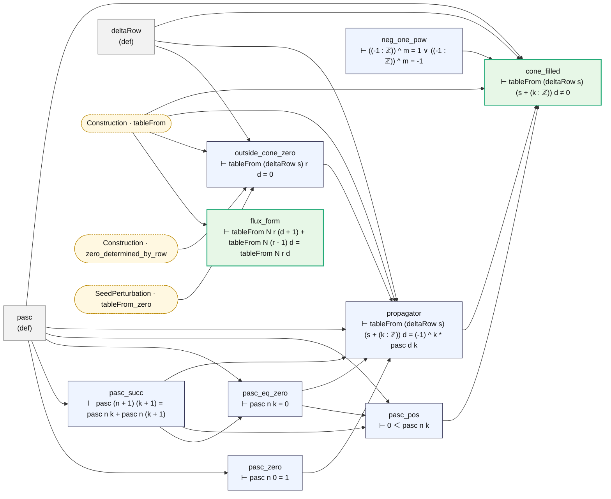

# `lean/Propagation.lean`

**What it does** (its own header): Propagation — the recurrence as transport: the light cone, and the propagator. `papers/Depth-as-Time.md` reads depth as time. Take that literally: with `d` as time and `r` as space, the recurrence

**Imports:** [`Construction`](../lean/Construction.md), [`SeedPerturbation`](../lean/SeedPerturbation.md).
**Imported by:** nothing.

Blue: theorem. Green: a theorem nothing else uses (an end). Dashed white: connects to nothing. Grey: definition. Red: contains `sorry`. Yellow: in another file. An arrow A → B reads "A is used by B".

## Every declaration

| declaration | proves (output) | needs (input) | why (its own docstring) | uses | used by |
|---|---|---|---|---|---|
| `Propagation.pasc` def, line 57 | ℕ → ℕ → ℤ | — | Binomial coefficients by the Pascal recurrence, ℤ-valued. Core has no `Nat.choose`; defining it this way makes Pascal's identity definitional. | — | `Propagation.cone_filled`, `Propagation.pasc_eq_zero`, `Propagation.pasc_pos`, `Propagation.pasc_succ`, `Propagation.pasc_zero`, `Propagation.propagator` |
| `Propagation.pasc_zero` theorem, line 63 | pasc n 0 = 1 | n : ℕ | The left edge of the triangle is all ones. | `Propagation.pasc` | `Propagation.propagator` |
| `Propagation.pasc_succ` theorem, line 66 | pasc (n + 1) (k + 1) = pasc n k + pasc n (k + 1) | n k : ℕ | Pascal's identity — definitional, because `pasc` is defined by it. | `Propagation.pasc` | `Propagation.pasc_eq_zero`, `Propagation.pasc_pos`, `Propagation.propagator` |
| `Propagation.pasc_eq_zero` theorem, line 69 | pasc n k = 0 | h : n &lt; k | Above the diagonal the binomial vanishes. | `Propagation.pasc`, `Propagation.pasc_succ` | `Propagation.pasc_pos`, `Propagation.propagator` |
| `Propagation.pasc_pos` theorem, line 83 | 0 &lt; pasc n k | h : k ≤ n | On and below the diagonal it is positive — this is what "no lacunae" rests on: the propagator never vanishes inside its cone. | `Propagation.pasc`, `Propagation.pasc_eq_zero`, `Propagation.pasc_succ` | `Propagation.cone_filled` |
| `Propagation.deltaRow` def, line 105 | ℤ → ℤ | s : ℤ | A unit disturbance at rung `s`: the delta row. | — | `Propagation.cone_filled`, `Propagation.outside_cone_zero`, `Propagation.propagator` |
| `Propagation.outside_cone_zero` theorem, line 111 | tableFrom (deltaRow s) r d = 0 | s r : ℤ; d : ℕ; h : r &lt; s ∨ s &lt; r - (d : ℤ) | Outside the forward cone, nothing. A source at `s` does not reach a cell whose window `[r−d, r]` misses `s` — the range of influence is bounded by speed 1. Downstream (`r &lt; s`) and past the cone's left edge (`s &lt; r−d`) the cell is zero. | `Construction.tableFrom`, `Construction.zero_determined_by_row`, `Propagation.deltaRow`, `SeedPerturbation.tableFrom_zero` | `Propagation.propagator` |
| `Propagation.propagator` theorem, line 125 | tableFrom (deltaRow s) (s + (k : ℤ)) d = (-1) ^ k * pasc d k | s : ℤ; d k : ℕ; hk : k ≤ d | Inside the cone, the propagator. At offset `k ≤ d` from the source the cell is exactly `(−1)^k · C(d,k)`: the Green's function of the evolution is the alternating binomial row — the stencil, read as a propagator. | `Construction.tableFrom`, `Propagation.deltaRow`, `Propagation.outside_cone_zero`, `Propagation.pasc`, `Propagation.pasc_eq_zero`, `Propagation.pasc_succ`, `Propagation.pasc_zero` | `Propagation.cone_filled` |
| `Propagation.neg_one_pow` theorem, line 170 | ((-1 : ℤ)) ^ m = 1 ∨ ((-1 : ℤ)) ^ m = -1 | m : ℕ | `(−1)^m` is `1` or `−1`. Stated here because core carries no pow lemmas. | — | `Propagation.cone_filled` |
| `Propagation.cone_filled` theorem, line 182 | tableFrom (deltaRow s) (s + (k : ℤ)) d ≠ 0 | s : ℤ; d k : ℕ; hk : k ≤ d | No lacunae. Strictly inside the forward cone the disturbance is felt at EVERY cell — the propagator never vanishes there. Discrete 1+1 transport fills its cone, where the 3+1 wave equation would leave the interior silent. | `Construction.tableFrom`, `Propagation.deltaRow`, `Propagation.neg_one_pow`, `Propagation.pasc`, `Propagation.pasc_pos`, `Propagation.propagator` | — |
| `Propagation.flux_form` theorem, line 195 | tableFrom N r (d + 1) + tableFrom N (r - 1) d = tableFrom N r d | N : ℤ → ℤ; r : ℤ; d : ℕ | The flux form. The recurrence rearranged as a conservation step: what the cell holds at time `d+1` plus what flowed left is what it held at `d`. Definitional — recorded so the transport reading has its conservation law stated. The interval form (a sum at time `d+1` telescoping to boundary terms) is `Isogeny.telescope`, on the Mathlib side. | `Construction.tableFrom` | — |
