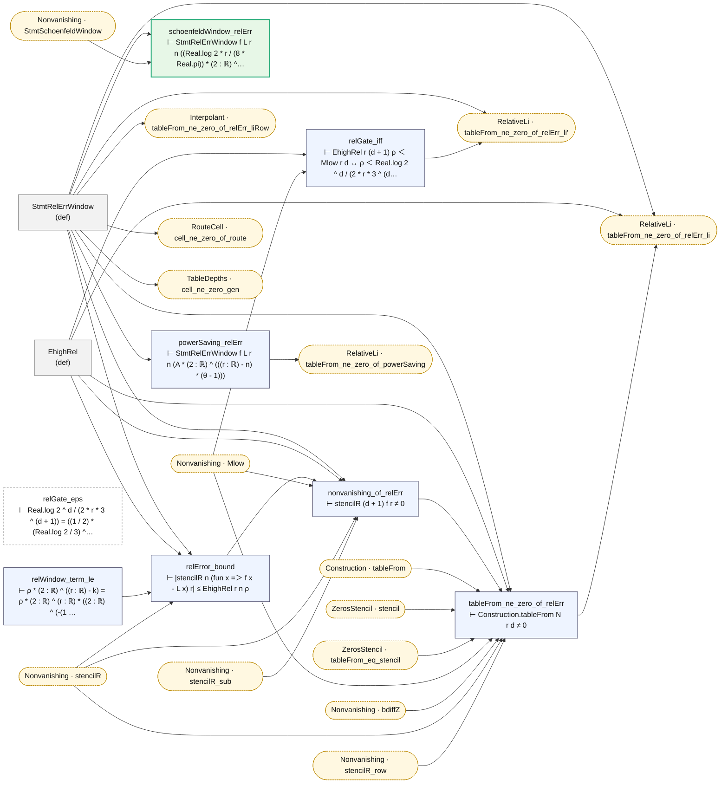

# `lean/RelativeGate.lean`

**What it does** (its own header): RelativeGate — the census gate, stated without assuming an error shape. WHY THIS FILE EXISTS. `Nonvanishing.lean` states the census gate in the RH shape: `StmtSchoenfeldWindow` carries `√x·log x/(8π)` per value, and `Ehigh` accumulates it into `2^(r/2)·(1+2^(−1/2))^n`. Every downstream tolerance study (O68, entry 118) then swept the family `C·√x·(log x)^k` — every row RH-strength. Whether the gate NEEDS that shape was never asked, and the answer was assumed rather than derived.

**Imports:** [`Nonvanishing`](../lean/Nonvanishing.md).
**Imported by:** [`RelativeLi`](../lean/RelativeLi.md).

Blue: theorem. Green: a theorem nothing else uses (an end). Dashed white: connects to nothing. Grey: definition. Red: contains `sorry`. Yellow: in another file. An arrow A → B reads "A is used by B".

## Every declaration

| declaration | proves (output) | needs (input) | why (its own docstring) | uses | used by |
|---|---|---|---|---|---|
| `RelativeGate.StmtRelErrWindow` def, line 58 | Prop | f L : ℤ → ℝ; r : ℤ; n : ℕ; ρ : ℝ | Relative error on the window. Each of the `n+1` values the stencil reads sits within `ρ` times its own scale `2^m`. No functional form is assumed — this is the weakest hypothesis the gate can consume. | — | `Interpolant.tableFrom_ne_zero_of_relErr_liRow`, `RelativeGate.nonvanishing_of_relErr`, `RelativeGate.powerSaving_relErr`, `RelativeGate.relError_bound`, `RelativeGate.schoenfeldWindow_relErr`, `RelativeGate.tableFrom_ne_zero_of_relErr`, `RelativeLi.tableFrom_ne_zero_of_relErr_li`, `RelativeLi.tableFrom_ne_zero_of_relErr_li'`, `RouteCell.cell_ne_zero_of_route`, `TableDepths.cell_ne_zero_gen` |
| `RelativeGate.EhighRel` def, line 67 | ℝ | r : ℤ; n : ℕ; ρ : ℝ | The accumulated ceiling under a relative-error hypothesis: `ρ·2^r·(3/2)^n`. The per-value scale halves down the window, so the binomial sum contributes `Σ C(n,k) 2^(−k) = (3/2)^n` — the exact analogue of `Ehigh`'s `(1+2^(−1/2))^n`, with `2^(−1/2)` replaced by `2^(−1)`. | — | `RelativeGate.nonvanishing_of_relErr`, `RelativeGate.relError_bound`, `RelativeGate.relGate_iff`, `RelativeGate.tableFrom_ne_zero_of_relErr`, `RelativeLi.tableFrom_ne_zero_of_relErr_li` |
| `RelativeGate.relWindow_term_le` theorem, line 72 | ρ * (2 : ℝ) ^ ((r : ℝ) - k) = ρ * (2 : ℝ) ^ (r : ℝ) * ((2 : ℝ) ^ (-(1 : ℝ))) ^ k | k : ℕ | Each windowed relative bound is the top-of-window scale times `2^(−k)`. | — | `RelativeGate.relError_bound` |
| `RelativeGate.relError_bound` theorem, line 86 | \|stencilR n (fun x =&gt; f x - L x) r\| ≤ EhighRel r n ρ | hS : StmtRelErrWindow f L r n ρ | The error bound, shape-free. Triangle inequality, the per-term scale, and the binomial theorem at `t = 1/2`. | `Nonvanishing.stencilR`, `RelativeGate.EhighRel`, `RelativeGate.StmtRelErrWindow`, `RelativeGate.relWindow_term_le` | `RelativeGate.nonvanishing_of_relErr` |
| `RelativeGate.relGate_iff` theorem, line 123 | EhighRel r (d + 1) ρ &lt; Mlow r d ↔ ρ &lt; Real.log 2 ^ d / (2 * r * 3 ^ (d + 1)) | hr : (0 : ℝ) &lt; r | THE GATE, REDUCED. The census condition against a relative-error ceiling is a bound on `ρ` alone — the scale `2^r` appears on both sides and cancels. What survives is | `Nonvanishing.Mlow`, `RelativeGate.EhighRel` | `RelativeLi.tableFrom_ne_zero_of_relErr_li'` |
| `RelativeGate.relGate_eps` theorem, line 170 | Real.log 2 ^ d / (2 * r * 3 ^ (d + 1)) = ((1 / 2) * (Real.log 2 / 3) ^ (d + 1)) / ((r : ℝ) * Real.log 2) | hr : (0 : ℝ) &lt; r | The threshold as a single constant divided by `log x`: with `log x = r·log 2`, the gate reads `ρ &lt; ε_d / log x` where `ε_d = 0.5·(log 2/3)^(d+1)`. The constant falls by `3/log 2 ≈ 4.33` per unit of depth. | — | — |
| `RelativeGate.nonvanishing_of_relErr` theorem, line 182 | stencilR (d + 1) f r ≠ 0 | hS : StmtRelErrWindow f L r (d + 1) ρ; hM : Mlow r d ≤ \|stencilR (d + 1) L r\|; hgap : EhighRel r (d + 1) ρ &lt; Mlow r d | The arrow, with no assumption on the error's shape. | `Nonvanishing.Mlow`, `Nonvanishing.stencilR`, `Nonvanishing.stencilR_sub`, `RelativeGate.EhighRel`, `RelativeGate.StmtRelErrWindow`, `RelativeGate.relError_bound` | `RelativeGate.tableFrom_ne_zero_of_relErr` |
| `RelativeGate.tableFrom_ne_zero_of_relErr` theorem, line 195 | Construction.tableFrom N r d ≠ 0 | hrow : ∀ k ∈ range (d + 2), ((N (r - k) : ℤ) : ℝ) = bdiffZ f (r - k); hS : StmtRelErrWindow f L r (d + 1) ρ; hM : Mlow r d ≤ \|stencilR (d + 1) L r\|; hgap : EhighRel r (d + 1) ρ &lt; Mlow r d | Onto the integer table, shape-free. Mirrors `Nonvanishing.tableFrom_ne_zero_of` with the relative-error hypothesis in place of the Schoenfeld one. | `Construction.tableFrom`, `Nonvanishing.Mlow`, `Nonvanishing.bdiffZ`, `Nonvanishing.stencilR`, `Nonvanishing.stencilR_row`, `RelativeGate.EhighRel`, `RelativeGate.StmtRelErrWindow`, `RelativeGate.nonvanishing_of_relErr`, `Zeros.stencil`, `Zeros.tableFrom_eq_stencil` | `RelativeLi.tableFrom_ne_zero_of_relErr_li` |
| `RelativeGate.schoenfeldWindow_relErr` theorem, line 227 | StmtRelErrWindow f L r n ((Real.log 2 * r / (8 * Real.pi)) * (2 : ℝ) ^ (-((r : ℝ) - n) / 2)) | hr : (n : ℤ) ≤ r; hS : Nonvanishing.StmtSchoenfeldWindow f L r n | The weld to the RH layer. `Nonvanishing.StmtSchoenfeldWindow` is an instance of the shape-free hypothesis. The relative error is worst at the window BOTTOM — `√x/x = 2^(−m/2)` grows as `m` falls — so the witness is `ρ = (log 2·r/(8π))·2^(−(r−n)/2)`, not the top-of-window value. Both factors are then bounded termwise: `r−k ≤ r` for the linear one, `k ≤ n` for… | `Nonvanishing.StmtSchoenfeldWindow`, `RelativeGate.StmtRelErrWindow` | — |
| `RelativeGate.powerSaving_relErr` theorem, line 273 | StmtRelErrWindow f L r n (A * (2 : ℝ) ^ (((r : ℝ) - n) * (θ - 1))) | hA : 0 ≤ A; hθ : θ ≤ 1; hP : ∀ k ∈ range (n + 1), \|f (r - k) - L (r - k)\| ≤ A * ((2 : ℝ) ^ ((r : ℝ) - k)) ^ θ | The power-saving instance. A bound `\|f − L\| ≤ A·x^θ` at `x = 2^m` gives relative error `A·2^(m(θ−1))`, worst at the window bottom when `θ ≤ 1`. So the witness is `ρ = A·2^((r−n)(θ−1))`, and the gate becomes a statement about the exponent `θ` alone. | `RelativeGate.StmtRelErrWindow` | `RelativeLi.tableFrom_ne_zero_of_powerSaving` |
