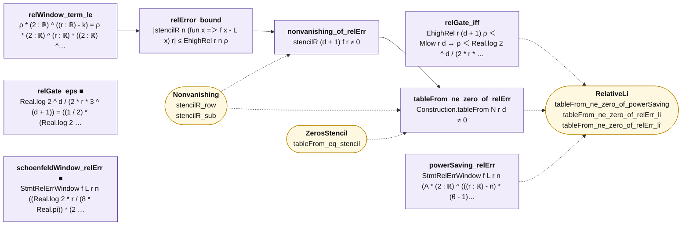

# `lean/RelativeGate.lean`

RelativeGate — the census gate, stated without assuming an error shape. WHY THIS FILE EXISTS. `Nonvanishing.lean` states the census gate in the RH shape: `StmtSchoenfeldWindow` carries `√x·log x/(8π)` per value, and `Ehigh` accumulates it into `2^(r/2)·(1+2^(−1/2))^n`. Every downstream tolerance study (O68, entry 118) then swept the family `C·√x·(log x)^k` — every row RH-strength. Whether the gate NEEDS that shape was never asked, and the answer was assumed rather than derived.

8 theorems, 2 definitions, 336 lines. Arrows are Lean's own record of what each proof uses.

**Imports:** [`Nonvanishing`](../lean/Nonvanishing.md)  
**Imported by:** [`RelativeLi`](../lean/RelativeLi.md)

## The picture



An arrow A → B reads "A is used in the proof of B". Green: counting, integers only. Violet: shape, analysis with no ζ. Blue: reads ζ. A name ending in ■ is an end: nothing else uses it. Red: contains `sorry`. Yellow: theorems in another file, counted; a dotted arrow crosses files. Definitions are not drawn; they are listed below the diagram.

## Definitions

<a name="RelativeGate-StmtRelErrWindow"></a>
### `RelativeGate.StmtRelErrWindow`

def · line 58

Relative error on the window. Each of the `n+1` values the stencil reads sits within `ρ` times its own scale `2^m`. No functional form is assumed — this is the weakest hypothesis the gate can consume.

- **Is:** `` StmtRelErrWindow (f L : ℤ → ℝ) (r : ℤ) (n : ℕ) (ρ : ℝ) : Prop := ∀ k ∈ range (n + 1), |f (r - k) - L (r - k)| ≤ ρ * (2 : ℝ) ^ ((r : ℝ) - k) ``
- **Used by 11:** [`Interpolant.tableFrom_ne_zero_of_relErr_liRow`](../lean/Interpolant.md#Interpolant-tableFrom_ne_zero_of_relErr_liRow), [`RelativeGate.nonvanishing_of_relErr`](#RelativeGate-nonvanishing_of_relErr), [`RelativeGate.powerSaving_relErr`](#RelativeGate-powerSaving_relErr), [`RelativeGate.relError_bound`](#RelativeGate-relError_bound), [`RelativeGate.schoenfeldWindow_relErr`](#RelativeGate-schoenfeldWindow_relErr), [`RelativeGate.tableFrom_ne_zero_of_relErr`](#RelativeGate-tableFrom_ne_zero_of_relErr), [`RelativeLi.tableFrom_ne_zero_of_relErr_li`](../lean/RelativeLi.md#RelativeLi-tableFrom_ne_zero_of_relErr_li), [`RelativeLi.tableFrom_ne_zero_of_relErr_li'`](../lean/RelativeLi.md#RelativeLi-tableFrom_ne_zero_of_relErr_li-), [`RouteCell.cell_ne_zero_of_route`](../lean/RouteCell.md#RouteCell-cell_ne_zero_of_route), [`TableDepths.cell_ne_zero_gen`](../lean_stage3/TableDepths.md#TableDepths-cell_ne_zero_gen), [`TableRoute.cell_ne_zero_of_RH`](../lean_stage3/TableRoute.md#TableRoute-cell_ne_zero_of_RH)

<a name="RelativeGate-EhighRel"></a>
### `RelativeGate.EhighRel`

def · line 67

The accumulated ceiling under a relative-error hypothesis: `ρ·2^r·(3/2)^n`. The per-value scale halves down the window, so the binomial sum contributes `Σ C(n,k) 2^(−k) = (3/2)^n` — the exact analogue of `Ehigh`'s `(1+2^(−1/2))^n`, with `2^(−1/2)` replaced by `2^(−1)`.

- **Is:** `` EhighRel (r : ℤ) (n : ℕ) (ρ : ℝ) : ℝ := ρ * (2 : ℝ) ^ (r : ℝ) * (3 / 2) ^ n ``
- **Used by 6:** [`RelativeGate.nonvanishing_of_relErr`](#RelativeGate-nonvanishing_of_relErr), [`RelativeGate.relError_bound`](#RelativeGate-relError_bound), [`RelativeGate.relGate_iff`](#RelativeGate-relGate_iff), [`RelativeGate.tableFrom_ne_zero_of_relErr`](#RelativeGate-tableFrom_ne_zero_of_relErr), [`RelativeLi.tableFrom_ne_zero_of_relErr_li`](../lean/RelativeLi.md#RelativeLi-tableFrom_ne_zero_of_relErr_li), [`RelativeLi.tableFrom_ne_zero_of_relErr_li'`](../lean/RelativeLi.md#RelativeLi-tableFrom_ne_zero_of_relErr_li-)

## Theorems

<a name="RelativeGate-relWindow_term_le"></a>
### `RelativeGate.relWindow_term_le`

line 72

**Shape.** Uses real or complex analysis; nothing in it or beneath it reads ζ.

**Why.** Each windowed relative bound is the top-of-window scale times `2^(−k)`.

**Proves**

```lean
ρ * (2 : ℝ) ^ ((r : ℝ) - k) = ρ * (2 : ℝ) ^ (r : ℝ) * ((2 : ℝ) ^ (-(1 : ℝ))) ^ k
```

**Needs** (its hypotheses)

  - `` k : ℕ ``

**Fed by:** no theorem of this repo; it stands on Mathlib.

**Feeds** (1 that use it)

  - [`RelativeGate.relError_bound`](#RelativeGate-relError_bound) — `` |stencilR n (fun x => f x - L x) r| ≤ EhighRel r n ρ ``

<a name="RelativeGate-relError_bound"></a>
### `RelativeGate.relError_bound`

line 86

**Shape.** Uses real or complex analysis; nothing in it or beneath it reads ζ.

**Why.** The error bound, shape-free. Triangle inequality, the per-term scale, and the binomial theorem at `t = 1/2`.

**Proves**

```lean
|stencilR n (fun x => f x - L x) r| ≤ EhighRel r n ρ
```

**Needs** (its hypotheses)

  - `` hS : StmtRelErrWindow f L r n ρ ``

**Stated with:** [`Nonvanishing.stencilR`](../lean/Nonvanishing.md#Nonvanishing-stencilR), [`RelativeGate.EhighRel`](#RelativeGate-EhighRel), [`RelativeGate.StmtRelErrWindow`](#RelativeGate-StmtRelErrWindow)

**Fed by** (1 theorem its proof uses)

  - [`RelativeGate.relWindow_term_le`](#RelativeGate-relWindow_term_le) — `` ρ * (2 : ℝ) ^ ((r : ℝ) - k) = ρ * (2 : ℝ) ^ (r : ℝ) * ((2 : ℝ) ^ (-(1 : ℝ))) ^ k ``

**Feeds** (1 that use it)

  - [`RelativeGate.nonvanishing_of_relErr`](#RelativeGate-nonvanishing_of_relErr) — `` stencilR (d + 1) f r ≠ 0 ``

<a name="RelativeGate-relGate_iff"></a>
### `RelativeGate.relGate_iff`

line 123

**Shape.** Uses real or complex analysis; nothing in it or beneath it reads ζ.

**Why.** THE GATE, REDUCED. The census condition against a relative-error ceiling is a bound on `ρ` alone — the scale `2^r` appears on both sides and cancels. What survives is

**Proves**

```lean
EhighRel r (d + 1) ρ < Mlow r d ↔ ρ < Real.log 2 ^ d / (2 * r * 3 ^ (d + 1))
```

**Needs** (its hypotheses)

  - `` hr : (0 : ℝ) < r ``

**Stated with:** [`Nonvanishing.Mlow`](../lean/Nonvanishing.md#Nonvanishing-Mlow), [`RelativeGate.EhighRel`](#RelativeGate-EhighRel)

**Fed by:** no theorem of this repo; it stands on Mathlib and the definitions below.

**Feeds** (1 that use it)

  - [`RelativeLi.tableFrom_ne_zero_of_relErr_li'`](../lean/RelativeLi.md#RelativeLi-tableFrom_ne_zero_of_relErr_li-) (RelativeLi) — `` Construction.tableFrom N r d ≠ 0 ``

<a name="RelativeGate-relGate_eps"></a>
### `RelativeGate.relGate_eps`

line 170

**Shape.** Uses real or complex analysis; nothing in it or beneath it reads ζ.

**Why.** The threshold as a single constant divided by `log x`: with `log x = r·log 2`, the gate reads `ρ < ε_d / log x` where `ε_d = 0.5·(log 2/3)^(d+1)`. The constant falls by `3/log 2 ≈ 4.33` per unit of depth.

**Proves**

```lean
Real.log 2 ^ d / (2 * r * 3 ^ (d + 1)) = ((1 / 2) * (Real.log 2 / 3) ^ (d + 1)) / ((r : ℝ) * Real.log 2)
```

**Needs** (its hypotheses)

  - `` hr : (0 : ℝ) < r ``

**Fed by:** no theorem of this repo; it stands on Mathlib.

**Feeds:** nothing. It connects to nothing.

<a name="RelativeGate-nonvanishing_of_relErr"></a>
### `RelativeGate.nonvanishing_of_relErr`

line 182

**Shape.** Uses real or complex analysis; nothing in it or beneath it reads ζ.

**Why.** The arrow, with no assumption on the error's shape.

**Proves**

```lean
stencilR (d + 1) f r ≠ 0
```

**Needs** (its hypotheses)

  - `` hS : StmtRelErrWindow f L r (d + 1) ρ ``
  - `` hM : Mlow r d ≤ |stencilR (d + 1) L r| ``
  - `` hgap : EhighRel r (d + 1) ρ < Mlow r d ``

**Stated with:** [`Nonvanishing.Mlow`](../lean/Nonvanishing.md#Nonvanishing-Mlow), [`Nonvanishing.stencilR`](../lean/Nonvanishing.md#Nonvanishing-stencilR), [`RelativeGate.EhighRel`](#RelativeGate-EhighRel), [`RelativeGate.StmtRelErrWindow`](#RelativeGate-StmtRelErrWindow)

**Fed by** (2 theorems its proof uses)

  - [`Nonvanishing.stencilR_sub`](../lean/Nonvanishing.md#Nonvanishing-stencilR_sub) (Nonvanishing) — `` stencilR n (fun x => f x - L x) r = stencilR n f r - stencilR n L r ``
  - [`RelativeGate.relError_bound`](#RelativeGate-relError_bound) — `` |stencilR n (fun x => f x - L x) r| ≤ EhighRel r n ρ ``

**Feeds** (1 that use it)

  - [`RelativeGate.tableFrom_ne_zero_of_relErr`](#RelativeGate-tableFrom_ne_zero_of_relErr) — `` Construction.tableFrom N r d ≠ 0 ``

<a name="RelativeGate-tableFrom_ne_zero_of_relErr"></a>
### `RelativeGate.tableFrom_ne_zero_of_relErr`

line 195

**Shape.** Uses real or complex analysis; nothing in it or beneath it reads ζ.

**Why.** Onto the integer table, shape-free. Mirrors `Nonvanishing.tableFrom_ne_zero_of` with the relative-error hypothesis in place of the Schoenfeld one.

**Proves**

```lean
Construction.tableFrom N r d ≠ 0
```

**Needs** (its hypotheses)

  - `` hrow : ∀ k ∈ range (d + 2), ((N (r - k) : ℤ) : ℝ) = bdiffZ f (r - k) ``
  - `` hS : StmtRelErrWindow f L r (d + 1) ρ ``
  - `` hM : Mlow r d ≤ |stencilR (d + 1) L r| ``
  - `` hgap : EhighRel r (d + 1) ρ < Mlow r d ``

**Stated with:** [`Construction.tableFrom`](../lean/Construction.md#Construction-tableFrom), [`Nonvanishing.Mlow`](../lean/Nonvanishing.md#Nonvanishing-Mlow), [`Nonvanishing.bdiffZ`](../lean/Nonvanishing.md#Nonvanishing-bdiffZ), [`Nonvanishing.stencilR`](../lean/Nonvanishing.md#Nonvanishing-stencilR), [`RelativeGate.EhighRel`](#RelativeGate-EhighRel), [`RelativeGate.StmtRelErrWindow`](#RelativeGate-StmtRelErrWindow)

**Fed by** (3 theorems its proof uses)

  - [`Nonvanishing.stencilR_row`](../lean/Nonvanishing.md#Nonvanishing-stencilR_row) (Nonvanishing) — `` stencilR d (bdiffZ g) r = stencilR (d + 1) g r ``
  - [`RelativeGate.nonvanishing_of_relErr`](#RelativeGate-nonvanishing_of_relErr) — `` stencilR (d + 1) f r ≠ 0 ``
  - [`Zeros.tableFrom_eq_stencil`](../lean/ZerosStencil.md#Zeros-tableFrom_eq_stencil) (ZerosStencil) — `` Construction.tableFrom N r d = stencil d (fun k => N (r - k)) ``

**Definitions its proof touches:** [`Zeros.stencil`](../lean/ZerosStencil.md#Zeros-stencil)

**Feeds** (1 that use it)

  - [`RelativeLi.tableFrom_ne_zero_of_relErr_li`](../lean/RelativeLi.md#RelativeLi-tableFrom_ne_zero_of_relErr_li) (RelativeLi) — `` Construction.tableFrom N r d ≠ 0 ``

<a name="RelativeGate-schoenfeldWindow_relErr"></a>
### `RelativeGate.schoenfeldWindow_relErr`

line 227

**Shape.** Uses real or complex analysis; nothing in it or beneath it reads ζ.

**Why.** The weld to the RH layer. `Nonvanishing.StmtSchoenfeldWindow` is an instance of the shape-free hypothesis. The relative error is worst at the window BOTTOM — `√x/x = 2^(−m/2)` grows as `m` falls — so the witness is `ρ = (log 2·r/(8π))·2^(−(r−n)/2)`, not the top-of-window value. Both factors are then bounded termwise: `r−k ≤ r` for the linear one, `k ≤ n` for the exponential one.

**Proves**

```lean
StmtRelErrWindow f L r n ((Real.log 2 * r / (8 * Real.pi)) * (2 : ℝ) ^ (-((r : ℝ) - n) / 2))
```

**Needs** (its hypotheses)

  - `` hr : (n : ℤ) ≤ r ``
  - `` hS : Nonvanishing.StmtSchoenfeldWindow f L r n ``

**Stated with:** [`Nonvanishing.StmtSchoenfeldWindow`](../lean/Nonvanishing.md#Nonvanishing-StmtSchoenfeldWindow), [`RelativeGate.StmtRelErrWindow`](#RelativeGate-StmtRelErrWindow)

**Fed by:** no theorem of this repo; it stands on Mathlib and the definitions below.

**Feeds:** nothing. It is an end.

<a name="RelativeGate-powerSaving_relErr"></a>
### `RelativeGate.powerSaving_relErr`

line 273

**Shape.** Uses real or complex analysis; nothing in it or beneath it reads ζ.

**Why.** The power-saving instance. A bound `|f − L| ≤ A·x^θ` at `x = 2^m` gives relative error `A·2^(m(θ−1))`, worst at the window bottom when `θ ≤ 1`. So the witness is `ρ = A·2^((r−n)(θ−1))`, and the gate becomes a statement about the exponent `θ` alone.

**Proves**

```lean
StmtRelErrWindow f L r n (A * (2 : ℝ) ^ (((r : ℝ) - n) * (θ - 1)))
```

**Needs** (its hypotheses)

  - `` hA : 0 ≤ A ``
  - `` hθ : θ ≤ 1 ``
  - `` hP : ∀ k ∈ range (n + 1), |f (r - k) - L (r - k)| ≤ A * ((2 : ℝ) ^ ((r : ℝ) - k)) ^ θ ``

**Stated with:** [`RelativeGate.StmtRelErrWindow`](#RelativeGate-StmtRelErrWindow)

**Fed by:** no theorem of this repo; it stands on Mathlib and the definitions below.

**Feeds** (1 that use it)

  - [`RelativeLi.tableFrom_ne_zero_of_powerSaving`](../lean/RelativeLi.md#RelativeLi-tableFrom_ne_zero_of_powerSaving) (RelativeLi) — `` Construction.tableFrom N r d ≠ 0 ``

