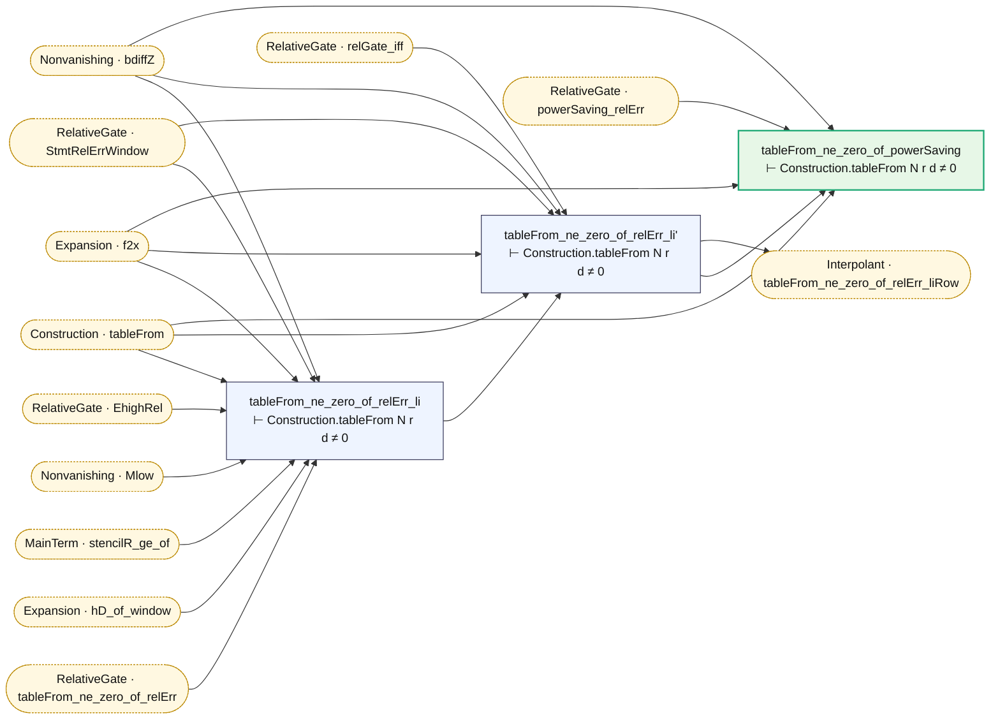

# `lean/RelativeLi.lean`

**What it does** (its own header): RelativeLi — the relative-error gate with its main term discharged. `RelativeGate.tableFrom_ne_zero_of_relErr` makes a cell nonzero from a relative error on a window of rows, a floor `hM` under the main term's stencil, and the gap. `Expansion.hD_of_window` with `MainTerm.stencilR_ge_of` proves that floor for a smooth interpolant `G` of `li` along the doublings (`G' = 2^x/x`). Nothing composed them: the Schoenfeld-shaped gate had its composition (`Expansion.tableFrom_ne_zero_of_li`), the shape-free gate did not. Thi…

**Imports:** [`Expansion`](../lean/Expansion.md), [`RelativeGate`](../lean/RelativeGate.md).
**Imported by:** [`Interpolant`](../lean/Interpolant.md).

Blue: theorem. Green: a theorem nothing else uses (an end). Dashed white: connects to nothing. Grey: definition. Red: contains `sorry`. Yellow: in another file. An arrow A → B reads "A is used by B".

## Every declaration

| declaration | proves (output) | needs (input) | why (its own docstring) | uses | used by |
|---|---|---|---|---|---|
| `RelativeLi.tableFrom_ne_zero_of_relErr_li` theorem, line 38 | Construction.tableFrom N r d ≠ 0 | hG : ContDiff ℝ (⊤ : ℕ∞) G; hG' : ∀ x ∈ Ioi ((1 : ℝ) / 2), HasDerivAt G (Expansion.f2x x) x; hrow : ∀ k ∈ range (d + 2), ((N (r - k) : ℤ) : ℝ) = Nonvanishing.bdiffZ f (r - k); hS : RelativeGate.StmtRelErrWindow f (fun k : ℤ =&gt; G k) r (d + 1) ρ; hbot : (1 : ℝ) ≤ (r : ℝ) - (d + 1); hw : 2 * (d : ℝ) ≤ Real.log 2 * ((r : ℝ) - (d + 1)); hgap : RelativeGate.EhighRel r (d + 1) ρ &lt; Nonvanishing.Mlow r d | The shape-free gate on the table, main term discharged. | `Construction.tableFrom`, `Expansion.f2x`, `Expansion.hD_of_window`, `MainTerm.stencilR_ge_of`, `Nonvanishing.Mlow`, `Nonvanishing.bdiffZ`, `RelativeGate.EhighRel`, `RelativeGate.StmtRelErrWindow`, `RelativeGate.tableFrom_ne_zero_of_relErr` | `RelativeLi.tableFrom_ne_zero_of_relErr_li'` |
| `RelativeLi.tableFrom_ne_zero_of_relErr_li'` theorem, line 52 | Construction.tableFrom N r d ≠ 0 | hG : ContDiff ℝ (⊤ : ℕ∞) G; hG' : ∀ x ∈ Ioi ((1 : ℝ) / 2), HasDerivAt G (Expansion.f2x x) x; hrow : ∀ k ∈ range (d + 2), ((N (r - k) : ℤ) : ℝ) = Nonvanishing.bdiffZ f (r - k); hS : RelativeGate.StmtRelErrWindow f (fun k : ℤ =&gt; G k) r (d + 1) ρ; hbot : (1 : ℝ) ≤ (r : ℝ) - (d + 1); hw : 2 * (d : ℝ) ≤ Real.log 2 * ((r : ℝ) - (d + 1)); hρ : ρ &lt; Real.log 2 ^ d / (2 * r * 3 ^ (d + 1)) | The same with the gap reduced to a bound on `ρ` alone. | `Construction.tableFrom`, `Expansion.f2x`, `Nonvanishing.bdiffZ`, `RelativeGate.StmtRelErrWindow`, `RelativeGate.relGate_iff`, `RelativeLi.tableFrom_ne_zero_of_relErr_li` | `Interpolant.tableFrom_ne_zero_of_relErr_liRow`, `RelativeLi.tableFrom_ne_zero_of_powerSaving` |
| `RelativeLi.tableFrom_ne_zero_of_powerSaving` theorem, line 70 | Construction.tableFrom N r d ≠ 0 | hG : ContDiff ℝ (⊤ : ℕ∞) G; hG' : ∀ x ∈ Ioi ((1 : ℝ) / 2), HasDerivAt G (Expansion.f2x x) x; hrow : ∀ k ∈ range (d + 2), ((N (r - k) : ℤ) : ℝ) = Nonvanishing.bdiffZ f (r - k); hA : 0 ≤ A; hθ : θ ≤ 1; hP : ∀ k ∈ range (d + 1 + 1), \|f (r - k) - G ((r - k : ℤ) : ℝ)\| ≤ A * ((2 : ℝ) ^ ((r : ℝ) - k)) ^ θ; hbot : (1 : ℝ) ≤ (r : ℝ) - (d + 1); hw : 2 * (d : ℝ) ≤ Real.log 2 * ((r : ℝ) - (d + 1)); hρ : A * (2 : ℝ) ^ (((r : ℝ) - ((d + 1 : ℕ) : ℝ)) * (θ - 1)) &lt; Real.log 2 ^ d / (2 * r * 3 ^ (d + 1)) | From a power bound on the rows. `\|f(m) − G(m)\| ≤ A·(2^m)^θ` on the window with `θ ≤ 1`, and `A·2^((r−d−1)(θ−1))` under the gate's threshold. | `Construction.tableFrom`, `Expansion.f2x`, `Nonvanishing.bdiffZ`, `RelativeGate.powerSaving_relErr`, `RelativeLi.tableFrom_ne_zero_of_relErr_li'` | — |
