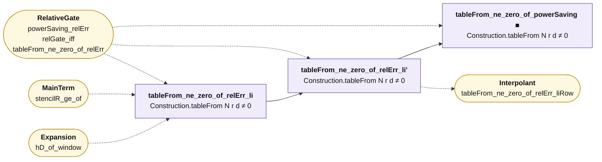

# `lean/RelativeLi.lean`

RelativeLi — the relative-error gate with its main term discharged. `RelativeGate.tableFrom_ne_zero_of_relErr` makes a cell nonzero from a relative error on a window of rows, a floor `hM` under the main term's stencil, and the gap. `Expansion.hD_of_window` with `MainTerm.stencilR_ge_of` proves that floor for a smooth interpolant `G` of `li` along the doublings (`G' = 2^x/x`). Nothing composed them: the Schoenfeld-shaped gate had its composition (`Expansion.tableFrom_ne_zero_of_li`), the shape-free gate did not. Thi…

3 theorems, 0 definitions, 107 lines. Arrows are Lean's own record of what each proof uses.

**Imports:** [`Expansion`](../lean/Expansion.md), [`RelativeGate`](../lean/RelativeGate.md)  
**Imported by:** [`Interpolant`](../lean/Interpolant.md)

## The picture



An arrow A → B reads "A is used in the proof of B". Green: counting, integers only. Violet: shape, analysis with no ζ. Blue: reads ζ. A name ending in ■ is an end: nothing else uses it. Red: contains `sorry`. Yellow: theorems in another file, counted; a dotted arrow crosses files. Definitions are not drawn; they are listed below the diagram.

## Theorems

<a name="RelativeLi-tableFrom_ne_zero_of_relErr_li"></a>
### `RelativeLi.tableFrom_ne_zero_of_relErr_li`

line 38

**Shape.** Uses real or complex analysis; nothing in it or beneath it reads ζ.

**Why.** The shape-free gate on the table, main term discharged.

**Proves**

```lean
Construction.tableFrom N r d ≠ 0
```

**Needs** (its hypotheses)

  - `` hG : ContDiff ℝ (⊤ : ℕ∞) G ``
  - `` hG' : ∀ x ∈ Ioi ((1 : ℝ) / 2), HasDerivAt G (Expansion.f2x x) x ``
  - `` hrow : ∀ k ∈ range (d + 2), ((N (r - k) : ℤ) : ℝ) = Nonvanishing.bdiffZ f (r - k) ``
  - `` hS : RelativeGate.StmtRelErrWindow f (fun k : ℤ => G k) r (d + 1) ρ ``
  - `` hbot : (1 : ℝ) ≤ (r : ℝ) - (d + 1) ``
  - `` hw : 2 * (d : ℝ) ≤ Real.log 2 * ((r : ℝ) - (d + 1)) ``
  - `` hgap : RelativeGate.EhighRel r (d + 1) ρ < Nonvanishing.Mlow r d ``

**Stated with:** [`Construction.tableFrom`](../lean/Construction.md#Construction-tableFrom), [`Expansion.f2x`](../lean/Expansion.md#Expansion-f2x), [`Nonvanishing.Mlow`](../lean/Nonvanishing.md#Nonvanishing-Mlow), [`Nonvanishing.bdiffZ`](../lean/Nonvanishing.md#Nonvanishing-bdiffZ), [`RelativeGate.EhighRel`](../lean/RelativeGate.md#RelativeGate-EhighRel), [`RelativeGate.StmtRelErrWindow`](../lean/RelativeGate.md#RelativeGate-StmtRelErrWindow)

**Fed by** (3 theorems its proof uses)

  - [`Expansion.hD_of_window`](../lean/Expansion.md#Expansion-hD_of_window) (Expansion) — `` ∀ y ∈ Icc ((r : ℝ) - (d + 1)) r, Nonvanishing.Mlow r d ≤ iteratedDeriv (d + 1) G y ``
  - [`MainTerm.stencilR_ge_of`](../lean/MainTerm.md#MainTerm-stencilR_ge_of) (MainTerm) — `` c ≤ |Nonvanishing.stencilR (d + 1) (fun k : ℤ => G k) r| ``
  - [`RelativeGate.tableFrom_ne_zero_of_relErr`](../lean/RelativeGate.md#RelativeGate-tableFrom_ne_zero_of_relErr) (RelativeGate) — `` Construction.tableFrom N r d ≠ 0 ``

**Feeds** (1 that use it)

  - [`RelativeLi.tableFrom_ne_zero_of_relErr_li'`](#RelativeLi-tableFrom_ne_zero_of_relErr_li-) — `` Construction.tableFrom N r d ≠ 0 ``

<a name="RelativeLi-tableFrom_ne_zero_of_relErr_li-"></a>
### `RelativeLi.tableFrom_ne_zero_of_relErr_li'`

line 52

**Shape.** Uses real or complex analysis; nothing in it or beneath it reads ζ.

**Why.** The same with the gap reduced to a bound on `ρ` alone.

**Proves**

```lean
Construction.tableFrom N r d ≠ 0
```

**Needs** (its hypotheses)

  - `` hG : ContDiff ℝ (⊤ : ℕ∞) G ``
  - `` hG' : ∀ x ∈ Ioi ((1 : ℝ) / 2), HasDerivAt G (Expansion.f2x x) x ``
  - `` hrow : ∀ k ∈ range (d + 2), ((N (r - k) : ℤ) : ℝ) = Nonvanishing.bdiffZ f (r - k) ``
  - `` hS : RelativeGate.StmtRelErrWindow f (fun k : ℤ => G k) r (d + 1) ρ ``
  - `` hbot : (1 : ℝ) ≤ (r : ℝ) - (d + 1) ``
  - `` hw : 2 * (d : ℝ) ≤ Real.log 2 * ((r : ℝ) - (d + 1)) ``
  - `` hρ : ρ < Real.log 2 ^ d / (2 * r * 3 ^ (d + 1)) ``

**Stated with:** [`Construction.tableFrom`](../lean/Construction.md#Construction-tableFrom), [`Expansion.f2x`](../lean/Expansion.md#Expansion-f2x), [`Nonvanishing.bdiffZ`](../lean/Nonvanishing.md#Nonvanishing-bdiffZ), [`RelativeGate.StmtRelErrWindow`](../lean/RelativeGate.md#RelativeGate-StmtRelErrWindow)

**Fed by** (2 theorems its proof uses)

  - [`RelativeGate.relGate_iff`](../lean/RelativeGate.md#RelativeGate-relGate_iff) (RelativeGate) — `` EhighRel r (d + 1) ρ < Mlow r d ↔ ρ < Real.log 2 ^ d / (2 * r * 3 ^ (d + 1)) ``
  - [`RelativeLi.tableFrom_ne_zero_of_relErr_li`](#RelativeLi-tableFrom_ne_zero_of_relErr_li) — `` Construction.tableFrom N r d ≠ 0 ``

**Definitions its proof touches:** [`Nonvanishing.Mlow`](../lean/Nonvanishing.md#Nonvanishing-Mlow), [`RelativeGate.EhighRel`](../lean/RelativeGate.md#RelativeGate-EhighRel)

**Feeds** (2 that use it)

  - [`Interpolant.tableFrom_ne_zero_of_relErr_liRow`](../lean/Interpolant.md#Interpolant-tableFrom_ne_zero_of_relErr_liRow) (Interpolant) — `` Construction.tableFrom N r d ≠ 0 ``
  - [`RelativeLi.tableFrom_ne_zero_of_powerSaving`](#RelativeLi-tableFrom_ne_zero_of_powerSaving) — `` Construction.tableFrom N r d ≠ 0 ``

<a name="RelativeLi-tableFrom_ne_zero_of_powerSaving"></a>
### `RelativeLi.tableFrom_ne_zero_of_powerSaving`

line 70

**Shape.** Uses real or complex analysis; nothing in it or beneath it reads ζ.

**Why.** From a power bound on the rows. `|f(m) − G(m)| ≤ A·(2^m)^θ` on the window with `θ ≤ 1`, and `A·2^((r−d−1)(θ−1))` under the gate's threshold.

**Proves**

```lean
Construction.tableFrom N r d ≠ 0
```

**Needs** (its hypotheses)

  - `` hG : ContDiff ℝ (⊤ : ℕ∞) G ``
  - `` hG' : ∀ x ∈ Ioi ((1 : ℝ) / 2), HasDerivAt G (Expansion.f2x x) x ``
  - `` hrow : ∀ k ∈ range (d + 2), ((N (r - k) : ℤ) : ℝ) = Nonvanishing.bdiffZ f (r - k) ``
  - `` hA : 0 ≤ A ``
  - `` hθ : θ ≤ 1 ``
  - `` hP : ∀ k ∈ range (d + 1 + 1), |f (r - k) - G ((r - k : ℤ) : ℝ)| ≤ A * ((2 : ℝ) ^ ((r : ℝ) - k)) ^ θ ``
  - `` hbot : (1 : ℝ) ≤ (r : ℝ) - (d + 1) ``
  - `` hw : 2 * (d : ℝ) ≤ Real.log 2 * ((r : ℝ) - (d + 1)) ``
  - `` hρ : A * (2 : ℝ) ^ (((r : ℝ) - ((d + 1 : ℕ) : ℝ)) * (θ - 1)) < Real.log 2 ^ d / (2 * r * 3 ^ (d + 1)) ``

**Stated with:** [`Construction.tableFrom`](../lean/Construction.md#Construction-tableFrom), [`Expansion.f2x`](../lean/Expansion.md#Expansion-f2x), [`Nonvanishing.bdiffZ`](../lean/Nonvanishing.md#Nonvanishing-bdiffZ)

**Fed by** (2 theorems its proof uses)

  - [`RelativeGate.powerSaving_relErr`](../lean/RelativeGate.md#RelativeGate-powerSaving_relErr) (RelativeGate) — `` StmtRelErrWindow f L r n (A * (2 : ℝ) ^ (((r : ℝ) - n) * (θ - 1))) ``
  - [`RelativeLi.tableFrom_ne_zero_of_relErr_li'`](#RelativeLi-tableFrom_ne_zero_of_relErr_li-) — `` Construction.tableFrom N r d ≠ 0 ``

**Feeds:** nothing. It is an end.

