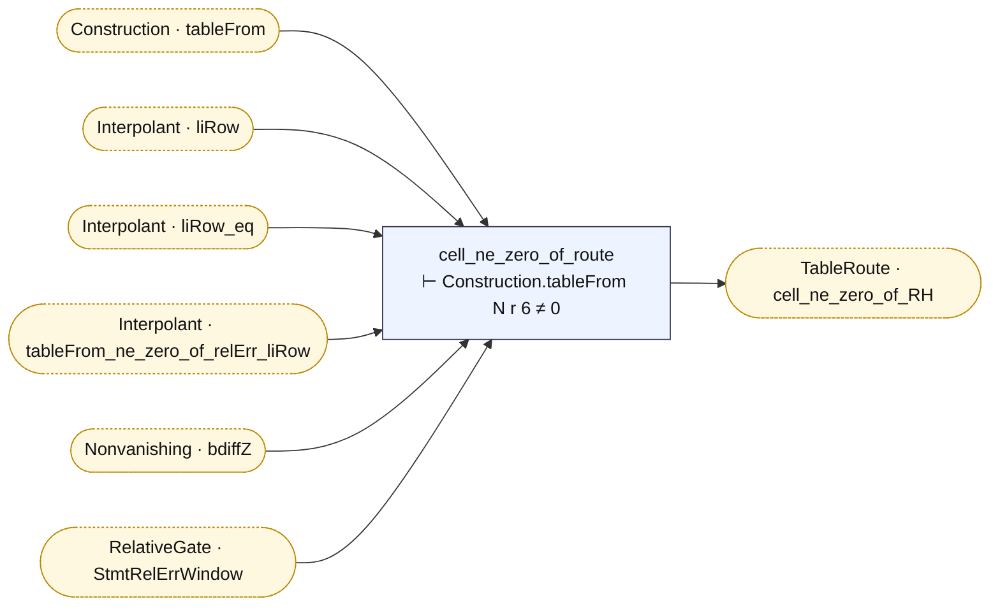

# `lean/RouteCell.lean`

**What it does** (its own header): RouteCell — block E9 of `lean_stage3/design/joints.md`, the table tree's half. The gate (`Interpolant.tableFrom_ne_zero_of_relErr_liRow`) at depth six, on the statement the other tree's explicit-formula route proves under RH.

**Imports:** [`Interpolant`](../lean/Interpolant.md).
**Imported by:** nothing.

Blue: theorem. Green: a theorem nothing else uses (an end). Dashed white: connects to nothing. Grey: definition. Red: contains `sorry`. Yellow: in another file. An arrow A → B reads "A is used by B".

## Every declaration

| declaration | proves (output) | needs (input) | why (its own docstring) | uses | used by |
|---|---|---|---|---|---|
| `RouteCell.cell_ne_zero_of_route` theorem, line 28 | Construction.tableFrom N r 6 ≠ 0 | hr : 80 ≤ r; hrow : ∀ k ∈ Finset.range (6 + 2), ((N (r - k) : ℤ) : ℝ) = Nonvanishing.bdiffZ f (r - k); hroute : ∃ ρ : ℝ, RelativeGate.StmtRelErrWindow f (fun m : ℤ =&gt; 2 / Real.log 2 + ∫ t in (1 : ℝ)..(m : ℝ), Real.exp (Real.log 2 * t) / t) r (6 + 1) ρ ∧ ρ &lt; Real.log 2 ^ 6 / (2 * r * 3 ^ (6 + 1)) | — | `Construction.tableFrom`, `Interpolant.liRow`, `Interpolant.liRow_eq`, `Interpolant.tableFrom_ne_zero_of_relErr_liRow`, `Nonvanishing.bdiffZ`, `RelativeGate.StmtRelErrWindow` | `TableRoute.cell_ne_zero_of_RH` |
