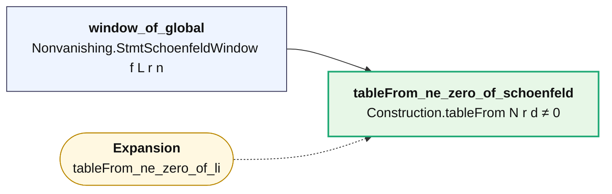

# `lean/Schoenfeld.lean`

Schoenfeld — stage 3's interface: the literature sentence, verbatim. `Expansion.tableFrom_ne_zero_of_li` carries the conditional arrow with `hS` stated window-wise, in bench shape: per-`k` bounds with the power already translated to `2^((r−k)/2)`. Nobody can check that against Schoenfeld 1976 by eye. This module moves the unproven surface to the exact cited sentence:

2 theorems, 1 definition, 126 lines. Arrows are Lean's own record of what each proof uses.

**Imports:** [`Expansion`](../lean/Expansion.md)  
**Imported by:** nothing

## The picture



An arrow A → B reads "A is used in the proof of B". Blue: theorem. Green: a theorem nothing else uses (an end). Dashed: connects to nothing. Red: contains `sorry`. Yellow: theorems in another file, counted; a dotted arrow crosses files. Definitions are not drawn; they are listed below the diagram.

## Definitions

<a name="Schoenfeld-StmtSchoenfeld"></a>
### `Schoenfeld.StmtSchoenfeld`

def · line 37

Schoenfeld 1976, Corollary 1, verbatim shape: for all `x ≥ 2657`, `|π(x) − li(x)| ≤ √x · log x / (8π)`. RH-conditional in the literature; here a named hypothesis over abstract `pi li : ℝ → ℝ`.

- **Is:** `` StmtSchoenfeld (pi li : ℝ → ℝ) : Prop := ∀ x : ℝ, 2657 ≤ x → |pi x - li x| ≤ Real.sqrt x * Real.log x / (8 * Real.pi) ``
- **Used by 2:** [`Schoenfeld.tableFrom_ne_zero_of_schoenfeld`](#Schoenfeld-tableFrom_ne_zero_of_schoenfeld), [`Schoenfeld.window_of_global`](#Schoenfeld-window_of_global)

## Theorems

<a name="Schoenfeld-window_of_global"></a>
### `Schoenfeld.window_of_global`

line 44

**Why.** The bridge: the global sentence implies the bench-shaped window hypothesis whenever the window bottom clears `12`, since `2^12 = 4096 ≥ 2657`. The translation is `√(2^y) = 2^(y/2)` and `log(2^y) = y·log 2`.

**Proves**

```lean
Nonvanishing.StmtSchoenfeldWindow f L r n
```

**Needs** (its hypotheses)

  - `` hpi : StmtSchoenfeld pi li ``
  - `` hf : ∀ m : ℤ, f m = pi ((2 : ℝ) ^ (m : ℝ)) ``
  - `` hL : ∀ m : ℤ, L m = li ((2 : ℝ) ^ (m : ℝ)) ``
  - `` hbot : (12 : ℤ) ≤ r - n ``

**Stated with:** [`Nonvanishing.StmtSchoenfeldWindow`](../lean/Nonvanishing.md#Nonvanishing-StmtSchoenfeldWindow), [`Schoenfeld.StmtSchoenfeld`](#Schoenfeld-StmtSchoenfeld)

**Fed by:** no theorem of this repo; it stands on Mathlib and the definitions below.

**Feeds** (1 that use it)

  - [`Schoenfeld.tableFrom_ne_zero_of_schoenfeld`](#Schoenfeld-tableFrom_ne_zero_of_schoenfeld) — `` Construction.tableFrom N r d ≠ 0 ``

<a name="Schoenfeld-tableFrom_ne_zero_of_schoenfeld"></a>
### `Schoenfeld.tableFrom_ne_zero_of_schoenfeld`

line 86

**Why.** The arrow, with the literature sentence as its one analytic input. Identical to `Expansion.tableFrom_ne_zero_of_li` except that `hS` is replaced by `StmtSchoenfeld` — Schoenfeld's published inequality character for character — plus the compatibility of `f` and `G` with `pi` and `li` at the points `2^m`, and the window bottom raised to `12 ≤ r − (d+1)` so every window point clears Schoenfeld's floor `x ≥ 2657`.

**Proves**

```lean
Construction.tableFrom N r d ≠ 0
```

**Needs** (its hypotheses)

  - `` hG : ContDiff ℝ (⊤ : ℕ∞) G ``
  - `` hG' : ∀ x ∈ Ioi ((1 : ℝ) / 2), HasDerivAt G (Expansion.f2x x) x ``
  - `` hpi : StmtSchoenfeld pi li ``
  - `` hf : ∀ m : ℤ, f m = pi ((2 : ℝ) ^ (m : ℝ)) ``
  - `` hli : ∀ m : ℤ, G (m : ℝ) = li ((2 : ℝ) ^ (m : ℝ)) ``
  - `` hrow : ∀ k ∈ range (d + 2), ((N (r - k) : ℤ) : ℝ) = Nonvanishing.bdiffZ f (r - k) ``
  - `` hr : ((d + 1 : ℕ) : ℤ) ≤ r ``
  - `` hbot : (12 : ℤ) ≤ r - ((d + 1 : ℕ) : ℤ) ``
  - `` hw : 2 * (d : ℝ) ≤ Real.log 2 * ((r : ℝ) - (d + 1)) ``
  - `` hgap : Nonvanishing.Ehigh r (d + 1) < Nonvanishing.Mlow r d ``

**Stated with:** [`Construction.tableFrom`](../lean/Construction.md#Construction-tableFrom), [`Expansion.f2x`](../lean/Expansion.md#Expansion-f2x), [`Nonvanishing.Ehigh`](../lean/Nonvanishing.md#Nonvanishing-Ehigh), [`Nonvanishing.Mlow`](../lean/Nonvanishing.md#Nonvanishing-Mlow), [`Nonvanishing.bdiffZ`](../lean/Nonvanishing.md#Nonvanishing-bdiffZ), [`Schoenfeld.StmtSchoenfeld`](#Schoenfeld-StmtSchoenfeld)

**Fed by** (2 theorems its proof uses)

  - [`Expansion.tableFrom_ne_zero_of_li`](../lean/Expansion.md#Expansion-tableFrom_ne_zero_of_li) (Expansion) — `` Construction.tableFrom N r d ≠ 0 ``
  - [`Schoenfeld.window_of_global`](#Schoenfeld-window_of_global) — `` Nonvanishing.StmtSchoenfeldWindow f L r n ``

**Feeds:** nothing. It is an end.

