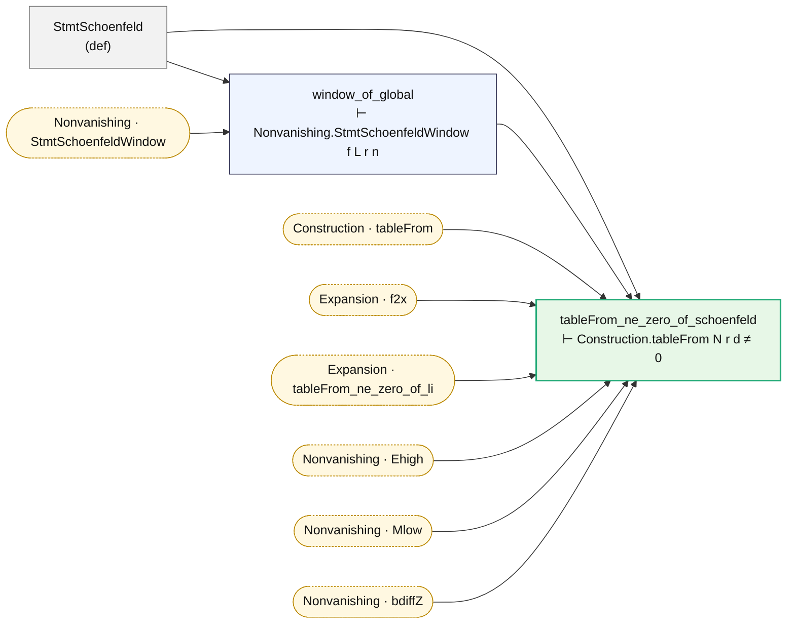

# `lean/Schoenfeld.lean`

**What it does** (its own header): Schoenfeld — stage 3's interface: the literature sentence, verbatim. `Expansion.tableFrom_ne_zero_of_li` carries the conditional arrow with `hS` stated window-wise, in bench shape: per-`k` bounds with the power already translated to `2^((r−k)/2)`. Nobody can check that against Schoenfeld 1976 by eye. This module moves the unproven surface to the exact cited sentence:

**Imports:** [`Expansion`](../lean/Expansion.md).
**Imported by:** nothing.

Blue: theorem. Green: a theorem nothing else uses (an end). Dashed white: connects to nothing. Grey: definition. Red: contains `sorry`. Yellow: in another file. An arrow A → B reads "A is used by B".

## Every declaration

| declaration | proves (output) | needs (input) | why (its own docstring) | uses | used by |
|---|---|---|---|---|---|
| `Schoenfeld.StmtSchoenfeld` def, line 37 | Prop | pi li : ℝ → ℝ | Schoenfeld 1976, Corollary 1, verbatim shape: for all `x ≥ 2657`, `\|π(x) − li(x)\| ≤ √x · log x / (8π)`. RH-conditional in the literature; here a named hypothesis over abstract `pi li : ℝ → ℝ`. | — | `Schoenfeld.tableFrom_ne_zero_of_schoenfeld`, `Schoenfeld.window_of_global` |
| `Schoenfeld.window_of_global` theorem, line 44 | Nonvanishing.StmtSchoenfeldWindow f L r n | hpi : StmtSchoenfeld pi li; hf : ∀ m : ℤ, f m = pi ((2 : ℝ) ^ (m : ℝ)); hL : ∀ m : ℤ, L m = li ((2 : ℝ) ^ (m : ℝ)); hbot : (12 : ℤ) ≤ r - n | The bridge: the global sentence implies the bench-shaped window hypothesis whenever the window bottom clears `12`, since `2^12 = 4096 ≥ 2657`. The translation is `√(2^y) = 2^(y/2)` and `log(2^y) = y·log 2`. | `Nonvanishing.StmtSchoenfeldWindow`, `Schoenfeld.StmtSchoenfeld` | `Schoenfeld.tableFrom_ne_zero_of_schoenfeld` |
| `Schoenfeld.tableFrom_ne_zero_of_schoenfeld` theorem, line 86 | Construction.tableFrom N r d ≠ 0 | hG : ContDiff ℝ (⊤ : ℕ∞) G; hG' : ∀ x ∈ Ioi ((1 : ℝ) / 2), HasDerivAt G (Expansion.f2x x) x; hpi : StmtSchoenfeld pi li; hf : ∀ m : ℤ, f m = pi ((2 : ℝ) ^ (m : ℝ)); hli : ∀ m : ℤ, G (m : ℝ) = li ((2 : ℝ) ^ (m : ℝ)); hrow : ∀ k ∈ range (d + 2), ((N (r - k) : ℤ) : ℝ) = Nonvanishing.bdiffZ f (r - k); hr : ((d + 1 : ℕ) : ℤ) ≤ r; hbot : (12 : ℤ) ≤ r - ((d + 1 : ℕ) : ℤ); hw : 2 * (d : ℝ) ≤ Real.log 2 * ((r : ℝ) - (d + 1)); hgap : Nonvanishing.Ehigh r (d + 1) &lt; Nonvanishing.Mlow r d | The arrow, with the literature sentence as its one analytic input. Identical to `Expansion.tableFrom_ne_zero_of_li` except that `hS` is replaced by `StmtSchoenfeld` — Schoenfeld's published inequality character for character — plus the compatibility of `f` and `G` with `pi` and `li` at the points `2^m`, and the window bottom raised to `12 ≤ r − (d+1)` so eve… | `Construction.tableFrom`, `Expansion.f2x`, `Expansion.tableFrom_ne_zero_of_li`, `Nonvanishing.Ehigh`, `Nonvanishing.Mlow`, `Nonvanishing.bdiffZ`, `Schoenfeld.StmtSchoenfeld`, `Schoenfeld.window_of_global` | — |
