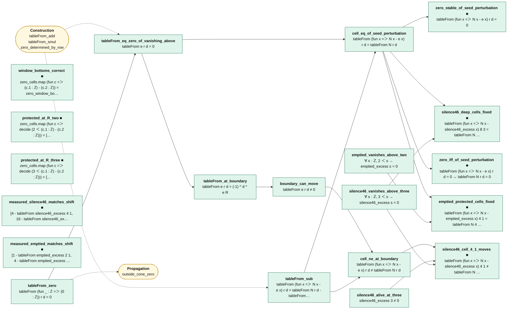

# `lean/SeedPerturbation.lean`

SeedPerturbation — changing the seed convention cannot reach a deep cell. THE QUESTION. The dyadic tables in `imported/lattice_mapper/` are built on a seed convention: the primes 2 and 3 are treated as lattice rather than counted as primes. That is a choice. If a different choice moved the zeros, the zeros would be artefacts of bookkeeping. So: which cells can a change of convention reach?

20 theorems, 8 definitions, 457 lines. Arrows are Lean's own record of what each proof uses.

**Imports:** [`Construction`](../lean/Construction.md)  
**Imported by:** [`Propagation`](../lean/Propagation.md), [`ZeroCells`](../lean/ZeroCells.md)

## The picture



An arrow A → B reads "A is used in the proof of B". Green: counting, integers only. Violet: shape, analysis with no ζ. Blue: reads ζ. A name ending in ■ is an end: nothing else uses it. Red: contains `sorry`. Yellow: theorems in another file, counted; a dotted arrow crosses files. Definitions are not drawn; they are listed below the diagram.

## Definitions

<a name="SeedPerturbation-zero_cells"></a>
### `SeedPerturbation.zero_cells`

def · line 214

The four exact zeros of the dyadic prime table, `(r, d)`. Same list as `Zeros.measured_zeros`, `Construction.measured_zeros`, `PairIdentity.zero_cells`; re-read here from `imported/lattice_mapper/32bit/dyadic_difference_table_32.csv`.

- **Is:** `` zero_cells : List (ℕ × ℕ) := [(2, 1), (4, 1), (8, 3), (20, 6)] ``
- **Used by 6:** [`SeedPerturbation.protected_at_R_three`](#SeedPerturbation-protected_at_R_three), [`SeedPerturbation.protected_at_R_two`](#SeedPerturbation-protected_at_R_two), [`SeedPerturbation.window_bottoms_correct`](#SeedPerturbation-window_bottoms_correct), [`ZeroCells.all_four_have_length_four`](../lean/ZeroCells.md#ZeroCells-all_four_have_length_four), [`ZeroCells.seedPerturbation_all_vanish`](../lean/ZeroCells.md#ZeroCells-seedPerturbation_all_vanish), [`ZeroCells.seedPerturbation_eq`](../lean/ZeroCells.md#ZeroCells-seedPerturbation_eq)

<a name="SeedPerturbation-zero_window_bottoms"></a>
### `SeedPerturbation.zero_window_bottoms`

def · line 217

The window bottoms `r − d` of the four zeros.

- **Is:** `` zero_window_bottoms : List ℤ := [1, 3, 5, 14] ``
- **Used by 1:** [`SeedPerturbation.window_bottoms_correct`](#SeedPerturbation-window_bottoms_correct)

<a name="SeedPerturbation-silence46_excess"></a>
### `SeedPerturbation.silence46_excess`

def · line 247

The measured excess for `silence46`: one silenced number in rung 2, one in rung 3, nothing above.

- **Is:** `` silence46_excess : ℤ → ℤ := fun s => if s = 2 ∨ s = 3 then 1 else 0 ``
- **Used by 5:** [`SeedPerturbation.measured_silence46_matches_shift`](#SeedPerturbation-measured_silence46_matches_shift), [`SeedPerturbation.silence46_alive_at_three`](#SeedPerturbation-silence46_alive_at_three), [`SeedPerturbation.silence46_cell_4_1_moves`](#SeedPerturbation-silence46_cell_4_1_moves), [`SeedPerturbation.silence46_deep_cells_fixed`](#SeedPerturbation-silence46_deep_cells_fixed), [`SeedPerturbation.silence46_vanishes_above_three`](#SeedPerturbation-silence46_vanishes_above_three)

<a name="SeedPerturbation-measured_composite"></a>
### `SeedPerturbation.measured_composite`

def · line 262

Cells `(4,1)`, `(8,3)`, `(20,6)` of `dyadic_composite_difference_table_32.csv`.

- **Is:** `` measured_composite : List ℤ := [4, 16, 8192] ``
- **Used by 0:** nothing

<a name="SeedPerturbation-measured_composite_silence46"></a>
### `SeedPerturbation.measured_composite_silence46`

def · line 266

The same three cells of `dyadic_composite_difference_table_32_silence46.csv`.

- **Is:** `` measured_composite_silence46 : List ℤ := [5, 16, 8192] ``
- **Used by 1:** [`SeedPerturbation.measured_silence46_matches_shift`](#SeedPerturbation-measured_silence46_matches_shift)

<a name="SeedPerturbation-emptied_excess"></a>
### `SeedPerturbation.emptied_excess`

def · line 312

The measured excess for the emptied variant: rung 1 loses one, rung 2 loses two, nothing above.

- **Is:** `` emptied_excess : ℤ → ℤ := fun s => if s = 1 then 1 else if s = 2 then 2 else 0 ``
- **Used by 3:** [`SeedPerturbation.emptied_protected_cells_fixed`](#SeedPerturbation-emptied_protected_cells_fixed), [`SeedPerturbation.emptied_vanishes_above_two`](#SeedPerturbation-emptied_vanishes_above_two), [`SeedPerturbation.measured_emptied_matches_shift`](#SeedPerturbation-measured_emptied_matches_shift)

<a name="SeedPerturbation-measured_composite_four"></a>
### `SeedPerturbation.measured_composite_four`

def · line 324

Cells `(2,1)`, `(4,1)`, `(8,3)`, `(20,6)` of `dyadic_composite_difference_table_32.csv`.

- **Is:** `` measured_composite_four : List ℤ := [1, 4, 16, 8192] ``
- **Used by 0:** nothing

<a name="SeedPerturbation-measured_emptied_four"></a>
### `SeedPerturbation.measured_emptied_four`

def · line 327

The same four cells of `dyadic_composite_extended_emptied_32.csv`.

- **Is:** `` measured_emptied_four : List ℤ := [0, 4, 16, 8192] ``
- **Used by 1:** [`SeedPerturbation.measured_emptied_matches_shift`](#SeedPerturbation-measured_emptied_matches_shift)

## Theorems

<a name="SeedPerturbation-tableFrom_zero"></a>
### `SeedPerturbation.tableFrom_zero`

line 74

**Counting.** Integers only: nothing in its statement or proof, or in anything it rests on, uses analysis or ζ.

**Why.** The zero row builds the zero table.

**Proves**

```lean
tableFrom (fun _ : ℤ => (0 : ℤ)) r d = 0
```

**Needs** (its hypotheses)

  - `` r : ℤ ``
  - `` d : ℕ ``

**Stated with:** [`Construction.tableFrom`](../lean/Construction.md#Construction-tableFrom)

**Fed by:** no theorem of this repo; it stands on Mathlib and the definitions below.

**Feeds** (2 that use it)

  - [`Propagation.outside_cone_zero`](../lean/Propagation.md#Propagation-outside_cone_zero) (Propagation) — `` tableFrom (deltaRow s) r d = 0 ``
  - [`SeedPerturbation.tableFrom_eq_zero_of_vanishing_above`](#SeedPerturbation-tableFrom_eq_zero_of_vanishing_above) — `` tableFrom e r d = 0 ``

<a name="SeedPerturbation-tableFrom_sub"></a>
### `SeedPerturbation.tableFrom_sub`

line 85

**Counting.** Integers only: nothing in its statement or proof, or in anything it rests on, uses analysis or ζ.

**Why.** Linearity, in the form the convention change needs. Replacing the depth-0 row `N` by `N − e` subtracts `tableFrom e` from every cell of the table, at every depth.

**Proves**

```lean
tableFrom (fun x => N x - e x) r d = tableFrom N r d - tableFrom e r d
```

**Needs** (its hypotheses)

  - `` N e : ℤ → ℤ ``
  - `` r : ℤ ``
  - `` d : ℕ ``

**Stated with:** [`Construction.tableFrom`](../lean/Construction.md#Construction-tableFrom)

**Fed by** (2 theorems its proof uses)

  - [`Construction.tableFrom_add`](../lean/Construction.md#Construction-tableFrom_add) (Construction) — `` tableFrom (fun x => N x + M x) r d = tableFrom N r d + tableFrom M r d ``
  - [`Construction.tableFrom_smul`](../lean/Construction.md#Construction-tableFrom_smul) (Construction) — `` tableFrom (fun x => c * N x) r d = c * tableFrom N r d ``

**Feeds** (2 that use it)

  - [`SeedPerturbation.cell_eq_of_seed_perturbation`](#SeedPerturbation-cell_eq_of_seed_perturbation) — `` tableFrom (fun x => N x - e x) r d = tableFrom N r d ``
  - [`SeedPerturbation.cell_ne_at_boundary`](#SeedPerturbation-cell_ne_at_boundary) — `` tableFrom (fun x => N x - e x) r d ≠ tableFrom N r d ``

<a name="SeedPerturbation-tableFrom_eq_zero_of_vanishing_above"></a>
### `SeedPerturbation.tableFrom_eq_zero_of_vanishing_above`

line 108

**Counting.** Integers only: nothing in its statement or proof, or in anything it rests on, uses analysis or ζ.

**Why.** The excess table vanishes past the excess. If `e` is zero on every rung strictly above `R`, then every cell whose window bottom `r − d` clears `R` reads only zeros, so the cell is zero.

**Proves**

```lean
tableFrom e r d = 0
```

**Needs** (its hypotheses)

  - `` he : ∀ s : ℤ, R < s → e s = 0 ``
  - `` r : ℤ ``
  - `` d : ℕ ``
  - `` hrd : R < r - (d : ℤ) ``

**Stated with:** [`Construction.tableFrom`](../lean/Construction.md#Construction-tableFrom)

**Fed by** (2 theorems its proof uses)

  - [`Construction.zero_determined_by_row`](../lean/Construction.md#Construction-zero_determined_by_row) (Construction) — `` tableFrom N r d = tableFrom M r d ``
  - [`SeedPerturbation.tableFrom_zero`](#SeedPerturbation-tableFrom_zero) — `` tableFrom (fun _ : ℤ => (0 : ℤ)) r d = 0 ``

**Feeds** (2 that use it)

  - [`SeedPerturbation.cell_eq_of_seed_perturbation`](#SeedPerturbation-cell_eq_of_seed_perturbation) — `` tableFrom (fun x => N x - e x) r d = tableFrom N r d ``
  - [`SeedPerturbation.tableFrom_at_boundary`](#SeedPerturbation-tableFrom_at_boundary) — `` tableFrom e r d = (-1) ^ d * e R ``

<a name="SeedPerturbation-cell_eq_of_seed_perturbation"></a>
### `SeedPerturbation.cell_eq_of_seed_perturbation`

line 124

**Counting.** Integers only: nothing in its statement or proof, or in anything it rests on, uses analysis or ζ.

**Why.** The claim. Changing the seed convention replaces the depth-0 row `N` by `N − e`. If `e` vanishes on every rung strictly above `R`, then every cell at `(r,d)` with `r − d > R` is IDENTICAL under both conventions.

**Proves**

```lean
tableFrom (fun x => N x - e x) r d = tableFrom N r d
```

**Needs** (its hypotheses)

  - `` he : ∀ s : ℤ, R < s → e s = 0 ``
  - `` r : ℤ ``
  - `` d : ℕ ``
  - `` hrd : R < r - (d : ℤ) ``

**Stated with:** [`Construction.tableFrom`](../lean/Construction.md#Construction-tableFrom)

**Fed by** (2 theorems its proof uses)

  - [`SeedPerturbation.tableFrom_eq_zero_of_vanishing_above`](#SeedPerturbation-tableFrom_eq_zero_of_vanishing_above) — `` tableFrom e r d = 0 ``
  - [`SeedPerturbation.tableFrom_sub`](#SeedPerturbation-tableFrom_sub) — `` tableFrom (fun x => N x - e x) r d = tableFrom N r d - tableFrom e r d ``

**Feeds** (4 that use it)

  - [`SeedPerturbation.emptied_protected_cells_fixed`](#SeedPerturbation-emptied_protected_cells_fixed) — `` tableFrom (fun x => N x - emptied_excess x) 4 1 = tableFrom N 4 1 ∧ tableFrom (fun x => N x - emptied_excess x) 8 3 = tableFrom N 8 3 ∧ tableFrom (fun… ``
  - [`SeedPerturbation.silence46_deep_cells_fixed`](#SeedPerturbation-silence46_deep_cells_fixed) — `` tableFrom (fun x => N x - silence46_excess x) 8 3 = tableFrom N 8 3 ∧ tableFrom (fun x => N x - silence46_excess x) 20 6 = tableFrom N 20 6 ``
  - [`SeedPerturbation.zero_iff_of_seed_perturbation`](#SeedPerturbation-zero_iff_of_seed_perturbation) — `` tableFrom (fun x => N x - e x) r d = 0 ↔ tableFrom N r d = 0 ``
  - [`SeedPerturbation.zero_stable_of_seed_perturbation`](#SeedPerturbation-zero_stable_of_seed_perturbation) — `` tableFrom (fun x => N x - e x) r d = 0 ``

<a name="SeedPerturbation-zero_stable_of_seed_perturbation"></a>
### `SeedPerturbation.zero_stable_of_seed_perturbation`

line 134

**Counting.** Integers only: nothing in its statement or proof, or in anything it rests on, uses analysis or ζ.

**Why.** The corollary. A zero at `(r,d)` with `r − d > R` is a zero under both conventions. The seed convention cannot have put it there and cannot take it away.

**Proves**

```lean
tableFrom (fun x => N x - e x) r d = 0
```

**Needs** (its hypotheses)

  - `` he : ∀ s : ℤ, R < s → e s = 0 ``
  - `` r : ℤ ``
  - `` d : ℕ ``
  - `` hrd : R < r - (d : ℤ) ``
  - `` hz : tableFrom N r d = 0 ``

**Stated with:** [`Construction.tableFrom`](../lean/Construction.md#Construction-tableFrom)

**Fed by** (1 theorem its proof uses)

  - [`SeedPerturbation.cell_eq_of_seed_perturbation`](#SeedPerturbation-cell_eq_of_seed_perturbation) — `` tableFrom (fun x => N x - e x) r d = tableFrom N r d ``

**Feeds:** nothing. It is an end.

<a name="SeedPerturbation-zero_iff_of_seed_perturbation"></a>
### `SeedPerturbation.zero_iff_of_seed_perturbation`

line 143

**Counting.** Integers only: nothing in its statement or proof, or in anything it rests on, uses analysis or ζ.

**Why.** The same statement as an equivalence, which is the honest form: past the excess, the two conventions have the same zero set. Neither direction is a weaker claim than the other.

**Proves**

```lean
tableFrom (fun x => N x - e x) r d = 0 ↔ tableFrom N r d = 0
```

**Needs** (its hypotheses)

  - `` he : ∀ s : ℤ, R < s → e s = 0 ``
  - `` r : ℤ ``
  - `` d : ℕ ``
  - `` hrd : R < r - (d : ℤ) ``

**Stated with:** [`Construction.tableFrom`](../lean/Construction.md#Construction-tableFrom)

**Fed by** (1 theorem its proof uses)

  - [`SeedPerturbation.cell_eq_of_seed_perturbation`](#SeedPerturbation-cell_eq_of_seed_perturbation) — `` tableFrom (fun x => N x - e x) r d = tableFrom N r d ``

**Feeds:** nothing. It is an end.

<a name="SeedPerturbation-tableFrom_at_boundary"></a>
### `SeedPerturbation.tableFrom_at_boundary`

line 157

**Counting.** Integers only: nothing in its statement or proof, or in anything it rests on, uses analysis or ζ.

**Why.** The boundary cell, exactly. When the window bottom sits on `R` itself, `d` backward differences leave `(−1)^d · e R` — the whole excess, signed. Every higher entry of the window is already zero, so the bottom entry is all there is.

**Proves**

```lean
tableFrom e r d = (-1) ^ d * e R
```

**Needs** (its hypotheses)

  - `` he : ∀ s : ℤ, R < s → e s = 0 ``
  - `` r : ℤ ``
  - `` d : ℕ ``
  - `` hrd : r - (d : ℤ) = R ``

**Stated with:** [`Construction.tableFrom`](../lean/Construction.md#Construction-tableFrom)

**Fed by** (1 theorem its proof uses)

  - [`SeedPerturbation.tableFrom_eq_zero_of_vanishing_above`](#SeedPerturbation-tableFrom_eq_zero_of_vanishing_above) — `` tableFrom e r d = 0 ``

**Feeds** (1 that use it)

  - [`SeedPerturbation.boundary_can_move`](#SeedPerturbation-boundary_can_move) — `` tableFrom e r d ≠ 0 ``

<a name="SeedPerturbation-boundary_can_move"></a>
### `SeedPerturbation.boundary_can_move`

line 177

**Counting.** Integers only: nothing in its statement or proof, or in anything it rests on, uses analysis or ζ.

**Why.** `r − d > R` cannot be relaxed to `r − d ≥ R`. Take `R` to be the largest rung where `e` is non-zero, which is what `R_e` means. Then every cell with `r − d = R` moves, by exactly `±e R`. The strict inequality is not slack in the proof; it is the boundary.

**Proves**

```lean
tableFrom e r d ≠ 0
```

**Needs** (its hypotheses)

  - `` he : ∀ s : ℤ, R < s → e s = 0 ``
  - `` r : ℤ ``
  - `` d : ℕ ``
  - `` hrd : r - (d : ℤ) = R ``
  - `` hne : e R ≠ 0 ``

**Stated with:** [`Construction.tableFrom`](../lean/Construction.md#Construction-tableFrom)

**Fed by** (1 theorem its proof uses)

  - [`SeedPerturbation.tableFrom_at_boundary`](#SeedPerturbation-tableFrom_at_boundary) — `` tableFrom e r d = (-1) ^ d * e R ``

**Feeds** (1 that use it)

  - [`SeedPerturbation.cell_ne_at_boundary`](#SeedPerturbation-cell_ne_at_boundary) — `` tableFrom (fun x => N x - e x) r d ≠ tableFrom N r d ``

<a name="SeedPerturbation-cell_ne_at_boundary"></a>
### `SeedPerturbation.cell_ne_at_boundary`

line 185

**Counting.** Integers only: nothing in its statement or proof, or in anything it rests on, uses analysis or ζ.

**Why.** The same fact said about the two conventions rather than about `e`: at the boundary the cell genuinely differs.

**Proves**

```lean
tableFrom (fun x => N x - e x) r d ≠ tableFrom N r d
```

**Needs** (its hypotheses)

  - `` he : ∀ s : ℤ, R < s → e s = 0 ``
  - `` r : ℤ ``
  - `` d : ℕ ``
  - `` hrd : r - (d : ℤ) = R ``
  - `` hne : e R ≠ 0 ``

**Stated with:** [`Construction.tableFrom`](../lean/Construction.md#Construction-tableFrom)

**Fed by** (2 theorems its proof uses)

  - [`SeedPerturbation.boundary_can_move`](#SeedPerturbation-boundary_can_move) — `` tableFrom e r d ≠ 0 ``
  - [`SeedPerturbation.tableFrom_sub`](#SeedPerturbation-tableFrom_sub) — `` tableFrom (fun x => N x - e x) r d = tableFrom N r d - tableFrom e r d ``

**Feeds** (1 that use it)

  - [`SeedPerturbation.silence46_cell_4_1_moves`](#SeedPerturbation-silence46_cell_4_1_moves) — `` tableFrom (fun x => N x - silence46_excess x) 4 1 ≠ tableFrom N 4 1 ``

<a name="SeedPerturbation-window_bottoms_correct"></a>
### `SeedPerturbation.window_bottoms_correct`

line 221

**Counting.** Integers only: nothing in its statement or proof, or in anything it rests on, uses analysis or ζ.

**Why.** The window bottoms `r − d` of the four zeros are `1, 3, 5, 14`, computed rather than transcribed.

**Proves**

```lean
zero_cells.map (fun c => (c.1 : ℤ) - (c.2 : ℤ)) = zero_window_bottoms
```

**Stated with:** [`SeedPerturbation.zero_cells`](#SeedPerturbation-zero_cells), [`SeedPerturbation.zero_window_bottoms`](#SeedPerturbation-zero_window_bottoms)

**Fed by:** no theorem of this repo; it stands on Mathlib and the definitions below.

**Feeds:** nothing. It is an end.

<a name="SeedPerturbation-protected_at_R_two"></a>
### `SeedPerturbation.protected_at_R_two`

line 227

**Counting.** Integers only: nothing in its statement or proof, or in anything it rests on, uses analysis or ζ.

**Why.** Which zeros the theorem protects when 2 and 3 are the excluded primes. `R_e = 2`, so `(2,1)` is unprotected and the other three are fixed. This is the prediction, stated before looking at any perturbed table.

**Proves**

```lean
zero_cells.map (fun c => decide (2 < (c.1 : ℤ) - (c.2 : ℤ))) = [false, true, true, true]
```

**Stated with:** [`SeedPerturbation.zero_cells`](#SeedPerturbation-zero_cells)

**Fed by:** no theorem of this repo; it stands on Mathlib and the definitions below.

**Feeds:** nothing. It is an end.

<a name="SeedPerturbation-protected_at_R_three"></a>
### `SeedPerturbation.protected_at_R_three`

line 233

**Counting.** Integers only: nothing in its statement or proof, or in anything it rests on, uses analysis or ζ.

**Why.** And when the excess reaches rung 3 — which `silence46` does, since 6 sits in `(4,8]`. Now `(4,1)` falls to the boundary as well.

**Proves**

```lean
zero_cells.map (fun c => decide (3 < (c.1 : ℤ) - (c.2 : ℤ))) = [false, false, true, true]
```

**Stated with:** [`SeedPerturbation.zero_cells`](#SeedPerturbation-zero_cells)

**Fed by:** no theorem of this repo; it stands on Mathlib and the definitions below.

**Feeds:** nothing. It is an end.

<a name="SeedPerturbation-silence46_vanishes_above_three"></a>
### `SeedPerturbation.silence46_vanishes_above_three`

line 251

**Counting.** Integers only: nothing in its statement or proof, or in anything it rests on, uses analysis or ζ.

**Why.** The `silence46` excess is confined to rungs 2 and 3 — the hypothesis `cell_eq_of_seed_perturbation` needs, at `R_e = 3`.

**Proves**

```lean
∀ s : ℤ, 3 < s → silence46_excess s = 0
```

**Stated with:** [`SeedPerturbation.silence46_excess`](#SeedPerturbation-silence46_excess)

**Fed by:** no theorem of this repo; it stands on Mathlib and the definitions below.

**Feeds** (2 that use it)

  - [`SeedPerturbation.silence46_cell_4_1_moves`](#SeedPerturbation-silence46_cell_4_1_moves) — `` tableFrom (fun x => N x - silence46_excess x) 4 1 ≠ tableFrom N 4 1 ``
  - [`SeedPerturbation.silence46_deep_cells_fixed`](#SeedPerturbation-silence46_deep_cells_fixed) — `` tableFrom (fun x => N x - silence46_excess x) 8 3 = tableFrom N 8 3 ∧ tableFrom (fun x => N x - silence46_excess x) 20 6 = tableFrom N 20 6 ``

<a name="SeedPerturbation-silence46_alive_at_three"></a>
### `SeedPerturbation.silence46_alive_at_three`

line 258

**Counting.** Integers only: nothing in its statement or proof, or in anything it rests on, uses analysis or ζ.

**Why.** And rung 3 genuinely carries excess, so `boundary_can_move` has its `e R ≠ 0`.

**Proves**

```lean
silence46_excess 3 ≠ 0
```

**Stated with:** [`SeedPerturbation.silence46_excess`](#SeedPerturbation-silence46_excess)

**Fed by:** no theorem of this repo; it stands on Mathlib and the definitions below.

**Feeds** (1 that use it)

  - [`SeedPerturbation.silence46_cell_4_1_moves`](#SeedPerturbation-silence46_cell_4_1_moves) — `` tableFrom (fun x => N x - silence46_excess x) 4 1 ≠ tableFrom N 4 1 ``

<a name="SeedPerturbation-measured_silence46_matches_shift"></a>
### `SeedPerturbation.measured_silence46_matches_shift`

line 275

**Counting.** Integers only: nothing in its statement or proof, or in anything it rests on, uses analysis or ζ.

**Why.** The falsifier. Subtracting `tableFrom silence46_excess` from the three measured base cells reproduces the three measured silenced cells exactly — including the one that MOVED. `(4,1)` sits at `r − d = 3 = R_e`, and the shift `tableFrom e 4 1 = −1` carries 4 to 5, which is what the file says. `(8,3)` and `(20,6)` clear `R_e` and do not move.

**Proves**

```lean
[4 - tableFrom silence46_excess 4 1, 16 - tableFrom silence46_excess 8 3, 8192 - tableFrom silence46_excess 20 6] = measured_composite_silence46
```

**Stated with:** [`Construction.tableFrom`](../lean/Construction.md#Construction-tableFrom), [`SeedPerturbation.measured_composite_silence46`](#SeedPerturbation-measured_composite_silence46), [`SeedPerturbation.silence46_excess`](#SeedPerturbation-silence46_excess)

**Fed by:** no theorem of this repo; it stands on Mathlib and the definitions below.

**Feeds:** nothing. It is an end.

<a name="SeedPerturbation-silence46_deep_cells_fixed"></a>
### `SeedPerturbation.silence46_deep_cells_fixed`

line 284

**Counting.** Integers only: nothing in its statement or proof, or in anything it rests on, uses analysis or ζ.

**Why.** The two deep cells are protected by the theorem, not by arithmetic luck: `8 − 3 = 5 > 3` and `20 − 6 = 14 > 3`, so `cell_eq_of_seed_perturbation` applies and no computation is needed.

**Proves**

```lean
tableFrom (fun x => N x - silence46_excess x) 8 3 = tableFrom N 8 3 ∧ tableFrom (fun x => N x - silence46_excess x) 20 6 = tableFrom N 20 6
```

**Needs** (its hypotheses)

  - `` N : ℤ → ℤ ``

**Stated with:** [`Construction.tableFrom`](../lean/Construction.md#Construction-tableFrom), [`SeedPerturbation.silence46_excess`](#SeedPerturbation-silence46_excess)

**Fed by** (2 theorems its proof uses)

  - [`SeedPerturbation.cell_eq_of_seed_perturbation`](#SeedPerturbation-cell_eq_of_seed_perturbation) — `` tableFrom (fun x => N x - e x) r d = tableFrom N r d ``
  - [`SeedPerturbation.silence46_vanishes_above_three`](#SeedPerturbation-silence46_vanishes_above_three) — `` ∀ s : ℤ, 3 < s → silence46_excess s = 0 ``

**Feeds:** nothing. It is an end.

<a name="SeedPerturbation-silence46_cell_4_1_moves"></a>
### `SeedPerturbation.silence46_cell_4_1_moves`

line 292

**Counting.** Integers only: nothing in its statement or proof, or in anything it rests on, uses analysis or ζ.

**Why.** And `(4,1)` is not protected, for the reason the theorem gives rather than by inspection: `4 − 1 = 3 = R_e`, so `boundary_can_move` fires.

**Proves**

```lean
tableFrom (fun x => N x - silence46_excess x) 4 1 ≠ tableFrom N 4 1
```

**Needs** (its hypotheses)

  - `` N : ℤ → ℤ ``

**Stated with:** [`Construction.tableFrom`](../lean/Construction.md#Construction-tableFrom), [`SeedPerturbation.silence46_excess`](#SeedPerturbation-silence46_excess)

**Fed by** (3 theorems its proof uses)

  - [`SeedPerturbation.cell_ne_at_boundary`](#SeedPerturbation-cell_ne_at_boundary) — `` tableFrom (fun x => N x - e x) r d ≠ tableFrom N r d ``
  - [`SeedPerturbation.silence46_alive_at_three`](#SeedPerturbation-silence46_alive_at_three) — `` silence46_excess 3 ≠ 0 ``
  - [`SeedPerturbation.silence46_vanishes_above_three`](#SeedPerturbation-silence46_vanishes_above_three) — `` ∀ s : ℤ, 3 < s → silence46_excess s = 0 ``

**Feeds:** nothing. It is an end.

<a name="SeedPerturbation-emptied_vanishes_above_two"></a>
### `SeedPerturbation.emptied_vanishes_above_two`

line 316

**Counting.** Integers only: nothing in its statement or proof, or in anything it rests on, uses analysis or ζ.

**Why.** The emptied variant's excess is confined to rungs 1 and 2 — `R_e = 2`, the same profile as excluding the primes 2 and 3.

**Proves**

```lean
∀ s : ℤ, 2 < s → emptied_excess s = 0
```

**Stated with:** [`SeedPerturbation.emptied_excess`](#SeedPerturbation-emptied_excess)

**Fed by:** no theorem of this repo; it stands on Mathlib and the definitions below.

**Feeds** (1 that use it)

  - [`SeedPerturbation.emptied_protected_cells_fixed`](#SeedPerturbation-emptied_protected_cells_fixed) — `` tableFrom (fun x => N x - emptied_excess x) 4 1 = tableFrom N 4 1 ∧ tableFrom (fun x => N x - emptied_excess x) 8 3 = tableFrom N 8 3 ∧ tableFrom (fun… ``

<a name="SeedPerturbation-measured_emptied_matches_shift"></a>
### `SeedPerturbation.measured_emptied_matches_shift`

line 333

**Counting.** Integers only: nothing in its statement or proof, or in anything it rests on, uses analysis or ζ.

**Why.** The second falsifier, at `R_e = 2`. The three cells the theorem protects are unmoved in the file, and the one it does not protect — `(2,1)`, window bottom `1` — moved from 1 to 0, by exactly the predicted shift `tableFrom e 2 1 = e 2 − e 1 = 1`.

**Proves**

```lean
[1 - tableFrom emptied_excess 2 1, 4 - tableFrom emptied_excess 4 1, 16 - tableFrom emptied_excess 8 3, 8192 - tableFrom emptied_excess 20 6] = measured_emptied_four
```

**Stated with:** [`Construction.tableFrom`](../lean/Construction.md#Construction-tableFrom), [`SeedPerturbation.emptied_excess`](#SeedPerturbation-emptied_excess), [`SeedPerturbation.measured_emptied_four`](#SeedPerturbation-measured_emptied_four)

**Fed by:** no theorem of this repo; it stands on Mathlib and the definitions below.

**Feeds:** nothing. It is an end.

<a name="SeedPerturbation-emptied_protected_cells_fixed"></a>
### `SeedPerturbation.emptied_protected_cells_fixed`

line 342

**Counting.** Integers only: nothing in its statement or proof, or in anything it rests on, uses analysis or ζ.

**Why.** The three protected cells, again by theorem rather than by computation: `4 − 1 = 3 > 2`, `8 − 3 = 5 > 2`, `20 − 6 = 14 > 2`.

**Proves**

```lean
tableFrom (fun x => N x - emptied_excess x) 4 1 = tableFrom N 4 1 ∧ tableFrom (fun x => N x - emptied_excess x) 8 3 = tableFrom N 8 3 ∧ tableFrom (fun x => N x - emptied_excess x) 20 6 = tableFrom N 20 6
```

**Needs** (its hypotheses)

  - `` N : ℤ → ℤ ``

**Stated with:** [`Construction.tableFrom`](../lean/Construction.md#Construction-tableFrom), [`SeedPerturbation.emptied_excess`](#SeedPerturbation-emptied_excess)

**Fed by** (2 theorems its proof uses)

  - [`SeedPerturbation.cell_eq_of_seed_perturbation`](#SeedPerturbation-cell_eq_of_seed_perturbation) — `` tableFrom (fun x => N x - e x) r d = tableFrom N r d ``
  - [`SeedPerturbation.emptied_vanishes_above_two`](#SeedPerturbation-emptied_vanishes_above_two) — `` ∀ s : ℤ, 2 < s → emptied_excess s = 0 ``

**Feeds:** nothing. It is an end.

