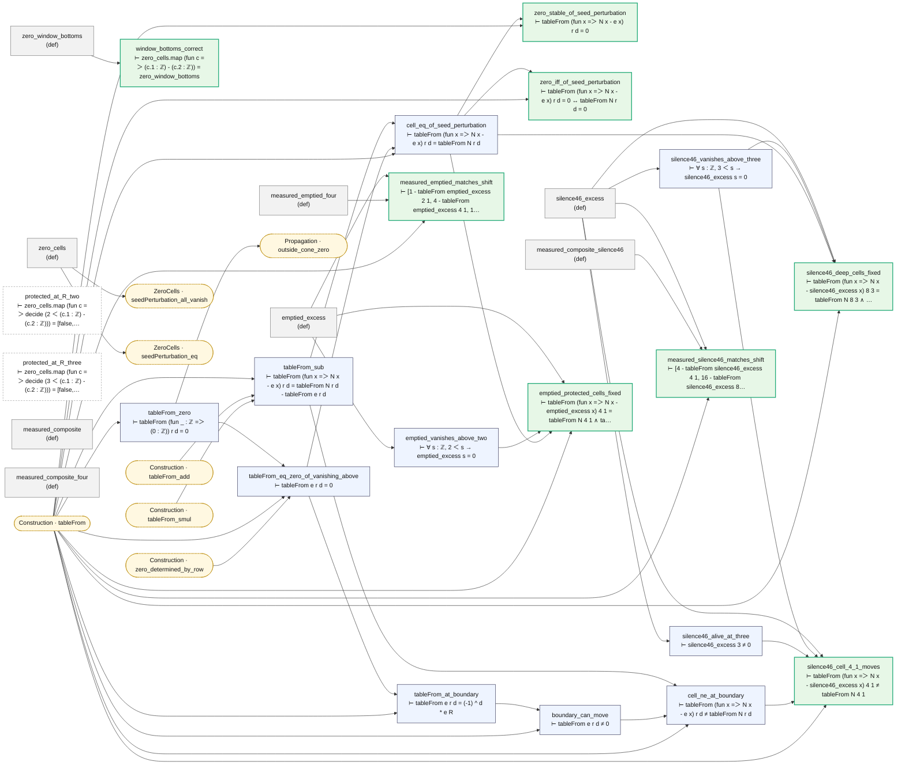

# `lean/SeedPerturbation.lean`

**What it does** (its own header): SeedPerturbation — changing the seed convention cannot reach a deep cell. THE QUESTION. The dyadic tables in `imported/lattice_mapper/` are built on a seed convention: the primes 2 and 3 are treated as lattice rather than counted as primes. That is a choice. If a different choice moved the zeros, the zeros would be artefacts of bookkeeping. So: which cells can a change of convention reach?

**Imports:** [`Construction`](../lean/Construction.md).
**Imported by:** [`Propagation`](../lean/Propagation.md), [`ZeroCells`](../lean/ZeroCells.md).

Blue: theorem. Green: a theorem nothing else uses (an end). Dashed white: connects to nothing. Grey: definition. Red: contains `sorry`. Yellow: in another file. An arrow A → B reads "A is used by B".

## Every declaration

| declaration | proves (output) | needs (input) | why (its own docstring) | uses | used by |
|---|---|---|---|---|---|
| `SeedPerturbation.tableFrom_zero` theorem, line 74 | tableFrom (fun _ : ℤ =&gt; (0 : ℤ)) r d = 0 | r : ℤ; d : ℕ | The zero row builds the zero table. | `Construction.tableFrom` | `Propagation.outside_cone_zero`, `SeedPerturbation.tableFrom_eq_zero_of_vanishing_above` |
| `SeedPerturbation.tableFrom_sub` theorem, line 85 | tableFrom (fun x =&gt; N x - e x) r d = tableFrom N r d - tableFrom e r d | N e : ℤ → ℤ; r : ℤ; d : ℕ | Linearity, in the form the convention change needs. Replacing the depth-0 row `N` by `N − e` subtracts `tableFrom e` from every cell of the table, at every depth. | `Construction.tableFrom`, `Construction.tableFrom_add`, `Construction.tableFrom_smul` | `SeedPerturbation.cell_eq_of_seed_perturbation`, `SeedPerturbation.cell_ne_at_boundary` |
| `SeedPerturbation.tableFrom_eq_zero_of_vanishing_above` theorem, line 108 | tableFrom e r d = 0 | he : ∀ s : ℤ, R &lt; s → e s = 0; r : ℤ; d : ℕ; hrd : R &lt; r - (d : ℤ) | The excess table vanishes past the excess. If `e` is zero on every rung strictly above `R`, then every cell whose window bottom `r − d` clears `R` reads only zeros, so the cell is zero. | `Construction.tableFrom`, `Construction.zero_determined_by_row`, `SeedPerturbation.tableFrom_zero` | `SeedPerturbation.cell_eq_of_seed_perturbation`, `SeedPerturbation.tableFrom_at_boundary` |
| `SeedPerturbation.cell_eq_of_seed_perturbation` theorem, line 124 | tableFrom (fun x =&gt; N x - e x) r d = tableFrom N r d | he : ∀ s : ℤ, R &lt; s → e s = 0; r : ℤ; d : ℕ; hrd : R &lt; r - (d : ℤ) | The claim. Changing the seed convention replaces the depth-0 row `N` by `N − e`. If `e` vanishes on every rung strictly above `R`, then every cell at `(r,d)` with `r − d &gt; R` is IDENTICAL under both conventions. | `Construction.tableFrom`, `SeedPerturbation.tableFrom_eq_zero_of_vanishing_above`, `SeedPerturbation.tableFrom_sub` | `SeedPerturbation.emptied_protected_cells_fixed`, `SeedPerturbation.silence46_deep_cells_fixed`, `SeedPerturbation.zero_iff_of_seed_perturbation`, `SeedPerturbation.zero_stable_of_seed_perturbation` |
| `SeedPerturbation.zero_stable_of_seed_perturbation` theorem, line 134 | tableFrom (fun x =&gt; N x - e x) r d = 0 | he : ∀ s : ℤ, R &lt; s → e s = 0; r : ℤ; d : ℕ; hrd : R &lt; r - (d : ℤ); hz : tableFrom N r d = 0 | The corollary. A zero at `(r,d)` with `r − d &gt; R` is a zero under both conventions. The seed convention cannot have put it there and cannot take it away. | `Construction.tableFrom`, `SeedPerturbation.cell_eq_of_seed_perturbation` | — |
| `SeedPerturbation.zero_iff_of_seed_perturbation` theorem, line 143 | tableFrom (fun x =&gt; N x - e x) r d = 0 ↔ tableFrom N r d = 0 | he : ∀ s : ℤ, R &lt; s → e s = 0; r : ℤ; d : ℕ; hrd : R &lt; r - (d : ℤ) | The same statement as an equivalence, which is the honest form: past the excess, the two conventions have the same zero set. Neither direction is a weaker claim than the other. | `Construction.tableFrom`, `SeedPerturbation.cell_eq_of_seed_perturbation` | — |
| `SeedPerturbation.tableFrom_at_boundary` theorem, line 157 | tableFrom e r d = (-1) ^ d * e R | he : ∀ s : ℤ, R &lt; s → e s = 0; r : ℤ; d : ℕ; hrd : r - (d : ℤ) = R | The boundary cell, exactly. When the window bottom sits on `R` itself, `d` backward differences leave `(−1)^d · e R` — the whole excess, signed. Every higher entry of the window is already zero, so the bottom entry is all there is. | `Construction.tableFrom`, `SeedPerturbation.tableFrom_eq_zero_of_vanishing_above` | `SeedPerturbation.boundary_can_move` |
| `SeedPerturbation.boundary_can_move` theorem, line 177 | tableFrom e r d ≠ 0 | he : ∀ s : ℤ, R &lt; s → e s = 0; r : ℤ; d : ℕ; hrd : r - (d : ℤ) = R; hne : e R ≠ 0 | `r − d &gt; R` cannot be relaxed to `r − d ≥ R`. Take `R` to be the largest rung where `e` is non-zero, which is what `R_e` means. Then every cell with `r − d = R` moves, by exactly `±e R`. The strict inequality is not slack in the proof; it is the boundary. | `Construction.tableFrom`, `SeedPerturbation.tableFrom_at_boundary` | `SeedPerturbation.cell_ne_at_boundary` |
| `SeedPerturbation.cell_ne_at_boundary` theorem, line 185 | tableFrom (fun x =&gt; N x - e x) r d ≠ tableFrom N r d | he : ∀ s : ℤ, R &lt; s → e s = 0; r : ℤ; d : ℕ; hrd : r - (d : ℤ) = R; hne : e R ≠ 0 | The same fact said about the two conventions rather than about `e`: at the boundary the cell genuinely differs. | `Construction.tableFrom`, `SeedPerturbation.boundary_can_move`, `SeedPerturbation.tableFrom_sub` | `SeedPerturbation.silence46_cell_4_1_moves` |
| `SeedPerturbation.zero_cells` def, line 214 | List (ℕ × ℕ) | — | The four exact zeros of the dyadic prime table, `(r, d)`. Same list as `Zeros.measured_zeros`, `Construction.measured_zeros`, `PairIdentity.zero_cells`; re-read here from `imported/lattice_mapper/32bit/dyadic_difference_table_32.csv`. | — | `ZeroCells.seedPerturbation_all_vanish`, `ZeroCells.seedPerturbation_eq` |
| `SeedPerturbation.zero_window_bottoms` def, line 217 | List ℤ | — | The window bottoms `r − d` of the four zeros. | — | `SeedPerturbation.window_bottoms_correct` |
| `SeedPerturbation.window_bottoms_correct` theorem, line 221 | zero_cells.map (fun c =&gt; (c.1 : ℤ) - (c.2 : ℤ)) = zero_window_bottoms | — | The window bottoms `r − d` of the four zeros are `1, 3, 5, 14`, computed rather than transcribed. | `SeedPerturbation.zero_window_bottoms` | — |
| `SeedPerturbation.protected_at_R_two` theorem, line 227 | zero_cells.map (fun c =&gt; decide (2 &lt; (c.1 : ℤ) - (c.2 : ℤ))) = [false, true, true, true] | — | Which zeros the theorem protects when 2 and 3 are the excluded primes. `R_e = 2`, so `(2,1)` is unprotected and the other three are fixed. This is the prediction, stated before looking at any perturbed table. | — | — |
| `SeedPerturbation.protected_at_R_three` theorem, line 233 | zero_cells.map (fun c =&gt; decide (3 &lt; (c.1 : ℤ) - (c.2 : ℤ))) = [false, false, true, true] | — | And when the excess reaches rung 3 — which `silence46` does, since 6 sits in `(4,8]`. Now `(4,1)` falls to the boundary as well. | — | — |
| `SeedPerturbation.silence46_excess` def, line 247 | ℤ → ℤ | — | The measured excess for `silence46`: one silenced number in rung 2, one in rung 3, nothing above. | — | `SeedPerturbation.measured_silence46_matches_shift`, `SeedPerturbation.silence46_alive_at_three`, `SeedPerturbation.silence46_cell_4_1_moves`, `SeedPerturbation.silence46_deep_cells_fixed`, `SeedPerturbation.silence46_vanishes_above_three` |
| `SeedPerturbation.silence46_vanishes_above_three` theorem, line 251 | ∀ s : ℤ, 3 &lt; s → silence46_excess s = 0 | — | The `silence46` excess is confined to rungs 2 and 3 — the hypothesis `cell_eq_of_seed_perturbation` needs, at `R_e = 3`. | `SeedPerturbation.silence46_excess` | `SeedPerturbation.silence46_cell_4_1_moves`, `SeedPerturbation.silence46_deep_cells_fixed` |
| `SeedPerturbation.silence46_alive_at_three` theorem, line 258 | silence46_excess 3 ≠ 0 | — | And rung 3 genuinely carries excess, so `boundary_can_move` has its `e R ≠ 0`. | `SeedPerturbation.silence46_excess` | `SeedPerturbation.silence46_cell_4_1_moves` |
| `SeedPerturbation.measured_composite` def, line 262 | List ℤ | — | Cells `(4,1)`, `(8,3)`, `(20,6)` of `dyadic_composite_difference_table_32.csv`. | — | — |
| `SeedPerturbation.measured_composite_silence46` def, line 266 | List ℤ | — | The same three cells of `dyadic_composite_difference_table_32_silence46.csv`. | — | `SeedPerturbation.measured_silence46_matches_shift` |
| `SeedPerturbation.measured_silence46_matches_shift` theorem, line 275 | [4 - tableFrom silence46_excess 4 1, 16 - tableFrom silence46_excess 8 3, 8192 - tableFrom silence46_excess 20 6] = measured_composite_silence46 | — | The falsifier. Subtracting `tableFrom silence46_excess` from the three measured base cells reproduces the three measured silenced cells exactly — including the one that MOVED. `(4,1)` sits at `r − d = 3 = R_e`, and the shift `tableFrom e 4 1 = −1` carries 4 to 5, which is what the file says. `(8,3)` and `(20,6)` clear `R_e` and do not move. | `Construction.tableFrom`, `SeedPerturbation.measured_composite_silence46`, `SeedPerturbation.silence46_excess` | — |
| `SeedPerturbation.silence46_deep_cells_fixed` theorem, line 284 | tableFrom (fun x =&gt; N x - silence46_excess x) 8 3 = tableFrom N 8 3 ∧ tableFrom (fun x =&gt; N x - silence46_excess x) 20 6 = tableFrom N 20 6 | N : ℤ → ℤ | The two deep cells are protected by the theorem, not by arithmetic luck: `8 − 3 = 5 &gt; 3` and `20 − 6 = 14 &gt; 3`, so `cell_eq_of_seed_perturbation` applies and no computation is needed. | `Construction.tableFrom`, `SeedPerturbation.cell_eq_of_seed_perturbation`, `SeedPerturbation.silence46_excess`, `SeedPerturbation.silence46_vanishes_above_three` | — |
| `SeedPerturbation.silence46_cell_4_1_moves` theorem, line 292 | tableFrom (fun x =&gt; N x - silence46_excess x) 4 1 ≠ tableFrom N 4 1 | N : ℤ → ℤ | And `(4,1)` is not protected, for the reason the theorem gives rather than by inspection: `4 − 1 = 3 = R_e`, so `boundary_can_move` fires. | `Construction.tableFrom`, `SeedPerturbation.cell_ne_at_boundary`, `SeedPerturbation.silence46_alive_at_three`, `SeedPerturbation.silence46_excess`, `SeedPerturbation.silence46_vanishes_above_three` | — |
| `SeedPerturbation.emptied_excess` def, line 312 | ℤ → ℤ | — | The measured excess for the emptied variant: rung 1 loses one, rung 2 loses two, nothing above. | — | `SeedPerturbation.emptied_protected_cells_fixed`, `SeedPerturbation.emptied_vanishes_above_two`, `SeedPerturbation.measured_emptied_matches_shift` |
| `SeedPerturbation.emptied_vanishes_above_two` theorem, line 316 | ∀ s : ℤ, 2 &lt; s → emptied_excess s = 0 | — | The emptied variant's excess is confined to rungs 1 and 2 — `R_e = 2`, the same profile as excluding the primes 2 and 3. | `SeedPerturbation.emptied_excess` | `SeedPerturbation.emptied_protected_cells_fixed` |
| `SeedPerturbation.measured_composite_four` def, line 324 | List ℤ | — | Cells `(2,1)`, `(4,1)`, `(8,3)`, `(20,6)` of `dyadic_composite_difference_table_32.csv`. | — | — |
| `SeedPerturbation.measured_emptied_four` def, line 327 | List ℤ | — | The same four cells of `dyadic_composite_extended_emptied_32.csv`. | — | `SeedPerturbation.measured_emptied_matches_shift` |
| `SeedPerturbation.measured_emptied_matches_shift` theorem, line 333 | [1 - tableFrom emptied_excess 2 1, 4 - tableFrom emptied_excess 4 1, 16 - tableFrom emptied_excess 8 3, 8192 - tableFrom emptied_excess 20 6] = measured_emptied_four | — | The second falsifier, at `R_e = 2`. The three cells the theorem protects are unmoved in the file, and the one it does not protect — `(2,1)`, window bottom `1` — moved from 1 to 0, by exactly the predicted shift `tableFrom e 2 1 = e 2 − e 1 = 1`. | `Construction.tableFrom`, `SeedPerturbation.emptied_excess`, `SeedPerturbation.measured_emptied_four` | — |
| `SeedPerturbation.emptied_protected_cells_fixed` theorem, line 342 | tableFrom (fun x =&gt; N x - emptied_excess x) 4 1 = tableFrom N 4 1 ∧ tableFrom (fun x =&gt; N x - emptied_excess x) 8 3 = tableFrom N 8 3 ∧ tableFrom (fun x =&gt; N x - emptied_excess x) 20 6 = tableFrom N 20 6 | N : ℤ → ℤ | The three protected cells, again by theorem rather than by computation: `4 − 1 = 3 &gt; 2`, `8 − 3 = 5 &gt; 2`, `20 − 6 = 14 &gt; 2`. | `Construction.tableFrom`, `SeedPerturbation.cell_eq_of_seed_perturbation`, `SeedPerturbation.emptied_excess`, `SeedPerturbation.emptied_vanishes_above_two` | — |
