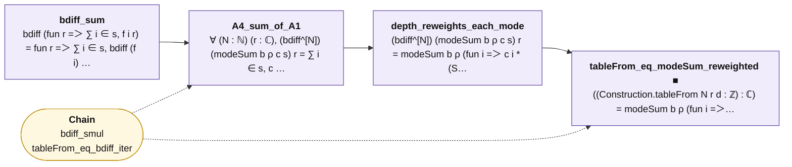

# `lean/Superposition.lean`

Superposition — the missing licence for building the residual from the zeros. `Chain.A4_of_A1` gives the depth-N gain for a SINGLE mode. Every use of it on the bench applies it to a SUM over zeta zeros (O34, O35). Nothing so far permits that step. This file supplies it, and nothing else.

4 theorems, 1 definition, 122 lines. Arrows are Lean's own record of what each proof uses.

**Imports:** [`Chain`](../lean/Chain.md)  
**Imported by:** nothing

## The picture



An arrow A → B reads "A is used in the proof of B". Green: counting, integers only. Violet: shape, analysis with no ζ. Blue: reads ζ. A name ending in ■ is an end: nothing else uses it. Red: contains `sorry`. Yellow: theorems in another file, counted; a dotted arrow crosses files. Definitions are not drawn; they are listed below the diagram.

## Definitions

<a name="Superposition-modeSum"></a>
### `Superposition.modeSum`

def · line 21

A finite superposition of ladder modes.

- **Is:** `` modeSum (b : ℝ) (ρ : ι → ℂ) (c : ι → ℂ) (s : Finset ι) : ℂ → ℂ := fun r => ∑ i ∈ s, c i * mode b (ρ i) r ``
- **Built from:** [`Chain.mode`](../lean/Chain.md#Chain-mode)
- **Used by 4:** [`Superposition.A4_sum_of_A1`](#Superposition-A4_sum_of_A1), [`Superposition.depth_reweights_each_mode`](#Superposition-depth_reweights_each_mode), [`Superposition.tableFrom_eq_modeSum_reweighted`](#Superposition-tableFrom_eq_modeSum_reweighted), [`CellModes.cell_eq_modeSum`](../lean_stage3/CellModes.md#CellModes-cell_eq_modeSum)

## Theorems

<a name="Superposition-bdiff_sum"></a>
### `Superposition.bdiff_sum`

line 25

**Shape.** Uses real or complex analysis; nothing in it or beneath it reads ζ.

**Why.** `bdiff` distributes over a finite sum.

**Proves**

```lean
bdiff (fun r => ∑ i ∈ s, f i r) = fun r => ∑ i ∈ s, bdiff (f i) r
```

**Needs** (its hypotheses)

  - `` f : ι → ℂ → ℂ ``
  - `` s : Finset ι ``

**Stated with:** [`Chain.bdiff`](../lean/Chain.md#Chain-bdiff)

**Fed by:** no theorem of this repo; it stands on Mathlib and the definitions below.

**Feeds** (1 that use it)

  - [`Superposition.A4_sum_of_A1`](#Superposition-A4_sum_of_A1) — `` ∀ (N : ℕ) (r : ℂ), (bdiff^[N]) (modeSum b ρ c s) r = ∑ i ∈ s, c i * (Sym b (ρ i)) ^ N * mode b (ρ i) r ``

<a name="Superposition-A4_sum_of_A1"></a>
### `Superposition.A4_sum_of_A1`

line 33

**Shape.** Uses real or complex analysis; nothing in it or beneath it reads ζ.

**Why.** The licence. If A1 holds for every mode in the family, then `N` differences act on the superposition by acting on each mode separately. This is what permits applying the depth gain to a sum over zeros.

**Proves**

```lean
∀ (N : ℕ) (r : ℂ), (bdiff^[N]) (modeSum b ρ c s) r = ∑ i ∈ s, c i * (Sym b (ρ i)) ^ N * mode b (ρ i) r
```

**Needs** (its hypotheses)

  - `` hA1 : ∀ i ∈ s, StmtA1 b (ρ i) ``

**Stated with:** [`Chain.StmtA1`](../lean/Chain.md#Chain-StmtA1), [`Chain.Sym`](../lean/Chain.md#Chain-Sym), [`Chain.bdiff`](../lean/Chain.md#Chain-bdiff), [`Chain.mode`](../lean/Chain.md#Chain-mode), [`Superposition.modeSum`](#Superposition-modeSum)

**Fed by** (2 theorems its proof uses)

  - [`Chain.bdiff_smul`](../lean/Chain.md#Chain-bdiff_smul) (Chain) — `` bdiff (fun r => k * f r) = fun r => k * bdiff f r ``
  - [`Superposition.bdiff_sum`](#Superposition-bdiff_sum) — `` bdiff (fun r => ∑ i ∈ s, f i r) = fun r => ∑ i ∈ s, bdiff (f i) r ``

**Feeds** (1 that use it)

  - [`Superposition.depth_reweights_each_mode`](#Superposition-depth_reweights_each_mode) — `` (bdiff^[N]) (modeSum b ρ c s) r = modeSum b ρ (fun i => c i * (Sym b (ρ i)) ^ N) s r ``

<a name="Superposition-depth_reweights_each_mode"></a>
### `Superposition.depth_reweights_each_mode`

line 60

**Shape.** Uses real or complex analysis; nothing in it or beneath it reads ζ.

**Why.** Corollary — the falsifiable form. Every mode is scaled by its own gain, so the depth-`N` superposition is the depth-0 one with each term reweighted by `(Sym b ρᵢ)^N`. The measured fractions in O34 test this model; they are not inputs to it.

**Proves**

```lean
(bdiff^[N]) (modeSum b ρ c s) r = modeSum b ρ (fun i => c i * (Sym b (ρ i)) ^ N) s r
```

**Needs** (its hypotheses)

  - `` hA1 : ∀ i ∈ s, StmtA1 b (ρ i) ``
  - `` N : ℕ ``
  - `` r : ℂ ``

**Stated with:** [`Chain.StmtA1`](../lean/Chain.md#Chain-StmtA1), [`Chain.Sym`](../lean/Chain.md#Chain-Sym), [`Chain.bdiff`](../lean/Chain.md#Chain-bdiff), [`Superposition.modeSum`](#Superposition-modeSum)

**Fed by** (1 theorem its proof uses)

  - [`Superposition.A4_sum_of_A1`](#Superposition-A4_sum_of_A1) — `` ∀ (N : ℕ) (r : ℂ), (bdiff^[N]) (modeSum b ρ c s) r = ∑ i ∈ s, c i * (Sym b (ρ i)) ^ N * mode b (ρ i) r ``

**Definitions its proof touches:** [`Chain.mode`](../lean/Chain.md#Chain-mode)

**Feeds** (1 that use it)

  - [`Superposition.tableFrom_eq_modeSum_reweighted`](#Superposition-tableFrom_eq_modeSum_reweighted) — `` ((Construction.tableFrom N r d : ℤ) : ℂ) = modeSum b ρ (fun i => c i * (Sym b (ρ i)) ^ d) s (r : ℂ) ``

<a name="Superposition-tableFrom_eq_modeSum_reweighted"></a>
### `Superposition.tableFrom_eq_modeSum_reweighted`

line 90

**Shape.** Uses real or complex analysis; nothing in it or beneath it reads ζ.

**Why.** The table is a superposition, reweighted by depth. An integer row agreeing at every integer with a finite superposition of ladder modes: its cell at `(r,d)` is that superposition with each mode carrying its own `(Sym b ρᵢ)^d`.

**Proves**

```lean
((Construction.tableFrom N r d : ℤ) : ℂ) = modeSum b ρ (fun i => c i * (Sym b (ρ i)) ^ d) s (r : ℂ)
```

**Needs** (its hypotheses)

  - `` hA1 : ∀ i ∈ s, StmtA1 b (ρ i) ``
  - `` hag : ∀ n : ℤ, ((N n : ℤ) : ℂ) = modeSum b ρ c s (n : ℂ) ``
  - `` r : ℤ ``
  - `` d : ℕ ``

**Stated with:** [`Chain.StmtA1`](../lean/Chain.md#Chain-StmtA1), [`Chain.Sym`](../lean/Chain.md#Chain-Sym), [`Construction.tableFrom`](../lean/Construction.md#Construction-tableFrom), [`Superposition.modeSum`](#Superposition-modeSum)

**Fed by** (2 theorems its proof uses)

  - [`Chain.tableFrom_eq_bdiff_iter`](../lean/Chain.md#Chain-tableFrom_eq_bdiff_iter) (Chain) — `` ((Construction.tableFrom N r d : ℤ) : ℂ) = (bdiff^[d]) g (r : ℂ) ``
  - [`Superposition.depth_reweights_each_mode`](#Superposition-depth_reweights_each_mode) — `` (bdiff^[N]) (modeSum b ρ c s) r = modeSum b ρ (fun i => c i * (Sym b (ρ i)) ^ N) s r ``

**Definitions its proof touches:** [`Chain.bdiff`](../lean/Chain.md#Chain-bdiff)

**Feeds:** nothing. It is an end.

