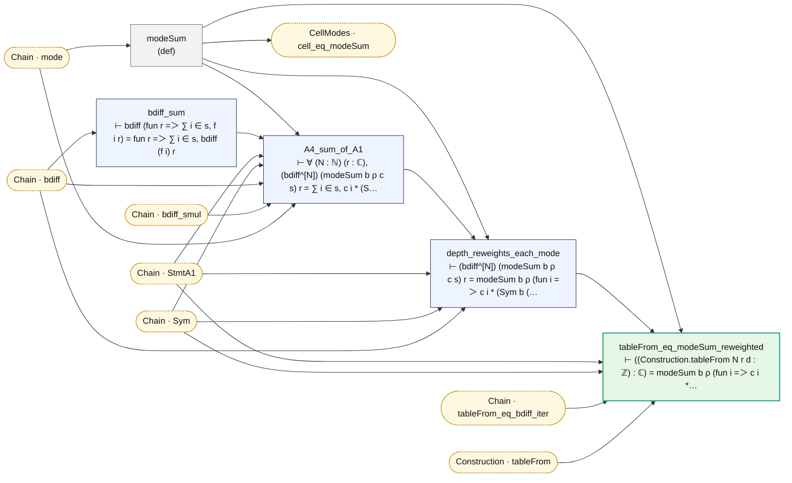

# `lean/Superposition.lean`

**What it does** (its own header): Superposition — the missing licence for building the residual from the zeros. `Chain.A4_of_A1` gives the depth-N gain for a SINGLE mode. Every use of it on the bench applies it to a SUM over zeta zeros (O34, O35). Nothing so far permits that step. This file supplies it, and nothing else.

**Imports:** [`Chain`](../lean/Chain.md).
**Imported by:** nothing.

Blue: theorem. Green: a theorem nothing else uses (an end). Dashed white: connects to nothing. Grey: definition. Red: contains `sorry`. Yellow: in another file. An arrow A → B reads "A is used by B".

## Every declaration

| declaration | proves (output) | needs (input) | why (its own docstring) | uses | used by |
|---|---|---|---|---|---|
| `Superposition.modeSum` def, line 21 | ℂ → ℂ | b : ℝ; ρ : ι → ℂ; c : ι → ℂ; s : Finset ι | A finite superposition of ladder modes. | `Chain.mode` | `Superposition.A4_sum_of_A1`, `Superposition.depth_reweights_each_mode`, `Superposition.tableFrom_eq_modeSum_reweighted`, `CellModes.cell_eq_modeSum` |
| `Superposition.bdiff_sum` theorem, line 25 | bdiff (fun r =&gt; ∑ i ∈ s, f i r) = fun r =&gt; ∑ i ∈ s, bdiff (f i) r | f : ι → ℂ → ℂ; s : Finset ι | `bdiff` distributes over a finite sum. | `Chain.bdiff` | `Superposition.A4_sum_of_A1` |
| `Superposition.A4_sum_of_A1` theorem, line 33 | ∀ (N : ℕ) (r : ℂ), (bdiff^[N]) (modeSum b ρ c s) r = ∑ i ∈ s, c i * (Sym b (ρ i)) ^ N * mode b (ρ i) r | hA1 : ∀ i ∈ s, StmtA1 b (ρ i) | The licence. If A1 holds for every mode in the family, then `N` differences act on the superposition by acting on each mode separately. This is what permits applying the depth gain to a sum over zeros. | `Chain.StmtA1`, `Chain.Sym`, `Chain.bdiff`, `Chain.bdiff_smul`, `Chain.mode`, `Superposition.bdiff_sum`, `Superposition.modeSum` | `Superposition.depth_reweights_each_mode` |
| `Superposition.depth_reweights_each_mode` theorem, line 60 | (bdiff^[N]) (modeSum b ρ c s) r = modeSum b ρ (fun i =&gt; c i * (Sym b (ρ i)) ^ N) s r | hA1 : ∀ i ∈ s, StmtA1 b (ρ i); N : ℕ; r : ℂ | Corollary — the falsifiable form. Every mode is scaled by its own gain, so the depth-`N` superposition is the depth-0 one with each term reweighted by `(Sym b ρᵢ)^N`. The measured fractions in O34 test this model; they are not inputs to it. | `Chain.StmtA1`, `Chain.Sym`, `Chain.bdiff`, `Superposition.A4_sum_of_A1`, `Superposition.modeSum` | `Superposition.tableFrom_eq_modeSum_reweighted` |
| `Superposition.tableFrom_eq_modeSum_reweighted` theorem, line 90 | ((Construction.tableFrom N r d : ℤ) : ℂ) = modeSum b ρ (fun i =&gt; c i * (Sym b (ρ i)) ^ d) s (r : ℂ) | hA1 : ∀ i ∈ s, StmtA1 b (ρ i); hag : ∀ n : ℤ, ((N n : ℤ) : ℂ) = modeSum b ρ c s (n : ℂ); r : ℤ; d : ℕ | The table is a superposition, reweighted by depth. An integer row agreeing at every integer with a finite superposition of ladder modes: its cell at `(r,d)` is that superposition with each mode carrying its own `(Sym b ρᵢ)^d`. | `Chain.StmtA1`, `Chain.Sym`, `Chain.tableFrom_eq_bdiff_iter`, `Construction.tableFrom`, `Superposition.depth_reweights_each_mode`, `Superposition.modeSum` | — |
