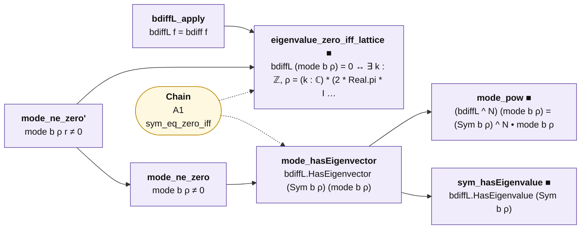

# `lean/TransferOp.lean`

TransferOp — bdiff named as the operator it is, in Mathlib's own vocabulary. `papers/Depth-as-Time.md` reads depth as iteration: each mode `x^ρ` is multiplied by `(1 − b^(−ρ))` per step (A2), the operator has a growth factor per mode (A3), and the first Riemann zero is the fastest-growing mode of the difference operator in base 2 (B4). That is transfer-operator vocabulary — `bdiff` is the transfer operator of the ladder shift, the modes are its eigenfunctions, `Sym` its multiplier — and none of it was stated in the…

7 theorems, 1 definition, 157 lines. Arrows are Lean's own record of what each proof uses.

**Imports:** [`Chain`](../lean/Chain.md)  
**Imported by:** nothing

## The picture



An arrow A → B reads "A is used in the proof of B". Green: counting, integers only. Violet: shape, analysis with no ζ. Blue: reads ζ. A name ending in ■ is an end: nothing else uses it. Red: contains `sorry`. Yellow: theorems in another file, counted; a dotted arrow crosses files. Definitions are not drawn; they are listed below the diagram.

## Definitions

<a name="TransferOp-bdiffL"></a>
### `TransferOp.bdiffL`

def · line 47

`Chain.bdiff`, packaged as a linear endomorphism of the function space. The linearity was consumed all over the tree (`bdiff_smul`, `Superposition.bdiff_sum`) and never stated as a structure.

- **Is:** `` bdiffL : Module.End ℂ (ℂ → ℂ) where toFun := bdiff map_add' f g := by funext r simp [bdiff] ring map_smul' c f := by funext r simp [bdiff] ring ``
- **Built from:** [`Chain.bdiff`](../lean/Chain.md#Chain-bdiff)
- **Used by 5:** [`TransferOp.bdiffL_apply`](#TransferOp-bdiffL_apply), [`TransferOp.eigenvalue_zero_iff_lattice`](#TransferOp-eigenvalue_zero_iff_lattice), [`TransferOp.mode_hasEigenvector`](#TransferOp-mode_hasEigenvector), [`TransferOp.mode_pow`](#TransferOp-mode_pow), [`TransferOp.sym_hasEigenvalue`](#TransferOp-sym_hasEigenvalue)

## Theorems

<a name="TransferOp-bdiffL_apply"></a>
### `TransferOp.bdiffL_apply`

line 61

**Shape.** Uses real or complex analysis; nothing in it or beneath it reads ζ.

**Why.** The packaging is definitional: applying the endomorphism is applying `bdiff`.

**Proves**

```lean
bdiffL f = bdiff f
```

**Needs** (its hypotheses)

  - `` f : ℂ → ℂ ``

**Stated with:** [`Chain.bdiff`](../lean/Chain.md#Chain-bdiff), [`TransferOp.bdiffL`](#TransferOp-bdiffL)

**Fed by:** no theorem of this repo; it stands on Mathlib and the definitions below.

**Feeds** (1 that use it)

  - [`TransferOp.eigenvalue_zero_iff_lattice`](#TransferOp-eigenvalue_zero_iff_lattice) — `` bdiffL (mode b ρ) = 0 ↔ ∃ k : ℤ, ρ = (k : ℂ) * (2 * Real.pi * I / Real.log b) ``

<a name="TransferOp-mode_ne_zero-"></a>
### `TransferOp.mode_ne_zero'`

line 64

**Shape.** Uses real or complex analysis; nothing in it or beneath it reads ζ.

**Why.** A mode never vanishes: `b^(rρ) ≠ 0` for `b ≠ 0`.

**Proves**

```lean
mode b ρ r ≠ 0
```

**Needs** (its hypotheses)

  - `` hb : b ≠ 0 ``
  - `` ρ r : ℂ ``

**Stated with:** [`Chain.mode`](../lean/Chain.md#Chain-mode)

**Fed by:** no theorem of this repo; it stands on Mathlib and the definitions below.

**Feeds** (2 that use it)

  - [`TransferOp.eigenvalue_zero_iff_lattice`](#TransferOp-eigenvalue_zero_iff_lattice) — `` bdiffL (mode b ρ) = 0 ↔ ∃ k : ℤ, ρ = (k : ℂ) * (2 * Real.pi * I / Real.log b) ``
  - [`TransferOp.mode_ne_zero`](#TransferOp-mode_ne_zero) — `` mode b ρ ≠ 0 ``

<a name="TransferOp-mode_ne_zero"></a>
### `TransferOp.mode_ne_zero`

line 70

**Shape.** Uses real or complex analysis; nothing in it or beneath it reads ζ.

**Why.** Hence a mode is not the zero function.

**Proves**

```lean
mode b ρ ≠ 0
```

**Needs** (its hypotheses)

  - `` hb : b ≠ 0 ``
  - `` ρ : ℂ ``

**Stated with:** [`Chain.mode`](../lean/Chain.md#Chain-mode)

**Fed by** (1 theorem its proof uses)

  - [`TransferOp.mode_ne_zero'`](#TransferOp-mode_ne_zero-) — `` mode b ρ r ≠ 0 ``

**Feeds** (1 that use it)

  - [`TransferOp.mode_hasEigenvector`](#TransferOp-mode_hasEigenvector) — `` bdiffL.HasEigenvector (Sym b ρ) (mode b ρ) ``

<a name="TransferOp-mode_hasEigenvector"></a>
### `TransferOp.mode_hasEigenvector`

line 78

**Shape.** Uses real or complex analysis; nothing in it or beneath it reads ζ.

**Why.** The mode is an eigenvector, in Mathlib's sense. `Chain.A1` is the pointwise identity; this is the same fact carried into `Module.End.HasEigenvector`, which is what makes the operator reading a structure rather than a description.

**Proves**

```lean
bdiffL.HasEigenvector (Sym b ρ) (mode b ρ)
```

**Needs** (its hypotheses)

  - `` hb : b ≠ 0 ``
  - `` ρ : ℂ ``

**Stated with:** [`Chain.Sym`](../lean/Chain.md#Chain-Sym), [`Chain.mode`](../lean/Chain.md#Chain-mode), [`TransferOp.bdiffL`](#TransferOp-bdiffL)

**Fed by** (2 theorems its proof uses)

  - [`Chain.A1`](../lean/Chain.md#Chain-A1) (Chain) — `` StmtA1 b ρ ``
  - [`TransferOp.mode_ne_zero`](#TransferOp-mode_ne_zero) — `` mode b ρ ≠ 0 ``

**Definitions its proof touches:** [`Chain.bdiff`](../lean/Chain.md#Chain-bdiff)

**Feeds** (2 that use it)

  - [`TransferOp.mode_pow`](#TransferOp-mode_pow) — `` (bdiffL ^ N) (mode b ρ) = (Sym b ρ) ^ N • mode b ρ ``
  - [`TransferOp.sym_hasEigenvalue`](#TransferOp-sym_hasEigenvalue) — `` bdiffL.HasEigenvalue (Sym b ρ) ``

<a name="TransferOp-sym_hasEigenvalue"></a>
### `TransferOp.sym_hasEigenvalue`

line 90

**Shape.** Uses real or complex analysis; nothing in it or beneath it reads ζ.

**Why.** `Sym b ρ` is in the point spectrum. Every value of the symbol is an eigenvalue of the difference operator.

**Proves**

```lean
bdiffL.HasEigenvalue (Sym b ρ)
```

**Needs** (its hypotheses)

  - `` hb : b ≠ 0 ``
  - `` ρ : ℂ ``

**Stated with:** [`Chain.Sym`](../lean/Chain.md#Chain-Sym), [`TransferOp.bdiffL`](#TransferOp-bdiffL)

**Fed by** (1 theorem its proof uses)

  - [`TransferOp.mode_hasEigenvector`](#TransferOp-mode_hasEigenvector) — `` bdiffL.HasEigenvector (Sym b ρ) (mode b ρ) ``

**Definitions its proof touches:** [`Chain.mode`](../lean/Chain.md#Chain-mode)

**Feeds:** nothing. It is an end.

<a name="TransferOp-mode_pow"></a>
### `TransferOp.mode_pow`

line 97

**Shape.** Uses real or complex analysis; nothing in it or beneath it reads ζ.

**Why.** Depth is the operator power on the eigenline. `(bdiffL^N) mode = Sym^N • mode` — `Chain.A4` as an operator identity, via Mathlib's `HasEigenvector.pow_apply`.

**Proves**

```lean
(bdiffL ^ N) (mode b ρ) = (Sym b ρ) ^ N • mode b ρ
```

**Needs** (its hypotheses)

  - `` hb : b ≠ 0 ``
  - `` ρ : ℂ ``
  - `` N : ℕ ``

**Stated with:** [`Chain.Sym`](../lean/Chain.md#Chain-Sym), [`Chain.mode`](../lean/Chain.md#Chain-mode), [`TransferOp.bdiffL`](#TransferOp-bdiffL)

**Fed by** (1 theorem its proof uses)

  - [`TransferOp.mode_hasEigenvector`](#TransferOp-mode_hasEigenvector) — `` bdiffL.HasEigenvector (Sym b ρ) (mode b ρ) ``

**Feeds:** nothing. It is an end.

<a name="TransferOp-eigenvalue_zero_iff_lattice"></a>
### `TransferOp.eigenvalue_zero_iff_lattice`

line 105

**Shape.** Uses real or complex analysis; nothing in it or beneath it reads ζ.

**Why.** The kernel eigenvalue sits exactly on the pole lattice. The mode is annihilated — eigenvalue 0 — precisely when `ρ ∈ (2πi/log b)·ℤ`, which is `Chain.sym_eq_zero_iff` read as a statement about the operator. This is the lattice `Transform.sym_zero_on_outer_circle` carries to `|z| = 1`.

**Proves**

```lean
bdiffL (mode b ρ) = 0 ↔ ∃ k : ℤ, ρ = (k : ℂ) * (2 * Real.pi * I / Real.log b)
```

**Needs** (its hypotheses)

  - `` hb : 0 < b ``
  - `` hb1 : b ≠ 1 ``
  - `` ρ : ℂ ``

**Stated with:** [`Chain.mode`](../lean/Chain.md#Chain-mode), [`TransferOp.bdiffL`](#TransferOp-bdiffL)

**Fed by** (4 theorems its proof uses)

  - [`Chain.A1`](../lean/Chain.md#Chain-A1) (Chain) — `` StmtA1 b ρ ``
  - [`Chain.sym_eq_zero_iff`](../lean/Chain.md#Chain-sym_eq_zero_iff) (Chain) — `` Sym b s = 0 ↔ ∃ k : ℤ, s = (k : ℂ) * (2 * Real.pi * I / Real.log b) ``
  - [`TransferOp.bdiffL_apply`](#TransferOp-bdiffL_apply) — `` bdiffL f = bdiff f ``
  - [`TransferOp.mode_ne_zero'`](#TransferOp-mode_ne_zero-) — `` mode b ρ r ≠ 0 ``

**Definitions its proof touches:** [`Chain.Sym`](../lean/Chain.md#Chain-Sym), [`Chain.bdiff`](../lean/Chain.md#Chain-bdiff)

**Feeds:** nothing. It is an end.

