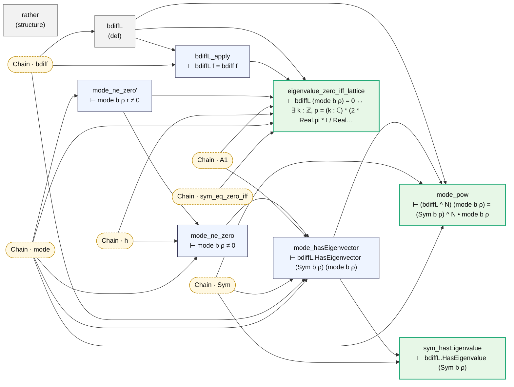

# `lean/TransferOp.lean`

**What it does** (its own header): TransferOp — bdiff named as the operator it is, in Mathlib's own vocabulary. `papers/Depth-as-Time.md` reads depth as iteration: each mode `x^ρ` is multiplied by `(1 − b^(−ρ))` per step (A2), the operator has a growth factor per mode (A3), and the first Riemann zero is the fastest-growing mode of the difference operator in base 2 (B4). That is transfer-operator vocabulary — `bdiff` is the transfer operator of the ladder shift, the modes are its eigenfunctions, `Sym` its multiplier — and none of it was stated in the…

**Imports:** [`Chain`](../lean/Chain.md).
**Imported by:** nothing.

Blue: theorem. Green: a theorem nothing else uses (an end). Dashed white: connects to nothing. Grey: definition. Red: contains `sorry`. Yellow: in another file. An arrow A → B reads "A is used by B".

## Every declaration

| declaration | proves (output) | needs (input) | why (its own docstring) | uses | used by |
|---|---|---|---|---|---|
| `TransferOp.bdiffL` def, line 47 | Module.End ℂ (ℂ → ℂ) | — | `Chain.bdiff`, packaged as a linear endomorphism of the function space. The linearity was consumed all over the tree (`bdiff_smul`, `Superposition.bdiff_sum`) and never stated as a structure. | `Chain.bdiff` | `TransferOp.bdiffL_apply`, `TransferOp.eigenvalue_zero_iff_lattice`, `TransferOp.mode_pow` |
| `TransferOp.bdiffL_apply` theorem, line 61 | bdiffL f = bdiff f | f : ℂ → ℂ | The packaging is definitional: applying the endomorphism is applying `bdiff`. | `Chain.bdiff`, `TransferOp.bdiffL` | `TransferOp.eigenvalue_zero_iff_lattice` |
| `TransferOp.mode_ne_zero'` theorem, line 64 | mode b ρ r ≠ 0 | hb : b ≠ 0; ρ r : ℂ | A mode never vanishes: `b^(rρ) ≠ 0` for `b ≠ 0`. | `Chain.mode` | `TransferOp.eigenvalue_zero_iff_lattice`, `TransferOp.mode_ne_zero` |
| `TransferOp.mode_ne_zero` theorem, line 70 | mode b ρ ≠ 0 | hb : b ≠ 0; ρ : ℂ | Hence a mode is not the zero function. | `Chain.h`, `Chain.mode`, `TransferOp.mode_ne_zero'` | `TransferOp.mode_hasEigenvector` |
| `TransferOp.rather` structure, line 77 | — | — | — | — | — |
| `TransferOp.mode_hasEigenvector` theorem, line 78 | bdiffL.HasEigenvector (Sym b ρ) (mode b ρ) | hb : b ≠ 0; ρ : ℂ | The mode is an eigenvector, in Mathlib's sense. `Chain.A1` is the pointwise identity; this is the same fact carried into `Module.End.HasEigenvector`, which is what makes the operator reading a structure rather than a description. | `Chain.A1`, `Chain.Sym`, `Chain.bdiff`, `Chain.mode`, `TransferOp.mode_ne_zero` | `TransferOp.mode_pow`, `TransferOp.sym_hasEigenvalue` |
| `TransferOp.sym_hasEigenvalue` theorem, line 90 | bdiffL.HasEigenvalue (Sym b ρ) | hb : b ≠ 0; ρ : ℂ | `Sym b ρ` is in the point spectrum. Every value of the symbol is an eigenvalue of the difference operator. | `Chain.Sym`, `TransferOp.mode_hasEigenvector` | — |
| `TransferOp.mode_pow` theorem, line 97 | (bdiffL ^ N) (mode b ρ) = (Sym b ρ) ^ N • mode b ρ | hb : b ≠ 0; ρ : ℂ; N : ℕ | Depth is the operator power on the eigenline. `(bdiffL^N) mode = Sym^N • mode` — `Chain.A4` as an operator identity, via Mathlib's `HasEigenvector.pow_apply`. | `Chain.Sym`, `Chain.mode`, `TransferOp.bdiffL`, `TransferOp.mode_hasEigenvector` | — |
| `TransferOp.eigenvalue_zero_iff_lattice` theorem, line 105 | bdiffL (mode b ρ) = 0 ↔ ∃ k : ℤ, ρ = (k : ℂ) * (2 * Real.pi * I / Real.log b) | hb : 0 &lt; b; hb1 : b ≠ 1; ρ : ℂ | The kernel eigenvalue sits exactly on the pole lattice. The mode is annihilated — eigenvalue 0 — precisely when `ρ ∈ (2πi/log b)·ℤ`, which is `Chain.sym_eq_zero_iff` read as a statement about the operator. This is the lattice `Transform.sym_zero_on_outer_circle` carries to `\|z\| = 1`. | `Chain.A1`, `Chain.h`, `Chain.mode`, `Chain.sym_eq_zero_iff`, `TransferOp.bdiffL`, `TransferOp.bdiffL_apply`, `TransferOp.mode_ne_zero'` | — |
