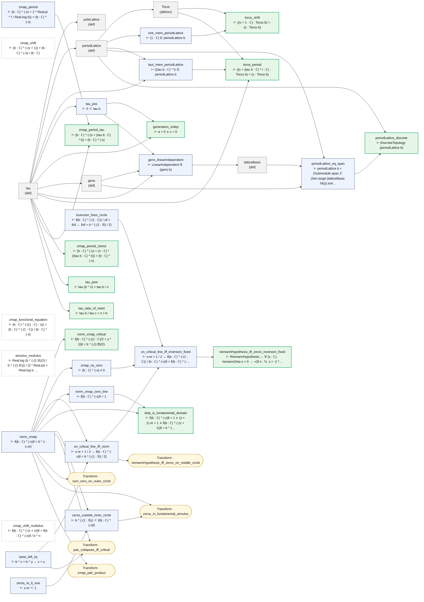
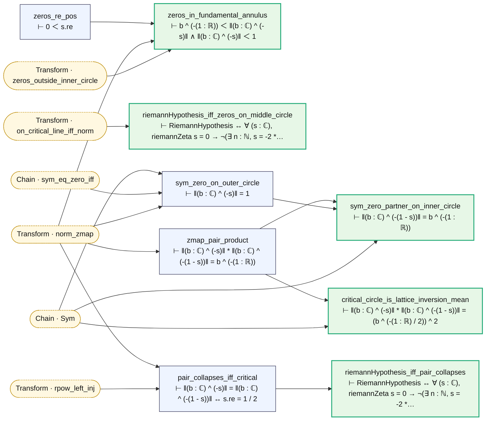

# `lean/Transform.lean`

**What it does** (its own header): Transform — block G's geometry: the strip, the annulus, and what closes it. `papers/Euler-Factor-Chain.md` § G is listed as **not formalised** in `lean/BUILD.md`, and most of it is measurement (G2, G4, G5, G7 from O39) or literature (G3 Jentzsch, G9 Hardy, G10 Odlyzko–te Riele). This file takes the part that is geometry.

**Imports:** [`Chain`](../lean/Chain.md), [`EulerFactorChain`](../lean/EulerFactorChain.md).
**Imported by:** nothing.

### Diagram 1 of 2

### Diagram 2 of 2

Blue: theorem. Green: a theorem nothing else uses (an end). Dashed white: connects to nothing. Grey: definition. Red: contains `sorry`. Yellow: in another file. An arrow A → B reads "A is used by B".

## Every declaration

| declaration | proves (output) | needs (input) | why (its own docstring) | uses | used by |
|---|---|---|---|---|---|
| `Transform.norm_zmap` theorem, line 48 | ‖(b : ℂ) ^ (-s)‖ = b ^ (-s.re) | hb : 0 &lt; b; s : ℂ | The map. `z = b^(−s)` sends the vertical line `Re s = σ` to the circle `\|z\| = b^(−σ)`. | — | `Transform.norm_zmap_critical`, `Transform.norm_zmap_zero_line`, `Transform.on_critical_line_iff_norm`, `Transform.pair_collapses_iff_critical`, `Transform.strip_is_fundamental_domain`, `Transform.sym_zero_on_outer_circle`, `Transform.zeros_in_fundamental_annulus`, `Transform.zeros_outside_inner_circle`, `Transform.zmap_ne_zero`, `Transform.zmap_pair_product` |
| `Transform.norm_zmap_critical` theorem, line 54 | ‖(b : ℂ) ^ (-((1 : ℂ)/2 + γ * I))‖ = b ^ (-(1:ℝ)/2) | hb : 0 &lt; b; γ : ℝ | The critical line lands on the circle of radius `b^(−1/2)`. | `Transform.norm_zmap` | — |
| `Transform.zmap_shift` theorem, line 61 | (b : ℂ) ^ (-(s + 1)) = (b : ℂ) ^ (-s) / (b : ℂ) | hb : 0 &lt; b; s : ℂ | The deck transformation. `s ↦ s + 1` becomes `z ↦ z / b`. This is the identification that closes the annulus into a torus: `ℂ* / b^ℤ`. | — | — |
| `Transform.zmap_period` theorem, line 69 | (b : ℂ) ^ (-(s + 2 * Real.pi * I / Real.log b)) = (b : ℂ) ^ (-s) | hb : 0 &lt; b; hb1 : b ≠ 1; s : ℂ | The other generator. `s ↦ s + 2πi/log b` leaves `z` fixed — that is the pole lattice, and it is why the strip maps to an annulus rather than a plane. | — | `Transform.zmap_period_tau` |
| `Transform.zmap_functional_equation` theorem, line 83 | (b : ℂ) ^ (-((1 : ℂ) - s)) = (b : ℂ) ^ (-(1 : ℂ)) / (b : ℂ) ^ (-s) | hb : 0 &lt; b; s : ℂ | The functional equation, in `z`. `s ↦ 1 − s` becomes `z ↦ b^(−1)/z`, inversion in the circle `\|z\| = b^(−1/2)` — which is the critical line. | — | — |
| `Transform.annulus_modulus` theorem, line 91 | Real.log (b ^ (-(1:ℝ)/2) / b ^ (-(1:ℝ))) / (2 * Real.pi) = Real.log b / (4 * Real.pi) | hb : 0 &lt; b | G7's modulus. The annulus between the two radii has conformal modulus `(log b)/4π`. Its ratio is `√b`, so it is half a fundamental domain of `ℂ* / b^ℤ`, whose modulus is `(log b)/2π`. | — | — |
| `Transform.tau` def, line 124 | ℝ | b : ℝ | The torus `ℂ*/b^ℤ` has lattice `⟨1, 2πi/log b⟩` in `s`, so its modular parameter is `τ = 2πi/log b`. This is its imaginary part. | — | `Transform.generators_indep`, `Transform.gens`, `Transform.gens_linearIndependent`, `Transform.periodLattice`, `Transform.poleLattice`, `Transform.tauI_mem_periodLattice`, `Transform.tau_pos`, `Transform.tau_pow`, `Transform.tau_ratio_of_meet`, `Transform.torus_period`, `Transform.zmap_period_tau`, `Transform.zmap_period_zsmul` |
| `Transform.zmap_period_tau` theorem, line 127 | (b : ℂ) ^ (-(s + (tau b : ℂ) * I)) = (b : ℂ) ^ (-s) | hb : 0 &lt; b; hb1 : b ≠ 1; s : ℂ | `τ` is exactly the period `zmap_period` uses. | `Transform.tau`, `Transform.zmap_period` | — |
| `Transform.tau_pow` theorem, line 140 | tau (b ^ n) = tau b / n | hb : 1 &lt; b; n : ℕ; hn : 0 &lt; n | The power chain. `τ(b^n) = τ(b)/n`. This is why `{2,4,8}` is one family: `τ₄ = τ₂/2` and `τ₈ = τ₂/3`. | `Transform.tau` | — |
| `Transform.tau_ratio_of_meet` theorem, line 150 | tau b / tau c = n / m | hb : 1 &lt; b; hc : 1 &lt; c; hm : 0 &lt; m; h : b ^ n = c ^ m | Meeting ladders have rationally related `τ`, and the ratio is the meeting exponents. If `b^n = c^m` then `τ(b)/τ(c) = n/m`. `Zeros.primeFactors_eq_of_meets` records the arithmetic side: ladders meet only inside a prime-power chain. | `Transform.tau` | — |
| `Transform.poleLattice` def, line 187 | AddSubgroup ℂ | b : ℝ | The pole lattice alone: integer multiples of the period `τ(b)·i`. The `z`-map is constant on its cosets, which is why the strip becomes an annulus. | `Transform.tau` | — |
| `Transform.periodLattice` def, line 192 | AddSubgroup ℂ | b : ℝ | The full period lattice in `s`: generated by `1`, the deck transformation, and `τ(b)·i`, the pole lattice. | `Transform.tau` | `Transform.Torus`, `Transform.one_mem_periodLattice`, `Transform.periodLattice_discrete`, `Transform.periodLattice_eq_span`, `Transform.tauI_mem_periodLattice` |
| `Transform.Torus` abbrev, line 196 | Type | b : ℝ | The torus. `ℂ ⧸ ⟨1, τ(b)·i⟩` — the object `ℂ*/b^ℤ` names. | `Transform.periodLattice` | `Transform.torus_period`, `Transform.torus_shift` |
| `Transform.one_mem_periodLattice` theorem, line 199 | (1 : ℂ) ∈ periodLattice b | b : ℝ | The deck generator `1` is in the lattice. | `Transform.periodLattice` | `Transform.torus_shift` |
| `Transform.tauI_mem_periodLattice` theorem, line 203 | ((tau b : ℂ) * I) ∈ periodLattice b | b : ℝ | The period generator `τ(b)·i` is in the lattice. | `Transform.periodLattice`, `Transform.tau` | `Transform.torus_period` |
| `Transform.tau_pos` theorem, line 207 | 0 &lt; tau b | hb : 1 &lt; b | `τ(b) &gt; 0` for `b &gt; 1`, which is what makes the second generator nonzero. | `Transform.tau` | `Transform.generators_indep`, `Transform.gens_linearIndependent` |
| `Transform.generators_indep` theorem, line 215 | a = 0 ∧ c = 0 | hb : 1 &lt; b; a c : ℝ; h : (a : ℂ) + (c : ℂ) * ((tau b : ℂ) * I) = 0 | The lattice has rank 2. The two generators are ℝ-linearly independent: one is real, the other purely imaginary and nonzero. This is what separates a torus from a cylinder, and it is the only place `b &gt; 1` is needed. | `Transform.tau`, `Transform.tau_pos` | — |
| `Transform.gens` def, line 226 | Fin 2 → ℂ | b : ℝ | The two generators as a family, for the basis construction below. | `Transform.tau` | `Transform.gens_linearIndependent`, `Transform.periodLattice_eq_span` |
| `Transform.gens_linearIndependent` theorem, line 229 | LinearIndependent ℝ (gens b) | hb : 1 &lt; b | `generators_indep` in the form Mathlib's basis constructor wants. | `Transform.gens`, `Transform.tau`, `Transform.tau_pos` | `Transform.latticeBasis` |
| `Transform.latticeBasis` def, line 242 | Module.Basis (Fin 2) ℝ ℂ | hb : 1 &lt; b | The lattice basis. `⟨1, τ(b)·i⟩` is an ℝ-basis of ℂ, so the subgroup it generates is a rank-2 ℤ-lattice in a 2-dimensional ℝ-space. | `Transform.gens_linearIndependent` | `Transform.periodLattice_eq_span` |
| `Transform.periodLattice_eq_span` theorem, line 249 | periodLattice b = (Submodule.span ℤ (Set.range (latticeBasis hb))).toAddSubgroup | hb : 1 &lt; b | The additive closure of the two generators is the ℤ-span of the basis — the bridge from `AddSubgroup.closure` to the `ZLattice` instance that `periodLattice_discrete` consumes. | `Transform.gens`, `Transform.latticeBasis`, `Transform.periodLattice` | `Transform.periodLattice_discrete` |
| `Transform.periodLattice_discrete` theorem, line 262 | DiscreteTopology (periodLattice b) | hb : 1 &lt; b | The lattice is discrete. This is what upgrades `ℂ ⧸ periodLattice b` from a quotient by a subgroup to a torus: a rank-2 ℤ-span of an ℝ-basis carries the discrete topology, so the quotient is Hausdorff and the fibres are isolated. The docstring above this section claimed this was left unproved; it is proved here. | `Transform.periodLattice`, `Transform.periodLattice_eq_span` | — |
| `Transform.torus_shift` theorem, line 268 | ((s + 1 : ℂ) : Torus b) = (s : Torus b) | b : ℝ; s : ℂ | The deck transformation is an identity in the torus. | `Transform.Torus`, `Transform.one_mem_periodLattice` | — |
| `Transform.torus_period` theorem, line 274 | ((s + (tau b : ℂ) * I : ℂ) : Torus b) = (s : Torus b) | b : ℝ; s : ℂ | The period is an identity in the torus. | `Transform.Torus`, `Transform.tau`, `Transform.tauI_mem_periodLattice` | — |
| `Transform.zmap_period_zsmul` theorem, line 281 | (b : ℂ) ^ (-(s + (n : ℂ) * ((tau b : ℂ) * I))) = (b : ℂ) ^ (-s) | hb : 0 &lt; b; hb1 : b ≠ 1; s : ℂ; n : ℤ | The `z`-map descends past the whole pole lattice, not just one period. `zmap_period` is the `n = 1` case. | `Transform.tau` | — |
| `Transform.zmap_shift_modulus` theorem, line 297 | ‖(b : ℂ) ^ (-(s + n))‖ = ‖(b : ℂ) ^ (-s)‖ / b ^ n | hb : 0 &lt; b; s : ℂ; n : ℕ | The deck transformation scales the modulus by `b^(−n)`. This is the `b^ℤ` in `ℂ*/b^ℤ`: at `b = 2` it identifies `\|z\| = … 0.5 ~ 1 ~ 2 ~ 4 …`, so every 2:1 annulus is a fundamental domain. | — | — |
| `Transform.inversion_fixes_circle` theorem, line 311 | ‖(b : ℂ) ^ (-(1 : ℂ)) / z‖ = ‖z‖ ↔ ‖z‖ = b ^ (-(1 : ℝ) / 2) | hb : 0 &lt; b; hz : z ≠ 0 | The functional equation is inversion in the critical circle, as a theorem. `z ↦ b^(−1)/z` preserves modulus exactly on `\|z\| = b^(−1/2)` — the image of the critical line. The geometric reading in `zmap_functional_equation` was a docstring until here. | — | `Transform.on_critical_line_iff_inversion_fixed` |
| `Transform.rpow_left_inj` theorem, line 349 | b ^ x = b ^ y ↔ x = y | hb : 1 &lt; b; x y : ℝ | For `b &gt; 1` the real power is injective in the exponent. | — | `Transform.on_critical_line_iff_norm`, `Transform.pair_collapses_iff_critical` |
| `Transform.zmap_ne_zero` theorem, line 360 | (b : ℂ) ^ (-s) ≠ 0 | hb : 0 &lt; b; s : ℂ | The image of `s` under the `z`-map is never zero. | `Transform.norm_zmap` | `Transform.on_critical_line_iff_inversion_fixed` |
| `Transform.on_critical_line_iff_norm` theorem, line 367 | s.re = 1 / 2 ↔ ‖(b : ℂ) ^ (-s)‖ = b ^ (-(1 : ℝ) / 2) | hb : 1 &lt; b; s : ℂ | The critical line is exactly the fixed circle. `Re s = 1/2` iff the image `b^(−s)` lands on `\|z\| = b^(−1/2)`. | `Transform.norm_zmap`, `Transform.rpow_left_inj` | `Transform.on_critical_line_iff_inversion_fixed`, `Transform.riemannHypothesis_iff_zeros_on_middle_circle` |
| `Transform.on_critical_line_iff_inversion_fixed` theorem, line 375 | s.re = 1 / 2 ↔ ‖(b : ℂ) ^ (-(1 : ℂ)) / (b : ℂ) ^ (-s)‖ = ‖(b : ℂ) ^ (-s)‖ | hb : 1 &lt; b; s : ℂ | RH's condition, as a fixed point of the inversion. `Re s = 1/2` iff `b^(−s)` is fixed in modulus by `z ↦ b^(−1)/z`, which `zmap_functional_equation` identifies as `s ↦ 1 − s`. | `Transform.inversion_fixes_circle`, `Transform.on_critical_line_iff_norm`, `Transform.zmap_ne_zero` | `Transform.riemannHypothesis_iff_zeros_inversion_fixed` |
| `Transform.riemannHypothesis_iff_zeros_inversion_fixed` theorem, line 387 | RiemannHypothesis ↔ ∀ (s : ℂ), riemannZeta s = 0 → ¬(∃ n : ℕ, s = -2 * (n + 1)) → s ≠ 1 → ‖(b : ℂ) ^ (-(1 : ℂ)) / (b : ℂ) ^ (-s)‖ = ‖(b : ℂ) ^ (-s)‖ | hb : 1 &lt; b | The Riemann hypothesis, restated on the torus. Mathlib's `RiemannHypothesis` holds exactly when every nontrivial zero of `ζ` is carried by `z = b^(−s)` to a fixed point of the inversion `z ↦ b^(−1)/z`. | `Transform.on_critical_line_iff_inversion_fixed` | — |
| `Transform.norm_zmap_zero_line` theorem, line 415 | ‖(b : ℂ) ^ (-s)‖ = 1 | hb : 0 &lt; b; h : s.re = 0 | `Re s = 0` lands on the unit circle. | `Transform.norm_zmap` | `Transform.strip_is_fundamental_domain` |
| `Transform.strip_is_fundamental_domain` theorem, line 423 | ‖(b : ℂ) ^ (-s)‖ = 1 ∧ (s + 1).re = 1 ∧ ‖(b : ℂ) ^ (-(s + 1))‖ = b ^ (-(1 : ℝ)) | hb : 1 &lt; b; h : s.re = 0 | The critical strip is one fundamental domain of `ℂ*/b^ℤ`. Its left edge maps to `\|z\| = 1`, its right edge to `\|z\| = b^(−1)`, and the two are a single deck step apart — `s ↦ s + 1`, which `zmap_shift` sends to `z ↦ z/b`. | `Transform.norm_zmap`, `Transform.norm_zmap_zero_line` | — |
| `Transform.zeros_re_lt_one` theorem, line 434 | s.re &lt; 1 | hz : riemannZeta s = 0 | Every zero of ζ has `Re s &lt; 1`, from Mathlib's non-vanishing on the closed half-plane `1 ≤ Re s`. | — | `Transform.zeros_outside_inner_circle` |
| `Transform.zeros_outside_inner_circle` theorem, line 441 | b ^ (-(1 : ℝ)) &lt; ‖(b : ℂ) ^ (-s)‖ | hb : 1 &lt; b; hz : riemannZeta s = 0 | Every zero lies strictly outside the inner circle. `Re s &lt; 1` becomes `\|z\| &gt; b^(−1)` — the zeros are inside the fundamental annulus, on the far side of the boundary the Euler product owns. | `Transform.norm_zmap`, `Transform.zeros_re_lt_one` | `Transform.zeros_in_fundamental_annulus` |
| `Transform.zeros_re_pos` theorem, line 452 | 0 &lt; s.re | hz : riemannZeta s = 0; ht : ¬(∃ n : ℕ, s = -2 * (n + 1)) | Every nontrivial zero has `0 &lt; Re s`. The functional equation reflects Mathlib's non-vanishing on `1 ≤ Re s` across to the left edge: at a zero with `Re s ≤ 0` every factor of `riemannZeta_one_sub` is nonzero except the cosine, and the cosine's zeros are exactly the trivial zeros together with `s = 0`, where `ζ(0) = −1/2`. | — | `Transform.zeros_in_fundamental_annulus` |
| `Transform.zeros_in_fundamental_annulus` theorem, line 514 | b ^ (-(1 : ℝ)) &lt; ‖(b : ℂ) ^ (-s)‖ ∧ ‖(b : ℂ) ^ (-s)‖ &lt; 1 | hb : 1 &lt; b; hz : riemannZeta s = 0; ht : ¬(∃ n : ℕ, s = -2 * (n + 1)) | Every nontrivial zero lies in the open fundamental annulus. `b^(−1) &lt; \|z\| &lt; 1` — and `strip_is_fundamental_domain` says that annulus is exactly one fundamental domain of `ℂ*/b^ℤ`. So the zeros of ζ sit inside a single copy of the torus, for every base at once. | `Transform.norm_zmap`, `Transform.zeros_outside_inner_circle`, `Transform.zeros_re_pos` | — |
| `Transform.riemannHypothesis_iff_zeros_on_middle_circle` theorem, line 529 | RiemannHypothesis ↔ ∀ (s : ℂ), riemannZeta s = 0 → ¬(∃ n : ℕ, s = -2 * (n + 1)) → s ≠ 1 → ‖(b : ℂ) ^ (-s)‖ = b ^ (-(1 : ℝ) / 2) | hb : 1 &lt; b | RH, as a statement about one annulus. Every nontrivial zero lies in the fundamental annulus `b^(−1) &lt; \|z\| &lt; 1`; RH says every one of them lies on its middle circle `\|z\| = b^(−1/2)`, which `inversion_fixes_circle` identifies as the fixed set of `z ↦ b^(−1)/z`. The middle circle is the geometric mean of the two boundaries, and the inversion swaps those boundar… | `Transform.on_critical_line_iff_norm` | — |
| `Transform.zmap_pair_product` theorem, line 558 | ‖(b : ℂ) ^ (-s)‖ * ‖(b : ℂ) ^ (-(1 - s))‖ = b ^ (-(1 : ℝ)) | hb : 0 &lt; b; s : ℂ | The pair identity. `‖z_s‖ · ‖z_{1−s}‖ = b^(−1)` for every `s`, so the geometric mean of a point and its inversion partner is always `b^(−1/2)`. | `Transform.norm_zmap` | `Transform.critical_circle_is_lattice_inversion_mean`, `Transform.sym_zero_partner_on_inner_circle` |
| `Transform.pair_collapses_iff_critical` theorem, line 567 | ‖(b : ℂ) ^ (-s)‖ = ‖(b : ℂ) ^ (-(1 - s))‖ ↔ s.re = 1 / 2 | hb : 1 &lt; b; s : ℂ | The pair collapses exactly on the critical line. `‖z_s‖ = ‖z_{1−s}‖` iff `Re s = 1/2` — the two are equal only at the geometric mean their product pins. | `Transform.norm_zmap`, `Transform.rpow_left_inj` | `Transform.riemannHypothesis_iff_pair_collapses` |
| `Transform.riemannHypothesis_iff_pair_collapses` theorem, line 577 | RiemannHypothesis ↔ ∀ (s : ℂ), riemannZeta s = 0 → ¬(∃ n : ℕ, s = -2 * (n + 1)) → s ≠ 1 → ‖(b : ℂ) ^ (-s)‖ = ‖(b : ℂ) ^ (-(1 - s))‖ | hb : 1 &lt; b | RH: the pair collapses at every zero. Mathlib's `RiemannHypothesis` holds exactly when each nontrivial zero has the same modulus as its inversion partner. Since `zmap_pair_product` pins their geometric mean at `b^(−1/2)` unconditionally, collapsing and landing on the middle circle are one event. | `Transform.pair_collapses_iff_critical` | — |
| `Transform.sym_zero_on_outer_circle` theorem, line 602 | ‖(b : ℂ) ^ (-s)‖ = 1 | hb : 0 &lt; b; hb1 : b ≠ 1; hs : Chain.Sym b s = 0 | A zero of the table's symbol lands on `\|z\| = 1`. | `Chain.Sym`, `Chain.sym_eq_zero_iff`, `Transform.norm_zmap` | `Transform.sym_zero_partner_on_inner_circle` |
| `Transform.sym_zero_partner_on_inner_circle` theorem, line 613 | ‖(b : ℂ) ^ (-(1 - s))‖ = b ^ (-(1 : ℝ)) | hb : 0 &lt; b; hb1 : b ≠ 1; hs : Chain.Sym b s = 0 | Its inversion partner lands on `\|z\| = b^(−1)`. | `Chain.Sym`, `Transform.sym_zero_on_outer_circle`, `Transform.zmap_pair_product` | — |
| `Transform.critical_circle_is_lattice_inversion_mean` theorem, line 623 | ‖(b : ℂ) ^ (-s)‖ * ‖(b : ℂ) ^ (-(1 - s))‖ = (b ^ (-(1 : ℝ) / 2)) ^ 2 | hb : 0 &lt; b; hb1 : b ≠ 1; hs : Chain.Sym b s = 0 | The table's lattice, inverted, gives the critical circle. The zero comes from the table; the inversion puts it and its partner at `\|z\| = 1` and `\|z\| = b^(−1)`; their geometric mean is `b^(−1/2)`, which `on_critical_line_iff_norm` reads as `Re s = 1/2`. | `Chain.Sym`, `Transform.zmap_pair_product` | — |
