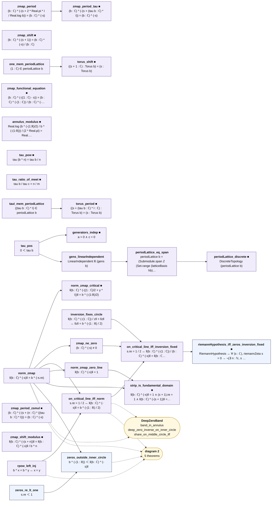
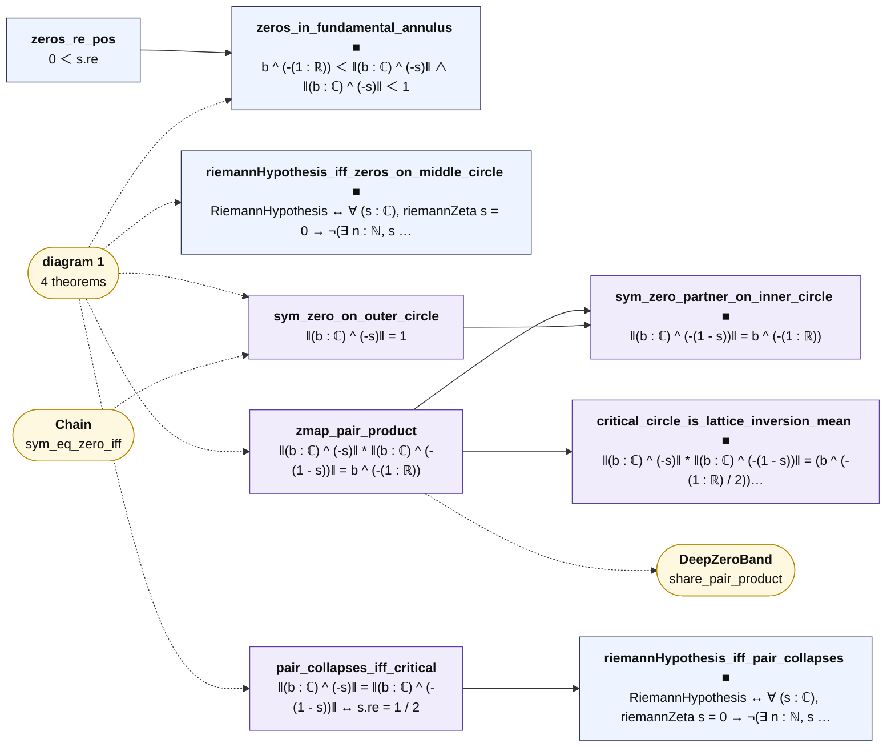

# `lean/Transform.lean`

Transform — block G's geometry: the strip, the annulus, and what closes it. `papers/Euler-Factor-Chain.md` § G is listed as **not formalised** in `lean/BUILD.md`, and most of it is measurement (G2, G4, G5, G7 from O39) or literature (G3 Jentzsch, G9 Hardy, G10 Odlyzko–te Riele). This file takes the part that is geometry.

39 theorems, 6 definitions, 799 lines. Arrows are Lean's own record of what each proof uses.

**Imports:** [`Chain`](../lean/Chain.md), [`EulerFactorChain`](../lean/EulerFactorChain.md)  
**Imported by:** [`DeepZeroBand`](../lean/DeepZeroBand.md)

## The picture

### Diagram 1 of 2: `norm_zmap` to `zeros_outside_inner_circle`



### Diagram 2 of 2: `zeros_re_pos` to `critical_circle_is_lattice_inversion_mean`



An arrow A → B reads "A is used in the proof of B". Green: counting, integers only. Violet: shape, analysis with no ζ. Blue: reads ζ. A name ending in ■ is an end: nothing else uses it. Red: contains `sorry`. Yellow: theorems in another file, counted; a dotted arrow crosses files. Definitions are not drawn; they are listed below the diagram.

## Definitions

<a name="Transform-tau"></a>
### `Transform.tau`

def · line 124

The torus `ℂ*/b^ℤ` has lattice `⟨1, 2πi/log b⟩` in `s`, so its modular parameter is `τ = 2πi/log b`. This is its imaginary part.

- **Is:** `` tau (b : ℝ) : ℝ := 2 * Real.pi / Real.log b ``
- **Used by 14:** [`Transform.generators_indep`](#Transform-generators_indep), [`Transform.gens`](#Transform-gens), [`Transform.gens_linearIndependent`](#Transform-gens_linearIndependent), [`Transform.one_mem_periodLattice`](#Transform-one_mem_periodLattice), [`Transform.periodLattice`](#Transform-periodLattice), [`Transform.periodLattice_eq_span`](#Transform-periodLattice_eq_span), [`Transform.poleLattice`](#Transform-poleLattice), [`Transform.tauI_mem_periodLattice`](#Transform-tauI_mem_periodLattice), [`Transform.tau_pos`](#Transform-tau_pos), [`Transform.tau_pow`](#Transform-tau_pow), [`Transform.tau_ratio_of_meet`](#Transform-tau_ratio_of_meet), [`Transform.torus_period`](#Transform-torus_period), [`Transform.zmap_period_tau`](#Transform-zmap_period_tau), [`Transform.zmap_period_zsmul`](#Transform-zmap_period_zsmul)

<a name="Transform-poleLattice"></a>
### `Transform.poleLattice`

def · line 187

The pole lattice alone: integer multiples of the period `τ(b)·i`. The `z`-map is constant on its cosets, which is why the strip becomes an annulus.

- **Is:** `` poleLattice (b : ℝ) : AddSubgroup ℂ := AddSubgroup.zmultiples ((tau b : ℂ) * I) ``
- **Built from:** [`Transform.tau`](#Transform-tau)
- **Used by 0:** nothing

<a name="Transform-periodLattice"></a>
### `Transform.periodLattice`

def · line 192

The full period lattice in `s`: generated by `1`, the deck transformation, and `τ(b)·i`, the pole lattice.

- **Is:** `` periodLattice (b : ℝ) : AddSubgroup ℂ := AddSubgroup.closure {1, (tau b : ℂ) * I} ``
- **Built from:** [`Transform.tau`](#Transform-tau)
- **Used by 7:** [`Transform.Torus`](#Transform-Torus), [`Transform.one_mem_periodLattice`](#Transform-one_mem_periodLattice), [`Transform.periodLattice_discrete`](#Transform-periodLattice_discrete), [`Transform.periodLattice_eq_span`](#Transform-periodLattice_eq_span), [`Transform.tauI_mem_periodLattice`](#Transform-tauI_mem_periodLattice), [`Transform.torus_period`](#Transform-torus_period), [`Transform.torus_shift`](#Transform-torus_shift)

<a name="Transform-Torus"></a>
### `Transform.Torus`

abbrev · line 196

The torus. `ℂ ⧸ ⟨1, τ(b)·i⟩` — the object `ℂ*/b^ℤ` names.

- **Is:** `` Torus (b : ℝ) : Type := ℂ ⧸ periodLattice b ``
- **Built from:** [`Transform.periodLattice`](#Transform-periodLattice)
- **Used by 0:** nothing

<a name="Transform-gens"></a>
### `Transform.gens`

def · line 226

The two generators as a family, for the basis construction below.

- **Is:** `` gens (b : ℝ) : Fin 2 → ℂ := ![1, (tau b : ℂ) * I] ``
- **Built from:** [`Transform.tau`](#Transform-tau)
- **Used by 3:** [`Transform.gens_linearIndependent`](#Transform-gens_linearIndependent), [`Transform.latticeBasis`](#Transform-latticeBasis), [`Transform.periodLattice_eq_span`](#Transform-periodLattice_eq_span)

<a name="Transform-latticeBasis"></a>
### `Transform.latticeBasis`

def · line 242

The lattice basis. `⟨1, τ(b)·i⟩` is an ℝ-basis of ℂ, so the subgroup it generates is a rank-2 ℤ-lattice in a 2-dimensional ℝ-space.

- **Is:** `` latticeBasis {b : ℝ} (hb : 1 < b) : Module.Basis (Fin 2) ℝ ℂ := basisOfLinearIndependentOfCardEqFinrank (gens_linearIndependent hb) (by simp [Complex.finrank_real_complex]) ``
- **Built from:** [`Transform.gens`](#Transform-gens), [`Transform.gens_linearIndependent`](#Transform-gens_linearIndependent)
- **Used by 2:** [`Transform.periodLattice_discrete`](#Transform-periodLattice_discrete), [`Transform.periodLattice_eq_span`](#Transform-periodLattice_eq_span)

## Theorems

<a name="Transform-norm_zmap"></a>
### `Transform.norm_zmap`

line 48

**Shape.** Uses real or complex analysis; nothing in it or beneath it reads ζ.

**Why.** The map. `z = b^(−s)` sends the vertical line `Re s = σ` to the circle `|z| = b^(−σ)`.

**Proves**

```lean
‖(b : ℂ) ^ (-s)‖ = b ^ (-s.re)
```

**Needs** (its hypotheses)

  - `` hb : 0 < b ``
  - `` s : ℂ ``

**Fed by:** no theorem of this repo; it stands on Mathlib.

**Feeds** (12 that use it)

  - [`DeepZeroBand.band_in_annulus`](../lean/DeepZeroBand.md#DeepZeroBand-band_in_annulus) (DeepZeroBand) — `` b ^ (-(1 : ℝ)) ≤ ‖(b : ℂ) ^ (-(x : ℂ))‖ ∧ ‖(b : ℂ) ^ (-(x : ℂ))‖ ≤ 1 ``
  - [`DeepZeroBand.deep_zero_inverse_on_inner_circle`](../lean/DeepZeroBand.md#DeepZeroBand-deep_zero_inverse_on_inner_circle) (DeepZeroBand) — `` ‖(b : ℂ) ^ (-((share compRow 20 6 13 : ℝ) : ℂ))‖ = b ^ (-(1 : ℝ)) ``
  - [`Transform.norm_zmap_critical`](#Transform-norm_zmap_critical) — `` ‖(b : ℂ) ^ (-((1 : ℂ)/2 + γ * I))‖ = b ^ (-(1:ℝ)/2) ``
  - [`Transform.norm_zmap_zero_line`](#Transform-norm_zmap_zero_line) — `` ‖(b : ℂ) ^ (-s)‖ = 1 ``
  - [`Transform.on_critical_line_iff_norm`](#Transform-on_critical_line_iff_norm) — `` s.re = 1 / 2 ↔ ‖(b : ℂ) ^ (-s)‖ = b ^ (-(1 : ℝ) / 2) ``
  - [`Transform.pair_collapses_iff_critical`](#Transform-pair_collapses_iff_critical) — `` ‖(b : ℂ) ^ (-s)‖ = ‖(b : ℂ) ^ (-(1 - s))‖ ↔ s.re = 1 / 2 ``
  - [`Transform.strip_is_fundamental_domain`](#Transform-strip_is_fundamental_domain) — `` ‖(b : ℂ) ^ (-s)‖ = 1 ∧ (s + 1).re = 1 ∧ ‖(b : ℂ) ^ (-(s + 1))‖ = b ^ (-(1 : ℝ)) ``
  - [`Transform.sym_zero_on_outer_circle`](#Transform-sym_zero_on_outer_circle) — `` ‖(b : ℂ) ^ (-s)‖ = 1 ``
  - [`Transform.zeros_in_fundamental_annulus`](#Transform-zeros_in_fundamental_annulus) — `` b ^ (-(1 : ℝ)) < ‖(b : ℂ) ^ (-s)‖ ∧ ‖(b : ℂ) ^ (-s)‖ < 1 ``
  - [`Transform.zeros_outside_inner_circle`](#Transform-zeros_outside_inner_circle) — `` b ^ (-(1 : ℝ)) < ‖(b : ℂ) ^ (-s)‖ ``
  - [`Transform.zmap_ne_zero`](#Transform-zmap_ne_zero) — `` (b : ℂ) ^ (-s) ≠ 0 ``
  - [`Transform.zmap_pair_product`](#Transform-zmap_pair_product) — `` ‖(b : ℂ) ^ (-s)‖ * ‖(b : ℂ) ^ (-(1 - s))‖ = b ^ (-(1 : ℝ)) ``

<a name="Transform-norm_zmap_critical"></a>
### `Transform.norm_zmap_critical`

line 54

**Shape.** Uses real or complex analysis; nothing in it or beneath it reads ζ.

**Why.** The critical line lands on the circle of radius `b^(−1/2)`.

**Proves**

```lean
‖(b : ℂ) ^ (-((1 : ℂ)/2 + γ * I))‖ = b ^ (-(1:ℝ)/2)
```

**Needs** (its hypotheses)

  - `` hb : 0 < b ``
  - `` γ : ℝ ``

**Fed by** (1 theorem its proof uses)

  - [`Transform.norm_zmap`](#Transform-norm_zmap) — `` ‖(b : ℂ) ^ (-s)‖ = b ^ (-s.re) ``

**Feeds:** nothing. It is an end.

<a name="Transform-zmap_shift"></a>
### `Transform.zmap_shift`

line 61

**Shape.** Uses real or complex analysis; nothing in it or beneath it reads ζ.

**Why.** The deck transformation. `s ↦ s + 1` becomes `z ↦ z / b`. This is the identification that closes the annulus into a torus: `ℂ* / b^ℤ`.

**Proves**

```lean
(b : ℂ) ^ (-(s + 1)) = (b : ℂ) ^ (-s) / (b : ℂ)
```

**Needs** (its hypotheses)

  - `` hb : 0 < b ``
  - `` s : ℂ ``

**Fed by:** no theorem of this repo; it stands on Mathlib.

**Feeds:** nothing. It connects to nothing.

<a name="Transform-zmap_period"></a>
### `Transform.zmap_period`

line 69

**Shape.** Uses real or complex analysis; nothing in it or beneath it reads ζ.

**Why.** The other generator. `s ↦ s + 2πi/log b` leaves `z` fixed — that is the pole lattice, and it is why the strip maps to an annulus rather than a plane.

**Proves**

```lean
(b : ℂ) ^ (-(s + 2 * Real.pi * I / Real.log b)) = (b : ℂ) ^ (-s)
```

**Needs** (its hypotheses)

  - `` hb : 0 < b ``
  - `` hb1 : b ≠ 1 ``
  - `` s : ℂ ``

**Fed by:** no theorem of this repo; it stands on Mathlib.

**Feeds** (1 that use it)

  - [`Transform.zmap_period_tau`](#Transform-zmap_period_tau) — `` (b : ℂ) ^ (-(s + (tau b : ℂ) * I)) = (b : ℂ) ^ (-s) ``

<a name="Transform-zmap_functional_equation"></a>
### `Transform.zmap_functional_equation`

line 83

**Shape.** Uses real or complex analysis; nothing in it or beneath it reads ζ.

**Why.** The functional equation, in `z`. `s ↦ 1 − s` becomes `z ↦ b^(−1)/z`, inversion in the circle `|z| = b^(−1/2)` — which is the critical line.

**Proves**

```lean
(b : ℂ) ^ (-((1 : ℂ) - s)) = (b : ℂ) ^ (-(1 : ℂ)) / (b : ℂ) ^ (-s)
```

**Needs** (its hypotheses)

  - `` hb : 0 < b ``
  - `` s : ℂ ``

**Fed by:** no theorem of this repo; it stands on Mathlib.

**Feeds:** nothing. It connects to nothing.

<a name="Transform-annulus_modulus"></a>
### `Transform.annulus_modulus`

line 91

**Shape.** Uses real or complex analysis; nothing in it or beneath it reads ζ.

**Why.** G7's modulus. The annulus between the two radii has conformal modulus `(log b)/4π`. Its ratio is `√b`, so it is half a fundamental domain of `ℂ* / b^ℤ`, whose modulus is `(log b)/2π`.

**Proves**

```lean
Real.log (b ^ (-(1:ℝ)/2) / b ^ (-(1:ℝ))) / (2 * Real.pi) = Real.log b / (4 * Real.pi)
```

**Needs** (its hypotheses)

  - `` hb : 0 < b ``

**Fed by:** no theorem of this repo; it stands on Mathlib.

**Feeds:** nothing. It connects to nothing.

<a name="Transform-zmap_period_tau"></a>
### `Transform.zmap_period_tau`

line 127

**Shape.** Uses real or complex analysis; nothing in it or beneath it reads ζ.

**Why.** `τ` is exactly the period `zmap_period` uses.

**Proves**

```lean
(b : ℂ) ^ (-(s + (tau b : ℂ) * I)) = (b : ℂ) ^ (-s)
```

**Needs** (its hypotheses)

  - `` hb : 0 < b ``
  - `` hb1 : b ≠ 1 ``
  - `` s : ℂ ``

**Stated with:** [`Transform.tau`](#Transform-tau)

**Fed by** (1 theorem its proof uses)

  - [`Transform.zmap_period`](#Transform-zmap_period) — `` (b : ℂ) ^ (-(s + 2 * Real.pi * I / Real.log b)) = (b : ℂ) ^ (-s) ``

**Feeds:** nothing. It is an end.

<a name="Transform-tau_pow"></a>
### `Transform.tau_pow`

line 140

**Shape.** Uses real or complex analysis; nothing in it or beneath it reads ζ.

**Why.** The power chain. `τ(b^n) = τ(b)/n`. This is why `{2,4,8}` is one family: `τ₄ = τ₂/2` and `τ₈ = τ₂/3`.

**Proves**

```lean
tau (b ^ n) = tau b / n
```

**Needs** (its hypotheses)

  - `` hb : 1 < b ``
  - `` n : ℕ ``
  - `` hn : 0 < n ``

**Stated with:** [`Transform.tau`](#Transform-tau)

**Fed by:** no theorem of this repo; it stands on Mathlib and the definitions below.

**Feeds:** nothing. It is an end.

<a name="Transform-tau_ratio_of_meet"></a>
### `Transform.tau_ratio_of_meet`

line 150

**Shape.** Uses real or complex analysis; nothing in it or beneath it reads ζ.

**Why.** Meeting ladders have rationally related `τ`, and the ratio is the meeting exponents. If `b^n = c^m` then `τ(b)/τ(c) = n/m`. `Zeros.primeFactors_eq_of_meets` records the arithmetic side: ladders meet only inside a prime-power chain.

**Proves**

```lean
tau b / tau c = n / m
```

**Needs** (its hypotheses)

  - `` hb : 1 < b ``
  - `` hc : 1 < c ``
  - `` hm : 0 < m ``
  - `` h : b ^ n = c ^ m ``

**Stated with:** [`Transform.tau`](#Transform-tau)

**Fed by:** no theorem of this repo; it stands on Mathlib and the definitions below.

**Feeds:** nothing. It is an end.

<a name="Transform-one_mem_periodLattice"></a>
### `Transform.one_mem_periodLattice`

line 199

**Shape.** Uses real or complex analysis; nothing in it or beneath it reads ζ.

**Why.** The deck generator `1` is in the lattice.

**Proves**

```lean
(1 : ℂ) ∈ periodLattice b
```

**Needs** (its hypotheses)

  - `` b : ℝ ``

**Stated with:** [`Transform.periodLattice`](#Transform-periodLattice)

**Fed by:** no theorem of this repo; it stands on Mathlib and the definitions below.

**Definitions its proof touches:** [`Transform.tau`](#Transform-tau)

**Feeds** (1 that use it)

  - [`Transform.torus_shift`](#Transform-torus_shift) — `` ((s + 1 : ℂ) : Torus b) = (s : Torus b) ``

<a name="Transform-tauI_mem_periodLattice"></a>
### `Transform.tauI_mem_periodLattice`

line 203

**Shape.** Uses real or complex analysis; nothing in it or beneath it reads ζ.

**Why.** The period generator `τ(b)·i` is in the lattice.

**Proves**

```lean
((tau b : ℂ) * I) ∈ periodLattice b
```

**Needs** (its hypotheses)

  - `` b : ℝ ``

**Stated with:** [`Transform.periodLattice`](#Transform-periodLattice), [`Transform.tau`](#Transform-tau)

**Fed by:** no theorem of this repo; it stands on Mathlib and the definitions below.

**Feeds** (1 that use it)

  - [`Transform.torus_period`](#Transform-torus_period) — `` ((s + (tau b : ℂ) * I : ℂ) : Torus b) = (s : Torus b) ``

<a name="Transform-tau_pos"></a>
### `Transform.tau_pos`

line 207

**Shape.** Uses real or complex analysis; nothing in it or beneath it reads ζ.

**Why.** `τ(b) > 0` for `b > 1`, which is what makes the second generator nonzero.

**Proves**

```lean
0 < tau b
```

**Needs** (its hypotheses)

  - `` hb : 1 < b ``

**Stated with:** [`Transform.tau`](#Transform-tau)

**Fed by:** no theorem of this repo; it stands on Mathlib and the definitions below.

**Feeds** (2 that use it)

  - [`Transform.generators_indep`](#Transform-generators_indep) — `` a = 0 ∧ c = 0 ``
  - [`Transform.gens_linearIndependent`](#Transform-gens_linearIndependent) — `` LinearIndependent ℝ (gens b) ``

<a name="Transform-generators_indep"></a>
### `Transform.generators_indep`

line 215

**Shape.** Uses real or complex analysis; nothing in it or beneath it reads ζ.

**Why.** The lattice has rank 2. The two generators are ℝ-linearly independent: one is real, the other purely imaginary and nonzero. This is what separates a torus from a cylinder, and it is the only place `b > 1` is needed.

**Proves**

```lean
a = 0 ∧ c = 0
```

**Needs** (its hypotheses)

  - `` hb : 1 < b ``
  - `` a c : ℝ ``
  - `` h : (a : ℂ) + (c : ℂ) * ((tau b : ℂ) * I) = 0 ``

**Stated with:** [`Transform.tau`](#Transform-tau)

**Fed by** (1 theorem its proof uses)

  - [`Transform.tau_pos`](#Transform-tau_pos) — `` 0 < tau b ``

**Feeds:** nothing. It is an end.

<a name="Transform-gens_linearIndependent"></a>
### `Transform.gens_linearIndependent`

line 229

**Shape.** Uses real or complex analysis; nothing in it or beneath it reads ζ.

**Why.** `generators_indep` in the form Mathlib's basis constructor wants.

**Proves**

```lean
LinearIndependent ℝ (gens b)
```

**Needs** (its hypotheses)

  - `` hb : 1 < b ``

**Stated with:** [`Transform.gens`](#Transform-gens)

**Fed by** (1 theorem its proof uses)

  - [`Transform.tau_pos`](#Transform-tau_pos) — `` 0 < tau b ``

**Definitions its proof touches:** [`Transform.tau`](#Transform-tau)

**Feeds** (2 that use it)

  - [`Transform.latticeBasis`](#Transform-latticeBasis) — def
  - [`Transform.periodLattice_eq_span`](#Transform-periodLattice_eq_span) — `` periodLattice b = (Submodule.span ℤ (Set.range (latticeBasis hb))).toAddSubgroup ``

<a name="Transform-periodLattice_eq_span"></a>
### `Transform.periodLattice_eq_span`

line 249

**Shape.** Uses real or complex analysis; nothing in it or beneath it reads ζ.

**Why.** The additive closure of the two generators is the ℤ-span of the basis — the bridge from `AddSubgroup.closure` to the `ZLattice` instance that `periodLattice_discrete` consumes.

**Proves**

```lean
periodLattice b = (Submodule.span ℤ (Set.range (latticeBasis hb))).toAddSubgroup
```

**Needs** (its hypotheses)

  - `` hb : 1 < b ``

**Stated with:** [`Transform.latticeBasis`](#Transform-latticeBasis), [`Transform.periodLattice`](#Transform-periodLattice)

**Fed by** (1 theorem its proof uses)

  - [`Transform.gens_linearIndependent`](#Transform-gens_linearIndependent) — `` LinearIndependent ℝ (gens b) ``

**Definitions its proof touches:** [`Transform.gens`](#Transform-gens), [`Transform.tau`](#Transform-tau)

**Feeds** (1 that use it)

  - [`Transform.periodLattice_discrete`](#Transform-periodLattice_discrete) — `` DiscreteTopology (periodLattice b) ``

<a name="Transform-periodLattice_discrete"></a>
### `Transform.periodLattice_discrete`

line 262

**Shape.** Uses real or complex analysis; nothing in it or beneath it reads ζ.

**Why.** The lattice is discrete. This is what upgrades `ℂ ⧸ periodLattice b` from a quotient by a subgroup to a torus: a rank-2 ℤ-span of an ℝ-basis carries the discrete topology, so the quotient is Hausdorff and the fibres are isolated. The docstring above this section claimed this was left unproved; it is proved here.

**Proves**

```lean
DiscreteTopology (periodLattice b)
```

**Needs** (its hypotheses)

  - `` hb : 1 < b ``

**Stated with:** [`Transform.periodLattice`](#Transform-periodLattice)

**Fed by** (1 theorem its proof uses)

  - [`Transform.periodLattice_eq_span`](#Transform-periodLattice_eq_span) — `` periodLattice b = (Submodule.span ℤ (Set.range (latticeBasis hb))).toAddSubgroup ``

**Definitions its proof touches:** [`Transform.latticeBasis`](#Transform-latticeBasis)

**Feeds:** nothing. It is an end.

<a name="Transform-torus_shift"></a>
### `Transform.torus_shift`

line 268

**Shape.** Uses real or complex analysis; nothing in it or beneath it reads ζ.

**Why.** The deck transformation is an identity in the torus.

**Proves**

```lean
((s + 1 : ℂ) : Torus b) = (s : Torus b)
```

**Needs** (its hypotheses)

  - `` b : ℝ ``
  - `` s : ℂ ``

**Stated with:** [`Transform.periodLattice`](#Transform-periodLattice)

**Fed by** (1 theorem its proof uses)

  - [`Transform.one_mem_periodLattice`](#Transform-one_mem_periodLattice) — `` (1 : ℂ) ∈ periodLattice b ``

**Feeds:** nothing. It is an end.

<a name="Transform-torus_period"></a>
### `Transform.torus_period`

line 274

**Shape.** Uses real or complex analysis; nothing in it or beneath it reads ζ.

**Why.** The period is an identity in the torus.

**Proves**

```lean
((s + (tau b : ℂ) * I : ℂ) : Torus b) = (s : Torus b)
```

**Needs** (its hypotheses)

  - `` b : ℝ ``
  - `` s : ℂ ``

**Stated with:** [`Transform.periodLattice`](#Transform-periodLattice), [`Transform.tau`](#Transform-tau)

**Fed by** (1 theorem its proof uses)

  - [`Transform.tauI_mem_periodLattice`](#Transform-tauI_mem_periodLattice) — `` ((tau b : ℂ) * I) ∈ periodLattice b ``

**Feeds:** nothing. It is an end.

<a name="Transform-zmap_period_zsmul"></a>
### `Transform.zmap_period_zsmul`

line 281

**Shape.** Uses real or complex analysis; nothing in it or beneath it reads ζ.

**Why.** The `z`-map descends past the whole pole lattice, not just one period. `zmap_period` is the `n = 1` case.

**Proves**

```lean
(b : ℂ) ^ (-(s + (n : ℂ) * ((tau b : ℂ) * I))) = (b : ℂ) ^ (-s)
```

**Needs** (its hypotheses)

  - `` hb : 0 < b ``
  - `` hb1 : b ≠ 1 ``
  - `` s : ℂ ``
  - `` n : ℤ ``

**Stated with:** [`Transform.tau`](#Transform-tau)

**Fed by:** no theorem of this repo; it stands on Mathlib and the definitions below.

**Feeds:** nothing. It is an end.

<a name="Transform-zmap_shift_modulus"></a>
### `Transform.zmap_shift_modulus`

line 297

**Shape.** Uses real or complex analysis; nothing in it or beneath it reads ζ.

**Why.** The deck transformation scales the modulus by `b^(−n)`. This is the `b^ℤ` in `ℂ*/b^ℤ`: at `b = 2` it identifies `|z| = … 0.5 ~ 1 ~ 2 ~ 4 …`, so every 2:1 annulus is a fundamental domain.

**Proves**

```lean
‖(b : ℂ) ^ (-(s + n))‖ = ‖(b : ℂ) ^ (-s)‖ / b ^ n
```

**Needs** (its hypotheses)

  - `` hb : 0 < b ``
  - `` s : ℂ ``
  - `` n : ℕ ``

**Fed by:** no theorem of this repo; it stands on Mathlib.

**Feeds:** nothing. It connects to nothing.

<a name="Transform-inversion_fixes_circle"></a>
### `Transform.inversion_fixes_circle`

line 311

**Shape.** Uses real or complex analysis; nothing in it or beneath it reads ζ.

**Why.** The functional equation is inversion in the critical circle, as a theorem. `z ↦ b^(−1)/z` preserves modulus exactly on `|z| = b^(−1/2)` — the image of the critical line. The geometric reading in `zmap_functional_equation` was a docstring until here.

**Proves**

```lean
‖(b : ℂ) ^ (-(1 : ℂ)) / z‖ = ‖z‖ ↔ ‖z‖ = b ^ (-(1 : ℝ) / 2)
```

**Needs** (its hypotheses)

  - `` hb : 0 < b ``
  - `` hz : z ≠ 0 ``

**Fed by:** no theorem of this repo; it stands on Mathlib.

**Feeds** (1 that use it)

  - [`Transform.on_critical_line_iff_inversion_fixed`](#Transform-on_critical_line_iff_inversion_fixed) — `` s.re = 1 / 2 ↔ ‖(b : ℂ) ^ (-(1 : ℂ)) / (b : ℂ) ^ (-s)‖ = ‖(b : ℂ) ^ (-s)‖ ``

<a name="Transform-rpow_left_inj"></a>
### `Transform.rpow_left_inj`

line 349

**Shape.** Uses real or complex analysis; nothing in it or beneath it reads ζ.

**Why.** For `b > 1` the real power is injective in the exponent.

**Proves**

```lean
b ^ x = b ^ y ↔ x = y
```

**Needs** (its hypotheses)

  - `` hb : 1 < b ``
  - `` x y : ℝ ``

**Fed by:** no theorem of this repo; it stands on Mathlib.

**Feeds** (2 that use it)

  - [`Transform.on_critical_line_iff_norm`](#Transform-on_critical_line_iff_norm) — `` s.re = 1 / 2 ↔ ‖(b : ℂ) ^ (-s)‖ = b ^ (-(1 : ℝ) / 2) ``
  - [`Transform.pair_collapses_iff_critical`](#Transform-pair_collapses_iff_critical) — `` ‖(b : ℂ) ^ (-s)‖ = ‖(b : ℂ) ^ (-(1 - s))‖ ↔ s.re = 1 / 2 ``

<a name="Transform-zmap_ne_zero"></a>
### `Transform.zmap_ne_zero`

line 360

**Shape.** Uses real or complex analysis; nothing in it or beneath it reads ζ.

**Why.** The image of `s` under the `z`-map is never zero.

**Proves**

```lean
(b : ℂ) ^ (-s) ≠ 0
```

**Needs** (its hypotheses)

  - `` hb : 0 < b ``
  - `` s : ℂ ``

**Fed by** (1 theorem its proof uses)

  - [`Transform.norm_zmap`](#Transform-norm_zmap) — `` ‖(b : ℂ) ^ (-s)‖ = b ^ (-s.re) ``

**Feeds** (1 that use it)

  - [`Transform.on_critical_line_iff_inversion_fixed`](#Transform-on_critical_line_iff_inversion_fixed) — `` s.re = 1 / 2 ↔ ‖(b : ℂ) ^ (-(1 : ℂ)) / (b : ℂ) ^ (-s)‖ = ‖(b : ℂ) ^ (-s)‖ ``

<a name="Transform-on_critical_line_iff_norm"></a>
### `Transform.on_critical_line_iff_norm`

line 367

**Shape.** Uses real or complex analysis; nothing in it or beneath it reads ζ.

**Why.** The critical line is exactly the fixed circle. `Re s = 1/2` iff the image `b^(−s)` lands on `|z| = b^(−1/2)`.

**Proves**

```lean
s.re = 1 / 2 ↔ ‖(b : ℂ) ^ (-s)‖ = b ^ (-(1 : ℝ) / 2)
```

**Needs** (its hypotheses)

  - `` hb : 1 < b ``
  - `` s : ℂ ``

**Fed by** (2 theorems its proof uses)

  - [`Transform.norm_zmap`](#Transform-norm_zmap) — `` ‖(b : ℂ) ^ (-s)‖ = b ^ (-s.re) ``
  - [`Transform.rpow_left_inj`](#Transform-rpow_left_inj) — `` b ^ x = b ^ y ↔ x = y ``

**Feeds** (3 that use it)

  - [`DeepZeroBand.share_on_middle_circle_iff`](../lean/DeepZeroBand.md#DeepZeroBand-share_on_middle_circle_iff) (DeepZeroBand) — `` ‖(b : ℂ) ^ (-(x : ℂ))‖ = b ^ (-(1 : ℝ) / 2) ↔ x = 1 / 2 ``
  - [`Transform.on_critical_line_iff_inversion_fixed`](#Transform-on_critical_line_iff_inversion_fixed) — `` s.re = 1 / 2 ↔ ‖(b : ℂ) ^ (-(1 : ℂ)) / (b : ℂ) ^ (-s)‖ = ‖(b : ℂ) ^ (-s)‖ ``
  - [`Transform.riemannHypothesis_iff_zeros_on_middle_circle`](#Transform-riemannHypothesis_iff_zeros_on_middle_circle) — `` RiemannHypothesis ↔ ∀ (s : ℂ), riemannZeta s = 0 → ¬(∃ n : ℕ, s = -2 * (n + 1)) → s ≠ 1 → ‖(b : ℂ) ^ (-s)‖ = b ^ (-(1 : ℝ) / 2) ``

<a name="Transform-on_critical_line_iff_inversion_fixed"></a>
### `Transform.on_critical_line_iff_inversion_fixed`

line 375

**Shape.** Uses real or complex analysis; nothing in it or beneath it reads ζ.

**Why.** RH's condition, as a fixed point of the inversion. `Re s = 1/2` iff `b^(−s)` is fixed in modulus by `z ↦ b^(−1)/z`, which `zmap_functional_equation` identifies as `s ↦ 1 − s`.

**Proves**

```lean
s.re = 1 / 2 ↔ ‖(b : ℂ) ^ (-(1 : ℂ)) / (b : ℂ) ^ (-s)‖ = ‖(b : ℂ) ^ (-s)‖
```

**Needs** (its hypotheses)

  - `` hb : 1 < b ``
  - `` s : ℂ ``

**Fed by** (3 theorems its proof uses)

  - [`Transform.inversion_fixes_circle`](#Transform-inversion_fixes_circle) — `` ‖(b : ℂ) ^ (-(1 : ℂ)) / z‖ = ‖z‖ ↔ ‖z‖ = b ^ (-(1 : ℝ) / 2) ``
  - [`Transform.on_critical_line_iff_norm`](#Transform-on_critical_line_iff_norm) — `` s.re = 1 / 2 ↔ ‖(b : ℂ) ^ (-s)‖ = b ^ (-(1 : ℝ) / 2) ``
  - [`Transform.zmap_ne_zero`](#Transform-zmap_ne_zero) — `` (b : ℂ) ^ (-s) ≠ 0 ``

**Feeds** (1 that use it)

  - [`Transform.riemannHypothesis_iff_zeros_inversion_fixed`](#Transform-riemannHypothesis_iff_zeros_inversion_fixed) — `` RiemannHypothesis ↔ ∀ (s : ℂ), riemannZeta s = 0 → ¬(∃ n : ℕ, s = -2 * (n + 1)) → s ≠ 1 → ‖(b : ℂ) ^ (-(1 : ℂ)) / (b : ℂ) ^ (-s)‖ = ‖(b : ℂ) ^ (-s)‖ ``

<a name="Transform-riemannHypothesis_iff_zeros_inversion_fixed"></a>
### `Transform.riemannHypothesis_iff_zeros_inversion_fixed`

line 387

**Reads ζ.** It, or something it rests on, uses the zeta function, its zeros or the Riemann hypothesis.

**Why.** The Riemann hypothesis, restated on the torus. Mathlib's `RiemannHypothesis` holds exactly when every nontrivial zero of `ζ` is carried by `z = b^(−s)` to a fixed point of the inversion `z ↦ b^(−1)/z`.

**Proves**

```lean
RiemannHypothesis ↔ ∀ (s : ℂ), riemannZeta s = 0 → ¬(∃ n : ℕ, s = -2 * (n + 1)) → s ≠ 1 → ‖(b : ℂ) ^ (-(1 : ℂ)) / (b : ℂ) ^ (-s)‖ = ‖(b : ℂ) ^ (-s)‖
```

**Needs** (its hypotheses)

  - `` hb : 1 < b ``

**Fed by** (1 theorem its proof uses)

  - [`Transform.on_critical_line_iff_inversion_fixed`](#Transform-on_critical_line_iff_inversion_fixed) — `` s.re = 1 / 2 ↔ ‖(b : ℂ) ^ (-(1 : ℂ)) / (b : ℂ) ^ (-s)‖ = ‖(b : ℂ) ^ (-s)‖ ``

**Feeds:** nothing. It is an end.

<a name="Transform-norm_zmap_zero_line"></a>
### `Transform.norm_zmap_zero_line`

line 415

**Shape.** Uses real or complex analysis; nothing in it or beneath it reads ζ.

**Why.** `Re s = 0` lands on the unit circle.

**Proves**

```lean
‖(b : ℂ) ^ (-s)‖ = 1
```

**Needs** (its hypotheses)

  - `` hb : 0 < b ``
  - `` h : s.re = 0 ``

**Fed by** (1 theorem its proof uses)

  - [`Transform.norm_zmap`](#Transform-norm_zmap) — `` ‖(b : ℂ) ^ (-s)‖ = b ^ (-s.re) ``

**Feeds** (1 that use it)

  - [`Transform.strip_is_fundamental_domain`](#Transform-strip_is_fundamental_domain) — `` ‖(b : ℂ) ^ (-s)‖ = 1 ∧ (s + 1).re = 1 ∧ ‖(b : ℂ) ^ (-(s + 1))‖ = b ^ (-(1 : ℝ)) ``

<a name="Transform-strip_is_fundamental_domain"></a>
### `Transform.strip_is_fundamental_domain`

line 423

**Shape.** Uses real or complex analysis; nothing in it or beneath it reads ζ.

**Why.** The critical strip is one fundamental domain of `ℂ*/b^ℤ`. Its left edge maps to `|z| = 1`, its right edge to `|z| = b^(−1)`, and the two are a single deck step apart — `s ↦ s + 1`, which `zmap_shift` sends to `z ↦ z/b`.

**Proves**

```lean
‖(b : ℂ) ^ (-s)‖ = 1 ∧ (s + 1).re = 1 ∧ ‖(b : ℂ) ^ (-(s + 1))‖ = b ^ (-(1 : ℝ))
```

**Needs** (its hypotheses)

  - `` hb : 1 < b ``
  - `` h : s.re = 0 ``

**Fed by** (2 theorems its proof uses)

  - [`Transform.norm_zmap`](#Transform-norm_zmap) — `` ‖(b : ℂ) ^ (-s)‖ = b ^ (-s.re) ``
  - [`Transform.norm_zmap_zero_line`](#Transform-norm_zmap_zero_line) — `` ‖(b : ℂ) ^ (-s)‖ = 1 ``

**Feeds:** nothing. It is an end.

<a name="Transform-zeros_re_lt_one"></a>
### `Transform.zeros_re_lt_one`

line 434

**Reads ζ.** It, or something it rests on, uses the zeta function, its zeros or the Riemann hypothesis.

**Why.** Every zero of ζ has `Re s < 1`, from Mathlib's non-vanishing on the closed half-plane `1 ≤ Re s`.

**Proves**

```lean
s.re < 1
```

**Needs** (its hypotheses)

  - `` hz : riemannZeta s = 0 ``

**Fed by:** no theorem of this repo; it stands on Mathlib.

**Feeds** (1 that use it)

  - [`Transform.zeros_outside_inner_circle`](#Transform-zeros_outside_inner_circle) — `` b ^ (-(1 : ℝ)) < ‖(b : ℂ) ^ (-s)‖ ``

<a name="Transform-zeros_outside_inner_circle"></a>
### `Transform.zeros_outside_inner_circle`

line 441

**Reads ζ.** It, or something it rests on, uses the zeta function, its zeros or the Riemann hypothesis.

**Why.** Every zero lies strictly outside the inner circle. `Re s < 1` becomes `|z| > b^(−1)` — the zeros are inside the fundamental annulus, on the far side of the boundary the Euler product owns.

**Proves**

```lean
b ^ (-(1 : ℝ)) < ‖(b : ℂ) ^ (-s)‖
```

**Needs** (its hypotheses)

  - `` hb : 1 < b ``
  - `` hz : riemannZeta s = 0 ``

**Fed by** (2 theorems its proof uses)

  - [`Transform.norm_zmap`](#Transform-norm_zmap) — `` ‖(b : ℂ) ^ (-s)‖ = b ^ (-s.re) ``
  - [`Transform.zeros_re_lt_one`](#Transform-zeros_re_lt_one) — `` s.re < 1 ``

**Feeds** (1 that use it)

  - [`Transform.zeros_in_fundamental_annulus`](#Transform-zeros_in_fundamental_annulus) — `` b ^ (-(1 : ℝ)) < ‖(b : ℂ) ^ (-s)‖ ∧ ‖(b : ℂ) ^ (-s)‖ < 1 ``

<a name="Transform-zeros_re_pos"></a>
### `Transform.zeros_re_pos`

line 452

**Reads ζ.** It, or something it rests on, uses the zeta function, its zeros or the Riemann hypothesis.

**Why.** Every nontrivial zero has `0 < Re s`. The functional equation reflects Mathlib's non-vanishing on `1 ≤ Re s` across to the left edge: at a zero with `Re s ≤ 0` every factor of `riemannZeta_one_sub` is nonzero except the cosine, and the cosine's zeros are exactly the trivial zeros together with `s = 0`, where `ζ(0) = −1/2`.

**Proves**

```lean
0 < s.re
```

**Needs** (its hypotheses)

  - `` hz : riemannZeta s = 0 ``
  - `` ht : ¬(∃ n : ℕ, s = -2 * (n + 1)) ``

**Fed by:** no theorem of this repo; it stands on Mathlib.

**Feeds** (1 that use it)

  - [`Transform.zeros_in_fundamental_annulus`](#Transform-zeros_in_fundamental_annulus) — `` b ^ (-(1 : ℝ)) < ‖(b : ℂ) ^ (-s)‖ ∧ ‖(b : ℂ) ^ (-s)‖ < 1 ``

<a name="Transform-zeros_in_fundamental_annulus"></a>
### `Transform.zeros_in_fundamental_annulus`

line 514

**Reads ζ.** It, or something it rests on, uses the zeta function, its zeros or the Riemann hypothesis.

**Why.** Every nontrivial zero lies in the open fundamental annulus. `b^(−1) < |z| < 1` — and `strip_is_fundamental_domain` says that annulus is exactly one fundamental domain of `ℂ*/b^ℤ`. So the zeros of ζ sit inside a single copy of the torus, for every base at once.

**Proves**

```lean
b ^ (-(1 : ℝ)) < ‖(b : ℂ) ^ (-s)‖ ∧ ‖(b : ℂ) ^ (-s)‖ < 1
```

**Needs** (its hypotheses)

  - `` hb : 1 < b ``
  - `` hz : riemannZeta s = 0 ``
  - `` ht : ¬(∃ n : ℕ, s = -2 * (n + 1)) ``

**Fed by** (3 theorems its proof uses)

  - [`Transform.norm_zmap`](#Transform-norm_zmap) — `` ‖(b : ℂ) ^ (-s)‖ = b ^ (-s.re) ``
  - [`Transform.zeros_outside_inner_circle`](#Transform-zeros_outside_inner_circle) — `` b ^ (-(1 : ℝ)) < ‖(b : ℂ) ^ (-s)‖ ``
  - [`Transform.zeros_re_pos`](#Transform-zeros_re_pos) — `` 0 < s.re ``

**Feeds:** nothing. It is an end.

<a name="Transform-riemannHypothesis_iff_zeros_on_middle_circle"></a>
### `Transform.riemannHypothesis_iff_zeros_on_middle_circle`

line 529

**Reads ζ.** It, or something it rests on, uses the zeta function, its zeros or the Riemann hypothesis.

**Why.** RH, as a statement about one annulus. Every nontrivial zero lies in the fundamental annulus `b^(−1) < |z| < 1`; RH says every one of them lies on its middle circle `|z| = b^(−1/2)`, which `inversion_fixes_circle` identifies as the fixed set of `z ↦ b^(−1)/z`. The middle circle is the geometric mean of the two boundaries, and the inversion swaps those boundaries.

**Proves**

```lean
RiemannHypothesis ↔ ∀ (s : ℂ), riemannZeta s = 0 → ¬(∃ n : ℕ, s = -2 * (n + 1)) → s ≠ 1 → ‖(b : ℂ) ^ (-s)‖ = b ^ (-(1 : ℝ) / 2)
```

**Needs** (its hypotheses)

  - `` hb : 1 < b ``

**Fed by** (1 theorem its proof uses)

  - [`Transform.on_critical_line_iff_norm`](#Transform-on_critical_line_iff_norm) — `` s.re = 1 / 2 ↔ ‖(b : ℂ) ^ (-s)‖ = b ^ (-(1 : ℝ) / 2) ``

**Feeds:** nothing. It is an end.

<a name="Transform-zmap_pair_product"></a>
### `Transform.zmap_pair_product`

line 558

**Shape.** Uses real or complex analysis; nothing in it or beneath it reads ζ.

**Why.** The pair identity. `‖z_s‖ · ‖z_{1−s}‖ = b^(−1)` for every `s`, so the geometric mean of a point and its inversion partner is always `b^(−1/2)`.

**Proves**

```lean
‖(b : ℂ) ^ (-s)‖ * ‖(b : ℂ) ^ (-(1 - s))‖ = b ^ (-(1 : ℝ))
```

**Needs** (its hypotheses)

  - `` hb : 0 < b ``
  - `` s : ℂ ``

**Fed by** (1 theorem its proof uses)

  - [`Transform.norm_zmap`](#Transform-norm_zmap) — `` ‖(b : ℂ) ^ (-s)‖ = b ^ (-s.re) ``

**Feeds** (3 that use it)

  - [`DeepZeroBand.share_pair_product`](../lean/DeepZeroBand.md#DeepZeroBand-share_pair_product) (DeepZeroBand) — `` ‖(b : ℂ) ^ (-((share P r d e : ℝ) : ℂ))‖ * ‖(b : ℂ) ^ (-((share C r d e : ℝ) : ℂ))‖ = b ^ (-(1 : ℝ)) ``
  - [`Transform.critical_circle_is_lattice_inversion_mean`](#Transform-critical_circle_is_lattice_inversion_mean) — `` ‖(b : ℂ) ^ (-s)‖ * ‖(b : ℂ) ^ (-(1 - s))‖ = (b ^ (-(1 : ℝ) / 2)) ^ 2 ``
  - [`Transform.sym_zero_partner_on_inner_circle`](#Transform-sym_zero_partner_on_inner_circle) — `` ‖(b : ℂ) ^ (-(1 - s))‖ = b ^ (-(1 : ℝ)) ``

<a name="Transform-pair_collapses_iff_critical"></a>
### `Transform.pair_collapses_iff_critical`

line 567

**Shape.** Uses real or complex analysis; nothing in it or beneath it reads ζ.

**Why.** The pair collapses exactly on the critical line. `‖z_s‖ = ‖z_{1−s}‖` iff `Re s = 1/2` — the two are equal only at the geometric mean their product pins.

**Proves**

```lean
‖(b : ℂ) ^ (-s)‖ = ‖(b : ℂ) ^ (-(1 - s))‖ ↔ s.re = 1 / 2
```

**Needs** (its hypotheses)

  - `` hb : 1 < b ``
  - `` s : ℂ ``

**Fed by** (2 theorems its proof uses)

  - [`Transform.norm_zmap`](#Transform-norm_zmap) — `` ‖(b : ℂ) ^ (-s)‖ = b ^ (-s.re) ``
  - [`Transform.rpow_left_inj`](#Transform-rpow_left_inj) — `` b ^ x = b ^ y ↔ x = y ``

**Feeds** (1 that use it)

  - [`Transform.riemannHypothesis_iff_pair_collapses`](#Transform-riemannHypothesis_iff_pair_collapses) — `` RiemannHypothesis ↔ ∀ (s : ℂ), riemannZeta s = 0 → ¬(∃ n : ℕ, s = -2 * (n + 1)) → s ≠ 1 → ‖(b : ℂ) ^ (-s)‖ = ‖(b : ℂ) ^ (-(1 - s))‖ ``

<a name="Transform-riemannHypothesis_iff_pair_collapses"></a>
### `Transform.riemannHypothesis_iff_pair_collapses`

line 577

**Reads ζ.** It, or something it rests on, uses the zeta function, its zeros or the Riemann hypothesis.

**Why.** RH: the pair collapses at every zero. Mathlib's `RiemannHypothesis` holds exactly when each nontrivial zero has the same modulus as its inversion partner. Since `zmap_pair_product` pins their geometric mean at `b^(−1/2)` unconditionally, collapsing and landing on the middle circle are one event.

**Proves**

```lean
RiemannHypothesis ↔ ∀ (s : ℂ), riemannZeta s = 0 → ¬(∃ n : ℕ, s = -2 * (n + 1)) → s ≠ 1 → ‖(b : ℂ) ^ (-s)‖ = ‖(b : ℂ) ^ (-(1 - s))‖
```

**Needs** (its hypotheses)

  - `` hb : 1 < b ``

**Fed by** (1 theorem its proof uses)

  - [`Transform.pair_collapses_iff_critical`](#Transform-pair_collapses_iff_critical) — `` ‖(b : ℂ) ^ (-s)‖ = ‖(b : ℂ) ^ (-(1 - s))‖ ↔ s.re = 1 / 2 ``

**Feeds:** nothing. It is an end.

<a name="Transform-sym_zero_on_outer_circle"></a>
### `Transform.sym_zero_on_outer_circle`

line 602

**Shape.** Uses real or complex analysis; nothing in it or beneath it reads ζ.

**Why.** A zero of the table's symbol lands on `|z| = 1`.

**Proves**

```lean
‖(b : ℂ) ^ (-s)‖ = 1
```

**Needs** (its hypotheses)

  - `` hb : 0 < b ``
  - `` hb1 : b ≠ 1 ``
  - `` hs : Chain.Sym b s = 0 ``

**Stated with:** [`Chain.Sym`](../lean/Chain.md#Chain-Sym)

**Fed by** (2 theorems its proof uses)

  - [`Chain.sym_eq_zero_iff`](../lean/Chain.md#Chain-sym_eq_zero_iff) (Chain) — `` Sym b s = 0 ↔ ∃ k : ℤ, s = (k : ℂ) * (2 * Real.pi * I / Real.log b) ``
  - [`Transform.norm_zmap`](#Transform-norm_zmap) — `` ‖(b : ℂ) ^ (-s)‖ = b ^ (-s.re) ``

**Feeds** (1 that use it)

  - [`Transform.sym_zero_partner_on_inner_circle`](#Transform-sym_zero_partner_on_inner_circle) — `` ‖(b : ℂ) ^ (-(1 - s))‖ = b ^ (-(1 : ℝ)) ``

<a name="Transform-sym_zero_partner_on_inner_circle"></a>
### `Transform.sym_zero_partner_on_inner_circle`

line 613

**Shape.** Uses real or complex analysis; nothing in it or beneath it reads ζ.

**Why.** Its inversion partner lands on `|z| = b^(−1)`.

**Proves**

```lean
‖(b : ℂ) ^ (-(1 - s))‖ = b ^ (-(1 : ℝ))
```

**Needs** (its hypotheses)

  - `` hb : 0 < b ``
  - `` hb1 : b ≠ 1 ``
  - `` hs : Chain.Sym b s = 0 ``

**Stated with:** [`Chain.Sym`](../lean/Chain.md#Chain-Sym)

**Fed by** (2 theorems its proof uses)

  - [`Transform.sym_zero_on_outer_circle`](#Transform-sym_zero_on_outer_circle) — `` ‖(b : ℂ) ^ (-s)‖ = 1 ``
  - [`Transform.zmap_pair_product`](#Transform-zmap_pair_product) — `` ‖(b : ℂ) ^ (-s)‖ * ‖(b : ℂ) ^ (-(1 - s))‖ = b ^ (-(1 : ℝ)) ``

**Feeds:** nothing. It is an end.

<a name="Transform-critical_circle_is_lattice_inversion_mean"></a>
### `Transform.critical_circle_is_lattice_inversion_mean`

line 623

**Shape.** Uses real or complex analysis; nothing in it or beneath it reads ζ.

**Why.** The table's lattice, inverted, gives the critical circle. The zero comes from the table; the inversion puts it and its partner at `|z| = 1` and `|z| = b^(−1)`; their geometric mean is `b^(−1/2)`, which `on_critical_line_iff_norm` reads as `Re s = 1/2`.

**Proves**

```lean
‖(b : ℂ) ^ (-s)‖ * ‖(b : ℂ) ^ (-(1 - s))‖ = (b ^ (-(1 : ℝ) / 2)) ^ 2
```

**Needs** (its hypotheses)

  - `` hb : 0 < b ``
  - `` hb1 : b ≠ 1 ``
  - `` hs : Chain.Sym b s = 0 ``

**Stated with:** [`Chain.Sym`](../lean/Chain.md#Chain-Sym)

**Fed by** (1 theorem its proof uses)

  - [`Transform.zmap_pair_product`](#Transform-zmap_pair_product) — `` ‖(b : ℂ) ^ (-s)‖ * ‖(b : ℂ) ^ (-(1 - s))‖ = b ^ (-(1 : ℝ)) ``

**Feeds:** nothing. It is an end.

