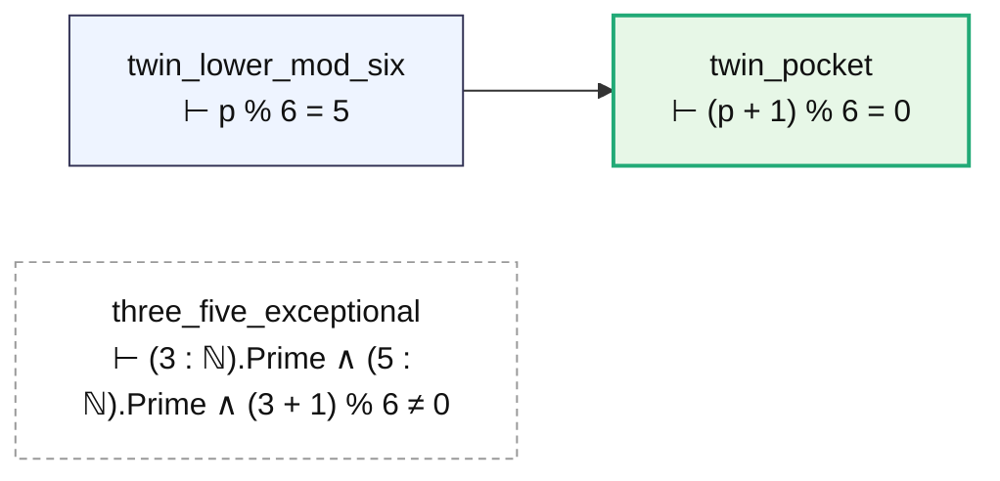

# `lean/TwinLattice.lean`

**What it does** (its own header): TwinLattice — a twin pair is a lattice site, not a coincidence of spacing. Every twin pair above 3 is `(6k − 1, 6k + 1)`. The single integer between them is `6k`. So a twin pair is not two primes that happen to sit two apart: it is a site on the `2·3` lattice with primes on both shoulders, and counting twins is counting doubly-flanked lattice sites.

**Imports:** nothing in this tree.
**Imported by:** nothing.

Blue: theorem. Green: a theorem nothing else uses (an end). Dashed white: connects to nothing. Grey: definition. Red: contains `sorry`. Yellow: in another file. An arrow A → B reads "A is used by B".

## Every declaration

| declaration | proves (output) | needs (input) | why (its own docstring) | uses | used by |
|---|---|---|---|---|---|
| `TwinLattice.twin_lower_mod_six` theorem, line 38 | p % 6 = 5 | hp : p.Prime; hp2 : (p + 2).Prime; h3 : 3 &lt; p | The lattice. Every twin pair above 3 has its lower member at `6k − 1`. `3 &lt; p` is not decoration: `(3,5)` is the one exception, and `three_five_exceptional` below exhibits it rather than leaving it implied. | — | `TwinLattice.twin_pocket` |
| `TwinLattice.twin_pocket` theorem, line 54 | (p + 1) % 6 = 0 | hp : p.Prime; hp2 : (p + 2).Prime; h3 : 3 &lt; p | The pocket. The single integer between a twin pair is a multiple of 6. That is the site; the pair is what is attached to it. | `TwinLattice.twin_lower_mod_six` | — |
| `TwinLattice.three_five_exceptional` theorem, line 68 | (3 : ℕ).Prime ∧ (5 : ℕ).Prime ∧ (3 + 1) % 6 ≠ 0 | — | `(3,5)` is the exception, exhibited rather than assumed. Its pocket is 4, which is not on the lattice. It is also the first twin pair, so the lattice reading begins at `(5,7)`. | — | — |
