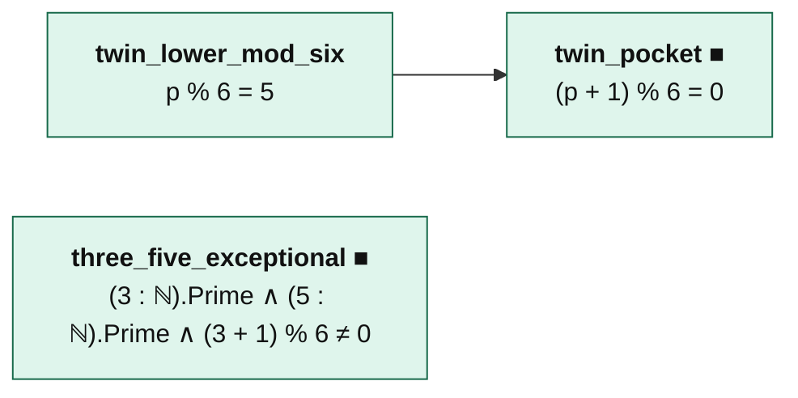

# `lean/TwinLattice.lean`

TwinLattice — a twin pair is a lattice site, not a coincidence of spacing. Every twin pair above 3 is `(6k − 1, 6k + 1)`. The single integer between them is `6k`. So a twin pair is not two primes that happen to sit two apart: it is a site on the `2·3` lattice with primes on both shoulders, and counting twins is counting doubly-flanked lattice sites.

3 theorems, 0 definitions, 99 lines. Arrows are Lean's own record of what each proof uses.

**Imports:** nothing in this tree  
**Imported by:** nothing

## The picture



An arrow A → B reads "A is used in the proof of B". Green: counting, integers only. Violet: shape, analysis with no ζ. Blue: reads ζ. A name ending in ■ is an end: nothing else uses it. Red: contains `sorry`. Yellow: theorems in another file, counted; a dotted arrow crosses files. Definitions are not drawn; they are listed below the diagram.

## Theorems

<a name="TwinLattice-twin_lower_mod_six"></a>
### `TwinLattice.twin_lower_mod_six`

line 38

**Counting.** Integers only: nothing in its statement or proof, or in anything it rests on, uses analysis or ζ.

**Why.** The lattice. Every twin pair above 3 has its lower member at `6k − 1`. `3 < p` is not decoration: `(3,5)` is the one exception, and `three_five_exceptional` below exhibits it rather than leaving it implied.

**Proves**

```lean
p % 6 = 5
```

**Needs** (its hypotheses)

  - `` hp : p.Prime ``
  - `` hp2 : (p + 2).Prime ``
  - `` h3 : 3 < p ``

**Fed by:** no theorem of this repo; it stands on Mathlib.

**Feeds** (1 that use it)

  - [`TwinLattice.twin_pocket`](#TwinLattice-twin_pocket) — `` (p + 1) % 6 = 0 ``

<a name="TwinLattice-twin_pocket"></a>
### `TwinLattice.twin_pocket`

line 54

**Counting.** Integers only: nothing in its statement or proof, or in anything it rests on, uses analysis or ζ.

**Why.** The pocket. The single integer between a twin pair is a multiple of 6. That is the site; the pair is what is attached to it.

**Proves**

```lean
(p + 1) % 6 = 0
```

**Needs** (its hypotheses)

  - `` hp : p.Prime ``
  - `` hp2 : (p + 2).Prime ``
  - `` h3 : 3 < p ``

**Fed by** (1 theorem its proof uses)

  - [`TwinLattice.twin_lower_mod_six`](#TwinLattice-twin_lower_mod_six) — `` p % 6 = 5 ``

**Feeds:** nothing. It is an end.

<a name="TwinLattice-three_five_exceptional"></a>
### `TwinLattice.three_five_exceptional`

line 68

**Counting.** Integers only: nothing in its statement or proof, or in anything it rests on, uses analysis or ζ.

**Why.** `(3,5)` is the exception, exhibited rather than assumed. Its pocket is 4, which is not on the lattice. It is also the first twin pair, so the lattice reading begins at `(5,7)`.

**Proves**

```lean
(3 : ℕ).Prime ∧ (5 : ℕ).Prime ∧ (3 + 1) % 6 ≠ 0
```

**Fed by:** no theorem of this repo; it stands on Mathlib.

**Feeds:** nothing. It connects to nothing.

