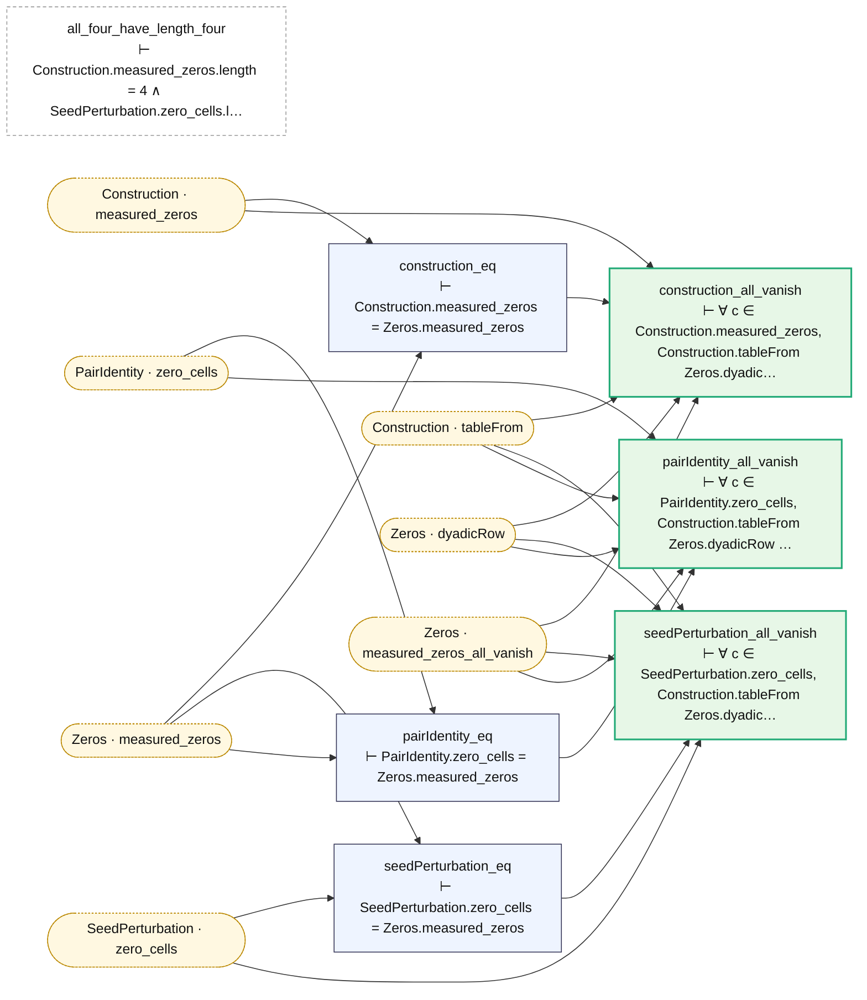

# `lean/ZeroCells.lean`

**What it does** (its own header): ZeroCells — the four zeros are one object with four names, and the kernel now says so.

**Imports:** [`PairIdentity`](../lean/PairIdentity.md), [`SeedPerturbation`](../lean/SeedPerturbation.md), [`Zeros`](../lean/Zeros.md).
**Imported by:** nothing.

Blue: theorem. Green: a theorem nothing else uses (an end). Dashed white: connects to nothing. Grey: definition. Red: contains `sorry`. Yellow: in another file. An arrow A → B reads "A is used by B".

## Every declaration

| declaration | proves (output) | needs (input) | why (its own docstring) | uses | used by |
|---|---|---|---|---|---|
| `ZeroCells.construction_eq` theorem, line 53 | Construction.measured_zeros = Zeros.measured_zeros | — | The construction module's list is the computed one. `rfl`, and that is what makes it a check: edit either list and this stops compiling. | `Construction.measured_zeros`, `Zeros.measured_zeros` | `ZeroCells.construction_all_vanish` |
| `ZeroCells.seedPerturbation_eq` theorem, line 61 | SeedPerturbation.zero_cells = Zeros.measured_zeros | — | The seed-perturbation module's list is the computed one. It was re-read independently from `imported/lattice_mapper/32bit/dyadic_difference_table_32.csv`, so this equality is also a statement that the imported table and `pi2n_cache` agree at those four cells. | `SeedPerturbation.zero_cells`, `Zeros.measured_zeros` | `ZeroCells.seedPerturbation_all_vanish` |
| `ZeroCells.pairIdentity_eq` theorem, line 65 | PairIdentity.zero_cells = Zeros.measured_zeros | — | The pair-identity module's list is the computed one. | `PairIdentity.zero_cells`, `Zeros.measured_zeros` | `ZeroCells.pairIdentity_all_vanish` |
| `ZeroCells.construction_all_vanish` theorem, line 70 | ∀ c ∈ Construction.measured_zeros, Construction.tableFrom Zeros.dyadicRow (c.1 : ℤ) c.2 = 0 | — | Every cell `Construction.measured_zeros` names vanishes — now derived, not transcribed. | `Construction.measured_zeros`, `Construction.tableFrom`, `ZeroCells.construction_eq`, `Zeros.dyadicRow`, `Zeros.measured_zeros_all_vanish` | — |
| `ZeroCells.seedPerturbation_all_vanish` theorem, line 76 | ∀ c ∈ SeedPerturbation.zero_cells, Construction.tableFrom Zeros.dyadicRow (c.1 : ℤ) c.2 = 0 | — | Every cell `SeedPerturbation.zero_cells` names vanishes. | `Construction.tableFrom`, `SeedPerturbation.zero_cells`, `ZeroCells.seedPerturbation_eq`, `Zeros.dyadicRow`, `Zeros.measured_zeros_all_vanish` | — |
| `ZeroCells.pairIdentity_all_vanish` theorem, line 82 | ∀ c ∈ PairIdentity.zero_cells, Construction.tableFrom Zeros.dyadicRow (c.1 : ℤ) c.2 = 0 | — | Every cell `PairIdentity.zero_cells` names vanishes. | `Construction.tableFrom`, `PairIdentity.zero_cells`, `ZeroCells.pairIdentity_eq`, `Zeros.dyadicRow`, `Zeros.measured_zeros_all_vanish` | — |
| `ZeroCells.all_four_have_length_four` theorem, line 90 | Construction.measured_zeros.length = 4 ∧ SeedPerturbation.zero_cells.length = 4 ∧ PairIdentity.zero_cells.length = 4 ∧ Zeros.measured_zeros.length = 4 | — | All four names, one length. The "exactly four" of the papers is now a property of a single object rather than of four lists that happen to agree. | — | — |
