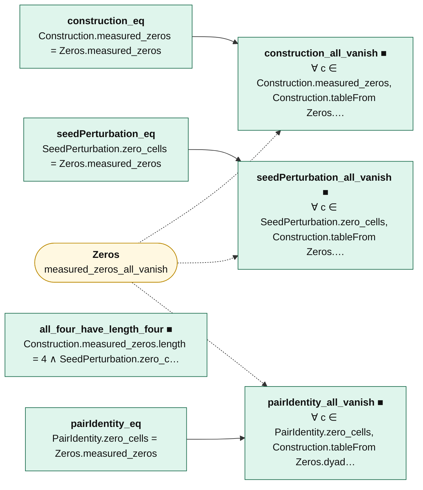

# `lean/ZeroCells.lean`

ZeroCells — the four zeros are one object with four names, and the kernel now says so.

7 theorems, 0 definitions, 134 lines. Arrows are Lean's own record of what each proof uses.

**Imports:** [`PairIdentity`](../lean/PairIdentity.md), [`SeedPerturbation`](../lean/SeedPerturbation.md), [`Zeros`](../lean/Zeros.md)  
**Imported by:** nothing

## The picture



An arrow A → B reads "A is used in the proof of B". Green: counting, integers only. Violet: shape, analysis with no ζ. Blue: reads ζ. A name ending in ■ is an end: nothing else uses it. Red: contains `sorry`. Yellow: theorems in another file, counted; a dotted arrow crosses files. Definitions are not drawn; they are listed below the diagram.

## Theorems

<a name="ZeroCells-construction_eq"></a>
### `ZeroCells.construction_eq`

line 53

**Counting.** Integers only: nothing in its statement or proof, or in anything it rests on, uses analysis or ζ.

**Why.** The construction module's list is the computed one. `rfl`, and that is what makes it a check: edit either list and this stops compiling.

**Proves**

```lean
Construction.measured_zeros = Zeros.measured_zeros
```

**Stated with:** [`Construction.measured_zeros`](../lean/Construction.md#Construction-measured_zeros), [`Zeros.measured_zeros`](../lean/Zeros.md#Zeros-measured_zeros)

**Fed by:** no theorem of this repo; it stands on Mathlib and the definitions below.

**Feeds** (1 that use it)

  - [`ZeroCells.construction_all_vanish`](#ZeroCells-construction_all_vanish) — `` ∀ c ∈ Construction.measured_zeros, Construction.tableFrom Zeros.dyadicRow (c.1 : ℤ) c.2 = 0 ``

<a name="ZeroCells-seedPerturbation_eq"></a>
### `ZeroCells.seedPerturbation_eq`

line 61

**Counting.** Integers only: nothing in its statement or proof, or in anything it rests on, uses analysis or ζ.

**Why.** The seed-perturbation module's list is the computed one. It was re-read independently from `imported/lattice_mapper/32bit/dyadic_difference_table_32.csv`, so this equality is also a statement that the imported table and `pi2n_cache` agree at those four cells.

**Proves**

```lean
SeedPerturbation.zero_cells = Zeros.measured_zeros
```

**Stated with:** [`SeedPerturbation.zero_cells`](../lean/SeedPerturbation.md#SeedPerturbation-zero_cells), [`Zeros.measured_zeros`](../lean/Zeros.md#Zeros-measured_zeros)

**Fed by:** no theorem of this repo; it stands on Mathlib and the definitions below.

**Feeds** (1 that use it)

  - [`ZeroCells.seedPerturbation_all_vanish`](#ZeroCells-seedPerturbation_all_vanish) — `` ∀ c ∈ SeedPerturbation.zero_cells, Construction.tableFrom Zeros.dyadicRow (c.1 : ℤ) c.2 = 0 ``

<a name="ZeroCells-pairIdentity_eq"></a>
### `ZeroCells.pairIdentity_eq`

line 65

**Counting.** Integers only: nothing in its statement or proof, or in anything it rests on, uses analysis or ζ.

**Why.** The pair-identity module's list is the computed one.

**Proves**

```lean
PairIdentity.zero_cells = Zeros.measured_zeros
```

**Stated with:** [`PairIdentity.zero_cells`](../lean/PairIdentity.md#PairIdentity-zero_cells), [`Zeros.measured_zeros`](../lean/Zeros.md#Zeros-measured_zeros)

**Fed by:** no theorem of this repo; it stands on Mathlib and the definitions below.

**Feeds** (1 that use it)

  - [`ZeroCells.pairIdentity_all_vanish`](#ZeroCells-pairIdentity_all_vanish) — `` ∀ c ∈ PairIdentity.zero_cells, Construction.tableFrom Zeros.dyadicRow (c.1 : ℤ) c.2 = 0 ``

<a name="ZeroCells-construction_all_vanish"></a>
### `ZeroCells.construction_all_vanish`

line 70

**Counting.** Integers only: nothing in its statement or proof, or in anything it rests on, uses analysis or ζ.

**Why.** Every cell `Construction.measured_zeros` names vanishes — now derived, not transcribed.

**Proves**

```lean
∀ c ∈ Construction.measured_zeros, Construction.tableFrom Zeros.dyadicRow (c.1 : ℤ) c.2 = 0
```

**Stated with:** [`Construction.measured_zeros`](../lean/Construction.md#Construction-measured_zeros), [`Construction.tableFrom`](../lean/Construction.md#Construction-tableFrom), [`Zeros.dyadicRow`](../lean/Zeros.md#Zeros-dyadicRow)

**Fed by** (2 theorems its proof uses)

  - [`ZeroCells.construction_eq`](#ZeroCells-construction_eq) — `` Construction.measured_zeros = Zeros.measured_zeros ``
  - [`Zeros.measured_zeros_all_vanish`](../lean/Zeros.md#Zeros-measured_zeros_all_vanish) (Zeros) — `` ∀ c ∈ measured_zeros, Construction.tableFrom dyadicRow (c.1 : ℤ) c.2 = 0 ``

**Definitions its proof touches:** [`Zeros.measured_zeros`](../lean/Zeros.md#Zeros-measured_zeros)

**Feeds:** nothing. It is an end.

<a name="ZeroCells-seedPerturbation_all_vanish"></a>
### `ZeroCells.seedPerturbation_all_vanish`

line 76

**Counting.** Integers only: nothing in its statement or proof, or in anything it rests on, uses analysis or ζ.

**Why.** Every cell `SeedPerturbation.zero_cells` names vanishes.

**Proves**

```lean
∀ c ∈ SeedPerturbation.zero_cells, Construction.tableFrom Zeros.dyadicRow (c.1 : ℤ) c.2 = 0
```

**Stated with:** [`Construction.tableFrom`](../lean/Construction.md#Construction-tableFrom), [`SeedPerturbation.zero_cells`](../lean/SeedPerturbation.md#SeedPerturbation-zero_cells), [`Zeros.dyadicRow`](../lean/Zeros.md#Zeros-dyadicRow)

**Fed by** (2 theorems its proof uses)

  - [`ZeroCells.seedPerturbation_eq`](#ZeroCells-seedPerturbation_eq) — `` SeedPerturbation.zero_cells = Zeros.measured_zeros ``
  - [`Zeros.measured_zeros_all_vanish`](../lean/Zeros.md#Zeros-measured_zeros_all_vanish) (Zeros) — `` ∀ c ∈ measured_zeros, Construction.tableFrom dyadicRow (c.1 : ℤ) c.2 = 0 ``

**Definitions its proof touches:** [`Zeros.measured_zeros`](../lean/Zeros.md#Zeros-measured_zeros)

**Feeds:** nothing. It is an end.

<a name="ZeroCells-pairIdentity_all_vanish"></a>
### `ZeroCells.pairIdentity_all_vanish`

line 82

**Counting.** Integers only: nothing in its statement or proof, or in anything it rests on, uses analysis or ζ.

**Why.** Every cell `PairIdentity.zero_cells` names vanishes.

**Proves**

```lean
∀ c ∈ PairIdentity.zero_cells, Construction.tableFrom Zeros.dyadicRow (c.1 : ℤ) c.2 = 0
```

**Stated with:** [`Construction.tableFrom`](../lean/Construction.md#Construction-tableFrom), [`PairIdentity.zero_cells`](../lean/PairIdentity.md#PairIdentity-zero_cells), [`Zeros.dyadicRow`](../lean/Zeros.md#Zeros-dyadicRow)

**Fed by** (2 theorems its proof uses)

  - [`ZeroCells.pairIdentity_eq`](#ZeroCells-pairIdentity_eq) — `` PairIdentity.zero_cells = Zeros.measured_zeros ``
  - [`Zeros.measured_zeros_all_vanish`](../lean/Zeros.md#Zeros-measured_zeros_all_vanish) (Zeros) — `` ∀ c ∈ measured_zeros, Construction.tableFrom dyadicRow (c.1 : ℤ) c.2 = 0 ``

**Definitions its proof touches:** [`Zeros.measured_zeros`](../lean/Zeros.md#Zeros-measured_zeros)

**Feeds:** nothing. It is an end.

<a name="ZeroCells-all_four_have_length_four"></a>
### `ZeroCells.all_four_have_length_four`

line 90

**Counting.** Integers only: nothing in its statement or proof, or in anything it rests on, uses analysis or ζ.

**Why.** All four names, one length. The "exactly four" of the papers is now a property of a single object rather than of four lists that happen to agree.

**Proves**

```lean
Construction.measured_zeros.length = 4 ∧ SeedPerturbation.zero_cells.length = 4 ∧ PairIdentity.zero_cells.length = 4 ∧ Zeros.measured_zeros.length = 4
```

**Stated with:** [`Construction.measured_zeros`](../lean/Construction.md#Construction-measured_zeros), [`PairIdentity.zero_cells`](../lean/PairIdentity.md#PairIdentity-zero_cells), [`SeedPerturbation.zero_cells`](../lean/SeedPerturbation.md#SeedPerturbation-zero_cells), [`Zeros.measured_zeros`](../lean/Zeros.md#Zeros-measured_zeros)

**Fed by:** no theorem of this repo; it stands on Mathlib and the definitions below.

**Feeds:** nothing. It is an end.

