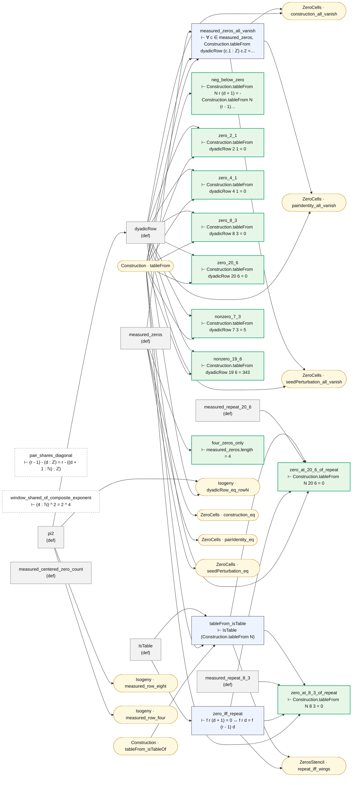

# `lean/Zeros.lean`

**What it does** (its own header): Zeros — what is provable about the four exact zeros, and what is not. THE MEASUREMENT (results/O16_run2.log): over r <= 62, d <= 61 the dyadic prime difference table has exactly four exact zeros — (2,1), (4,1), (8,3), (20,6) — and no others. The centered table has none at all.

**Imports:** [`Construction`](../lean/Construction.md).
**Imported by:** [`Isogeny`](../lean/Isogeny.md), [`Nonvanishing`](../lean/Nonvanishing.md), [`ZeroCells`](../lean/ZeroCells.md), [`ZerosStencil`](../lean/ZerosStencil.md).

Blue: theorem. Green: a theorem nothing else uses (an end). Dashed white: connects to nothing. Grey: definition. Red: contains `sorry`. Yellow: in another file. An arrow A → B reads "A is used by B".

## Every declaration

| declaration | proves (output) | needs (input) | why (its own docstring) | uses | used by |
|---|---|---|---|---|---|
| `Zeros.IsTable` def, line 70 | Prop | f : ℤ → ℕ → ℤ | The table recurrence: each cell is the difference of the two above it. Depth is carried in ℕ. An earlier version quantified `d` over ℤ, which is satisfiable but not by the bench's table: `Construction.tableFrom` has type `ℤ → ℕ → ℤ` and cannot be passed at all, and the obvious `toNat` adapter makes the recurrence at `d = -1` read `N r = N r - N (r-1)`, forci… | — | `Zeros.tableFrom_isTable`, `Zeros.zero_iff_repeat` |
| `Zeros.tableFrom_isTable` theorem, line 76 | IsTable (Construction.tableFrom N) | N : ℤ → ℤ | The bench's table is one. The hypothesis of `zero_iff_repeat` now has a witness: it is the second conjunct of `Construction.tableFrom_isTableOf`, which itself depends on no axioms. | `Construction.tableFrom`, `Construction.tableFrom_isTableOf`, `Zeros.IsTable` | `Zeros.zero_at_20_6_of_repeat`, `Zeros.zero_at_8_3_of_repeat`, `Zeros.repeat_iff_wings` |
| `Zeros.zero_iff_repeat` theorem, line 81 | f r (d + 1) = 0 ↔ f r d = f (r - 1) d | hf : IsTable f; r : ℤ; d : ℕ | A zero is exactly a repeat one depth up. This is definitional, and it is the only characterisation of a zero the chain supplies. | `Zeros.IsTable` | `Zeros.zero_at_20_6_of_repeat`, `Zeros.zero_at_8_3_of_repeat`, `Zeros.repeat_iff_wings` |
| `Zeros.neg_below_zero` theorem, line 95 | Construction.tableFrom N r (d + 1) = -Construction.tableFrom N (r - 1) d | N : ℤ → ℤ; r : ℤ; d : ℕ; hz : Construction.tableFrom N r d = 0 | A zero puts its left neighbour, negated, directly beneath it. With the cell above vanishing, the recurrence has nothing to subtract from. | `Construction.tableFrom` | — |
| `Zeros.pair_shares_diagonal` theorem, line 105 | (r - 1) - (d : ℤ) = r - ((d + 1 : ℕ) : ℤ) | r : ℤ; d : ℕ | And those two cells share a diagonal. The left neighbour sits at `(r-1, d)` and the copy at `(r, d+1)`, and `r - d` is the same for both. So every zero places a `±v` pair as adjacent cells on the diagonal one in -- `±343` at `(20,6)`, `±5` at `(8,3)`, both measured in `The-Fold.md` § C3. | — | — |
| `Zeros.window_shared_of_composite_exponent` theorem, line 115 | (4 : ℕ) ^ 2 = 2 ^ 4 | — | The (8,3) window is shared. Depth 3 spans `2^4 = 4^2`, so base 4 reaches it at depth 1. Against `Zeros.window_exclusive_of_prime_exponent`, which puts base 2 alone in the (20,6) window, the two deep zeros are different kinds of object. | — | — |
| `Zeros.measured_zeros` def, line 137 | List (ℕ × ℕ) | — | The four exact zeros, `(r, d)`, over `r &lt;= 62`, `d &lt;= 61`. `results/O16_run2.log`. Unexplained: no theorem above predicts these — their LOCATION is not derived, and nothing here changes that. | — | `ZeroCells.construction_eq`, `ZeroCells.pairIdentity_eq`, `ZeroCells.seedPerturbation_eq`, `Zeros.four_zeros_only`, `Zeros.measured_zeros_all_vanish` |
| `Zeros.pi2` def, line 159 | ℕ → ℤ | — | `π(2^n)` for `n = 0…20`, read from `pi2n_cache.json`. This is the only measured input to anything below — 21 integers, and no other data enters. | — | `Isogeny.dyadicRow_eq_rowN`, `Isogeny.measured_row_eight`, `Isogeny.measured_row_four`, `Zeros.dyadicRow` |
| `Zeros.dyadicRow` def, line 167 | ℤ → ℤ | — | The depth-0 row `N(r) = π(2^r) − π(2^(r−1))`: the primes in `(2^(r−1), 2^r]`. | `Zeros.pi2` | `Isogeny.dyadicRow_eq_rowN`, `ZeroCells.construction_all_vanish`, `ZeroCells.pairIdentity_all_vanish`, `ZeroCells.seedPerturbation_all_vanish`, `Zeros.measured_zeros_all_vanish`, `Zeros.nonzero_19_6`, `Zeros.nonzero_7_3`, `Zeros.zero_20_6`, `Zeros.zero_2_1`, `Zeros.zero_4_1`, `Zeros.zero_8_3` |
| `Zeros.zero_2_1` theorem, line 171 | Construction.tableFrom dyadicRow 2 1 = 0 | — | `(2,1)` vanishes: `1·1 − 1·1 = 0`, computed by the kernel from `pi2`. | `Construction.tableFrom`, `Zeros.dyadicRow` | — |
| `Zeros.zero_4_1` theorem, line 173 | Construction.tableFrom dyadicRow 4 1 = 0 | — | `(4,1)` vanishes: `1·2 − 1·2 = 0`. | `Construction.tableFrom`, `Zeros.dyadicRow` | — |
| `Zeros.zero_8_3` theorem, line 175 | Construction.tableFrom dyadicRow 8 3 = 0 | — | `(8,3)` vanishes: `23 − 3·13 + 3·7 − 5 = 0`, four values of `π`. | `Construction.tableFrom`, `Zeros.dyadicRow` | — |
| `Zeros.zero_20_6` theorem, line 178 | Construction.tableFrom dyadicRow 20 6 = 0 | — | `(20,6)` vanishes: the depth-6 stencil on seven values of `π`, spanning `2^13` to `2^20`. The deep zero, computed. | `Construction.tableFrom`, `Zeros.dyadicRow` | — |
| `Zeros.measured_zeros_all_vanish` theorem, line 182 | ∀ c ∈ measured_zeros, Construction.tableFrom dyadicRow (c.1 : ℤ) c.2 = 0 | — | The list's own claim, as a theorem. Every cell `measured_zeros` names vanishes on the dyadic row. | `Construction.tableFrom`, `Zeros.dyadicRow`, `Zeros.measured_zeros` | `ZeroCells.construction_all_vanish`, `ZeroCells.pairIdentity_all_vanish`, `ZeroCells.seedPerturbation_all_vanish` |
| `Zeros.nonzero_7_3` theorem, line 187 | Construction.tableFrom dyadicRow 7 3 = 5 | — | A non-zero neighbour, so the check can fail. | `Construction.tableFrom`, `Zeros.dyadicRow` | — |
| `Zeros.nonzero_19_6` theorem, line 191 | Construction.tableFrom dyadicRow 19 6 = 343 | — | The `+343` of `papers/The-Fold.md` § C3, the partner of the `−343` that a zero at `(20,6)` forces onto `(20,7)`. | `Construction.tableFrom`, `Zeros.dyadicRow` | — |
| `Zeros.measured_repeat_20_6` def, line 195 | ℤ | — | The repeats that produce the two deep zeros. `results/joint_dyadic_triadic_table.csv`, rows 19/20 at d5 and rows 7/8 at d2. | — | `Zeros.zero_at_20_6_of_repeat` |
| `Zeros.measured_repeat_8_3` def, line 196 | ℤ | — | — | — | `Zeros.zero_at_8_3_of_repeat` |
| `Zeros.measured_centered_zero_count` def, line 200 | ℕ | — | The centered (skew-adjoint) table has no exact zeros at all, `r &lt;= 62`, `d &lt;= 30`. `results/O16_run2.log`. | — | — |
| `Zeros.four_zeros_only` theorem, line 203 | measured_zeros.length = 4 | — | Four zeros in 1953 cells. Recorded, not derived. | `Zeros.measured_zeros` | — |
| `Zeros.zero_at_20_6_of_repeat` theorem, line 210 | Construction.tableFrom N 20 6 = 0 | N : ℤ → ℤ; h20 : Construction.tableFrom N 20 5 = measured_repeat_20_6; h19 : Construction.tableFrom N 19 5 = measured_repeat_20_6 | The measured repeat gives the deep zero, through the theorem. `O27` reads `d5` at `r = 19` and `r = 20` as both 623; `zero_iff_repeat` turns that into `(20,6) = 0` without computing anything. The measurement is the input and the vanishing is the output, which is the only direction this file supports. | `Construction.tableFrom`, `Zeros.measured_repeat_20_6`, `Zeros.tableFrom_isTable`, `Zeros.zero_iff_repeat` | — |
| `Zeros.zero_at_8_3_of_repeat` theorem, line 219 | Construction.tableFrom N 8 3 = 0 | N : ℤ → ℤ; h8 : Construction.tableFrom N 8 2 = measured_repeat_8_3; h7 : Construction.tableFrom N 7 2 = measured_repeat_8_3 | The same for the other deep zero, where the repeated value is 4. | `Construction.tableFrom`, `Zeros.measured_repeat_8_3`, `Zeros.tableFrom_isTable`, `Zeros.zero_iff_repeat` | — |
