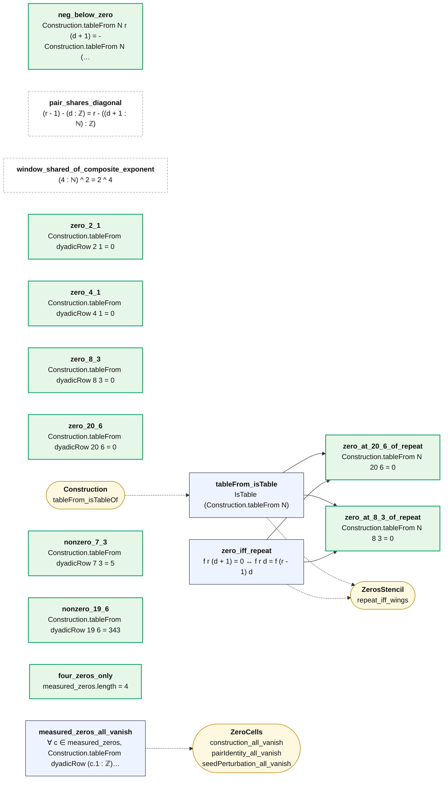

# `lean/Zeros.lean`

Zeros — what is provable about the four exact zeros, and what is not. THE MEASUREMENT (results/O16_run2.log): over r <= 62, d <= 61 the dyadic prime difference table has exactly four exact zeros — (2,1), (4,1), (8,3), (20,6) — and no others. The centered table has none at all.

15 theorems, 7 definitions, 298 lines. Arrows are Lean's own record of what each proof uses.

**Imports:** [`Construction`](../lean/Construction.md)  
**Imported by:** [`Isogeny`](../lean/Isogeny.md), [`Nonvanishing`](../lean/Nonvanishing.md), [`ZeroCells`](../lean/ZeroCells.md), [`ZerosStencil`](../lean/ZerosStencil.md)

## The picture



An arrow A → B reads "A is used in the proof of B". Blue: theorem. Green: a theorem nothing else uses (an end). Dashed: connects to nothing. Red: contains `sorry`. Yellow: theorems in another file, counted; a dotted arrow crosses files. Definitions are not drawn; they are listed below the diagram.

## Definitions

<a name="Zeros-IsTable"></a>
### `Zeros.IsTable`

def · line 70

The table recurrence: each cell is the difference of the two above it. Depth is carried in ℕ. An earlier version quantified `d` over ℤ, which is satisfiable but not by the bench's table: `Construction.tableFrom` has type `ℤ → ℕ → ℤ` and cannot be passed at all, and the obvious `toNat` adapter makes the recurrence at `d = -1` read `N r = N r - N (r-1)`, forcing `N (r-1) = 0` at every rung. So the theorem below was quantified over a class the object it is about is not in.

- **Is:** `` IsTable (f : ℤ → ℕ → ℤ) : Prop := ∀ (r : ℤ) (d : ℕ), f r (d + 1) = f r d - f (r - 1) d ``
- **Used by 2:** [`Zeros.tableFrom_isTable`](#Zeros-tableFrom_isTable), [`Zeros.zero_iff_repeat`](#Zeros-zero_iff_repeat)

<a name="Zeros-measured_zeros"></a>
### `Zeros.measured_zeros`

def · line 137

The four exact zeros, `(r, d)`, over `r <= 62`, `d <= 61`. `results/O16_run2.log`. Unexplained: no theorem above predicts these — their LOCATION is not derived, and nothing here changes that.

- **Is:** `` measured_zeros : List (ℕ × ℕ) := [(2, 1), (4, 1), (8, 3), (20, 6)] ``
- **Used by 9:** [`ZeroCells.all_four_have_length_four`](../lean/ZeroCells.md#ZeroCells-all_four_have_length_four), [`ZeroCells.construction_all_vanish`](../lean/ZeroCells.md#ZeroCells-construction_all_vanish), [`ZeroCells.construction_eq`](../lean/ZeroCells.md#ZeroCells-construction_eq), [`ZeroCells.pairIdentity_all_vanish`](../lean/ZeroCells.md#ZeroCells-pairIdentity_all_vanish), [`ZeroCells.pairIdentity_eq`](../lean/ZeroCells.md#ZeroCells-pairIdentity_eq), [`ZeroCells.seedPerturbation_all_vanish`](../lean/ZeroCells.md#ZeroCells-seedPerturbation_all_vanish), [`ZeroCells.seedPerturbation_eq`](../lean/ZeroCells.md#ZeroCells-seedPerturbation_eq), [`Zeros.four_zeros_only`](#Zeros-four_zeros_only), [`Zeros.measured_zeros_all_vanish`](#Zeros-measured_zeros_all_vanish)

<a name="Zeros-pi2"></a>
### `Zeros.pi2`

def · line 159

`π(2^n)` for `n = 0…20`, read from `pi2n_cache.json`. This is the only measured input to anything below — 21 integers, and no other data enters.

- **Is:** `` pi2 : ℕ → ℤ | 0 => 0 | 1 => 1 | 2 => 2 | 3 => 4 | 4 => 6 | 5 => 11 | 6 => 18 | 7 => 31 | 8 => 54 | 9 => 97 | 10 => 172 | 11 => 309 | 12 => 564 | 13 => 1028 | 14 => 1900 | 15 => 3512 | 16 => 6542 | 17 => 12251 | 18 => 23000 | 19 => 43390 | 20 => 82025 | _ => 0 ``
- **Used by 4:** [`Isogeny.dyadicRow_eq_rowN`](../lean/Isogeny.md#Isogeny-dyadicRow_eq_rowN), [`Isogeny.measured_row_eight`](../lean/Isogeny.md#Isogeny-measured_row_eight), [`Isogeny.measured_row_four`](../lean/Isogeny.md#Isogeny-measured_row_four), [`Zeros.dyadicRow`](#Zeros-dyadicRow)

<a name="Zeros-dyadicRow"></a>
### `Zeros.dyadicRow`

def · line 167

The depth-0 row `N(r) = π(2^r) − π(2^(r−1))`: the primes in `(2^(r−1), 2^r]`.

- **Is:** `` dyadicRow : ℤ → ℤ := fun r => if 1 ≤ r ∧ r ≤ 20 then pi2 r.toNat - pi2 (r - 1).toNat else 0 ``
- **Built from:** [`Zeros.pi2`](#Zeros-pi2)
- **Used by 11:** [`Isogeny.dyadicRow_eq_rowN`](../lean/Isogeny.md#Isogeny-dyadicRow_eq_rowN), [`ZeroCells.construction_all_vanish`](../lean/ZeroCells.md#ZeroCells-construction_all_vanish), [`ZeroCells.pairIdentity_all_vanish`](../lean/ZeroCells.md#ZeroCells-pairIdentity_all_vanish), [`ZeroCells.seedPerturbation_all_vanish`](../lean/ZeroCells.md#ZeroCells-seedPerturbation_all_vanish), [`Zeros.measured_zeros_all_vanish`](#Zeros-measured_zeros_all_vanish), [`Zeros.nonzero_19_6`](#Zeros-nonzero_19_6), [`Zeros.nonzero_7_3`](#Zeros-nonzero_7_3), [`Zeros.zero_20_6`](#Zeros-zero_20_6), [`Zeros.zero_2_1`](#Zeros-zero_2_1), [`Zeros.zero_4_1`](#Zeros-zero_4_1), [`Zeros.zero_8_3`](#Zeros-zero_8_3)

<a name="Zeros-measured_repeat_20_6"></a>
### `Zeros.measured_repeat_20_6`

def · line 195

The repeats that produce the two deep zeros. `results/joint_dyadic_triadic_table.csv`, rows 19/20 at d5 and rows 7/8 at d2.

- **Is:** `` measured_repeat_20_6 : ℤ := 623 ``
- **Used by 1:** [`Zeros.zero_at_20_6_of_repeat`](#Zeros-zero_at_20_6_of_repeat)

<a name="Zeros-measured_repeat_8_3"></a>
### `Zeros.measured_repeat_8_3`

def · line 196

- **Is:** `` measured_repeat_8_3 : ℤ := 4 ``
- **Used by 1:** [`Zeros.zero_at_8_3_of_repeat`](#Zeros-zero_at_8_3_of_repeat)

<a name="Zeros-measured_centered_zero_count"></a>
### `Zeros.measured_centered_zero_count`

def · line 200

The centered (skew-adjoint) table has no exact zeros at all, `r <= 62`, `d <= 30`. `results/O16_run2.log`.

- **Is:** `` measured_centered_zero_count : ℕ := 0 ``
- **Used by 0:** nothing

## Theorems

<a name="Zeros-tableFrom_isTable"></a>
### `Zeros.tableFrom_isTable`

line 76

**Why.** The bench's table is one. The hypothesis of `zero_iff_repeat` now has a witness: it is the second conjunct of `Construction.tableFrom_isTableOf`, which itself depends on no axioms.

**Proves**

```lean
IsTable (Construction.tableFrom N)
```

**Needs** (its hypotheses)

  - `` N : ℤ → ℤ ``

**Stated with:** [`Construction.tableFrom`](../lean/Construction.md#Construction-tableFrom), [`Zeros.IsTable`](#Zeros-IsTable)

**Fed by** (1 theorem its proof uses)

  - [`Construction.tableFrom_isTableOf`](../lean/Construction.md#Construction-tableFrom_isTableOf) (Construction) — `` IsTableOf N (tableFrom N) ``

**Feeds** (3 that use it)

  - [`Zeros.zero_at_20_6_of_repeat`](#Zeros-zero_at_20_6_of_repeat) — `` Construction.tableFrom N 20 6 = 0 ``
  - [`Zeros.zero_at_8_3_of_repeat`](#Zeros-zero_at_8_3_of_repeat) — `` Construction.tableFrom N 8 3 = 0 ``
  - [`Zeros.repeat_iff_wings`](../lean/ZerosStencil.md#Zeros-repeat_iff_wings) (ZerosStencil) — `` Construction.tableFrom N r d = Construction.tableFrom N (r - 1) d ↔ wingPlus (d + 1) (fun k => N (r - k)) = wingMinus (d + 1) (fun k => N (r - k)) ``

<a name="Zeros-zero_iff_repeat"></a>
### `Zeros.zero_iff_repeat`

line 81

**Why.** A zero is exactly a repeat one depth up. This is definitional, and it is the only characterisation of a zero the chain supplies.

**Proves**

```lean
f r (d + 1) = 0 ↔ f r d = f (r - 1) d
```

**Needs** (its hypotheses)

  - `` hf : IsTable f ``
  - `` r : ℤ ``
  - `` d : ℕ ``

**Stated with:** [`Zeros.IsTable`](#Zeros-IsTable)

**Fed by:** no theorem of this repo; it stands on Mathlib and the definitions below.

**Feeds** (3 that use it)

  - [`Zeros.zero_at_20_6_of_repeat`](#Zeros-zero_at_20_6_of_repeat) — `` Construction.tableFrom N 20 6 = 0 ``
  - [`Zeros.zero_at_8_3_of_repeat`](#Zeros-zero_at_8_3_of_repeat) — `` Construction.tableFrom N 8 3 = 0 ``
  - [`Zeros.repeat_iff_wings`](../lean/ZerosStencil.md#Zeros-repeat_iff_wings) (ZerosStencil) — `` Construction.tableFrom N r d = Construction.tableFrom N (r - 1) d ↔ wingPlus (d + 1) (fun k => N (r - k)) = wingMinus (d + 1) (fun k => N (r - k)) ``

<a name="Zeros-neg_below_zero"></a>
### `Zeros.neg_below_zero`

line 95

**Why.** A zero puts its left neighbour, negated, directly beneath it. With the cell above vanishing, the recurrence has nothing to subtract from.

**Proves**

```lean
Construction.tableFrom N r (d + 1) = -Construction.tableFrom N (r - 1) d
```

**Needs** (its hypotheses)

  - `` N : ℤ → ℤ ``
  - `` r : ℤ ``
  - `` d : ℕ ``
  - `` hz : Construction.tableFrom N r d = 0 ``

**Stated with:** [`Construction.tableFrom`](../lean/Construction.md#Construction-tableFrom)

**Fed by:** no theorem of this repo; it stands on Mathlib and the definitions below.

**Feeds:** nothing. It is an end.

<a name="Zeros-pair_shares_diagonal"></a>
### `Zeros.pair_shares_diagonal`

line 105

**Why.** And those two cells share a diagonal. The left neighbour sits at `(r-1, d)` and the copy at `(r, d+1)`, and `r - d` is the same for both. So every zero places a `±v` pair as adjacent cells on the diagonal one in -- `±343` at `(20,6)`, `±5` at `(8,3)`, both measured in `The-Fold.md` § C3.

**Proves**

```lean
(r - 1) - (d : ℤ) = r - ((d + 1 : ℕ) : ℤ)
```

**Needs** (its hypotheses)

  - `` r : ℤ ``
  - `` d : ℕ ``

**Fed by:** no theorem of this repo; it stands on Mathlib.

**Feeds:** nothing. It connects to nothing.

<a name="Zeros-window_shared_of_composite_exponent"></a>
### `Zeros.window_shared_of_composite_exponent`

line 115

**Why.** The (8,3) window is shared. Depth 3 spans `2^4 = 4^2`, so base 4 reaches it at depth 1. Against `Zeros.window_exclusive_of_prime_exponent`, which puts base 2 alone in the (20,6) window, the two deep zeros are different kinds of object.

**Proves**

```lean
(4 : ℕ) ^ 2 = 2 ^ 4
```

**Fed by:** no theorem of this repo; it stands on Mathlib.

**Feeds:** nothing. It connects to nothing.

<a name="Zeros-zero_2_1"></a>
### `Zeros.zero_2_1`

line 171

**Why.** `(2,1)` vanishes: `1·1 − 1·1 = 0`, computed by the kernel from `pi2`.

**Proves**

```lean
Construction.tableFrom dyadicRow 2 1 = 0
```

**Stated with:** [`Construction.tableFrom`](../lean/Construction.md#Construction-tableFrom), [`Zeros.dyadicRow`](#Zeros-dyadicRow)

**Fed by:** no theorem of this repo; it stands on Mathlib and the definitions below.

**Feeds:** nothing. It is an end.

<a name="Zeros-zero_4_1"></a>
### `Zeros.zero_4_1`

line 173

**Why.** `(4,1)` vanishes: `1·2 − 1·2 = 0`.

**Proves**

```lean
Construction.tableFrom dyadicRow 4 1 = 0
```

**Stated with:** [`Construction.tableFrom`](../lean/Construction.md#Construction-tableFrom), [`Zeros.dyadicRow`](#Zeros-dyadicRow)

**Fed by:** no theorem of this repo; it stands on Mathlib and the definitions below.

**Feeds:** nothing. It is an end.

<a name="Zeros-zero_8_3"></a>
### `Zeros.zero_8_3`

line 175

**Why.** `(8,3)` vanishes: `23 − 3·13 + 3·7 − 5 = 0`, four values of `π`.

**Proves**

```lean
Construction.tableFrom dyadicRow 8 3 = 0
```

**Stated with:** [`Construction.tableFrom`](../lean/Construction.md#Construction-tableFrom), [`Zeros.dyadicRow`](#Zeros-dyadicRow)

**Fed by:** no theorem of this repo; it stands on Mathlib and the definitions below.

**Feeds:** nothing. It is an end.

<a name="Zeros-zero_20_6"></a>
### `Zeros.zero_20_6`

line 178

**Why.** `(20,6)` vanishes: the depth-6 stencil on seven values of `π`, spanning `2^13` to `2^20`. The deep zero, computed.

**Proves**

```lean
Construction.tableFrom dyadicRow 20 6 = 0
```

**Stated with:** [`Construction.tableFrom`](../lean/Construction.md#Construction-tableFrom), [`Zeros.dyadicRow`](#Zeros-dyadicRow)

**Fed by:** no theorem of this repo; it stands on Mathlib and the definitions below.

**Feeds:** nothing. It is an end.

<a name="Zeros-measured_zeros_all_vanish"></a>
### `Zeros.measured_zeros_all_vanish`

line 182

**Why.** The list's own claim, as a theorem. Every cell `measured_zeros` names vanishes on the dyadic row.

**Proves**

```lean
∀ c ∈ measured_zeros, Construction.tableFrom dyadicRow (c.1 : ℤ) c.2 = 0
```

**Stated with:** [`Construction.tableFrom`](../lean/Construction.md#Construction-tableFrom), [`Zeros.dyadicRow`](#Zeros-dyadicRow), [`Zeros.measured_zeros`](#Zeros-measured_zeros)

**Fed by:** no theorem of this repo; it stands on Mathlib and the definitions below.

**Feeds** (3 that use it)

  - [`ZeroCells.construction_all_vanish`](../lean/ZeroCells.md#ZeroCells-construction_all_vanish) (ZeroCells) — `` ∀ c ∈ Construction.measured_zeros, Construction.tableFrom Zeros.dyadicRow (c.1 : ℤ) c.2 = 0 ``
  - [`ZeroCells.pairIdentity_all_vanish`](../lean/ZeroCells.md#ZeroCells-pairIdentity_all_vanish) (ZeroCells) — `` ∀ c ∈ PairIdentity.zero_cells, Construction.tableFrom Zeros.dyadicRow (c.1 : ℤ) c.2 = 0 ``
  - [`ZeroCells.seedPerturbation_all_vanish`](../lean/ZeroCells.md#ZeroCells-seedPerturbation_all_vanish) (ZeroCells) — `` ∀ c ∈ SeedPerturbation.zero_cells, Construction.tableFrom Zeros.dyadicRow (c.1 : ℤ) c.2 = 0 ``

<a name="Zeros-nonzero_7_3"></a>
### `Zeros.nonzero_7_3`

line 187

**Why.** A non-zero neighbour, so the check can fail.

**Proves**

```lean
Construction.tableFrom dyadicRow 7 3 = 5
```

**Stated with:** [`Construction.tableFrom`](../lean/Construction.md#Construction-tableFrom), [`Zeros.dyadicRow`](#Zeros-dyadicRow)

**Fed by:** no theorem of this repo; it stands on Mathlib and the definitions below.

**Feeds:** nothing. It is an end.

<a name="Zeros-nonzero_19_6"></a>
### `Zeros.nonzero_19_6`

line 191

**Why.** The `+343` of `papers/The-Fold.md` § C3, the partner of the `−343` that a zero at `(20,6)` forces onto `(20,7)`.

**Proves**

```lean
Construction.tableFrom dyadicRow 19 6 = 343
```

**Stated with:** [`Construction.tableFrom`](../lean/Construction.md#Construction-tableFrom), [`Zeros.dyadicRow`](#Zeros-dyadicRow)

**Fed by:** no theorem of this repo; it stands on Mathlib and the definitions below.

**Feeds:** nothing. It is an end.

<a name="Zeros-four_zeros_only"></a>
### `Zeros.four_zeros_only`

line 203

**Why.** Four zeros in 1953 cells. Recorded, not derived.

**Proves**

```lean
measured_zeros.length = 4
```

**Stated with:** [`Zeros.measured_zeros`](#Zeros-measured_zeros)

**Fed by:** no theorem of this repo; it stands on Mathlib and the definitions below.

**Feeds:** nothing. It is an end.

<a name="Zeros-zero_at_20_6_of_repeat"></a>
### `Zeros.zero_at_20_6_of_repeat`

line 210

**Why.** The measured repeat gives the deep zero, through the theorem. `O27` reads `d5` at `r = 19` and `r = 20` as both 623; `zero_iff_repeat` turns that into `(20,6) = 0` without computing anything. The measurement is the input and the vanishing is the output, which is the only direction this file supports.

**Proves**

```lean
Construction.tableFrom N 20 6 = 0
```

**Needs** (its hypotheses)

  - `` N : ℤ → ℤ ``
  - `` h20 : Construction.tableFrom N 20 5 = measured_repeat_20_6 ``
  - `` h19 : Construction.tableFrom N 19 5 = measured_repeat_20_6 ``

**Stated with:** [`Construction.tableFrom`](../lean/Construction.md#Construction-tableFrom), [`Zeros.measured_repeat_20_6`](#Zeros-measured_repeat_20_6)

**Fed by** (2 theorems its proof uses)

  - [`Zeros.tableFrom_isTable`](#Zeros-tableFrom_isTable) — `` IsTable (Construction.tableFrom N) ``
  - [`Zeros.zero_iff_repeat`](#Zeros-zero_iff_repeat) — `` f r (d + 1) = 0 ↔ f r d = f (r - 1) d ``

**Feeds:** nothing. It is an end.

<a name="Zeros-zero_at_8_3_of_repeat"></a>
### `Zeros.zero_at_8_3_of_repeat`

line 219

**Why.** The same for the other deep zero, where the repeated value is 4.

**Proves**

```lean
Construction.tableFrom N 8 3 = 0
```

**Needs** (its hypotheses)

  - `` N : ℤ → ℤ ``
  - `` h8 : Construction.tableFrom N 8 2 = measured_repeat_8_3 ``
  - `` h7 : Construction.tableFrom N 7 2 = measured_repeat_8_3 ``

**Stated with:** [`Construction.tableFrom`](../lean/Construction.md#Construction-tableFrom), [`Zeros.measured_repeat_8_3`](#Zeros-measured_repeat_8_3)

**Fed by** (2 theorems its proof uses)

  - [`Zeros.tableFrom_isTable`](#Zeros-tableFrom_isTable) — `` IsTable (Construction.tableFrom N) ``
  - [`Zeros.zero_iff_repeat`](#Zeros-zero_iff_repeat) — `` f r (d + 1) = 0 ↔ f r d = f (r - 1) d ``

**Feeds:** nothing. It is an end.

