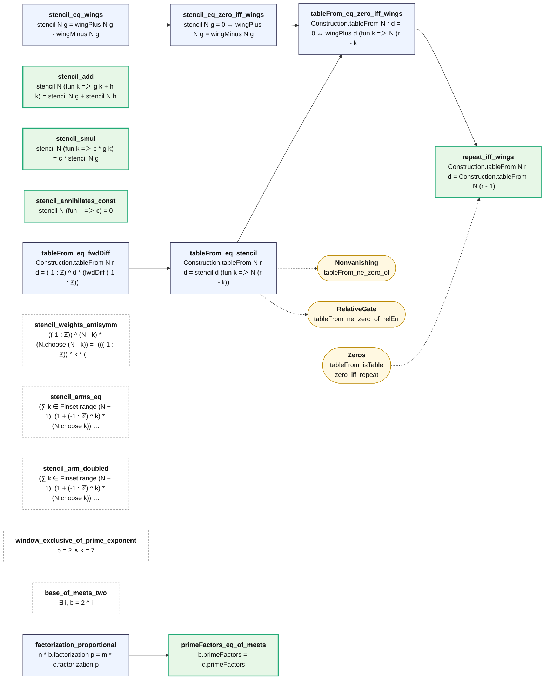

# `lean/ZerosStencil.lean`

ZerosStencil — the Mathlib-dependent half of `Zeros.lean`. Split out of `Zeros.lean` on 2026-08-26. The classification is by axiom pin, not by subject: these are exactly the fifteen theorems whose `#print axioms` carries `Classical.choice`, and every one of them acquires it from Mathlib — `Finset.range` and the alternating-sum lemmas for the stencil family, `Nat.factorization` and `Nat.dvd_prime_pow` for the four ladder results. Notes entries 59, 66 and 187 are the record; 66 predicted this exact list two weeks bef…

16 theorems, 4 definitions, 386 lines. Arrows are Lean's own record of what each proof uses.

**Imports:** [`Construction`](../lean/Construction.md), [`Zeros`](../lean/Zeros.md)  
**Imported by:** [`Nonvanishing`](../lean/Nonvanishing.md)

## The picture



An arrow A → B reads "A is used in the proof of B". Blue: theorem. Green: a theorem nothing else uses (an end). Dashed: connects to nothing. Red: contains `sorry`. Yellow: theorems in another file, counted; a dotted arrow crosses files. Definitions are not drawn; they are listed below the diagram.

## Definitions

<a name="Zeros-stencil"></a>
### `Zeros.stencil`

def · line 55

The `N`-fold alternating binomial functional — the stencil that produces a cell at depth `N-1` from `N+1` values of the counting function.

- **Is:** `` stencil (N : ℕ) (g : ℕ → ℤ) : ℤ := ∑ k ∈ Finset.range (N + 1), (-1 : ℤ) ^ k * (N.choose k) * g k ``
- **Used by 9:** [`Nonvanishing.tableFrom_ne_zero_of`](../lean/Nonvanishing.md#Nonvanishing-tableFrom_ne_zero_of), [`RelativeGate.tableFrom_ne_zero_of_relErr`](../lean/RelativeGate.md#RelativeGate-tableFrom_ne_zero_of_relErr), [`Zeros.stencil_add`](#Zeros-stencil_add), [`Zeros.stencil_annihilates_const`](#Zeros-stencil_annihilates_const), [`Zeros.stencil_eq_wings`](#Zeros-stencil_eq_wings), [`Zeros.stencil_eq_zero_iff_wings`](#Zeros-stencil_eq_zero_iff_wings), [`Zeros.stencil_smul`](#Zeros-stencil_smul), [`Zeros.tableFrom_eq_stencil`](#Zeros-tableFrom_eq_stencil), [`Zeros.tableFrom_eq_zero_iff_wings`](#Zeros-tableFrom_eq_zero_iff_wings)

<a name="Zeros-wingPlus"></a>
### `Zeros.wingPlus`

def · line 119

The `+` wing: the even-index arm of the stencil, unsigned.

- **Is:** `` wingPlus (N : ℕ) (g : ℕ → ℤ) : ℤ := ∑ k ∈ (Finset.range (N + 1)).filter (fun k => Even k), (N.choose k : ℤ) * g k ``
- **Used by 4:** [`Zeros.repeat_iff_wings`](#Zeros-repeat_iff_wings), [`Zeros.stencil_eq_wings`](#Zeros-stencil_eq_wings), [`Zeros.stencil_eq_zero_iff_wings`](#Zeros-stencil_eq_zero_iff_wings), [`Zeros.tableFrom_eq_zero_iff_wings`](#Zeros-tableFrom_eq_zero_iff_wings)

<a name="Zeros-wingMinus"></a>
### `Zeros.wingMinus`

def · line 123

The `−` wing: the odd-index arm, unsigned.

- **Is:** `` wingMinus (N : ℕ) (g : ℕ → ℤ) : ℤ := ∑ k ∈ (Finset.range (N + 1)).filter (fun k => ¬ Even k), (N.choose k : ℤ) * g k ``
- **Used by 4:** [`Zeros.repeat_iff_wings`](#Zeros-repeat_iff_wings), [`Zeros.stencil_eq_wings`](#Zeros-stencil_eq_wings), [`Zeros.stencil_eq_zero_iff_wings`](#Zeros-stencil_eq_zero_iff_wings), [`Zeros.tableFrom_eq_zero_iff_wings`](#Zeros-tableFrom_eq_zero_iff_wings)

<a name="Zeros-LaddersMeet"></a>
### `Zeros.LaddersMeet`

def · line 261

Two ladders share a rung above `x = 1` exactly when some power of one is a power of the other. `Commensurate-Ladders.md` § A2 states the real-log form, `log b / log c` rational; this is the same condition in ℕ, which is where the rungs actually sit and which needs no transcendence.

- **Is:** `` LaddersMeet (b c : ℕ) : Prop := ∃ n m : ℕ, 0 < n ∧ 0 < m ∧ b ^ n = c ^ m ``
- **Used by 0:** nothing

## Theorems

<a name="Zeros-tableFrom_eq_fwdDiff"></a>
### `Zeros.tableFrom_eq_fwdDiff`

line 39

**Why.** The table's `d`-fold backward difference is `(-1)^d` times Mathlib's `d`-fold forward difference at step `-1`. The bridge exists so that `tableFrom_eq_stencil` can borrow Mathlib's binomial theorem rather than redo the index bookkeeping.

**Proves**

```lean
Construction.tableFrom N r d = (-1 : ℤ) ^ d * (fwdDiff (-1 : ℤ))^[d] N r
```

**Needs** (its hypotheses)

  - `` N : ℤ → ℤ ``
  - `` r : ℤ ``
  - `` d : ℕ ``

**Stated with:** [`Construction.tableFrom`](../lean/Construction.md#Construction-tableFrom)

**Fed by:** no theorem of this repo; it stands on Mathlib and the definitions below.

**Feeds** (1 that use it)

  - [`Zeros.tableFrom_eq_stencil`](#Zeros-tableFrom_eq_stencil) — `` Construction.tableFrom N r d = stencil d (fun k => N (r - k)) ``

<a name="Zeros-tableFrom_eq_stencil"></a>
### `Zeros.tableFrom_eq_stencil`

line 66

**Why.** The operator IS Pascal. The cell at `(r,d)` — `d` backward differences of the row — equals the alternating binomial stencil of order `d` applied to the `d+1` row values in its window.

**Proves**

```lean
Construction.tableFrom N r d = stencil d (fun k => N (r - k))
```

**Needs** (its hypotheses)

  - `` N : ℤ → ℤ ``
  - `` r : ℤ ``
  - `` d : ℕ ``

**Stated with:** [`Construction.tableFrom`](../lean/Construction.md#Construction-tableFrom), [`Zeros.stencil`](#Zeros-stencil)

**Fed by** (1 theorem its proof uses)

  - [`Zeros.tableFrom_eq_fwdDiff`](#Zeros-tableFrom_eq_fwdDiff) — `` Construction.tableFrom N r d = (-1 : ℤ) ^ d * (fwdDiff (-1 : ℤ))^[d] N r ``

**Feeds** (3 that use it)

  - [`Nonvanishing.tableFrom_ne_zero_of`](../lean/Nonvanishing.md#Nonvanishing-tableFrom_ne_zero_of) (Nonvanishing) — `` Construction.tableFrom N r d ≠ 0 ``
  - [`RelativeGate.tableFrom_ne_zero_of_relErr`](../lean/RelativeGate.md#RelativeGate-tableFrom_ne_zero_of_relErr) (RelativeGate) — `` Construction.tableFrom N r d ≠ 0 ``
  - [`Zeros.tableFrom_eq_zero_iff_wings`](#Zeros-tableFrom_eq_zero_iff_wings) — `` Construction.tableFrom N r d = 0 ↔ wingPlus d (fun k => N (r - k)) = wingMinus d (fun k => N (r - k)) ``

<a name="Zeros-stencil_add"></a>
### `Zeros.stencil_add`

line 84

**Why.** The stencil is linear in the sampled values. So a zero is a single linear equation on the `N+1` values of `pi` inside its window — one condition, hence codimension one. Nothing here says when it is satisfied.

**Proves**

```lean
stencil N (fun k => g k + h k) = stencil N g + stencil N h
```

**Needs** (its hypotheses)

  - `` N : ℕ ``
  - `` g h : ℕ → ℤ ``

**Stated with:** [`Zeros.stencil`](#Zeros-stencil)

**Fed by:** no theorem of this repo; it stands on Mathlib and the definitions below.

**Feeds:** nothing. It is an end.

<a name="Zeros-stencil_smul"></a>
### `Zeros.stencil_smul`

line 91

**Why.** And scalars pass through — linearity's other half, beside `stencil_add`.

**Proves**

```lean
stencil N (fun k => c * g k) = c * stencil N g
```

**Needs** (its hypotheses)

  - `` N : ℕ ``
  - `` c : ℤ ``
  - `` g : ℕ → ℤ ``

**Stated with:** [`Zeros.stencil`](#Zeros-stencil)

**Fed by:** no theorem of this repo; it stands on Mathlib and the definitions below.

**Feeds:** nothing. It is an end.

<a name="Zeros-stencil_annihilates_const"></a>
### `Zeros.stencil_annihilates_const`

line 100

**Why.** The stencil's positive and negative arms carry equal total weight. For `N = 7` each arm sums to 64: the balance is exact by construction, not by anything about the primes.

**Proves**

```lean
stencil N (fun _ => c) = 0
```

**Needs** (its hypotheses)

  - `` N : ℕ ``
  - `` hN : 0 < N ``
  - `` c : ℤ ``

**Stated with:** [`Zeros.stencil`](#Zeros-stencil)

**Fed by:** no theorem of this repo; it stands on Mathlib and the definitions below.

**Feeds:** nothing. It is an end.

<a name="Zeros-stencil_eq_wings"></a>
### `Zeros.stencil_eq_wings`

line 127

**Why.** The fold is an identity, not a test. `cell = wing⁺ − wing⁻`, always.

**Proves**

```lean
stencil N g = wingPlus N g - wingMinus N g
```

**Needs** (its hypotheses)

  - `` N : ℕ ``
  - `` g : ℕ → ℤ ``

**Stated with:** [`Zeros.stencil`](#Zeros-stencil), [`Zeros.wingMinus`](#Zeros-wingMinus), [`Zeros.wingPlus`](#Zeros-wingPlus)

**Fed by:** no theorem of this repo; it stands on Mathlib and the definitions below.

**Feeds** (1 that use it)

  - [`Zeros.stencil_eq_zero_iff_wings`](#Zeros-stencil_eq_zero_iff_wings) — `` stencil N g = 0 ↔ wingPlus N g = wingMinus N g ``

<a name="Zeros-stencil_eq_zero_iff_wings"></a>
### `Zeros.stencil_eq_zero_iff_wings`

line 141

**Why.** A zero is where the wings balance.

**Proves**

```lean
stencil N g = 0 ↔ wingPlus N g = wingMinus N g
```

**Needs** (its hypotheses)

  - `` N : ℕ ``
  - `` g : ℕ → ℤ ``

**Stated with:** [`Zeros.stencil`](#Zeros-stencil), [`Zeros.wingMinus`](#Zeros-wingMinus), [`Zeros.wingPlus`](#Zeros-wingPlus)

**Fed by** (1 theorem its proof uses)

  - [`Zeros.stencil_eq_wings`](#Zeros-stencil_eq_wings) — `` stencil N g = wingPlus N g - wingMinus N g ``

**Feeds** (1 that use it)

  - [`Zeros.tableFrom_eq_zero_iff_wings`](#Zeros-tableFrom_eq_zero_iff_wings) — `` Construction.tableFrom N r d = 0 ↔ wingPlus d (fun k => N (r - k)) = wingMinus d (fun k => N (r - k)) ``

<a name="Zeros-tableFrom_eq_zero_iff_wings"></a>
### `Zeros.tableFrom_eq_zero_iff_wings`

line 147

**Why.** The cell, folded. Through `tableFrom_eq_stencil`: the table's cell at `(r,d)` vanishes exactly when the two wings of its window balance.

**Proves**

```lean
Construction.tableFrom N r d = 0 ↔ wingPlus d (fun k => N (r - k)) = wingMinus d (fun k => N (r - k))
```

**Needs** (its hypotheses)

  - `` N : ℤ → ℤ ``
  - `` r : ℤ ``
  - `` d : ℕ ``

**Stated with:** [`Construction.tableFrom`](../lean/Construction.md#Construction-tableFrom), [`Zeros.wingMinus`](#Zeros-wingMinus), [`Zeros.wingPlus`](#Zeros-wingPlus)

**Fed by** (2 theorems its proof uses)

  - [`Zeros.stencil_eq_zero_iff_wings`](#Zeros-stencil_eq_zero_iff_wings) — `` stencil N g = 0 ↔ wingPlus N g = wingMinus N g ``
  - [`Zeros.tableFrom_eq_stencil`](#Zeros-tableFrom_eq_stencil) — `` Construction.tableFrom N r d = stencil d (fun k => N (r - k)) ``

**Definitions its proof touches:** [`Zeros.stencil`](#Zeros-stencil)

**Feeds** (1 that use it)

  - [`Zeros.repeat_iff_wings`](#Zeros-repeat_iff_wings) — `` Construction.tableFrom N r d = Construction.tableFrom N (r - 1) d ↔ wingPlus (d + 1) (fun k => N (r - k)) = wingMinus (d + 1) (fun k => N (r - k)) ``

<a name="Zeros-repeat_iff_wings"></a>
### `Zeros.repeat_iff_wings`

line 156

**Why.** Two readings of one fact. `zero_iff_repeat` says a cell vanishes iff the row repeats at the depth below. This says it vanishes iff the wings balance. The repeat reading and the fold reading are the same statement, and until now nothing in the tree connected them.

**Proves**

```lean
Construction.tableFrom N r d = Construction.tableFrom N (r - 1) d ↔ wingPlus (d + 1) (fun k => N (r - k)) = wingMinus (d + 1) (fun k => N (r - k))
```

**Needs** (its hypotheses)

  - `` N : ℤ → ℤ ``
  - `` r : ℤ ``
  - `` d : ℕ ``

**Stated with:** [`Construction.tableFrom`](../lean/Construction.md#Construction-tableFrom), [`Zeros.wingMinus`](#Zeros-wingMinus), [`Zeros.wingPlus`](#Zeros-wingPlus)

**Fed by** (3 theorems its proof uses)

  - [`Zeros.tableFrom_isTable`](../lean/Zeros.md#Zeros-tableFrom_isTable) (Zeros) — `` IsTable (Construction.tableFrom N) ``
  - [`Zeros.zero_iff_repeat`](../lean/Zeros.md#Zeros-zero_iff_repeat) (Zeros) — `` f r (d + 1) = 0 ↔ f r d = f (r - 1) d ``
  - [`Zeros.tableFrom_eq_zero_iff_wings`](#Zeros-tableFrom_eq_zero_iff_wings) — `` Construction.tableFrom N r d = 0 ↔ wingPlus d (fun k => N (r - k)) = wingMinus d (fun k => N (r - k)) ``

**Feeds:** nothing. It is an end.

<a name="Zeros-stencil_weights_antisymm"></a>
### `Zeros.stencil_weights_antisymm`

line 177

**Why.** The stencil is antisymmetric when its order is odd. Reflecting an index about the midpoint negates its weight, because `(N-k) + k = N` is odd and so the two indices have opposite parity.

**Proves**

```lean
((-1 : ℤ)) ^ (N - k) * (N.choose (N - k)) = -(((-1 : ℤ)) ^ k * (N.choose k))
```

**Needs** (its hypotheses)

  - `` hN : Odd N ``
  - `` k : ℕ ``
  - `` hk : k ≤ N ``

**Fed by:** no theorem of this repo; it stands on Mathlib.

**Feeds:** nothing. It connects to nothing.

<a name="Zeros-stencil_arms_eq"></a>
### `Zeros.stencil_arms_eq`

line 202

**Why.** The two arms weigh the same. `stencil_annihilates_const` says the signed weights cancel; written as two sums, that is the positive-index arm equalling the negative-index arm. `(1 + (-1)^k)` is twice the indicator of even `k` and `(1 - (-1)^k)` twice the indicator of odd `k`, so this is the split with the division cleared.

**Proves**

```lean
(∑ k ∈ Finset.range (N + 1), (1 + (-1 : ℤ) ^ k) * (N.choose k)) = ∑ k ∈ Finset.range (N + 1), (1 - (-1 : ℤ) ^ k) * (N.choose k)
```

**Needs** (its hypotheses)

  - `` hN : N ≠ 0 ``

**Fed by:** no theorem of this repo; it stands on Mathlib.

**Feeds:** nothing. It connects to nothing.

<a name="Zeros-stencil_arm_doubled"></a>
### `Zeros.stencil_arm_doubled`

line 217

**Why.** And each arm is `2^(N-1)`. Doubled, an arm is the whole row, `2^N`. With `stencil_arms_eq` that fixes both at half the row -- 64 and 64 at `N = 7`, 8 and 8 at `N = 4`, which is what `The-Fold.md` § B1 reports.

**Proves**

```lean
(∑ k ∈ Finset.range (N + 1), (1 + (-1 : ℤ) ^ k) * (N.choose k)) = 2 ^ N
```

**Needs** (its hypotheses)

  - `` hN : N ≠ 0 ``

**Fed by:** no theorem of this repo; it stands on Mathlib.

**Feeds:** nothing. It connects to nothing.

<a name="Zeros-window_exclusive_of_prime_exponent"></a>
### `Zeros.window_exclusive_of_prime_exponent`

line 232

**Why.** The (20,6) window is base-2 exclusive. Depth 6 spans a ratio of `2^7`. Since 7 is prime, no integer base `b >= 2` reaches that window at any integer depth `k >= 2`. Base 2 at depth 6 is the only way to look through it.

**Proves**

```lean
b = 2 ∧ k = 7
```

**Needs** (its hypotheses)

  - `` b k : ℕ ``
  - `` hb : 2 ≤ b ``
  - `` hk : 2 ≤ k ``
  - `` h : b ^ k = 2 ^ 7 ``

**Fed by:** no theorem of this repo; it stands on Mathlib.

**Feeds:** nothing. It connects to nothing.

<a name="Zeros-base_of_meets_two"></a>
### `Zeros.base_of_meets_two`

line 273

**Why.** Only powers of two reach a dyadic window. If any positive power of `b` equals a power of 2, then `b` is itself a power of 2. So the ladders meeting base 2 are exactly `2, 4, 8, 16, …` and no others -- which is the general form of `window_exclusive_of_prime_exponent`, stated for every window rather than for `2^7`.

**Proves**

```lean
∃ i, b = 2 ^ i
```

**Needs** (its hypotheses)

  - `` hk : k ≠ 0 ``
  - `` h : b ^ k = 2 ^ m ``

**Fed by:** no theorem of this repo; it stands on Mathlib.

**Feeds:** nothing. It connects to nothing.

<a name="Zeros-factorization_proportional"></a>
### `Zeros.factorization_proportional`

line 284

**Why.** Two ladders that meet have proportional exponents. If some power of `b` equals some power of `c`, then at every prime the two exponents stand in the ratio `m : n`. This is the "shared lineage" of `Commensurate-Ladders.md` § A2 in exact form -- not that `b` and `c` are related somehow, but that their prime signatures are one vector scaled two ways.

**Proves**

```lean
n * b.factorization p = m * c.factorization p
```

**Needs** (its hypotheses)

  - `` h : b ^ n = c ^ m ``
  - `` p : ℕ ``

**Fed by:** no theorem of this repo; it stands on Mathlib.

**Feeds** (1 that use it)

  - [`Zeros.primeFactors_eq_of_meets`](#Zeros-primeFactors_eq_of_meets) — `` b.primeFactors = c.primeFactors ``

<a name="Zeros-primeFactors_eq_of_meets"></a>
### `Zeros.primeFactors_eq_of_meets`

line 295

**Why.** And they are built from the same primes. Proportionality with both exponents nonzero forces the supports to agree, so ladders that meet are made of one prime set. Bases 2 and 3 meet nowhere above `x = 1` for exactly this reason -- there is no common ancestor because there is no common prime.

**Proves**

```lean
b.primeFactors = c.primeFactors
```

**Needs** (its hypotheses)

  - `` hn : n ≠ 0 ``
  - `` hm : m ≠ 0 ``
  - `` h : b ^ n = c ^ m ``

**Fed by** (1 theorem its proof uses)

  - [`Zeros.factorization_proportional`](#Zeros-factorization_proportional) — `` n * b.factorization p = m * c.factorization p ``

**Feeds:** nothing. It is an end.

