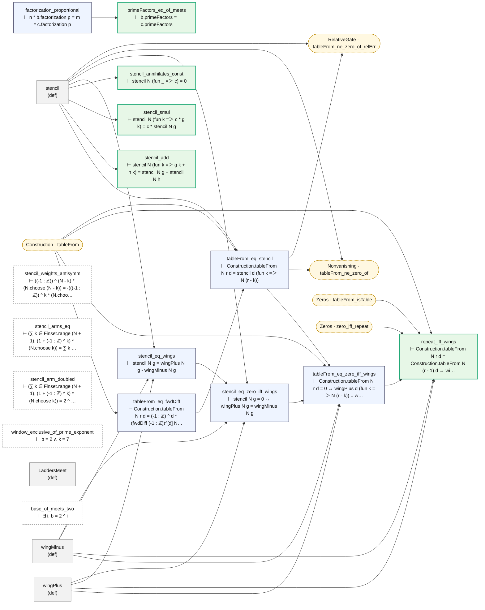

# `lean/ZerosStencil.lean`

**What it does** (its own header): ZerosStencil — the Mathlib-dependent half of `Zeros.lean`. Split out of `Zeros.lean` on 2026-08-26. The classification is by axiom pin, not by subject: these are exactly the fifteen theorems whose `#print axioms` carries `Classical.choice`, and every one of them acquires it from Mathlib — `Finset.range` and the alternating-sum lemmas for the stencil family, `Nat.factorization` and `Nat.dvd_prime_pow` for the four ladder results. Notes entries 59, 66 and 187 are the record; 66 predicted this exact list two weeks bef…

**Imports:** [`Construction`](../lean/Construction.md), [`Zeros`](../lean/Zeros.md).
**Imported by:** [`Nonvanishing`](../lean/Nonvanishing.md).

Blue: theorem. Green: a theorem nothing else uses (an end). Dashed white: connects to nothing. Grey: definition. Red: contains `sorry`. Yellow: in another file. An arrow A → B reads "A is used by B".

## Every declaration

| declaration | proves (output) | needs (input) | why (its own docstring) | uses | used by |
|---|---|---|---|---|---|
| `Zeros.tableFrom_eq_fwdDiff` theorem, line 39 | Construction.tableFrom N r d = (-1 : ℤ) ^ d * (fwdDiff (-1 : ℤ))^[d] N r | N : ℤ → ℤ; r : ℤ; d : ℕ | The table's `d`-fold backward difference is `(-1)^d` times Mathlib's `d`-fold forward difference at step `-1`. The bridge exists so that `tableFrom_eq_stencil` can borrow Mathlib's binomial theorem rather than redo the index bookkeeping. | `Construction.tableFrom` | `Zeros.tableFrom_eq_stencil` |
| `Zeros.stencil` def, line 55 | ℤ | N : ℕ; g : ℕ → ℤ | The `N`-fold alternating binomial functional — the stencil that produces a cell at depth `N-1` from `N+1` values of the counting function. | — | `Nonvanishing.tableFrom_ne_zero_of`, `RelativeGate.tableFrom_ne_zero_of_relErr`, `Zeros.stencil_add`, `Zeros.stencil_annihilates_const`, `Zeros.stencil_eq_wings`, `Zeros.stencil_eq_zero_iff_wings`, `Zeros.stencil_smul`, `Zeros.tableFrom_eq_stencil` |
| `Zeros.tableFrom_eq_stencil` theorem, line 66 | Construction.tableFrom N r d = stencil d (fun k =&gt; N (r - k)) | N : ℤ → ℤ; r : ℤ; d : ℕ | The operator IS Pascal. The cell at `(r,d)` — `d` backward differences of the row — equals the alternating binomial stencil of order `d` applied to the `d+1` row values in its window. | `Construction.tableFrom`, `Zeros.stencil`, `Zeros.tableFrom_eq_fwdDiff` | `Nonvanishing.tableFrom_ne_zero_of`, `RelativeGate.tableFrom_ne_zero_of_relErr`, `Zeros.tableFrom_eq_zero_iff_wings` |
| `Zeros.stencil_add` theorem, line 84 | stencil N (fun k =&gt; g k + h k) = stencil N g + stencil N h | N : ℕ; g h : ℕ → ℤ | The stencil is linear in the sampled values. So a zero is a single linear equation on the `N+1` values of `pi` inside its window — one condition, hence codimension one. Nothing here says when it is satisfied. | `Zeros.stencil` | — |
| `Zeros.stencil_smul` theorem, line 91 | stencil N (fun k =&gt; c * g k) = c * stencil N g | N : ℕ; c : ℤ; g : ℕ → ℤ | And scalars pass through — linearity's other half, beside `stencil_add`. | `Zeros.stencil` | — |
| `Zeros.stencil_annihilates_const` theorem, line 100 | stencil N (fun _ =&gt; c) = 0 | N : ℕ; hN : 0 &lt; N; c : ℤ | The stencil's positive and negative arms carry equal total weight. For `N = 7` each arm sums to 64: the balance is exact by construction, not by anything about the primes. | `Zeros.stencil` | — |
| `Zeros.wingPlus` def, line 119 | ℤ | N : ℕ; g : ℕ → ℤ | The `+` wing: the even-index arm of the stencil, unsigned. | — | `Zeros.repeat_iff_wings`, `Zeros.stencil_eq_wings`, `Zeros.stencil_eq_zero_iff_wings`, `Zeros.tableFrom_eq_zero_iff_wings` |
| `Zeros.wingMinus` def, line 123 | ℤ | N : ℕ; g : ℕ → ℤ | The `−` wing: the odd-index arm, unsigned. | — | `Zeros.repeat_iff_wings`, `Zeros.stencil_eq_wings`, `Zeros.stencil_eq_zero_iff_wings`, `Zeros.tableFrom_eq_zero_iff_wings` |
| `Zeros.stencil_eq_wings` theorem, line 127 | stencil N g = wingPlus N g - wingMinus N g | N : ℕ; g : ℕ → ℤ | The fold is an identity, not a test. `cell = wing⁺ − wing⁻`, always. | `Zeros.stencil`, `Zeros.wingMinus`, `Zeros.wingPlus` | `Zeros.stencil_eq_zero_iff_wings` |
| `Zeros.stencil_eq_zero_iff_wings` theorem, line 141 | stencil N g = 0 ↔ wingPlus N g = wingMinus N g | N : ℕ; g : ℕ → ℤ | A zero is where the wings balance. | `Zeros.stencil`, `Zeros.stencil_eq_wings`, `Zeros.wingMinus`, `Zeros.wingPlus` | `Zeros.tableFrom_eq_zero_iff_wings` |
| `Zeros.tableFrom_eq_zero_iff_wings` theorem, line 147 | Construction.tableFrom N r d = 0 ↔ wingPlus d (fun k =&gt; N (r - k)) = wingMinus d (fun k =&gt; N (r - k)) | N : ℤ → ℤ; r : ℤ; d : ℕ | The cell, folded. Through `tableFrom_eq_stencil`: the table's cell at `(r,d)` vanishes exactly when the two wings of its window balance. | `Construction.tableFrom`, `Zeros.stencil_eq_zero_iff_wings`, `Zeros.tableFrom_eq_stencil`, `Zeros.wingMinus`, `Zeros.wingPlus` | `Zeros.repeat_iff_wings` |
| `Zeros.repeat_iff_wings` theorem, line 156 | Construction.tableFrom N r d = Construction.tableFrom N (r - 1) d ↔ wingPlus (d + 1) (fun k =&gt; N (r - k)) = wingMinus (d + 1) (fun k =&gt; N (r - k)) | N : ℤ → ℤ; r : ℤ; d : ℕ | Two readings of one fact. `zero_iff_repeat` says a cell vanishes iff the row repeats at the depth below. This says it vanishes iff the wings balance. The repeat reading and the fold reading are the same statement, and until now nothing in the tree connected them. | `Construction.tableFrom`, `Zeros.tableFrom_isTable`, `Zeros.zero_iff_repeat`, `Zeros.tableFrom_eq_zero_iff_wings`, `Zeros.wingMinus`, `Zeros.wingPlus` | — |
| `Zeros.stencil_weights_antisymm` theorem, line 177 | ((-1 : ℤ)) ^ (N - k) * (N.choose (N - k)) = -(((-1 : ℤ)) ^ k * (N.choose k)) | hN : Odd N; k : ℕ; hk : k ≤ N | The stencil is antisymmetric when its order is odd. Reflecting an index about the midpoint negates its weight, because `(N-k) + k = N` is odd and so the two indices have opposite parity. | — | — |
| `Zeros.stencil_arms_eq` theorem, line 202 | (∑ k ∈ Finset.range (N + 1), (1 + (-1 : ℤ) ^ k) * (N.choose k)) = ∑ k ∈ Finset.range (N + 1), (1 - (-1 : ℤ) ^ k) * (N.choose k) | hN : N ≠ 0 | The two arms weigh the same. `stencil_annihilates_const` says the signed weights cancel; written as two sums, that is the positive-index arm equalling the negative-index arm. `(1 + (-1)^k)` is twice the indicator of even `k` and `(1 - (-1)^k)` twice the indicator of odd `k`, so this is the split with the division cleared. | — | — |
| `Zeros.stencil_arm_doubled` theorem, line 217 | (∑ k ∈ Finset.range (N + 1), (1 + (-1 : ℤ) ^ k) * (N.choose k)) = 2 ^ N | hN : N ≠ 0 | And each arm is `2^(N-1)`. Doubled, an arm is the whole row, `2^N`. With `stencil_arms_eq` that fixes both at half the row -- 64 and 64 at `N = 7`, 8 and 8 at `N = 4`, which is what `The-Fold.md` § B1 reports. | — | — |
| `Zeros.window_exclusive_of_prime_exponent` theorem, line 232 | b = 2 ∧ k = 7 | b k : ℕ; hb : 2 ≤ b; hk : 2 ≤ k; h : b ^ k = 2 ^ 7 | The (20,6) window is base-2 exclusive. Depth 6 spans a ratio of `2^7`. Since 7 is prime, no integer base `b &gt;= 2` reaches that window at any integer depth `k &gt;= 2`. Base 2 at depth 6 is the only way to look through it. | — | — |
| `Zeros.LaddersMeet` def, line 261 | Prop | b c : ℕ | Two ladders share a rung above `x = 1` exactly when some power of one is a power of the other. `Commensurate-Ladders.md` § A2 states the real-log form, `log b / log c` rational; this is the same condition in ℕ, which is where the rungs actually sit and which needs no transcendence. | — | — |
| `Zeros.base_of_meets_two` theorem, line 273 | ∃ i, b = 2 ^ i | hk : k ≠ 0; h : b ^ k = 2 ^ m | Only powers of two reach a dyadic window. If any positive power of `b` equals a power of 2, then `b` is itself a power of 2. So the ladders meeting base 2 are exactly `2, 4, 8, 16, …` and no others -- which is the general form of `window_exclusive_of_prime_exponent`, stated for every window rather than for `2^7`. | — | — |
| `Zeros.factorization_proportional` theorem, line 284 | n * b.factorization p = m * c.factorization p | h : b ^ n = c ^ m; p : ℕ | Two ladders that meet have proportional exponents. If some power of `b` equals some power of `c`, then at every prime the two exponents stand in the ratio `m : n`. This is the "shared lineage" of `Commensurate-Ladders.md` § A2 in exact form -- not that `b` and `c` are related somehow, but that their prime signatures are one vector scaled two ways. | — | `Zeros.primeFactors_eq_of_meets` |
| `Zeros.primeFactors_eq_of_meets` theorem, line 295 | b.primeFactors = c.primeFactors | hn : n ≠ 0; hm : m ≠ 0; h : b ^ n = c ^ m | And they are built from the same primes. Proportionality with both exponents nonzero forces the supports to agree, so ladders that meet are made of one prime set. Bases 2 and 3 meet nowhere above `x = 1` for exactly this reason -- there is no common ancestor because there is no common prime. | `Zeros.factorization_proportional` | — |
