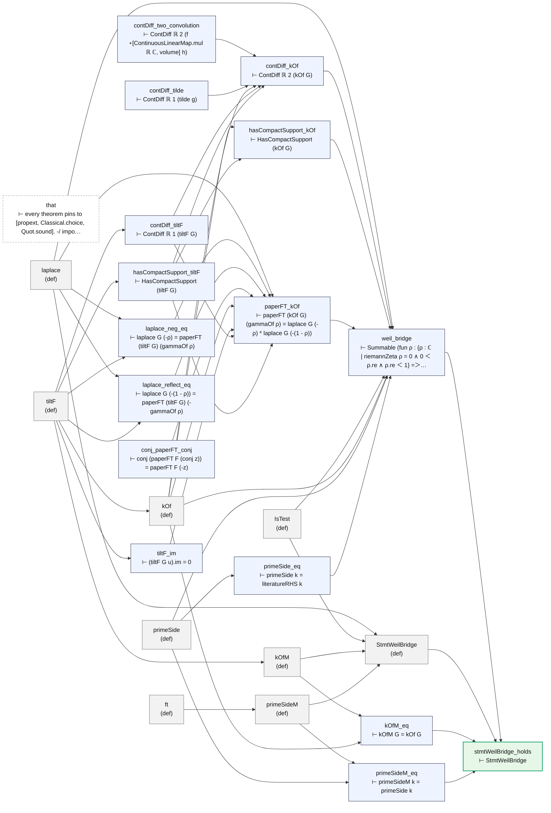

# `lean_bridge/Bridge/WeilBridge.lean`

**What it does** (its own header): WeilBridge — the bridge to primes: the zero side of Weil's form at a test function of Stage 3's class equals the prime side, proved against zeta23's explicit formula. The third tree, `lean_bridge/`. 2026-11-22. The statement is unit 0379's; the choice of a third tree is Julian's of the same day.

**Imports:** nothing in this tree.
**Imported by:** [`Bridge`](../lean_bridge/Bridge.md).

Blue: theorem. Green: a theorem nothing else uses (an end). Dashed white: connects to nothing. Grey: definition. Red: contains `sorry`. Yellow: in another file. An arrow A → B reads "A is used by B".

## Every declaration

| declaration | proves (output) | needs (input) | why (its own docstring) | uses | used by |
|---|---|---|---|---|---|
| `that` theorem, line 39 | every theorem pins to [propext, Classical.choice, Quot.sound]. -/ import Zeta23.WeilEF.Main | — | — | — | — |
| `Bridge.laplace` def, line 54 | ℂ | G : ℝ → ℂ; z : ℂ | The two-sided Laplace transform. Copied from `Stage3/WeilDetect.lean`. | — | `Bridge.StmtWeilBridge`, `Bridge.laplace_neg_eq`, `Bridge.laplace_reflect_eq`, `Bridge.paperFT_kOf`, `Bridge.weil_bridge` |
| `Bridge.IsTest` def, line 58 | Prop | L : ℝ; G : ℝ → ℂ | The test-function class at support `L`. Copied from `Stage3/WeilDetect.lean`. | — | `Bridge.StmtWeilBridge`, `Bridge.weil_bridge` |
| `Bridge.tiltF` def, line 63 | ℝ → ℂ | G : ℝ → ℂ | `F(u) = G(u)·e^{u/2}`: the test function in zeta23's centred variable. | — | `Bridge.contDiff_tiltF`, `Bridge.hasCompactSupport_tiltF`, `Bridge.kOf`, `Bridge.kOfM`, `Bridge.laplace_neg_eq`, `Bridge.laplace_reflect_eq`, `Bridge.tiltF_im` |
| `Bridge.kOf` def, line 66 | ℝ → ℂ | G : ℝ → ℂ | `k = F ⋆ F̃`, the Weil test function of `G`. | `Bridge.tiltF` | `Bridge.contDiff_kOf`, `Bridge.hasCompactSupport_kOf`, `Bridge.kOfM_eq`, `Bridge.paperFT_kOf`, `Bridge.weil_bridge` |
| `Bridge.primeSide` def, line 69 | ℂ | k : ℝ → ℂ | zeta23's `literatureRHS`, written out. | — | `Bridge.primeSideM_eq`, `Bridge.primeSide_eq`, `Bridge.weil_bridge` |
| `Bridge.primeSide_eq` theorem, line 76 | primeSide k = literatureRHS k | k : ℝ → ℂ | — | `Bridge.primeSide` | `Bridge.weil_bridge` |
| `Bridge.tiltF_im` theorem, line 78 | (tiltF G u).im = 0 | hG : ∀ u, (G u).im = 0; u : ℝ | — | `Bridge.tiltF` | `Bridge.paperFT_kOf` |
| `Bridge.contDiff_tiltF` theorem, line 83 | ContDiff ℝ 1 (tiltF G) | hG : ContDiff ℝ 1 G | — | `Bridge.tiltF` | `Bridge.contDiff_kOf`, `Bridge.paperFT_kOf` |
| `Bridge.hasCompactSupport_tiltF` theorem, line 88 | HasCompactSupport (tiltF G) | hG : HasCompactSupport G | — | `Bridge.tiltF` | `Bridge.contDiff_kOf`, `Bridge.hasCompactSupport_kOf`, `Bridge.paperFT_kOf` |
| `Bridge.laplace_neg_eq` theorem, line 95 | laplace G (-ρ) = paperFT (tiltF G) (gammaOf ρ) | G : ℝ → ℂ; ρ : ℂ | The transform at `−ρ`, in zeta23's variable. | `Bridge.laplace`, `Bridge.tiltF` | `Bridge.paperFT_kOf` |
| `Bridge.laplace_reflect_eq` theorem, line 108 | laplace G (-(1 - ρ)) = paperFT (tiltF G) (-gammaOf ρ) | G : ℝ → ℂ; ρ : ℂ | The transform at `−(1 − ρ)`, in zeta23's variable. | `Bridge.laplace`, `Bridge.tiltF` | `Bridge.paperFT_kOf` |
| `Bridge.conj_paperFT_conj` theorem, line 121 | conj (paperFT F (conj z)) = paperFT F (-z) | hF : ∀ u, (F u).im = 0; z : ℂ | For a real-valued `F`, the conjugate-reflected transform is the transform at `−z`. | — | `Bridge.paperFT_kOf` |
| `Bridge.contDiff_two_convolution` theorem, line 138 | ContDiff ℝ 2 (f ⋆[ContinuousLinearMap.mul ℝ ℂ, volume] h) | hf : ContDiff ℝ 1 f; hfs : HasCompactSupport f; hh : ContDiff ℝ 1 h; hhs : HasCompactSupport h | The convolution of two compactly supported `C¹` functions is `C²`. | — | `Bridge.contDiff_kOf` |
| `Bridge.contDiff_tilde` theorem, line 159 | ContDiff ℝ 1 (tilde g) | hg : ContDiff ℝ 1 g | — | — | `Bridge.contDiff_kOf` |
| `Bridge.contDiff_kOf` theorem, line 163 | ContDiff ℝ 2 (kOf G) | hG : ContDiff ℝ 1 G; hGs : HasCompactSupport G | — | `Bridge.contDiff_tilde`, `Bridge.contDiff_tiltF`, `Bridge.contDiff_two_convolution`, `Bridge.hasCompactSupport_tiltF`, `Bridge.kOf` | `Bridge.weil_bridge` |
| `Bridge.hasCompactSupport_kOf` theorem, line 169 | HasCompactSupport (kOf G) | hGs : HasCompactSupport G | — | `Bridge.hasCompactSupport_tiltF`, `Bridge.kOf` | `Bridge.weil_bridge` |
| `Bridge.paperFT_kOf` theorem, line 174 | paperFT (kOf G) (gammaOf ρ) = laplace G (-ρ) * laplace G (-(1 - ρ)) | hre : ∀ u, (G u).im = 0; hG : ContDiff ℝ 1 G; hGs : HasCompactSupport G; ρ : ℂ | The term at a zero, in both languages. | `Bridge.conj_paperFT_conj`, `Bridge.contDiff_tiltF`, `Bridge.hasCompactSupport_tiltF`, `Bridge.kOf`, `Bridge.laplace`, `Bridge.laplace_neg_eq`, `Bridge.laplace_reflect_eq`, `Bridge.tiltF_im` | `Bridge.weil_bridge` |
| `Bridge.weil_bridge` theorem, line 185 | Summable (fun ρ : {ρ : ℂ \| riemannZeta ρ = 0 ∧ 0 &lt; ρ.re ∧ ρ.re &lt; 1} =&gt; (((analyticOrderAt riemannZeta (ρ : ℂ)).toNat : ℕ) : ℂ) * (laplace G (-(ρ : ℂ)) * laplace G (-(1 - (ρ : ℂ))))) ∧ ∑' ρ : {ρ : ℂ \| riemannZeta ρ = 0 ∧ 0 &lt; ρ.re ∧ ρ.re &lt; 1}, (((analyticOrderAt riemannZeta (ρ : ℂ)).toNat : ℕ) : ℂ) * (laplace G (-(ρ : ℂ)) * laplace G (-(1 - (ρ : ℂ)))) = primeSide (kOf G) | hG : IsTest L G | The bridge. For a test function of Stage 3's class, the zero side of Weil's form, over the nontrivial zeros of `riemannZeta` with multiplicity, is summable and equals the prime side at `k = F ⋆ F̃`. | `Bridge.IsTest`, `Bridge.contDiff_kOf`, `Bridge.hasCompactSupport_kOf`, `Bridge.kOf`, `Bridge.laplace`, `Bridge.paperFT_kOf`, `Bridge.primeSide`, `Bridge.primeSide_eq` | `Bridge.stmtWeilBridge_holds` |
| `Bridge.ft` def, line 209 | ℂ | k : ℝ → ℂ; z : ℂ | The transform `∫ k(u) e^{izu} du`; zeta23's `paperFT`. | — | `Bridge.primeSideM` |
| `Bridge.kOfM` def, line 213 | ℝ → ℂ | G : ℝ → ℂ | `k = F ⋆ F̃` in Mathlib's convolution; zeta23's `weilTest` at `F = tiltF G`. | `Bridge.tiltF` | `Bridge.StmtWeilBridge`, `Bridge.kOfM_eq` |
| `Bridge.primeSideM` def, line 218 | ℂ | k : ℝ → ℂ | The prime side: the pole terms, minus the prime sum, plus the archimedean integral. | `Bridge.ft` | `Bridge.StmtWeilBridge`, `Bridge.primeSideM_eq` |
| `Bridge.StmtWeilBridge` def, line 226 | Prop | — | The bridge, as a statement. | `Bridge.IsTest`, `Bridge.kOfM`, `Bridge.laplace`, `Bridge.primeSideM` | `Bridge.stmtWeilBridge_holds` |
| `Bridge.kOfM_eq` theorem, line 236 | kOfM G = kOf G | G : ℝ → ℂ | — | `Bridge.kOf`, `Bridge.kOfM` | `Bridge.stmtWeilBridge_holds` |
| `Bridge.primeSideM_eq` theorem, line 238 | primeSideM k = primeSide k | k : ℝ → ℂ | — | `Bridge.primeSide`, `Bridge.primeSideM` | `Bridge.stmtWeilBridge_holds` |
| `Bridge.stmtWeilBridge_holds` theorem, line 241 | StmtWeilBridge | — | The bridge holds. | `Bridge.StmtWeilBridge`, `Bridge.kOfM_eq`, `Bridge.primeSideM_eq`, `Bridge.weil_bridge` | — |
