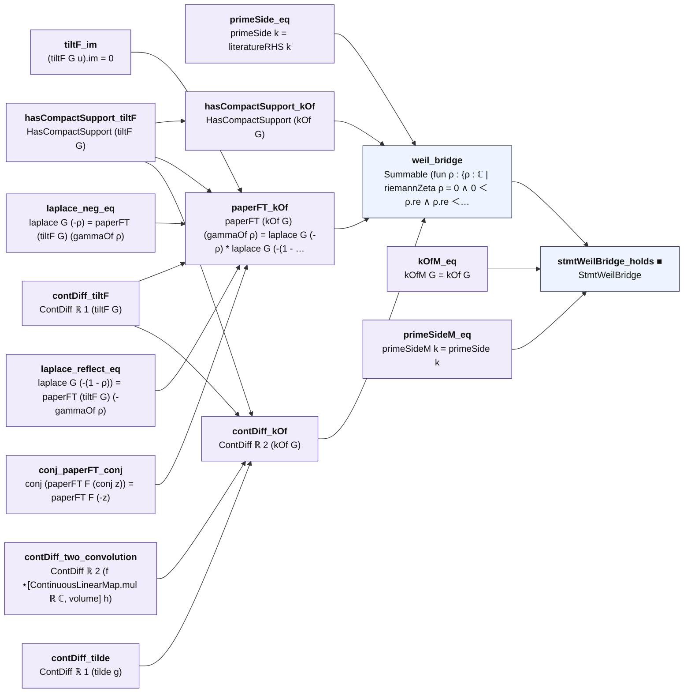

# `lean_bridge/Bridge/WeilBridge.lean`

WeilBridge — the bridge to primes: the zero side of Weil's form at a test function of Stage 3's class equals the prime side, proved against zeta23's explicit formula. The third tree, `lean_bridge/`. 2026-11-22. The statement is unit 0379's; the choice of a third tree is Julian's of the same day.

16 theorems, 9 definitions, 278 lines. Arrows are Lean's own record of what each proof uses.

**Imports:** nothing in this tree  
**Imported by:** [`Bridge`](../lean_bridge/Bridge.md)

## The picture



An arrow A → B reads "A is used in the proof of B". Green: counting, integers only. Violet: shape, analysis with no ζ. Blue: reads ζ. A name ending in ■ is an end: nothing else uses it. Red: contains `sorry`. Yellow: theorems in another file, counted; a dotted arrow crosses files. Definitions are not drawn; they are listed below the diagram.

## Definitions

<a name="Bridge-laplace"></a>
### `Bridge.laplace`

def · line 54

The two-sided Laplace transform. Copied from `Stage3/WeilDetect.lean`.

- **Is:** `` laplace (G : ℝ → ℂ) (z : ℂ) : ℂ := ∫ u : ℝ, G u * Complex.exp (-(z * (u : ℂ))) ``
- **Used by 6:** [`Bridge.StmtWeilBridge`](#Bridge-StmtWeilBridge), [`Bridge.laplace_neg_eq`](#Bridge-laplace_neg_eq), [`Bridge.laplace_reflect_eq`](#Bridge-laplace_reflect_eq), [`Bridge.paperFT_kOf`](#Bridge-paperFT_kOf), [`Bridge.stmtWeilBridge_holds`](#Bridge-stmtWeilBridge_holds), [`Bridge.weil_bridge`](#Bridge-weil_bridge)

<a name="Bridge-IsTest"></a>
### `Bridge.IsTest`

def · line 58

The test-function class at support `L`. Copied from `Stage3/WeilDetect.lean`.

- **Is:** `` IsTest (L : ℝ) (G : ℝ → ℂ) : Prop := (∀ u, (G u).im = 0) ∧ ContDiff ℝ 1 G ∧ HasCompactSupport G ∧ tsupport G ⊆ Set.Icc (-L / 2) (L / 2) ``
- **Used by 3:** [`Bridge.StmtWeilBridge`](#Bridge-StmtWeilBridge), [`Bridge.stmtWeilBridge_holds`](#Bridge-stmtWeilBridge_holds), [`Bridge.weil_bridge`](#Bridge-weil_bridge)

<a name="Bridge-tiltF"></a>
### `Bridge.tiltF`

def · line 63

`F(u) = G(u)·e^{u/2}`: the test function in zeta23's centred variable.

- **Is:** `` tiltF (G : ℝ → ℂ) : ℝ → ℂ := fun u => G u * ((Real.exp (u / 2) : ℝ) : ℂ) ``
- **Used by 10:** [`Bridge.contDiff_kOf`](#Bridge-contDiff_kOf), [`Bridge.contDiff_tiltF`](#Bridge-contDiff_tiltF), [`Bridge.hasCompactSupport_kOf`](#Bridge-hasCompactSupport_kOf), [`Bridge.hasCompactSupport_tiltF`](#Bridge-hasCompactSupport_tiltF), [`Bridge.kOf`](#Bridge-kOf), [`Bridge.kOfM`](#Bridge-kOfM), [`Bridge.laplace_neg_eq`](#Bridge-laplace_neg_eq), [`Bridge.laplace_reflect_eq`](#Bridge-laplace_reflect_eq), [`Bridge.paperFT_kOf`](#Bridge-paperFT_kOf), [`Bridge.tiltF_im`](#Bridge-tiltF_im)

<a name="Bridge-kOf"></a>
### `Bridge.kOf`

def · line 66

`k = F ⋆ F̃`, the Weil test function of `G`.

- **Is:** `` kOf (G : ℝ → ℂ) : ℝ → ℂ := weilTest (tiltF G) (tiltF G) ``
- **Built from:** [`Bridge.tiltF`](#Bridge-tiltF)
- **Used by 6:** [`Bridge.contDiff_kOf`](#Bridge-contDiff_kOf), [`Bridge.hasCompactSupport_kOf`](#Bridge-hasCompactSupport_kOf), [`Bridge.kOfM_eq`](#Bridge-kOfM_eq), [`Bridge.paperFT_kOf`](#Bridge-paperFT_kOf), [`Bridge.stmtWeilBridge_holds`](#Bridge-stmtWeilBridge_holds), [`Bridge.weil_bridge`](#Bridge-weil_bridge)

<a name="Bridge-primeSide"></a>
### `Bridge.primeSide`

def · line 69

zeta23's `literatureRHS`, written out.

- **Is:** `` primeSide (k : ℝ → ℂ) : ℂ := paperFT k (I / 2) + paperFT k (-I / 2) - ∑' n : ℕ, ((ArithmeticFunction.vonMangoldt n / Real.sqrt n : ℝ) : ℂ) * (k (Real.log n) + k (-Real.log n)) + (1 / (2 * π) : ℂ) * ∫ r : ℝ, paperFT k r * (((Complex.digamma (1 / 4 + I * r / 2)).re - Real.log π : ℝ) : ℂ) ``
- **Used by 4:** [`Bridge.primeSideM_eq`](#Bridge-primeSideM_eq), [`Bridge.primeSide_eq`](#Bridge-primeSide_eq), [`Bridge.stmtWeilBridge_holds`](#Bridge-stmtWeilBridge_holds), [`Bridge.weil_bridge`](#Bridge-weil_bridge)

<a name="Bridge-ft"></a>
### `Bridge.ft`

def · line 216

The transform `∫ k(u) e^{izu} du`; zeta23's `paperFT`.

- **Is:** `` ft (k : ℝ → ℂ) (z : ℂ) : ℂ := ∫ u : ℝ, k u * Complex.exp (Complex.I * z * (u : ℂ)) ``
- **Used by 1:** [`Bridge.primeSideM`](#Bridge-primeSideM)

<a name="Bridge-kOfM"></a>
### `Bridge.kOfM`

def · line 220

`k = F ⋆ F̃` in Mathlib's convolution; zeta23's `weilTest` at `F = tiltF G`.

- **Is:** `` kOfM (G : ℝ → ℂ) : ℝ → ℂ := MeasureTheory.convolution (tiltF G) (fun u => (starRingEnd ℂ) (tiltF G (-u))) (ContinuousLinearMap.mul ℝ ℂ) MeasureTheory.volume ``
- **Built from:** [`Bridge.tiltF`](#Bridge-tiltF)
- **Used by 3:** [`Bridge.StmtWeilBridge`](#Bridge-StmtWeilBridge), [`Bridge.kOfM_eq`](#Bridge-kOfM_eq), [`Bridge.stmtWeilBridge_holds`](#Bridge-stmtWeilBridge_holds)

<a name="Bridge-primeSideM"></a>
### `Bridge.primeSideM`

def · line 225

The prime side: the pole terms, minus the prime sum, plus the archimedean integral.

- **Is:** `` primeSideM (k : ℝ → ℂ) : ℂ := ft k (Complex.I / 2) + ft k (-Complex.I / 2) - ∑' n : ℕ, ((ArithmeticFunction.vonMangoldt n / Real.sqrt n : ℝ) : ℂ) * (k (Real.log n) + k (-Real.log n)) + (1 / (2 * Real.pi) : ℂ) * ∫ r : ℝ, ft k r * (((logDeriv Complex.Gamma (1 / 4 + Complex.I * r / 2)).re - Real.log Real.pi : ℝ) : ℂ) ``
- **Built from:** [`Bridge.ft`](#Bridge-ft)
- **Used by 3:** [`Bridge.StmtWeilBridge`](#Bridge-StmtWeilBridge), [`Bridge.primeSideM_eq`](#Bridge-primeSideM_eq), [`Bridge.stmtWeilBridge_holds`](#Bridge-stmtWeilBridge_holds)

<a name="Bridge-StmtWeilBridge"></a>
### `Bridge.StmtWeilBridge`

def · line 233

The bridge, as a statement.

- **Is:** `` StmtWeilBridge : Prop := ∀ (L : ℝ) (G : ℝ → ℂ), IsTest L G → Summable (fun ρ : {ρ : ℂ | riemannZeta ρ = 0 ∧ 0 < ρ.re ∧ ρ.re < 1} => (((analyticOrderAt riemannZeta (ρ : ℂ)).toNat : ℕ) : ℂ) * (laplace G (-(ρ : ℂ)) * laplace G (-(1 - (ρ : ℂ))))) ∧ ∑' ρ : {ρ : ℂ | riemannZeta ρ = 0 ∧ 0 < ρ.re ∧ ρ.re < 1}, (((analyticOrderAt riemannZeta (ρ : ℂ)).toNat : ℕ) : ℂ) * (laplace G (-(ρ : ℂ)) * laplace G (-(1 - (ρ : ℂ)))) = prime… ``
- **Built from:** [`Bridge.IsTest`](#Bridge-IsTest), [`Bridge.kOfM`](#Bridge-kOfM), [`Bridge.laplace`](#Bridge-laplace), [`Bridge.primeSideM`](#Bridge-primeSideM)
- **Used by 1:** [`Bridge.stmtWeilBridge_holds`](#Bridge-stmtWeilBridge_holds)

## Theorems

<a name="Bridge-primeSide_eq"></a>
### `Bridge.primeSide_eq`

line 77

**Shape.** Uses real or complex analysis; nothing in it or beneath it reads ζ.

**Why.** The prime side written out here equals zeta23's `literatureRHS`.

**Proves**

```lean
primeSide k = literatureRHS k
```

**Needs** (its hypotheses)

  - `` k : ℝ → ℂ ``

**Stated with:** [`Bridge.primeSide`](#Bridge-primeSide)

**Fed by:** no theorem of this repo; it stands on Mathlib and the definitions below.

**Feeds** (1 that use it)

  - [`Bridge.weil_bridge`](#Bridge-weil_bridge) — `` Summable (fun ρ : {ρ : ℂ | riemannZeta ρ = 0 ∧ 0 < ρ.re ∧ ρ.re < 1} => (((analyticOrderAt riemannZeta (ρ : ℂ)).toNat : ℕ) : ℂ) * (laplace G (-(ρ : ℂ))… ``

<a name="Bridge-tiltF_im"></a>
### `Bridge.tiltF_im`

line 80

**Shape.** Uses real or complex analysis; nothing in it or beneath it reads ζ.

**Why.** If `G` is real-valued, then the tilted function `tiltF G` is real-valued.

**Proves**

```lean
(tiltF G u).im = 0
```

**Needs** (its hypotheses)

  - `` hG : ∀ u, (G u).im = 0 ``
  - `` u : ℝ ``

**Stated with:** [`Bridge.tiltF`](#Bridge-tiltF)

**Fed by:** no theorem of this repo; it stands on Mathlib and the definitions below.

**Feeds** (1 that use it)

  - [`Bridge.paperFT_kOf`](#Bridge-paperFT_kOf) — `` paperFT (kOf G) (gammaOf ρ) = laplace G (-ρ) * laplace G (-(1 - ρ)) ``

<a name="Bridge-contDiff_tiltF"></a>
### `Bridge.contDiff_tiltF`

line 86

**Shape.** Uses real or complex analysis; nothing in it or beneath it reads ζ.

**Why.** If `G` is `C¹`, then the tilted function `tiltF G` is `C¹`.

**Proves**

```lean
ContDiff ℝ 1 (tiltF G)
```

**Needs** (its hypotheses)

  - `` hG : ContDiff ℝ 1 G ``

**Stated with:** [`Bridge.tiltF`](#Bridge-tiltF)

**Fed by:** no theorem of this repo; it stands on Mathlib and the definitions below.

**Feeds** (2 that use it)

  - [`Bridge.contDiff_kOf`](#Bridge-contDiff_kOf) — `` ContDiff ℝ 2 (kOf G) ``
  - [`Bridge.paperFT_kOf`](#Bridge-paperFT_kOf) — `` paperFT (kOf G) (gammaOf ρ) = laplace G (-ρ) * laplace G (-(1 - ρ)) ``

<a name="Bridge-hasCompactSupport_tiltF"></a>
### `Bridge.hasCompactSupport_tiltF`

line 92

**Shape.** Uses real or complex analysis; nothing in it or beneath it reads ζ.

**Why.** If `G` has compact support, then the tilted function `tiltF G` has compact support.

**Proves**

```lean
HasCompactSupport (tiltF G)
```

**Needs** (its hypotheses)

  - `` hG : HasCompactSupport G ``

**Stated with:** [`Bridge.tiltF`](#Bridge-tiltF)

**Fed by:** no theorem of this repo; it stands on Mathlib and the definitions below.

**Feeds** (3 that use it)

  - [`Bridge.contDiff_kOf`](#Bridge-contDiff_kOf) — `` ContDiff ℝ 2 (kOf G) ``
  - [`Bridge.hasCompactSupport_kOf`](#Bridge-hasCompactSupport_kOf) — `` HasCompactSupport (kOf G) ``
  - [`Bridge.paperFT_kOf`](#Bridge-paperFT_kOf) — `` paperFT (kOf G) (gammaOf ρ) = laplace G (-ρ) * laplace G (-(1 - ρ)) ``

<a name="Bridge-laplace_neg_eq"></a>
### `Bridge.laplace_neg_eq`

line 99

**Shape.** Uses real or complex analysis; nothing in it or beneath it reads ζ.

**Why.** The transform at `−ρ`, in zeta23's variable.

**Proves**

```lean
laplace G (-ρ) = paperFT (tiltF G) (gammaOf ρ)
```

**Needs** (its hypotheses)

  - `` G : ℝ → ℂ ``
  - `` ρ : ℂ ``

**Stated with:** [`Bridge.laplace`](#Bridge-laplace), [`Bridge.tiltF`](#Bridge-tiltF)

**Fed by:** no theorem of this repo; it stands on Mathlib and the definitions below.

**Feeds** (1 that use it)

  - [`Bridge.paperFT_kOf`](#Bridge-paperFT_kOf) — `` paperFT (kOf G) (gammaOf ρ) = laplace G (-ρ) * laplace G (-(1 - ρ)) ``

<a name="Bridge-laplace_reflect_eq"></a>
### `Bridge.laplace_reflect_eq`

line 112

**Shape.** Uses real or complex analysis; nothing in it or beneath it reads ζ.

**Why.** The transform at `−(1 − ρ)`, in zeta23's variable.

**Proves**

```lean
laplace G (-(1 - ρ)) = paperFT (tiltF G) (-gammaOf ρ)
```

**Needs** (its hypotheses)

  - `` G : ℝ → ℂ ``
  - `` ρ : ℂ ``

**Stated with:** [`Bridge.laplace`](#Bridge-laplace), [`Bridge.tiltF`](#Bridge-tiltF)

**Fed by:** no theorem of this repo; it stands on Mathlib and the definitions below.

**Feeds** (1 that use it)

  - [`Bridge.paperFT_kOf`](#Bridge-paperFT_kOf) — `` paperFT (kOf G) (gammaOf ρ) = laplace G (-ρ) * laplace G (-(1 - ρ)) ``

<a name="Bridge-conj_paperFT_conj"></a>
### `Bridge.conj_paperFT_conj`

line 125

**Shape.** Uses real or complex analysis; nothing in it or beneath it reads ζ.

**Why.** For a real-valued `F`, the conjugate-reflected transform is the transform at `−z`.

**Proves**

```lean
conj (paperFT F (conj z)) = paperFT F (-z)
```

**Needs** (its hypotheses)

  - `` hF : ∀ u, (F u).im = 0 ``
  - `` z : ℂ ``

**Fed by:** no theorem of this repo; it stands on Mathlib.

**Feeds** (1 that use it)

  - [`Bridge.paperFT_kOf`](#Bridge-paperFT_kOf) — `` paperFT (kOf G) (gammaOf ρ) = laplace G (-ρ) * laplace G (-(1 - ρ)) ``

<a name="Bridge-contDiff_two_convolution"></a>
### `Bridge.contDiff_two_convolution`

line 142

**Shape.** Uses real or complex analysis; nothing in it or beneath it reads ζ.

**Why.** The convolution of two compactly supported `C¹` functions is `C²`.

**Proves**

```lean
ContDiff ℝ 2 (f ⋆[ContinuousLinearMap.mul ℝ ℂ, volume] h)
```

**Needs** (its hypotheses)

  - `` hf : ContDiff ℝ 1 f ``
  - `` hfs : HasCompactSupport f ``
  - `` hh : ContDiff ℝ 1 h ``
  - `` hhs : HasCompactSupport h ``

**Fed by:** no theorem of this repo; it stands on Mathlib.

**Feeds** (1 that use it)

  - [`Bridge.contDiff_kOf`](#Bridge-contDiff_kOf) — `` ContDiff ℝ 2 (kOf G) ``

<a name="Bridge-contDiff_tilde"></a>
### `Bridge.contDiff_tilde`

line 164

**Shape.** Uses real or complex analysis; nothing in it or beneath it reads ζ.

**Why.** If `g` is `C¹`, then its conjugate reflection `tilde g` is `C¹`.

**Proves**

```lean
ContDiff ℝ 1 (tilde g)
```

**Needs** (its hypotheses)

  - `` hg : ContDiff ℝ 1 g ``

**Fed by:** no theorem of this repo; it stands on Mathlib.

**Feeds** (1 that use it)

  - [`Bridge.contDiff_kOf`](#Bridge-contDiff_kOf) — `` ContDiff ℝ 2 (kOf G) ``

<a name="Bridge-contDiff_kOf"></a>
### `Bridge.contDiff_kOf`

line 169

**Shape.** Uses real or complex analysis; nothing in it or beneath it reads ζ.

**Why.** If `G` is `C¹` with compact support, then the Weil test function `kOf G` is `C²`.

**Proves**

```lean
ContDiff ℝ 2 (kOf G)
```

**Needs** (its hypotheses)

  - `` hG : ContDiff ℝ 1 G ``
  - `` hGs : HasCompactSupport G ``

**Stated with:** [`Bridge.kOf`](#Bridge-kOf)

**Fed by** (4 theorems its proof uses)

  - [`Bridge.contDiff_tilde`](#Bridge-contDiff_tilde) — `` ContDiff ℝ 1 (tilde g) ``
  - [`Bridge.contDiff_tiltF`](#Bridge-contDiff_tiltF) — `` ContDiff ℝ 1 (tiltF G) ``
  - [`Bridge.contDiff_two_convolution`](#Bridge-contDiff_two_convolution) — `` ContDiff ℝ 2 (f ⋆[ContinuousLinearMap.mul ℝ ℂ, volume] h) ``
  - [`Bridge.hasCompactSupport_tiltF`](#Bridge-hasCompactSupport_tiltF) — `` HasCompactSupport (tiltF G) ``

**Definitions its proof touches:** [`Bridge.tiltF`](#Bridge-tiltF)

**Feeds** (1 that use it)

  - [`Bridge.weil_bridge`](#Bridge-weil_bridge) — `` Summable (fun ρ : {ρ : ℂ | riemannZeta ρ = 0 ∧ 0 < ρ.re ∧ ρ.re < 1} => (((analyticOrderAt riemannZeta (ρ : ℂ)).toNat : ℕ) : ℂ) * (laplace G (-(ρ : ℂ))… ``

<a name="Bridge-hasCompactSupport_kOf"></a>
### `Bridge.hasCompactSupport_kOf`

line 176

**Shape.** Uses real or complex analysis; nothing in it or beneath it reads ζ.

**Why.** If `G` has compact support, then the Weil test function `kOf G` has compact support.

**Proves**

```lean
HasCompactSupport (kOf G)
```

**Needs** (its hypotheses)

  - `` hGs : HasCompactSupport G ``

**Stated with:** [`Bridge.kOf`](#Bridge-kOf)

**Fed by** (1 theorem its proof uses)

  - [`Bridge.hasCompactSupport_tiltF`](#Bridge-hasCompactSupport_tiltF) — `` HasCompactSupport (tiltF G) ``

**Definitions its proof touches:** [`Bridge.tiltF`](#Bridge-tiltF)

**Feeds** (1 that use it)

  - [`Bridge.weil_bridge`](#Bridge-weil_bridge) — `` Summable (fun ρ : {ρ : ℂ | riemannZeta ρ = 0 ∧ 0 < ρ.re ∧ ρ.re < 1} => (((analyticOrderAt riemannZeta (ρ : ℂ)).toNat : ℕ) : ℂ) * (laplace G (-(ρ : ℂ))… ``

<a name="Bridge-paperFT_kOf"></a>
### `Bridge.paperFT_kOf`

line 181

**Shape.** Uses real or complex analysis; nothing in it or beneath it reads ζ.

**Why.** The term at a zero, in both languages.

**Proves**

```lean
paperFT (kOf G) (gammaOf ρ) = laplace G (-ρ) * laplace G (-(1 - ρ))
```

**Needs** (its hypotheses)

  - `` hre : ∀ u, (G u).im = 0 ``
  - `` hG : ContDiff ℝ 1 G ``
  - `` hGs : HasCompactSupport G ``
  - `` ρ : ℂ ``

**Stated with:** [`Bridge.kOf`](#Bridge-kOf), [`Bridge.laplace`](#Bridge-laplace)

**Fed by** (6 theorems its proof uses)

  - [`Bridge.conj_paperFT_conj`](#Bridge-conj_paperFT_conj) — `` conj (paperFT F (conj z)) = paperFT F (-z) ``
  - [`Bridge.contDiff_tiltF`](#Bridge-contDiff_tiltF) — `` ContDiff ℝ 1 (tiltF G) ``
  - [`Bridge.hasCompactSupport_tiltF`](#Bridge-hasCompactSupport_tiltF) — `` HasCompactSupport (tiltF G) ``
  - [`Bridge.laplace_neg_eq`](#Bridge-laplace_neg_eq) — `` laplace G (-ρ) = paperFT (tiltF G) (gammaOf ρ) ``
  - [`Bridge.laplace_reflect_eq`](#Bridge-laplace_reflect_eq) — `` laplace G (-(1 - ρ)) = paperFT (tiltF G) (-gammaOf ρ) ``
  - [`Bridge.tiltF_im`](#Bridge-tiltF_im) — `` (tiltF G u).im = 0 ``

**Definitions its proof touches:** [`Bridge.tiltF`](#Bridge-tiltF)

**Feeds** (1 that use it)

  - [`Bridge.weil_bridge`](#Bridge-weil_bridge) — `` Summable (fun ρ : {ρ : ℂ | riemannZeta ρ = 0 ∧ 0 < ρ.re ∧ ρ.re < 1} => (((analyticOrderAt riemannZeta (ρ : ℂ)).toNat : ℕ) : ℂ) * (laplace G (-(ρ : ℂ))… ``

<a name="Bridge-weil_bridge"></a>
### `Bridge.weil_bridge`

line 192

**Reads ζ.** It, or something it rests on, uses the zeta function, its zeros or the Riemann hypothesis.

**Why.** The bridge. For a test function of Stage 3's class, the zero side of Weil's form, over the nontrivial zeros of `riemannZeta` with multiplicity, is summable and equals the prime side at `k = F ⋆ F̃`.

**Proves**

```lean
Summable (fun ρ : {ρ : ℂ | riemannZeta ρ = 0 ∧ 0 < ρ.re ∧ ρ.re < 1} => (((analyticOrderAt riemannZeta (ρ : ℂ)).toNat : ℕ) : ℂ) * (laplace G (-(ρ : ℂ)) * laplace G (-(1 - (ρ : ℂ))))) ∧ ∑' ρ : {ρ : ℂ | riemannZeta ρ = 0 ∧ 0 < ρ.re ∧ ρ.re < 1}, (((analyticOrderAt riemannZeta (ρ : ℂ)).toNat : ℕ) : ℂ) * (laplace G (-(ρ : ℂ)) * laplace G (-(1 - (ρ : ℂ)))) = primeSide (kOf G)
```

**Needs** (its hypotheses)

  - `` hG : IsTest L G ``

**Stated with:** [`Bridge.IsTest`](#Bridge-IsTest), [`Bridge.kOf`](#Bridge-kOf), [`Bridge.laplace`](#Bridge-laplace), [`Bridge.primeSide`](#Bridge-primeSide)

**Fed by** (4 theorems its proof uses)

  - [`Bridge.contDiff_kOf`](#Bridge-contDiff_kOf) — `` ContDiff ℝ 2 (kOf G) ``
  - [`Bridge.hasCompactSupport_kOf`](#Bridge-hasCompactSupport_kOf) — `` HasCompactSupport (kOf G) ``
  - [`Bridge.paperFT_kOf`](#Bridge-paperFT_kOf) — `` paperFT (kOf G) (gammaOf ρ) = laplace G (-ρ) * laplace G (-(1 - ρ)) ``
  - [`Bridge.primeSide_eq`](#Bridge-primeSide_eq) — `` primeSide k = literatureRHS k ``

**Feeds** (1 that use it)

  - [`Bridge.stmtWeilBridge_holds`](#Bridge-stmtWeilBridge_holds) — `` StmtWeilBridge ``

<a name="Bridge-kOfM_eq"></a>
### `Bridge.kOfM_eq`

line 244

**Shape.** Uses real or complex analysis; nothing in it or beneath it reads ζ.

**Why.** The Weil test function in Mathlib's convolution, `kOfM G`, equals `kOf G`.

**Proves**

```lean
kOfM G = kOf G
```

**Needs** (its hypotheses)

  - `` G : ℝ → ℂ ``

**Stated with:** [`Bridge.kOf`](#Bridge-kOf), [`Bridge.kOfM`](#Bridge-kOfM)

**Fed by:** no theorem of this repo; it stands on Mathlib and the definitions below.

**Feeds** (1 that use it)

  - [`Bridge.stmtWeilBridge_holds`](#Bridge-stmtWeilBridge_holds) — `` StmtWeilBridge ``

<a name="Bridge-primeSideM_eq"></a>
### `Bridge.primeSideM_eq`

line 247

**Shape.** Uses real or complex analysis; nothing in it or beneath it reads ζ.

**Why.** The prime side written against Mathlib alone, `primeSideM k`, equals `primeSide k`.

**Proves**

```lean
primeSideM k = primeSide k
```

**Needs** (its hypotheses)

  - `` k : ℝ → ℂ ``

**Stated with:** [`Bridge.primeSide`](#Bridge-primeSide), [`Bridge.primeSideM`](#Bridge-primeSideM)

**Fed by:** no theorem of this repo; it stands on Mathlib and the definitions below.

**Feeds** (1 that use it)

  - [`Bridge.stmtWeilBridge_holds`](#Bridge-stmtWeilBridge_holds) — `` StmtWeilBridge ``

<a name="Bridge-stmtWeilBridge_holds"></a>
### `Bridge.stmtWeilBridge_holds`

line 250

**Reads ζ.** It, or something it rests on, uses the zeta function, its zeros or the Riemann hypothesis.

**Why.** The bridge holds.

**Proves**

```lean
StmtWeilBridge
```

**Stated with:** [`Bridge.StmtWeilBridge`](#Bridge-StmtWeilBridge)

**Fed by** (3 theorems its proof uses)

  - [`Bridge.kOfM_eq`](#Bridge-kOfM_eq) — `` kOfM G = kOf G ``
  - [`Bridge.primeSideM_eq`](#Bridge-primeSideM_eq) — `` primeSideM k = primeSide k ``
  - [`Bridge.weil_bridge`](#Bridge-weil_bridge) — `` Summable (fun ρ : {ρ : ℂ | riemannZeta ρ = 0 ∧ 0 < ρ.re ∧ ρ.re < 1} => (((analyticOrderAt riemannZeta (ρ : ℂ)).toNat : ℕ) : ℂ) * (laplace G (-(ρ : ℂ))… ``

**Definitions its proof touches:** [`Bridge.IsTest`](#Bridge-IsTest), [`Bridge.kOf`](#Bridge-kOf), [`Bridge.kOfM`](#Bridge-kOfM), [`Bridge.laplace`](#Bridge-laplace), [`Bridge.primeSide`](#Bridge-primeSide), [`Bridge.primeSideM`](#Bridge-primeSideM)

**Feeds:** nothing. It is an end.

