# `lean_stage3/Stage3/Abscissa.lean`

**What it does** (its own header): Abscissa — the contour's abscissa as a parameter, with RH as one instance. WHY THIS FILE EXISTS. `lean_stage3/Stage3/LineBound.lean:1091` defines

**Imports:** [`LineBound`](../lean_stage3/LineBound.md).
**Imported by:** [`Stage3`](../lean_stage3/Stage3.md), [`ThetaLine`](../lean_stage3/ThetaLine.md).

```mermaid
flowchart LR
  n0["σθ<br/>(def)"]:::dfn
  n1["σθ_half<br/>⊢ σθ (1/2) X = RHPull.σRH X"]:::lone
  n2["σθ_re<br/>⊢ ((σθ θ X : ℂ) + I * (t : ℂ)).re = σθ θ X"]:::lone
  n3["StmtZeroFreeRight<br/>(def)"]:::dfn
  n4["zeta_ne_zero_right_of<br/>⊢ ζ s ≠ 0"]:::thm
  n5["never<br/>⊢ "]:::lone
  n6["zeroFreeRight_of_RH<br/>⊢ StmtZeroFreeRight (1/2)"]:::thm
  n7["zeroFreeRight_mono<br/>⊢ StmtZeroFreeRight θ'"]:::end_
  n8["rpow_σθ<br/>⊢ X ^ (σθ θ X) = Real.exp 1 * X ^ θ"]:::lone
  n9["rpow_σθ_half<br/>⊢ X ^ (σθ (1/2) X) = Real.exp 1 * Real.sqrt X"]:::lone
  n10["abscissa_gives_power<br/>⊢ K * X ^ (σθ θ X) = (Real.exp 1 * K) * X ^ θ"]:::lone
  n11["zeroFreeRight_one<br/>⊢ StmtZeroFreeRight 1"]:::end_
  n12["logDerivZeta_crude_theta<br/>⊢ ‖deriv ζ ((σ₁ : ℂ) + I * (t : ℂ)) / ζ ((σ₁ : ℂ) + I * (t : ℂ))‖ ≤ 1996…"]:::thm
  n13["logDerivZeta_crude_half<br/>⊢ ‖deriv ζ ((σ₁ : ℂ) + I * (t : ℂ)) / ζ ((σ₁ : ℂ) + I * (t : ℂ))‖ ≤ 1996…"]:::end_
  x0(["JensenCount · jensenF"]):::ext
  x1(["JensenCount · jensenF_analytic"]):::ext
  x2(["JensenCount · jensenF_bound"]):::ext
  x3(["JensenCount · jensenF_zero_eq_one"]):::ext
  x4(["JensenCount · jensenF_zeros_finite"]):::ext
  x5(["JensenCount · pole_away_centre"]):::ext
  x6(["JensenCount · zeta_centre_ne_zero"]):::ext
  x7(["JointWindowDial · zeroFreeRight_of_window"]):::ext
  x8(["LineBound · zeta_ne_zero_of_RH"]):::ext
  x9(["LineBound · finalBoundConst_le"]):::ext
  x10(["ThetaConverse · zeroFreeRight_iff_psiWeakTheta"]):::ext
  x11(["ThetaConverse · zeroFreeRight_of_psiWeakTheta"]):::ext
  x12(["ThetaConverse · zeroFreeRight_one_of_chebyshev"]):::ext
  x13(["ThetaLine · logDerivZeta_compact_theta"]):::ext
  x14(["ThetaLine · logDerivZeta_line_half"]):::ext
  x15(["ThetaLine · logDerivZeta_line_theta"]):::ext
  x16(["ThetaLine · logDerivZeta_sq_at_X_theta"]):::ext
  x17(["ThetaPi · schoenfeldWeakTheta_of_zeroFree"]):::ext
  x18(["ThetaPi · schoenfeldWeak_of_RH_half"]):::ext
  x19(["ThetaPsi · I2_norm_le_theta"]):::ext
  x20(["ThetaPsi · I8_norm_le_theta"]):::ext
  x21(["ThetaPsi · contour_at_instantiation_theta"]):::ext
  x22(["ThetaPsi · holo_logDerivZeta_theta"]):::ext
  x23(["ThetaPsi · integrand_norm_le_horiz_neg_theta"]):::ext
  x24(["ThetaPsi · integrand_norm_le_horiz_theta"]):::ext
  x25(["ThetaPsi · psi_weak_of_RH_half"]):::ext
  x26(["ThetaPsi · psi_weak_of_theta"]):::ext
  x27(["ThetaPsi · pull_at_theta_abscissa"]):::ext
  x28(["ThetaPull · I37_norm_le_decay_theta"]):::ext
  x29(["ThetaPull · I37_norm_le_epsfree_theta"]):::ext
  x30(["ThetaPull · I37_power_form_theta"]):::ext
  x31(["ThetaPull · I37_power_log3_theta"]):::ext
  x32(["ThetaPull · I37_sqrt_log3_half"]):::ext
  x33(["ThetaPull · integrand_norm_le_theta"]):::ext
  n12 --> n13
  n12 --> x16
  n12 --> x23
  n12 --> x24
  n3 --> n11
  n3 --> n12
  n3 --> n4
  n3 --> n6
  n3 --> n7
  n3 --> x10
  n3 --> x11
  n3 --> x12
  n3 --> x13
  n3 --> x15
  n3 --> x16
  n3 --> x17
  n3 --> x19
  n3 --> x20
  n3 --> x21
  n3 --> x22
  n3 --> x23
  n3 --> x24
  n3 --> x26
  n3 --> x27
  n3 --> x28
  n3 --> x29
  n3 --> x30
  n3 --> x31
  n3 --> x33
  n3 --> x7
  n4 --> n12
  n4 --> x13
  n4 --> x22
  n6 --> n13
  n6 --> x14
  n6 --> x18
  n6 --> x25
  n6 --> x32
  x0 --> n12
  x1 --> n12
  x2 --> n12
  x3 --> n12
  x4 --> n12
  x5 --> n12
  x6 --> n12
  x8 --> n4
  x8 --> n6
  x9 --> n12
  classDef thm fill:#eef4ff,stroke:#335,color:#111
  classDef dfn fill:#f2f2f2,stroke:#777,color:#111
  classDef end_ fill:#e7f7e7,stroke:#2a7,color:#111,stroke-width:2px
  classDef lone fill:#fff,stroke:#999,color:#111,stroke-dasharray:4 3
  classDef bad fill:#ffe5e5,stroke:#c22,color:#111,stroke-width:2px
  classDef ext fill:#fff8e1,stroke:#b80,color:#111,stroke-dasharray:2 2
```

Blue: theorem. Green: a theorem nothing else uses (an end). Dashed white: connects to nothing. Grey: definition. Red: contains `sorry`. Yellow: in another file. An arrow A → B reads "A is used by B".

## Every declaration

| declaration | proves (output) | needs (input) | why (its own docstring) | uses | used by |
|---|---|---|---|---|---|
| `Stage3.σθ` def, line 98 | ℝ | θ X : ℝ | The parameterised abscissa. `σθ θ X = θ + 1/log X`. The existing `RHPull.σRH` is the `θ = 1/2` case. | — | — |
| `Stage3.σθ_half` theorem, line 102 | σθ (1/2) X = RHPull.σRH X | X : ℝ | The weld. At `θ = 1/2` this is the abscissa the built machine already uses, definitionally. | — | — |
| `Stage3.σθ_re` theorem, line 104 | ((σθ θ X : ℂ) + I * (t : ℂ)).re = σθ θ X | θ X t : ℝ | — | — | — |
| `Stage3.StmtZeroFreeRight` def, line 112 | Prop | θ : ℝ | A zero-free half-plane at `θ`. This is the whole content the contour pull requires: nothing vanishes strictly to the right of `θ`, the pole at `s = 1` excepted. RH is the case `θ = 1/2`. | — | `Stage3.logDerivZeta_crude_theta`, `Stage3.zeroFreeRight_mono`, `Stage3.zeroFreeRight_of_RH`, `Stage3.zeroFreeRight_one`, `Stage3.zeta_ne_zero_right_of`, `JointWindowDial.zeroFreeRight_of_window`, `Stage3.zeroFreeRight_iff_psiWeakTheta`, `Stage3.zeroFreeRight_of_psiWeakTheta`, `Stage3.zeroFreeRight_one_of_chebyshev`, `Stage3.logDerivZeta_compact_theta`, `Stage3.logDerivZeta_line_theta`, `Stage3.logDerivZeta_sq_at_X_theta`, `Stage3.schoenfeldWeakTheta_of_zeroFree`, `Stage3.I2_norm_le_theta`, `Stage3.I8_norm_le_theta`, `Stage3.contour_at_instantiation_theta`, `Stage3.holo_logDerivZeta_theta`, `Stage3.integrand_norm_le_horiz_neg_theta`, `Stage3.integrand_norm_le_horiz_theta`, `Stage3.psi_weak_of_theta`, `Stage3.pull_at_theta_abscissa`, `Stage3.I37_norm_le_decay_theta`, `Stage3.I37_norm_le_epsfree_theta`, `Stage3.I37_power_form_theta`, `Stage3.I37_power_log3_theta`, `Stage3.integrand_norm_le_theta` |
| `Stage3.zeta_ne_zero_right_of` theorem, line 118 | ζ s ≠ 0 | hθ : StmtZeroFreeRight θ; hs : θ &lt; s.re; hs1 : s ≠ 1 | The consumer lemma, in the shape the machine uses. Mirrors `RHPull.zeta_ne_zero_of_RH` with the hypothesis carried as a parameter rather than as RH. | `Stage3.StmtZeroFreeRight`, `RHPull.zeta_ne_zero_of_RH` | `Stage3.logDerivZeta_crude_theta`, `Stage3.logDerivZeta_compact_theta`, `Stage3.holo_logDerivZeta_theta` |
| `Stage3.never` theorem, line 124 | — | — | — | — | — |
| `Stage3.zeroFreeRight_of_RH` theorem, line 125 | StmtZeroFreeRight (1/2) | hRH : RiemannHypothesis | RH is the `θ = 1/2` instance. The proof is `RHPull.zeta_ne_zero_of_RH`'s, unchanged — which is the point: the lemma never needed RH as such, only a zero-free half-plane. | `Stage3.StmtZeroFreeRight`, `RHPull.zeta_ne_zero_of_RH` | `Stage3.logDerivZeta_crude_half`, `Stage3.logDerivZeta_line_half`, `Stage3.schoenfeldWeak_of_RH_half`, `Stage3.psi_weak_of_RH_half`, `Stage3.I37_sqrt_log3_half` |
| `Stage3.zeroFreeRight_mono` theorem, line 133 | StmtZeroFreeRight θ' | h : θ ≤ θ'; hθ : StmtZeroFreeRight θ | A weaker exponent is a weaker hypothesis. Moving the half-plane right only removes obligations, so the family is monotone in `θ` — this is what makes `θ` a dial rather than a relabelling. | `Stage3.StmtZeroFreeRight` | — |
| `Stage3.rpow_σθ` theorem, line 144 | X ^ (σθ θ X) = Real.exp 1 * X ^ θ | hX : 0 &lt; X; hLX : 0 &lt; Real.log X | The abscissa identity at general `θ`. `X^(θ + 1/log X) = e·X^θ`. This is the whole arithmetic content of the choice of abscissa: the `1/log X` correction contributes a bare factor of `e`, and the `θ` contributes `X^θ`. `RHPull.rpow_σRH` is the `θ = 1/2` case, where `X^(1/2) = √X`. | — | — |
| `Stage3.rpow_σθ_half` theorem, line 154 | X ^ (σθ (1/2) X) = Real.exp 1 * Real.sqrt X | hX : 0 &lt; X; hLX : 4 ≤ Real.log X | The `θ = 1/2` case is the built one, so the generalisation recovers `RHPull.rpow_σRH` rather than competing with it. | — | — |
| `Stage3.abscissa_gives_power` theorem, line 164 | K * X ^ (σθ θ X) = (Real.exp 1 * K) * X ^ θ | hX : 0 &lt; X; hLX : 0 &lt; Real.log X; hK : 0 ≤ K | Where the power saving comes from. The vertical segment's bound carries `X^(σθ θ X)`, and `rpow_σθ` turns that into `e·X^θ`. So a contour run at abscissa `θ` produces a bound of shape `X^θ·(log X)^k` — which is exactly the POWER SAVING form entry 277 measured the census to need, with `θ = 0.7464` closing depth 6. At `θ = 1/2` it is `√X`, the RH-strength boun… | — | — |
| `Stage3.zeroFreeRight_one` theorem, line 174 | StmtZeroFreeRight 1 | — | The unconditional endpoint. `θ = 1` holds outright, from Mathlib's non-vanishing on the closed half-plane `1 ≤ re s`. So the family is non-empty and the open question is exactly how far left of `1` it can be pushed. | `Stage3.StmtZeroFreeRight` | — |
| `Stage3.logDerivZeta_crude_theta` theorem, line 186 | ‖deriv ζ ((σ₁ : ℂ) + I * (t : ℂ)) / ζ ((σ₁ : ℂ) + I * (t : ℂ))‖ ≤ 1996 * Real.log (84 * t) + (29 * Real.log t + 129) / (σ₁ - θ) | hθ : StmtZeroFreeRight θ; hθlo : 1/2 ≤ θ; ht : 2 ≤ t; hlo : θ &lt; σ₁; hhi : σ₁ ≤ 2 | The crude bound on `\zeta'/\zeta` on a vertical line, at a general zero-free abscissa `θ`. `Slice3.logDerivZeta_crude` is the case `θ = 1/2`, via `zeroFreeRight_of_RH`, with identical constants. | `Stage3.StmtZeroFreeRight`, `Stage3.zeta_ne_zero_right_of`, `Stage3.jensenF`, `Stage3.jensenF_analytic`, `Stage3.jensenF_bound`, `Stage3.jensenF_zero_eq_one`, `Stage3.jensenF_zeros_finite`, `Stage3.pole_away_centre`, `Stage3.zeta_centre_ne_zero`, `Slice3.finalBoundConst_le` | `Stage3.logDerivZeta_crude_half`, `Stage3.logDerivZeta_sq_at_X_theta`, `Stage3.integrand_norm_le_horiz_neg_theta`, `Stage3.integrand_norm_le_horiz_theta` |
| `Stage3.logDerivZeta_crude_half` theorem, line 368 | ‖deriv ζ ((σ₁ : ℂ) + I * (t : ℂ)) / ζ ((σ₁ : ℂ) + I * (t : ℂ))‖ ≤ 1996 * Real.log (84 * t) + (29 * Real.log t + 129) / (σ₁ - 1/2) | hRH : RiemannHypothesis; ht : 2 ≤ t; hlo : 1/2 &lt; σ₁; hhi : σ₁ ≤ 2 | The weld at `θ = 1/2`. Under RH the general bound specialises to exactly `Slice3.logDerivZeta_crude`'s statement, numerals included — so the generalisation recovers the built theorem rather than competing with it. | `Stage3.logDerivZeta_crude_theta`, `Stage3.zeroFreeRight_of_RH` | — |
