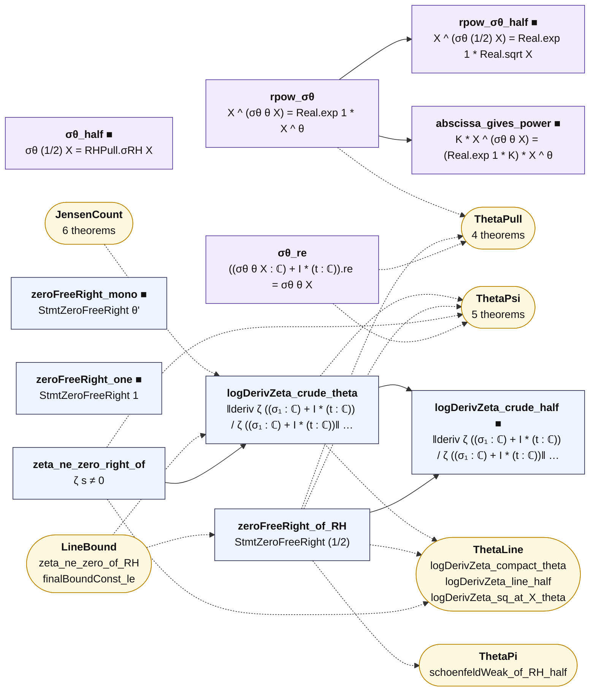

# `lean_stage3/Stage3/Abscissa.lean`

Abscissa — the contour's abscissa as a parameter, with RH as one instance. WHY THIS FILE EXISTS. `lean_stage3/Stage3/LineBound.lean:1091` defines

11 theorems, 2 definitions, 413 lines. Arrows are Lean's own record of what each proof uses.

**Imports:** [`LineBound`](../lean_stage3/LineBound.md)  
**Imported by:** [`Stage3`](../lean_stage3/Stage3.md), [`ThetaLine`](../lean_stage3/ThetaLine.md)

## The picture



An arrow A → B reads "A is used in the proof of B". Green: counting, integers only. Violet: shape, analysis with no ζ. Blue: reads ζ. A name ending in ■ is an end: nothing else uses it. Red: contains `sorry`. Yellow: theorems in another file, counted; a dotted arrow crosses files. Definitions are not drawn; they are listed below the diagram.

## Definitions

<a name="Stage3---"></a>
### `Stage3.σθ`

def · line 98

The parameterised abscissa. `σθ θ X = θ + 1/log X`. The existing `RHPull.σRH` is the `θ = 1/2` case.

- **Is:** `` σθ (θ X : ℝ) : ℝ := θ + 1 / Real.log X ``
- **Used by 25:** [`Stage3.abscissa_gives_power`](#Stage3-abscissa_gives_power), [`Stage3.rpow_σθ`](#Stage3-rpow_--), [`Stage3.rpow_σθ_half`](#Stage3-rpow_--_half), [`Stage3.σθ_half`](#Stage3---_half), [`Stage3.σθ_re`](#Stage3---_re), [`Stage3.I2_norm_le_theta`](../lean_stage3/ThetaPsi.md#Stage3-I2_norm_le_theta), [`Stage3.I8_norm_le_theta`](../lean_stage3/ThetaPsi.md#Stage3-I8_norm_le_theta), [`Stage3.contour_at_instantiation_theta`](../lean_stage3/ThetaPsi.md#Stage3-contour_at_instantiation_theta), [`Stage3.horiz_length_theta`](../lean_stage3/ThetaPsi.md#Stage3-horiz_length_theta), [`Stage3.integrand_norm_le_horiz_neg_theta`](../lean_stage3/ThetaPsi.md#Stage3-integrand_norm_le_horiz_neg_theta), [`Stage3.integrand_norm_le_horiz_theta`](../lean_stage3/ThetaPsi.md#Stage3-integrand_norm_le_horiz_theta), [`Stage3.lt_σθ`](../lean_stage3/ThetaPsi.md#Stage3-lt_--), [`Stage3.mellin_vert_le_theta`](../lean_stage3/ThetaPsi.md#Stage3-mellin_vert_le_theta), [`Stage3.psi_weak_of_theta`](../lean_stage3/ThetaPsi.md#Stage3-psi_weak_of_theta), [`Stage3.pull_at_theta_abscissa`](../lean_stage3/ThetaPsi.md#Stage3-pull_at_theta_abscissa), [`Stage3.σθ_lt_one`](../lean_stage3/ThetaPsi.md#Stage3---_lt_one), [`Stage3.I37_norm_le_decay_theta`](../lean_stage3/ThetaPull.md#Stage3-I37_norm_le_decay_theta), [`Stage3.I37_norm_le_epsfree_theta`](../lean_stage3/ThetaPull.md#Stage3-I37_norm_le_epsfree_theta), [`Stage3.I37_power_form_theta`](../lean_stage3/ThetaPull.md#Stage3-I37_power_form_theta), [`Stage3.I37_power_log3_theta`](../lean_stage3/ThetaPull.md#Stage3-I37_power_log3_theta), [`Stage3.I37_sqrt_log3_half`](../lean_stage3/ThetaPull.md#Stage3-I37_sqrt_log3_half), [`Stage3.half_lt_σθ`](../lean_stage3/ThetaPull.md#Stage3-half_lt_--), [`Stage3.integrand_norm_le_theta`](../lean_stage3/ThetaPull.md#Stage3-integrand_norm_le_theta), [`Stage3.kernel_le_theta`](../lean_stage3/ThetaPull.md#Stage3-kernel_le_theta), [`Stage3.norm_line_ge_theta`](../lean_stage3/ThetaPull.md#Stage3-norm_line_ge_theta)

<a name="Stage3-StmtZeroFreeRight"></a>
### `Stage3.StmtZeroFreeRight`

def · line 112

A zero-free half-plane at `θ`. This is the whole content the contour pull requires: nothing vanishes strictly to the right of `θ`, the pole at `s = 1` excepted. RH is the case `θ = 1/2`.

- **Is:** `` StmtZeroFreeRight (θ : ℝ) : Prop := ∀ s : ℂ, θ < s.re → s ≠ 1 → ζ s ≠ 0 ``
- **Used by 26:** [`Stage3.logDerivZeta_crude_theta`](#Stage3-logDerivZeta_crude_theta), [`Stage3.zeroFreeRight_mono`](#Stage3-zeroFreeRight_mono), [`Stage3.zeroFreeRight_of_RH`](#Stage3-zeroFreeRight_of_RH), [`Stage3.zeroFreeRight_one`](#Stage3-zeroFreeRight_one), [`Stage3.zeta_ne_zero_right_of`](#Stage3-zeta_ne_zero_right_of), [`JointWindowDial.zeroFreeRight_of_window`](../lean_stage3/JointWindowDial.md#JointWindowDial-zeroFreeRight_of_window), [`Stage3.zeroFreeRight_iff_psiWeakTheta`](../lean_stage3/ThetaConverse.md#Stage3-zeroFreeRight_iff_psiWeakTheta), [`Stage3.zeroFreeRight_of_psiWeakTheta`](../lean_stage3/ThetaConverse.md#Stage3-zeroFreeRight_of_psiWeakTheta), [`Stage3.zeroFreeRight_one_of_chebyshev`](../lean_stage3/ThetaConverse.md#Stage3-zeroFreeRight_one_of_chebyshev), [`Stage3.logDerivZeta_compact_theta`](../lean_stage3/ThetaLine.md#Stage3-logDerivZeta_compact_theta), [`Stage3.logDerivZeta_line_theta`](../lean_stage3/ThetaLine.md#Stage3-logDerivZeta_line_theta), [`Stage3.logDerivZeta_sq_at_X_theta`](../lean_stage3/ThetaLine.md#Stage3-logDerivZeta_sq_at_X_theta), [`Stage3.schoenfeldWeakTheta_of_zeroFree`](../lean_stage3/ThetaPi.md#Stage3-schoenfeldWeakTheta_of_zeroFree), [`Stage3.I2_norm_le_theta`](../lean_stage3/ThetaPsi.md#Stage3-I2_norm_le_theta), [`Stage3.I8_norm_le_theta`](../lean_stage3/ThetaPsi.md#Stage3-I8_norm_le_theta), [`Stage3.contour_at_instantiation_theta`](../lean_stage3/ThetaPsi.md#Stage3-contour_at_instantiation_theta), [`Stage3.holo_logDerivZeta_theta`](../lean_stage3/ThetaPsi.md#Stage3-holo_logDerivZeta_theta), [`Stage3.integrand_norm_le_horiz_neg_theta`](../lean_stage3/ThetaPsi.md#Stage3-integrand_norm_le_horiz_neg_theta), [`Stage3.integrand_norm_le_horiz_theta`](../lean_stage3/ThetaPsi.md#Stage3-integrand_norm_le_horiz_theta), [`Stage3.psi_weak_of_theta`](../lean_stage3/ThetaPsi.md#Stage3-psi_weak_of_theta), [`Stage3.pull_at_theta_abscissa`](../lean_stage3/ThetaPsi.md#Stage3-pull_at_theta_abscissa), [`Stage3.I37_norm_le_decay_theta`](../lean_stage3/ThetaPull.md#Stage3-I37_norm_le_decay_theta), [`Stage3.I37_norm_le_epsfree_theta`](../lean_stage3/ThetaPull.md#Stage3-I37_norm_le_epsfree_theta), [`Stage3.I37_power_form_theta`](../lean_stage3/ThetaPull.md#Stage3-I37_power_form_theta), [`Stage3.I37_power_log3_theta`](../lean_stage3/ThetaPull.md#Stage3-I37_power_log3_theta), [`Stage3.integrand_norm_le_theta`](../lean_stage3/ThetaPull.md#Stage3-integrand_norm_le_theta)

## Theorems

<a name="Stage3---_half"></a>
### `Stage3.σθ_half`

line 102

**Shape.** Uses real or complex analysis; nothing in it or beneath it reads ζ.

**Why.** The weld. At `θ = 1/2` this is the abscissa the built machine already uses, definitionally.

**Proves**

```lean
σθ (1/2) X = RHPull.σRH X
```

**Needs** (its hypotheses)

  - `` X : ℝ ``

**Stated with:** [`Stage3.σθ`](#Stage3---), [`RHPull.σRH`](../lean_stage3/LineBound.md#RHPull--RH)

**Fed by:** no theorem of this repo; it stands on Mathlib and the definitions below.

**Feeds:** nothing. It is an end.

<a name="Stage3---_re"></a>
### `Stage3.σθ_re`

line 104

**Shape.** Uses real or complex analysis; nothing in it or beneath it reads ζ.

**Proves**

```lean
((σθ θ X : ℂ) + I * (t : ℂ)).re = σθ θ X
```

**Needs** (its hypotheses)

  - `` θ X t : ℝ ``

**Stated with:** [`Stage3.σθ`](#Stage3---)

**Fed by:** no theorem of this repo; it stands on Mathlib and the definitions below.

**Feeds** (2 that use it)

  - [`Stage3.mellin_vert_le_theta`](../lean_stage3/ThetaPsi.md#Stage3-mellin_vert_le_theta) (ThetaPsi) — `` ‖mellin (fun x ↦ (Smooth1 ν ε x : ℂ)) ((σθ θ X : ℂ) + I * (t : ℂ))‖ ≤ B * ‖((σθ θ X : ℂ)) + I * (t : ℂ)‖⁻¹ ``
  - [`Stage3.integrand_norm_le_theta`](../lean_stage3/ThetaPull.md#Stage3-integrand_norm_le_theta) (ThetaPull) — `` ‖SmoothedChebyshevIntegrand ν ε X ((σθ θ X : ℂ) + I * (t : ℂ))‖ ≤ 11100 * (Real.log X) ^ 2 * M * X ^ (σθ θ X) ``

<a name="Stage3-zeta_ne_zero_right_of"></a>
### `Stage3.zeta_ne_zero_right_of`

line 118

**Reads ζ.** It, or something it rests on, uses the zeta function, its zeros or the Riemann hypothesis.

**Why.** The consumer lemma, in the shape the machine uses. Mirrors `RHPull.zeta_ne_zero_of_RH` with the hypothesis carried as a parameter rather than as RH.

**Proves**

```lean
ζ s ≠ 0
```

**Needs** (its hypotheses)

  - `` hθ : StmtZeroFreeRight θ ``
  - `` hs : θ < s.re ``
  - `` hs1 : s ≠ 1 ``

**Stated with:** [`Stage3.StmtZeroFreeRight`](#Stage3-StmtZeroFreeRight)

**Fed by:** no theorem of this repo; it stands on Mathlib and the definitions below.

**Feeds** (3 that use it)

  - [`Stage3.logDerivZeta_crude_theta`](#Stage3-logDerivZeta_crude_theta) — `` ‖deriv ζ ((σ₁ : ℂ) + I * (t : ℂ)) / ζ ((σ₁ : ℂ) + I * (t : ℂ))‖ ≤ 1996 * Real.log (84 * t) + (29 * Real.log t + 129) / (σ₁ - θ) ``
  - [`Stage3.logDerivZeta_compact_theta`](../lean_stage3/ThetaLine.md#Stage3-logDerivZeta_compact_theta) (ThetaLine) — `` ‖deriv ζ ((σ₁ : ℂ) + I * (t : ℂ)) / ζ ((σ₁ : ℂ) + I * (t : ℂ))‖ ≤ 14530 + 2 / (1 - θ) + 212 / (σ₁ - θ) ``
  - [`Stage3.holo_logDerivZeta_theta`](../lean_stage3/ThetaPsi.md#Stage3-holo_logDerivZeta_theta) (ThetaPsi) — `` HolomorphicOn (deriv riemannZeta / riemannZeta) (Set.Icc σ₁ 2 ×ℂ Set.Icc (-T) T \ {1}) ``

<a name="Stage3-zeroFreeRight_of_RH"></a>
### `Stage3.zeroFreeRight_of_RH`

line 125

**Reads ζ.** It, or something it rests on, uses the zeta function, its zeros or the Riemann hypothesis.

**Why.** RH is the `θ = 1/2` instance. The proof is `RHPull.zeta_ne_zero_of_RH`'s, unchanged — which is the point: the lemma never needed RH as such, only a zero-free half-plane.

**Proves**

```lean
StmtZeroFreeRight (1/2)
```

**Needs** (its hypotheses)

  - `` hRH : RiemannHypothesis ``

**Stated with:** [`Stage3.StmtZeroFreeRight`](#Stage3-StmtZeroFreeRight)

**Fed by** (1 theorem its proof uses)

  - [`RHPull.zeta_ne_zero_of_RH`](../lean_stage3/LineBound.md#RHPull-zeta_ne_zero_of_RH) (LineBound) — `` ζ s ≠ 0 ``

**Feeds** (5 that use it)

  - [`Stage3.logDerivZeta_crude_half`](#Stage3-logDerivZeta_crude_half) — `` ‖deriv ζ ((σ₁ : ℂ) + I * (t : ℂ)) / ζ ((σ₁ : ℂ) + I * (t : ℂ))‖ ≤ 1996 * Real.log (84 * t) + (29 * Real.log t + 129) / (σ₁ - 1/2) ``
  - [`Stage3.logDerivZeta_line_half`](../lean_stage3/ThetaLine.md#Stage3-logDerivZeta_line_half) (ThetaLine) — `` ‖deriv ζ (((1/2 + 1/Real.log X : ℝ)) + I * (t : ℂ)) / ζ (((1/2 + 1/Real.log X : ℝ)) + I * (t : ℂ))‖ ≤ 11100 * (Real.log X) ^ 2 ``
  - [`Stage3.schoenfeldWeak_of_RH_half`](../lean_stage3/ThetaPi.md#Stage3-schoenfeldWeak_of_RH_half) (ThetaPi) — `` ∃ C > 0, ∃ x₀ : ℝ, StmtSchoenfeldWeak C 2 x₀ (fun x => (Nat.primeCounting ⌊x⌋₊ : ℝ)) Li ``
  - [`Stage3.psi_weak_of_RH_half`](../lean_stage3/ThetaPsi.md#Stage3-psi_weak_of_RH_half) (ThetaPsi) — `` ∃ C > 0, ∃ x₀ : ℝ, ∀ t : ℝ, x₀ ≤ t → |ψ t - t| ≤ C * Real.sqrt t * (Real.log t) ^ 3 ``
  - [`Stage3.I37_sqrt_log3_half`](../lean_stage3/ThetaPull.md#Stage3-I37_sqrt_log3_half) (ThetaPull) — `` ‖I₃₇ ν ε T X (RHPull.σRH X)‖ ≤ (66600 * Real.exp 1 * B / Real.pi) * Real.sqrt X * (Real.log X) ^ 3 ``

<a name="Stage3-zeroFreeRight_mono"></a>
### `Stage3.zeroFreeRight_mono`

line 133

**Reads ζ.** It, or something it rests on, uses the zeta function, its zeros or the Riemann hypothesis.

**Why.** A weaker exponent is a weaker hypothesis. Moving the half-plane right only removes obligations, so the family is monotone in `θ` — this is what makes `θ` a dial rather than a relabelling.

**Proves**

```lean
StmtZeroFreeRight θ'
```

**Needs** (its hypotheses)

  - `` h : θ ≤ θ' ``
  - `` hθ : StmtZeroFreeRight θ ``

**Stated with:** [`Stage3.StmtZeroFreeRight`](#Stage3-StmtZeroFreeRight)

**Fed by:** no theorem of this repo; it stands on Mathlib and the definitions below.

**Feeds:** nothing. It is an end.

<a name="Stage3-rpow_--"></a>
### `Stage3.rpow_σθ`

line 144

**Shape.** Uses real or complex analysis; nothing in it or beneath it reads ζ.

**Why.** The abscissa identity at general `θ`. `X^(θ + 1/log X) = e·X^θ`. This is the whole arithmetic content of the choice of abscissa: the `1/log X` correction contributes a bare factor of `e`, and the `θ` contributes `X^θ`. `RHPull.rpow_σRH` is the `θ = 1/2` case, where `X^(1/2) = √X`.

**Proves**

```lean
X ^ (σθ θ X) = Real.exp 1 * X ^ θ
```

**Needs** (its hypotheses)

  - `` hX : 0 < X ``
  - `` hLX : 0 < Real.log X ``

**Stated with:** [`Stage3.σθ`](#Stage3---)

**Fed by:** no theorem of this repo; it stands on Mathlib and the definitions below.

**Feeds** (4 that use it)

  - [`Stage3.abscissa_gives_power`](#Stage3-abscissa_gives_power) — `` K * X ^ (σθ θ X) = (Real.exp 1 * K) * X ^ θ ``
  - [`Stage3.rpow_σθ_half`](#Stage3-rpow_--_half) — `` X ^ (σθ (1/2) X) = Real.exp 1 * Real.sqrt X ``
  - [`Stage3.I37_power_form_theta`](../lean_stage3/ThetaPull.md#Stage3-I37_power_form_theta) (ThetaPull) — `` ‖I₃₇ ν ε T X (σθ θ X)‖ ≤ (22200 * Real.exp 1 * C / ε) * X ^ θ * (Real.log X) ^ 2 ``
  - [`Stage3.I37_power_log3_theta`](../lean_stage3/ThetaPull.md#Stage3-I37_power_log3_theta) (ThetaPull) — `` ‖I₃₇ ν ε T X (σθ θ X)‖ ≤ (66600 * Real.exp 1 * B / Real.pi) * X ^ θ * (Real.log X) ^ 3 ``

<a name="Stage3-rpow_--_half"></a>
### `Stage3.rpow_σθ_half`

line 154

**Shape.** Uses real or complex analysis; nothing in it or beneath it reads ζ.

**Why.** The `θ = 1/2` case is the built one, so the generalisation recovers `RHPull.rpow_σRH` rather than competing with it.

**Proves**

```lean
X ^ (σθ (1/2) X) = Real.exp 1 * Real.sqrt X
```

**Needs** (its hypotheses)

  - `` hX : 0 < X ``
  - `` hLX : 4 ≤ Real.log X ``

**Stated with:** [`Stage3.σθ`](#Stage3---)

**Fed by** (1 theorem its proof uses)

  - [`Stage3.rpow_σθ`](#Stage3-rpow_--) — `` X ^ (σθ θ X) = Real.exp 1 * X ^ θ ``

**Feeds:** nothing. It is an end.

<a name="Stage3-abscissa_gives_power"></a>
### `Stage3.abscissa_gives_power`

line 164

**Shape.** Uses real or complex analysis; nothing in it or beneath it reads ζ.

**Why.** Where the power saving comes from. The vertical segment's bound carries `X^(σθ θ X)`, and `rpow_σθ` turns that into `e·X^θ`. So a contour run at abscissa `θ` produces a bound of shape `X^θ·(log X)^k` — which is exactly the POWER SAVING form entry 277 measured the census to need, with `θ = 0.7464` closing depth 6. At `θ = 1/2` it is `√X`, the RH-strength bound the built machine produces.

**Proves**

```lean
K * X ^ (σθ θ X) = (Real.exp 1 * K) * X ^ θ
```

**Needs** (its hypotheses)

  - `` hX : 0 < X ``
  - `` hLX : 0 < Real.log X ``
  - `` hK : 0 ≤ K ``

**Stated with:** [`Stage3.σθ`](#Stage3---)

**Fed by** (1 theorem its proof uses)

  - [`Stage3.rpow_σθ`](#Stage3-rpow_--) — `` X ^ (σθ θ X) = Real.exp 1 * X ^ θ ``

**Feeds:** nothing. It is an end.

<a name="Stage3-zeroFreeRight_one"></a>
### `Stage3.zeroFreeRight_one`

line 174

**Reads ζ.** It, or something it rests on, uses the zeta function, its zeros or the Riemann hypothesis.

**Why.** The unconditional endpoint. `θ = 1` holds outright, from Mathlib's non-vanishing on the closed half-plane `1 ≤ re s`. So the family is non-empty and the open question is exactly how far left of `1` it can be pushed.

**Proves**

```lean
StmtZeroFreeRight 1
```

**Stated with:** [`Stage3.StmtZeroFreeRight`](#Stage3-StmtZeroFreeRight)

**Fed by:** no theorem of this repo; it stands on Mathlib and the definitions below.

**Feeds:** nothing. It is an end.

<a name="Stage3-logDerivZeta_crude_theta"></a>
### `Stage3.logDerivZeta_crude_theta`

line 186

**Reads ζ.** It, or something it rests on, uses the zeta function, its zeros or the Riemann hypothesis.

**Why.** The crude bound on `\zeta'/\zeta` on a vertical line, at a general zero-free abscissa `θ`. `Slice3.logDerivZeta_crude` is the case `θ = 1/2`, via `zeroFreeRight_of_RH`, with identical constants.

**Proves**

```lean
‖deriv ζ ((σ₁ : ℂ) + I * (t : ℂ)) / ζ ((σ₁ : ℂ) + I * (t : ℂ))‖ ≤ 1996 * Real.log (84 * t) + (29 * Real.log t + 129) / (σ₁ - θ)
```

**Needs** (its hypotheses)

  - `` hθ : StmtZeroFreeRight θ ``
  - `` hθlo : 1/2 ≤ θ ``
  - `` ht : 2 ≤ t ``
  - `` hlo : θ < σ₁ ``
  - `` hhi : σ₁ ≤ 2 ``

**Stated with:** [`Stage3.StmtZeroFreeRight`](#Stage3-StmtZeroFreeRight)

**Fed by** (8 theorems its proof uses)

  - [`Stage3.zeta_ne_zero_right_of`](#Stage3-zeta_ne_zero_right_of) — `` ζ s ≠ 0 ``
  - [`Stage3.jensenF_analytic`](../lean_stage3/JensenCount.md#Stage3-jensenF_analytic) (JensenCount) — `` AnalyticOnNhd ℂ (jensenF T) (Metric.closedBall (0 : ℂ) 1) ``
  - [`Stage3.jensenF_bound`](../lean_stage3/JensenCount.md#Stage3-jensenF_bound) (JensenCount) — `` ‖jensenF T z‖ ≤ 84 * T ``
  - [`Stage3.jensenF_zero_eq_one`](../lean_stage3/JensenCount.md#Stage3-jensenF_zero_eq_one) (JensenCount) — `` jensenF T 0 = 1 ``
  - [`Stage3.jensenF_zeros_finite`](../lean_stage3/JensenCount.md#Stage3-jensenF_zeros_finite) (JensenCount) — `` (SetOfZeros 1 (jensenF T)).Finite ``
  - [`Stage3.pole_away_centre`](../lean_stage3/JensenCount.md#Stage3-pole_away_centre) (JensenCount) — `` v ≠ 1 ``
  - [`Stage3.zeta_centre_ne_zero`](../lean_stage3/JensenCount.md#Stage3-zeta_centre_ne_zero) (JensenCount) — `` ζ (2 + Complex.I * (T : ℂ)) ≠ 0 ``
  - [`Slice3.finalBoundConst_le`](../lean_stage3/LineBound.md#Slice3-finalBoundConst_le) (LineBound) — `` 16 * ((181:ℝ)/200) ^ 2 / ((181/200) - (3/4)) ^ 3 + 1 / (((15/16:ℝ) ^ 2 / (29/32) - 29/32) * Real.log ((15/16)/(29/32))) ≤ 3991 ``

**Definitions its proof touches:** [`Stage3.jensenF`](../lean_stage3/JensenCount.md#Stage3-jensenF)

**Feeds** (4 that use it)

  - [`Stage3.logDerivZeta_crude_half`](#Stage3-logDerivZeta_crude_half) — `` ‖deriv ζ ((σ₁ : ℂ) + I * (t : ℂ)) / ζ ((σ₁ : ℂ) + I * (t : ℂ))‖ ≤ 1996 * Real.log (84 * t) + (29 * Real.log t + 129) / (σ₁ - 1/2) ``
  - [`Stage3.logDerivZeta_sq_at_X_theta`](../lean_stage3/ThetaLine.md#Stage3-logDerivZeta_sq_at_X_theta) (ThetaLine) — `` ‖deriv ζ (((θ + 1/Real.log X : ℝ)) + I * (t : ℂ)) / ζ (((θ + 1/Real.log X : ℝ)) + I * (t : ℂ))‖ ≤ 11100 * (Real.log X) ^ 2 ``
  - [`Stage3.integrand_norm_le_horiz_neg_theta`](../lean_stage3/ThetaPsi.md#Stage3-integrand_norm_le_horiz_neg_theta) (ThetaPsi) — `` ‖SmoothedChebyshevIntegrand ν ε X ((σ : ℂ) - (T : ℂ) * I)‖ ≤ (1996 * Real.log (84 * T) + (29 * Real.log T + 129) * Real.log X) * M * X ^ σ ``
  - [`Stage3.integrand_norm_le_horiz_theta`](../lean_stage3/ThetaPsi.md#Stage3-integrand_norm_le_horiz_theta) (ThetaPsi) — `` ‖SmoothedChebyshevIntegrand ν ε X ((σ : ℂ) + I * (t : ℂ))‖ ≤ (1996 * Real.log (84 * t) + (29 * Real.log t + 129) * Real.log X) * M * X ^ σ ``

<a name="Stage3-logDerivZeta_crude_half"></a>
### `Stage3.logDerivZeta_crude_half`

line 368

**Reads ζ.** It, or something it rests on, uses the zeta function, its zeros or the Riemann hypothesis.

**Why.** The weld at `θ = 1/2`. Under RH the general bound specialises to exactly `Slice3.logDerivZeta_crude`'s statement, numerals included — so the generalisation recovers the built theorem rather than competing with it.

**Proves**

```lean
‖deriv ζ ((σ₁ : ℂ) + I * (t : ℂ)) / ζ ((σ₁ : ℂ) + I * (t : ℂ))‖ ≤ 1996 * Real.log (84 * t) + (29 * Real.log t + 129) / (σ₁ - 1/2)
```

**Needs** (its hypotheses)

  - `` hRH : RiemannHypothesis ``
  - `` ht : 2 ≤ t ``
  - `` hlo : 1/2 < σ₁ ``
  - `` hhi : σ₁ ≤ 2 ``

**Fed by** (2 theorems its proof uses)

  - [`Stage3.logDerivZeta_crude_theta`](#Stage3-logDerivZeta_crude_theta) — `` ‖deriv ζ ((σ₁ : ℂ) + I * (t : ℂ)) / ζ ((σ₁ : ℂ) + I * (t : ℂ))‖ ≤ 1996 * Real.log (84 * t) + (29 * Real.log t + 129) / (σ₁ - θ) ``
  - [`Stage3.zeroFreeRight_of_RH`](#Stage3-zeroFreeRight_of_RH) — `` StmtZeroFreeRight (1/2) ``

**Feeds:** nothing. It is an end.

