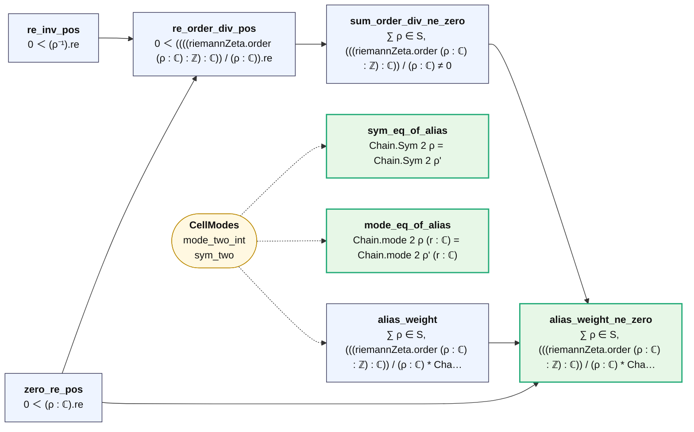

# `lean_stage3/Stage3/AliasClass.lean`

> **Read from the source text.** This file changed after the last `python3 utilities/lean_map.py --dump`, so the arrows on this page are names occurring in each proof and have not been confirmed by Lean.

AliasClass — block J10a of `lean_stage3/design/joints.md`. 2026-11-22. Joint 10 on the table's own ladder, first piece. On the ladder `2^r` a zero `ρ` of ζ enters only through `z = 2^ρ`: its mode at row `r` is `z^r` and its symbol is `1 − z⁻¹`. Zeros with the same `z` have the same real part and heights that differ by a multiple of `2π/log 2`; the ladder folds them together. This module proves that folding never cancels: the zeros sharing a `z` contribute to the cell one mode whose weight is not zero, at every dept…

8 theorems, 0 definitions, 134 lines. 

**Imports:** [`CellModes`](../lean_stage3/CellModes.md)  
**Imported by:** [`Stage3`](../lean_stage3/Stage3.md)

## The picture



An arrow A → B reads "A is used in the proof of B". Blue: theorem. Green: a theorem nothing else uses (an end). Dashed: connects to nothing. Red: contains `sorry`. Yellow: theorems in another file, counted; a dotted arrow crosses files. Definitions are not drawn; they are listed below the diagram.

## Theorems

<a name="AliasClass-re_inv_pos"></a>
### `AliasClass.re_inv_pos`

line 36 · arrows read from text

**Why.** The reciprocal of a point right of the imaginary axis is right of it too.

**Proves**

```lean
0 < (ρ⁻¹).re
```

**Needs** (its hypotheses)

  - `` h : 0 < ρ.re ``

**Fed by:** no theorem of this repo; it stands on Mathlib.

**Feeds** (1 that use it)

  - [`AliasClass.re_order_div_pos`](#AliasClass-re_order_div_pos) — `` 0 < ((((riemannZeta.order (ρ : ℂ) : ℤ) : ℂ)) / (ρ : ℂ)).re ``

<a name="AliasClass-zero_re_pos"></a>
### `AliasClass.zero_re_pos`

line 42 · arrows read from text

**Why.** A nontrivial zero of ζ has positive real part.

**Proves**

```lean
0 < (ρ : ℂ).re
```

**Needs** (its hypotheses)

  - `` ρ : Kadiri.NontrivialZeros ``

**Fed by:** no theorem of this repo; it stands on Mathlib.

**Feeds** (2 that use it)

  - [`AliasClass.alias_weight_ne_zero`](#AliasClass-alias_weight_ne_zero) — `` ∑ ρ ∈ S, (((riemannZeta.order (ρ : ℂ) : ℤ) : ℂ)) / (ρ : ℂ) * Chain.Sym 2 (ρ : ℂ) ^ d * Chain.mode 2 (ρ : ℂ) (r : ℂ) ≠ 0 ``
  - [`AliasClass.re_order_div_pos`](#AliasClass-re_order_div_pos) — `` 0 < ((((riemannZeta.order (ρ : ℂ) : ℤ) : ℂ)) / (ρ : ℂ)).re ``

<a name="AliasClass-re_order_div_pos"></a>
### `AliasClass.re_order_div_pos`

line 45 · arrows read from text

**Why.** The coefficient a zero carries in the cell, `m(ρ)/ρ`, has positive real part.

**Proves**

```lean
0 < ((((riemannZeta.order (ρ : ℂ) : ℤ) : ℂ)) / (ρ : ℂ)).re
```

**Needs** (its hypotheses)

  - `` ρ : Kadiri.NontrivialZeros ``

**Fed by** (2 theorems its proof uses)

  - [`AliasClass.re_inv_pos`](#AliasClass-re_inv_pos) — `` 0 < (ρ⁻¹).re ``
  - [`AliasClass.zero_re_pos`](#AliasClass-zero_re_pos) — `` 0 < (ρ : ℂ).re ``

**Feeds** (1 that use it)

  - [`AliasClass.sum_order_div_ne_zero`](#AliasClass-sum_order_div_ne_zero) — `` ∑ ρ ∈ S, (((riemannZeta.order (ρ : ℂ) : ℤ) : ℂ)) / (ρ : ℂ) ≠ 0 ``

<a name="AliasClass-sum_order_div_ne_zero"></a>
### `AliasClass.sum_order_div_ne_zero`

line 59 · arrows read from text

**Why.** No set of zeros cancels. The coefficients `m(ρ)/ρ` of a nonempty finite set of zeros never add to zero: each has positive real part.

**Proves**

```lean
∑ ρ ∈ S, (((riemannZeta.order (ρ : ℂ) : ℤ) : ℂ)) / (ρ : ℂ) ≠ 0
```

**Needs** (its hypotheses)

  - `` S : Finset Kadiri.NontrivialZeros ``
  - `` hS : S.Nonempty ``

**Fed by** (1 theorem its proof uses)

  - [`AliasClass.re_order_div_pos`](#AliasClass-re_order_div_pos) — `` 0 < ((((riemannZeta.order (ρ : ℂ) : ℤ) : ℂ)) / (ρ : ℂ)).re ``

**Feeds** (1 that use it)

  - [`AliasClass.alias_weight_ne_zero`](#AliasClass-alias_weight_ne_zero) — `` ∑ ρ ∈ S, (((riemannZeta.order (ρ : ℂ) : ℤ) : ℂ)) / (ρ : ℂ) * Chain.Sym 2 (ρ : ℂ) ^ d * Chain.mode 2 (ρ : ℂ) (r : ℂ) ≠ 0 ``

<a name="AliasClass-sym_eq_of_alias"></a>
### `AliasClass.sym_eq_of_alias`

line 69 · arrows read from text

**Why.** Zeros the ladder folds together have the same symbol.

**Proves**

```lean
Chain.Sym 2 ρ = Chain.Sym 2 ρ'
```

**Needs** (its hypotheses)

  - `` h : (2 : ℂ) ^ ρ = (2 : ℂ) ^ ρ' ``

**Fed by** (1 theorem its proof uses)

  - [`CellModes.sym_two`](../lean_stage3/CellModes.md#CellModes-sym_two) (CellModes) — `` Chain.Sym 2 ρ = 1 - ((2:ℂ) ^ ρ)⁻¹ ``

**Definitions its proof touches:** [`Chain.Sym`](../lean/Chain.md#Chain-Sym)

**Feeds:** nothing. It is an end.

<a name="AliasClass-mode_eq_of_alias"></a>
### `AliasClass.mode_eq_of_alias`

line 74 · arrows read from text

**Why.** Zeros the ladder folds together have the same mode at every row.

**Proves**

```lean
Chain.mode 2 ρ (r : ℂ) = Chain.mode 2 ρ' (r : ℂ)
```

**Needs** (its hypotheses)

  - `` h : (2 : ℂ) ^ ρ = (2 : ℂ) ^ ρ' ``
  - `` r : ℤ ``

**Fed by** (1 theorem its proof uses)

  - [`CellModes.mode_two_int`](../lean_stage3/CellModes.md#CellModes-mode_two_int) (CellModes) — `` Chain.mode 2 ρ (r : ℂ) = ((2:ℂ) ^ ρ) ^ r ``

**Definitions its proof touches:** [`Chain.mode`](../lean/Chain.md#Chain-mode)

**Feeds:** nothing. It is an end.

<a name="AliasClass-alias_weight"></a>
### `AliasClass.alias_weight`

line 81 · arrows read from text

**Why.** A folded class is one mode. Zeros sharing `2^ρ = z` contribute to the cell `(r, d)` their coefficients added, times the symbol at `z` to the depth, times `z^r`.

**Proves**

```lean
∑ ρ ∈ S, (((riemannZeta.order (ρ : ℂ) : ℤ) : ℂ)) / (ρ : ℂ) * Chain.Sym 2 (ρ : ℂ) ^ d * Chain.mode 2 (ρ : ℂ) (r : ℂ) = (∑ ρ ∈ S, (((riemannZeta.order (ρ : ℂ) : ℤ) : ℂ)) / (ρ : ℂ)) * (1 - z⁻¹) ^ d * z ^ r
```

**Needs** (its hypotheses)

  - `` S : Finset Kadiri.NontrivialZeros ``
  - `` hz : ∀ ρ ∈ S, (2 : ℂ) ^ (ρ : ℂ) = z ``
  - `` d : ℕ ``
  - `` r : ℤ ``

**Fed by** (2 theorems its proof uses)

  - [`CellModes.mode_two_int`](../lean_stage3/CellModes.md#CellModes-mode_two_int) (CellModes) — `` Chain.mode 2 ρ (r : ℂ) = ((2:ℂ) ^ ρ) ^ r ``
  - [`CellModes.sym_two`](../lean_stage3/CellModes.md#CellModes-sym_two) (CellModes) — `` Chain.Sym 2 ρ = 1 - ((2:ℂ) ^ ρ)⁻¹ ``

**Definitions its proof touches:** [`Chain.Sym`](../lean/Chain.md#Chain-Sym), [`Chain.mode`](../lean/Chain.md#Chain-mode)

**Feeds** (1 that use it)

  - [`AliasClass.alias_weight_ne_zero`](#AliasClass-alias_weight_ne_zero) — `` ∑ ρ ∈ S, (((riemannZeta.order (ρ : ℂ) : ℤ) : ℂ)) / (ρ : ℂ) * Chain.Sym 2 (ρ : ℂ) ^ d * Chain.mode 2 (ρ : ℂ) (r : ℂ) ≠ 0 ``

<a name="AliasClass-alias_weight_ne_zero"></a>
### `AliasClass.alias_weight_ne_zero`

line 93 · arrows read from text

**Why.** Folding loses no zero. The mode a folded class contributes has weight not zero, at every depth and every row.

**Proves**

```lean
∑ ρ ∈ S, (((riemannZeta.order (ρ : ℂ) : ℤ) : ℂ)) / (ρ : ℂ) * Chain.Sym 2 (ρ : ℂ) ^ d * Chain.mode 2 (ρ : ℂ) (r : ℂ) ≠ 0
```

**Needs** (its hypotheses)

  - `` S : Finset Kadiri.NontrivialZeros ``
  - `` hS : S.Nonempty ``
  - `` hz : ∀ ρ ∈ S, (2 : ℂ) ^ (ρ : ℂ) = z ``
  - `` d : ℕ ``
  - `` r : ℤ ``

**Fed by** (3 theorems its proof uses)

  - [`AliasClass.alias_weight`](#AliasClass-alias_weight) — `` ∑ ρ ∈ S, (((riemannZeta.order (ρ : ℂ) : ℤ) : ℂ)) / (ρ : ℂ) * Chain.Sym 2 (ρ : ℂ) ^ d * Chain.mode 2 (ρ : ℂ) (r : ℂ) = (∑ ρ ∈ S, (((riemannZeta.order (… ``
  - [`AliasClass.sum_order_div_ne_zero`](#AliasClass-sum_order_div_ne_zero) — `` ∑ ρ ∈ S, (((riemannZeta.order (ρ : ℂ) : ℤ) : ℂ)) / (ρ : ℂ) ≠ 0 ``
  - [`AliasClass.zero_re_pos`](#AliasClass-zero_re_pos) — `` 0 < (ρ : ℂ).re ``

**Definitions its proof touches:** [`Chain.Sym`](../lean/Chain.md#Chain-Sym), [`Chain.mode`](../lean/Chain.md#Chain-mode)

**Feeds:** nothing. It is an end.

