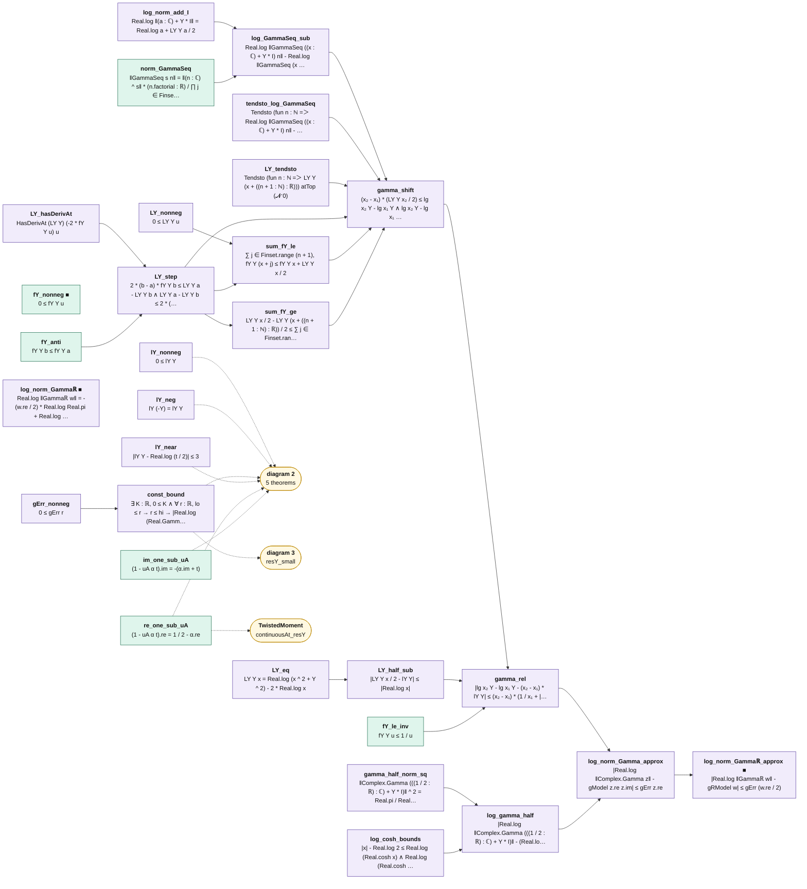
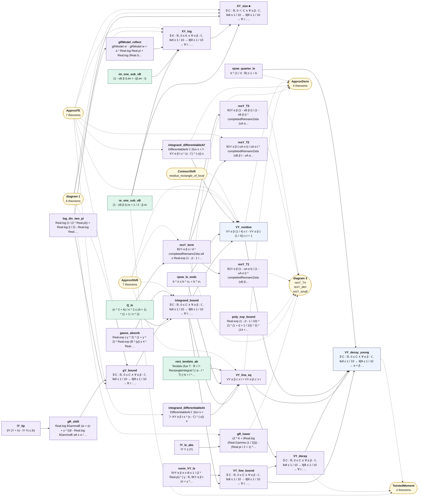
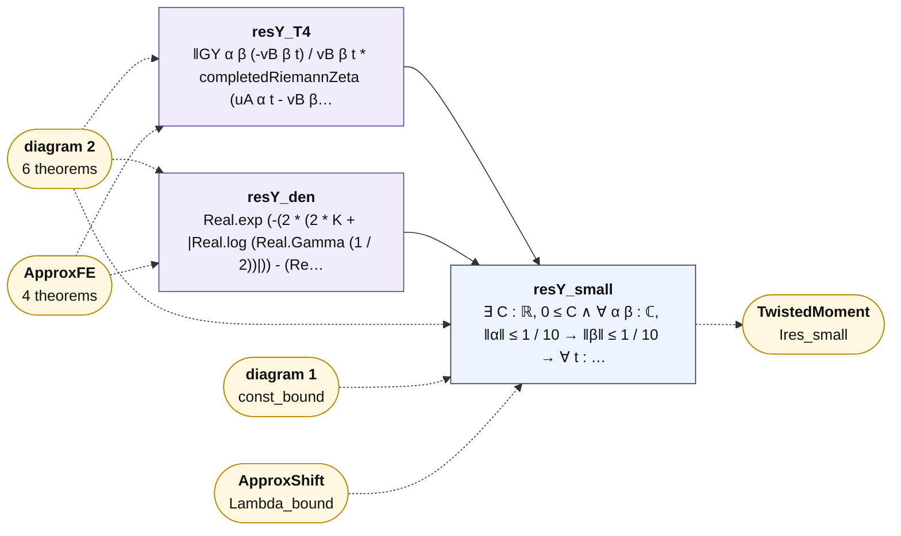

# `lean_stage3/Stage3/ApproxBounds.lean`

> **Read from the source text.** This file changed after the last `python3 utilities/lean_map.py --dump`, so the arrows on this page are names occurring in each proof and have not been confirmed by Lean.

# ApproxBounds — block S12 of `lean_stage3/design/stencil.md`, piece 2a, the sizes. 2026-11-25.

63 theorems, 7 definitions, 1722 lines. 

**Imports:** [`ApproxShift`](../lean_stage3/ApproxShift.md)  
**Imported by:** [`Stage3`](../lean_stage3/Stage3.md), [`ApproxDeriv`](../lean_stage3/ApproxDeriv.md)

## The picture

### Diagram 1 of 3: `LY_hasDerivAt` to `im_one_sub_uA`



### Diagram 2 of 3: `re_one_sub_vB` to `resY_T3`



### Diagram 3 of 3: `resY_T4` to `resY_small`



An arrow A → B reads "A is used in the proof of B". Green: counting, integers only. Violet: shape, analysis with no ζ. Blue: reads ζ. A name ending in ■ is an end: nothing else uses it. Red: contains `sorry`. Yellow: theorems in another file, counted; a dotted arrow crosses files. Definitions are not drawn; they are listed below the diagram.

## Definitions

<a name="ApproxBounds-fY"></a>
### `ApproxBounds.fY`

def · line 52

- **Is:** `` fY (Y u : ℝ) : ℝ := Y ^ 2 / (u * (u ^ 2 + Y ^ 2)) noncomputable ``
- **Used by 9:** [`ApproxBounds.LY_hasDerivAt`](#ApproxBounds-LY_hasDerivAt), [`ApproxBounds.LY_step`](#ApproxBounds-LY_step), [`ApproxBounds.fY_anti`](#ApproxBounds-fY_anti), [`ApproxBounds.fY_le_inv`](#ApproxBounds-fY_le_inv), [`ApproxBounds.fY_nonneg`](#ApproxBounds-fY_nonneg), [`ApproxBounds.gamma_rel`](#ApproxBounds-gamma_rel), [`ApproxBounds.gamma_shift`](#ApproxBounds-gamma_shift), [`ApproxBounds.sum_fY_ge`](#ApproxBounds-sum_fY_ge), [`ApproxBounds.sum_fY_le`](#ApproxBounds-sum_fY_le)

<a name="ApproxBounds-LY"></a>
### `ApproxBounds.LY`

def · line 56

- **Is:** `` LY (Y u : ℝ) : ℝ := Real.log (1 + Y ^ 2 / u ^ 2) ``
- **Used by 12:** [`ApproxBounds.LY_eq`](#ApproxBounds-LY_eq), [`ApproxBounds.LY_half_sub`](#ApproxBounds-LY_half_sub), [`ApproxBounds.LY_hasDerivAt`](#ApproxBounds-LY_hasDerivAt), [`ApproxBounds.LY_nonneg`](#ApproxBounds-LY_nonneg), [`ApproxBounds.LY_step`](#ApproxBounds-LY_step), [`ApproxBounds.LY_tendsto`](#ApproxBounds-LY_tendsto), [`ApproxBounds.gamma_rel`](#ApproxBounds-gamma_rel), [`ApproxBounds.gamma_shift`](#ApproxBounds-gamma_shift), [`ApproxBounds.log_GammaSeq_sub`](#ApproxBounds-log_GammaSeq_sub), [`ApproxBounds.log_norm_add_I`](#ApproxBounds-log_norm_add_I), [`ApproxBounds.sum_fY_ge`](#ApproxBounds-sum_fY_ge), [`ApproxBounds.sum_fY_le`](#ApproxBounds-sum_fY_le)

<a name="ApproxBounds-lg"></a>
### `ApproxBounds.lg`

def · line 210

- **Is:** `` lg (x Y : ℝ) : ℝ := Real.log ‖Complex.Gamma ((x : ℂ) + Y * I)‖ - Real.log (Real.Gamma x) ``
- **Used by 4:** [`ApproxBounds.gamma_rel`](#ApproxBounds-gamma_rel), [`ApproxBounds.gamma_shift`](#ApproxBounds-gamma_shift), [`ApproxBounds.log_norm_Gamma_approx`](#ApproxBounds-log_norm_Gamma_approx), [`ApproxBounds.tendsto_log_GammaSeq`](#ApproxBounds-tendsto_log_GammaSeq)

<a name="ApproxBounds-lY"></a>
### `ApproxBounds.lY`

def · line 294

- **Is:** `` lY (Y : ℝ) : ℝ := Real.log (1 + Y ^ 2) / 2 ``
- **Used by 12:** [`ApproxBounds.LY_half_sub`](#ApproxBounds-LY_half_sub), [`ApproxBounds.XY_log`](#ApproxBounds-XY_log), [`ApproxBounds.gModel`](#ApproxBounds-gModel), [`ApproxBounds.gRModel_reflect`](#ApproxBounds-gRModel_reflect), [`ApproxBounds.gR_lower`](#ApproxBounds-gR_lower), [`ApproxBounds.gR_shift`](#ApproxBounds-gR_shift), [`ApproxBounds.gamma_rel`](#ApproxBounds-gamma_rel), [`ApproxBounds.lY_le_abs`](#ApproxBounds-lY_le_abs), [`ApproxBounds.lY_lip`](#ApproxBounds-lY_lip), [`ApproxBounds.lY_near`](#ApproxBounds-lY_near), [`ApproxBounds.lY_neg`](#ApproxBounds-lY_neg), [`ApproxBounds.lY_nonneg`](#ApproxBounds-lY_nonneg)

<a name="ApproxBounds-gModel"></a>
### `ApproxBounds.gModel`

def · line 426

- **Is:** `` gModel (r Y : ℝ) : ℝ := Real.log (Real.Gamma r) - Real.log (Real.Gamma (1 / 2)) + Real.log Real.pi / 2 - Real.pi * |Y| / 2 + (r - 1 / 2) * lY Y noncomputable ``
- **Built from:** [`ApproxBounds.lY`](#ApproxBounds-lY)
- **Used by 5:** [`ApproxBounds.gRModel`](#ApproxBounds-gRModel), [`ApproxBounds.gRModel_reflect`](#ApproxBounds-gRModel_reflect), [`ApproxBounds.gR_lower`](#ApproxBounds-gR_lower), [`ApproxBounds.gR_shift`](#ApproxBounds-gR_shift), [`ApproxBounds.log_norm_Gamma_approx`](#ApproxBounds-log_norm_Gamma_approx)

<a name="ApproxBounds-gErr"></a>
### `ApproxBounds.gErr`

def · line 432

- **Is:** `` gErr (r : ℝ) : ℝ := |r - 1 / 2| * (2 + 1 / r + |Real.log r| + Real.log 2) + Real.log 2 / 2 ``
- **Used by 7:** [`ApproxBounds.const_bound`](#ApproxBounds-const_bound), [`ApproxBounds.gErr_nonneg`](#ApproxBounds-gErr_nonneg), [`ApproxBounds.gR_lower`](#ApproxBounds-gR_lower), [`ApproxBounds.gR_shift`](#ApproxBounds-gR_shift), [`ApproxBounds.log_norm_Gamma_approx`](#ApproxBounds-log_norm_Gamma_approx), [`ApproxBounds.log_norm_Gammaℝ_approx`](#ApproxBounds-log_norm_Gamma-_approx), [`ApproxBounds.resY_den`](#ApproxBounds-resY_den)

<a name="ApproxBounds-gRModel"></a>
### `ApproxBounds.gRModel`

def · line 483

- **Is:** `` gRModel (w : ℂ) : ℝ := -(w.re / 2) * Real.log Real.pi + gModel (w.re / 2) (w.im / 2) ``
- **Built from:** [`ApproxBounds.gModel`](#ApproxBounds-gModel)
- **Used by 4:** [`ApproxBounds.gRModel_reflect`](#ApproxBounds-gRModel_reflect), [`ApproxBounds.gR_lower`](#ApproxBounds-gR_lower), [`ApproxBounds.gR_shift`](#ApproxBounds-gR_shift), [`ApproxBounds.log_norm_Gammaℝ_approx`](#ApproxBounds-log_norm_Gamma-_approx)

## Theorems

<a name="ApproxBounds-LY_hasDerivAt"></a>
### `ApproxBounds.LY_hasDerivAt`

line 58 · arrows read from text

**Shape.** Uses real or complex analysis; nothing in it or beneath it reads ζ.

**Proves**

```lean
HasDerivAt (LY Y) (-2 * fY Y u) u
```

**Needs** (its hypotheses)

  - `` Y : ℝ ``
  - `` hu : 0 < u ``

**Fed by:** no theorem of this repo; it stands on Mathlib and the definitions below.

**Definitions its proof touches:** [`ApproxBounds.LY`](#ApproxBounds-LY), [`ApproxBounds.fY`](#ApproxBounds-fY)

**Feeds** (1 that use it)

  - [`ApproxBounds.LY_step`](#ApproxBounds-LY_step) — `` 2 * (b - a) * fY Y b ≤ LY Y a - LY Y b ∧ LY Y a - LY Y b ≤ 2 * (b - a) * fY Y a ``

<a name="ApproxBounds-fY_nonneg"></a>
### `ApproxBounds.fY_nonneg`

line 73 · arrows read from text

**Counting.** Integers only: nothing in its statement or proof, or in anything it rests on, uses analysis or ζ.

**Proves**

```lean
0 ≤ fY Y u
```

**Needs** (its hypotheses)

  - `` Y : ℝ ``
  - `` hu : 0 < u ``

**Fed by:** no theorem of this repo; it stands on Mathlib and the definitions below.

**Definitions its proof touches:** [`ApproxBounds.fY`](#ApproxBounds-fY)

**Feeds:** nothing. It is an end.

<a name="ApproxBounds-fY_anti"></a>
### `ApproxBounds.fY_anti`

line 77 · arrows read from text

**Counting.** Integers only: nothing in its statement or proof, or in anything it rests on, uses analysis or ζ.

**Proves**

```lean
fY Y b ≤ fY Y a
```

**Needs** (its hypotheses)

  - `` Y : ℝ ``
  - `` ha : 0 < a ``
  - `` hab : a ≤ b ``

**Fed by:** no theorem of this repo; it stands on Mathlib and the definitions below.

**Definitions its proof touches:** [`ApproxBounds.fY`](#ApproxBounds-fY)

**Feeds** (1 that use it)

  - [`ApproxBounds.LY_step`](#ApproxBounds-LY_step) — `` 2 * (b - a) * fY Y b ≤ LY Y a - LY Y b ∧ LY Y a - LY Y b ≤ 2 * (b - a) * fY Y a ``

<a name="ApproxBounds-fY_le_inv"></a>
### `ApproxBounds.fY_le_inv`

line 84 · arrows read from text

**Counting.** Integers only: nothing in its statement or proof, or in anything it rests on, uses analysis or ζ.

**Proves**

```lean
fY Y u ≤ 1 / u
```

**Needs** (its hypotheses)

  - `` Y : ℝ ``
  - `` hu : 0 < u ``

**Fed by:** no theorem of this repo; it stands on Mathlib and the definitions below.

**Definitions its proof touches:** [`ApproxBounds.fY`](#ApproxBounds-fY)

**Feeds** (1 that use it)

  - [`ApproxBounds.gamma_rel`](#ApproxBounds-gamma_rel) — `` |lg x₂ Y - lg x₁ Y - (x₂ - x₁) * lY Y| ≤ (x₂ - x₁) * (1 / x₁ + |Real.log x₁| + |Real.log x₂|) ``

<a name="ApproxBounds-LY_nonneg"></a>
### `ApproxBounds.LY_nonneg`

line 89 · arrows read from text

**Shape.** Uses real or complex analysis; nothing in it or beneath it reads ζ.

**Proves**

```lean
0 ≤ LY Y u
```

**Needs** (its hypotheses)

  - `` Y u : ℝ ``

**Fed by:** no theorem of this repo; it stands on Mathlib and the definitions below.

**Definitions its proof touches:** [`ApproxBounds.LY`](#ApproxBounds-LY)

**Feeds** (1 that use it)

  - [`ApproxBounds.sum_fY_le`](#ApproxBounds-sum_fY_le) — `` ∑ j ∈ Finset.range (n + 1), fY Y (x + j) ≤ fY Y x + LY Y x / 2 ``

<a name="ApproxBounds-LY_step"></a>
### `ApproxBounds.LY_step`

line 96 · arrows read from text

**Shape.** Uses real or complex analysis; nothing in it or beneath it reads ζ.

**Why.** One step: `2(b−a) f(b) ≤ L(a) − L(b) ≤ 2(b−a) f(a)` for `0 < a ≤ b`.

**Proves**

```lean
2 * (b - a) * fY Y b ≤ LY Y a - LY Y b ∧ LY Y a - LY Y b ≤ 2 * (b - a) * fY Y a
```

**Needs** (its hypotheses)

  - `` Y : ℝ ``
  - `` ha : 0 < a ``
  - `` hab : a ≤ b ``

**Fed by** (2 theorems its proof uses)

  - [`ApproxBounds.LY_hasDerivAt`](#ApproxBounds-LY_hasDerivAt) — `` HasDerivAt (LY Y) (-2 * fY Y u) u ``
  - [`ApproxBounds.fY_anti`](#ApproxBounds-fY_anti) — `` fY Y b ≤ fY Y a ``

**Definitions its proof touches:** [`ApproxBounds.LY`](#ApproxBounds-LY), [`ApproxBounds.fY`](#ApproxBounds-fY)

**Feeds** (3 that use it)

  - [`ApproxBounds.gamma_shift`](#ApproxBounds-gamma_shift) — `` (x₂ - x₁) * (LY Y x₂ / 2) ≤ lg x₂ Y - lg x₁ Y ∧ lg x₂ Y - lg x₁ Y ≤ (x₂ - x₁) * (fY Y x₁ + LY Y x₁ / 2) ``
  - [`ApproxBounds.sum_fY_ge`](#ApproxBounds-sum_fY_ge) — `` LY Y x / 2 - LY Y (x + ((n + 1 : ℕ) : ℝ)) / 2 ≤ ∑ j ∈ Finset.range (n + 1), fY Y (x + j) ``
  - [`ApproxBounds.sum_fY_le`](#ApproxBounds-sum_fY_le) — `` ∑ j ∈ Finset.range (n + 1), fY Y (x + j) ≤ fY Y x + LY Y x / 2 ``

<a name="ApproxBounds-sum_fY_le"></a>
### `ApproxBounds.sum_fY_le`

line 117 · arrows read from text

**Shape.** Uses real or complex analysis; nothing in it or beneath it reads ζ.

**Why.** `Σ_{j ≤ n} f(x+j) ≤ f(x) + L(x)/2`.

**Proves**

```lean
∑ j ∈ Finset.range (n + 1), fY Y (x + j) ≤ fY Y x + LY Y x / 2
```

**Needs** (its hypotheses)

  - `` Y : ℝ ``
  - `` hx : 0 < x ``
  - `` n : ℕ ``

**Fed by** (2 theorems its proof uses)

  - [`ApproxBounds.LY_nonneg`](#ApproxBounds-LY_nonneg) — `` 0 ≤ LY Y u ``
  - [`ApproxBounds.LY_step`](#ApproxBounds-LY_step) — `` 2 * (b - a) * fY Y b ≤ LY Y a - LY Y b ∧ LY Y a - LY Y b ≤ 2 * (b - a) * fY Y a ``

**Definitions its proof touches:** [`ApproxBounds.LY`](#ApproxBounds-LY), [`ApproxBounds.fY`](#ApproxBounds-fY)

**Feeds** (1 that use it)

  - [`ApproxBounds.gamma_shift`](#ApproxBounds-gamma_shift) — `` (x₂ - x₁) * (LY Y x₂ / 2) ≤ lg x₂ Y - lg x₁ Y ∧ lg x₂ Y - lg x₁ Y ≤ (x₂ - x₁) * (fY Y x₁ + LY Y x₁ / 2) ``

<a name="ApproxBounds-sum_fY_ge"></a>
### `ApproxBounds.sum_fY_ge`

line 134 · arrows read from text

**Shape.** Uses real or complex analysis; nothing in it or beneath it reads ζ.

**Why.** `(L(x) − L(x+n+1))/2 ≤ Σ_{j ≤ n} f(x+j)`.

**Proves**

```lean
LY Y x / 2 - LY Y (x + ((n + 1 : ℕ) : ℝ)) / 2 ≤ ∑ j ∈ Finset.range (n + 1), fY Y (x + j)
```

**Needs** (its hypotheses)

  - `` Y : ℝ ``
  - `` hx : 0 < x ``
  - `` n : ℕ ``

**Fed by** (1 theorem its proof uses)

  - [`ApproxBounds.LY_step`](#ApproxBounds-LY_step) — `` 2 * (b - a) * fY Y b ≤ LY Y a - LY Y b ∧ LY Y a - LY Y b ≤ 2 * (b - a) * fY Y a ``

**Definitions its proof touches:** [`ApproxBounds.LY`](#ApproxBounds-LY), [`ApproxBounds.fY`](#ApproxBounds-fY)

**Feeds** (1 that use it)

  - [`ApproxBounds.gamma_shift`](#ApproxBounds-gamma_shift) — `` (x₂ - x₁) * (LY Y x₂ / 2) ≤ lg x₂ Y - lg x₁ Y ∧ lg x₂ Y - lg x₁ Y ≤ (x₂ - x₁) * (fY Y x₁ + LY Y x₁ / 2) ``

<a name="ApproxBounds-log_norm_add_I"></a>
### `ApproxBounds.log_norm_add_I`

line 148 · arrows read from text

**Shape.** Uses real or complex analysis; nothing in it or beneath it reads ζ.

**Why.** `log ‖a + iY‖ = log a + L(a)/2` for `a > 0`.

**Proves**

```lean
Real.log ‖(a : ℂ) + Y * I‖ = Real.log a + LY Y a / 2
```

**Needs** (its hypotheses)

  - `` ha : 0 < a ``
  - `` Y : ℝ ``

**Fed by:** no theorem of this repo; it stands on Mathlib and the definitions below.

**Definitions its proof touches:** [`ApproxBounds.LY`](#ApproxBounds-LY)

**Feeds** (1 that use it)

  - [`ApproxBounds.log_GammaSeq_sub`](#ApproxBounds-log_GammaSeq_sub) — `` Real.log ‖GammaSeq ((x : ℂ) + Y * I) n‖ - Real.log ‖GammaSeq (x : ℂ) n‖ = -(1 / 2) * ∑ j ∈ Finset.range (n + 1), LY Y (x + j) ``

<a name="ApproxBounds-norm_GammaSeq"></a>
### `ApproxBounds.norm_GammaSeq`

line 159 · arrows read from text

**Counting.** Integers only: nothing in its statement or proof, or in anything it rests on, uses analysis or ζ.

**Proves**

```lean
‖GammaSeq s n‖ = ‖(n : ℂ) ^ s‖ * (n.factorial : ℝ) / ∏ j ∈ Finset.range (n + 1), ‖s + j‖
```

**Needs** (its hypotheses)

  - `` s : ℂ ``
  - `` n : ℕ ``

**Fed by:** no theorem of this repo; it stands on Mathlib.

**Feeds** (1 that use it)

  - [`ApproxBounds.log_GammaSeq_sub`](#ApproxBounds-log_GammaSeq_sub) — `` Real.log ‖GammaSeq ((x : ℂ) + Y * I) n‖ - Real.log ‖GammaSeq (x : ℂ) n‖ = -(1 / 2) * ∑ j ∈ Finset.range (n + 1), LY Y (x + j) ``

<a name="ApproxBounds-log_GammaSeq_sub"></a>
### `ApproxBounds.log_GammaSeq_sub`

line 166 · arrows read from text

**Shape.** Uses real or complex analysis; nothing in it or beneath it reads ζ.

**Why.** The partial product: `log‖GammaSeq (x+iY) n‖ − log‖GammaSeq x n‖ = −½ Σ_{j≤n} L(x+j)`.

**Proves**

```lean
Real.log ‖GammaSeq ((x : ℂ) + Y * I) n‖ - Real.log ‖GammaSeq (x : ℂ) n‖ = -(1 / 2) * ∑ j ∈ Finset.range (n + 1), LY Y (x + j)
```

**Needs** (its hypotheses)

  - `` hx : 0 < x ``
  - `` Y : ℝ ``
  - `` hn : 1 ≤ n ``

**Fed by** (2 theorems its proof uses)

  - [`ApproxBounds.log_norm_add_I`](#ApproxBounds-log_norm_add_I) — `` Real.log ‖(a : ℂ) + Y * I‖ = Real.log a + LY Y a / 2 ``
  - [`ApproxBounds.norm_GammaSeq`](#ApproxBounds-norm_GammaSeq) — `` ‖GammaSeq s n‖ = ‖(n : ℂ) ^ s‖ * (n.factorial : ℝ) / ∏ j ∈ Finset.range (n + 1), ‖s + j‖ ``

**Definitions its proof touches:** [`ApproxBounds.LY`](#ApproxBounds-LY)

**Feeds** (1 that use it)

  - [`ApproxBounds.gamma_shift`](#ApproxBounds-gamma_shift) — `` (x₂ - x₁) * (LY Y x₂ / 2) ≤ lg x₂ Y - lg x₁ Y ∧ lg x₂ Y - lg x₁ Y ≤ (x₂ - x₁) * (fY Y x₁ + LY Y x₁ / 2) ``

<a name="ApproxBounds-tendsto_log_GammaSeq"></a>
### `ApproxBounds.tendsto_log_GammaSeq`

line 212 · arrows read from text

**Shape.** Uses real or complex analysis; nothing in it or beneath it reads ζ.

**Proves**

```lean
Tendsto (fun n : ℕ => Real.log ‖GammaSeq ((x : ℂ) + Y * I) n‖ - Real.log ‖GammaSeq (x : ℂ) n‖) atTop (𝓝 (lg x Y))
```

**Needs** (its hypotheses)

  - `` hx : 0 < x ``
  - `` Y : ℝ ``

**Fed by:** no theorem of this repo; it stands on Mathlib and the definitions below.

**Definitions its proof touches:** [`ApproxBounds.lg`](#ApproxBounds-lg)

**Feeds** (1 that use it)

  - [`ApproxBounds.gamma_shift`](#ApproxBounds-gamma_shift) — `` (x₂ - x₁) * (LY Y x₂ / 2) ≤ lg x₂ Y - lg x₁ Y ∧ lg x₂ Y - lg x₁ Y ≤ (x₂ - x₁) * (fY Y x₁ + LY Y x₁ / 2) ``

<a name="ApproxBounds-LY_tendsto"></a>
### `ApproxBounds.LY_tendsto`

line 229 · arrows read from text

**Shape.** Uses real or complex analysis; nothing in it or beneath it reads ζ.

**Proves**

```lean
Tendsto (fun n : ℕ => LY Y (x + ((n + 1 : ℕ) : ℝ))) atTop (𝓝 0)
```

**Needs** (its hypotheses)

  - `` Y x : ℝ ``

**Fed by:** no theorem of this repo; it stands on Mathlib and the definitions below.

**Definitions its proof touches:** [`ApproxBounds.LY`](#ApproxBounds-LY)

**Feeds** (1 that use it)

  - [`ApproxBounds.gamma_shift`](#ApproxBounds-gamma_shift) — `` (x₂ - x₁) * (LY Y x₂ / 2) ≤ lg x₂ Y - lg x₁ Y ∧ lg x₂ Y - lg x₁ Y ≤ (x₂ - x₁) * (fY Y x₁ + LY Y x₁ / 2) ``

<a name="ApproxBounds-gamma_shift"></a>
### `ApproxBounds.gamma_shift`

line 245 · arrows read from text

**Shape.** Uses real or complex analysis; nothing in it or beneath it reads ζ.

**Why.** The real shift at a fixed height, from Euler's product: for `0 < x₁ ≤ x₂`, `(x₂−x₁) L(x₂)/2 ≤ lg x₂ Y − lg x₁ Y ≤ (x₂−x₁)(f(x₁) + L(x₁)/2)`.

**Proves**

```lean
(x₂ - x₁) * (LY Y x₂ / 2) ≤ lg x₂ Y - lg x₁ Y ∧ lg x₂ Y - lg x₁ Y ≤ (x₂ - x₁) * (fY Y x₁ + LY Y x₁ / 2)
```

**Needs** (its hypotheses)

  - `` h1 : 0 < x₁ ``
  - `` h12 : x₁ ≤ x₂ ``
  - `` Y : ℝ ``

**Fed by** (6 theorems its proof uses)

  - [`ApproxBounds.LY_step`](#ApproxBounds-LY_step) — `` 2 * (b - a) * fY Y b ≤ LY Y a - LY Y b ∧ LY Y a - LY Y b ≤ 2 * (b - a) * fY Y a ``
  - [`ApproxBounds.LY_tendsto`](#ApproxBounds-LY_tendsto) — `` Tendsto (fun n : ℕ => LY Y (x + ((n + 1 : ℕ) : ℝ))) atTop (𝓝 0) ``
  - [`ApproxBounds.log_GammaSeq_sub`](#ApproxBounds-log_GammaSeq_sub) — `` Real.log ‖GammaSeq ((x : ℂ) + Y * I) n‖ - Real.log ‖GammaSeq (x : ℂ) n‖ = -(1 / 2) * ∑ j ∈ Finset.range (n + 1), LY Y (x + j) ``
  - [`ApproxBounds.sum_fY_ge`](#ApproxBounds-sum_fY_ge) — `` LY Y x / 2 - LY Y (x + ((n + 1 : ℕ) : ℝ)) / 2 ≤ ∑ j ∈ Finset.range (n + 1), fY Y (x + j) ``
  - [`ApproxBounds.sum_fY_le`](#ApproxBounds-sum_fY_le) — `` ∑ j ∈ Finset.range (n + 1), fY Y (x + j) ≤ fY Y x + LY Y x / 2 ``
  - [`ApproxBounds.tendsto_log_GammaSeq`](#ApproxBounds-tendsto_log_GammaSeq) — `` Tendsto (fun n : ℕ => Real.log ‖GammaSeq ((x : ℂ) + Y * I) n‖ - Real.log ‖GammaSeq (x : ℂ) n‖) atTop (𝓝 (lg x Y)) ``

**Definitions its proof touches:** [`ApproxBounds.LY`](#ApproxBounds-LY), [`ApproxBounds.fY`](#ApproxBounds-fY), [`ApproxBounds.lg`](#ApproxBounds-lg)

**Feeds** (1 that use it)

  - [`ApproxBounds.gamma_rel`](#ApproxBounds-gamma_rel) — `` |lg x₂ Y - lg x₁ Y - (x₂ - x₁) * lY Y| ≤ (x₂ - x₁) * (1 / x₁ + |Real.log x₁| + |Real.log x₂|) ``

<a name="ApproxBounds-lY_nonneg"></a>
### `ApproxBounds.lY_nonneg`

line 296 · arrows read from text

**Shape.** Uses real or complex analysis; nothing in it or beneath it reads ζ.

**Proves**

```lean
0 ≤ lY Y
```

**Needs** (its hypotheses)

  - `` Y : ℝ ``

**Fed by:** no theorem of this repo; it stands on Mathlib and the definitions below.

**Definitions its proof touches:** [`ApproxBounds.lY`](#ApproxBounds-lY)

**Feeds** (1 that use it)

  - [`ApproxBounds.gR_lower`](#ApproxBounds-gR_lower) — `` -(2 * K + |Real.log (Real.Gamma (1 / 2))|) - (Real.pi / 2 + 1) * |Y₀| ≤ Real.log ‖Gammaℝ w‖ ``

<a name="ApproxBounds-lY_neg"></a>
### `ApproxBounds.lY_neg`

line 301 · arrows read from text

**Shape.** Uses real or complex analysis; nothing in it or beneath it reads ζ.

**Proves**

```lean
lY (-Y) = lY Y
```

**Needs** (its hypotheses)

  - `` Y : ℝ ``

**Fed by:** no theorem of this repo; it stands on Mathlib and the definitions below.

**Definitions its proof touches:** [`ApproxBounds.lY`](#ApproxBounds-lY)

**Feeds** (3 that use it)

  - [`ApproxBounds.XY_log`](#ApproxBounds-XY_log) — `` ∃ K : ℝ, 0 ≤ K ∧ ∀ α β : ℂ, ‖α‖ ≤ 1 / 10 → ‖β‖ ≤ 1 / 10 → ∀ t : ℝ, 1 ≤ t → |Real.log ‖XY α β t‖ - (α + β).re * (Real.log Real.pi - Real.log (t / 2))| … ``
  - [`ApproxBounds.gRModel_reflect`](#ApproxBounds-gRModel_reflect) — `` gRModel w' - gRModel w = a * Real.log Real.pi + Real.log (Real.Gamma ((1 / 2 - a) / 2)) - Real.log (Real.Gamma ((1 / 2 + a) / 2)) - a * lY (Y / 2) ``
  - [`ApproxBounds.gY_bound`](#ApproxBounds-gY_bound) — `` ∃ C : ℝ, 0 ≤ C ∧ ∀ α β : ℂ, ‖α‖ ≤ 1 / 10 → ‖β‖ ≤ 1 / 10 → ∀ t : ℝ, 1 ≤ t → ∀ σ y : ℝ, σ₀ ≤ σ → σ ≤ σ₁ → ‖gY α β t (σ + y * I)‖ ≤ C * (t / (2 * Real.pi… ``

<a name="ApproxBounds-LY_eq"></a>
### `ApproxBounds.LY_eq`

line 304 · arrows read from text

**Shape.** Uses real or complex analysis; nothing in it or beneath it reads ζ.

**Proves**

```lean
LY Y x = Real.log (x ^ 2 + Y ^ 2) - 2 * Real.log x
```

**Needs** (its hypotheses)

  - `` hx : 0 < x ``
  - `` Y : ℝ ``

**Fed by:** no theorem of this repo; it stands on Mathlib and the definitions below.

**Definitions its proof touches:** [`ApproxBounds.LY`](#ApproxBounds-LY)

**Feeds** (1 that use it)

  - [`ApproxBounds.LY_half_sub`](#ApproxBounds-LY_half_sub) — `` |LY Y x / 2 - lY Y| ≤ |Real.log x| ``

<a name="ApproxBounds-LY_half_sub"></a>
### `ApproxBounds.LY_half_sub`

line 314 · arrows read from text

**Shape.** Uses real or complex analysis; nothing in it or beneath it reads ζ.

**Proves**

```lean
|LY Y x / 2 - lY Y| ≤ |Real.log x|
```

**Needs** (its hypotheses)

  - `` hx : 0 < x ``
  - `` Y : ℝ ``

**Fed by** (1 theorem its proof uses)

  - [`ApproxBounds.LY_eq`](#ApproxBounds-LY_eq) — `` LY Y x = Real.log (x ^ 2 + Y ^ 2) - 2 * Real.log x ``

**Definitions its proof touches:** [`ApproxBounds.LY`](#ApproxBounds-LY), [`ApproxBounds.lY`](#ApproxBounds-lY)

**Feeds** (1 that use it)

  - [`ApproxBounds.gamma_rel`](#ApproxBounds-gamma_rel) — `` |lg x₂ Y - lg x₁ Y - (x₂ - x₁) * lY Y| ≤ (x₂ - x₁) * (1 / x₁ + |Real.log x₁| + |Real.log x₂|) ``

<a name="ApproxBounds-gamma_rel"></a>
### `ApproxBounds.gamma_rel`

line 341 · arrows read from text

**Shape.** Uses real or complex analysis; nothing in it or beneath it reads ζ.

**Why.** The real shift in the `ℓ` form: `|lg x₂ Y − lg x₁ Y − (x₂−x₁) ℓ(Y)| ≤ (x₂−x₁)(1/x₁ + |log x₁| + |log x₂|)`.

**Proves**

```lean
|lg x₂ Y - lg x₁ Y - (x₂ - x₁) * lY Y| ≤ (x₂ - x₁) * (1 / x₁ + |Real.log x₁| + |Real.log x₂|)
```

**Needs** (its hypotheses)

  - `` h1 : 0 < x₁ ``
  - `` h12 : x₁ ≤ x₂ ``
  - `` Y : ℝ ``

**Fed by** (3 theorems its proof uses)

  - [`ApproxBounds.LY_half_sub`](#ApproxBounds-LY_half_sub) — `` |LY Y x / 2 - lY Y| ≤ |Real.log x| ``
  - [`ApproxBounds.fY_le_inv`](#ApproxBounds-fY_le_inv) — `` fY Y u ≤ 1 / u ``
  - [`ApproxBounds.gamma_shift`](#ApproxBounds-gamma_shift) — `` (x₂ - x₁) * (LY Y x₂ / 2) ≤ lg x₂ Y - lg x₁ Y ∧ lg x₂ Y - lg x₁ Y ≤ (x₂ - x₁) * (fY Y x₁ + LY Y x₁ / 2) ``

**Definitions its proof touches:** [`ApproxBounds.LY`](#ApproxBounds-LY), [`ApproxBounds.fY`](#ApproxBounds-fY), [`ApproxBounds.lY`](#ApproxBounds-lY), [`ApproxBounds.lg`](#ApproxBounds-lg)

**Feeds** (1 that use it)

  - [`ApproxBounds.log_norm_Gamma_approx`](#ApproxBounds-log_norm_Gamma_approx) — `` |Real.log ‖Complex.Gamma z‖ - gModel z.re z.im| ≤ gErr z.re ``

<a name="ApproxBounds-gamma_half_norm_sq"></a>
### `ApproxBounds.gamma_half_norm_sq`

line 364 · arrows read from text

**Shape.** Uses real or complex analysis; nothing in it or beneath it reads ζ.

**Why.** `‖Γ(1/2+iY)‖² = π / cosh(πY)` (PNT+ `gamma_half_vertical_norm_sq`, not built at the pin; re-proved).

**Proves**

```lean
‖Complex.Gamma (((1 / 2 : ℝ) : ℂ) + Y * I)‖ ^ 2 = Real.pi / Real.cosh (Real.pi * Y)
```

**Needs** (its hypotheses)

  - `` Y : ℝ ``

**Fed by:** no theorem of this repo; it stands on Mathlib.

**Feeds** (1 that use it)

  - [`ApproxBounds.log_gamma_half`](#ApproxBounds-log_gamma_half) — `` |Real.log ‖Complex.Gamma (((1 / 2 : ℝ) : ℂ) + Y * I)‖ - (Real.log Real.pi - Real.pi * |Y|) / 2| ≤ Real.log 2 / 2 ``

<a name="ApproxBounds-log_cosh_bounds"></a>
### `ApproxBounds.log_cosh_bounds`

line 386 · arrows read from text

**Shape.** Uses real or complex analysis; nothing in it or beneath it reads ζ.

**Proves**

```lean
|x| - Real.log 2 ≤ Real.log (Real.cosh x) ∧ Real.log (Real.cosh x) ≤ |x|
```

**Needs** (its hypotheses)

  - `` x : ℝ ``

**Fed by:** no theorem of this repo; it stands on Mathlib.

**Feeds** (1 that use it)

  - [`ApproxBounds.log_gamma_half`](#ApproxBounds-log_gamma_half) — `` |Real.log ‖Complex.Gamma (((1 / 2 : ℝ) : ℂ) + Y * I)‖ - (Real.log Real.pi - Real.pi * |Y|) / 2| ≤ Real.log 2 / 2 ``

<a name="ApproxBounds-log_gamma_half"></a>
### `ApproxBounds.log_gamma_half`

line 407 · arrows read from text

**Shape.** Uses real or complex analysis; nothing in it or beneath it reads ζ.

**Why.** On the half line: `|log‖Γ(1/2+iY)‖ − (log π − π|Y|)/2| ≤ log 2 / 2`.

**Proves**

```lean
|Real.log ‖Complex.Gamma (((1 / 2 : ℝ) : ℂ) + Y * I)‖ - (Real.log Real.pi - Real.pi * |Y|) / 2| ≤ Real.log 2 / 2
```

**Needs** (its hypotheses)

  - `` Y : ℝ ``

**Fed by** (2 theorems its proof uses)

  - [`ApproxBounds.gamma_half_norm_sq`](#ApproxBounds-gamma_half_norm_sq) — `` ‖Complex.Gamma (((1 / 2 : ℝ) : ℂ) + Y * I)‖ ^ 2 = Real.pi / Real.cosh (Real.pi * Y) ``
  - [`ApproxBounds.log_cosh_bounds`](#ApproxBounds-log_cosh_bounds) — `` |x| - Real.log 2 ≤ Real.log (Real.cosh x) ∧ Real.log (Real.cosh x) ≤ |x| ``

**Feeds** (1 that use it)

  - [`ApproxBounds.log_norm_Gamma_approx`](#ApproxBounds-log_norm_Gamma_approx) — `` |Real.log ‖Complex.Gamma z‖ - gModel z.re z.im| ≤ gErr z.re ``

<a name="ApproxBounds-log_norm_Gamma_approx"></a>
### `ApproxBounds.log_norm_Gamma_approx`

line 436 · arrows read from text

**Shape.** Uses real or complex analysis; nothing in it or beneath it reads ζ.

**Why.** Stirling in the crude-explicit form, for `Re z > 0`, every height: `|log ‖Γ z‖ − gModel (Re z) (Im z)| ≤ gErr (Re z)`.

**Proves**

```lean
|Real.log ‖Complex.Gamma z‖ - gModel z.re z.im| ≤ gErr z.re
```

**Needs** (its hypotheses)

  - `` hz : 0 < z.re ``

**Fed by** (2 theorems its proof uses)

  - [`ApproxBounds.gamma_rel`](#ApproxBounds-gamma_rel) — `` |lg x₂ Y - lg x₁ Y - (x₂ - x₁) * lY Y| ≤ (x₂ - x₁) * (1 / x₁ + |Real.log x₁| + |Real.log x₂|) ``
  - [`ApproxBounds.log_gamma_half`](#ApproxBounds-log_gamma_half) — `` |Real.log ‖Complex.Gamma (((1 / 2 : ℝ) : ℂ) + Y * I)‖ - (Real.log Real.pi - Real.pi * |Y|) / 2| ≤ Real.log 2 / 2 ``

**Definitions its proof touches:** [`ApproxBounds.gErr`](#ApproxBounds-gErr), [`ApproxBounds.gModel`](#ApproxBounds-gModel), [`ApproxBounds.lg`](#ApproxBounds-lg)

**Feeds** (1 that use it)

  - [`ApproxBounds.log_norm_Gammaℝ_approx`](#ApproxBounds-log_norm_Gamma-_approx) — `` |Real.log ‖Gammaℝ w‖ - gRModel w| ≤ gErr (w.re / 2) ``

<a name="ApproxBounds-log_norm_Gamma-"></a>
### `ApproxBounds.log_norm_Gammaℝ`

line 472 · arrows read from text

**Shape.** Uses real or complex analysis; nothing in it or beneath it reads ζ.

**Proves**

```lean
Real.log ‖Gammaℝ w‖ = -(w.re / 2) * Real.log Real.pi + Real.log ‖Complex.Gamma (w / 2)‖
```

**Needs** (its hypotheses)

  - `` hw : 0 < w.re ``

**Fed by:** no theorem of this repo; it stands on Mathlib.

**Feeds:** nothing. It connects to nothing.

<a name="ApproxBounds-log_norm_Gamma-_approx"></a>
### `ApproxBounds.log_norm_Gammaℝ_approx`

line 485 · arrows read from text

**Shape.** Uses real or complex analysis; nothing in it or beneath it reads ζ.

**Proves**

```lean
|Real.log ‖Gammaℝ w‖ - gRModel w| ≤ gErr (w.re / 2)
```

**Needs** (its hypotheses)

  - `` hw : 0 < w.re ``

**Fed by** (1 theorem its proof uses)

  - [`ApproxBounds.log_norm_Gamma_approx`](#ApproxBounds-log_norm_Gamma_approx) — `` |Real.log ‖Complex.Gamma z‖ - gModel z.re z.im| ≤ gErr z.re ``

**Definitions its proof touches:** [`ApproxBounds.gErr`](#ApproxBounds-gErr), [`ApproxBounds.gRModel`](#ApproxBounds-gRModel)

**Feeds:** nothing. It is an end.

<a name="ApproxBounds-gErr_nonneg"></a>
### `ApproxBounds.gErr_nonneg`

line 495 · arrows read from text

**Shape.** Uses real or complex analysis; nothing in it or beneath it reads ζ.

**Proves**

```lean
0 ≤ gErr r
```

**Needs** (its hypotheses)

  - `` hr : 0 < r ``

**Fed by:** no theorem of this repo; it stands on Mathlib and the definitions below.

**Definitions its proof touches:** [`ApproxBounds.gErr`](#ApproxBounds-gErr)

**Feeds** (1 that use it)

  - [`ApproxBounds.const_bound`](#ApproxBounds-const_bound) — `` ∃ K : ℝ, 0 ≤ K ∧ ∀ r : ℝ, lo ≤ r → r ≤ hi → |Real.log (Real.Gamma r)| ≤ K ∧ gErr r ≤ K ``

<a name="ApproxBounds-const_bound"></a>
### `ApproxBounds.const_bound`

line 502 · arrows read from text

**Shape.** Uses real or complex analysis; nothing in it or beneath it reads ζ.

**Why.** Uniform constants on a compact range of real parts.

**Proves**

```lean
∃ K : ℝ, 0 ≤ K ∧ ∀ r : ℝ, lo ≤ r → r ≤ hi → |Real.log (Real.Gamma r)| ≤ K ∧ gErr r ≤ K
```

**Needs** (its hypotheses)

  - `` hlo : 0 < lo ``

**Fed by** (1 theorem its proof uses)

  - [`ApproxBounds.gErr_nonneg`](#ApproxBounds-gErr_nonneg) — `` 0 ≤ gErr r ``

**Definitions its proof touches:** [`ApproxBounds.gErr`](#ApproxBounds-gErr)

**Feeds** (3 that use it)

  - [`ApproxBounds.XY_log`](#ApproxBounds-XY_log) — `` ∃ K : ℝ, 0 ≤ K ∧ ∀ α β : ℂ, ‖α‖ ≤ 1 / 10 → ‖β‖ ≤ 1 / 10 → ∀ t : ℝ, 1 ≤ t → |Real.log ‖XY α β t‖ - (α + β).re * (Real.log Real.pi - Real.log (t / 2))| … ``
  - [`ApproxBounds.gY_bound`](#ApproxBounds-gY_bound) — `` ∃ C : ℝ, 0 ≤ C ∧ ∀ α β : ℂ, ‖α‖ ≤ 1 / 10 → ‖β‖ ≤ 1 / 10 → ∀ t : ℝ, 1 ≤ t → ∀ σ y : ℝ, σ₀ ≤ σ → σ ≤ σ₁ → ‖gY α β t (σ + y * I)‖ ≤ C * (t / (2 * Real.pi… ``
  - [`ApproxBounds.resY_small`](#ApproxBounds-resY_small) — `` ∃ C : ℝ, 0 ≤ C ∧ ∀ α β : ℂ, ‖α‖ ≤ 1 / 10 → ‖β‖ ≤ 1 / 10 → ∀ t : ℝ, 1 ≤ t → ‖resY α β t‖ ≤ C * (1 + 1 / ‖α + β‖ ^ 2) * Real.exp (-(t ^ 2 / 2)) ``

<a name="ApproxBounds-lY_near"></a>
### `ApproxBounds.lY_near`

line 536 · arrows read from text

**Shape.** Uses real or complex analysis; nothing in it or beneath it reads ζ.

**Why.** `|ℓ(Y) − log(t/2)| ≤ 3` for `t ≥ 1`, `|Y − t/2| ≤ t/10`.

**Proves**

```lean
|lY Y - Real.log (t / 2)| ≤ 3
```

**Needs** (its hypotheses)

  - `` ht : 1 ≤ t ``
  - `` hY : |Y - t / 2| ≤ t / 10 ``

**Fed by:** no theorem of this repo; it stands on Mathlib and the definitions below.

**Definitions its proof touches:** [`ApproxBounds.lY`](#ApproxBounds-lY)

**Feeds** (2 that use it)

  - [`ApproxBounds.XY_log`](#ApproxBounds-XY_log) — `` ∃ K : ℝ, 0 ≤ K ∧ ∀ α β : ℂ, ‖α‖ ≤ 1 / 10 → ‖β‖ ≤ 1 / 10 → ∀ t : ℝ, 1 ≤ t → |Real.log ‖XY α β t‖ - (α + β).re * (Real.log Real.pi - Real.log (t / 2))| … ``
  - [`ApproxBounds.gY_bound`](#ApproxBounds-gY_bound) — `` ∃ C : ℝ, 0 ≤ C ∧ ∀ α β : ℂ, ‖α‖ ≤ 1 / 10 → ‖β‖ ≤ 1 / 10 → ∀ t : ℝ, 1 ≤ t → ∀ σ y : ℝ, σ₀ ≤ σ → σ ≤ σ₁ → ‖gY α β t (σ + y * I)‖ ≤ C * (t / (2 * Real.pi… ``

<a name="ApproxBounds-re_one_sub_uA"></a>
### `ApproxBounds.re_one_sub_uA`

line 561 · arrows read from text

**Counting.** Integers only: nothing in its statement or proof, or in anything it rests on, uses analysis or ζ.

**Proves**

```lean
(1 - uA α t).re = 1 / 2 - α.re
```

**Needs** (its hypotheses)

  - `` α : ℂ ``
  - `` t : ℝ ``

**Fed by:** no theorem of this repo; it stands on Mathlib and the definitions below.

**Definitions its proof touches:** [`ApproxFE.uA`](../lean_stage3/ApproxFE.md#ApproxFE-uA)

**Feeds** (3 that use it)

  - [`ApproxBounds.XY_log`](#ApproxBounds-XY_log) — `` ∃ K : ℝ, 0 ≤ K ∧ ∀ α β : ℂ, ‖α‖ ≤ 1 / 10 → ‖β‖ ≤ 1 / 10 → ∀ t : ℝ, 1 ≤ t → |Real.log ‖XY α β t‖ - (α + β).re * (Real.log Real.pi - Real.log (t / 2))| … ``
  - [`ApproxBounds.XY_size`](#ApproxBounds-XY_size) — `` ∃ C : ℝ, 0 < C ∧ ∀ α β : ℂ, ‖α‖ ≤ 1 / 10 → ‖β‖ ≤ 1 / 10 → ∀ t : ℝ, 1 ≤ t → ‖XY α β t‖ ≤ C * (t / (2 * Real.pi)) ^ (-(α + β).re) ∧ (t / (2 * Real.pi)) … ``
  - [`TwistedMoment.continuousAt_resY`](../lean_stage3/TwistedMoment.md#TwistedMoment-continuousAt_resY) (TwistedMoment) — `` ContinuousAt (fun t => resY α β t) t ``

<a name="ApproxBounds-im_one_sub_uA"></a>
### `ApproxBounds.im_one_sub_uA`

line 563 · arrows read from text

**Counting.** Integers only: nothing in its statement or proof, or in anything it rests on, uses analysis or ζ.

**Proves**

```lean
(1 - uA α t).im = -(α.im + t)
```

**Needs** (its hypotheses)

  - `` α : ℂ ``
  - `` t : ℝ ``

**Fed by:** no theorem of this repo; it stands on Mathlib and the definitions below.

**Definitions its proof touches:** [`ApproxFE.uA`](../lean_stage3/ApproxFE.md#ApproxFE-uA)

**Feeds** (1 that use it)

  - [`ApproxBounds.XY_log`](#ApproxBounds-XY_log) — `` ∃ K : ℝ, 0 ≤ K ∧ ∀ α β : ℂ, ‖α‖ ≤ 1 / 10 → ‖β‖ ≤ 1 / 10 → ∀ t : ℝ, 1 ≤ t → |Real.log ‖XY α β t‖ - (α + β).re * (Real.log Real.pi - Real.log (t / 2))| … ``

<a name="ApproxBounds-re_one_sub_vB"></a>
### `ApproxBounds.re_one_sub_vB`

line 565 · arrows read from text

**Counting.** Integers only: nothing in its statement or proof, or in anything it rests on, uses analysis or ζ.

**Proves**

```lean
(1 - vB β t).re = 1 / 2 - β.re
```

**Needs** (its hypotheses)

  - `` β : ℂ ``
  - `` t : ℝ ``

**Fed by:** no theorem of this repo; it stands on Mathlib and the definitions below.

**Definitions its proof touches:** [`ApproxFE.vB`](../lean_stage3/ApproxFE.md#ApproxFE-vB)

**Feeds** (3 that use it)

  - [`ApproxBounds.XY_log`](#ApproxBounds-XY_log) — `` ∃ K : ℝ, 0 ≤ K ∧ ∀ α β : ℂ, ‖α‖ ≤ 1 / 10 → ‖β‖ ≤ 1 / 10 → ∀ t : ℝ, 1 ≤ t → |Real.log ‖XY α β t‖ - (α + β).re * (Real.log Real.pi - Real.log (t / 2))| … ``
  - [`ApproxBounds.XY_size`](#ApproxBounds-XY_size) — `` ∃ C : ℝ, 0 < C ∧ ∀ α β : ℂ, ‖α‖ ≤ 1 / 10 → ‖β‖ ≤ 1 / 10 → ∀ t : ℝ, 1 ≤ t → ‖XY α β t‖ ≤ C * (t / (2 * Real.pi)) ^ (-(α + β).re) ∧ (t / (2 * Real.pi)) … ``
  - [`TwistedMoment.continuousAt_resY`](../lean_stage3/TwistedMoment.md#TwistedMoment-continuousAt_resY) (TwistedMoment) — `` ContinuousAt (fun t => resY α β t) t ``

<a name="ApproxBounds-im_one_sub_vB"></a>
### `ApproxBounds.im_one_sub_vB`

line 567 · arrows read from text

**Counting.** Integers only: nothing in its statement or proof, or in anything it rests on, uses analysis or ζ.

**Proves**

```lean
(1 - vB β t).im = -(β.im - t)
```

**Needs** (its hypotheses)

  - `` β : ℂ ``
  - `` t : ℝ ``

**Fed by:** no theorem of this repo; it stands on Mathlib and the definitions below.

**Definitions its proof touches:** [`ApproxFE.vB`](../lean_stage3/ApproxFE.md#ApproxFE-vB)

**Feeds** (1 that use it)

  - [`ApproxBounds.XY_log`](#ApproxBounds-XY_log) — `` ∃ K : ℝ, 0 ≤ K ∧ ∀ α β : ℂ, ‖α‖ ≤ 1 / 10 → ‖β‖ ≤ 1 / 10 → ∀ t : ℝ, 1 ≤ t → |Real.log ‖XY α β t‖ - (α + β).re * (Real.log Real.pi - Real.log (t / 2))| … ``

<a name="ApproxBounds-gRModel_reflect"></a>
### `ApproxBounds.gRModel_reflect`

line 571 · arrows read from text

**Shape.** Uses real or complex analysis; nothing in it or beneath it reads ζ.

**Why.** The model difference `gRModel(1−u) − gRModel(u)`.

**Proves**

```lean
gRModel w' - gRModel w = a * Real.log Real.pi + Real.log (Real.Gamma ((1 / 2 - a) / 2)) - Real.log (Real.Gamma ((1 / 2 + a) / 2)) - a * lY (Y / 2)
```

**Needs** (its hypotheses)

  - `` w : ℂ ``
  - `` a Y : ℝ ``
  - `` hre : w.re = 1 / 2 + a ``
  - `` him : w.im = Y ``
  - `` w' : ℂ ``
  - `` hre' : w'.re = 1 / 2 - a ``
  - `` him' : w'.im = -Y ``

**Fed by** (1 theorem its proof uses)

  - [`ApproxBounds.lY_neg`](#ApproxBounds-lY_neg) — `` lY (-Y) = lY Y ``

**Definitions its proof touches:** [`ApproxBounds.gModel`](#ApproxBounds-gModel), [`ApproxBounds.gRModel`](#ApproxBounds-gRModel), [`ApproxBounds.lY`](#ApproxBounds-lY)

**Feeds** (1 that use it)

  - [`ApproxBounds.XY_log`](#ApproxBounds-XY_log) — `` ∃ K : ℝ, 0 ≤ K ∧ ∀ α β : ℂ, ‖α‖ ≤ 1 / 10 → ‖β‖ ≤ 1 / 10 → ∀ t : ℝ, 1 ≤ t → |Real.log ‖XY α β t‖ - (α + β).re * (Real.log Real.pi - Real.log (t / 2))| … ``

<a name="ApproxBounds-XY_log"></a>
### `ApproxBounds.XY_log`

line 581 · arrows read from text

**Shape.** Uses real or complex analysis; nothing in it or beneath it reads ζ.

**Why.** The log of `‖X_{α,β,t}‖` is `Re(α+β)·(log π − log(t/2))` up to a constant, uniformly for `‖α‖, ‖β‖ ≤ 1/10`, `t ≥ 1`.

**Proves**

```lean
∃ K : ℝ, 0 ≤ K ∧ ∀ α β : ℂ, ‖α‖ ≤ 1 / 10 → ‖β‖ ≤ 1 / 10 → ∀ t : ℝ, 1 ≤ t → |Real.log ‖XY α β t‖ - (α + β).re * (Real.log Real.pi - Real.log (t / 2))| ≤ K
```

**Fed by** (12 theorems its proof uses)

  - [`ApproxBounds.const_bound`](#ApproxBounds-const_bound) — `` ∃ K : ℝ, 0 ≤ K ∧ ∀ r : ℝ, lo ≤ r → r ≤ hi → |Real.log (Real.Gamma r)| ≤ K ∧ gErr r ≤ K ``
  - [`ApproxBounds.gRModel_reflect`](#ApproxBounds-gRModel_reflect) — `` gRModel w' - gRModel w = a * Real.log Real.pi + Real.log (Real.Gamma ((1 / 2 - a) / 2)) - Real.log (Real.Gamma ((1 / 2 + a) / 2)) - a * lY (Y / 2) ``
  - [`ApproxBounds.im_one_sub_uA`](#ApproxBounds-im_one_sub_uA) — `` (1 - uA α t).im = -(α.im + t) ``
  - [`ApproxBounds.im_one_sub_vB`](#ApproxBounds-im_one_sub_vB) — `` (1 - vB β t).im = -(β.im - t) ``
  - [`ApproxBounds.lY_near`](#ApproxBounds-lY_near) — `` |lY Y - Real.log (t / 2)| ≤ 3 ``
  - [`ApproxBounds.lY_neg`](#ApproxBounds-lY_neg) — `` lY (-Y) = lY Y ``
  - [`ApproxBounds.re_one_sub_uA`](#ApproxBounds-re_one_sub_uA) — `` (1 - uA α t).re = 1 / 2 - α.re ``
  - [`ApproxBounds.re_one_sub_vB`](#ApproxBounds-re_one_sub_vB) — `` (1 - vB β t).re = 1 / 2 - β.re ``
  - [`ApproxFE.uA_im`](../lean_stage3/ApproxFE.md#ApproxFE-uA_im) (ApproxFE) — `` (uA α t).im = α.im + t ``
  - [`ApproxFE.uA_re`](../lean_stage3/ApproxFE.md#ApproxFE-uA_re) (ApproxFE) — `` (uA α t).re = 1 / 2 + α.re ``
  - [`ApproxFE.vB_im`](../lean_stage3/ApproxFE.md#ApproxFE-vB_im) (ApproxFE) — `` (vB β t).im = β.im - t ``
  - [`ApproxFE.vB_re`](../lean_stage3/ApproxFE.md#ApproxFE-vB_re) (ApproxFE) — `` (vB β t).re = 1 / 2 + β.re ``

**Definitions its proof touches:** [`ApproxBounds.lY`](#ApproxBounds-lY), [`ApproxFE.XY`](../lean_stage3/ApproxFE.md#ApproxFE-XY), [`ApproxFE.uA`](../lean_stage3/ApproxFE.md#ApproxFE-uA), [`ApproxFE.vB`](../lean_stage3/ApproxFE.md#ApproxFE-vB)

**Feeds** (1 that use it)

  - [`ApproxBounds.XY_size`](#ApproxBounds-XY_size) — `` ∃ C : ℝ, 0 < C ∧ ∀ α β : ℂ, ‖α‖ ≤ 1 / 10 → ‖β‖ ≤ 1 / 10 → ∀ t : ℝ, 1 ≤ t → ‖XY α β t‖ ≤ C * (t / (2 * Real.pi)) ^ (-(α + β).re) ∧ (t / (2 * Real.pi)) … ``

<a name="ApproxBounds-log_div_two_pi"></a>
### `ApproxBounds.log_div_two_pi`

line 646 · arrows read from text

**Shape.** Uses real or complex analysis; nothing in it or beneath it reads ζ.

**Proves**

```lean
Real.log (t / (2 * Real.pi)) = Real.log (t / 2) - Real.log Real.pi
```

**Needs** (its hypotheses)

  - `` ht : 0 < t ``

**Fed by:** no theorem of this repo; it stands on Mathlib.

**Feeds** (2 that use it)

  - [`ApproxBounds.XY_size`](#ApproxBounds-XY_size) — `` ∃ C : ℝ, 0 < C ∧ ∀ α β : ℂ, ‖α‖ ≤ 1 / 10 → ‖β‖ ≤ 1 / 10 → ∀ t : ℝ, 1 ≤ t → ‖XY α β t‖ ≤ C * (t / (2 * Real.pi)) ^ (-(α + β).re) ∧ (t / (2 * Real.pi)) … ``
  - [`ApproxBounds.gY_bound`](#ApproxBounds-gY_bound) — `` ∃ C : ℝ, 0 ≤ C ∧ ∀ α β : ℂ, ‖α‖ ≤ 1 / 10 → ‖β‖ ≤ 1 / 10 → ∀ t : ℝ, 1 ≤ t → ∀ σ y : ℝ, σ₀ ≤ σ → σ ≤ σ₁ → ‖gY α β t (σ + y * I)‖ ≤ C * (t / (2 * Real.pi… ``

<a name="ApproxBounds-XY_size"></a>
### `ApproxBounds.XY_size`

line 654 · arrows read from text

**Shape.** Uses real or complex analysis; nothing in it or beneath it reads ζ.

**Why.** Target 1, Young's (4.2) in the bound form, both sides: for `‖α‖, ‖β‖ ≤ 1/10` and `t ≥ 1`, `‖X_{α,β,t}‖ ≤ C (t/2π)^(−Re(α+β))` and `(t/2π)^(−Re(α+β)) ≤ C ‖X_{α,β,t}‖`, with one `C`.

**Proves**

```lean
∃ C : ℝ, 0 < C ∧ ∀ α β : ℂ, ‖α‖ ≤ 1 / 10 → ‖β‖ ≤ 1 / 10 → ∀ t : ℝ, 1 ≤ t → ‖XY α β t‖ ≤ C * (t / (2 * Real.pi)) ^ (-(α + β).re) ∧ (t / (2 * Real.pi)) ^ (-(α + β).re) ≤ C * ‖XY α β t‖
```

**Fed by** (6 theorems its proof uses)

  - [`ApproxBounds.XY_log`](#ApproxBounds-XY_log) — `` ∃ K : ℝ, 0 ≤ K ∧ ∀ α β : ℂ, ‖α‖ ≤ 1 / 10 → ‖β‖ ≤ 1 / 10 → ∀ t : ℝ, 1 ≤ t → |Real.log ‖XY α β t‖ - (α + β).re * (Real.log Real.pi - Real.log (t / 2))| … ``
  - [`ApproxBounds.log_div_two_pi`](#ApproxBounds-log_div_two_pi) — `` Real.log (t / (2 * Real.pi)) = Real.log (t / 2) - Real.log Real.pi ``
  - [`ApproxBounds.re_one_sub_uA`](#ApproxBounds-re_one_sub_uA) — `` (1 - uA α t).re = 1 / 2 - α.re ``
  - [`ApproxBounds.re_one_sub_vB`](#ApproxBounds-re_one_sub_vB) — `` (1 - vB β t).re = 1 / 2 - β.re ``
  - [`ApproxFE.uA_re`](../lean_stage3/ApproxFE.md#ApproxFE-uA_re) (ApproxFE) — `` (uA α t).re = 1 / 2 + α.re ``
  - [`ApproxFE.vB_re`](../lean_stage3/ApproxFE.md#ApproxFE-vB_re) (ApproxFE) — `` (vB β t).re = 1 / 2 + β.re ``

**Definitions its proof touches:** [`ApproxFE.XY`](../lean_stage3/ApproxFE.md#ApproxFE-XY), [`ApproxFE.uA`](../lean_stage3/ApproxFE.md#ApproxFE-uA), [`ApproxFE.vB`](../lean_stage3/ApproxFE.md#ApproxFE-vB)

**Feeds:** nothing. It is an end.

<a name="ApproxBounds-lY_lip"></a>
### `ApproxBounds.lY_lip`

line 691 · arrows read from text

**Shape.** Uses real or complex analysis; nothing in it or beneath it reads ζ.

**Why.** `|ℓ(Y + h) − ℓ(Y)| ≤ |h|`.

**Proves**

```lean
|lY (Y + h) - lY Y| ≤ |h|
```

**Needs** (its hypotheses)

  - `` Y h : ℝ ``

**Fed by:** no theorem of this repo; it stands on Mathlib and the definitions below.

**Definitions its proof touches:** [`ApproxBounds.lY`](#ApproxBounds-lY)

**Feeds** (1 that use it)

  - [`ApproxBounds.gR_shift`](#ApproxBounds-gR_shift) — `` Real.log ‖Gammaℝ (w + (σ + y * I))‖ - Real.log ‖Gammaℝ w‖ ≤ σ / 2 * (Real.log (t / 2) - Real.log Real.pi) + 2 * K + 2 * K' + 3 * |σ| / 2 + (Real.pi / … ``

<a name="ApproxBounds-gR_shift"></a>
### `ApproxBounds.gR_shift`

line 725 · arrows read from text

**Shape.** Uses real or complex analysis; nothing in it or beneath it reads ζ.

**Why.** One factor of `g`: `log‖Gammaℝ(w+s)‖ − log‖Gammaℝ w‖` for `s = σ + iy`, `Re w = 1/2 + a`, `Im w = 2Y₀` with `ℓ(Y₀)` within `3` of `log(t/2)`.

**Proves**

```lean
Real.log ‖Gammaℝ (w + (σ + y * I))‖ - Real.log ‖Gammaℝ w‖ ≤ σ / 2 * (Real.log (t / 2) - Real.log Real.pi) + 2 * K + 2 * K' + 3 * |σ| / 2 + (Real.pi / 4 + |σ| / 4 + 1 / 4) * |y|
```

**Needs** (its hypotheses)

  - `` hre : w.re = 1 / 2 + a ``
  - `` him : w.im = 2 * Y₀ ``
  - `` ha : |a| ≤ 1 / 10 ``
  - `` hY₀ : |lY Y₀ - Real.log (t / 2)| ≤ 3 ``
  - `` hσ : -(2 / 5) < σ ``
  - `` hK : |Real.log (Real.Gamma ((1 / 2 + a) / 2))| ≤ K ∧ gErr ((1 / 2 + a) / 2) ≤ K ``
  - `` hK' : |Real.log (Real.Gamma ((1 / 2 + a + σ) / 2))| ≤ K' ∧ gErr ((1 / 2 + a + σ) / 2) ≤ K' ``

**Fed by** (1 theorem its proof uses)

  - [`ApproxBounds.lY_lip`](#ApproxBounds-lY_lip) — `` |lY (Y + h) - lY Y| ≤ |h| ``

**Definitions its proof touches:** [`ApproxBounds.gErr`](#ApproxBounds-gErr), [`ApproxBounds.gModel`](#ApproxBounds-gModel), [`ApproxBounds.gRModel`](#ApproxBounds-gRModel), [`ApproxBounds.lY`](#ApproxBounds-lY)

**Feeds** (1 that use it)

  - [`ApproxBounds.gY_bound`](#ApproxBounds-gY_bound) — `` ∃ C : ℝ, 0 ≤ C ∧ ∀ α β : ℂ, ‖α‖ ≤ 1 / 10 → ‖β‖ ≤ 1 / 10 → ∀ t : ℝ, 1 ≤ t → ∀ σ y : ℝ, σ₀ ≤ σ → σ ≤ σ₁ → ‖gY α β t (σ + y * I)‖ ≤ C * (t / (2 * Real.pi… ``

<a name="ApproxBounds-gY_bound"></a>
### `ApproxBounds.gY_bound`

line 786 · arrows read from text

**Shape.** Uses real or complex analysis; nothing in it or beneath it reads ζ.

**Why.** Young's `g_{α,β}(s,t) = (t/2π)^s (1 + …)` in the bound form, on a strip `σ₀ ≤ Re s ≤ σ₁` with `σ₀ > −2/5`: `‖g(σ+iy, t)‖ ≤ C (t/2π)^σ e^{B|y|}`, uniformly in `‖α‖, ‖β‖ ≤ 1/10`, `t ≥ 1`.

**Proves**

```lean
∃ C : ℝ, 0 ≤ C ∧ ∀ α β : ℂ, ‖α‖ ≤ 1 / 10 → ‖β‖ ≤ 1 / 10 → ∀ t : ℝ, 1 ≤ t → ∀ σ y : ℝ, σ₀ ≤ σ → σ ≤ σ₁ → ‖gY α β t (σ + y * I)‖ ≤ C * (t / (2 * Real.pi)) ^ σ * Real.exp ((Real.pi / 2 + (|σ₀| + |σ₁|) / 2 + 1 / 2) * |y|)
```

**Needs** (its hypotheses)

  - `` h0 : -(2 / 5) < σ₀ ``

**Fed by** (9 theorems its proof uses)

  - [`ApproxBounds.const_bound`](#ApproxBounds-const_bound) — `` ∃ K : ℝ, 0 ≤ K ∧ ∀ r : ℝ, lo ≤ r → r ≤ hi → |Real.log (Real.Gamma r)| ≤ K ∧ gErr r ≤ K ``
  - [`ApproxBounds.gR_shift`](#ApproxBounds-gR_shift) — `` Real.log ‖Gammaℝ (w + (σ + y * I))‖ - Real.log ‖Gammaℝ w‖ ≤ σ / 2 * (Real.log (t / 2) - Real.log Real.pi) + 2 * K + 2 * K' + 3 * |σ| / 2 + (Real.pi / … ``
  - [`ApproxBounds.lY_near`](#ApproxBounds-lY_near) — `` |lY Y - Real.log (t / 2)| ≤ 3 ``
  - [`ApproxBounds.lY_neg`](#ApproxBounds-lY_neg) — `` lY (-Y) = lY Y ``
  - [`ApproxBounds.log_div_two_pi`](#ApproxBounds-log_div_two_pi) — `` Real.log (t / (2 * Real.pi)) = Real.log (t / 2) - Real.log Real.pi ``
  - [`ApproxFE.uA_im`](../lean_stage3/ApproxFE.md#ApproxFE-uA_im) (ApproxFE) — `` (uA α t).im = α.im + t ``
  - [`ApproxFE.uA_re`](../lean_stage3/ApproxFE.md#ApproxFE-uA_re) (ApproxFE) — `` (uA α t).re = 1 / 2 + α.re ``
  - [`ApproxFE.vB_im`](../lean_stage3/ApproxFE.md#ApproxFE-vB_im) (ApproxFE) — `` (vB β t).im = β.im - t ``
  - [`ApproxFE.vB_re`](../lean_stage3/ApproxFE.md#ApproxFE-vB_re) (ApproxFE) — `` (vB β t).re = 1 / 2 + β.re ``

**Definitions its proof touches:** [`ApproxFE.gY`](../lean_stage3/ApproxFE.md#ApproxFE-gY), [`ApproxFE.uA`](../lean_stage3/ApproxFE.md#ApproxFE-uA), [`ApproxFE.vB`](../lean_stage3/ApproxFE.md#ApproxFE-vB)

**Feeds** (1 that use it)

  - [`ApproxBounds.integrand_bound`](#ApproxBounds-integrand_bound) — `` ∃ C : ℝ, 0 ≤ C ∧ ∀ α β : ℂ, ‖α‖ ≤ 1 / 10 → ‖β‖ ≤ 1 / 10 → ∀ t : ℝ, 1 ≤ t → ∀ x : ℝ, 0 < x → ∀ σ y : ℝ, σ₀ ≤ σ → σ ≤ σ₁ → δ ≤ ‖(σ : ℂ) + y * I‖ → ‖KY α… ``

<a name="ApproxBounds-gauss_absorb"></a>
### `ApproxBounds.gauss_absorb`

line 849 · arrows read from text

**Shape.** Uses real or complex analysis; nothing in it or beneath it reads ζ.

**Why.** `e^(−y²)(1+y²)e^(B|y|) ≤ 4 e^(B²) e^(−y²/2)`.

**Proves**

```lean
Real.exp (-y ^ 2) * (1 + y ^ 2) * Real.exp (B * |y|) ≤ 4 * Real.exp (B ^ 2) * Real.exp (-(1 / 2) * y ^ 2)
```

**Needs** (its hypotheses)

  - `` B y : ℝ ``

**Fed by:** no theorem of this repo; it stands on Mathlib.

**Feeds** (1 that use it)

  - [`ApproxBounds.integrand_bound`](#ApproxBounds-integrand_bound) — `` ∃ C : ℝ, 0 ≤ C ∧ ∀ α β : ℂ, ‖α‖ ≤ 1 / 10 → ‖β‖ ≤ 1 / 10 → ∀ t : ℝ, 1 ≤ t → ∀ x : ℝ, 0 < x → ∀ σ y : ℝ, σ₀ ≤ σ → σ ≤ σ₁ → δ ≤ ‖(σ : ℂ) + y * I‖ → ‖KY α… ``

<a name="ApproxBounds-Q_le"></a>
### `ApproxBounds.Q_le`

line 868 · arrows read from text

**Counting.** Integers only: nothing in its statement or proof, or in anything it rests on, uses analysis or ζ.

**Proves**

```lean
(n ^ 2 + A) / n ^ 2 ≤ (A + 1) * (1 + 1 / n ^ 2)
```

**Needs** (its hypotheses)

  - `` n A : ℝ ``
  - `` hA : 0 ≤ A ``

**Fed by:** no theorem of this repo; it stands on Mathlib.

**Feeds** (2 that use it)

  - [`ApproxBounds.integrand_bound`](#ApproxBounds-integrand_bound) — `` ∃ C : ℝ, 0 ≤ C ∧ ∀ α β : ℂ, ‖α‖ ≤ 1 / 10 → ‖β‖ ≤ 1 / 10 → ∀ t : ℝ, 1 ≤ t → ∀ x : ℝ, 0 < x → ∀ σ y : ℝ, σ₀ ≤ σ → σ ≤ σ₁ → δ ≤ ‖(σ : ℂ) + y * I‖ → ‖KY α… ``
  - [`ApproxBounds.resY_term`](#ApproxBounds-resY_term) — `` ‖GY α β s / d * completedRiemannZeta w‖ ≤ Real.exp (1 - (t - 1 / 10) ^ 2) * (9 * (1 + 1 / ‖α + β‖ ^ 2) * (1 + (t + 1 / 10) ^ 2)) * (5 / 2) * (M * (14 … ``

<a name="ApproxBounds-integrand_bound"></a>
### `ApproxBounds.integrand_bound`

line 883 · arrows read from text

**Shape.** Uses real or complex analysis; nothing in it or beneath it reads ζ.

**Why.** The integrand of `V` on a strip `σ₀ ≤ Re s ≤ σ₁`, `|Re s| ≥ δ > 0`: `‖G(s)/s·g(s,t)·x^(−s)‖ ≤ C (1 + ‖α+β‖^(−2)) (t/2π)^σ x^(−σ) e^(−y²/2)`.

**Proves**

```lean
∃ C : ℝ, 0 ≤ C ∧ ∀ α β : ℂ, ‖α‖ ≤ 1 / 10 → ‖β‖ ≤ 1 / 10 → ∀ t : ℝ, 1 ≤ t → ∀ x : ℝ, 0 < x → ∀ σ y : ℝ, σ₀ ≤ σ → σ ≤ σ₁ → δ ≤ ‖(σ : ℂ) + y * I‖ → ‖KY α β t (σ + y * I) * (x : ℂ) ^ (-((σ : ℂ) + y * I))‖ ≤ C * (1 + 1 / ‖α + β‖ ^ 2) * ((t / (2 * Real.pi)) ^ σ * x ^ (-σ)) * Real.exp (-(1 / 2) * y ^ 2)
```

**Needs** (its hypotheses)

  - `` h0 : -(2 / 5) < σ₀ ``
  - `` hδ : 0 < δ ``

**Fed by** (4 theorems its proof uses)

  - [`ApproxBounds.Q_le`](#ApproxBounds-Q_le) — `` (n ^ 2 + A) / n ^ 2 ≤ (A + 1) * (1 + 1 / n ^ 2) ``
  - [`ApproxBounds.gY_bound`](#ApproxBounds-gY_bound) — `` ∃ C : ℝ, 0 ≤ C ∧ ∀ α β : ℂ, ‖α‖ ≤ 1 / 10 → ‖β‖ ≤ 1 / 10 → ∀ t : ℝ, 1 ≤ t → ∀ σ y : ℝ, σ₀ ≤ σ → σ ≤ σ₁ → ‖gY α β t (σ + y * I)‖ ≤ C * (t / (2 * Real.pi… ``
  - [`ApproxBounds.gauss_absorb`](#ApproxBounds-gauss_absorb) — `` Real.exp (-y ^ 2) * (1 + y ^ 2) * Real.exp (B * |y|) ≤ 4 * Real.exp (B ^ 2) * Real.exp (-(1 / 2) * y ^ 2) ``
  - [`ApproxShift.GY_norm_le`](../lean_stage3/ApproxShift.md#ApproxShift-GY_norm_le) (ApproxShift) — `` ‖GY α β s‖ ≤ Real.exp (c ^ 2 - s.im ^ 2) * ((‖α + β‖ ^ 2 + 4 * c ^ 2 + 4) / ‖α + β‖ ^ 2 * (1 + s.im ^ 2)) ``

**Definitions its proof touches:** [`ApproxFE.GY`](../lean_stage3/ApproxFE.md#ApproxFE-GY), [`ApproxFE.KY`](../lean_stage3/ApproxFE.md#ApproxFE-KY), [`ApproxFE.gY`](../lean_stage3/ApproxFE.md#ApproxFE-gY)

**Feeds** (4 that use it)

  - [`ApproxBounds.VY_line_bound`](#ApproxBounds-VY_line_bound) — `` ∃ C : ℝ, 0 ≤ C ∧ ∀ α β : ℂ, ‖α‖ ≤ 1 / 10 → ‖β‖ ≤ 1 / 10 → ∀ t : ℝ, 1 ≤ t → ∀ x : ℝ, 0 < x → ‖VY α β σ x t‖ ≤ C * (1 + 1 / ‖α + β‖ ^ 2) * ((t / (2 * Re… ``
  - [`ApproxBounds.VY_line_eq`](#ApproxBounds-VY_line_eq) — `` VY α β c x t = VY α β c' x t ``
  - [`ApproxBounds.VY_residue`](#ApproxBounds-VY_residue) — `` VY α β (1 / 4) x t - VY α β (-(1 / 4)) x t = 1 ``
  - [`ApproxDeriv.VYj_line_bound`](../lean_stage3/ApproxDeriv.md#ApproxDeriv-VYj_line_bound) (ApproxDeriv) — `` ∃ C : ℝ, 0 ≤ C ∧ ∀ α β : ℂ, ‖α‖ ≤ 1 / 10 → ‖β‖ ≤ 1 / 10 → ∀ t : ℝ, 1 ≤ t → ∀ x : ℝ, 0 < x → ‖(t : ℂ) ^ 1 * VY1 α β σ x t‖ ≤ C * (1 + 1 / ‖α + β‖ ^ 2) … ``

<a name="ApproxBounds-norm_VY_le"></a>
### `ApproxBounds.norm_VY_le`

line 939 · arrows read from text

**Shape.** Uses real or complex analysis; nothing in it or beneath it reads ζ.

**Proves**

```lean
‖VY α β σ x t‖ ≤ 1 / (2 * Real.pi) * ∫ y : ℝ, ‖KY α β t (σ + y * I) * (x : ℂ) ^ (-((σ : ℂ) + y * I))‖
```

**Needs** (its hypotheses)

  - `` α β : ℂ ``
  - `` σ x t : ℝ ``

**Fed by:** no theorem of this repo; it stands on Mathlib and the definitions below.

**Definitions its proof touches:** [`ApproxFE.KY`](../lean_stage3/ApproxFE.md#ApproxFE-KY), [`ApproxFE.VY`](../lean_stage3/ApproxFE.md#ApproxFE-VY)

**Feeds** (1 that use it)

  - [`ApproxBounds.VY_line_bound`](#ApproxBounds-VY_line_bound) — `` ∃ C : ℝ, 0 ≤ C ∧ ∀ α β : ℂ, ‖α‖ ≤ 1 / 10 → ‖β‖ ≤ 1 / 10 → ∀ t : ℝ, 1 ≤ t → ∀ x : ℝ, 0 < x → ‖VY α β σ x t‖ ≤ C * (1 + 1 / ‖α + β‖ ^ 2) * ((t / (2 * Re… ``

<a name="ApproxBounds-VY_line_bound"></a>
### `ApproxBounds.VY_line_bound`

line 952 · arrows read from text

**Shape.** Uses real or complex analysis; nothing in it or beneath it reads ζ.

**Why.** `V` on one line `Re s = σ`, `σ ≠ 0`, `σ > −2/5`: `‖V_σ(x,t)‖ ≤ C (1 + ‖α+β‖^(−2)) (t/2π)^σ x^(−σ)`.

**Proves**

```lean
∃ C : ℝ, 0 ≤ C ∧ ∀ α β : ℂ, ‖α‖ ≤ 1 / 10 → ‖β‖ ≤ 1 / 10 → ∀ t : ℝ, 1 ≤ t → ∀ x : ℝ, 0 < x → ‖VY α β σ x t‖ ≤ C * (1 + 1 / ‖α + β‖ ^ 2) * ((t / (2 * Real.pi)) ^ σ * x ^ (-σ))
```

**Needs** (its hypotheses)

  - `` h0 : -(2 / 5) < σ ``
  - `` hσ : σ ≠ 0 ``

**Fed by** (2 theorems its proof uses)

  - [`ApproxBounds.integrand_bound`](#ApproxBounds-integrand_bound) — `` ∃ C : ℝ, 0 ≤ C ∧ ∀ α β : ℂ, ‖α‖ ≤ 1 / 10 → ‖β‖ ≤ 1 / 10 → ∀ t : ℝ, 1 ≤ t → ∀ x : ℝ, 0 < x → ∀ σ y : ℝ, σ₀ ≤ σ → σ ≤ σ₁ → δ ≤ ‖(σ : ℂ) + y * I‖ → ‖KY α… ``
  - [`ApproxBounds.norm_VY_le`](#ApproxBounds-norm_VY_le) — `` ‖VY α β σ x t‖ ≤ 1 / (2 * Real.pi) * ∫ y : ℝ, ‖KY α β t (σ + y * I) * (x : ℂ) ^ (-((σ : ℂ) + y * I))‖ ``

**Definitions its proof touches:** [`ApproxFE.KY`](../lean_stage3/ApproxFE.md#ApproxFE-KY), [`ApproxFE.VY`](../lean_stage3/ApproxFE.md#ApproxFE-VY)

**Feeds** (2 that use it)

  - [`ApproxBounds.VY_decay`](#ApproxBounds-VY_decay) — `` ∃ C : ℝ, 0 ≤ C ∧ ∀ α β : ℂ, ‖α‖ ≤ 1 / 10 → ‖β‖ ≤ 1 / 10 → ∀ t : ℝ, 1 ≤ t → ∀ x : ℝ, 0 < x → ∀ c : ℝ, 0 < c → ‖VY α β c x t‖ ≤ C * (1 + 1 / ‖α + β‖ ^ 2… ``
  - [`ApproxBounds.VY_decay_young`](#ApproxBounds-VY_decay_young) — `` ∃ C : ℝ, 0 ≤ C ∧ ∀ α β : ℂ, ‖α‖ ≤ 1 / 10 → ‖β‖ ≤ 1 / 10 → α + β ≠ 0 → ∀ t : ℝ, 1 ≤ t → ∀ x : ℝ, 0 < x → ∀ c : ℝ, 0 < c → ‖VY α β c x t‖ ≤ C * (1 + 1 /… ``

<a name="ApproxBounds-integrand_differentiableAt"></a>
### `ApproxBounds.integrand_differentiableAt`

line 979 · arrows read from text

**Shape.** Uses real or complex analysis; nothing in it or beneath it reads ζ.

**Why.** The integrand of `V` is holomorphic on `Re s > 0`.

**Proves**

```lean
DifferentiableAt ℂ (fun s => KY α β t s * (x : ℂ) ^ (-s)) s
```

**Needs** (its hypotheses)

  - `` hx : 0 < x ``
  - `` hα : -(1 / 2) < α.re ``
  - `` hβ : -(1 / 2) < β.re ``
  - `` hs : 0 < s.re ``

**Fed by** (3 theorems its proof uses)

  - [`ApproxFE.KY_differentiableAt`](../lean_stage3/ApproxFE.md#ApproxFE-KY_differentiableAt) (ApproxFE) — `` DifferentiableAt ℂ (KY α β t) s ``
  - [`ApproxFE.uA_re`](../lean_stage3/ApproxFE.md#ApproxFE-uA_re) (ApproxFE) — `` (uA α t).re = 1 / 2 + α.re ``
  - [`ApproxFE.vB_re`](../lean_stage3/ApproxFE.md#ApproxFE-vB_re) (ApproxFE) — `` (vB β t).re = 1 / 2 + β.re ``

**Definitions its proof touches:** [`ApproxFE.KY`](../lean_stage3/ApproxFE.md#ApproxFE-KY), [`ApproxFE.uA`](../lean_stage3/ApproxFE.md#ApproxFE-uA), [`ApproxFE.vB`](../lean_stage3/ApproxFE.md#ApproxFE-vB)

**Feeds** (1 that use it)

  - [`ApproxBounds.VY_line_eq`](#ApproxBounds-VY_line_eq) — `` VY α β c x t = VY α β c' x t ``

<a name="ApproxBounds-rpow_le_ends"></a>
### `ApproxBounds.rpow_le_ends`

line 993 · arrows read from text

**Shape.** Uses real or complex analysis; nothing in it or beneath it reads ζ.

**Why.** `b^σ ≤ b^σ₀ + b^σ₁` for `σ₀ ≤ σ ≤ σ₁`.

**Proves**

```lean
b ^ σ ≤ b ^ σ₀ + b ^ σ₁
```

**Needs** (its hypotheses)

  - `` hb : 0 < b ``
  - `` h0 : σ₀ ≤ σ ``
  - `` h1 : σ ≤ σ₁ ``

**Fed by:** no theorem of this repo; it stands on Mathlib.

**Feeds** (2 that use it)

  - [`ApproxBounds.VY_line_eq`](#ApproxBounds-VY_line_eq) — `` VY α β c x t = VY α β c' x t ``
  - [`ApproxBounds.VY_residue`](#ApproxBounds-VY_residue) — `` VY α β (1 / 4) x t - VY α β (-(1 / 4)) x t = 1 ``

<a name="ApproxBounds-rect_tendsto_ab"></a>
### `ApproxBounds.rect_tendsto_ab`

line 1003 · arrows read from text

**Counting.** Integers only: nothing in its statement or proof, or in anything it rests on, uses analysis or ζ.

**Why.** PNT+'s `RectangleIntegral_tendsTo_VerticalIntegral` for `[a, b]` (ApproxShift's `rect_tendsto` is the case `[−c, c]`).

**Proves**

```lean
Tendsto (fun T : ℝ => RectangleIntegral f (↑a - I * T) (↑b + I * T)) atTop (𝓝 (VerticalIntegral f b - VerticalIntegral f a))
```

**Needs** (its hypotheses)

  - `` hbot : Tendsto (fun y : ℝ => ∫ x : ℝ in a..b, f (x + y * I)) atBot (𝓝 0) ``
  - `` htop : Tendsto (fun y : ℝ => ∫ x : ℝ in a..b, f (x + y * I)) atTop (𝓝 0) ``
  - `` hleft : Integrable (fun y : ℝ => f (↑a + y * I)) ``
  - `` hright : Integrable (fun y : ℝ => f (↑b + y * I)) ``

**Fed by:** no theorem of this repo; it stands on Mathlib.

**Feeds** (1 that use it)

  - [`ApproxBounds.VY_line_eq`](#ApproxBounds-VY_line_eq) — `` VY α β c x t = VY α β c' x t ``

<a name="ApproxBounds-VY_line_eq"></a>
### `ApproxBounds.VY_line_eq`

line 1021 · arrows read from text

**Shape.** Uses real or complex analysis; nothing in it or beneath it reads ζ.

**Why.** `V` does not depend on the line: `V_c = V_{c'}` for `0 < c ≤ c'` (Cauchy on the rectangle `[c, c'] × [−T, T]`, the horizontal edges `→ 0` by the Gaussian).

**Proves**

```lean
VY α β c x t = VY α β c' x t
```

**Needs** (its hypotheses)

  - `` hc : 0 < c ``
  - `` hcc : c ≤ c' ``
  - `` hα : ‖α‖ ≤ 1 / 10 ``
  - `` hβ : ‖β‖ ≤ 1 / 10 ``
  - `` ht : 1 ≤ t ``
  - `` hx : 0 < x ``

**Fed by** (6 theorems its proof uses)

  - [`ApproxBounds.integrand_bound`](#ApproxBounds-integrand_bound) — `` ∃ C : ℝ, 0 ≤ C ∧ ∀ α β : ℂ, ‖α‖ ≤ 1 / 10 → ‖β‖ ≤ 1 / 10 → ∀ t : ℝ, 1 ≤ t → ∀ x : ℝ, 0 < x → ∀ σ y : ℝ, σ₀ ≤ σ → σ ≤ σ₁ → δ ≤ ‖(σ : ℂ) + y * I‖ → ‖KY α… ``
  - [`ApproxBounds.integrand_differentiableAt`](#ApproxBounds-integrand_differentiableAt) — `` DifferentiableAt ℂ (fun s => KY α β t s * (x : ℂ) ^ (-s)) s ``
  - [`ApproxBounds.rect_tendsto_ab`](#ApproxBounds-rect_tendsto_ab) — `` Tendsto (fun T : ℝ => RectangleIntegral f (↑a - I * T) (↑b + I * T)) atTop (𝓝 (VerticalIntegral f b - VerticalIntegral f a)) ``
  - [`ApproxBounds.rpow_le_ends`](#ApproxBounds-rpow_le_ends) — `` b ^ σ ≤ b ^ σ₀ + b ^ σ₁ ``
  - [`ApproxShift.gauss_atBot`](../lean_stage3/ApproxShift.md#ApproxShift-gauss_atBot) (ApproxShift) — `` Tendsto (fun y : ℝ => Real.exp (-(1 / 2) * y ^ 2)) atBot (𝓝 0) ``
  - [`ApproxShift.gauss_atTop`](../lean_stage3/ApproxShift.md#ApproxShift-gauss_atTop) (ApproxShift) — `` Tendsto (fun y : ℝ => Real.exp (-(1 / 2) * y ^ 2)) atTop (𝓝 0) ``

**Definitions its proof touches:** [`ApproxFE.KY`](../lean_stage3/ApproxFE.md#ApproxFE-KY), [`ApproxFE.VY`](../lean_stage3/ApproxFE.md#ApproxFE-VY)

**Feeds** (3 that use it)

  - [`ApproxBounds.VY_decay`](#ApproxBounds-VY_decay) — `` ∃ C : ℝ, 0 ≤ C ∧ ∀ α β : ℂ, ‖α‖ ≤ 1 / 10 → ‖β‖ ≤ 1 / 10 → ∀ t : ℝ, 1 ≤ t → ∀ x : ℝ, 0 < x → ∀ c : ℝ, 0 < c → ‖VY α β c x t‖ ≤ C * (1 + 1 / ‖α + β‖ ^ 2… ``
  - [`ApproxBounds.VY_decay_young`](#ApproxBounds-VY_decay_young) — `` ∃ C : ℝ, 0 ≤ C ∧ ∀ α β : ℂ, ‖α‖ ≤ 1 / 10 → ‖β‖ ≤ 1 / 10 → α + β ≠ 0 → ∀ t : ℝ, 1 ≤ t → ∀ x : ℝ, 0 < x → ∀ c : ℝ, 0 < c → ‖VY α β c x t‖ ≤ C * (1 + 1 /… ``
  - [`ApproxDeriv.VYj_lines`](../lean_stage3/ApproxDeriv.md#ApproxDeriv-VYj_lines) (ApproxDeriv) — `` VY1 α β c x t = VY1 α β A x t ∧ VY1 α β c x t = VY1 α β (-(1 / 4)) x t ∧ VY2 α β c x t = VY2 α β A x t ∧ VY2 α β c x t = VY2 α β (-(1 / 4)) x t ``

<a name="ApproxBounds-VY_decay"></a>
### `ApproxBounds.VY_decay`

line 1095 · arrows read from text

**Shape.** Uses real or complex analysis; nothing in it or beneath it reads ζ.

**Why.** Target 3, the `j = 0` case of Young's (4.3) for `x ≥ t`, with the direction read off the integral: shifting right, `‖V_{α,β}(x,t)‖ ≤ C_A (1 + ‖α+β‖^(−2)) (t/x)^A` for every `A > 0`, on every line `c > 0` (so for Young's `c = 1`), uniformly in `‖α‖, ‖β‖ ≤ 1/10`, `t ≥ 1`, `x > 0`. Large `x/t` makes `V` small.

**Proves**

```lean
∃ C : ℝ, 0 ≤ C ∧ ∀ α β : ℂ, ‖α‖ ≤ 1 / 10 → ‖β‖ ≤ 1 / 10 → ∀ t : ℝ, 1 ≤ t → ∀ x : ℝ, 0 < x → ∀ c : ℝ, 0 < c → ‖VY α β c x t‖ ≤ C * (1 + 1 / ‖α + β‖ ^ 2) * (t / x) ^ A
```

**Needs** (its hypotheses)

  - `` hA : 0 < A ``

**Fed by** (2 theorems its proof uses)

  - [`ApproxBounds.VY_line_bound`](#ApproxBounds-VY_line_bound) — `` ∃ C : ℝ, 0 ≤ C ∧ ∀ α β : ℂ, ‖α‖ ≤ 1 / 10 → ‖β‖ ≤ 1 / 10 → ∀ t : ℝ, 1 ≤ t → ∀ x : ℝ, 0 < x → ‖VY α β σ x t‖ ≤ C * (1 + 1 / ‖α + β‖ ^ 2) * ((t / (2 * Re… ``
  - [`ApproxBounds.VY_line_eq`](#ApproxBounds-VY_line_eq) — `` VY α β c x t = VY α β c' x t ``

**Definitions its proof touches:** [`ApproxFE.VY`](../lean_stage3/ApproxFE.md#ApproxFE-VY)

**Feeds** (3 that use it)

  - [`ApproxBounds.VY_decay_young`](#ApproxBounds-VY_decay_young) — `` ∃ C : ℝ, 0 ≤ C ∧ ∀ α β : ℂ, ‖α‖ ≤ 1 / 10 → ‖β‖ ≤ 1 / 10 → α + β ≠ 0 → ∀ t : ℝ, 1 ≤ t → ∀ x : ℝ, 0 < x → ∀ c : ℝ, 0 < c → ‖VY α β c x t‖ ≤ C * (1 + 1 /… ``
  - [`TwistedMoment.continuousOn_S1`](../lean_stage3/TwistedMoment.md#TwistedMoment-continuousOn_S1) (TwistedMoment) — `` ContinuousOn (fun t => S1 α β c t) (Set.Icc 1 B) ``
  - [`TwistedMoment.hk_dom`](../lean_stage3/TwistedMoment.md#TwistedMoment-hk_dom) (TwistedMoment) — `` (∀ p : ℕ × ℕ, Integrable fun t => (W.w t : ℂ) * S1term α β c t p * Ehk σ₀ h k t) ∧ Summable fun p : ℕ × ℕ => ∫ t, ‖(W.w t : ℂ) * S1term α β c t p * Eh… ``

<a name="ApproxBounds-integrand_differentiableAt-"></a>
### `ApproxBounds.integrand_differentiableAt'`

line 1120 · arrows read from text

**Shape.** Uses real or complex analysis; nothing in it or beneath it reads ζ.

**Why.** The integrand of `V` is differentiable at `s ≠ 0` with `Re s > −2/5`.

**Proves**

```lean
DifferentiableAt ℂ (fun s => KY α β t s * (x : ℂ) ^ (-s)) s
```

**Needs** (its hypotheses)

  - `` hx : 0 < x ``
  - `` hα : ‖α‖ ≤ 1 / 10 ``
  - `` hβ : ‖β‖ ≤ 1 / 10 ``
  - `` hs : -(2 / 5) < s.re ``
  - `` hs0 : s ≠ 0 ``

**Fed by** (3 theorems its proof uses)

  - [`ApproxFE.KY_differentiableAt`](../lean_stage3/ApproxFE.md#ApproxFE-KY_differentiableAt) (ApproxFE) — `` DifferentiableAt ℂ (KY α β t) s ``
  - [`ApproxFE.uA_re`](../lean_stage3/ApproxFE.md#ApproxFE-uA_re) (ApproxFE) — `` (uA α t).re = 1 / 2 + α.re ``
  - [`ApproxFE.vB_re`](../lean_stage3/ApproxFE.md#ApproxFE-vB_re) (ApproxFE) — `` (vB β t).re = 1 / 2 + β.re ``

**Definitions its proof touches:** [`ApproxFE.KY`](../lean_stage3/ApproxFE.md#ApproxFE-KY), [`ApproxFE.uA`](../lean_stage3/ApproxFE.md#ApproxFE-uA), [`ApproxFE.vB`](../lean_stage3/ApproxFE.md#ApproxFE-vB)

**Feeds** (2 that use it)

  - [`ApproxBounds.VY_residue`](#ApproxBounds-VY_residue) — `` VY α β (1 / 4) x t - VY α β (-(1 / 4)) x t = 1 ``
  - [`ApproxDeriv.cont_F`](../lean_stage3/ApproxDeriv.md#ApproxDeriv-cont_F) (ApproxDeriv) — `` Continuous fun y : ℝ => KY α β t (σ + y * I) * (x : ℂ) ^ (-((σ : ℂ) + y * I)) ``

<a name="ApproxBounds-VY_residue"></a>
### `ApproxBounds.VY_residue`

line 1135 · arrows read from text

**Reads ζ.** It, or something it rests on, uses the zeta function, its zeros or the Riemann hypothesis.

**Why.** The residue at `s = 0`, moving left: `V_{1/4}(x,t) − V_{−1/4}(x,t) = G(0) g(0) = 1` for `α + β ≠ 0` (`ContourShift.residue_rectangle_of_local` on `[−1/4, 1/4] × [−T, T]`).

**Proves**

```lean
VY α β (1 / 4) x t - VY α β (-(1 / 4)) x t = 1
```

**Needs** (its hypotheses)

  - `` hα : ‖α‖ ≤ 1 / 10 ``
  - `` hβ : ‖β‖ ≤ 1 / 10 ``
  - `` hαβ : α + β ≠ 0 ``
  - `` ht : 1 ≤ t ``
  - `` hx : 0 < x ``

**Fed by** (14 theorems its proof uses)

  - [`ApproxBounds.integrand_bound`](#ApproxBounds-integrand_bound) — `` ∃ C : ℝ, 0 ≤ C ∧ ∀ α β : ℂ, ‖α‖ ≤ 1 / 10 → ‖β‖ ≤ 1 / 10 → ∀ t : ℝ, 1 ≤ t → ∀ x : ℝ, 0 < x → ∀ σ y : ℝ, σ₀ ≤ σ → σ ≤ σ₁ → δ ≤ ‖(σ : ℂ) + y * I‖ → ‖KY α… ``
  - [`ApproxBounds.integrand_differentiableAt'`](#ApproxBounds-integrand_differentiableAt-) — `` DifferentiableAt ℂ (fun s => KY α β t s * (x : ℂ) ^ (-s)) s ``
  - [`ApproxBounds.rpow_le_ends`](#ApproxBounds-rpow_le_ends) — `` b ^ σ ≤ b ^ σ₀ + b ^ σ₁ ``
  - [`ApproxFE.GY_zero`](../lean_stage3/ApproxFE.md#ApproxFE-GY_zero) (ApproxFE) — `` GY α β 0 = 1 ``
  - [`ApproxFE.gY_zero`](../lean_stage3/ApproxFE.md#ApproxFE-gY_zero) (ApproxFE) — `` gY α β t 0 = 1 ``
  - [`ApproxFE.uA_re`](../lean_stage3/ApproxFE.md#ApproxFE-uA_re) (ApproxFE) — `` (uA α t).re = 1 / 2 + α.re ``
  - [`ApproxFE.vB_re`](../lean_stage3/ApproxFE.md#ApproxFE-vB_re) (ApproxFE) — `` (vB β t).re = 1 / 2 + β.re ``
  - [`ApproxShift.GY_analyticAt`](../lean_stage3/ApproxShift.md#ApproxShift-GY_analyticAt) (ApproxShift) — `` AnalyticAt ℂ (GY α β) p ``
  - [`ApproxShift.gauss_atBot`](../lean_stage3/ApproxShift.md#ApproxShift-gauss_atBot) (ApproxShift) — `` Tendsto (fun y : ℝ => Real.exp (-(1 / 2) * y ^ 2)) atBot (𝓝 0) ``
  - [`ApproxShift.gauss_atTop`](../lean_stage3/ApproxShift.md#ApproxShift-gauss_atTop) (ApproxShift) — `` Tendsto (fun y : ℝ => Real.exp (-(1 / 2) * y ^ 2)) atTop (𝓝 0) ``
  - [`ApproxShift.local_simple`](../lean_stage3/ApproxShift.md#ApproxShift-local_simple) (ApproxShift) — `` ∃ h : ℂ → ℂ, AnalyticAt ℂ h p ∧ ∀ᶠ s in 𝓝[≠] p, f s = h s + A / (s - p) ``
  - [`ApproxShift.rect_mem_nhds`](../lean_stage3/ApproxShift.md#ApproxShift-rect_mem_nhds) (ApproxShift) — `` Rectangle (↑(-c) - I * ↑T) (↑c + I * ↑T) ∈ 𝓝 p ``
  - [`ApproxShift.rect_tendsto`](../lean_stage3/ApproxShift.md#ApproxShift-rect_tendsto) (ApproxShift) — `` Tendsto (fun T : ℝ => RectangleIntegral f (↑(-c) - I * T) (↑c + I * T)) atTop (𝓝 (VerticalIntegral f c - VerticalIntegral f (-c))) ``
  - [`ContourShift.residue_rectangle_of_local`](../lean_stage3/ContourShift.md#ContourShift-residue_rectangle_of_local) (ContourShift) — `` RectangleIntegral' f z w = ∑ p ∈ P, A p ``

**Definitions its proof touches:** [`ApproxFE.GY`](../lean_stage3/ApproxFE.md#ApproxFE-GY), [`ApproxFE.KY`](../lean_stage3/ApproxFE.md#ApproxFE-KY), [`ApproxFE.VY`](../lean_stage3/ApproxFE.md#ApproxFE-VY), [`ApproxFE.gY`](../lean_stage3/ApproxFE.md#ApproxFE-gY), [`ApproxFE.uA`](../lean_stage3/ApproxFE.md#ApproxFE-uA), [`ApproxFE.vB`](../lean_stage3/ApproxFE.md#ApproxFE-vB)

**Feeds** (2 that use it)

  - [`ApproxBounds.VY_decay_young`](#ApproxBounds-VY_decay_young) — `` ∃ C : ℝ, 0 ≤ C ∧ ∀ α β : ℂ, ‖α‖ ≤ 1 / 10 → ‖β‖ ≤ 1 / 10 → α + β ≠ 0 → ∀ t : ℝ, 1 ≤ t → ∀ x : ℝ, 0 < x → ∀ c : ℝ, 0 < c → ‖VY α β c x t‖ ≤ C * (1 + 1 /… ``
  - [`ApproxDeriv.VYj_lines`](../lean_stage3/ApproxDeriv.md#ApproxDeriv-VYj_lines) (ApproxDeriv) — `` VY1 α β c x t = VY1 α β A x t ∧ VY1 α β c x t = VY1 α β (-(1 / 4)) x t ∧ VY2 α β c x t = VY2 α β A x t ∧ VY2 α β c x t = VY2 α β (-(1 / 4)) x t ``

<a name="ApproxBounds-rpow_quarter_le"></a>
### `ApproxBounds.rpow_quarter_le`

line 1269 · arrows read from text

**Shape.** Uses real or complex analysis; nothing in it or beneath it reads ζ.

**Proves**

```lean
b ^ (1 / 4 : ℝ) ≤ 1 + b
```

**Needs** (its hypotheses)

  - `` hb : 0 ≤ b ``

**Fed by:** no theorem of this repo; it stands on Mathlib.

**Feeds** (2 that use it)

  - [`ApproxBounds.VY_decay_young`](#ApproxBounds-VY_decay_young) — `` ∃ C : ℝ, 0 ≤ C ∧ ∀ α β : ℂ, ‖α‖ ≤ 1 / 10 → ‖β‖ ≤ 1 / 10 → α + β ≠ 0 → ∀ t : ℝ, 1 ≤ t → ∀ x : ℝ, 0 < x → ∀ c : ℝ, 0 < c → ‖VY α β c x t‖ ≤ C * (1 + 1 /… ``
  - [`ApproxDeriv.assemble`](../lean_stage3/ApproxDeriv.md#ApproxDeriv-assemble) (ApproxDeriv) — `` z ≤ (8 * Cm * 2 ^ A + Ca * 2 ^ A) * N * (1 + x / t) ^ (-A) ``

<a name="ApproxBounds-VY_decay_young"></a>
### `ApproxBounds.VY_decay_young`

line 1281 · arrows read from text

**Reads ζ.** It, or something it rests on, uses the zeta function, its zeros or the Riemann hypothesis.

**Why.** Target 3 in Young's form, the `j = 0` case of (4.3) with the direction the integral gives: `‖V_{α,β}(x,t)‖ ≤ C_A (1 + ‖α+β‖^(−2)) (1 + x/t)^(−A)` for every `A > 0`, every `x > 0`, every line `c > 0`, uniformly in `‖α‖, ‖β‖ ≤ 1/10` with `α + β ≠ 0`, `t ≥ 1`. For `x ≤ t` it is the residue `1` plus the line `−1/4` (`VY_residue`); for `x ≥ t`, `VY_decay`.

**Proves**

```lean
∃ C : ℝ, 0 ≤ C ∧ ∀ α β : ℂ, ‖α‖ ≤ 1 / 10 → ‖β‖ ≤ 1 / 10 → α + β ≠ 0 → ∀ t : ℝ, 1 ≤ t → ∀ x : ℝ, 0 < x → ∀ c : ℝ, 0 < c → ‖VY α β c x t‖ ≤ C * (1 + 1 / ‖α + β‖ ^ 2) * (1 + x / t) ^ (-A)
```

**Needs** (its hypotheses)

  - `` hA : 0 < A ``

**Fed by** (5 theorems its proof uses)

  - [`ApproxBounds.VY_decay`](#ApproxBounds-VY_decay) — `` ∃ C : ℝ, 0 ≤ C ∧ ∀ α β : ℂ, ‖α‖ ≤ 1 / 10 → ‖β‖ ≤ 1 / 10 → ∀ t : ℝ, 1 ≤ t → ∀ x : ℝ, 0 < x → ∀ c : ℝ, 0 < c → ‖VY α β c x t‖ ≤ C * (1 + 1 / ‖α + β‖ ^ 2… ``
  - [`ApproxBounds.VY_line_bound`](#ApproxBounds-VY_line_bound) — `` ∃ C : ℝ, 0 ≤ C ∧ ∀ α β : ℂ, ‖α‖ ≤ 1 / 10 → ‖β‖ ≤ 1 / 10 → ∀ t : ℝ, 1 ≤ t → ∀ x : ℝ, 0 < x → ‖VY α β σ x t‖ ≤ C * (1 + 1 / ‖α + β‖ ^ 2) * ((t / (2 * Re… ``
  - [`ApproxBounds.VY_line_eq`](#ApproxBounds-VY_line_eq) — `` VY α β c x t = VY α β c' x t ``
  - [`ApproxBounds.VY_residue`](#ApproxBounds-VY_residue) — `` VY α β (1 / 4) x t - VY α β (-(1 / 4)) x t = 1 ``
  - [`ApproxBounds.rpow_quarter_le`](#ApproxBounds-rpow_quarter_le) — `` b ^ (1 / 4 : ℝ) ≤ 1 + b ``

**Definitions its proof touches:** [`ApproxFE.VY`](../lean_stage3/ApproxFE.md#ApproxFE-VY)

**Feeds** (1 that use it)

  - [`TwistedMoment.Fw2_bound`](../lean_stage3/TwistedMoment.md#TwistedMoment-Fw2_bound) (TwistedMoment) — `` ∃ K : ℝ, 0 ≤ K ∧ ∀ (T L : ℝ) (W : Weight T L), 0 < T → 1 ≤ L → ∀ α β : ℂ, ‖α‖ ≤ 1 / 10 → ‖β‖ ≤ 1 / 10 → α + β ≠ 0 → ∀ x : ℝ, 0 < x → ∀ c : ℝ, 0 < c → … ``

<a name="ApproxBounds-lY_le_abs"></a>
### `ApproxBounds.lY_le_abs`

line 1357 · arrows read from text

**Shape.** Uses real or complex analysis; nothing in it or beneath it reads ζ.

**Proves**

```lean
lY Y ≤ |Y|
```

**Needs** (its hypotheses)

  - `` Y : ℝ ``

**Fed by:** no theorem of this repo; it stands on Mathlib and the definitions below.

**Definitions its proof touches:** [`ApproxBounds.lY`](#ApproxBounds-lY)

**Feeds** (1 that use it)

  - [`ApproxBounds.gR_lower`](#ApproxBounds-gR_lower) — `` -(2 * K + |Real.log (Real.Gamma (1 / 2))|) - (Real.pi / 2 + 1) * |Y₀| ≤ Real.log ‖Gammaℝ w‖ ``

<a name="ApproxBounds-gR_lower"></a>
### `ApproxBounds.gR_lower`

line 1370 · arrows read from text

**Shape.** Uses real or complex analysis; nothing in it or beneath it reads ζ.

**Why.** A lower bound for `‖Gammaℝ w‖`, `Re w = 1/2 + a`, `Im w = 2Y₀`: `log ‖Gammaℝ w‖ ≥ −2K − |log Γ(1/2)| − (π/2 + 1)|Y₀|`.

**Proves**

```lean
-(2 * K + |Real.log (Real.Gamma (1 / 2))|) - (Real.pi / 2 + 1) * |Y₀| ≤ Real.log ‖Gammaℝ w‖
```

**Needs** (its hypotheses)

  - `` hre : w.re = 1 / 2 + a ``
  - `` him : w.im = 2 * Y₀ ``
  - `` ha : |a| ≤ 1 / 10 ``
  - `` hK : |Real.log (Real.Gamma ((1 / 2 + a) / 2))| ≤ K ∧ gErr ((1 / 2 + a) / 2) ≤ K ``

**Fed by** (2 theorems its proof uses)

  - [`ApproxBounds.lY_le_abs`](#ApproxBounds-lY_le_abs) — `` lY Y ≤ |Y| ``
  - [`ApproxBounds.lY_nonneg`](#ApproxBounds-lY_nonneg) — `` 0 ≤ lY Y ``

**Definitions its proof touches:** [`ApproxBounds.gErr`](#ApproxBounds-gErr), [`ApproxBounds.gModel`](#ApproxBounds-gModel), [`ApproxBounds.gRModel`](#ApproxBounds-gRModel), [`ApproxBounds.lY`](#ApproxBounds-lY)

**Feeds** (1 that use it)

  - [`ApproxBounds.resY_den`](#ApproxBounds-resY_den) — `` Real.exp (-(2 * (2 * K + |Real.log (Real.Gamma (1 / 2))|)) - (Real.pi / 2 + 1) * (t + 1 / 10)) ≤ ‖Gammaℝ (uA α t) * Gammaℝ (vB β t)‖ ``

<a name="ApproxBounds-resY_term"></a>
### `ApproxBounds.resY_term`

line 1398 · arrows read from text

**Shape.** Uses real or complex analysis; nothing in it or beneath it reads ζ.

**Why.** One term of `resY`: `‖G(s)/d · Λ(w)‖`.

**Proves**

```lean
‖GY α β s / d * completedRiemannZeta w‖ ≤ Real.exp (1 - (t - 1 / 10) ^ 2) * (9 * (1 + 1 / ‖α + β‖ ^ 2) * (1 + (t + 1 / 10) ^ 2)) * (5 / 2) * (M * (14 + 8 * t))
```

**Needs** (its hypotheses)

  - `` ht : 1 ≤ t ``
  - `` hM0 : 0 ≤ M ``
  - `` hM : ∀ w : ℂ, |w.re| ≤ 2 → 1 ≤ |w.im| → ‖completedRiemannZeta w‖ ≤ M * (6 + 4 * ‖w‖) ``
  - `` hsre : |s.re| ≤ 1 ``
  - `` hsim1 : t - 1 / 10 ≤ |s.im| ``
  - `` hsim2 : |s.im| ≤ t + 1 / 10 ``
  - `` hd : 2 / 5 ≤ ‖d‖ ``
  - `` hwre : |w.re| ≤ 2 ``
  - `` hwim : 1 ≤ |w.im| ``
  - `` hwn : ‖w‖ ≤ 2 * t + 2 ``

**Fed by** (2 theorems its proof uses)

  - [`ApproxBounds.Q_le`](#ApproxBounds-Q_le) — `` (n ^ 2 + A) / n ^ 2 ≤ (A + 1) * (1 + 1 / n ^ 2) ``
  - [`ApproxShift.GY_norm_le`](../lean_stage3/ApproxShift.md#ApproxShift-GY_norm_le) (ApproxShift) — `` ‖GY α β s‖ ≤ Real.exp (c ^ 2 - s.im ^ 2) * ((‖α + β‖ ^ 2 + 4 * c ^ 2 + 4) / ‖α + β‖ ^ 2 * (1 + s.im ^ 2)) ``

**Definitions its proof touches:** [`ApproxFE.GY`](../lean_stage3/ApproxFE.md#ApproxFE-GY)

**Feeds** (4 that use it)

  - [`ApproxBounds.resY_T1`](#ApproxBounds-resY_T1) — `` ‖GY α β (1 - uA α t) / (1 - uA α t) * completedRiemannZeta (vB β t + 1 - uA α t)‖ ≤ Real.exp (1 - (t - 1 / 10) ^ 2) * (9 * (1 + 1 / ‖α + β‖ ^ 2) * (1 … ``
  - [`ApproxBounds.resY_T2`](#ApproxBounds-resY_T2) — `` ‖GY α β (-uA α t) / uA α t * completedRiemannZeta (vB β t - uA α t)‖ ≤ Real.exp (1 - (t - 1 / 10) ^ 2) * (9 * (1 + 1 / ‖α + β‖ ^ 2) * (1 + (t + 1 / 10… ``
  - [`ApproxBounds.resY_T3`](#ApproxBounds-resY_T3) — `` ‖GY α β (1 - vB β t) / (1 - vB β t) * completedRiemannZeta (uA α t + 1 - vB β t)‖ ≤ Real.exp (1 - (t - 1 / 10) ^ 2) * (9 * (1 + 1 / ‖α + β‖ ^ 2) * (1 … ``
  - [`ApproxBounds.resY_T4`](#ApproxBounds-resY_T4) — `` ‖GY α β (-vB β t) / vB β t * completedRiemannZeta (uA α t - vB β t)‖ ≤ Real.exp (1 - (t - 1 / 10) ^ 2) * (9 * (1 + 1 / ‖α + β‖ ^ 2) * (1 + (t + 1 / 10… ``

<a name="ApproxBounds-poly_exp_bound"></a>
### `ApproxBounds.poly_exp_bound`

line 1433 · arrows read from text

**Shape.** Uses real or complex analysis; nothing in it or beneath it reads ζ.

**Why.** The Gaussian beats the rest: for `t ≥ 1`, `e^(1−(t−1/10)²)(1+(t+1/10)²)(14+8t)e^((π/2+1)(t+1/10)) ≤ 14 e^(L²/2+2) e^(−t²/2)`, `L = π/2 + 5`.

**Proves**

```lean
Real.exp (1 - (t - 1 / 10) ^ 2) * (1 + (t + 1 / 10) ^ 2) * (14 + 8 * t) * Real.exp ((Real.pi / 2 + 1) * (t + 1 / 10)) ≤ 14 * Real.exp ((Real.pi / 2 + 5) ^ 2 / 2 + 2) * Real.exp (-(t ^ 2 / 2))
```

**Needs** (its hypotheses)

  - `` ht : 1 ≤ t ``

**Fed by:** no theorem of this repo; it stands on Mathlib.

**Feeds** (1 that use it)

  - [`ApproxBounds.resY_small`](#ApproxBounds-resY_small) — `` ∃ C : ℝ, 0 ≤ C ∧ ∀ α β : ℂ, ‖α‖ ≤ 1 / 10 → ‖β‖ ≤ 1 / 10 → ∀ t : ℝ, 1 ≤ t → ‖resY α β t‖ ≤ C * (1 + 1 / ‖α + β‖ ^ 2) * Real.exp (-(t ^ 2 / 2)) ``

<a name="ApproxBounds-resY_T1"></a>
### `ApproxBounds.resY_T1`

line 1462 · arrows read from text

**Shape.** Uses real or complex analysis; nothing in it or beneath it reads ζ.

**Proves**

```lean
‖GY α β (1 - uA α t) / (1 - uA α t) * completedRiemannZeta (vB β t + 1 - uA α t)‖ ≤ Real.exp (1 - (t - 1 / 10) ^ 2) * (9 * (1 + 1 / ‖α + β‖ ^ 2) * (1 + (t + 1 / 10) ^ 2)) * (5 / 2) * (M * (14 + 8 * t))
```

**Needs** (its hypotheses)

  - `` hM0 : 0 ≤ M ``
  - `` hM : ∀ w : ℂ, |w.re| ≤ 2 → 1 ≤ |w.im| → ‖completedRiemannZeta w‖ ≤ M * (6 + 4 * ‖w‖) ``
  - `` hα : ‖α‖ ≤ 1 / 10 ``
  - `` hβ : ‖β‖ ≤ 1 / 10 ``
  - `` ht : 1 ≤ t ``

**Fed by** (1 theorem its proof uses)

  - [`ApproxBounds.resY_term`](#ApproxBounds-resY_term) — `` ‖GY α β s / d * completedRiemannZeta w‖ ≤ Real.exp (1 - (t - 1 / 10) ^ 2) * (9 * (1 + 1 / ‖α + β‖ ^ 2) * (1 + (t + 1 / 10) ^ 2)) * (5 / 2) * (M * (14 … ``

**Definitions its proof touches:** [`ApproxFE.GY`](../lean_stage3/ApproxFE.md#ApproxFE-GY), [`ApproxFE.uA`](../lean_stage3/ApproxFE.md#ApproxFE-uA), [`ApproxFE.vB`](../lean_stage3/ApproxFE.md#ApproxFE-vB)

**Feeds** (1 that use it)

  - [`ApproxBounds.resY_small`](#ApproxBounds-resY_small) — `` ∃ C : ℝ, 0 ≤ C ∧ ∀ α β : ℂ, ‖α‖ ≤ 1 / 10 → ‖β‖ ≤ 1 / 10 → ∀ t : ℝ, 1 ≤ t → ‖resY α β t‖ ≤ C * (1 + 1 / ‖α + β‖ ^ 2) * Real.exp (-(t ^ 2 / 2)) ``

<a name="ApproxBounds-resY_T2"></a>
### `ApproxBounds.resY_T2`

line 1491 · arrows read from text

**Shape.** Uses real or complex analysis; nothing in it or beneath it reads ζ.

**Proves**

```lean
‖GY α β (-uA α t) / uA α t * completedRiemannZeta (vB β t - uA α t)‖ ≤ Real.exp (1 - (t - 1 / 10) ^ 2) * (9 * (1 + 1 / ‖α + β‖ ^ 2) * (1 + (t + 1 / 10) ^ 2)) * (5 / 2) * (M * (14 + 8 * t))
```

**Needs** (its hypotheses)

  - `` hM0 : 0 ≤ M ``
  - `` hM : ∀ w : ℂ, |w.re| ≤ 2 → 1 ≤ |w.im| → ‖completedRiemannZeta w‖ ≤ M * (6 + 4 * ‖w‖) ``
  - `` hα : ‖α‖ ≤ 1 / 10 ``
  - `` hβ : ‖β‖ ≤ 1 / 10 ``
  - `` ht : 1 ≤ t ``

**Fed by** (2 theorems its proof uses)

  - [`ApproxBounds.resY_term`](#ApproxBounds-resY_term) — `` ‖GY α β s / d * completedRiemannZeta w‖ ≤ Real.exp (1 - (t - 1 / 10) ^ 2) * (9 * (1 + 1 / ‖α + β‖ ^ 2) * (1 + (t + 1 / 10) ^ 2)) * (5 / 2) * (M * (14 … ``
  - [`ApproxFE.uA_re`](../lean_stage3/ApproxFE.md#ApproxFE-uA_re) (ApproxFE) — `` (uA α t).re = 1 / 2 + α.re ``

**Definitions its proof touches:** [`ApproxFE.GY`](../lean_stage3/ApproxFE.md#ApproxFE-GY), [`ApproxFE.uA`](../lean_stage3/ApproxFE.md#ApproxFE-uA), [`ApproxFE.vB`](../lean_stage3/ApproxFE.md#ApproxFE-vB)

**Feeds** (1 that use it)

  - [`ApproxBounds.resY_small`](#ApproxBounds-resY_small) — `` ∃ C : ℝ, 0 ≤ C ∧ ∀ α β : ℂ, ‖α‖ ≤ 1 / 10 → ‖β‖ ≤ 1 / 10 → ∀ t : ℝ, 1 ≤ t → ‖resY α β t‖ ≤ C * (1 + 1 / ‖α + β‖ ^ 2) * Real.exp (-(t ^ 2 / 2)) ``

<a name="ApproxBounds-resY_T3"></a>
### `ApproxBounds.resY_T3`

line 1520 · arrows read from text

**Shape.** Uses real or complex analysis; nothing in it or beneath it reads ζ.

**Proves**

```lean
‖GY α β (1 - vB β t) / (1 - vB β t) * completedRiemannZeta (uA α t + 1 - vB β t)‖ ≤ Real.exp (1 - (t - 1 / 10) ^ 2) * (9 * (1 + 1 / ‖α + β‖ ^ 2) * (1 + (t + 1 / 10) ^ 2)) * (5 / 2) * (M * (14 + 8 * t))
```

**Needs** (its hypotheses)

  - `` hM0 : 0 ≤ M ``
  - `` hM : ∀ w : ℂ, |w.re| ≤ 2 → 1 ≤ |w.im| → ‖completedRiemannZeta w‖ ≤ M * (6 + 4 * ‖w‖) ``
  - `` hα : ‖α‖ ≤ 1 / 10 ``
  - `` hβ : ‖β‖ ≤ 1 / 10 ``
  - `` ht : 1 ≤ t ``

**Fed by** (1 theorem its proof uses)

  - [`ApproxBounds.resY_term`](#ApproxBounds-resY_term) — `` ‖GY α β s / d * completedRiemannZeta w‖ ≤ Real.exp (1 - (t - 1 / 10) ^ 2) * (9 * (1 + 1 / ‖α + β‖ ^ 2) * (1 + (t + 1 / 10) ^ 2)) * (5 / 2) * (M * (14 … ``

**Definitions its proof touches:** [`ApproxFE.GY`](../lean_stage3/ApproxFE.md#ApproxFE-GY), [`ApproxFE.uA`](../lean_stage3/ApproxFE.md#ApproxFE-uA), [`ApproxFE.vB`](../lean_stage3/ApproxFE.md#ApproxFE-vB)

**Feeds** (1 that use it)

  - [`ApproxBounds.resY_small`](#ApproxBounds-resY_small) — `` ∃ C : ℝ, 0 ≤ C ∧ ∀ α β : ℂ, ‖α‖ ≤ 1 / 10 → ‖β‖ ≤ 1 / 10 → ∀ t : ℝ, 1 ≤ t → ‖resY α β t‖ ≤ C * (1 + 1 / ‖α + β‖ ^ 2) * Real.exp (-(t ^ 2 / 2)) ``

<a name="ApproxBounds-resY_T4"></a>
### `ApproxBounds.resY_T4`

line 1549 · arrows read from text

**Shape.** Uses real or complex analysis; nothing in it or beneath it reads ζ.

**Proves**

```lean
‖GY α β (-vB β t) / vB β t * completedRiemannZeta (uA α t - vB β t)‖ ≤ Real.exp (1 - (t - 1 / 10) ^ 2) * (9 * (1 + 1 / ‖α + β‖ ^ 2) * (1 + (t + 1 / 10) ^ 2)) * (5 / 2) * (M * (14 + 8 * t))
```

**Needs** (its hypotheses)

  - `` hM0 : 0 ≤ M ``
  - `` hM : ∀ w : ℂ, |w.re| ≤ 2 → 1 ≤ |w.im| → ‖completedRiemannZeta w‖ ≤ M * (6 + 4 * ‖w‖) ``
  - `` hα : ‖α‖ ≤ 1 / 10 ``
  - `` hβ : ‖β‖ ≤ 1 / 10 ``
  - `` ht : 1 ≤ t ``

**Fed by** (2 theorems its proof uses)

  - [`ApproxBounds.resY_term`](#ApproxBounds-resY_term) — `` ‖GY α β s / d * completedRiemannZeta w‖ ≤ Real.exp (1 - (t - 1 / 10) ^ 2) * (9 * (1 + 1 / ‖α + β‖ ^ 2) * (1 + (t + 1 / 10) ^ 2)) * (5 / 2) * (M * (14 … ``
  - [`ApproxFE.vB_re`](../lean_stage3/ApproxFE.md#ApproxFE-vB_re) (ApproxFE) — `` (vB β t).re = 1 / 2 + β.re ``

**Definitions its proof touches:** [`ApproxFE.GY`](../lean_stage3/ApproxFE.md#ApproxFE-GY), [`ApproxFE.uA`](../lean_stage3/ApproxFE.md#ApproxFE-uA), [`ApproxFE.vB`](../lean_stage3/ApproxFE.md#ApproxFE-vB)

**Feeds** (1 that use it)

  - [`ApproxBounds.resY_small`](#ApproxBounds-resY_small) — `` ∃ C : ℝ, 0 ≤ C ∧ ∀ α β : ℂ, ‖α‖ ≤ 1 / 10 → ‖β‖ ≤ 1 / 10 → ∀ t : ℝ, 1 ≤ t → ‖resY α β t‖ ≤ C * (1 + 1 / ‖α + β‖ ^ 2) * Real.exp (-(t ^ 2 / 2)) ``

<a name="ApproxBounds-resY_den"></a>
### `ApproxBounds.resY_den`

line 1579 · arrows read from text

**Shape.** Uses real or complex analysis; nothing in it or beneath it reads ζ.

**Why.** The denominator of `resY`: `‖Gammaℝ(u) Gammaℝ(v)‖ ≥ e^(−2K₂ − (π/2+1)(t + 1/10))`.

**Proves**

```lean
Real.exp (-(2 * (2 * K + |Real.log (Real.Gamma (1 / 2))|)) - (Real.pi / 2 + 1) * (t + 1 / 10)) ≤ ‖Gammaℝ (uA α t) * Gammaℝ (vB β t)‖
```

**Needs** (its hypotheses)

  - `` hK : ∀ r : ℝ, 1 / 5 ≤ r → r ≤ 3 / 10 → |Real.log (Real.Gamma r)| ≤ K ∧ gErr r ≤ K ``
  - `` hα : ‖α‖ ≤ 1 / 10 ``
  - `` hβ : ‖β‖ ≤ 1 / 10 ``
  - `` ht : 1 ≤ t ``

**Fed by** (5 theorems its proof uses)

  - [`ApproxBounds.gR_lower`](#ApproxBounds-gR_lower) — `` -(2 * K + |Real.log (Real.Gamma (1 / 2))|) - (Real.pi / 2 + 1) * |Y₀| ≤ Real.log ‖Gammaℝ w‖ ``
  - [`ApproxFE.uA_im`](../lean_stage3/ApproxFE.md#ApproxFE-uA_im) (ApproxFE) — `` (uA α t).im = α.im + t ``
  - [`ApproxFE.uA_re`](../lean_stage3/ApproxFE.md#ApproxFE-uA_re) (ApproxFE) — `` (uA α t).re = 1 / 2 + α.re ``
  - [`ApproxFE.vB_im`](../lean_stage3/ApproxFE.md#ApproxFE-vB_im) (ApproxFE) — `` (vB β t).im = β.im - t ``
  - [`ApproxFE.vB_re`](../lean_stage3/ApproxFE.md#ApproxFE-vB_re) (ApproxFE) — `` (vB β t).re = 1 / 2 + β.re ``

**Definitions its proof touches:** [`ApproxBounds.gErr`](#ApproxBounds-gErr), [`ApproxFE.uA`](../lean_stage3/ApproxFE.md#ApproxFE-uA), [`ApproxFE.vB`](../lean_stage3/ApproxFE.md#ApproxFE-vB)

**Feeds** (1 that use it)

  - [`ApproxBounds.resY_small`](#ApproxBounds-resY_small) — `` ∃ C : ℝ, 0 ≤ C ∧ ∀ α β : ℂ, ‖α‖ ≤ 1 / 10 → ‖β‖ ≤ 1 / 10 → ∀ t : ℝ, 1 ≤ t → ‖resY α β t‖ ≤ C * (1 + 1 / ‖α + β‖ ^ 2) * Real.exp (-(t ^ 2 / 2)) ``

<a name="ApproxBounds-resY_small"></a>
### `ApproxBounds.resY_small`

line 1612 · arrows read from text

**Reads ζ.** It, or something it rests on, uses the zeta function, its zeros or the Riemann hypothesis.

**Why.** Target 2: `‖resY α β t‖ ≤ C (1 + ‖α+β‖^(−2)) e^(−t²/2)` for `‖α‖, ‖β‖ ≤ 1/10`, `t ≥ 1`. The Gaussian `G` at the four poles, height `≈ t`, beats the `Λ` values (polynomial, `ApproxShift.Lambda_bound`) and `1/‖Gammaℝ(u) Gammaℝ(v)‖ ≪ e^((π/2+1)t)`.

**Proves**

```lean
∃ C : ℝ, 0 ≤ C ∧ ∀ α β : ℂ, ‖α‖ ≤ 1 / 10 → ‖β‖ ≤ 1 / 10 → ∀ t : ℝ, 1 ≤ t → ‖resY α β t‖ ≤ C * (1 + 1 / ‖α + β‖ ^ 2) * Real.exp (-(t ^ 2 / 2))
```

**Fed by** (8 theorems its proof uses)

  - [`ApproxBounds.const_bound`](#ApproxBounds-const_bound) — `` ∃ K : ℝ, 0 ≤ K ∧ ∀ r : ℝ, lo ≤ r → r ≤ hi → |Real.log (Real.Gamma r)| ≤ K ∧ gErr r ≤ K ``
  - [`ApproxBounds.poly_exp_bound`](#ApproxBounds-poly_exp_bound) — `` Real.exp (1 - (t - 1 / 10) ^ 2) * (1 + (t + 1 / 10) ^ 2) * (14 + 8 * t) * Real.exp ((Real.pi / 2 + 1) * (t + 1 / 10)) ≤ 14 * Real.exp ((Real.pi / 2 + … ``
  - [`ApproxBounds.resY_T1`](#ApproxBounds-resY_T1) — `` ‖GY α β (1 - uA α t) / (1 - uA α t) * completedRiemannZeta (vB β t + 1 - uA α t)‖ ≤ Real.exp (1 - (t - 1 / 10) ^ 2) * (9 * (1 + 1 / ‖α + β‖ ^ 2) * (1 … ``
  - [`ApproxBounds.resY_T2`](#ApproxBounds-resY_T2) — `` ‖GY α β (-uA α t) / uA α t * completedRiemannZeta (vB β t - uA α t)‖ ≤ Real.exp (1 - (t - 1 / 10) ^ 2) * (9 * (1 + 1 / ‖α + β‖ ^ 2) * (1 + (t + 1 / 10… ``
  - [`ApproxBounds.resY_T3`](#ApproxBounds-resY_T3) — `` ‖GY α β (1 - vB β t) / (1 - vB β t) * completedRiemannZeta (uA α t + 1 - vB β t)‖ ≤ Real.exp (1 - (t - 1 / 10) ^ 2) * (9 * (1 + 1 / ‖α + β‖ ^ 2) * (1 … ``
  - [`ApproxBounds.resY_T4`](#ApproxBounds-resY_T4) — `` ‖GY α β (-vB β t) / vB β t * completedRiemannZeta (uA α t - vB β t)‖ ≤ Real.exp (1 - (t - 1 / 10) ^ 2) * (9 * (1 + 1 / ‖α + β‖ ^ 2) * (1 + (t + 1 / 10… ``
  - [`ApproxBounds.resY_den`](#ApproxBounds-resY_den) — `` Real.exp (-(2 * (2 * K + |Real.log (Real.Gamma (1 / 2))|)) - (Real.pi / 2 + 1) * (t + 1 / 10)) ≤ ‖Gammaℝ (uA α t) * Gammaℝ (vB β t)‖ ``
  - [`ApproxShift.Lambda_bound`](../lean_stage3/ApproxShift.md#ApproxShift-Lambda_bound) (ApproxShift) — `` ∃ M : ℝ, 0 ≤ M ∧ ∀ w : ℂ, |w.re| ≤ R → 1 ≤ |w.im| → ‖completedRiemannZeta w‖ ≤ M * (6 + 4 * ‖w‖) ``

**Definitions its proof touches:** [`ApproxFE.GY`](../lean_stage3/ApproxFE.md#ApproxFE-GY), [`ApproxFE.resY`](../lean_stage3/ApproxFE.md#ApproxFE-resY), [`ApproxFE.uA`](../lean_stage3/ApproxFE.md#ApproxFE-uA), [`ApproxFE.vB`](../lean_stage3/ApproxFE.md#ApproxFE-vB)

**Feeds** (1 that use it)

  - [`TwistedMoment.Ires_small`](../lean_stage3/TwistedMoment.md#TwistedMoment-Ires_small) (TwistedMoment) — `` ∃ C : ℝ, 0 ≤ C ∧ ∀ (T L : ℝ) (W : Weight T L), 4 ≤ T → ∀ (M : ℕ) (a : ℕ → ℂ) (σ₀ : ℝ) (α β : ℂ), ‖α‖ ≤ 1 / 10 → ‖β‖ ≤ 1 / 10 → ‖Ires W M a σ₀ α β‖ ≤ C… ``

