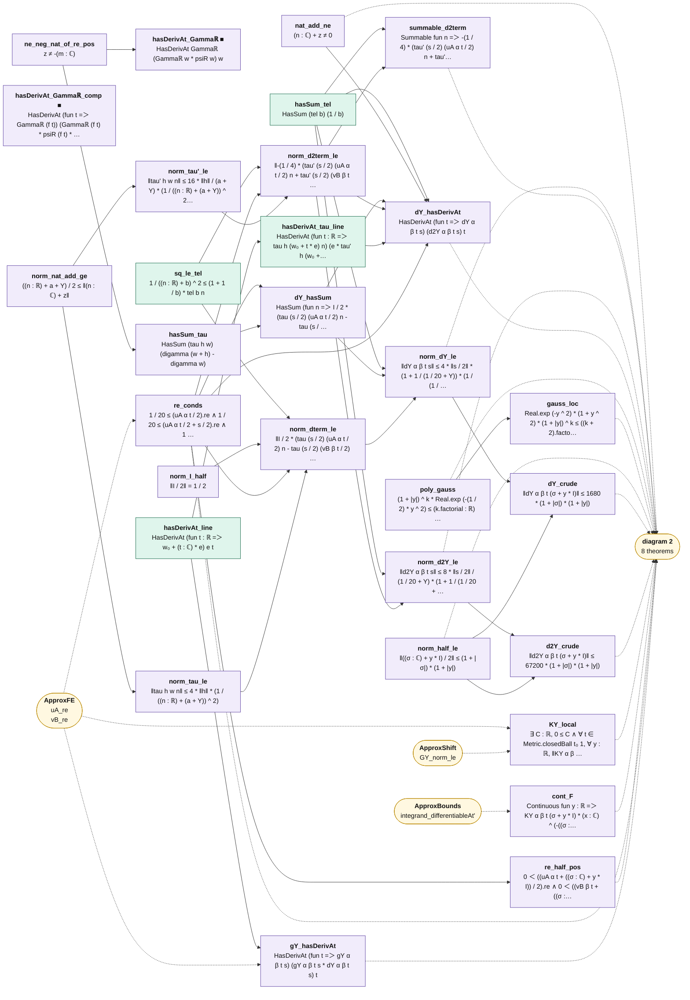
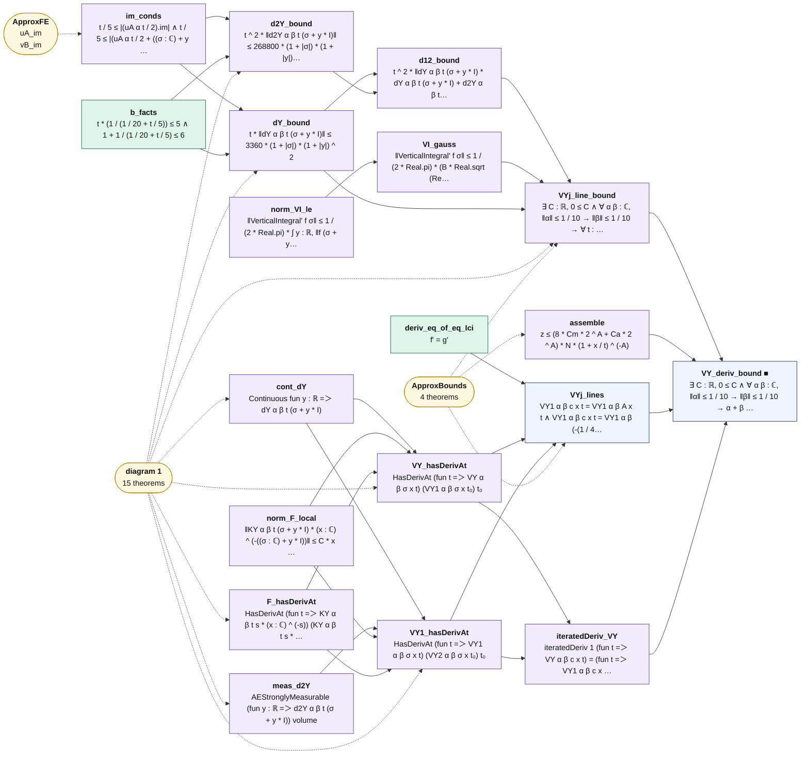

# `lean_stage3/Stage3/ApproxDeriv.lean`

> **Read from the source text.** This file changed after the last `python3 utilities/lean_map.py --dump`, so the arrows on this page are names occurring in each proof and have not been confirmed by Lean.

# ApproxDeriv — block S12 of `lean_stage3/design/stencil.md`, piece 2b-i, the derivatives of V. 2026-11-25.

49 theorems, 8 definitions, 1303 lines. 

**Imports:** [`ApproxBounds`](../lean_stage3/ApproxBounds.md)  
**Imported by:** [`Stage3`](../lean_stage3/Stage3.md)

## The picture

### Diagram 1 of 2: `ne_neg_nat_of_re_pos` to `re_half_pos`



### Diagram 2 of 2: `cont_dY` to `VY_deriv_bound`



An arrow A → B reads "A is used in the proof of B". Green: counting, integers only. Violet: shape, analysis with no ζ. Blue: reads ζ. A name ending in ■ is an end: nothing else uses it. Red: contains `sorry`. Yellow: theorems in another file, counted; a dotted arrow crosses files. Definitions are not drawn; they are listed below the diagram.

## Definitions

<a name="ApproxDeriv-psiR"></a>
### `ApproxDeriv.psiR`

def · line 60

- **Is:** `` psiR (w : ℂ) : ℂ := -(Complex.log Real.pi) / 2 + digamma (w / 2) / 2 ``
- **Used by 3:** [`ApproxDeriv.gY_hasDerivAt`](#ApproxDeriv-gY_hasDerivAt), [`ApproxDeriv.hasDerivAt_Gammaℝ`](#ApproxDeriv-hasDerivAt_Gamma-), [`ApproxDeriv.hasDerivAt_Gammaℝ_comp`](#ApproxDeriv-hasDerivAt_Gamma-_comp)

<a name="ApproxDeriv-dY"></a>
### `ApproxDeriv.dY`

def · line 117

- **Is:** `` dY (α β : ℂ) (t : ℝ) (s : ℂ) : ℂ := I / 2 * ((digamma ((uA α t + s) / 2) - digamma (uA α t / 2)) - (digamma ((vB β t + s) / 2) - digamma (vB β t / 2))) ``
- **Built from:** [`ApproxFE.uA`](../lean_stage3/ApproxFE.md#ApproxFE-uA), [`ApproxFE.vB`](../lean_stage3/ApproxFE.md#ApproxFE-vB)
- **Used by 14:** [`ApproxDeriv.F_hasDerivAt`](#ApproxDeriv-F_hasDerivAt), [`ApproxDeriv.VY1`](#ApproxDeriv-VY1), [`ApproxDeriv.VY1_hasDerivAt`](#ApproxDeriv-VY1_hasDerivAt), [`ApproxDeriv.VY2`](#ApproxDeriv-VY2), [`ApproxDeriv.VY_hasDerivAt`](#ApproxDeriv-VY_hasDerivAt), [`ApproxDeriv.VYj_line_bound`](#ApproxDeriv-VYj_line_bound), [`ApproxDeriv.cont_dY`](#ApproxDeriv-cont_dY), [`ApproxDeriv.d12_bound`](#ApproxDeriv-d12_bound), [`ApproxDeriv.dY_bound`](#ApproxDeriv-dY_bound), [`ApproxDeriv.dY_crude`](#ApproxDeriv-dY_crude), [`ApproxDeriv.dY_hasDerivAt`](#ApproxDeriv-dY_hasDerivAt), [`ApproxDeriv.dY_hasSum`](#ApproxDeriv-dY_hasSum), [`ApproxDeriv.gY_hasDerivAt`](#ApproxDeriv-gY_hasDerivAt), [`ApproxDeriv.norm_dY_le`](#ApproxDeriv-norm_dY_le)

<a name="ApproxDeriv-tau"></a>
### `ApproxDeriv.tau`

def · line 179

- **Is:** `` tau (h w : ℂ) (n : ℕ) : ℂ := ((n : ℂ) + w)⁻¹ - ((n : ℂ) + w + h)⁻¹ noncomputable ``
- **Used by 6:** [`ApproxDeriv.dY_hasDerivAt`](#ApproxDeriv-dY_hasDerivAt), [`ApproxDeriv.dY_hasSum`](#ApproxDeriv-dY_hasSum), [`ApproxDeriv.hasDerivAt_tau_line`](#ApproxDeriv-hasDerivAt_tau_line), [`ApproxDeriv.hasSum_tau`](#ApproxDeriv-hasSum_tau), [`ApproxDeriv.norm_dterm_le`](#ApproxDeriv-norm_dterm_le), [`ApproxDeriv.norm_tau_le`](#ApproxDeriv-norm_tau_le)

<a name="ApproxDeriv-tau-"></a>
### `ApproxDeriv.tau'`

def · line 183

- **Is:** `` tau' (h w : ℂ) (n : ℕ) : ℂ := (((n : ℂ) + w + h) ^ 2)⁻¹ - (((n : ℂ) + w) ^ 2)⁻¹ ``
- **Used by 7:** [`ApproxDeriv.d2Y`](#ApproxDeriv-d2Y), [`ApproxDeriv.dY_hasDerivAt`](#ApproxDeriv-dY_hasDerivAt), [`ApproxDeriv.hasDerivAt_tau_line`](#ApproxDeriv-hasDerivAt_tau_line), [`ApproxDeriv.meas_d2Y`](#ApproxDeriv-meas_d2Y), [`ApproxDeriv.norm_d2term_le`](#ApproxDeriv-norm_d2term_le), [`ApproxDeriv.norm_tau'_le`](#ApproxDeriv-norm_tau-_le), [`ApproxDeriv.summable_d2term`](#ApproxDeriv-summable_d2term)

<a name="ApproxDeriv-tel"></a>
### `ApproxDeriv.tel`

def · line 296

- **Is:** `` tel (b : ℝ) (n : ℕ) : ℝ := 1 / ((n : ℝ) + b) - 1 / (((n + 1 : ℕ) : ℝ) + b) ``
- **Used by 5:** [`ApproxDeriv.dY_hasDerivAt`](#ApproxDeriv-dY_hasDerivAt), [`ApproxDeriv.hasSum_tel`](#ApproxDeriv-hasSum_tel), [`ApproxDeriv.norm_d2term_le`](#ApproxDeriv-norm_d2term_le), [`ApproxDeriv.norm_dterm_le`](#ApproxDeriv-norm_dterm_le), [`ApproxDeriv.sq_le_tel`](#ApproxDeriv-sq_le_tel)

<a name="ApproxDeriv-d2Y"></a>
### `ApproxDeriv.d2Y`

def · line 397

- **Is:** `` d2Y (α β : ℂ) (t : ℝ) (s : ℂ) : ℂ := ∑' n : ℕ, -(1 / 4) * (tau' (s / 2) (uA α t / 2) n + tau' (s / 2) (vB β t / 2) n) ``
- **Built from:** [`ApproxDeriv.tau'`](#ApproxDeriv-tau-), [`ApproxFE.uA`](../lean_stage3/ApproxFE.md#ApproxFE-uA), [`ApproxFE.vB`](../lean_stage3/ApproxFE.md#ApproxFE-vB)
- **Used by 9:** [`ApproxDeriv.VY1_hasDerivAt`](#ApproxDeriv-VY1_hasDerivAt), [`ApproxDeriv.VY2`](#ApproxDeriv-VY2), [`ApproxDeriv.VYj_line_bound`](#ApproxDeriv-VYj_line_bound), [`ApproxDeriv.d12_bound`](#ApproxDeriv-d12_bound), [`ApproxDeriv.d2Y_bound`](#ApproxDeriv-d2Y_bound), [`ApproxDeriv.d2Y_crude`](#ApproxDeriv-d2Y_crude), [`ApproxDeriv.dY_hasDerivAt`](#ApproxDeriv-dY_hasDerivAt), [`ApproxDeriv.meas_d2Y`](#ApproxDeriv-meas_d2Y), [`ApproxDeriv.norm_d2Y_le`](#ApproxDeriv-norm_d2Y_le)

<a name="ApproxDeriv-VY1"></a>
### `ApproxDeriv.VY1`

def · line 706

- **Is:** `` VY1 (α β : ℂ) (c x t : ℝ) : ℂ := VerticalIntegral' (fun s => KY α β t s * (x : ℂ) ^ (-s) * dY α β t s) c noncomputable ``
- **Built from:** [`ApproxDeriv.dY`](#ApproxDeriv-dY), [`ApproxFE.KY`](../lean_stage3/ApproxFE.md#ApproxFE-KY)
- **Used by 5:** [`ApproxDeriv.VY1_hasDerivAt`](#ApproxDeriv-VY1_hasDerivAt), [`ApproxDeriv.VY_hasDerivAt`](#ApproxDeriv-VY_hasDerivAt), [`ApproxDeriv.VYj_line_bound`](#ApproxDeriv-VYj_line_bound), [`ApproxDeriv.VYj_lines`](#ApproxDeriv-VYj_lines), [`ApproxDeriv.iteratedDeriv_VY`](#ApproxDeriv-iteratedDeriv_VY)

<a name="ApproxDeriv-VY2"></a>
### `ApproxDeriv.VY2`

def · line 711

- **Is:** `` VY2 (α β : ℂ) (c x t : ℝ) : ℂ := VerticalIntegral' (fun s => KY α β t s * (x : ℂ) ^ (-s) * (dY α β t s * dY α β t s + d2Y α β t s)) c ``
- **Built from:** [`ApproxDeriv.d2Y`](#ApproxDeriv-d2Y), [`ApproxDeriv.dY`](#ApproxDeriv-dY), [`ApproxFE.KY`](../lean_stage3/ApproxFE.md#ApproxFE-KY)
- **Used by 4:** [`ApproxDeriv.VY1_hasDerivAt`](#ApproxDeriv-VY1_hasDerivAt), [`ApproxDeriv.VYj_line_bound`](#ApproxDeriv-VYj_line_bound), [`ApproxDeriv.VYj_lines`](#ApproxDeriv-VYj_lines), [`ApproxDeriv.iteratedDeriv_VY`](#ApproxDeriv-iteratedDeriv_VY)

## Theorems

<a name="ApproxDeriv-ne_neg_nat_of_re_pos"></a>
### `ApproxDeriv.ne_neg_nat_of_re_pos`

line 62 · arrows read from text

**Shape.** Uses real or complex analysis; nothing in it or beneath it reads ζ.

**Proves**

```lean
z ≠ -(m : ℂ)
```

**Needs** (its hypotheses)

  - `` hz : 0 < z.re ``
  - `` m : ℕ ``

**Fed by:** no theorem of this repo; it stands on Mathlib.

**Feeds** (2 that use it)

  - [`ApproxDeriv.hasDerivAt_Gammaℝ`](#ApproxDeriv-hasDerivAt_Gamma-) — `` HasDerivAt Gammaℝ (Gammaℝ w * psiR w) w ``
  - [`ApproxDeriv.hasSum_tau`](#ApproxDeriv-hasSum_tau) — `` HasSum (tau h w) (digamma (w + h) - digamma w) ``

<a name="ApproxDeriv-hasDerivAt_Gamma-"></a>
### `ApproxDeriv.hasDerivAt_Gammaℝ`

line 69 · arrows read from text

**Shape.** Uses real or complex analysis; nothing in it or beneath it reads ζ.

**Proves**

```lean
HasDerivAt Gammaℝ (Gammaℝ w * psiR w) w
```

**Needs** (its hypotheses)

  - `` hw : 0 < w.re ``

**Fed by** (1 theorem its proof uses)

  - [`ApproxDeriv.ne_neg_nat_of_re_pos`](#ApproxDeriv-ne_neg_nat_of_re_pos) — `` z ≠ -(m : ℂ) ``

**Definitions its proof touches:** [`ApproxDeriv.psiR`](#ApproxDeriv-psiR)

**Feeds:** nothing. It is an end.

<a name="ApproxDeriv-hasDerivAt_line"></a>
### `ApproxDeriv.hasDerivAt_line`

line 101 · arrows read from text

**Counting.** Integers only: nothing in its statement or proof, or in anything it rests on, uses analysis or ζ.

**Why.** A real line in `ℂ`: `t ↦ w₀ + t e` has derivative `e`.

**Proves**

```lean
HasDerivAt (fun t : ℝ => w₀ + (t : ℂ) * e) e t
```

**Needs** (its hypotheses)

  - `` w₀ e : ℂ ``
  - `` t : ℝ ``

**Fed by:** no theorem of this repo; it stands on Mathlib.

**Feeds** (2 that use it)

  - [`ApproxDeriv.gY_hasDerivAt`](#ApproxDeriv-gY_hasDerivAt) — `` HasDerivAt (fun t => gY α β t s) (gY α β t s * dY α β t s) t ``
  - [`ApproxDeriv.hasDerivAt_tau_line`](#ApproxDeriv-hasDerivAt_tau_line) — `` HasDerivAt (fun t : ℝ => tau h (w₀ + t * e) n) (e * tau' h (w₀ + t * e) n) t ``

<a name="ApproxDeriv-hasDerivAt_Gamma-_comp"></a>
### `ApproxDeriv.hasDerivAt_Gammaℝ_comp`

line 107 · arrows read from text

**Shape.** Uses real or complex analysis; nothing in it or beneath it reads ζ.

**Why.** `t ↦ Gammaℝ(f t)` for `f : ℝ → ℂ` with `Re f t > 0`.

**Proves**

```lean
HasDerivAt (fun t => Gammaℝ (f t)) (Gammaℝ (f t) * psiR (f t) * e) t
```

**Needs** (its hypotheses)

  - `` hf : HasDerivAt f e t ``
  - `` hw : 0 < (f t).re ``

**Fed by:** no theorem of this repo; it stands on Mathlib and the definitions below.

**Definitions its proof touches:** [`ApproxDeriv.psiR`](#ApproxDeriv-psiR)

**Feeds:** nothing. It is an end.

<a name="ApproxDeriv-re_conds"></a>
### `ApproxDeriv.re_conds`

line 121 · arrows read from text

**Shape.** Uses real or complex analysis; nothing in it or beneath it reads ζ.

**Proves**

```lean
1 / 20 ≤ (uA α t / 2).re ∧ 1 / 20 ≤ (uA α t / 2 + s / 2).re ∧ 1 / 20 ≤ (vB β t / 2).re ∧ 1 / 20 ≤ (vB β t / 2 + s / 2).re
```

**Needs** (its hypotheses)

  - `` hα : ‖α‖ ≤ 1 / 10 ``
  - `` hβ : ‖β‖ ≤ 1 / 10 ``
  - `` hs : -(1 / 4) ≤ s.re ``
  - `` t : ℝ ``

**Fed by** (2 theorems its proof uses)

  - [`ApproxFE.uA_re`](../lean_stage3/ApproxFE.md#ApproxFE-uA_re) (ApproxFE) — `` (uA α t).re = 1 / 2 + α.re ``
  - [`ApproxFE.vB_re`](../lean_stage3/ApproxFE.md#ApproxFE-vB_re) (ApproxFE) — `` (vB β t).re = 1 / 2 + β.re ``

**Definitions its proof touches:** [`ApproxFE.uA`](../lean_stage3/ApproxFE.md#ApproxFE-uA), [`ApproxFE.vB`](../lean_stage3/ApproxFE.md#ApproxFE-vB)

**Feeds** (6 that use it)

  - [`ApproxDeriv.dY_hasDerivAt`](#ApproxDeriv-dY_hasDerivAt) — `` HasDerivAt (fun t => dY α β t s) (d2Y α β t s) t ``
  - [`ApproxDeriv.dY_hasSum`](#ApproxDeriv-dY_hasSum) — `` HasSum (fun n => I / 2 * (tau (s / 2) (uA α t / 2) n - tau (s / 2) (vB β t / 2) n)) (dY α β t s) ``
  - [`ApproxDeriv.meas_d2Y`](#ApproxDeriv-meas_d2Y) — `` AEStronglyMeasurable (fun y : ℝ => d2Y α β t (σ + y * I)) volume ``
  - [`ApproxDeriv.norm_d2term_le`](#ApproxDeriv-norm_d2term_le) — `` ‖-(1 / 4) * (tau' (s / 2) (uA α t / 2) n + tau' (s / 2) (vB β t / 2) n)‖ ≤ 8 * ‖s / 2‖ / (1 / 20 + Y) * (1 + 1 / (1 / 20 + Y)) * tel (1 / 20 + Y) n ``
  - [`ApproxDeriv.norm_dterm_le`](#ApproxDeriv-norm_dterm_le) — `` ‖I / 2 * (tau (s / 2) (uA α t / 2) n - tau (s / 2) (vB β t / 2) n)‖ ≤ 4 * ‖s / 2‖ * (1 + 1 / (1 / 20 + Y)) * tel (1 / 20 + Y) n ``
  - [`ApproxDeriv.re_half_pos`](#ApproxDeriv-re_half_pos) — `` 0 < ((uA α t + ((σ : ℂ) + y * I)) / 2).re ∧ 0 < ((vB β t + ((σ : ℂ) + y * I)) / 2).re ``

<a name="ApproxDeriv-gY_hasDerivAt"></a>
### `ApproxDeriv.gY_hasDerivAt`

line 131 · arrows read from text

**Shape.** Uses real or complex analysis; nothing in it or beneath it reads ζ.

**Proves**

```lean
HasDerivAt (fun t => gY α β t s) (gY α β t s * dY α β t s) t
```

**Needs** (its hypotheses)

  - `` hα : ‖α‖ ≤ 1 / 10 ``
  - `` hβ : ‖β‖ ≤ 1 / 10 ``
  - `` hs : -(1 / 4) ≤ s.re ``
  - `` t : ℝ ``

**Fed by** (3 theorems its proof uses)

  - [`ApproxDeriv.hasDerivAt_line`](#ApproxDeriv-hasDerivAt_line) — `` HasDerivAt (fun t : ℝ => w₀ + (t : ℂ) * e) e t ``
  - [`ApproxFE.uA_re`](../lean_stage3/ApproxFE.md#ApproxFE-uA_re) (ApproxFE) — `` (uA α t).re = 1 / 2 + α.re ``
  - [`ApproxFE.vB_re`](../lean_stage3/ApproxFE.md#ApproxFE-vB_re) (ApproxFE) — `` (vB β t).re = 1 / 2 + β.re ``

**Definitions its proof touches:** [`ApproxDeriv.dY`](#ApproxDeriv-dY), [`ApproxDeriv.psiR`](#ApproxDeriv-psiR), [`ApproxFE.gY`](../lean_stage3/ApproxFE.md#ApproxFE-gY), [`ApproxFE.uA`](../lean_stage3/ApproxFE.md#ApproxFE-uA), [`ApproxFE.vB`](../lean_stage3/ApproxFE.md#ApproxFE-vB)

**Feeds** (1 that use it)

  - [`ApproxDeriv.F_hasDerivAt`](#ApproxDeriv-F_hasDerivAt) — `` HasDerivAt (fun t => KY α β t s * (x : ℂ) ^ (-s)) (KY α β t s * (x : ℂ) ^ (-s) * dY α β t s) t ``

<a name="ApproxDeriv-hasSum_tau"></a>
### `ApproxDeriv.hasSum_tau`

line 185 · arrows read from text

**Shape.** Uses real or complex analysis; nothing in it or beneath it reads ζ.

**Proves**

```lean
HasSum (tau h w) (digamma (w + h) - digamma w)
```

**Needs** (its hypotheses)

  - `` hw : 0 < w.re ``
  - `` hwh : 0 < (w + h).re ``

**Fed by** (1 theorem its proof uses)

  - [`ApproxDeriv.ne_neg_nat_of_re_pos`](#ApproxDeriv-ne_neg_nat_of_re_pos) — `` z ≠ -(m : ℂ) ``

**Definitions its proof touches:** [`ApproxDeriv.tau`](#ApproxDeriv-tau)

**Feeds** (1 that use it)

  - [`ApproxDeriv.dY_hasSum`](#ApproxDeriv-dY_hasSum) — `` HasSum (fun n => I / 2 * (tau (s / 2) (uA α t / 2) n - tau (s / 2) (vB β t / 2) n)) (dY α β t s) ``

<a name="ApproxDeriv-norm_nat_add_ge"></a>
### `ApproxDeriv.norm_nat_add_ge`

line 201 · arrows read from text

**Shape.** Uses real or complex analysis; nothing in it or beneath it reads ζ.

**Proves**

```lean
((n : ℝ) + a + Y) / 2 ≤ ‖(n : ℂ) + z‖
```

**Needs** (its hypotheses)

  - `` hre : a ≤ z.re ``
  - `` him : Y ≤ |z.im| ``
  - `` n : ℕ ``

**Fed by:** no theorem of this repo; it stands on Mathlib.

**Feeds** (2 that use it)

  - [`ApproxDeriv.norm_tau'_le`](#ApproxDeriv-norm_tau-_le) — `` ‖tau' h w n‖ ≤ 16 * ‖h‖ / (a + Y) * (1 / ((n : ℝ) + (a + Y)) ^ 2) ``
  - [`ApproxDeriv.norm_tau_le`](#ApproxDeriv-norm_tau_le) — `` ‖tau h w n‖ ≤ 4 * ‖h‖ * (1 / ((n : ℝ) + (a + Y)) ^ 2) ``

<a name="ApproxDeriv-norm_tau_le"></a>
### `ApproxDeriv.norm_tau_le`

line 214 · arrows read from text

**Shape.** Uses real or complex analysis; nothing in it or beneath it reads ζ.

**Why.** `‖τₙ‖ ≤ 4‖h‖/(n+a+Y)²` when `Re w, Re(w+h) ≥ a > 0` and `|Im w|, |Im(w+h)| ≥ Y ≥ 0`.

**Proves**

```lean
‖tau h w n‖ ≤ 4 * ‖h‖ * (1 / ((n : ℝ) + (a + Y)) ^ 2)
```

**Needs** (its hypotheses)

  - `` ha : 0 < a ``
  - `` hY : 0 ≤ Y ``
  - `` h1 : a ≤ w.re ``
  - `` h2 : a ≤ (w + h).re ``
  - `` h3 : Y ≤ |w.im| ``
  - `` h4 : Y ≤ |(w + h).im| ``
  - `` n : ℕ ``

**Fed by** (1 theorem its proof uses)

  - [`ApproxDeriv.norm_nat_add_ge`](#ApproxDeriv-norm_nat_add_ge) — `` ((n : ℝ) + a + Y) / 2 ≤ ‖(n : ℂ) + z‖ ``

**Definitions its proof touches:** [`ApproxDeriv.tau`](#ApproxDeriv-tau)

**Feeds** (1 that use it)

  - [`ApproxDeriv.norm_dterm_le`](#ApproxDeriv-norm_dterm_le) — `` ‖I / 2 * (tau (s / 2) (uA α t / 2) n - tau (s / 2) (vB β t / 2) n)‖ ≤ 4 * ‖s / 2‖ * (1 + 1 / (1 / 20 + Y)) * tel (1 / 20 + Y) n ``

<a name="ApproxDeriv-norm_tau-_le"></a>
### `ApproxDeriv.norm_tau'_le`

line 239 · arrows read from text

**Shape.** Uses real or complex analysis; nothing in it or beneath it reads ζ.

**Why.** `‖τ'ₙ‖ ≤ 16‖h‖/(a+Y) · 1/(n+a+Y)²` under the same conditions.

**Proves**

```lean
‖tau' h w n‖ ≤ 16 * ‖h‖ / (a + Y) * (1 / ((n : ℝ) + (a + Y)) ^ 2)
```

**Needs** (its hypotheses)

  - `` ha : 0 < a ``
  - `` hY : 0 ≤ Y ``
  - `` h1 : a ≤ w.re ``
  - `` h2 : a ≤ (w + h).re ``
  - `` h3 : Y ≤ |w.im| ``
  - `` h4 : Y ≤ |(w + h).im| ``
  - `` n : ℕ ``

**Fed by** (1 theorem its proof uses)

  - [`ApproxDeriv.norm_nat_add_ge`](#ApproxDeriv-norm_nat_add_ge) — `` ((n : ℝ) + a + Y) / 2 ≤ ‖(n : ℂ) + z‖ ``

**Definitions its proof touches:** [`ApproxDeriv.tau'`](#ApproxDeriv-tau-)

**Feeds** (1 that use it)

  - [`ApproxDeriv.norm_d2term_le`](#ApproxDeriv-norm_d2term_le) — `` ‖-(1 / 4) * (tau' (s / 2) (uA α t / 2) n + tau' (s / 2) (vB β t / 2) n)‖ ≤ 8 * ‖s / 2‖ / (1 / 20 + Y) * (1 + 1 / (1 / 20 + Y)) * tel (1 / 20 + Y) n ``

<a name="ApproxDeriv-hasSum_tel"></a>
### `ApproxDeriv.hasSum_tel`

line 298 · arrows read from text

**Counting.** Integers only: nothing in its statement or proof, or in anything it rests on, uses analysis or ζ.

**Proves**

```lean
HasSum (tel b) (1 / b)
```

**Needs** (its hypotheses)

  - `` hb : 0 < b ``

**Fed by:** no theorem of this repo; it stands on Mathlib and the definitions below.

**Definitions its proof touches:** [`ApproxDeriv.tel`](#ApproxDeriv-tel)

**Feeds** (4 that use it)

  - [`ApproxDeriv.dY_hasDerivAt`](#ApproxDeriv-dY_hasDerivAt) — `` HasDerivAt (fun t => dY α β t s) (d2Y α β t s) t ``
  - [`ApproxDeriv.norm_d2Y_le`](#ApproxDeriv-norm_d2Y_le) — `` ‖d2Y α β t s‖ ≤ 8 * ‖s / 2‖ / (1 / 20 + Y) * (1 + 1 / (1 / 20 + Y)) * (1 / (1 / 20 + Y)) ``
  - [`ApproxDeriv.norm_dY_le`](#ApproxDeriv-norm_dY_le) — `` ‖dY α β t s‖ ≤ 4 * ‖s / 2‖ * (1 + 1 / (1 / 20 + Y)) * (1 / (1 / 20 + Y)) ``
  - [`ApproxDeriv.summable_d2term`](#ApproxDeriv-summable_d2term) — `` Summable fun n => -(1 / 4) * (tau' (s / 2) (uA α t / 2) n + tau' (s / 2) (vB β t / 2) n) ``

<a name="ApproxDeriv-sq_le_tel"></a>
### `ApproxDeriv.sq_le_tel`

line 317 · arrows read from text

**Counting.** Integers only: nothing in its statement or proof, or in anything it rests on, uses analysis or ζ.

**Proves**

```lean
1 / ((n : ℝ) + b) ^ 2 ≤ (1 + 1 / b) * tel b n
```

**Needs** (its hypotheses)

  - `` hb : 0 < b ``
  - `` n : ℕ ``

**Fed by:** no theorem of this repo; it stands on Mathlib and the definitions below.

**Definitions its proof touches:** [`ApproxDeriv.tel`](#ApproxDeriv-tel)

**Feeds** (2 that use it)

  - [`ApproxDeriv.norm_d2term_le`](#ApproxDeriv-norm_d2term_le) — `` ‖-(1 / 4) * (tau' (s / 2) (uA α t / 2) n + tau' (s / 2) (vB β t / 2) n)‖ ≤ 8 * ‖s / 2‖ / (1 / 20 + Y) * (1 + 1 / (1 / 20 + Y)) * tel (1 / 20 + Y) n ``
  - [`ApproxDeriv.norm_dterm_le`](#ApproxDeriv-norm_dterm_le) — `` ‖I / 2 * (tau (s / 2) (uA α t / 2) n - tau (s / 2) (vB β t / 2) n)‖ ≤ 4 * ‖s / 2‖ * (1 + 1 / (1 / 20 + Y)) * tel (1 / 20 + Y) n ``

<a name="ApproxDeriv-nat_add_ne"></a>
### `ApproxDeriv.nat_add_ne`

line 335 · arrows read from text

**Shape.** Uses real or complex analysis; nothing in it or beneath it reads ζ.

**Proves**

```lean
(n : ℂ) + z ≠ 0
```

**Needs** (its hypotheses)

  - `` hz : 0 < z.re ``
  - `` n : ℕ ``

**Fed by:** no theorem of this repo; it stands on Mathlib.

**Feeds** (2 that use it)

  - [`ApproxDeriv.dY_hasDerivAt`](#ApproxDeriv-dY_hasDerivAt) — `` HasDerivAt (fun t => dY α β t s) (d2Y α β t s) t ``
  - [`ApproxDeriv.meas_d2Y`](#ApproxDeriv-meas_d2Y) — `` AEStronglyMeasurable (fun y : ℝ => d2Y α β t (σ + y * I)) volume ``

<a name="ApproxDeriv-dY_hasSum"></a>
### `ApproxDeriv.dY_hasSum`

line 342 · arrows read from text

**Shape.** Uses real or complex analysis; nothing in it or beneath it reads ζ.

**Proves**

```lean
HasSum (fun n => I / 2 * (tau (s / 2) (uA α t / 2) n - tau (s / 2) (vB β t / 2) n)) (dY α β t s)
```

**Needs** (its hypotheses)

  - `` hα : ‖α‖ ≤ 1 / 10 ``
  - `` hβ : ‖β‖ ≤ 1 / 10 ``
  - `` hs : -(1 / 4) ≤ s.re ``
  - `` t : ℝ ``

**Fed by** (2 theorems its proof uses)

  - [`ApproxDeriv.hasSum_tau`](#ApproxDeriv-hasSum_tau) — `` HasSum (tau h w) (digamma (w + h) - digamma w) ``
  - [`ApproxDeriv.re_conds`](#ApproxDeriv-re_conds) — `` 1 / 20 ≤ (uA α t / 2).re ∧ 1 / 20 ≤ (uA α t / 2 + s / 2).re ∧ 1 / 20 ≤ (vB β t / 2).re ∧ 1 / 20 ≤ (vB β t / 2 + s / 2).re ``

**Definitions its proof touches:** [`ApproxDeriv.dY`](#ApproxDeriv-dY), [`ApproxDeriv.tau`](#ApproxDeriv-tau), [`ApproxFE.uA`](../lean_stage3/ApproxFE.md#ApproxFE-uA), [`ApproxFE.vB`](../lean_stage3/ApproxFE.md#ApproxFE-vB)

**Feeds** (2 that use it)

  - [`ApproxDeriv.dY_hasDerivAt`](#ApproxDeriv-dY_hasDerivAt) — `` HasDerivAt (fun t => dY α β t s) (d2Y α β t s) t ``
  - [`ApproxDeriv.norm_dY_le`](#ApproxDeriv-norm_dY_le) — `` ‖dY α β t s‖ ≤ 4 * ‖s / 2‖ * (1 + 1 / (1 / 20 + Y)) * (1 / (1 / 20 + Y)) ``

<a name="ApproxDeriv-norm_I_half"></a>
### `ApproxDeriv.norm_I_half`

line 355 · arrows read from text

**Shape.** Uses real or complex analysis; nothing in it or beneath it reads ζ.

**Proves**

```lean
‖I / 2‖ = 1 / 2
```

**Fed by:** no theorem of this repo; it stands on Mathlib.

**Feeds** (1 that use it)

  - [`ApproxDeriv.norm_dterm_le`](#ApproxDeriv-norm_dterm_le) — `` ‖I / 2 * (tau (s / 2) (uA α t / 2) n - tau (s / 2) (vB β t / 2) n)‖ ≤ 4 * ‖s / 2‖ * (1 + 1 / (1 / 20 + Y)) * tel (1 / 20 + Y) n ``

<a name="ApproxDeriv-norm_dterm_le"></a>
### `ApproxDeriv.norm_dterm_le`

line 360 · arrows read from text

**Shape.** Uses real or complex analysis; nothing in it or beneath it reads ζ.

**Why.** The term bound for `dY`.

**Proves**

```lean
‖I / 2 * (tau (s / 2) (uA α t / 2) n - tau (s / 2) (vB β t / 2) n)‖ ≤ 4 * ‖s / 2‖ * (1 + 1 / (1 / 20 + Y)) * tel (1 / 20 + Y) n
```

**Needs** (its hypotheses)

  - `` hα : ‖α‖ ≤ 1 / 10 ``
  - `` hβ : ‖β‖ ≤ 1 / 10 ``
  - `` hs : -(1 / 4) ≤ s.re ``
  - `` hY : 0 ≤ Y ``
  - `` i1 : Y ≤ |(uA α t / 2).im| ``
  - `` i2 : Y ≤ |(uA α t / 2 + s / 2).im| ``
  - `` i3 : Y ≤ |(vB β t / 2).im| ``
  - `` i4 : Y ≤ |(vB β t / 2 + s / 2).im| ``
  - `` n : ℕ ``

**Fed by** (4 theorems its proof uses)

  - [`ApproxDeriv.norm_I_half`](#ApproxDeriv-norm_I_half) — `` ‖I / 2‖ = 1 / 2 ``
  - [`ApproxDeriv.norm_tau_le`](#ApproxDeriv-norm_tau_le) — `` ‖tau h w n‖ ≤ 4 * ‖h‖ * (1 / ((n : ℝ) + (a + Y)) ^ 2) ``
  - [`ApproxDeriv.re_conds`](#ApproxDeriv-re_conds) — `` 1 / 20 ≤ (uA α t / 2).re ∧ 1 / 20 ≤ (uA α t / 2 + s / 2).re ∧ 1 / 20 ≤ (vB β t / 2).re ∧ 1 / 20 ≤ (vB β t / 2 + s / 2).re ``
  - [`ApproxDeriv.sq_le_tel`](#ApproxDeriv-sq_le_tel) — `` 1 / ((n : ℝ) + b) ^ 2 ≤ (1 + 1 / b) * tel b n ``

**Definitions its proof touches:** [`ApproxDeriv.tau`](#ApproxDeriv-tau), [`ApproxDeriv.tel`](#ApproxDeriv-tel), [`ApproxFE.uA`](../lean_stage3/ApproxFE.md#ApproxFE-uA), [`ApproxFE.vB`](../lean_stage3/ApproxFE.md#ApproxFE-vB)

**Feeds** (1 that use it)

  - [`ApproxDeriv.norm_dY_le`](#ApproxDeriv-norm_dY_le) — `` ‖dY α β t s‖ ≤ 4 * ‖s / 2‖ * (1 + 1 / (1 / 20 + Y)) * (1 / (1 / 20 + Y)) ``

<a name="ApproxDeriv-norm_dY_le"></a>
### `ApproxDeriv.norm_dY_le`

line 385 · arrows read from text

**Shape.** Uses real or complex analysis; nothing in it or beneath it reads ζ.

**Why.** `‖dY‖ ≤ 4‖s/2‖ (1 + 1/b)/b`, `b = 1/20 + Y`, `Y` a lower bound for the four imaginary parts.

**Proves**

```lean
‖dY α β t s‖ ≤ 4 * ‖s / 2‖ * (1 + 1 / (1 / 20 + Y)) * (1 / (1 / 20 + Y))
```

**Needs** (its hypotheses)

  - `` hα : ‖α‖ ≤ 1 / 10 ``
  - `` hβ : ‖β‖ ≤ 1 / 10 ``
  - `` hs : -(1 / 4) ≤ s.re ``
  - `` hY : 0 ≤ Y ``
  - `` i1 : Y ≤ |(uA α t / 2).im| ``
  - `` i2 : Y ≤ |(uA α t / 2 + s / 2).im| ``
  - `` i3 : Y ≤ |(vB β t / 2).im| ``
  - `` i4 : Y ≤ |(vB β t / 2 + s / 2).im| ``

**Fed by** (3 theorems its proof uses)

  - [`ApproxDeriv.dY_hasSum`](#ApproxDeriv-dY_hasSum) — `` HasSum (fun n => I / 2 * (tau (s / 2) (uA α t / 2) n - tau (s / 2) (vB β t / 2) n)) (dY α β t s) ``
  - [`ApproxDeriv.hasSum_tel`](#ApproxDeriv-hasSum_tel) — `` HasSum (tel b) (1 / b) ``
  - [`ApproxDeriv.norm_dterm_le`](#ApproxDeriv-norm_dterm_le) — `` ‖I / 2 * (tau (s / 2) (uA α t / 2) n - tau (s / 2) (vB β t / 2) n)‖ ≤ 4 * ‖s / 2‖ * (1 + 1 / (1 / 20 + Y)) * tel (1 / 20 + Y) n ``

**Definitions its proof touches:** [`ApproxDeriv.dY`](#ApproxDeriv-dY), [`ApproxFE.uA`](../lean_stage3/ApproxFE.md#ApproxFE-uA), [`ApproxFE.vB`](../lean_stage3/ApproxFE.md#ApproxFE-vB)

**Feeds** (2 that use it)

  - [`ApproxDeriv.dY_bound`](#ApproxDeriv-dY_bound) — `` t * ‖dY α β t (σ + y * I)‖ ≤ 3360 * (1 + |σ|) * (1 + |y|) ^ 2 ``
  - [`ApproxDeriv.dY_crude`](#ApproxDeriv-dY_crude) — `` ‖dY α β t (σ + y * I)‖ ≤ 1680 * (1 + |σ|) * (1 + |y|) ``

<a name="ApproxDeriv-norm_d2term_le"></a>
### `ApproxDeriv.norm_d2term_le`

line 400 · arrows read from text

**Shape.** Uses real or complex analysis; nothing in it or beneath it reads ζ.

**Proves**

```lean
‖-(1 / 4) * (tau' (s / 2) (uA α t / 2) n + tau' (s / 2) (vB β t / 2) n)‖ ≤ 8 * ‖s / 2‖ / (1 / 20 + Y) * (1 + 1 / (1 / 20 + Y)) * tel (1 / 20 + Y) n
```

**Needs** (its hypotheses)

  - `` hα : ‖α‖ ≤ 1 / 10 ``
  - `` hβ : ‖β‖ ≤ 1 / 10 ``
  - `` hs : -(1 / 4) ≤ s.re ``
  - `` hY : 0 ≤ Y ``
  - `` i1 : Y ≤ |(uA α t / 2).im| ``
  - `` i2 : Y ≤ |(uA α t / 2 + s / 2).im| ``
  - `` i3 : Y ≤ |(vB β t / 2).im| ``
  - `` i4 : Y ≤ |(vB β t / 2 + s / 2).im| ``
  - `` n : ℕ ``

**Fed by** (3 theorems its proof uses)

  - [`ApproxDeriv.norm_tau'_le`](#ApproxDeriv-norm_tau-_le) — `` ‖tau' h w n‖ ≤ 16 * ‖h‖ / (a + Y) * (1 / ((n : ℝ) + (a + Y)) ^ 2) ``
  - [`ApproxDeriv.re_conds`](#ApproxDeriv-re_conds) — `` 1 / 20 ≤ (uA α t / 2).re ∧ 1 / 20 ≤ (uA α t / 2 + s / 2).re ∧ 1 / 20 ≤ (vB β t / 2).re ∧ 1 / 20 ≤ (vB β t / 2 + s / 2).re ``
  - [`ApproxDeriv.sq_le_tel`](#ApproxDeriv-sq_le_tel) — `` 1 / ((n : ℝ) + b) ^ 2 ≤ (1 + 1 / b) * tel b n ``

**Definitions its proof touches:** [`ApproxDeriv.tau'`](#ApproxDeriv-tau-), [`ApproxDeriv.tel`](#ApproxDeriv-tel), [`ApproxFE.uA`](../lean_stage3/ApproxFE.md#ApproxFE-uA), [`ApproxFE.vB`](../lean_stage3/ApproxFE.md#ApproxFE-vB)

**Feeds** (3 that use it)

  - [`ApproxDeriv.dY_hasDerivAt`](#ApproxDeriv-dY_hasDerivAt) — `` HasDerivAt (fun t => dY α β t s) (d2Y α β t s) t ``
  - [`ApproxDeriv.norm_d2Y_le`](#ApproxDeriv-norm_d2Y_le) — `` ‖d2Y α β t s‖ ≤ 8 * ‖s / 2‖ / (1 / 20 + Y) * (1 + 1 / (1 / 20 + Y)) * (1 / (1 / 20 + Y)) ``
  - [`ApproxDeriv.summable_d2term`](#ApproxDeriv-summable_d2term) — `` Summable fun n => -(1 / 4) * (tau' (s / 2) (uA α t / 2) n + tau' (s / 2) (vB β t / 2) n) ``

<a name="ApproxDeriv-summable_d2term"></a>
### `ApproxDeriv.summable_d2term`

line 427 · arrows read from text

**Shape.** Uses real or complex analysis; nothing in it or beneath it reads ζ.

**Proves**

```lean
Summable fun n => -(1 / 4) * (tau' (s / 2) (uA α t / 2) n + tau' (s / 2) (vB β t / 2) n)
```

**Needs** (its hypotheses)

  - `` hα : ‖α‖ ≤ 1 / 10 ``
  - `` hβ : ‖β‖ ≤ 1 / 10 ``
  - `` hs : -(1 / 4) ≤ s.re ``
  - `` t : ℝ ``

**Fed by** (2 theorems its proof uses)

  - [`ApproxDeriv.hasSum_tel`](#ApproxDeriv-hasSum_tel) — `` HasSum (tel b) (1 / b) ``
  - [`ApproxDeriv.norm_d2term_le`](#ApproxDeriv-norm_d2term_le) — `` ‖-(1 / 4) * (tau' (s / 2) (uA α t / 2) n + tau' (s / 2) (vB β t / 2) n)‖ ≤ 8 * ‖s / 2‖ / (1 / 20 + Y) * (1 + 1 / (1 / 20 + Y)) * tel (1 / 20 + Y) n ``

**Definitions its proof touches:** [`ApproxDeriv.tau'`](#ApproxDeriv-tau-), [`ApproxFE.uA`](../lean_stage3/ApproxFE.md#ApproxFE-uA), [`ApproxFE.vB`](../lean_stage3/ApproxFE.md#ApproxFE-vB)

**Feeds** (1 that use it)

  - [`ApproxDeriv.meas_d2Y`](#ApproxDeriv-meas_d2Y) — `` AEStronglyMeasurable (fun y : ℝ => d2Y α β t (σ + y * I)) volume ``

<a name="ApproxDeriv-norm_d2Y_le"></a>
### `ApproxDeriv.norm_d2Y_le`

line 435 · arrows read from text

**Shape.** Uses real or complex analysis; nothing in it or beneath it reads ζ.

**Why.** `‖d2Y‖ ≤ 8‖s/2‖/b · (1 + 1/b)/b`.

**Proves**

```lean
‖d2Y α β t s‖ ≤ 8 * ‖s / 2‖ / (1 / 20 + Y) * (1 + 1 / (1 / 20 + Y)) * (1 / (1 / 20 + Y))
```

**Needs** (its hypotheses)

  - `` hα : ‖α‖ ≤ 1 / 10 ``
  - `` hβ : ‖β‖ ≤ 1 / 10 ``
  - `` hs : -(1 / 4) ≤ s.re ``
  - `` hY : 0 ≤ Y ``
  - `` i1 : Y ≤ |(uA α t / 2).im| ``
  - `` i2 : Y ≤ |(uA α t / 2 + s / 2).im| ``
  - `` i3 : Y ≤ |(vB β t / 2).im| ``
  - `` i4 : Y ≤ |(vB β t / 2 + s / 2).im| ``

**Fed by** (2 theorems its proof uses)

  - [`ApproxDeriv.hasSum_tel`](#ApproxDeriv-hasSum_tel) — `` HasSum (tel b) (1 / b) ``
  - [`ApproxDeriv.norm_d2term_le`](#ApproxDeriv-norm_d2term_le) — `` ‖-(1 / 4) * (tau' (s / 2) (uA α t / 2) n + tau' (s / 2) (vB β t / 2) n)‖ ≤ 8 * ‖s / 2‖ / (1 / 20 + Y) * (1 + 1 / (1 / 20 + Y)) * tel (1 / 20 + Y) n ``

**Definitions its proof touches:** [`ApproxDeriv.d2Y`](#ApproxDeriv-d2Y), [`ApproxFE.uA`](../lean_stage3/ApproxFE.md#ApproxFE-uA), [`ApproxFE.vB`](../lean_stage3/ApproxFE.md#ApproxFE-vB)

**Feeds** (2 that use it)

  - [`ApproxDeriv.d2Y_bound`](#ApproxDeriv-d2Y_bound) — `` t ^ 2 * ‖d2Y α β t (σ + y * I)‖ ≤ 268800 * (1 + |σ|) * (1 + |y|) ^ 3 ``
  - [`ApproxDeriv.d2Y_crude`](#ApproxDeriv-d2Y_crude) — `` ‖d2Y α β t (σ + y * I)‖ ≤ 67200 * (1 + |σ|) * (1 + |y|) ``

<a name="ApproxDeriv-hasDerivAt_tau_line"></a>
### `ApproxDeriv.hasDerivAt_tau_line`

line 445 · arrows read from text

**Counting.** Integers only: nothing in its statement or proof, or in anything it rests on, uses analysis or ζ.

**Proves**

```lean
HasDerivAt (fun t : ℝ => tau h (w₀ + t * e) n) (e * tau' h (w₀ + t * e) n) t
```

**Needs** (its hypotheses)

  - `` h w₀ e : ℂ ``
  - `` n : ℕ ``
  - `` t : ℝ ``
  - `` hp : (n : ℂ) + (w₀ + t * e) ≠ 0 ``
  - `` hq : (n : ℂ) + (w₀ + t * e) + h ≠ 0 ``

**Fed by** (1 theorem its proof uses)

  - [`ApproxDeriv.hasDerivAt_line`](#ApproxDeriv-hasDerivAt_line) — `` HasDerivAt (fun t : ℝ => w₀ + (t : ℂ) * e) e t ``

**Definitions its proof touches:** [`ApproxDeriv.tau`](#ApproxDeriv-tau), [`ApproxDeriv.tau'`](#ApproxDeriv-tau-)

**Feeds** (1 that use it)

  - [`ApproxDeriv.dY_hasDerivAt`](#ApproxDeriv-dY_hasDerivAt) — `` HasDerivAt (fun t => dY α β t s) (d2Y α β t s) t ``

<a name="ApproxDeriv-dY_hasDerivAt"></a>
### `ApproxDeriv.dY_hasDerivAt`

line 459 · arrows read from text

**Shape.** Uses real or complex analysis; nothing in it or beneath it reads ζ.

**Why.** `∂_t dY = d2Y`, for every real `t`.

**Proves**

```lean
HasDerivAt (fun t => dY α β t s) (d2Y α β t s) t
```

**Needs** (its hypotheses)

  - `` hα : ‖α‖ ≤ 1 / 10 ``
  - `` hβ : ‖β‖ ≤ 1 / 10 ``
  - `` hs : -(1 / 4) ≤ s.re ``
  - `` t : ℝ ``

**Fed by** (6 theorems its proof uses)

  - [`ApproxDeriv.dY_hasSum`](#ApproxDeriv-dY_hasSum) — `` HasSum (fun n => I / 2 * (tau (s / 2) (uA α t / 2) n - tau (s / 2) (vB β t / 2) n)) (dY α β t s) ``
  - [`ApproxDeriv.hasDerivAt_tau_line`](#ApproxDeriv-hasDerivAt_tau_line) — `` HasDerivAt (fun t : ℝ => tau h (w₀ + t * e) n) (e * tau' h (w₀ + t * e) n) t ``
  - [`ApproxDeriv.hasSum_tel`](#ApproxDeriv-hasSum_tel) — `` HasSum (tel b) (1 / b) ``
  - [`ApproxDeriv.nat_add_ne`](#ApproxDeriv-nat_add_ne) — `` (n : ℂ) + z ≠ 0 ``
  - [`ApproxDeriv.norm_d2term_le`](#ApproxDeriv-norm_d2term_le) — `` ‖-(1 / 4) * (tau' (s / 2) (uA α t / 2) n + tau' (s / 2) (vB β t / 2) n)‖ ≤ 8 * ‖s / 2‖ / (1 / 20 + Y) * (1 + 1 / (1 / 20 + Y)) * tel (1 / 20 + Y) n ``
  - [`ApproxDeriv.re_conds`](#ApproxDeriv-re_conds) — `` 1 / 20 ≤ (uA α t / 2).re ∧ 1 / 20 ≤ (uA α t / 2 + s / 2).re ∧ 1 / 20 ≤ (vB β t / 2).re ∧ 1 / 20 ≤ (vB β t / 2 + s / 2).re ``

**Definitions its proof touches:** [`ApproxDeriv.d2Y`](#ApproxDeriv-d2Y), [`ApproxDeriv.dY`](#ApproxDeriv-dY), [`ApproxDeriv.tau`](#ApproxDeriv-tau), [`ApproxDeriv.tau'`](#ApproxDeriv-tau-), [`ApproxDeriv.tel`](#ApproxDeriv-tel), [`ApproxFE.uA`](../lean_stage3/ApproxFE.md#ApproxFE-uA), [`ApproxFE.vB`](../lean_stage3/ApproxFE.md#ApproxFE-vB)

**Feeds** (1 that use it)

  - [`ApproxDeriv.VY1_hasDerivAt`](#ApproxDeriv-VY1_hasDerivAt) — `` HasDerivAt (fun t => VY1 α β σ x t) (VY2 α β σ x t₀) t₀ ``

<a name="ApproxDeriv-poly_gauss"></a>
### `ApproxDeriv.poly_gauss`

line 513 · arrows read from text

**Shape.** Uses real or complex analysis; nothing in it or beneath it reads ζ.

**Why.** `(1+|y|)^k e^(−y²/2) ≤ k! e² e^(−y²/4)`.

**Proves**

```lean
(1 + |y|) ^ k * Real.exp (-(1 / 2) * y ^ 2) ≤ (k.factorial : ℝ) * Real.exp 2 * Real.exp (-(1 / 4) * y ^ 2)
```

**Needs** (its hypotheses)

  - `` k : ℕ ``
  - `` y : ℝ ``

**Fed by:** no theorem of this repo; it stands on Mathlib.

**Feeds** (2 that use it)

  - [`ApproxDeriv.VYj_line_bound`](#ApproxDeriv-VYj_line_bound) — `` ∃ C : ℝ, 0 ≤ C ∧ ∀ α β : ℂ, ‖α‖ ≤ 1 / 10 → ‖β‖ ≤ 1 / 10 → ∀ t : ℝ, 1 ≤ t → ∀ x : ℝ, 0 < x → ‖(t : ℂ) ^ 1 * VY1 α β σ x t‖ ≤ C * (1 + 1 / ‖α + β‖ ^ 2) … ``
  - [`ApproxDeriv.gauss_loc`](#ApproxDeriv-gauss_loc) — `` Real.exp (-y ^ 2) * (1 + y ^ 2) * (1 + |y|) ^ k ≤ ((k + 2).factorial : ℝ) * Real.exp 2 * Real.exp (-(1 / 4) * y ^ 2) ``

<a name="ApproxDeriv-gauss_loc"></a>
### `ApproxDeriv.gauss_loc`

line 532 · arrows read from text

**Shape.** Uses real or complex analysis; nothing in it or beneath it reads ζ.

**Why.** `e^(−y²)(1+y²)(1+|y|)^k ≤ (k+2)! e² e^(−y²/4)`.

**Proves**

```lean
Real.exp (-y ^ 2) * (1 + y ^ 2) * (1 + |y|) ^ k ≤ ((k + 2).factorial : ℝ) * Real.exp 2 * Real.exp (-(1 / 4) * y ^ 2)
```

**Needs** (its hypotheses)

  - `` k : ℕ ``
  - `` y : ℝ ``

**Fed by** (1 theorem its proof uses)

  - [`ApproxDeriv.poly_gauss`](#ApproxDeriv-poly_gauss) — `` (1 + |y|) ^ k * Real.exp (-(1 / 2) * y ^ 2) ≤ (k.factorial : ℝ) * Real.exp 2 * Real.exp (-(1 / 4) * y ^ 2) ``

**Feeds** (2 that use it)

  - [`ApproxDeriv.VY1_hasDerivAt`](#ApproxDeriv-VY1_hasDerivAt) — `` HasDerivAt (fun t => VY1 α β σ x t) (VY2 α β σ x t₀) t₀ ``
  - [`ApproxDeriv.VY_hasDerivAt`](#ApproxDeriv-VY_hasDerivAt) — `` HasDerivAt (fun t => VY α β σ x t) (VY1 α β σ x t₀) t₀ ``

<a name="ApproxDeriv-norm_half_le"></a>
### `ApproxDeriv.norm_half_le`

line 544 · arrows read from text

**Shape.** Uses real or complex analysis; nothing in it or beneath it reads ζ.

**Why.** `‖(σ + iy)/2‖ ≤ (1+|σ|)(1+|y|)`.

**Proves**

```lean
‖((σ : ℂ) + y * I) / 2‖ ≤ (1 + |σ|) * (1 + |y|)
```

**Needs** (its hypotheses)

  - `` σ y : ℝ ``

**Fed by:** no theorem of this repo; it stands on Mathlib.

**Feeds** (4 that use it)

  - [`ApproxDeriv.d2Y_bound`](#ApproxDeriv-d2Y_bound) — `` t ^ 2 * ‖d2Y α β t (σ + y * I)‖ ≤ 268800 * (1 + |σ|) * (1 + |y|) ^ 3 ``
  - [`ApproxDeriv.d2Y_crude`](#ApproxDeriv-d2Y_crude) — `` ‖d2Y α β t (σ + y * I)‖ ≤ 67200 * (1 + |σ|) * (1 + |y|) ``
  - [`ApproxDeriv.dY_bound`](#ApproxDeriv-dY_bound) — `` t * ‖dY α β t (σ + y * I)‖ ≤ 3360 * (1 + |σ|) * (1 + |y|) ^ 2 ``
  - [`ApproxDeriv.dY_crude`](#ApproxDeriv-dY_crude) — `` ‖dY α β t (σ + y * I)‖ ≤ 1680 * (1 + |σ|) * (1 + |y|) ``

<a name="ApproxDeriv-dY_crude"></a>
### `ApproxDeriv.dY_crude`

line 553 · arrows read from text

**Shape.** Uses real or complex analysis; nothing in it or beneath it reads ζ.

**Why.** Crude bounds valid for every real `t`: `‖dY‖ ≤ 1680(1+|σ|)(1+|y|)`.

**Proves**

```lean
‖dY α β t (σ + y * I)‖ ≤ 1680 * (1 + |σ|) * (1 + |y|)
```

**Needs** (its hypotheses)

  - `` hα : ‖α‖ ≤ 1 / 10 ``
  - `` hβ : ‖β‖ ≤ 1 / 10 ``
  - `` hσ0 : -(1 / 4) ≤ σ ``
  - `` t y : ℝ ``

**Fed by** (2 theorems its proof uses)

  - [`ApproxDeriv.norm_dY_le`](#ApproxDeriv-norm_dY_le) — `` ‖dY α β t s‖ ≤ 4 * ‖s / 2‖ * (1 + 1 / (1 / 20 + Y)) * (1 / (1 / 20 + Y)) ``
  - [`ApproxDeriv.norm_half_le`](#ApproxDeriv-norm_half_le) — `` ‖((σ : ℂ) + y * I) / 2‖ ≤ (1 + |σ|) * (1 + |y|) ``

**Definitions its proof touches:** [`ApproxDeriv.dY`](#ApproxDeriv-dY)

**Feeds** (3 that use it)

  - [`ApproxDeriv.VY1_hasDerivAt`](#ApproxDeriv-VY1_hasDerivAt) — `` HasDerivAt (fun t => VY1 α β σ x t) (VY2 α β σ x t₀) t₀ ``
  - [`ApproxDeriv.VY_hasDerivAt`](#ApproxDeriv-VY_hasDerivAt) — `` HasDerivAt (fun t => VY α β σ x t) (VY1 α β σ x t₀) t₀ ``
  - [`ApproxDeriv.dY_bound`](#ApproxDeriv-dY_bound) — `` t * ‖dY α β t (σ + y * I)‖ ≤ 3360 * (1 + |σ|) * (1 + |y|) ^ 2 ``

<a name="ApproxDeriv-d2Y_crude"></a>
### `ApproxDeriv.d2Y_crude`

line 563 · arrows read from text

**Shape.** Uses real or complex analysis; nothing in it or beneath it reads ζ.

**Why.** `‖d2Y‖ ≤ 67200(1+|σ|)(1+|y|)` for every real `t`.

**Proves**

```lean
‖d2Y α β t (σ + y * I)‖ ≤ 67200 * (1 + |σ|) * (1 + |y|)
```

**Needs** (its hypotheses)

  - `` hα : ‖α‖ ≤ 1 / 10 ``
  - `` hβ : ‖β‖ ≤ 1 / 10 ``
  - `` hσ0 : -(1 / 4) ≤ σ ``
  - `` t y : ℝ ``

**Fed by** (2 theorems its proof uses)

  - [`ApproxDeriv.norm_d2Y_le`](#ApproxDeriv-norm_d2Y_le) — `` ‖d2Y α β t s‖ ≤ 8 * ‖s / 2‖ / (1 / 20 + Y) * (1 + 1 / (1 / 20 + Y)) * (1 / (1 / 20 + Y)) ``
  - [`ApproxDeriv.norm_half_le`](#ApproxDeriv-norm_half_le) — `` ‖((σ : ℂ) + y * I) / 2‖ ≤ (1 + |σ|) * (1 + |y|) ``

**Definitions its proof touches:** [`ApproxDeriv.d2Y`](#ApproxDeriv-d2Y)

**Feeds** (2 that use it)

  - [`ApproxDeriv.VY1_hasDerivAt`](#ApproxDeriv-VY1_hasDerivAt) — `` HasDerivAt (fun t => VY1 α β σ x t) (VY2 α β σ x t₀) t₀ ``
  - [`ApproxDeriv.d2Y_bound`](#ApproxDeriv-d2Y_bound) — `` t ^ 2 * ‖d2Y α β t (σ + y * I)‖ ≤ 268800 * (1 + |σ|) * (1 + |y|) ^ 3 ``

<a name="ApproxDeriv-KY_local"></a>
### `ApproxDeriv.KY_local`

line 576 · arrows read from text

**Shape.** Uses real or complex analysis; nothing in it or beneath it reads ζ.

**Why.** Near any `t₀`, the kernel is bounded by `C e^(−y²)(1+y²)` on the line `σ`, uniformly in `t ∈ [t₀−1, t₀+1]`: the numerator by `norm_Gammaℝ_le`, `1/(Gammaℝ(u)Gammaℝ(v))` by compactness.

**Proves**

```lean
∃ C : ℝ, 0 ≤ C ∧ ∀ t ∈ Metric.closedBall t₀ 1, ∀ y : ℝ, ‖KY α β t (σ + y * I)‖ ≤ C * (Real.exp (-y ^ 2) * (1 + y ^ 2))
```

**Needs** (its hypotheses)

  - `` hα : ‖α‖ ≤ 1 / 10 ``
  - `` hβ : ‖β‖ ≤ 1 / 10 ``
  - `` hσ0 : -(1 / 4) ≤ σ ``
  - `` hσ : σ ≠ 0 ``
  - `` t₀ : ℝ ``

**Fed by** (3 theorems its proof uses)

  - [`ApproxFE.uA_re`](../lean_stage3/ApproxFE.md#ApproxFE-uA_re) (ApproxFE) — `` (uA α t).re = 1 / 2 + α.re ``
  - [`ApproxFE.vB_re`](../lean_stage3/ApproxFE.md#ApproxFE-vB_re) (ApproxFE) — `` (vB β t).re = 1 / 2 + β.re ``
  - [`ApproxShift.GY_norm_le`](../lean_stage3/ApproxShift.md#ApproxShift-GY_norm_le) (ApproxShift) — `` ‖GY α β s‖ ≤ Real.exp (c ^ 2 - s.im ^ 2) * ((‖α + β‖ ^ 2 + 4 * c ^ 2 + 4) / ‖α + β‖ ^ 2 * (1 + s.im ^ 2)) ``

**Definitions its proof touches:** [`ApproxFE.GY`](../lean_stage3/ApproxFE.md#ApproxFE-GY), [`ApproxFE.KY`](../lean_stage3/ApproxFE.md#ApproxFE-KY), [`ApproxFE.gY`](../lean_stage3/ApproxFE.md#ApproxFE-gY), [`ApproxFE.uA`](../lean_stage3/ApproxFE.md#ApproxFE-uA), [`ApproxFE.vB`](../lean_stage3/ApproxFE.md#ApproxFE-vB)

**Feeds** (2 that use it)

  - [`ApproxDeriv.VY1_hasDerivAt`](#ApproxDeriv-VY1_hasDerivAt) — `` HasDerivAt (fun t => VY1 α β σ x t) (VY2 α β σ x t₀) t₀ ``
  - [`ApproxDeriv.VY_hasDerivAt`](#ApproxDeriv-VY_hasDerivAt) — `` HasDerivAt (fun t => VY α β σ x t) (VY1 α β σ x t₀) t₀ ``

<a name="ApproxDeriv-cont_F"></a>
### `ApproxDeriv.cont_F`

line 634 · arrows read from text

**Shape.** Uses real or complex analysis; nothing in it or beneath it reads ζ.

**Proves**

```lean
Continuous fun y : ℝ => KY α β t (σ + y * I) * (x : ℂ) ^ (-((σ : ℂ) + y * I))
```

**Needs** (its hypotheses)

  - `` hα : ‖α‖ ≤ 1 / 10 ``
  - `` hβ : ‖β‖ ≤ 1 / 10 ``
  - `` hσ0 : -(1 / 4) ≤ σ ``
  - `` hσ : σ ≠ 0 ``
  - `` hx : 0 < x ``
  - `` t : ℝ ``

**Fed by** (1 theorem its proof uses)

  - [`ApproxBounds.integrand_differentiableAt'`](../lean_stage3/ApproxBounds.md#ApproxBounds-integrand_differentiableAt-) (ApproxBounds) — `` DifferentiableAt ℂ (fun s => KY α β t s * (x : ℂ) ^ (-s)) s ``

**Definitions its proof touches:** [`ApproxFE.KY`](../lean_stage3/ApproxFE.md#ApproxFE-KY)

**Feeds** (2 that use it)

  - [`ApproxDeriv.VY1_hasDerivAt`](#ApproxDeriv-VY1_hasDerivAt) — `` HasDerivAt (fun t => VY1 α β σ x t) (VY2 α β σ x t₀) t₀ ``
  - [`ApproxDeriv.VY_hasDerivAt`](#ApproxDeriv-VY_hasDerivAt) — `` HasDerivAt (fun t => VY α β σ x t) (VY1 α β σ x t₀) t₀ ``

<a name="ApproxDeriv-re_half_pos"></a>
### `ApproxDeriv.re_half_pos`

line 649 · arrows read from text

**Shape.** Uses real or complex analysis; nothing in it or beneath it reads ζ.

**Proves**

```lean
0 < ((uA α t + ((σ : ℂ) + y * I)) / 2).re ∧ 0 < ((vB β t + ((σ : ℂ) + y * I)) / 2).re
```

**Needs** (its hypotheses)

  - `` hα : ‖α‖ ≤ 1 / 10 ``
  - `` hβ : ‖β‖ ≤ 1 / 10 ``
  - `` hσ0 : -(1 / 4) ≤ σ ``
  - `` t y : ℝ ``

**Fed by** (1 theorem its proof uses)

  - [`ApproxDeriv.re_conds`](#ApproxDeriv-re_conds) — `` 1 / 20 ≤ (uA α t / 2).re ∧ 1 / 20 ≤ (uA α t / 2 + s / 2).re ∧ 1 / 20 ≤ (vB β t / 2).re ∧ 1 / 20 ≤ (vB β t / 2 + s / 2).re ``

**Definitions its proof touches:** [`ApproxFE.uA`](../lean_stage3/ApproxFE.md#ApproxFE-uA), [`ApproxFE.vB`](../lean_stage3/ApproxFE.md#ApproxFE-vB)

**Feeds** (1 that use it)

  - [`ApproxDeriv.cont_dY`](#ApproxDeriv-cont_dY) — `` Continuous fun y : ℝ => dY α β t (σ + y * I) ``

<a name="ApproxDeriv-cont_dY"></a>
### `ApproxDeriv.cont_dY`

line 657 · arrows read from text

**Shape.** Uses real or complex analysis; nothing in it or beneath it reads ζ.

**Proves**

```lean
Continuous fun y : ℝ => dY α β t (σ + y * I)
```

**Needs** (its hypotheses)

  - `` hα : ‖α‖ ≤ 1 / 10 ``
  - `` hβ : ‖β‖ ≤ 1 / 10 ``
  - `` hσ0 : -(1 / 4) ≤ σ ``
  - `` t : ℝ ``

**Fed by** (1 theorem its proof uses)

  - [`ApproxDeriv.re_half_pos`](#ApproxDeriv-re_half_pos) — `` 0 < ((uA α t + ((σ : ℂ) + y * I)) / 2).re ∧ 0 < ((vB β t + ((σ : ℂ) + y * I)) / 2).re ``

**Definitions its proof touches:** [`ApproxDeriv.dY`](#ApproxDeriv-dY), [`ApproxFE.uA`](../lean_stage3/ApproxFE.md#ApproxFE-uA), [`ApproxFE.vB`](../lean_stage3/ApproxFE.md#ApproxFE-vB)

**Feeds** (2 that use it)

  - [`ApproxDeriv.VY1_hasDerivAt`](#ApproxDeriv-VY1_hasDerivAt) — `` HasDerivAt (fun t => VY1 α β σ x t) (VY2 α β σ x t₀) t₀ ``
  - [`ApproxDeriv.VY_hasDerivAt`](#ApproxDeriv-VY_hasDerivAt) — `` HasDerivAt (fun t => VY α β σ x t) (VY1 α β σ x t₀) t₀ ``

<a name="ApproxDeriv-meas_d2Y"></a>
### `ApproxDeriv.meas_d2Y`

line 671 · arrows read from text

**Shape.** Uses real or complex analysis; nothing in it or beneath it reads ζ.

**Proves**

```lean
AEStronglyMeasurable (fun y : ℝ => d2Y α β t (σ + y * I)) volume
```

**Needs** (its hypotheses)

  - `` hα : ‖α‖ ≤ 1 / 10 ``
  - `` hβ : ‖β‖ ≤ 1 / 10 ``
  - `` hσ0 : -(1 / 4) ≤ σ ``
  - `` t : ℝ ``

**Fed by** (3 theorems its proof uses)

  - [`ApproxDeriv.nat_add_ne`](#ApproxDeriv-nat_add_ne) — `` (n : ℂ) + z ≠ 0 ``
  - [`ApproxDeriv.re_conds`](#ApproxDeriv-re_conds) — `` 1 / 20 ≤ (uA α t / 2).re ∧ 1 / 20 ≤ (uA α t / 2 + s / 2).re ∧ 1 / 20 ≤ (vB β t / 2).re ∧ 1 / 20 ≤ (vB β t / 2 + s / 2).re ``
  - [`ApproxDeriv.summable_d2term`](#ApproxDeriv-summable_d2term) — `` Summable fun n => -(1 / 4) * (tau' (s / 2) (uA α t / 2) n + tau' (s / 2) (vB β t / 2) n) ``

**Definitions its proof touches:** [`ApproxDeriv.d2Y`](#ApproxDeriv-d2Y), [`ApproxDeriv.tau'`](#ApproxDeriv-tau-), [`ApproxFE.uA`](../lean_stage3/ApproxFE.md#ApproxFE-uA), [`ApproxFE.vB`](../lean_stage3/ApproxFE.md#ApproxFE-vB)

**Feeds** (1 that use it)

  - [`ApproxDeriv.VY1_hasDerivAt`](#ApproxDeriv-VY1_hasDerivAt) — `` HasDerivAt (fun t => VY1 α β σ x t) (VY2 α β σ x t₀) t₀ ``

<a name="ApproxDeriv-norm_F_local"></a>
### `ApproxDeriv.norm_F_local`

line 714 · arrows read from text

**Shape.** Uses real or complex analysis; nothing in it or beneath it reads ζ.

**Proves**

```lean
‖KY α β t (σ + y * I) * (x : ℂ) ^ (-((σ : ℂ) + y * I))‖ ≤ C * x ^ (-σ) * (Real.exp (-y ^ 2) * (1 + y ^ 2))
```

**Needs** (its hypotheses)

  - `` hx : 0 < x ``
  - `` hC : ‖KY α β t (σ + y * I)‖ ≤ C * (Real.exp (-y ^ 2) * (1 + y ^ 2)) ``

**Fed by:** no theorem of this repo; it stands on Mathlib and the definitions below.

**Definitions its proof touches:** [`ApproxFE.KY`](../lean_stage3/ApproxFE.md#ApproxFE-KY)

**Feeds** (2 that use it)

  - [`ApproxDeriv.VY1_hasDerivAt`](#ApproxDeriv-VY1_hasDerivAt) — `` HasDerivAt (fun t => VY1 α β σ x t) (VY2 α β σ x t₀) t₀ ``
  - [`ApproxDeriv.VY_hasDerivAt`](#ApproxDeriv-VY_hasDerivAt) — `` HasDerivAt (fun t => VY α β σ x t) (VY1 α β σ x t₀) t₀ ``

<a name="ApproxDeriv-F_hasDerivAt"></a>
### `ApproxDeriv.F_hasDerivAt`

line 726 · arrows read from text

**Shape.** Uses real or complex analysis; nothing in it or beneath it reads ζ.

**Proves**

```lean
HasDerivAt (fun t => KY α β t s * (x : ℂ) ^ (-s)) (KY α β t s * (x : ℂ) ^ (-s) * dY α β t s) t
```

**Needs** (its hypotheses)

  - `` hα : ‖α‖ ≤ 1 / 10 ``
  - `` hβ : ‖β‖ ≤ 1 / 10 ``
  - `` hs : -(1 / 4) ≤ s.re ``
  - `` x t : ℝ ``

**Fed by** (1 theorem its proof uses)

  - [`ApproxDeriv.gY_hasDerivAt`](#ApproxDeriv-gY_hasDerivAt) — `` HasDerivAt (fun t => gY α β t s) (gY α β t s * dY α β t s) t ``

**Definitions its proof touches:** [`ApproxDeriv.dY`](#ApproxDeriv-dY), [`ApproxFE.GY`](../lean_stage3/ApproxFE.md#ApproxFE-GY), [`ApproxFE.KY`](../lean_stage3/ApproxFE.md#ApproxFE-KY)

**Feeds** (2 that use it)

  - [`ApproxDeriv.VY1_hasDerivAt`](#ApproxDeriv-VY1_hasDerivAt) — `` HasDerivAt (fun t => VY1 α β σ x t) (VY2 α β σ x t₀) t₀ ``
  - [`ApproxDeriv.VY_hasDerivAt`](#ApproxDeriv-VY_hasDerivAt) — `` HasDerivAt (fun t => VY α β σ x t) (VY1 α β σ x t₀) t₀ ``

<a name="ApproxDeriv-VY_hasDerivAt"></a>
### `ApproxDeriv.VY_hasDerivAt`

line 737 · arrows read from text

**Shape.** Uses real or complex analysis; nothing in it or beneath it reads ζ.

**Why.** Differentiability of `V` in `t`, for every real `t`, on every line `σ ≥ −1/4`, `σ ≠ 0`: `∂_t V_σ(x,t) = VY1 α β σ x t`, the derivative under the integral.

**Proves**

```lean
HasDerivAt (fun t => VY α β σ x t) (VY1 α β σ x t₀) t₀
```

**Needs** (its hypotheses)

  - `` hσ0 : -(1 / 4) ≤ σ ``
  - `` hσ : σ ≠ 0 ``
  - `` hα : ‖α‖ ≤ 1 / 10 ``
  - `` hβ : ‖β‖ ≤ 1 / 10 ``
  - `` hx : 0 < x ``
  - `` t₀ : ℝ ``

**Fed by** (7 theorems its proof uses)

  - [`ApproxDeriv.F_hasDerivAt`](#ApproxDeriv-F_hasDerivAt) — `` HasDerivAt (fun t => KY α β t s * (x : ℂ) ^ (-s)) (KY α β t s * (x : ℂ) ^ (-s) * dY α β t s) t ``
  - [`ApproxDeriv.KY_local`](#ApproxDeriv-KY_local) — `` ∃ C : ℝ, 0 ≤ C ∧ ∀ t ∈ Metric.closedBall t₀ 1, ∀ y : ℝ, ‖KY α β t (σ + y * I)‖ ≤ C * (Real.exp (-y ^ 2) * (1 + y ^ 2)) ``
  - [`ApproxDeriv.cont_F`](#ApproxDeriv-cont_F) — `` Continuous fun y : ℝ => KY α β t (σ + y * I) * (x : ℂ) ^ (-((σ : ℂ) + y * I)) ``
  - [`ApproxDeriv.cont_dY`](#ApproxDeriv-cont_dY) — `` Continuous fun y : ℝ => dY α β t (σ + y * I) ``
  - [`ApproxDeriv.dY_crude`](#ApproxDeriv-dY_crude) — `` ‖dY α β t (σ + y * I)‖ ≤ 1680 * (1 + |σ|) * (1 + |y|) ``
  - [`ApproxDeriv.gauss_loc`](#ApproxDeriv-gauss_loc) — `` Real.exp (-y ^ 2) * (1 + y ^ 2) * (1 + |y|) ^ k ≤ ((k + 2).factorial : ℝ) * Real.exp 2 * Real.exp (-(1 / 4) * y ^ 2) ``
  - [`ApproxDeriv.norm_F_local`](#ApproxDeriv-norm_F_local) — `` ‖KY α β t (σ + y * I) * (x : ℂ) ^ (-((σ : ℂ) + y * I))‖ ≤ C * x ^ (-σ) * (Real.exp (-y ^ 2) * (1 + y ^ 2)) ``

**Definitions its proof touches:** [`ApproxDeriv.VY1`](#ApproxDeriv-VY1), [`ApproxDeriv.dY`](#ApproxDeriv-dY), [`ApproxFE.KY`](../lean_stage3/ApproxFE.md#ApproxFE-KY), [`ApproxFE.VY`](../lean_stage3/ApproxFE.md#ApproxFE-VY)

**Feeds** (2 that use it)

  - [`ApproxDeriv.VYj_lines`](#ApproxDeriv-VYj_lines) — `` VY1 α β c x t = VY1 α β A x t ∧ VY1 α β c x t = VY1 α β (-(1 / 4)) x t ∧ VY2 α β c x t = VY2 α β A x t ∧ VY2 α β c x t = VY2 α β (-(1 / 4)) x t ``
  - [`ApproxDeriv.iteratedDeriv_VY`](#ApproxDeriv-iteratedDeriv_VY) — `` iteratedDeriv 1 (fun t => VY α β c x t) = (fun t => VY1 α β c x t) ∧ iteratedDeriv 2 (fun t => VY α β c x t) = (fun t => VY2 α β c x t) ``

<a name="ApproxDeriv-VY1_hasDerivAt"></a>
### `ApproxDeriv.VY1_hasDerivAt`

line 787 · arrows read from text

**Shape.** Uses real or complex analysis; nothing in it or beneath it reads ζ.

**Why.** Differentiability of `∂_t V` in `t`: `∂_t VY1 α β σ x t = VY2 α β σ x t`.

**Proves**

```lean
HasDerivAt (fun t => VY1 α β σ x t) (VY2 α β σ x t₀) t₀
```

**Needs** (its hypotheses)

  - `` hσ0 : -(1 / 4) ≤ σ ``
  - `` hσ : σ ≠ 0 ``
  - `` hα : ‖α‖ ≤ 1 / 10 ``
  - `` hβ : ‖β‖ ≤ 1 / 10 ``
  - `` hx : 0 < x ``
  - `` t₀ : ℝ ``

**Fed by** (10 theorems its proof uses)

  - [`ApproxDeriv.F_hasDerivAt`](#ApproxDeriv-F_hasDerivAt) — `` HasDerivAt (fun t => KY α β t s * (x : ℂ) ^ (-s)) (KY α β t s * (x : ℂ) ^ (-s) * dY α β t s) t ``
  - [`ApproxDeriv.KY_local`](#ApproxDeriv-KY_local) — `` ∃ C : ℝ, 0 ≤ C ∧ ∀ t ∈ Metric.closedBall t₀ 1, ∀ y : ℝ, ‖KY α β t (σ + y * I)‖ ≤ C * (Real.exp (-y ^ 2) * (1 + y ^ 2)) ``
  - [`ApproxDeriv.cont_F`](#ApproxDeriv-cont_F) — `` Continuous fun y : ℝ => KY α β t (σ + y * I) * (x : ℂ) ^ (-((σ : ℂ) + y * I)) ``
  - [`ApproxDeriv.cont_dY`](#ApproxDeriv-cont_dY) — `` Continuous fun y : ℝ => dY α β t (σ + y * I) ``
  - [`ApproxDeriv.d2Y_crude`](#ApproxDeriv-d2Y_crude) — `` ‖d2Y α β t (σ + y * I)‖ ≤ 67200 * (1 + |σ|) * (1 + |y|) ``
  - [`ApproxDeriv.dY_crude`](#ApproxDeriv-dY_crude) — `` ‖dY α β t (σ + y * I)‖ ≤ 1680 * (1 + |σ|) * (1 + |y|) ``
  - [`ApproxDeriv.dY_hasDerivAt`](#ApproxDeriv-dY_hasDerivAt) — `` HasDerivAt (fun t => dY α β t s) (d2Y α β t s) t ``
  - [`ApproxDeriv.gauss_loc`](#ApproxDeriv-gauss_loc) — `` Real.exp (-y ^ 2) * (1 + y ^ 2) * (1 + |y|) ^ k ≤ ((k + 2).factorial : ℝ) * Real.exp 2 * Real.exp (-(1 / 4) * y ^ 2) ``
  - [`ApproxDeriv.meas_d2Y`](#ApproxDeriv-meas_d2Y) — `` AEStronglyMeasurable (fun y : ℝ => d2Y α β t (σ + y * I)) volume ``
  - [`ApproxDeriv.norm_F_local`](#ApproxDeriv-norm_F_local) — `` ‖KY α β t (σ + y * I) * (x : ℂ) ^ (-((σ : ℂ) + y * I))‖ ≤ C * x ^ (-σ) * (Real.exp (-y ^ 2) * (1 + y ^ 2)) ``

**Definitions its proof touches:** [`ApproxDeriv.VY1`](#ApproxDeriv-VY1), [`ApproxDeriv.VY2`](#ApproxDeriv-VY2), [`ApproxDeriv.d2Y`](#ApproxDeriv-d2Y), [`ApproxDeriv.dY`](#ApproxDeriv-dY), [`ApproxFE.KY`](../lean_stage3/ApproxFE.md#ApproxFE-KY)

**Feeds** (2 that use it)

  - [`ApproxDeriv.VYj_lines`](#ApproxDeriv-VYj_lines) — `` VY1 α β c x t = VY1 α β A x t ∧ VY1 α β c x t = VY1 α β (-(1 / 4)) x t ∧ VY2 α β c x t = VY2 α β A x t ∧ VY2 α β c x t = VY2 α β (-(1 / 4)) x t ``
  - [`ApproxDeriv.iteratedDeriv_VY`](#ApproxDeriv-iteratedDeriv_VY) — `` iteratedDeriv 1 (fun t => VY α β c x t) = (fun t => VY1 α β c x t) ∧ iteratedDeriv 2 (fun t => VY α β c x t) = (fun t => VY2 α β c x t) ``

<a name="ApproxDeriv-im_conds"></a>
### `ApproxDeriv.im_conds`

line 870 · arrows read from text

**Shape.** Uses real or complex analysis; nothing in it or beneath it reads ζ.

**Why.** In the bulk `|y| ≤ t/2`, the four imaginary parts are at least `t/5`.

**Proves**

```lean
t / 5 ≤ |(uA α t / 2).im| ∧ t / 5 ≤ |(uA α t / 2 + ((σ : ℂ) + y * I) / 2).im| ∧ t / 5 ≤ |(vB β t / 2).im| ∧ t / 5 ≤ |(vB β t / 2 + ((σ : ℂ) + y * I) / 2).im|
```

**Needs** (its hypotheses)

  - `` hα : ‖α‖ ≤ 1 / 10 ``
  - `` hβ : ‖β‖ ≤ 1 / 10 ``
  - `` ht : 1 ≤ t ``
  - `` hy : |y| ≤ t / 2 ``

**Fed by** (2 theorems its proof uses)

  - [`ApproxFE.uA_im`](../lean_stage3/ApproxFE.md#ApproxFE-uA_im) (ApproxFE) — `` (uA α t).im = α.im + t ``
  - [`ApproxFE.vB_im`](../lean_stage3/ApproxFE.md#ApproxFE-vB_im) (ApproxFE) — `` (vB β t).im = β.im - t ``

**Definitions its proof touches:** [`ApproxFE.uA`](../lean_stage3/ApproxFE.md#ApproxFE-uA), [`ApproxFE.vB`](../lean_stage3/ApproxFE.md#ApproxFE-vB)

**Feeds** (2 that use it)

  - [`ApproxDeriv.d2Y_bound`](#ApproxDeriv-d2Y_bound) — `` t ^ 2 * ‖d2Y α β t (σ + y * I)‖ ≤ 268800 * (1 + |σ|) * (1 + |y|) ^ 3 ``
  - [`ApproxDeriv.dY_bound`](#ApproxDeriv-dY_bound) — `` t * ‖dY α β t (σ + y * I)‖ ≤ 3360 * (1 + |σ|) * (1 + |y|) ^ 2 ``

<a name="ApproxDeriv-b_facts"></a>
### `ApproxDeriv.b_facts`

line 888 · arrows read from text

**Counting.** Integers only: nothing in its statement or proof, or in anything it rests on, uses analysis or ζ.

**Proves**

```lean
t * (1 / (1 / 20 + t / 5)) ≤ 5 ∧ 1 + 1 / (1 / 20 + t / 5) ≤ 6
```

**Needs** (its hypotheses)

  - `` ht : 1 ≤ t ``

**Fed by:** no theorem of this repo; it stands on Mathlib.

**Feeds** (2 that use it)

  - [`ApproxDeriv.d2Y_bound`](#ApproxDeriv-d2Y_bound) — `` t ^ 2 * ‖d2Y α β t (σ + y * I)‖ ≤ 268800 * (1 + |σ|) * (1 + |y|) ^ 3 ``
  - [`ApproxDeriv.dY_bound`](#ApproxDeriv-dY_bound) — `` t * ‖dY α β t (σ + y * I)‖ ≤ 3360 * (1 + |σ|) * (1 + |y|) ^ 2 ``

<a name="ApproxDeriv-dY_bound"></a>
### `ApproxDeriv.dY_bound`

line 898 · arrows read from text

**Shape.** Uses real or complex analysis; nothing in it or beneath it reads ζ.

**Why.** `t ‖dY(σ+iy, t)‖ ≤ 3360 (1+|σ|)(1+|y|)²` for `t ≥ 1`: the digamma differences are `O(|s|/t)` in the bulk `|y| ≤ t/2`, and `O(|s|)` with `t < 2|y|` outside it.

**Proves**

```lean
t * ‖dY α β t (σ + y * I)‖ ≤ 3360 * (1 + |σ|) * (1 + |y|) ^ 2
```

**Needs** (its hypotheses)

  - `` hα : ‖α‖ ≤ 1 / 10 ``
  - `` hβ : ‖β‖ ≤ 1 / 10 ``
  - `` hσ0 : -(1 / 4) ≤ σ ``
  - `` ht : 1 ≤ t ``
  - `` y : ℝ ``

**Fed by** (5 theorems its proof uses)

  - [`ApproxDeriv.b_facts`](#ApproxDeriv-b_facts) — `` t * (1 / (1 / 20 + t / 5)) ≤ 5 ∧ 1 + 1 / (1 / 20 + t / 5) ≤ 6 ``
  - [`ApproxDeriv.dY_crude`](#ApproxDeriv-dY_crude) — `` ‖dY α β t (σ + y * I)‖ ≤ 1680 * (1 + |σ|) * (1 + |y|) ``
  - [`ApproxDeriv.im_conds`](#ApproxDeriv-im_conds) — `` t / 5 ≤ |(uA α t / 2).im| ∧ t / 5 ≤ |(uA α t / 2 + ((σ : ℂ) + y * I) / 2).im| ∧ t / 5 ≤ |(vB β t / 2).im| ∧ t / 5 ≤ |(vB β t / 2 + ((σ : ℂ) + y * I) /… ``
  - [`ApproxDeriv.norm_dY_le`](#ApproxDeriv-norm_dY_le) — `` ‖dY α β t s‖ ≤ 4 * ‖s / 2‖ * (1 + 1 / (1 / 20 + Y)) * (1 / (1 / 20 + Y)) ``
  - [`ApproxDeriv.norm_half_le`](#ApproxDeriv-norm_half_le) — `` ‖((σ : ℂ) + y * I) / 2‖ ≤ (1 + |σ|) * (1 + |y|) ``

**Definitions its proof touches:** [`ApproxDeriv.dY`](#ApproxDeriv-dY)

**Feeds** (2 that use it)

  - [`ApproxDeriv.VYj_line_bound`](#ApproxDeriv-VYj_line_bound) — `` ∃ C : ℝ, 0 ≤ C ∧ ∀ α β : ℂ, ‖α‖ ≤ 1 / 10 → ‖β‖ ≤ 1 / 10 → ∀ t : ℝ, 1 ≤ t → ∀ x : ℝ, 0 < x → ‖(t : ℂ) ^ 1 * VY1 α β σ x t‖ ≤ C * (1 + 1 / ‖α + β‖ ^ 2) … ``
  - [`ApproxDeriv.d12_bound`](#ApproxDeriv-d12_bound) — `` t ^ 2 * ‖dY α β t (σ + y * I) * dY α β t (σ + y * I) + d2Y α β t (σ + y * I)‖ ≤ ((3360 * (1 + |σ|)) ^ 2 + 268800 * (1 + |σ|)) * (1 + |y|) ^ 4 ``

<a name="ApproxDeriv-d2Y_bound"></a>
### `ApproxDeriv.d2Y_bound`

line 927 · arrows read from text

**Shape.** Uses real or complex analysis; nothing in it or beneath it reads ζ.

**Why.** `t² ‖d2Y(σ+iy, t)‖ ≤ 268800 (1+|σ|)(1+|y|)³` for `t ≥ 1`.

**Proves**

```lean
t ^ 2 * ‖d2Y α β t (σ + y * I)‖ ≤ 268800 * (1 + |σ|) * (1 + |y|) ^ 3
```

**Needs** (its hypotheses)

  - `` hα : ‖α‖ ≤ 1 / 10 ``
  - `` hβ : ‖β‖ ≤ 1 / 10 ``
  - `` hσ0 : -(1 / 4) ≤ σ ``
  - `` ht : 1 ≤ t ``
  - `` y : ℝ ``

**Fed by** (5 theorems its proof uses)

  - [`ApproxDeriv.b_facts`](#ApproxDeriv-b_facts) — `` t * (1 / (1 / 20 + t / 5)) ≤ 5 ∧ 1 + 1 / (1 / 20 + t / 5) ≤ 6 ``
  - [`ApproxDeriv.d2Y_crude`](#ApproxDeriv-d2Y_crude) — `` ‖d2Y α β t (σ + y * I)‖ ≤ 67200 * (1 + |σ|) * (1 + |y|) ``
  - [`ApproxDeriv.im_conds`](#ApproxDeriv-im_conds) — `` t / 5 ≤ |(uA α t / 2).im| ∧ t / 5 ≤ |(uA α t / 2 + ((σ : ℂ) + y * I) / 2).im| ∧ t / 5 ≤ |(vB β t / 2).im| ∧ t / 5 ≤ |(vB β t / 2 + ((σ : ℂ) + y * I) /… ``
  - [`ApproxDeriv.norm_d2Y_le`](#ApproxDeriv-norm_d2Y_le) — `` ‖d2Y α β t s‖ ≤ 8 * ‖s / 2‖ / (1 / 20 + Y) * (1 + 1 / (1 / 20 + Y)) * (1 / (1 / 20 + Y)) ``
  - [`ApproxDeriv.norm_half_le`](#ApproxDeriv-norm_half_le) — `` ‖((σ : ℂ) + y * I) / 2‖ ≤ (1 + |σ|) * (1 + |y|) ``

**Definitions its proof touches:** [`ApproxDeriv.d2Y`](#ApproxDeriv-d2Y)

**Feeds** (1 that use it)

  - [`ApproxDeriv.d12_bound`](#ApproxDeriv-d12_bound) — `` t ^ 2 * ‖dY α β t (σ + y * I) * dY α β t (σ + y * I) + d2Y α β t (σ + y * I)‖ ≤ ((3360 * (1 + |σ|)) ^ 2 + 268800 * (1 + |σ|)) * (1 + |y|) ^ 4 ``

<a name="ApproxDeriv-d12_bound"></a>
### `ApproxDeriv.d12_bound`

line 958 · arrows read from text

**Shape.** Uses real or complex analysis; nothing in it or beneath it reads ζ.

**Why.** `t² ‖dY² + d2Y‖ ≤ E (1+|y|)⁴`, `E = 3360²(1+|σ|)² + 268800(1+|σ|)`.

**Proves**

```lean
t ^ 2 * ‖dY α β t (σ + y * I) * dY α β t (σ + y * I) + d2Y α β t (σ + y * I)‖ ≤ ((3360 * (1 + |σ|)) ^ 2 + 268800 * (1 + |σ|)) * (1 + |y|) ^ 4
```

**Needs** (its hypotheses)

  - `` hα : ‖α‖ ≤ 1 / 10 ``
  - `` hβ : ‖β‖ ≤ 1 / 10 ``
  - `` hσ0 : -(1 / 4) ≤ σ ``
  - `` ht : 1 ≤ t ``
  - `` y : ℝ ``

**Fed by** (2 theorems its proof uses)

  - [`ApproxDeriv.d2Y_bound`](#ApproxDeriv-d2Y_bound) — `` t ^ 2 * ‖d2Y α β t (σ + y * I)‖ ≤ 268800 * (1 + |σ|) * (1 + |y|) ^ 3 ``
  - [`ApproxDeriv.dY_bound`](#ApproxDeriv-dY_bound) — `` t * ‖dY α β t (σ + y * I)‖ ≤ 3360 * (1 + |σ|) * (1 + |y|) ^ 2 ``

**Definitions its proof touches:** [`ApproxDeriv.d2Y`](#ApproxDeriv-d2Y), [`ApproxDeriv.dY`](#ApproxDeriv-dY)

**Feeds** (1 that use it)

  - [`ApproxDeriv.VYj_line_bound`](#ApproxDeriv-VYj_line_bound) — `` ∃ C : ℝ, 0 ≤ C ∧ ∀ α β : ℂ, ‖α‖ ≤ 1 / 10 → ‖β‖ ≤ 1 / 10 → ∀ t : ℝ, 1 ≤ t → ∀ x : ℝ, 0 < x → ‖(t : ℂ) ^ 1 * VY1 α β σ x t‖ ≤ C * (1 + 1 / ‖α + β‖ ^ 2) … ``

<a name="ApproxDeriv-norm_VI_le"></a>
### `ApproxDeriv.norm_VI_le`

line 981 · arrows read from text

**Shape.** Uses real or complex analysis; nothing in it or beneath it reads ζ.

**Proves**

```lean
‖VerticalIntegral' f σ‖ ≤ 1 / (2 * Real.pi) * ∫ y : ℝ, ‖f (σ + y * I)‖
```

**Needs** (its hypotheses)

  - `` f : ℂ → ℂ ``
  - `` σ : ℝ ``

**Fed by:** no theorem of this repo; it stands on Mathlib.

**Feeds** (1 that use it)

  - [`ApproxDeriv.VI_gauss`](#ApproxDeriv-VI_gauss) — `` ‖VerticalIntegral' f σ‖ ≤ 1 / (2 * Real.pi) * (B * Real.sqrt (Real.pi / (1 / 4))) ``

<a name="ApproxDeriv-VI_gauss"></a>
### `ApproxDeriv.VI_gauss`

line 992 · arrows read from text

**Shape.** Uses real or complex analysis; nothing in it or beneath it reads ζ.

**Why.** A line integral bounded through a pointwise `B e^(−y²/4)` bound.

**Proves**

```lean
‖VerticalIntegral' f σ‖ ≤ 1 / (2 * Real.pi) * (B * Real.sqrt (Real.pi / (1 / 4)))
```

**Needs** (its hypotheses)

  - `` h : ∀ y : ℝ, ‖f (σ + y * I)‖ ≤ B * Real.exp (-(1 / 4) * y ^ 2) ``

**Fed by** (1 theorem its proof uses)

  - [`ApproxDeriv.norm_VI_le`](#ApproxDeriv-norm_VI_le) — `` ‖VerticalIntegral' f σ‖ ≤ 1 / (2 * Real.pi) * ∫ y : ℝ, ‖f (σ + y * I)‖ ``

**Feeds** (1 that use it)

  - [`ApproxDeriv.VYj_line_bound`](#ApproxDeriv-VYj_line_bound) — `` ∃ C : ℝ, 0 ≤ C ∧ ∀ α β : ℂ, ‖α‖ ≤ 1 / 10 → ‖β‖ ≤ 1 / 10 → ∀ t : ℝ, 1 ≤ t → ∀ x : ℝ, 0 < x → ‖(t : ℂ) ^ 1 * VY1 α β σ x t‖ ≤ C * (1 + 1 / ‖α + β‖ ^ 2) … ``

<a name="ApproxDeriv-VYj_line_bound"></a>
### `ApproxDeriv.VYj_line_bound`

line 1004 · arrows read from text

**Shape.** Uses real or complex analysis; nothing in it or beneath it reads ζ.

**Why.** The derivatives on one line `σ ≥ −1/4`, `σ ≠ 0`, for `t ≥ 1`: `‖t VY1‖, ‖t² VY2‖ ≤ C (1 + ‖α+β‖^(−2)) (t/2π)^σ x^(−σ)`.

**Proves**

```lean
∃ C : ℝ, 0 ≤ C ∧ ∀ α β : ℂ, ‖α‖ ≤ 1 / 10 → ‖β‖ ≤ 1 / 10 → ∀ t : ℝ, 1 ≤ t → ∀ x : ℝ, 0 < x → ‖(t : ℂ) ^ 1 * VY1 α β σ x t‖ ≤ C * (1 + 1 / ‖α + β‖ ^ 2) * ((t / (2 * Real.pi)) ^ σ * x ^ (-σ)) ∧ ‖(t : ℂ) ^ 2 * VY2 α β σ x t‖ ≤ C * (1 + 1 / ‖α + β‖ ^ 2) * ((t / (2 * Real.pi)) ^ σ * x ^ (-σ))
```

**Needs** (its hypotheses)

  - `` hσ0 : -(1 / 4) ≤ σ ``
  - `` hσ : σ ≠ 0 ``

**Fed by** (5 theorems its proof uses)

  - [`ApproxBounds.integrand_bound`](../lean_stage3/ApproxBounds.md#ApproxBounds-integrand_bound) (ApproxBounds) — `` ∃ C : ℝ, 0 ≤ C ∧ ∀ α β : ℂ, ‖α‖ ≤ 1 / 10 → ‖β‖ ≤ 1 / 10 → ∀ t : ℝ, 1 ≤ t → ∀ x : ℝ, 0 < x → ∀ σ y : ℝ, σ₀ ≤ σ → σ ≤ σ₁ → δ ≤ ‖(σ : ℂ) + y * I‖ → ‖KY α… ``
  - [`ApproxDeriv.VI_gauss`](#ApproxDeriv-VI_gauss) — `` ‖VerticalIntegral' f σ‖ ≤ 1 / (2 * Real.pi) * (B * Real.sqrt (Real.pi / (1 / 4))) ``
  - [`ApproxDeriv.d12_bound`](#ApproxDeriv-d12_bound) — `` t ^ 2 * ‖dY α β t (σ + y * I) * dY α β t (σ + y * I) + d2Y α β t (σ + y * I)‖ ≤ ((3360 * (1 + |σ|)) ^ 2 + 268800 * (1 + |σ|)) * (1 + |y|) ^ 4 ``
  - [`ApproxDeriv.dY_bound`](#ApproxDeriv-dY_bound) — `` t * ‖dY α β t (σ + y * I)‖ ≤ 3360 * (1 + |σ|) * (1 + |y|) ^ 2 ``
  - [`ApproxDeriv.poly_gauss`](#ApproxDeriv-poly_gauss) — `` (1 + |y|) ^ k * Real.exp (-(1 / 2) * y ^ 2) ≤ (k.factorial : ℝ) * Real.exp 2 * Real.exp (-(1 / 4) * y ^ 2) ``

**Definitions its proof touches:** [`ApproxDeriv.VY1`](#ApproxDeriv-VY1), [`ApproxDeriv.VY2`](#ApproxDeriv-VY2), [`ApproxDeriv.d2Y`](#ApproxDeriv-d2Y), [`ApproxDeriv.dY`](#ApproxDeriv-dY), [`ApproxFE.KY`](../lean_stage3/ApproxFE.md#ApproxFE-KY)

**Feeds** (1 that use it)

  - [`ApproxDeriv.VY_deriv_bound`](#ApproxDeriv-VY_deriv_bound) — `` ∃ C : ℝ, 0 ≤ C ∧ ∀ α β : ℂ, ‖α‖ ≤ 1 / 10 → ‖β‖ ≤ 1 / 10 → α + β ≠ 0 → ∀ t : ℝ, 1 ≤ t → ∀ x : ℝ, 0 < x → ∀ c : ℝ, 0 < c → ∀ j : ℕ, 1 ≤ j → j ≤ 2 → ‖(t … ``

<a name="ApproxDeriv-assemble"></a>
### `ApproxDeriv.assemble`

line 1097 · arrows read from text

**Shape.** Uses real or complex analysis; nothing in it or beneath it reads ζ.

**Why.** The two lines give Young's shape: the line `A` for `x > t`, the line `−1/4` for `x ≤ t`.

**Proves**

```lean
z ≤ (8 * Cm * 2 ^ A + Ca * 2 ^ A) * N * (1 + x / t) ^ (-A)
```

**Needs** (its hypotheses)

  - `` hA : 0 < A ``
  - `` hCa : 0 ≤ Ca ``
  - `` hCm : 0 ≤ Cm ``
  - `` hN : 0 ≤ N ``
  - `` ht : 1 ≤ t ``
  - `` hx : 0 < x ``
  - `` ha : t < x → z ≤ Ca * N * ((t / (2 * Real.pi)) ^ A * x ^ (-A)) ``
  - `` hm : x ≤ t → z ≤ Cm * N * ((t / (2 * Real.pi)) ^ (-(1 / 4) : ℝ) * x ^ (-(-(1 / 4)) : ℝ)) ``

**Fed by** (1 theorem its proof uses)

  - [`ApproxBounds.rpow_quarter_le`](../lean_stage3/ApproxBounds.md#ApproxBounds-rpow_quarter_le) (ApproxBounds) — `` b ^ (1 / 4 : ℝ) ≤ 1 + b ``

**Feeds** (1 that use it)

  - [`ApproxDeriv.VY_deriv_bound`](#ApproxDeriv-VY_deriv_bound) — `` ∃ C : ℝ, 0 ≤ C ∧ ∀ α β : ℂ, ‖α‖ ≤ 1 / 10 → ‖β‖ ≤ 1 / 10 → α + β ≠ 0 → ∀ t : ℝ, 1 ≤ t → ∀ x : ℝ, 0 < x → ∀ c : ℝ, 0 < c → ∀ j : ℕ, 1 ≤ j → j ≤ 2 → ‖(t … ``

<a name="ApproxDeriv-deriv_eq_of_eq_Ici"></a>
### `ApproxDeriv.deriv_eq_of_eq_Ici`

line 1160 · arrows read from text

**Counting.** Integers only: nothing in its statement or proof, or in anything it rests on, uses analysis or ζ.

**Why.** Two functions differentiable at `t` that agree on `[t, ∞)` have the same derivative.

**Proves**

```lean
f' = g'
```

**Needs** (its hypotheses)

  - `` hf : HasDerivAt f f' t ``
  - `` hg : HasDerivAt g g' t ``
  - `` h : ∀ y, t ≤ y → f y = g y ``

**Fed by:** no theorem of this repo; it stands on Mathlib.

**Feeds** (1 that use it)

  - [`ApproxDeriv.VYj_lines`](#ApproxDeriv-VYj_lines) — `` VY1 α β c x t = VY1 α β A x t ∧ VY1 α β c x t = VY1 α β (-(1 / 4)) x t ∧ VY2 α β c x t = VY2 α β A x t ∧ VY2 α β c x t = VY2 α β (-(1 / 4)) x t ``

<a name="ApproxDeriv-VYj_lines"></a>
### `ApproxDeriv.VYj_lines`

line 1167 · arrows read from text

**Reads ζ.** It, or something it rests on, uses the zeta function, its zeros or the Riemann hypothesis.

**Why.** The derivatives do not depend on the line, and the residue `1` drops out: for `t ≥ 1`, `VYj c = VYj A = VYj (−1/4)`, `j = 1, 2`.

**Proves**

```lean
VY1 α β c x t = VY1 α β A x t ∧ VY1 α β c x t = VY1 α β (-(1 / 4)) x t ∧ VY2 α β c x t = VY2 α β A x t ∧ VY2 α β c x t = VY2 α β (-(1 / 4)) x t
```

**Needs** (its hypotheses)

  - `` hα : ‖α‖ ≤ 1 / 10 ``
  - `` hβ : ‖β‖ ≤ 1 / 10 ``
  - `` hαβ : α + β ≠ 0 ``
  - `` hx : 0 < x ``
  - `` hc : 0 < c ``
  - `` hA : 0 < A ``
  - `` ht : 1 ≤ t ``

**Fed by** (5 theorems its proof uses)

  - [`ApproxBounds.VY_line_eq`](../lean_stage3/ApproxBounds.md#ApproxBounds-VY_line_eq) (ApproxBounds) — `` VY α β c x t = VY α β c' x t ``
  - [`ApproxBounds.VY_residue`](../lean_stage3/ApproxBounds.md#ApproxBounds-VY_residue) (ApproxBounds) — `` VY α β (1 / 4) x t - VY α β (-(1 / 4)) x t = 1 ``
  - [`ApproxDeriv.VY1_hasDerivAt`](#ApproxDeriv-VY1_hasDerivAt) — `` HasDerivAt (fun t => VY1 α β σ x t) (VY2 α β σ x t₀) t₀ ``
  - [`ApproxDeriv.VY_hasDerivAt`](#ApproxDeriv-VY_hasDerivAt) — `` HasDerivAt (fun t => VY α β σ x t) (VY1 α β σ x t₀) t₀ ``
  - [`ApproxDeriv.deriv_eq_of_eq_Ici`](#ApproxDeriv-deriv_eq_of_eq_Ici) — `` f' = g' ``

**Definitions its proof touches:** [`ApproxDeriv.VY1`](#ApproxDeriv-VY1), [`ApproxDeriv.VY2`](#ApproxDeriv-VY2), [`ApproxFE.VY`](../lean_stage3/ApproxFE.md#ApproxFE-VY)

**Feeds** (1 that use it)

  - [`ApproxDeriv.VY_deriv_bound`](#ApproxDeriv-VY_deriv_bound) — `` ∃ C : ℝ, 0 ≤ C ∧ ∀ α β : ℂ, ‖α‖ ≤ 1 / 10 → ‖β‖ ≤ 1 / 10 → α + β ≠ 0 → ∀ t : ℝ, 1 ≤ t → ∀ x : ℝ, 0 < x → ∀ c : ℝ, 0 < c → ∀ j : ℕ, 1 ≤ j → j ≤ 2 → ‖(t … ``

<a name="ApproxDeriv-iteratedDeriv_VY"></a>
### `ApproxDeriv.iteratedDeriv_VY`

line 1201 · arrows read from text

**Shape.** Uses real or complex analysis; nothing in it or beneath it reads ζ.

**Why.** `∂_t V = VY1` and `∂_t² V = VY2` as functions, on every line `c > 0`.

**Proves**

```lean
iteratedDeriv 1 (fun t => VY α β c x t) = (fun t => VY1 α β c x t) ∧ iteratedDeriv 2 (fun t => VY α β c x t) = (fun t => VY2 α β c x t)
```

**Needs** (its hypotheses)

  - `` hα : ‖α‖ ≤ 1 / 10 ``
  - `` hβ : ‖β‖ ≤ 1 / 10 ``
  - `` hx : 0 < x ``
  - `` hc : 0 < c ``

**Fed by** (2 theorems its proof uses)

  - [`ApproxDeriv.VY1_hasDerivAt`](#ApproxDeriv-VY1_hasDerivAt) — `` HasDerivAt (fun t => VY1 α β σ x t) (VY2 α β σ x t₀) t₀ ``
  - [`ApproxDeriv.VY_hasDerivAt`](#ApproxDeriv-VY_hasDerivAt) — `` HasDerivAt (fun t => VY α β σ x t) (VY1 α β σ x t₀) t₀ ``

**Definitions its proof touches:** [`ApproxDeriv.VY1`](#ApproxDeriv-VY1), [`ApproxDeriv.VY2`](#ApproxDeriv-VY2), [`ApproxFE.VY`](../lean_stage3/ApproxFE.md#ApproxFE-VY)

**Feeds** (1 that use it)

  - [`ApproxDeriv.VY_deriv_bound`](#ApproxDeriv-VY_deriv_bound) — `` ∃ C : ℝ, 0 ≤ C ∧ ∀ α β : ℂ, ‖α‖ ≤ 1 / 10 → ‖β‖ ≤ 1 / 10 → α + β ≠ 0 → ∀ t : ℝ, 1 ≤ t → ∀ x : ℝ, 0 < x → ∀ c : ℝ, 0 < c → ∀ j : ℕ, 1 ≤ j → j ≤ 2 → ‖(t … ``

<a name="ApproxDeriv-VY_deriv_bound"></a>
### `ApproxDeriv.VY_deriv_bound`

line 1216 · arrows read from text

**Reads ζ.** It, or something it rests on, uses the zeta function, its zeros or the Riemann hypothesis.

**Why.** Young's (4.3) for `j = 1, 2`. For every `A > 0` there is `C` with `‖t^j ∂_t^j V_{α,β}(x,t)‖ ≤ C (1 + ‖α+β‖^(−2)) (1 + x/t)^(−A)`, `j = 1, 2`, uniformly in `‖α‖, ‖β‖ ≤ 1/10` with `α + β ≠ 0`, `t ≥ 1`, `x > 0`, and the line `c > 0` of `V`.

**Proves**

```lean
∃ C : ℝ, 0 ≤ C ∧ ∀ α β : ℂ, ‖α‖ ≤ 1 / 10 → ‖β‖ ≤ 1 / 10 → α + β ≠ 0 → ∀ t : ℝ, 1 ≤ t → ∀ x : ℝ, 0 < x → ∀ c : ℝ, 0 < c → ∀ j : ℕ, 1 ≤ j → j ≤ 2 → ‖(t : ℂ) ^ j * iteratedDeriv j (fun t => VY α β c x t) t‖ ≤ C * (1 + 1 / ‖α + β‖ ^ 2) * (1 + x / t) ^ (-A)
```

**Needs** (its hypotheses)

  - `` hA : 0 < A ``

**Fed by** (4 theorems its proof uses)

  - [`ApproxDeriv.VYj_line_bound`](#ApproxDeriv-VYj_line_bound) — `` ∃ C : ℝ, 0 ≤ C ∧ ∀ α β : ℂ, ‖α‖ ≤ 1 / 10 → ‖β‖ ≤ 1 / 10 → ∀ t : ℝ, 1 ≤ t → ∀ x : ℝ, 0 < x → ‖(t : ℂ) ^ 1 * VY1 α β σ x t‖ ≤ C * (1 + 1 / ‖α + β‖ ^ 2) … ``
  - [`ApproxDeriv.VYj_lines`](#ApproxDeriv-VYj_lines) — `` VY1 α β c x t = VY1 α β A x t ∧ VY1 α β c x t = VY1 α β (-(1 / 4)) x t ∧ VY2 α β c x t = VY2 α β A x t ∧ VY2 α β c x t = VY2 α β (-(1 / 4)) x t ``
  - [`ApproxDeriv.assemble`](#ApproxDeriv-assemble) — `` z ≤ (8 * Cm * 2 ^ A + Ca * 2 ^ A) * N * (1 + x / t) ^ (-A) ``
  - [`ApproxDeriv.iteratedDeriv_VY`](#ApproxDeriv-iteratedDeriv_VY) — `` iteratedDeriv 1 (fun t => VY α β c x t) = (fun t => VY1 α β c x t) ∧ iteratedDeriv 2 (fun t => VY α β c x t) = (fun t => VY2 α β c x t) ``

**Definitions its proof touches:** [`ApproxFE.VY`](../lean_stage3/ApproxFE.md#ApproxFE-VY)

**Feeds:** nothing. It is an end.

