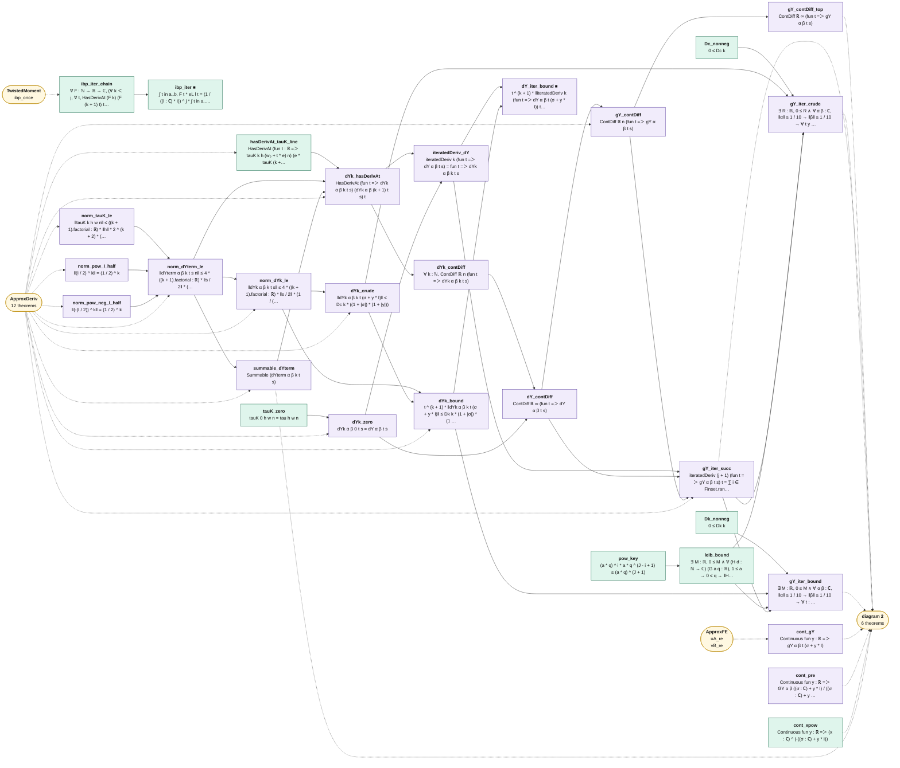
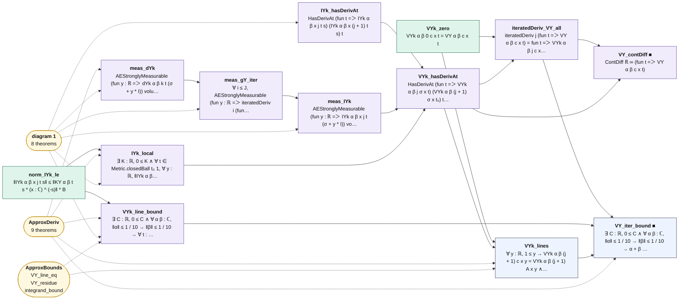

# `lean_stage3/Stage3/ApproxDerivAll.lean`

> **Read from the source text.** This file changed after the last `python3 utilities/lean_map.py --dump`, so the arrows on this page are names occurring in each proof and have not been confirmed by Lean.

# ApproxDerivAll — block S12 of `lean_stage3/design/stencil.md`, all orders. 2026-11-25.

43 theorems, 7 definitions, 1014 lines. 

**Imports:** [`TwistedMoment`](../lean_stage3/TwistedMoment.md)  
**Imported by:** [`Stage3`](../lean_stage3/Stage3.md)

## The picture

### Diagram 1 of 2: `ibp_iter_chain` to `cont_xpow`



### Diagram 2 of 2: `meas_dYk` to `VY_iter_bound`



An arrow A → B reads "A is used in the proof of B". Green: counting, integers only. Violet: shape, analysis with no ζ. Blue: reads ζ. A name ending in ■ is an end: nothing else uses it. Red: contains `sorry`. Yellow: theorems in another file, counted; a dotted arrow crosses files. Definitions are not drawn; they are listed below the diagram.

## Definitions

<a name="ApproxDerivAll-tauK"></a>
### `ApproxDerivAll.tauK`

def · line 102

- **Is:** `` tauK (k : ℕ) (h w : ℂ) (n : ℕ) : ℂ := (-1) ^ k * (k.factorial : ℂ) * ((((n : ℂ) + w) ^ (k + 1))⁻¹ - (((n : ℂ) + w + h) ^ (k + 1))⁻¹) ``
- **Used by 7:** [`ApproxDerivAll.dYk_hasDerivAt`](#ApproxDerivAll-dYk_hasDerivAt), [`ApproxDerivAll.dYterm`](#ApproxDerivAll-dYterm), [`ApproxDerivAll.hasDerivAt_tauK_line`](#ApproxDerivAll-hasDerivAt_tauK_line), [`ApproxDerivAll.meas_dYk`](#ApproxDerivAll-meas_dYk), [`ApproxDerivAll.norm_dYterm_le`](#ApproxDerivAll-norm_dYterm_le), [`ApproxDerivAll.norm_tauK_le`](#ApproxDerivAll-norm_tauK_le), [`ApproxDerivAll.tauK_zero`](#ApproxDerivAll-tauK_zero)

<a name="ApproxDerivAll-dYterm"></a>
### `ApproxDerivAll.dYterm`

def · line 202

- **Is:** `` dYterm (α β : ℂ) (k : ℕ) (t : ℝ) (s : ℂ) (n : ℕ) : ℂ := I / 2 * ((I / 2) ^ k * tauK k (s / 2) (uA α t / 2) n - (-(I / 2)) ^ k * tauK k (s / 2) (vB β t / 2) n) noncomputable ``
- **Built from:** [`ApproxDerivAll.tauK`](#ApproxDerivAll-tauK), [`ApproxFE.uA`](../lean_stage3/ApproxFE.md#ApproxFE-uA), [`ApproxFE.vB`](../lean_stage3/ApproxFE.md#ApproxFE-vB)
- **Used by 6:** [`ApproxDerivAll.dYk`](#ApproxDerivAll-dYk), [`ApproxDerivAll.dYk_hasDerivAt`](#ApproxDerivAll-dYk_hasDerivAt), [`ApproxDerivAll.dYk_zero`](#ApproxDerivAll-dYk_zero), [`ApproxDerivAll.meas_dYk`](#ApproxDerivAll-meas_dYk), [`ApproxDerivAll.norm_dYterm_le`](#ApproxDerivAll-norm_dYterm_le), [`ApproxDerivAll.summable_dYterm`](#ApproxDerivAll-summable_dYterm)

<a name="ApproxDerivAll-dYk"></a>
### `ApproxDerivAll.dYk`

def · line 208

- **Is:** `` dYk (α β : ℂ) (k : ℕ) (t : ℝ) (s : ℂ) : ℂ := ∑' n : ℕ, dYterm α β k t s n ``
- **Built from:** [`ApproxDerivAll.dYterm`](#ApproxDerivAll-dYterm)
- **Used by 13:** [`ApproxDerivAll.dY_contDiff`](#ApproxDerivAll-dY_contDiff), [`ApproxDerivAll.dYk_bound`](#ApproxDerivAll-dYk_bound), [`ApproxDerivAll.dYk_contDiff`](#ApproxDerivAll-dYk_contDiff), [`ApproxDerivAll.dYk_crude`](#ApproxDerivAll-dYk_crude), [`ApproxDerivAll.dYk_hasDerivAt`](#ApproxDerivAll-dYk_hasDerivAt), [`ApproxDerivAll.dYk_zero`](#ApproxDerivAll-dYk_zero), [`ApproxDerivAll.gY_iter_bound`](#ApproxDerivAll-gY_iter_bound), [`ApproxDerivAll.gY_iter_crude`](#ApproxDerivAll-gY_iter_crude), [`ApproxDerivAll.gY_iter_succ`](#ApproxDerivAll-gY_iter_succ), [`ApproxDerivAll.iteratedDeriv_dY`](#ApproxDerivAll-iteratedDeriv_dY), [`ApproxDerivAll.meas_dYk`](#ApproxDerivAll-meas_dYk), [`ApproxDerivAll.meas_gY_iter`](#ApproxDerivAll-meas_gY_iter), [`ApproxDerivAll.norm_dYk_le`](#ApproxDerivAll-norm_dYk_le)

<a name="ApproxDerivAll-Dc"></a>
### `ApproxDerivAll.Dc`

def · line 366

- **Is:** `` Dc (k : ℕ) : ℝ := 84 * ((k + 1).factorial : ℝ) * 20 ^ (k + 1) noncomputable ``
- **Used by 4:** [`ApproxDerivAll.Dc_nonneg`](#ApproxDerivAll-Dc_nonneg), [`ApproxDerivAll.dYk_bound`](#ApproxDerivAll-dYk_bound), [`ApproxDerivAll.dYk_crude`](#ApproxDerivAll-dYk_crude), [`ApproxDerivAll.gY_iter_crude`](#ApproxDerivAll-gY_iter_crude)

<a name="ApproxDerivAll-Dk"></a>
### `ApproxDerivAll.Dk`

def · line 370

- **Is:** `` Dk (k : ℕ) : ℝ := 84 * ((k + 1).factorial : ℝ) * 40 ^ (k + 1) ``
- **Used by 4:** [`ApproxDerivAll.Dk_nonneg`](#ApproxDerivAll-Dk_nonneg), [`ApproxDerivAll.dY_iter_bound`](#ApproxDerivAll-dY_iter_bound), [`ApproxDerivAll.dYk_bound`](#ApproxDerivAll-dYk_bound), [`ApproxDerivAll.gY_iter_bound`](#ApproxDerivAll-gY_iter_bound)

<a name="ApproxDerivAll-IYk"></a>
### `ApproxDerivAll.IYk`

def · line 696

- **Is:** `` IYk (α β : ℂ) (x : ℝ) (j : ℕ) (t : ℝ) (s : ℂ) : ℂ := GY α β s / s * iteratedDeriv j (fun t => gY α β t s) t * (x : ℂ) ^ (-s) noncomputable ``
- **Built from:** [`ApproxFE.GY`](../lean_stage3/ApproxFE.md#ApproxFE-GY), [`ApproxFE.gY`](../lean_stage3/ApproxFE.md#ApproxFE-gY)
- **Used by 8:** [`ApproxDerivAll.IYk_hasDerivAt`](#ApproxDerivAll-IYk_hasDerivAt), [`ApproxDerivAll.IYk_local`](#ApproxDerivAll-IYk_local), [`ApproxDerivAll.VYk`](#ApproxDerivAll-VYk), [`ApproxDerivAll.VYk_hasDerivAt`](#ApproxDerivAll-VYk_hasDerivAt), [`ApproxDerivAll.VYk_line_bound`](#ApproxDerivAll-VYk_line_bound), [`ApproxDerivAll.VYk_zero`](#ApproxDerivAll-VYk_zero), [`ApproxDerivAll.meas_IYk`](#ApproxDerivAll-meas_IYk), [`ApproxDerivAll.norm_IYk_le`](#ApproxDerivAll-norm_IYk_le)

<a name="ApproxDerivAll-VYk"></a>
### `ApproxDerivAll.VYk`

def · line 701

- **Is:** `` VYk (α β : ℂ) (j : ℕ) (c x t : ℝ) : ℂ := VerticalIntegral' (fun s => IYk α β x j t s) c ``
- **Built from:** [`ApproxDerivAll.IYk`](#ApproxDerivAll-IYk)
- **Used by 5:** [`ApproxDerivAll.VYk_hasDerivAt`](#ApproxDerivAll-VYk_hasDerivAt), [`ApproxDerivAll.VYk_line_bound`](#ApproxDerivAll-VYk_line_bound), [`ApproxDerivAll.VYk_lines`](#ApproxDerivAll-VYk_lines), [`ApproxDerivAll.VYk_zero`](#ApproxDerivAll-VYk_zero), [`ApproxDerivAll.iteratedDeriv_VY_all`](#ApproxDerivAll-iteratedDeriv_VY_all)

## Theorems

<a name="ApproxDerivAll-ibp_iter_chain"></a>
### `ApproxDerivAll.ibp_iter_chain`

line 62 · arrows read from text

**Counting.** Integers only: nothing in its statement or proof, or in anything it rests on, uses analysis or ζ.

**Why.** `j` integrations by parts against `e_λ(t) = e^(−iλt)`, for a chain `F 0, F 1, …, F j` with `F (k+1)` the derivative of `F k` and `F k` vanishing at `a`, `b` for `k < j`.

**Proves**

```lean
∀ F : ℕ → ℝ → ℂ, (∀ k < j, ∀ t, HasDerivAt (F k) (F (k + 1) t) t) → IntervalIntegrable (F j) volume a b → (∀ k < j, F k a = 0) → (∀ k < j, F k b = 0) → ∫ t in a..b, F 0 t * eL l t = (1 / ((l : ℂ) * I)) ^ j * ∫ t in a..b, F j t * eL l t
```

**Needs** (its hypotheses)

  - `` hl : l ≠ 0 ``
  - `` j : ℕ ``

**Fed by** (1 theorem its proof uses)

  - [`TwistedMoment.ibp_once`](../lean_stage3/TwistedMoment.md#TwistedMoment-ibp_once) (TwistedMoment) — `` ∫ t in a..b, F t * eL l t = (1 / ((l : ℂ) * I)) * ∫ t in a..b, F1 t * eL l t ``

**Definitions its proof touches:** [`TwistedMoment.eL`](../lean_stage3/TwistedMoment.md#TwistedMoment-eL)

**Feeds** (1 that use it)

  - [`ApproxDerivAll.ibp_iter`](#ApproxDerivAll-ibp_iter) — `` ∫ t in a..b, F t * eL l t = (1 / ((l : ℂ) * I)) ^ j * ∫ t in a..b, iteratedDeriv j F t * eL l t ``

<a name="ApproxDerivAll-ibp_iter"></a>
### `ApproxDerivAll.ibp_iter`

line 86 · arrows read from text

**Counting.** Integers only: nothing in its statement or proof, or in anything it rests on, uses analysis or ζ.

**Why.** `j` integrations by parts. For `F` of class `Cʲ` with `F, F', …, F^(j−1)` vanishing at `a` and `b`, and `λ ≠ 0`: `∫_a^b F e_λ = (1/(iλ))^j ∫_a^b F^(j) e_λ`, `e_λ(t) = e^(−iλt)`.

**Proves**

```lean
∫ t in a..b, F t * eL l t = (1 / ((l : ℂ) * I)) ^ j * ∫ t in a..b, iteratedDeriv j F t * eL l t
```

**Needs** (its hypotheses)

  - `` hl : l ≠ 0 ``
  - `` j : ℕ ``
  - `` hF : ContDiff ℝ j F ``
  - `` ha : ∀ k < j, iteratedDeriv k F a = 0 ``
  - `` hb : ∀ k < j, iteratedDeriv k F b = 0 ``

**Fed by** (1 theorem its proof uses)

  - [`ApproxDerivAll.ibp_iter_chain`](#ApproxDerivAll-ibp_iter_chain) — `` ∀ F : ℕ → ℝ → ℂ, (∀ k < j, ∀ t, HasDerivAt (F k) (F (k + 1) t) t) → IntervalIntegrable (F j) volume a b → (∀ k < j, F k a = 0) → (∀ k < j, F k b = 0) … ``

**Definitions its proof touches:** [`TwistedMoment.eL`](../lean_stage3/TwistedMoment.md#TwistedMoment-eL)

**Feeds:** nothing. It is an end.

<a name="ApproxDerivAll-tauK_zero"></a>
### `ApproxDerivAll.tauK_zero`

line 105 · arrows read from text

**Counting.** Integers only: nothing in its statement or proof, or in anything it rests on, uses analysis or ζ.

**Proves**

```lean
tauK 0 h w n = tau h w n
```

**Needs** (its hypotheses)

  - `` h w : ℂ ``
  - `` n : ℕ ``

**Fed by:** no theorem of this repo; it stands on Mathlib and the definitions below.

**Definitions its proof touches:** [`ApproxDeriv.tau`](../lean_stage3/ApproxDeriv.md#ApproxDeriv-tau), [`ApproxDerivAll.tauK`](#ApproxDerivAll-tauK)

**Feeds** (1 that use it)

  - [`ApproxDerivAll.dYk_zero`](#ApproxDerivAll-dYk_zero) — `` dYk α β 0 t s = dY α β t s ``

<a name="ApproxDerivAll-hasDerivAt_tauK_line"></a>
### `ApproxDerivAll.hasDerivAt_tauK_line`

line 108 · arrows read from text

**Counting.** Integers only: nothing in its statement or proof, or in anything it rests on, uses analysis or ζ.

**Proves**

```lean
HasDerivAt (fun t : ℝ => tauK k h (w₀ + t * e) n) (e * tauK (k + 1) h (w₀ + t * e) n) t
```

**Needs** (its hypotheses)

  - `` h w₀ e : ℂ ``
  - `` k n : ℕ ``
  - `` t : ℝ ``
  - `` hp : (n : ℂ) + (w₀ + t * e) ≠ 0 ``
  - `` hq : (n : ℂ) + (w₀ + t * e) + h ≠ 0 ``

**Fed by** (1 theorem its proof uses)

  - [`ApproxDeriv.hasDerivAt_line`](../lean_stage3/ApproxDeriv.md#ApproxDeriv-hasDerivAt_line) (ApproxDeriv) — `` HasDerivAt (fun t : ℝ => w₀ + (t : ℂ) * e) e t ``

**Definitions its proof touches:** [`ApproxDerivAll.tauK`](#ApproxDerivAll-tauK)

**Feeds** (1 that use it)

  - [`ApproxDerivAll.dYk_hasDerivAt`](#ApproxDerivAll-dYk_hasDerivAt) — `` HasDerivAt (fun t => dYk α β k t s) (dYk α β (k + 1) t s) t ``

<a name="ApproxDerivAll-norm_tauK_le"></a>
### `ApproxDerivAll.norm_tauK_le`

line 124 · arrows read from text

**Shape.** Uses real or complex analysis; nothing in it or beneath it reads ζ.

**Proves**

```lean
‖tauK k h w n‖ ≤ ((k + 1).factorial : ℝ) * ‖h‖ * 2 ^ (k + 2) * (1 / (a + Y)) ^ k * (1 / ((n : ℝ) + (a + Y)) ^ 2)
```

**Needs** (its hypotheses)

  - `` ha : 0 < a ``
  - `` hY : 0 ≤ Y ``
  - `` h1 : a ≤ w.re ``
  - `` h2 : a ≤ (w + h).re ``
  - `` h3 : Y ≤ |w.im| ``
  - `` h4 : Y ≤ |(w + h).im| ``
  - `` k n : ℕ ``

**Fed by** (1 theorem its proof uses)

  - [`ApproxDeriv.norm_nat_add_ge`](../lean_stage3/ApproxDeriv.md#ApproxDeriv-norm_nat_add_ge) (ApproxDeriv) — `` ((n : ℝ) + a + Y) / 2 ≤ ‖(n : ℂ) + z‖ ``

**Definitions its proof touches:** [`ApproxDerivAll.tauK`](#ApproxDerivAll-tauK)

**Feeds** (1 that use it)

  - [`ApproxDerivAll.norm_dYterm_le`](#ApproxDerivAll-norm_dYterm_le) — `` ‖dYterm α β k t s n‖ ≤ 4 * ((k + 1).factorial : ℝ) * ‖s / 2‖ * (1 / (1 / 20 + Y)) ^ k * (1 + 1 / (1 / 20 + Y)) * tel (1 / 20 + Y) n ``

<a name="ApproxDerivAll-dYk_zero"></a>
### `ApproxDerivAll.dYk_zero`

line 210 · arrows read from text

**Shape.** Uses real or complex analysis; nothing in it or beneath it reads ζ.

**Proves**

```lean
dYk α β 0 t s = dY α β t s
```

**Needs** (its hypotheses)

  - `` hα : ‖α‖ ≤ 1 / 10 ``
  - `` hβ : ‖β‖ ≤ 1 / 10 ``
  - `` hs : -(1 / 4) ≤ s.re ``
  - `` t : ℝ ``

**Fed by** (2 theorems its proof uses)

  - [`ApproxDeriv.dY_hasSum`](../lean_stage3/ApproxDeriv.md#ApproxDeriv-dY_hasSum) (ApproxDeriv) — `` HasSum (fun n => I / 2 * (tau (s / 2) (uA α t / 2) n - tau (s / 2) (vB β t / 2) n)) (dY α β t s) ``
  - [`ApproxDerivAll.tauK_zero`](#ApproxDerivAll-tauK_zero) — `` tauK 0 h w n = tau h w n ``

**Definitions its proof touches:** [`ApproxDeriv.dY`](../lean_stage3/ApproxDeriv.md#ApproxDeriv-dY), [`ApproxDerivAll.dYk`](#ApproxDerivAll-dYk), [`ApproxDerivAll.dYterm`](#ApproxDerivAll-dYterm)

**Feeds** (2 that use it)

  - [`ApproxDerivAll.dY_contDiff`](#ApproxDerivAll-dY_contDiff) — `` ContDiff ℝ ∞ (fun t => dY α β t s) ``
  - [`ApproxDerivAll.iteratedDeriv_dY`](#ApproxDerivAll-iteratedDeriv_dY) — `` iteratedDeriv k (fun t => dY α β t s) = fun t => dYk α β k t s ``

<a name="ApproxDerivAll-norm_pow_I_half"></a>
### `ApproxDerivAll.norm_pow_I_half`

line 216 · arrows read from text

**Shape.** Uses real or complex analysis; nothing in it or beneath it reads ζ.

**Proves**

```lean
‖(I / 2) ^ k‖ = (1 / 2) ^ k
```

**Needs** (its hypotheses)

  - `` k : ℕ ``

**Fed by** (1 theorem its proof uses)

  - [`ApproxDeriv.norm_I_half`](../lean_stage3/ApproxDeriv.md#ApproxDeriv-norm_I_half) (ApproxDeriv) — `` ‖I / 2‖ = 1 / 2 ``

**Feeds** (1 that use it)

  - [`ApproxDerivAll.norm_dYterm_le`](#ApproxDerivAll-norm_dYterm_le) — `` ‖dYterm α β k t s n‖ ≤ 4 * ((k + 1).factorial : ℝ) * ‖s / 2‖ * (1 / (1 / 20 + Y)) ^ k * (1 + 1 / (1 / 20 + Y)) * tel (1 / 20 + Y) n ``

<a name="ApproxDerivAll-norm_pow_neg_I_half"></a>
### `ApproxDerivAll.norm_pow_neg_I_half`

line 219 · arrows read from text

**Shape.** Uses real or complex analysis; nothing in it or beneath it reads ζ.

**Proves**

```lean
‖(-(I / 2)) ^ k‖ = (1 / 2) ^ k
```

**Needs** (its hypotheses)

  - `` k : ℕ ``

**Fed by** (1 theorem its proof uses)

  - [`ApproxDeriv.norm_I_half`](../lean_stage3/ApproxDeriv.md#ApproxDeriv-norm_I_half) (ApproxDeriv) — `` ‖I / 2‖ = 1 / 2 ``

**Feeds** (1 that use it)

  - [`ApproxDerivAll.norm_dYterm_le`](#ApproxDerivAll-norm_dYterm_le) — `` ‖dYterm α β k t s n‖ ≤ 4 * ((k + 1).factorial : ℝ) * ‖s / 2‖ * (1 / (1 / 20 + Y)) ^ k * (1 + 1 / (1 / 20 + Y)) * tel (1 / 20 + Y) n ``

<a name="ApproxDerivAll-norm_dYterm_le"></a>
### `ApproxDerivAll.norm_dYterm_le`

line 222 · arrows read from text

**Shape.** Uses real or complex analysis; nothing in it or beneath it reads ζ.

**Proves**

```lean
‖dYterm α β k t s n‖ ≤ 4 * ((k + 1).factorial : ℝ) * ‖s / 2‖ * (1 / (1 / 20 + Y)) ^ k * (1 + 1 / (1 / 20 + Y)) * tel (1 / 20 + Y) n
```

**Needs** (its hypotheses)

  - `` hα : ‖α‖ ≤ 1 / 10 ``
  - `` hβ : ‖β‖ ≤ 1 / 10 ``
  - `` hs : -(1 / 4) ≤ s.re ``
  - `` hY : 0 ≤ Y ``
  - `` i1 : Y ≤ |(uA α t / 2).im| ``
  - `` i2 : Y ≤ |(uA α t / 2 + s / 2).im| ``
  - `` i3 : Y ≤ |(vB β t / 2).im| ``
  - `` i4 : Y ≤ |(vB β t / 2 + s / 2).im| ``
  - `` k n : ℕ ``

**Fed by** (6 theorems its proof uses)

  - [`ApproxDeriv.norm_I_half`](../lean_stage3/ApproxDeriv.md#ApproxDeriv-norm_I_half) (ApproxDeriv) — `` ‖I / 2‖ = 1 / 2 ``
  - [`ApproxDeriv.re_conds`](../lean_stage3/ApproxDeriv.md#ApproxDeriv-re_conds) (ApproxDeriv) — `` 1 / 20 ≤ (uA α t / 2).re ∧ 1 / 20 ≤ (uA α t / 2 + s / 2).re ∧ 1 / 20 ≤ (vB β t / 2).re ∧ 1 / 20 ≤ (vB β t / 2 + s / 2).re ``
  - [`ApproxDeriv.sq_le_tel`](../lean_stage3/ApproxDeriv.md#ApproxDeriv-sq_le_tel) (ApproxDeriv) — `` 1 / ((n : ℝ) + b) ^ 2 ≤ (1 + 1 / b) * tel b n ``
  - [`ApproxDerivAll.norm_pow_I_half`](#ApproxDerivAll-norm_pow_I_half) — `` ‖(I / 2) ^ k‖ = (1 / 2) ^ k ``
  - [`ApproxDerivAll.norm_pow_neg_I_half`](#ApproxDerivAll-norm_pow_neg_I_half) — `` ‖(-(I / 2)) ^ k‖ = (1 / 2) ^ k ``
  - [`ApproxDerivAll.norm_tauK_le`](#ApproxDerivAll-norm_tauK_le) — `` ‖tauK k h w n‖ ≤ ((k + 1).factorial : ℝ) * ‖h‖ * 2 ^ (k + 2) * (1 / (a + Y)) ^ k * (1 / ((n : ℝ) + (a + Y)) ^ 2) ``

**Definitions its proof touches:** [`ApproxDeriv.tel`](../lean_stage3/ApproxDeriv.md#ApproxDeriv-tel), [`ApproxDerivAll.dYterm`](#ApproxDerivAll-dYterm), [`ApproxDerivAll.tauK`](#ApproxDerivAll-tauK), [`ApproxFE.uA`](../lean_stage3/ApproxFE.md#ApproxFE-uA), [`ApproxFE.vB`](../lean_stage3/ApproxFE.md#ApproxFE-vB)

**Feeds** (3 that use it)

  - [`ApproxDerivAll.dYk_hasDerivAt`](#ApproxDerivAll-dYk_hasDerivAt) — `` HasDerivAt (fun t => dYk α β k t s) (dYk α β (k + 1) t s) t ``
  - [`ApproxDerivAll.norm_dYk_le`](#ApproxDerivAll-norm_dYk_le) — `` ‖dYk α β k t s‖ ≤ 4 * ((k + 1).factorial : ℝ) * ‖s / 2‖ * (1 / (1 / 20 + Y)) ^ k * (1 + 1 / (1 / 20 + Y)) * (1 / (1 / 20 + Y)) ``
  - [`ApproxDerivAll.summable_dYterm`](#ApproxDerivAll-summable_dYterm) — `` Summable (dYterm α β k t s) ``

<a name="ApproxDerivAll-summable_dYterm"></a>
### `ApproxDerivAll.summable_dYterm`

line 255 · arrows read from text

**Shape.** Uses real or complex analysis; nothing in it or beneath it reads ζ.

**Proves**

```lean
Summable (dYterm α β k t s)
```

**Needs** (its hypotheses)

  - `` hα : ‖α‖ ≤ 1 / 10 ``
  - `` hβ : ‖β‖ ≤ 1 / 10 ``
  - `` hs : -(1 / 4) ≤ s.re ``
  - `` k : ℕ ``
  - `` t : ℝ ``

**Fed by** (2 theorems its proof uses)

  - [`ApproxDeriv.hasSum_tel`](../lean_stage3/ApproxDeriv.md#ApproxDeriv-hasSum_tel) (ApproxDeriv) — `` HasSum (tel b) (1 / b) ``
  - [`ApproxDerivAll.norm_dYterm_le`](#ApproxDerivAll-norm_dYterm_le) — `` ‖dYterm α β k t s n‖ ≤ 4 * ((k + 1).factorial : ℝ) * ‖s / 2‖ * (1 / (1 / 20 + Y)) ^ k * (1 + 1 / (1 / 20 + Y)) * tel (1 / 20 + Y) n ``

**Definitions its proof touches:** [`ApproxDerivAll.dYterm`](#ApproxDerivAll-dYterm)

**Feeds** (2 that use it)

  - [`ApproxDerivAll.dYk_hasDerivAt`](#ApproxDerivAll-dYk_hasDerivAt) — `` HasDerivAt (fun t => dYk α β k t s) (dYk α β (k + 1) t s) t ``
  - [`ApproxDerivAll.meas_dYk`](#ApproxDerivAll-meas_dYk) — `` AEStronglyMeasurable (fun y : ℝ => dYk α β k t (σ + y * I)) volume ``

<a name="ApproxDerivAll-norm_dYk_le"></a>
### `ApproxDerivAll.norm_dYk_le`

line 262 · arrows read from text

**Shape.** Uses real or complex analysis; nothing in it or beneath it reads ζ.

**Why.** `‖∂_tᵏ dY‖ ≤ 4 (k+1)! ‖s/2‖ (1/b)^k (1 + 1/b)/b`, `b = 1/20 + Y`.

**Proves**

```lean
‖dYk α β k t s‖ ≤ 4 * ((k + 1).factorial : ℝ) * ‖s / 2‖ * (1 / (1 / 20 + Y)) ^ k * (1 + 1 / (1 / 20 + Y)) * (1 / (1 / 20 + Y))
```

**Needs** (its hypotheses)

  - `` hα : ‖α‖ ≤ 1 / 10 ``
  - `` hβ : ‖β‖ ≤ 1 / 10 ``
  - `` hs : -(1 / 4) ≤ s.re ``
  - `` hY : 0 ≤ Y ``
  - `` i1 : Y ≤ |(uA α t / 2).im| ``
  - `` i2 : Y ≤ |(uA α t / 2 + s / 2).im| ``
  - `` i3 : Y ≤ |(vB β t / 2).im| ``
  - `` i4 : Y ≤ |(vB β t / 2 + s / 2).im| ``
  - `` k : ℕ ``

**Fed by** (2 theorems its proof uses)

  - [`ApproxDeriv.hasSum_tel`](../lean_stage3/ApproxDeriv.md#ApproxDeriv-hasSum_tel) (ApproxDeriv) — `` HasSum (tel b) (1 / b) ``
  - [`ApproxDerivAll.norm_dYterm_le`](#ApproxDerivAll-norm_dYterm_le) — `` ‖dYterm α β k t s n‖ ≤ 4 * ((k + 1).factorial : ℝ) * ‖s / 2‖ * (1 / (1 / 20 + Y)) ^ k * (1 + 1 / (1 / 20 + Y)) * tel (1 / 20 + Y) n ``

**Definitions its proof touches:** [`ApproxDerivAll.dYk`](#ApproxDerivAll-dYk), [`ApproxFE.uA`](../lean_stage3/ApproxFE.md#ApproxFE-uA), [`ApproxFE.vB`](../lean_stage3/ApproxFE.md#ApproxFE-vB)

**Feeds** (2 that use it)

  - [`ApproxDerivAll.dYk_bound`](#ApproxDerivAll-dYk_bound) — `` t ^ (k + 1) * ‖dYk α β k t (σ + y * I)‖ ≤ Dk k * (1 + |σ|) * (1 + |y|) ^ (k + 2) ``
  - [`ApproxDerivAll.dYk_crude`](#ApproxDerivAll-dYk_crude) — `` ‖dYk α β k t (σ + y * I)‖ ≤ Dc k * ((1 + |σ|) * (1 + |y|)) ``

<a name="ApproxDerivAll-dYk_hasDerivAt"></a>
### `ApproxDerivAll.dYk_hasDerivAt`

line 273 · arrows read from text

**Shape.** Uses real or complex analysis; nothing in it or beneath it reads ζ.

**Why.** `∂_t (∂_tᵏ dY) = ∂_t^(k+1) dY`, for every real `t`: the termwise derivative.

**Proves**

```lean
HasDerivAt (fun t => dYk α β k t s) (dYk α β (k + 1) t s) t
```

**Needs** (its hypotheses)

  - `` hα : ‖α‖ ≤ 1 / 10 ``
  - `` hβ : ‖β‖ ≤ 1 / 10 ``
  - `` hs : -(1 / 4) ≤ s.re ``
  - `` k : ℕ ``
  - `` t : ℝ ``

**Fed by** (6 theorems its proof uses)

  - [`ApproxDeriv.hasSum_tel`](../lean_stage3/ApproxDeriv.md#ApproxDeriv-hasSum_tel) (ApproxDeriv) — `` HasSum (tel b) (1 / b) ``
  - [`ApproxDeriv.nat_add_ne`](../lean_stage3/ApproxDeriv.md#ApproxDeriv-nat_add_ne) (ApproxDeriv) — `` (n : ℂ) + z ≠ 0 ``
  - [`ApproxDeriv.re_conds`](../lean_stage3/ApproxDeriv.md#ApproxDeriv-re_conds) (ApproxDeriv) — `` 1 / 20 ≤ (uA α t / 2).re ∧ 1 / 20 ≤ (uA α t / 2 + s / 2).re ∧ 1 / 20 ≤ (vB β t / 2).re ∧ 1 / 20 ≤ (vB β t / 2 + s / 2).re ``
  - [`ApproxDerivAll.hasDerivAt_tauK_line`](#ApproxDerivAll-hasDerivAt_tauK_line) — `` HasDerivAt (fun t : ℝ => tauK k h (w₀ + t * e) n) (e * tauK (k + 1) h (w₀ + t * e) n) t ``
  - [`ApproxDerivAll.norm_dYterm_le`](#ApproxDerivAll-norm_dYterm_le) — `` ‖dYterm α β k t s n‖ ≤ 4 * ((k + 1).factorial : ℝ) * ‖s / 2‖ * (1 / (1 / 20 + Y)) ^ k * (1 + 1 / (1 / 20 + Y)) * tel (1 / 20 + Y) n ``
  - [`ApproxDerivAll.summable_dYterm`](#ApproxDerivAll-summable_dYterm) — `` Summable (dYterm α β k t s) ``

**Definitions its proof touches:** [`ApproxDeriv.tel`](../lean_stage3/ApproxDeriv.md#ApproxDeriv-tel), [`ApproxDerivAll.dYk`](#ApproxDerivAll-dYk), [`ApproxDerivAll.dYterm`](#ApproxDerivAll-dYterm), [`ApproxDerivAll.tauK`](#ApproxDerivAll-tauK), [`ApproxFE.uA`](../lean_stage3/ApproxFE.md#ApproxFE-uA), [`ApproxFE.vB`](../lean_stage3/ApproxFE.md#ApproxFE-vB)

**Feeds** (2 that use it)

  - [`ApproxDerivAll.dYk_contDiff`](#ApproxDerivAll-dYk_contDiff) — `` ∀ k : ℕ, ContDiff ℝ n (fun t => dYk α β k t s) ``
  - [`ApproxDerivAll.iteratedDeriv_dY`](#ApproxDerivAll-iteratedDeriv_dY) — `` iteratedDeriv k (fun t => dY α β t s) = fun t => dYk α β k t s ``

<a name="ApproxDerivAll-dYk_contDiff"></a>
### `ApproxDerivAll.dYk_contDiff`

line 327 · arrows read from text

**Shape.** Uses real or complex analysis; nothing in it or beneath it reads ζ.

**Why.** `t ↦ ∂_tᵏ dY` is `Cⁿ` for every `n` and `k`.

**Proves**

```lean
∀ k : ℕ, ContDiff ℝ n (fun t => dYk α β k t s)
```

**Needs** (its hypotheses)

  - `` hα : ‖α‖ ≤ 1 / 10 ``
  - `` hβ : ‖β‖ ≤ 1 / 10 ``
  - `` hs : -(1 / 4) ≤ s.re ``
  - `` n : ℕ ``

**Fed by** (1 theorem its proof uses)

  - [`ApproxDerivAll.dYk_hasDerivAt`](#ApproxDerivAll-dYk_hasDerivAt) — `` HasDerivAt (fun t => dYk α β k t s) (dYk α β (k + 1) t s) t ``

**Definitions its proof touches:** [`ApproxDerivAll.dYk`](#ApproxDerivAll-dYk)

**Feeds** (1 that use it)

  - [`ApproxDerivAll.dY_contDiff`](#ApproxDerivAll-dY_contDiff) — `` ContDiff ℝ ∞ (fun t => dY α β t s) ``

<a name="ApproxDerivAll-iteratedDeriv_dY"></a>
### `ApproxDerivAll.iteratedDeriv_dY`

line 345 · arrows read from text

**Shape.** Uses real or complex analysis; nothing in it or beneath it reads ζ.

**Why.** `iteratedDeriv k (t ↦ dY) = ∂_tᵏ dY`, the termwise series.

**Proves**

```lean
iteratedDeriv k (fun t => dY α β t s) = fun t => dYk α β k t s
```

**Needs** (its hypotheses)

  - `` hα : ‖α‖ ≤ 1 / 10 ``
  - `` hβ : ‖β‖ ≤ 1 / 10 ``
  - `` hs : -(1 / 4) ≤ s.re ``
  - `` k : ℕ ``

**Fed by** (2 theorems its proof uses)

  - [`ApproxDerivAll.dYk_hasDerivAt`](#ApproxDerivAll-dYk_hasDerivAt) — `` HasDerivAt (fun t => dYk α β k t s) (dYk α β (k + 1) t s) t ``
  - [`ApproxDerivAll.dYk_zero`](#ApproxDerivAll-dYk_zero) — `` dYk α β 0 t s = dY α β t s ``

**Definitions its proof touches:** [`ApproxDeriv.dY`](../lean_stage3/ApproxDeriv.md#ApproxDeriv-dY), [`ApproxDerivAll.dYk`](#ApproxDerivAll-dYk)

**Feeds** (2 that use it)

  - [`ApproxDerivAll.dY_iter_bound`](#ApproxDerivAll-dY_iter_bound) — `` t ^ (k + 1) * ‖iteratedDeriv k (fun t => dY α β t (σ + y * I)) t‖ ≤ Dk k * (1 + |σ|) * (1 + |y|) ^ (k + 2) ``
  - [`ApproxDerivAll.gY_iter_succ`](#ApproxDerivAll-gY_iter_succ) — `` iteratedDeriv (j + 1) (fun t => gY α β t s) t = ∑ i ∈ Finset.range (j + 1), (j.choose i : ℂ) * iteratedDeriv i (fun t => gY α β t s) t * dYk α β (j - … ``

<a name="ApproxDerivAll-dY_contDiff"></a>
### `ApproxDerivAll.dY_contDiff`

line 357 · arrows read from text

**Shape.** Uses real or complex analysis; nothing in it or beneath it reads ζ.

**Why.** `t ↦ dY` is smooth, through the termwise derivatives of the digamma series.

**Proves**

```lean
ContDiff ℝ ∞ (fun t => dY α β t s)
```

**Needs** (its hypotheses)

  - `` hα : ‖α‖ ≤ 1 / 10 ``
  - `` hβ : ‖β‖ ≤ 1 / 10 ``
  - `` hs : -(1 / 4) ≤ s.re ``

**Fed by** (2 theorems its proof uses)

  - [`ApproxDerivAll.dYk_contDiff`](#ApproxDerivAll-dYk_contDiff) — `` ∀ k : ℕ, ContDiff ℝ n (fun t => dYk α β k t s) ``
  - [`ApproxDerivAll.dYk_zero`](#ApproxDerivAll-dYk_zero) — `` dYk α β 0 t s = dY α β t s ``

**Definitions its proof touches:** [`ApproxDeriv.dY`](../lean_stage3/ApproxDeriv.md#ApproxDeriv-dY), [`ApproxDerivAll.dYk`](#ApproxDerivAll-dYk)

**Feeds** (2 that use it)

  - [`ApproxDerivAll.gY_contDiff`](#ApproxDerivAll-gY_contDiff) — `` ContDiff ℝ n (fun t => gY α β t s) ``
  - [`ApproxDerivAll.gY_iter_succ`](#ApproxDerivAll-gY_iter_succ) — `` iteratedDeriv (j + 1) (fun t => gY α β t s) t = ∑ i ∈ Finset.range (j + 1), (j.choose i : ℂ) * iteratedDeriv i (fun t => gY α β t s) t * dYk α β (j - … ``

<a name="ApproxDerivAll-Dc_nonneg"></a>
### `ApproxDerivAll.Dc_nonneg`

line 372 · arrows read from text

**Counting.** Integers only: nothing in its statement or proof, or in anything it rests on, uses analysis or ζ.

**Proves**

```lean
0 ≤ Dc k
```

**Needs** (its hypotheses)

  - `` k : ℕ ``

**Fed by:** no theorem of this repo; it stands on Mathlib and the definitions below.

**Definitions its proof touches:** [`ApproxDerivAll.Dc`](#ApproxDerivAll-Dc)

**Feeds** (1 that use it)

  - [`ApproxDerivAll.gY_iter_crude`](#ApproxDerivAll-gY_iter_crude) — `` ∃ R : ℝ, 0 ≤ R ∧ ∀ α β : ℂ, ‖α‖ ≤ 1 / 10 → ‖β‖ ≤ 1 / 10 → ∀ t y : ℝ, ‖iteratedDeriv j (fun t => gY α β t (σ + y * I)) t‖ ≤ ‖gY α β t (σ + y * I)‖ * R … ``

<a name="ApproxDerivAll-Dk_nonneg"></a>
### `ApproxDerivAll.Dk_nonneg`

line 374 · arrows read from text

**Counting.** Integers only: nothing in its statement or proof, or in anything it rests on, uses analysis or ζ.

**Proves**

```lean
0 ≤ Dk k
```

**Needs** (its hypotheses)

  - `` k : ℕ ``

**Fed by:** no theorem of this repo; it stands on Mathlib and the definitions below.

**Definitions its proof touches:** [`ApproxDerivAll.Dk`](#ApproxDerivAll-Dk)

**Feeds** (1 that use it)

  - [`ApproxDerivAll.gY_iter_bound`](#ApproxDerivAll-gY_iter_bound) — `` ∃ M : ℝ, 0 ≤ M ∧ ∀ α β : ℂ, ‖α‖ ≤ 1 / 10 → ‖β‖ ≤ 1 / 10 → ∀ t : ℝ, 1 ≤ t → ∀ y : ℝ, ‖iteratedDeriv j (fun t => gY α β t (σ + y * I)) t‖ ≤ ‖gY α β t (σ… ``

<a name="ApproxDerivAll-dYk_crude"></a>
### `ApproxDerivAll.dYk_crude`

line 377 · arrows read from text

**Shape.** Uses real or complex analysis; nothing in it or beneath it reads ζ.

**Why.** `‖∂_tᵏ dY(σ+iy, t)‖ ≤ Dc k (1+|σ|)(1+|y|)` for every real `t`.

**Proves**

```lean
‖dYk α β k t (σ + y * I)‖ ≤ Dc k * ((1 + |σ|) * (1 + |y|))
```

**Needs** (its hypotheses)

  - `` hα : ‖α‖ ≤ 1 / 10 ``
  - `` hβ : ‖β‖ ≤ 1 / 10 ``
  - `` hσ0 : -(1 / 4) ≤ σ ``
  - `` k : ℕ ``
  - `` t y : ℝ ``

**Fed by** (2 theorems its proof uses)

  - [`ApproxDeriv.norm_half_le`](../lean_stage3/ApproxDeriv.md#ApproxDeriv-norm_half_le) (ApproxDeriv) — `` ‖((σ : ℂ) + y * I) / 2‖ ≤ (1 + |σ|) * (1 + |y|) ``
  - [`ApproxDerivAll.norm_dYk_le`](#ApproxDerivAll-norm_dYk_le) — `` ‖dYk α β k t s‖ ≤ 4 * ((k + 1).factorial : ℝ) * ‖s / 2‖ * (1 / (1 / 20 + Y)) ^ k * (1 + 1 / (1 / 20 + Y)) * (1 / (1 / 20 + Y)) ``

**Definitions its proof touches:** [`ApproxDerivAll.Dc`](#ApproxDerivAll-Dc), [`ApproxDerivAll.dYk`](#ApproxDerivAll-dYk)

**Feeds** (2 that use it)

  - [`ApproxDerivAll.dYk_bound`](#ApproxDerivAll-dYk_bound) — `` t ^ (k + 1) * ‖dYk α β k t (σ + y * I)‖ ≤ Dk k * (1 + |σ|) * (1 + |y|) ^ (k + 2) ``
  - [`ApproxDerivAll.gY_iter_crude`](#ApproxDerivAll-gY_iter_crude) — `` ∃ R : ℝ, 0 ≤ R ∧ ∀ α β : ℂ, ‖α‖ ≤ 1 / 10 → ‖β‖ ≤ 1 / 10 → ∀ t y : ℝ, ‖iteratedDeriv j (fun t => gY α β t (σ + y * I)) t‖ ≤ ‖gY α β t (σ + y * I)‖ * R … ``

<a name="ApproxDerivAll-dYk_bound"></a>
### `ApproxDerivAll.dYk_bound`

line 394 · arrows read from text

**Shape.** Uses real or complex analysis; nothing in it or beneath it reads ζ.

**Why.** Target 1, the bounds. `t^(k+1) ‖∂_tᵏ dY(σ+iy, t)‖ ≤ Dk k (1+|σ|)(1+|y|)^(k+2)` for `t ≥ 1`, every `k`; `k = 0, 1` are `ApproxDeriv.dY_bound`, `d2Y_bound` up to the constant.

**Proves**

```lean
t ^ (k + 1) * ‖dYk α β k t (σ + y * I)‖ ≤ Dk k * (1 + |σ|) * (1 + |y|) ^ (k + 2)
```

**Needs** (its hypotheses)

  - `` hα : ‖α‖ ≤ 1 / 10 ``
  - `` hβ : ‖β‖ ≤ 1 / 10 ``
  - `` hσ0 : -(1 / 4) ≤ σ ``
  - `` k : ℕ ``
  - `` ht : 1 ≤ t ``
  - `` y : ℝ ``

**Fed by** (5 theorems its proof uses)

  - [`ApproxDeriv.b_facts`](../lean_stage3/ApproxDeriv.md#ApproxDeriv-b_facts) (ApproxDeriv) — `` t * (1 / (1 / 20 + t / 5)) ≤ 5 ∧ 1 + 1 / (1 / 20 + t / 5) ≤ 6 ``
  - [`ApproxDeriv.im_conds`](../lean_stage3/ApproxDeriv.md#ApproxDeriv-im_conds) (ApproxDeriv) — `` t / 5 ≤ |(uA α t / 2).im| ∧ t / 5 ≤ |(uA α t / 2 + ((σ : ℂ) + y * I) / 2).im| ∧ t / 5 ≤ |(vB β t / 2).im| ∧ t / 5 ≤ |(vB β t / 2 + ((σ : ℂ) + y * I) /… ``
  - [`ApproxDeriv.norm_half_le`](../lean_stage3/ApproxDeriv.md#ApproxDeriv-norm_half_le) (ApproxDeriv) — `` ‖((σ : ℂ) + y * I) / 2‖ ≤ (1 + |σ|) * (1 + |y|) ``
  - [`ApproxDerivAll.dYk_crude`](#ApproxDerivAll-dYk_crude) — `` ‖dYk α β k t (σ + y * I)‖ ≤ Dc k * ((1 + |σ|) * (1 + |y|)) ``
  - [`ApproxDerivAll.norm_dYk_le`](#ApproxDerivAll-norm_dYk_le) — `` ‖dYk α β k t s‖ ≤ 4 * ((k + 1).factorial : ℝ) * ‖s / 2‖ * (1 / (1 / 20 + Y)) ^ k * (1 + 1 / (1 / 20 + Y)) * (1 / (1 / 20 + Y)) ``

**Definitions its proof touches:** [`ApproxDerivAll.Dc`](#ApproxDerivAll-Dc), [`ApproxDerivAll.Dk`](#ApproxDerivAll-Dk), [`ApproxDerivAll.dYk`](#ApproxDerivAll-dYk)

**Feeds** (2 that use it)

  - [`ApproxDerivAll.dY_iter_bound`](#ApproxDerivAll-dY_iter_bound) — `` t ^ (k + 1) * ‖iteratedDeriv k (fun t => dY α β t (σ + y * I)) t‖ ≤ Dk k * (1 + |σ|) * (1 + |y|) ^ (k + 2) ``
  - [`ApproxDerivAll.gY_iter_bound`](#ApproxDerivAll-gY_iter_bound) — `` ∃ M : ℝ, 0 ≤ M ∧ ∀ α β : ℂ, ‖α‖ ≤ 1 / 10 → ‖β‖ ≤ 1 / 10 → ∀ t : ℝ, 1 ≤ t → ∀ y : ℝ, ‖iteratedDeriv j (fun t => gY α β t (σ + y * I)) t‖ ≤ ‖gY α β t (σ… ``

<a name="ApproxDerivAll-dY_iter_bound"></a>
### `ApproxDerivAll.dY_iter_bound`

line 450 · arrows read from text

**Shape.** Uses real or complex analysis; nothing in it or beneath it reads ζ.

**Why.** Target 1. For every `k`, `t^(k+1) ‖∂_tᵏ dY α β t (σ+iy)‖ ≤ Dk k (1+|σ|)(1+|y|)^(k+2)`, uniformly in `‖α‖, ‖β‖ ≤ 1/10`, `σ ≥ −1/4`, `t ≥ 1`, with `∂_tᵏ` the iterated derivative of the smooth map `t ↦ dY` (`dY_contDiff`).

**Proves**

```lean
t ^ (k + 1) * ‖iteratedDeriv k (fun t => dY α β t (σ + y * I)) t‖ ≤ Dk k * (1 + |σ|) * (1 + |y|) ^ (k + 2)
```

**Needs** (its hypotheses)

  - `` hα : ‖α‖ ≤ 1 / 10 ``
  - `` hβ : ‖β‖ ≤ 1 / 10 ``
  - `` hσ0 : -(1 / 4) ≤ σ ``
  - `` k : ℕ ``
  - `` ht : 1 ≤ t ``
  - `` y : ℝ ``

**Fed by** (2 theorems its proof uses)

  - [`ApproxDerivAll.dYk_bound`](#ApproxDerivAll-dYk_bound) — `` t ^ (k + 1) * ‖dYk α β k t (σ + y * I)‖ ≤ Dk k * (1 + |σ|) * (1 + |y|) ^ (k + 2) ``
  - [`ApproxDerivAll.iteratedDeriv_dY`](#ApproxDerivAll-iteratedDeriv_dY) — `` iteratedDeriv k (fun t => dY α β t s) = fun t => dYk α β k t s ``

**Definitions its proof touches:** [`ApproxDeriv.dY`](../lean_stage3/ApproxDeriv.md#ApproxDeriv-dY), [`ApproxDerivAll.Dk`](#ApproxDerivAll-Dk)

**Feeds:** nothing. It is an end.

<a name="ApproxDerivAll-pow_key"></a>
### `ApproxDerivAll.pow_key`

line 459 · arrows read from text

**Counting.** Integers only: nothing in its statement or proof, or in anything it rests on, uses analysis or ζ.

**Proves**

```lean
(a * q) ^ i * a * q ^ (J - i + 1) ≤ (a * q) ^ (J + 1)
```

**Needs** (its hypotheses)

  - `` ha : 1 ≤ a ``
  - `` hq : 0 ≤ q ``
  - `` hi : i ≤ J ``

**Fed by:** no theorem of this repo; it stands on Mathlib.

**Feeds** (1 that use it)

  - [`ApproxDerivAll.leib_bound`](#ApproxDerivAll-leib_bound) — `` ∃ M : ℝ, 0 ≤ M ∧ ∀ (H d : ℕ → ℂ) (G a q : ℝ), 1 ≤ a → 0 ≤ q → ‖H 0‖ ≤ G → (∀ j, H (j + 1) = ∑ i ∈ Finset.range (j + 1), (j.choose i : ℂ) * H i * d (j … ``

<a name="ApproxDerivAll-leib_bound"></a>
### `ApproxDerivAll.leib_bound`

line 472 · arrows read from text

**Counting.** Integers only: nothing in its statement or proof, or in anything it rests on, uses analysis or ζ.

**Why.** The algebra of the induction: if `H (j+1) = Σ C(j,i) H i d(j−i)` and `‖d m‖ ≤ D m a q^(m+1)`, then `‖H i‖ ≤ ‖H 0‖-bound · M (aq)^i`, with `M` depending on `D` and the order only.

**Proves**

```lean
∃ M : ℝ, 0 ≤ M ∧ ∀ (H d : ℕ → ℂ) (G a q : ℝ), 1 ≤ a → 0 ≤ q → ‖H 0‖ ≤ G → (∀ j, H (j + 1) = ∑ i ∈ Finset.range (j + 1), (j.choose i : ℂ) * H i * d (j - i)) → (∀ m, ‖d m‖ ≤ D m * a * q ^ (m + 1)) → ∀ i ≤ J, ‖H i‖ ≤ G * M * (a * q) ^ i
```

**Needs** (its hypotheses)

  - `` D : ℕ → ℝ ``
  - `` hD : ∀ m, 0 ≤ D m ``
  - `` J : ℕ ``

**Fed by** (1 theorem its proof uses)

  - [`ApproxDerivAll.pow_key`](#ApproxDerivAll-pow_key) — `` (a * q) ^ i * a * q ^ (J - i + 1) ≤ (a * q) ^ (J + 1) ``

**Feeds** (2 that use it)

  - [`ApproxDerivAll.gY_iter_bound`](#ApproxDerivAll-gY_iter_bound) — `` ∃ M : ℝ, 0 ≤ M ∧ ∀ α β : ℂ, ‖α‖ ≤ 1 / 10 → ‖β‖ ≤ 1 / 10 → ∀ t : ℝ, 1 ≤ t → ∀ y : ℝ, ‖iteratedDeriv j (fun t => gY α β t (σ + y * I)) t‖ ≤ ‖gY α β t (σ… ``
  - [`ApproxDerivAll.gY_iter_crude`](#ApproxDerivAll-gY_iter_crude) — `` ∃ R : ℝ, 0 ≤ R ∧ ∀ α β : ℂ, ‖α‖ ≤ 1 / 10 → ‖β‖ ≤ 1 / 10 → ∀ t y : ℝ, ‖iteratedDeriv j (fun t => gY α β t (σ + y * I)) t‖ ≤ ‖gY α β t (σ + y * I)‖ * R … ``

<a name="ApproxDerivAll-gY_contDiff"></a>
### `ApproxDerivAll.gY_contDiff`

line 525 · arrows read from text

**Shape.** Uses real or complex analysis; nothing in it or beneath it reads ζ.

**Why.** `t ↦ g(s,t)` is `Cⁿ` for every `n`, from `∂_t g = g·dY`.

**Proves**

```lean
ContDiff ℝ n (fun t => gY α β t s)
```

**Needs** (its hypotheses)

  - `` hα : ‖α‖ ≤ 1 / 10 ``
  - `` hβ : ‖β‖ ≤ 1 / 10 ``
  - `` hs : -(1 / 4) ≤ s.re ``
  - `` n : ℕ ``

**Fed by** (2 theorems its proof uses)

  - [`ApproxDeriv.gY_hasDerivAt`](../lean_stage3/ApproxDeriv.md#ApproxDeriv-gY_hasDerivAt) (ApproxDeriv) — `` HasDerivAt (fun t => gY α β t s) (gY α β t s * dY α β t s) t ``
  - [`ApproxDerivAll.dY_contDiff`](#ApproxDerivAll-dY_contDiff) — `` ContDiff ℝ ∞ (fun t => dY α β t s) ``

**Definitions its proof touches:** [`ApproxDeriv.dY`](../lean_stage3/ApproxDeriv.md#ApproxDeriv-dY), [`ApproxFE.gY`](../lean_stage3/ApproxFE.md#ApproxFE-gY)

**Feeds** (2 that use it)

  - [`ApproxDerivAll.gY_contDiff_top`](#ApproxDerivAll-gY_contDiff_top) — `` ContDiff ℝ ∞ (fun t => gY α β t s) ``
  - [`ApproxDerivAll.gY_iter_succ`](#ApproxDerivAll-gY_iter_succ) — `` iteratedDeriv (j + 1) (fun t => gY α β t s) t = ∑ i ∈ Finset.range (j + 1), (j.choose i : ℂ) * iteratedDeriv i (fun t => gY α β t s) t * dYk α β (j - … ``

<a name="ApproxDerivAll-gY_contDiff_top"></a>
### `ApproxDerivAll.gY_contDiff_top`

line 542 · arrows read from text

**Shape.** Uses real or complex analysis; nothing in it or beneath it reads ζ.

**Proves**

```lean
ContDiff ℝ ∞ (fun t => gY α β t s)
```

**Needs** (its hypotheses)

  - `` hα : ‖α‖ ≤ 1 / 10 ``
  - `` hβ : ‖β‖ ≤ 1 / 10 ``
  - `` hs : -(1 / 4) ≤ s.re ``

**Fed by** (1 theorem its proof uses)

  - [`ApproxDerivAll.gY_contDiff`](#ApproxDerivAll-gY_contDiff) — `` ContDiff ℝ n (fun t => gY α β t s) ``

**Definitions its proof touches:** [`ApproxFE.gY`](../lean_stage3/ApproxFE.md#ApproxFE-gY)

**Feeds** (1 that use it)

  - [`ApproxDerivAll.IYk_hasDerivAt`](#ApproxDerivAll-IYk_hasDerivAt) — `` HasDerivAt (fun t => IYk α β x j t s) (IYk α β x (j + 1) t s) t ``

<a name="ApproxDerivAll-gY_iter_succ"></a>
### `ApproxDerivAll.gY_iter_succ`

line 547 · arrows read from text

**Shape.** Uses real or complex analysis; nothing in it or beneath it reads ζ.

**Why.** Leibniz: `∂_t^(j+1) g = Σ_{i ≤ j} C(j,i) ∂_tⁱ g · ∂_t^(j−i) dY`.

**Proves**

```lean
iteratedDeriv (j + 1) (fun t => gY α β t s) t = ∑ i ∈ Finset.range (j + 1), (j.choose i : ℂ) * iteratedDeriv i (fun t => gY α β t s) t * dYk α β (j - i) t s
```

**Needs** (its hypotheses)

  - `` hα : ‖α‖ ≤ 1 / 10 ``
  - `` hβ : ‖β‖ ≤ 1 / 10 ``
  - `` hs : -(1 / 4) ≤ s.re ``
  - `` j : ℕ ``
  - `` t : ℝ ``

**Fed by** (4 theorems its proof uses)

  - [`ApproxDeriv.gY_hasDerivAt`](../lean_stage3/ApproxDeriv.md#ApproxDeriv-gY_hasDerivAt) (ApproxDeriv) — `` HasDerivAt (fun t => gY α β t s) (gY α β t s * dY α β t s) t ``
  - [`ApproxDerivAll.dY_contDiff`](#ApproxDerivAll-dY_contDiff) — `` ContDiff ℝ ∞ (fun t => dY α β t s) ``
  - [`ApproxDerivAll.gY_contDiff`](#ApproxDerivAll-gY_contDiff) — `` ContDiff ℝ n (fun t => gY α β t s) ``
  - [`ApproxDerivAll.iteratedDeriv_dY`](#ApproxDerivAll-iteratedDeriv_dY) — `` iteratedDeriv k (fun t => dY α β t s) = fun t => dYk α β k t s ``

**Definitions its proof touches:** [`ApproxDeriv.dY`](../lean_stage3/ApproxDeriv.md#ApproxDeriv-dY), [`ApproxDerivAll.dYk`](#ApproxDerivAll-dYk), [`ApproxFE.gY`](../lean_stage3/ApproxFE.md#ApproxFE-gY)

**Feeds** (3 that use it)

  - [`ApproxDerivAll.gY_iter_bound`](#ApproxDerivAll-gY_iter_bound) — `` ∃ M : ℝ, 0 ≤ M ∧ ∀ α β : ℂ, ‖α‖ ≤ 1 / 10 → ‖β‖ ≤ 1 / 10 → ∀ t : ℝ, 1 ≤ t → ∀ y : ℝ, ‖iteratedDeriv j (fun t => gY α β t (σ + y * I)) t‖ ≤ ‖gY α β t (σ… ``
  - [`ApproxDerivAll.gY_iter_crude`](#ApproxDerivAll-gY_iter_crude) — `` ∃ R : ℝ, 0 ≤ R ∧ ∀ α β : ℂ, ‖α‖ ≤ 1 / 10 → ‖β‖ ≤ 1 / 10 → ∀ t y : ℝ, ‖iteratedDeriv j (fun t => gY α β t (σ + y * I)) t‖ ≤ ‖gY α β t (σ + y * I)‖ * R … ``
  - [`ApproxDerivAll.meas_gY_iter`](#ApproxDerivAll-meas_gY_iter) — `` ∀ i ≤ J, AEStronglyMeasurable (fun y : ℝ => iteratedDeriv i (fun t => gY α β t (σ + y * I)) t) volume ``

<a name="ApproxDerivAll-gY_iter_crude"></a>
### `ApproxDerivAll.gY_iter_crude`

line 560 · arrows read from text

**Shape.** Uses real or complex analysis; nothing in it or beneath it reads ζ.

**Why.** Crude: `‖∂_tʲ g‖ ≤ ‖g‖ R ((1+|σ|)(1+|y|))^j` at every real `t`.

**Proves**

```lean
∃ R : ℝ, 0 ≤ R ∧ ∀ α β : ℂ, ‖α‖ ≤ 1 / 10 → ‖β‖ ≤ 1 / 10 → ∀ t y : ℝ, ‖iteratedDeriv j (fun t => gY α β t (σ + y * I)) t‖ ≤ ‖gY α β t (σ + y * I)‖ * R * ((1 + |σ|) * (1 + |y|)) ^ j
```

**Needs** (its hypotheses)

  - `` hσ0 : -(1 / 4) ≤ σ ``
  - `` j : ℕ ``

**Fed by** (4 theorems its proof uses)

  - [`ApproxDerivAll.Dc_nonneg`](#ApproxDerivAll-Dc_nonneg) — `` 0 ≤ Dc k ``
  - [`ApproxDerivAll.dYk_crude`](#ApproxDerivAll-dYk_crude) — `` ‖dYk α β k t (σ + y * I)‖ ≤ Dc k * ((1 + |σ|) * (1 + |y|)) ``
  - [`ApproxDerivAll.gY_iter_succ`](#ApproxDerivAll-gY_iter_succ) — `` iteratedDeriv (j + 1) (fun t => gY α β t s) t = ∑ i ∈ Finset.range (j + 1), (j.choose i : ℂ) * iteratedDeriv i (fun t => gY α β t s) t * dYk α β (j - … ``
  - [`ApproxDerivAll.leib_bound`](#ApproxDerivAll-leib_bound) — `` ∃ M : ℝ, 0 ≤ M ∧ ∀ (H d : ℕ → ℂ) (G a q : ℝ), 1 ≤ a → 0 ≤ q → ‖H 0‖ ≤ G → (∀ j, H (j + 1) = ∑ i ∈ Finset.range (j + 1), (j.choose i : ℂ) * H i * d (j … ``

**Definitions its proof touches:** [`ApproxDerivAll.Dc`](#ApproxDerivAll-Dc), [`ApproxDerivAll.dYk`](#ApproxDerivAll-dYk), [`ApproxFE.gY`](../lean_stage3/ApproxFE.md#ApproxFE-gY)

**Feeds** (1 that use it)

  - [`ApproxDerivAll.IYk_local`](#ApproxDerivAll-IYk_local) — `` ∃ K : ℝ, 0 ≤ K ∧ ∀ t ∈ Metric.closedBall t₀ 1, ∀ y : ℝ, ‖IYk α β x j t (σ + y * I)‖ ≤ K * Real.exp (-(1 / 4) * y ^ 2) ``

<a name="ApproxDerivAll-gY_iter_bound"></a>
### `ApproxDerivAll.gY_iter_bound`

line 576 · arrows read from text

**Shape.** Uses real or complex analysis; nothing in it or beneath it reads ζ.

**Why.** At `t ≥ 1`: `‖∂_tʲ g‖ ≤ ‖g‖ M ((1+|σ|)(1+|y|)²/t)^j`.

**Proves**

```lean
∃ M : ℝ, 0 ≤ M ∧ ∀ α β : ℂ, ‖α‖ ≤ 1 / 10 → ‖β‖ ≤ 1 / 10 → ∀ t : ℝ, 1 ≤ t → ∀ y : ℝ, ‖iteratedDeriv j (fun t => gY α β t (σ + y * I)) t‖ ≤ ‖gY α β t (σ + y * I)‖ * M * ((1 + |σ|) * (1 + |y|) ^ 2 / t) ^ j
```

**Needs** (its hypotheses)

  - `` hσ0 : -(1 / 4) ≤ σ ``
  - `` j : ℕ ``

**Fed by** (4 theorems its proof uses)

  - [`ApproxDerivAll.Dk_nonneg`](#ApproxDerivAll-Dk_nonneg) — `` 0 ≤ Dk k ``
  - [`ApproxDerivAll.dYk_bound`](#ApproxDerivAll-dYk_bound) — `` t ^ (k + 1) * ‖dYk α β k t (σ + y * I)‖ ≤ Dk k * (1 + |σ|) * (1 + |y|) ^ (k + 2) ``
  - [`ApproxDerivAll.gY_iter_succ`](#ApproxDerivAll-gY_iter_succ) — `` iteratedDeriv (j + 1) (fun t => gY α β t s) t = ∑ i ∈ Finset.range (j + 1), (j.choose i : ℂ) * iteratedDeriv i (fun t => gY α β t s) t * dYk α β (j - … ``
  - [`ApproxDerivAll.leib_bound`](#ApproxDerivAll-leib_bound) — `` ∃ M : ℝ, 0 ≤ M ∧ ∀ (H d : ℕ → ℂ) (G a q : ℝ), 1 ≤ a → 0 ≤ q → ‖H 0‖ ≤ G → (∀ j, H (j + 1) = ∑ i ∈ Finset.range (j + 1), (j.choose i : ℂ) * H i * d (j … ``

**Definitions its proof touches:** [`ApproxDerivAll.Dk`](#ApproxDerivAll-Dk), [`ApproxDerivAll.dYk`](#ApproxDerivAll-dYk), [`ApproxFE.gY`](../lean_stage3/ApproxFE.md#ApproxFE-gY)

**Feeds** (1 that use it)

  - [`ApproxDerivAll.VYk_line_bound`](#ApproxDerivAll-VYk_line_bound) — `` ∃ C : ℝ, 0 ≤ C ∧ ∀ α β : ℂ, ‖α‖ ≤ 1 / 10 → ‖β‖ ≤ 1 / 10 → ∀ t : ℝ, 1 ≤ t → ∀ x : ℝ, 0 < x → ‖(t : ℂ) ^ j * VYk α β j σ x t‖ ≤ C * (1 + 1 / ‖α + β‖ ^ 2… ``

<a name="ApproxDerivAll-cont_gY"></a>
### `ApproxDerivAll.cont_gY`

line 605 · arrows read from text

**Shape.** Uses real or complex analysis; nothing in it or beneath it reads ζ.

**Proves**

```lean
Continuous fun y : ℝ => gY α β t (σ + y * I)
```

**Needs** (its hypotheses)

  - `` hα : ‖α‖ ≤ 1 / 10 ``
  - `` hβ : ‖β‖ ≤ 1 / 10 ``
  - `` hσ0 : -(1 / 4) ≤ σ ``
  - `` t : ℝ ``

**Fed by** (2 theorems its proof uses)

  - [`ApproxFE.uA_re`](../lean_stage3/ApproxFE.md#ApproxFE-uA_re) (ApproxFE) — `` (uA α t).re = 1 / 2 + α.re ``
  - [`ApproxFE.vB_re`](../lean_stage3/ApproxFE.md#ApproxFE-vB_re) (ApproxFE) — `` (vB β t).re = 1 / 2 + β.re ``

**Definitions its proof touches:** [`ApproxFE.gY`](../lean_stage3/ApproxFE.md#ApproxFE-gY), [`ApproxFE.uA`](../lean_stage3/ApproxFE.md#ApproxFE-uA), [`ApproxFE.vB`](../lean_stage3/ApproxFE.md#ApproxFE-vB)

**Feeds** (1 that use it)

  - [`ApproxDerivAll.meas_gY_iter`](#ApproxDerivAll-meas_gY_iter) — `` ∀ i ≤ J, AEStronglyMeasurable (fun y : ℝ => iteratedDeriv i (fun t => gY α β t (σ + y * I)) t) volume ``

<a name="ApproxDerivAll-cont_pre"></a>
### `ApproxDerivAll.cont_pre`

line 621 · arrows read from text

**Shape.** Uses real or complex analysis; nothing in it or beneath it reads ζ.

**Proves**

```lean
Continuous fun y : ℝ => GY α β ((σ : ℂ) + y * I) / ((σ : ℂ) + y * I)
```

**Needs** (its hypotheses)

  - `` hσ : σ ≠ 0 ``

**Fed by:** no theorem of this repo; it stands on Mathlib and the definitions below.

**Definitions its proof touches:** [`ApproxFE.GY`](../lean_stage3/ApproxFE.md#ApproxFE-GY)

**Feeds** (1 that use it)

  - [`ApproxDerivAll.meas_IYk`](#ApproxDerivAll-meas_IYk) — `` AEStronglyMeasurable (fun y : ℝ => IYk α β x j t (σ + y * I)) volume ``

<a name="ApproxDerivAll-cont_xpow"></a>
### `ApproxDerivAll.cont_xpow`

line 630 · arrows read from text

**Counting.** Integers only: nothing in its statement or proof, or in anything it rests on, uses analysis or ζ.

**Proves**

```lean
Continuous fun y : ℝ => (x : ℂ) ^ (-((σ : ℂ) + y * I))
```

**Needs** (its hypotheses)

  - `` hx : 0 < x ``

**Fed by:** no theorem of this repo; it stands on Mathlib.

**Feeds** (1 that use it)

  - [`ApproxDerivAll.meas_IYk`](#ApproxDerivAll-meas_IYk) — `` AEStronglyMeasurable (fun y : ℝ => IYk α β x j t (σ + y * I)) volume ``

<a name="ApproxDerivAll-meas_dYk"></a>
### `ApproxDerivAll.meas_dYk`

line 635 · arrows read from text

**Shape.** Uses real or complex analysis; nothing in it or beneath it reads ζ.

**Proves**

```lean
AEStronglyMeasurable (fun y : ℝ => dYk α β k t (σ + y * I)) volume
```

**Needs** (its hypotheses)

  - `` hα : ‖α‖ ≤ 1 / 10 ``
  - `` hβ : ‖β‖ ≤ 1 / 10 ``
  - `` hσ0 : -(1 / 4) ≤ σ ``
  - `` k : ℕ ``
  - `` t : ℝ ``

**Fed by** (3 theorems its proof uses)

  - [`ApproxDeriv.nat_add_ne`](../lean_stage3/ApproxDeriv.md#ApproxDeriv-nat_add_ne) (ApproxDeriv) — `` (n : ℂ) + z ≠ 0 ``
  - [`ApproxDeriv.re_conds`](../lean_stage3/ApproxDeriv.md#ApproxDeriv-re_conds) (ApproxDeriv) — `` 1 / 20 ≤ (uA α t / 2).re ∧ 1 / 20 ≤ (uA α t / 2 + s / 2).re ∧ 1 / 20 ≤ (vB β t / 2).re ∧ 1 / 20 ≤ (vB β t / 2 + s / 2).re ``
  - [`ApproxDerivAll.summable_dYterm`](#ApproxDerivAll-summable_dYterm) — `` Summable (dYterm α β k t s) ``

**Definitions its proof touches:** [`ApproxDerivAll.dYk`](#ApproxDerivAll-dYk), [`ApproxDerivAll.dYterm`](#ApproxDerivAll-dYterm), [`ApproxDerivAll.tauK`](#ApproxDerivAll-tauK), [`ApproxFE.uA`](../lean_stage3/ApproxFE.md#ApproxFE-uA), [`ApproxFE.vB`](../lean_stage3/ApproxFE.md#ApproxFE-vB)

**Feeds** (1 that use it)

  - [`ApproxDerivAll.meas_gY_iter`](#ApproxDerivAll-meas_gY_iter) — `` ∀ i ≤ J, AEStronglyMeasurable (fun y : ℝ => iteratedDeriv i (fun t => gY α β t (σ + y * I)) t) volume ``

<a name="ApproxDerivAll-meas_gY_iter"></a>
### `ApproxDerivAll.meas_gY_iter`

line 668 · arrows read from text

**Shape.** Uses real or complex analysis; nothing in it or beneath it reads ζ.

**Proves**

```lean
∀ i ≤ J, AEStronglyMeasurable (fun y : ℝ => iteratedDeriv i (fun t => gY α β t (σ + y * I)) t) volume
```

**Needs** (its hypotheses)

  - `` hα : ‖α‖ ≤ 1 / 10 ``
  - `` hβ : ‖β‖ ≤ 1 / 10 ``
  - `` hσ0 : -(1 / 4) ≤ σ ``
  - `` t : ℝ ``
  - `` J : ℕ ``

**Fed by** (3 theorems its proof uses)

  - [`ApproxDerivAll.cont_gY`](#ApproxDerivAll-cont_gY) — `` Continuous fun y : ℝ => gY α β t (σ + y * I) ``
  - [`ApproxDerivAll.gY_iter_succ`](#ApproxDerivAll-gY_iter_succ) — `` iteratedDeriv (j + 1) (fun t => gY α β t s) t = ∑ i ∈ Finset.range (j + 1), (j.choose i : ℂ) * iteratedDeriv i (fun t => gY α β t s) t * dYk α β (j - … ``
  - [`ApproxDerivAll.meas_dYk`](#ApproxDerivAll-meas_dYk) — `` AEStronglyMeasurable (fun y : ℝ => dYk α β k t (σ + y * I)) volume ``

**Definitions its proof touches:** [`ApproxDerivAll.dYk`](#ApproxDerivAll-dYk), [`ApproxFE.gY`](../lean_stage3/ApproxFE.md#ApproxFE-gY)

**Feeds** (1 that use it)

  - [`ApproxDerivAll.meas_IYk`](#ApproxDerivAll-meas_IYk) — `` AEStronglyMeasurable (fun y : ℝ => IYk α β x j t (σ + y * I)) volume ``

<a name="ApproxDerivAll-VYk_zero"></a>
### `ApproxDerivAll.VYk_zero`

line 704 · arrows read from text

**Counting.** Integers only: nothing in its statement or proof, or in anything it rests on, uses analysis or ζ.

**Proves**

```lean
VYk α β 0 c x t = VY α β c x t
```

**Needs** (its hypotheses)

  - `` α β : ℂ ``
  - `` c x t : ℝ ``

**Fed by:** no theorem of this repo; it stands on Mathlib and the definitions below.

**Definitions its proof touches:** [`ApproxDerivAll.IYk`](#ApproxDerivAll-IYk), [`ApproxDerivAll.VYk`](#ApproxDerivAll-VYk), [`ApproxFE.KY`](../lean_stage3/ApproxFE.md#ApproxFE-KY), [`ApproxFE.VY`](../lean_stage3/ApproxFE.md#ApproxFE-VY)

**Feeds** (2 that use it)

  - [`ApproxDerivAll.VYk_lines`](#ApproxDerivAll-VYk_lines) — `` ∀ y : ℝ, 1 ≤ y → VYk α β (j + 1) c x y = VYk α β (j + 1) A x y ∧ VYk α β (j + 1) c x y = VYk α β (j + 1) (-(1 / 4)) x y ``
  - [`ApproxDerivAll.iteratedDeriv_VY_all`](#ApproxDerivAll-iteratedDeriv_VY_all) — `` iteratedDeriv j (fun t => VY α β c x t) = fun t => VYk α β j c x t ``

<a name="ApproxDerivAll-IYk_hasDerivAt"></a>
### `ApproxDerivAll.IYk_hasDerivAt`

line 708 · arrows read from text

**Shape.** Uses real or complex analysis; nothing in it or beneath it reads ζ.

**Proves**

```lean
HasDerivAt (fun t => IYk α β x j t s) (IYk α β x (j + 1) t s) t
```

**Needs** (its hypotheses)

  - `` hα : ‖α‖ ≤ 1 / 10 ``
  - `` hβ : ‖β‖ ≤ 1 / 10 ``
  - `` hs : -(1 / 4) ≤ s.re ``
  - `` x : ℝ ``
  - `` j : ℕ ``
  - `` t : ℝ ``

**Fed by** (1 theorem its proof uses)

  - [`ApproxDerivAll.gY_contDiff_top`](#ApproxDerivAll-gY_contDiff_top) — `` ContDiff ℝ ∞ (fun t => gY α β t s) ``

**Definitions its proof touches:** [`ApproxDerivAll.IYk`](#ApproxDerivAll-IYk), [`ApproxFE.GY`](../lean_stage3/ApproxFE.md#ApproxFE-GY), [`ApproxFE.gY`](../lean_stage3/ApproxFE.md#ApproxFE-gY)

**Feeds** (1 that use it)

  - [`ApproxDerivAll.VYk_hasDerivAt`](#ApproxDerivAll-VYk_hasDerivAt) — `` HasDerivAt (fun t => VYk α β j σ x t) (VYk α β (j + 1) σ x t₀) t₀ ``

<a name="ApproxDerivAll-norm_IYk_le"></a>
### `ApproxDerivAll.norm_IYk_le`

line 720 · arrows read from text

**Counting.** Integers only: nothing in its statement or proof, or in anything it rests on, uses analysis or ζ.

**Proves**

```lean
‖IYk α β x j t s‖ ≤ ‖KY α β t s * (x : ℂ) ^ (-s)‖ * B
```

**Needs** (its hypotheses)

  - `` h : ‖iteratedDeriv j (fun t => gY α β t s) t‖ ≤ ‖gY α β t s‖ * B ``

**Fed by:** no theorem of this repo; it stands on Mathlib and the definitions below.

**Definitions its proof touches:** [`ApproxDerivAll.IYk`](#ApproxDerivAll-IYk), [`ApproxFE.GY`](../lean_stage3/ApproxFE.md#ApproxFE-GY), [`ApproxFE.KY`](../lean_stage3/ApproxFE.md#ApproxFE-KY), [`ApproxFE.gY`](../lean_stage3/ApproxFE.md#ApproxFE-gY)

**Feeds** (2 that use it)

  - [`ApproxDerivAll.IYk_local`](#ApproxDerivAll-IYk_local) — `` ∃ K : ℝ, 0 ≤ K ∧ ∀ t ∈ Metric.closedBall t₀ 1, ∀ y : ℝ, ‖IYk α β x j t (σ + y * I)‖ ≤ K * Real.exp (-(1 / 4) * y ^ 2) ``
  - [`ApproxDerivAll.VYk_line_bound`](#ApproxDerivAll-VYk_line_bound) — `` ∃ C : ℝ, 0 ≤ C ∧ ∀ α β : ℂ, ‖α‖ ≤ 1 / 10 → ‖β‖ ≤ 1 / 10 → ∀ t : ℝ, 1 ≤ t → ∀ x : ℝ, 0 < x → ‖(t : ℂ) ^ j * VYk α β j σ x t‖ ≤ C * (1 + 1 / ‖α + β‖ ^ 2… ``

<a name="ApproxDerivAll-meas_IYk"></a>
### `ApproxDerivAll.meas_IYk`

line 729 · arrows read from text

**Shape.** Uses real or complex analysis; nothing in it or beneath it reads ζ.

**Proves**

```lean
AEStronglyMeasurable (fun y : ℝ => IYk α β x j t (σ + y * I)) volume
```

**Needs** (its hypotheses)

  - `` hα : ‖α‖ ≤ 1 / 10 ``
  - `` hβ : ‖β‖ ≤ 1 / 10 ``
  - `` hσ0 : -(1 / 4) ≤ σ ``
  - `` hσ : σ ≠ 0 ``
  - `` hx : 0 < x ``
  - `` j : ℕ ``
  - `` t : ℝ ``

**Fed by** (3 theorems its proof uses)

  - [`ApproxDerivAll.cont_pre`](#ApproxDerivAll-cont_pre) — `` Continuous fun y : ℝ => GY α β ((σ : ℂ) + y * I) / ((σ : ℂ) + y * I) ``
  - [`ApproxDerivAll.cont_xpow`](#ApproxDerivAll-cont_xpow) — `` Continuous fun y : ℝ => (x : ℂ) ^ (-((σ : ℂ) + y * I)) ``
  - [`ApproxDerivAll.meas_gY_iter`](#ApproxDerivAll-meas_gY_iter) — `` ∀ i ≤ J, AEStronglyMeasurable (fun y : ℝ => iteratedDeriv i (fun t => gY α β t (σ + y * I)) t) volume ``

**Definitions its proof touches:** [`ApproxDerivAll.IYk`](#ApproxDerivAll-IYk)

**Feeds** (1 that use it)

  - [`ApproxDerivAll.VYk_hasDerivAt`](#ApproxDerivAll-VYk_hasDerivAt) — `` HasDerivAt (fun t => VYk α β j σ x t) (VYk α β (j + 1) σ x t₀) t₀ ``

<a name="ApproxDerivAll-IYk_local"></a>
### `ApproxDerivAll.IYk_local`

line 737 · arrows read from text

**Shape.** Uses real or complex analysis; nothing in it or beneath it reads ζ.

**Why.** Local domination: near any `t₀`, `‖IYk j‖ ≤ K e^(−y²/4)` on the line `σ`.

**Proves**

```lean
∃ K : ℝ, 0 ≤ K ∧ ∀ t ∈ Metric.closedBall t₀ 1, ∀ y : ℝ, ‖IYk α β x j t (σ + y * I)‖ ≤ K * Real.exp (-(1 / 4) * y ^ 2)
```

**Needs** (its hypotheses)

  - `` hα : ‖α‖ ≤ 1 / 10 ``
  - `` hβ : ‖β‖ ≤ 1 / 10 ``
  - `` hσ0 : -(1 / 4) ≤ σ ``
  - `` hσ : σ ≠ 0 ``
  - `` hx : 0 < x ``
  - `` j : ℕ ``
  - `` t₀ : ℝ ``

**Fed by** (5 theorems its proof uses)

  - [`ApproxDeriv.KY_local`](../lean_stage3/ApproxDeriv.md#ApproxDeriv-KY_local) (ApproxDeriv) — `` ∃ C : ℝ, 0 ≤ C ∧ ∀ t ∈ Metric.closedBall t₀ 1, ∀ y : ℝ, ‖KY α β t (σ + y * I)‖ ≤ C * (Real.exp (-y ^ 2) * (1 + y ^ 2)) ``
  - [`ApproxDeriv.gauss_loc`](../lean_stage3/ApproxDeriv.md#ApproxDeriv-gauss_loc) (ApproxDeriv) — `` Real.exp (-y ^ 2) * (1 + y ^ 2) * (1 + |y|) ^ k ≤ ((k + 2).factorial : ℝ) * Real.exp 2 * Real.exp (-(1 / 4) * y ^ 2) ``
  - [`ApproxDeriv.norm_F_local`](../lean_stage3/ApproxDeriv.md#ApproxDeriv-norm_F_local) (ApproxDeriv) — `` ‖KY α β t (σ + y * I) * (x : ℂ) ^ (-((σ : ℂ) + y * I))‖ ≤ C * x ^ (-σ) * (Real.exp (-y ^ 2) * (1 + y ^ 2)) ``
  - [`ApproxDerivAll.gY_iter_crude`](#ApproxDerivAll-gY_iter_crude) — `` ∃ R : ℝ, 0 ≤ R ∧ ∀ α β : ℂ, ‖α‖ ≤ 1 / 10 → ‖β‖ ≤ 1 / 10 → ∀ t y : ℝ, ‖iteratedDeriv j (fun t => gY α β t (σ + y * I)) t‖ ≤ ‖gY α β t (σ + y * I)‖ * R … ``
  - [`ApproxDerivAll.norm_IYk_le`](#ApproxDerivAll-norm_IYk_le) — `` ‖IYk α β x j t s‖ ≤ ‖KY α β t s * (x : ℂ) ^ (-s)‖ * B ``

**Definitions its proof touches:** [`ApproxDerivAll.IYk`](#ApproxDerivAll-IYk), [`ApproxFE.KY`](../lean_stage3/ApproxFE.md#ApproxFE-KY)

**Feeds** (1 that use it)

  - [`ApproxDerivAll.VYk_hasDerivAt`](#ApproxDerivAll-VYk_hasDerivAt) — `` HasDerivAt (fun t => VYk α β j σ x t) (VYk α β (j + 1) σ x t₀) t₀ ``

<a name="ApproxDerivAll-VYk_hasDerivAt"></a>
### `ApproxDerivAll.VYk_hasDerivAt`

line 763 · arrows read from text

**Shape.** Uses real or complex analysis; nothing in it or beneath it reads ζ.

**Why.** Differentiability of `∂_tʲ V` in `t`, every `j`, every real `t`, every line `σ ≥ −1/4`, `σ ≠ 0`: `∂_t VYk j = VYk (j+1)`, the derivative under the integral.

**Proves**

```lean
HasDerivAt (fun t => VYk α β j σ x t) (VYk α β (j + 1) σ x t₀) t₀
```

**Needs** (its hypotheses)

  - `` hσ0 : -(1 / 4) ≤ σ ``
  - `` hσ : σ ≠ 0 ``
  - `` hα : ‖α‖ ≤ 1 / 10 ``
  - `` hβ : ‖β‖ ≤ 1 / 10 ``
  - `` hx : 0 < x ``
  - `` j : ℕ ``
  - `` t₀ : ℝ ``

**Fed by** (3 theorems its proof uses)

  - [`ApproxDerivAll.IYk_hasDerivAt`](#ApproxDerivAll-IYk_hasDerivAt) — `` HasDerivAt (fun t => IYk α β x j t s) (IYk α β x (j + 1) t s) t ``
  - [`ApproxDerivAll.IYk_local`](#ApproxDerivAll-IYk_local) — `` ∃ K : ℝ, 0 ≤ K ∧ ∀ t ∈ Metric.closedBall t₀ 1, ∀ y : ℝ, ‖IYk α β x j t (σ + y * I)‖ ≤ K * Real.exp (-(1 / 4) * y ^ 2) ``
  - [`ApproxDerivAll.meas_IYk`](#ApproxDerivAll-meas_IYk) — `` AEStronglyMeasurable (fun y : ℝ => IYk α β x j t (σ + y * I)) volume ``

**Definitions its proof touches:** [`ApproxDerivAll.IYk`](#ApproxDerivAll-IYk), [`ApproxDerivAll.VYk`](#ApproxDerivAll-VYk)

**Feeds** (3 that use it)

  - [`ApproxDerivAll.VY_contDiff`](#ApproxDerivAll-VY_contDiff) — `` ContDiff ℝ ∞ (fun t => VY α β c x t) ``
  - [`ApproxDerivAll.VYk_lines`](#ApproxDerivAll-VYk_lines) — `` ∀ y : ℝ, 1 ≤ y → VYk α β (j + 1) c x y = VYk α β (j + 1) A x y ∧ VYk α β (j + 1) c x y = VYk α β (j + 1) (-(1 / 4)) x y ``
  - [`ApproxDerivAll.iteratedDeriv_VY_all`](#ApproxDerivAll-iteratedDeriv_VY_all) — `` iteratedDeriv j (fun t => VY α β c x t) = fun t => VYk α β j c x t ``

<a name="ApproxDerivAll-VYk_line_bound"></a>
### `ApproxDerivAll.VYk_line_bound`

line 791 · arrows read from text

**Shape.** Uses real or complex analysis; nothing in it or beneath it reads ζ.

**Why.** The derivatives on one line `σ ≥ −1/4`, `σ ≠ 0`, `t ≥ 1`: `‖tʲ VYk j‖ ≤ C (1 + ‖α+β‖^(−2)) (t/2π)^σ x^(−σ)`, every `j`.

**Proves**

```lean
∃ C : ℝ, 0 ≤ C ∧ ∀ α β : ℂ, ‖α‖ ≤ 1 / 10 → ‖β‖ ≤ 1 / 10 → ∀ t : ℝ, 1 ≤ t → ∀ x : ℝ, 0 < x → ‖(t : ℂ) ^ j * VYk α β j σ x t‖ ≤ C * (1 + 1 / ‖α + β‖ ^ 2) * ((t / (2 * Real.pi)) ^ σ * x ^ (-σ))
```

**Needs** (its hypotheses)

  - `` hσ0 : -(1 / 4) ≤ σ ``
  - `` hσ : σ ≠ 0 ``
  - `` j : ℕ ``

**Fed by** (5 theorems its proof uses)

  - [`ApproxBounds.integrand_bound`](../lean_stage3/ApproxBounds.md#ApproxBounds-integrand_bound) (ApproxBounds) — `` ∃ C : ℝ, 0 ≤ C ∧ ∀ α β : ℂ, ‖α‖ ≤ 1 / 10 → ‖β‖ ≤ 1 / 10 → ∀ t : ℝ, 1 ≤ t → ∀ x : ℝ, 0 < x → ∀ σ y : ℝ, σ₀ ≤ σ → σ ≤ σ₁ → δ ≤ ‖(σ : ℂ) + y * I‖ → ‖KY α… ``
  - [`ApproxDeriv.VI_gauss`](../lean_stage3/ApproxDeriv.md#ApproxDeriv-VI_gauss) (ApproxDeriv) — `` ‖VerticalIntegral' f σ‖ ≤ 1 / (2 * Real.pi) * (B * Real.sqrt (Real.pi / (1 / 4))) ``
  - [`ApproxDeriv.poly_gauss`](../lean_stage3/ApproxDeriv.md#ApproxDeriv-poly_gauss) (ApproxDeriv) — `` (1 + |y|) ^ k * Real.exp (-(1 / 2) * y ^ 2) ≤ (k.factorial : ℝ) * Real.exp 2 * Real.exp (-(1 / 4) * y ^ 2) ``
  - [`ApproxDerivAll.gY_iter_bound`](#ApproxDerivAll-gY_iter_bound) — `` ∃ M : ℝ, 0 ≤ M ∧ ∀ α β : ℂ, ‖α‖ ≤ 1 / 10 → ‖β‖ ≤ 1 / 10 → ∀ t : ℝ, 1 ≤ t → ∀ y : ℝ, ‖iteratedDeriv j (fun t => gY α β t (σ + y * I)) t‖ ≤ ‖gY α β t (σ… ``
  - [`ApproxDerivAll.norm_IYk_le`](#ApproxDerivAll-norm_IYk_le) — `` ‖IYk α β x j t s‖ ≤ ‖KY α β t s * (x : ℂ) ^ (-s)‖ * B ``

**Definitions its proof touches:** [`ApproxDerivAll.IYk`](#ApproxDerivAll-IYk), [`ApproxDerivAll.VYk`](#ApproxDerivAll-VYk), [`ApproxFE.KY`](../lean_stage3/ApproxFE.md#ApproxFE-KY)

**Feeds** (1 that use it)

  - [`ApproxDerivAll.VY_iter_bound`](#ApproxDerivAll-VY_iter_bound) — `` ∃ C : ℝ, 0 ≤ C ∧ ∀ α β : ℂ, ‖α‖ ≤ 1 / 10 → ‖β‖ ≤ 1 / 10 → α + β ≠ 0 → ∀ t : ℝ, 1 ≤ t → ∀ x : ℝ, 0 < x → ∀ c : ℝ, 0 < c → ‖(t : ℂ) ^ j * iteratedDeriv … ``

<a name="ApproxDerivAll-VYk_lines"></a>
### `ApproxDerivAll.VYk_lines`

line 848 · arrows read from text

**Reads ζ.** It, or something it rests on, uses the zeta function, its zeros or the Riemann hypothesis.

**Why.** The derivatives do not depend on the line, and the residue `1` drops out: for `t ≥ 1` and every `j`, `VYk (j+1) c = VYk (j+1) A = VYk (j+1) (−1/4)`.

**Proves**

```lean
∀ y : ℝ, 1 ≤ y → VYk α β (j + 1) c x y = VYk α β (j + 1) A x y ∧ VYk α β (j + 1) c x y = VYk α β (j + 1) (-(1 / 4)) x y
```

**Needs** (its hypotheses)

  - `` hα : ‖α‖ ≤ 1 / 10 ``
  - `` hβ : ‖β‖ ≤ 1 / 10 ``
  - `` hαβ : α + β ≠ 0 ``
  - `` hx : 0 < x ``
  - `` hc : 0 < c ``
  - `` hA : 0 < A ``
  - `` j : ℕ ``

**Fed by** (5 theorems its proof uses)

  - [`ApproxBounds.VY_line_eq`](../lean_stage3/ApproxBounds.md#ApproxBounds-VY_line_eq) (ApproxBounds) — `` VY α β c x t = VY α β c' x t ``
  - [`ApproxBounds.VY_residue`](../lean_stage3/ApproxBounds.md#ApproxBounds-VY_residue) (ApproxBounds) — `` VY α β (1 / 4) x t - VY α β (-(1 / 4)) x t = 1 ``
  - [`ApproxDeriv.deriv_eq_of_eq_Ici`](../lean_stage3/ApproxDeriv.md#ApproxDeriv-deriv_eq_of_eq_Ici) (ApproxDeriv) — `` f' = g' ``
  - [`ApproxDerivAll.VYk_hasDerivAt`](#ApproxDerivAll-VYk_hasDerivAt) — `` HasDerivAt (fun t => VYk α β j σ x t) (VYk α β (j + 1) σ x t₀) t₀ ``
  - [`ApproxDerivAll.VYk_zero`](#ApproxDerivAll-VYk_zero) — `` VYk α β 0 c x t = VY α β c x t ``

**Definitions its proof touches:** [`ApproxDerivAll.VYk`](#ApproxDerivAll-VYk), [`ApproxFE.VY`](../lean_stage3/ApproxFE.md#ApproxFE-VY)

**Feeds** (1 that use it)

  - [`ApproxDerivAll.VY_iter_bound`](#ApproxDerivAll-VY_iter_bound) — `` ∃ C : ℝ, 0 ≤ C ∧ ∀ α β : ℂ, ‖α‖ ≤ 1 / 10 → ‖β‖ ≤ 1 / 10 → α + β ≠ 0 → ∀ t : ℝ, 1 ≤ t → ∀ x : ℝ, 0 < x → ∀ c : ℝ, 0 < c → ‖(t : ℂ) ^ j * iteratedDeriv … ``

<a name="ApproxDerivAll-iteratedDeriv_VY_all"></a>
### `ApproxDerivAll.iteratedDeriv_VY_all`

line 890 · arrows read from text

**Shape.** Uses real or complex analysis; nothing in it or beneath it reads ζ.

**Why.** `∂_tʲ V = VYk j` as functions, every `j`, on every line `c > 0`.

**Proves**

```lean
iteratedDeriv j (fun t => VY α β c x t) = fun t => VYk α β j c x t
```

**Needs** (its hypotheses)

  - `` hα : ‖α‖ ≤ 1 / 10 ``
  - `` hβ : ‖β‖ ≤ 1 / 10 ``
  - `` hx : 0 < x ``
  - `` hc : 0 < c ``
  - `` j : ℕ ``

**Fed by** (2 theorems its proof uses)

  - [`ApproxDerivAll.VYk_hasDerivAt`](#ApproxDerivAll-VYk_hasDerivAt) — `` HasDerivAt (fun t => VYk α β j σ x t) (VYk α β (j + 1) σ x t₀) t₀ ``
  - [`ApproxDerivAll.VYk_zero`](#ApproxDerivAll-VYk_zero) — `` VYk α β 0 c x t = VY α β c x t ``

**Definitions its proof touches:** [`ApproxDerivAll.VYk`](#ApproxDerivAll-VYk), [`ApproxFE.VY`](../lean_stage3/ApproxFE.md#ApproxFE-VY)

**Feeds** (2 that use it)

  - [`ApproxDerivAll.VY_contDiff`](#ApproxDerivAll-VY_contDiff) — `` ContDiff ℝ ∞ (fun t => VY α β c x t) ``
  - [`ApproxDerivAll.VY_iter_bound`](#ApproxDerivAll-VY_iter_bound) — `` ∃ C : ℝ, 0 ≤ C ∧ ∀ α β : ℂ, ‖α‖ ≤ 1 / 10 → ‖β‖ ≤ 1 / 10 → α + β ≠ 0 → ∀ t : ℝ, 1 ≤ t → ∀ x : ℝ, 0 < x → ∀ c : ℝ, 0 < c → ‖(t : ℂ) ^ j * iteratedDeriv … ``

<a name="ApproxDerivAll-VY_contDiff"></a>
### `ApproxDerivAll.VY_contDiff`

line 903 · arrows read from text

**Shape.** Uses real or complex analysis; nothing in it or beneath it reads ζ.

**Why.** `t ↦ V_{α,β}(x,t)` is smooth, on every line `c > 0`.

**Proves**

```lean
ContDiff ℝ ∞ (fun t => VY α β c x t)
```

**Needs** (its hypotheses)

  - `` hα : ‖α‖ ≤ 1 / 10 ``
  - `` hβ : ‖β‖ ≤ 1 / 10 ``
  - `` hx : 0 < x ``
  - `` hc : 0 < c ``

**Fed by** (2 theorems its proof uses)

  - [`ApproxDerivAll.VYk_hasDerivAt`](#ApproxDerivAll-VYk_hasDerivAt) — `` HasDerivAt (fun t => VYk α β j σ x t) (VYk α β (j + 1) σ x t₀) t₀ ``
  - [`ApproxDerivAll.iteratedDeriv_VY_all`](#ApproxDerivAll-iteratedDeriv_VY_all) — `` iteratedDeriv j (fun t => VY α β c x t) = fun t => VYk α β j c x t ``

**Definitions its proof touches:** [`ApproxFE.VY`](../lean_stage3/ApproxFE.md#ApproxFE-VY)

**Feeds:** nothing. It is an end.

<a name="ApproxDerivAll-VY_iter_bound"></a>
### `ApproxDerivAll.VY_iter_bound`

line 913 · arrows read from text

**Reads ζ.** It, or something it rests on, uses the zeta function, its zeros or the Riemann hypothesis.

**Why.** Young's (4.3) for every `j ≥ 1`. For every `j ≥ 1` and `A > 0` there is `C` with `‖t^j ∂_t^j V_{α,β}(x,t)‖ ≤ C (1 + ‖α+β‖^(−2)) (1 + x/t)^(−A)`, uniformly in `‖α‖, ‖β‖ ≤ 1/10` with `α + β ≠ 0`, `t ≥ 1`, `x > 0`, and the line `c > 0` of `V`.

**Proves**

```lean
∃ C : ℝ, 0 ≤ C ∧ ∀ α β : ℂ, ‖α‖ ≤ 1 / 10 → ‖β‖ ≤ 1 / 10 → α + β ≠ 0 → ∀ t : ℝ, 1 ≤ t → ∀ x : ℝ, 0 < x → ∀ c : ℝ, 0 < c → ‖(t : ℂ) ^ j * iteratedDeriv j (fun t => VY α β c x t) t‖ ≤ C * (1 + 1 / ‖α + β‖ ^ 2) * (1 + x / t) ^ (-A)
```

**Needs** (its hypotheses)

  - `` hj : 1 ≤ j ``
  - `` hA : 0 < A ``

**Fed by** (4 theorems its proof uses)

  - [`ApproxDeriv.assemble`](../lean_stage3/ApproxDeriv.md#ApproxDeriv-assemble) (ApproxDeriv) — `` z ≤ (8 * Cm * 2 ^ A + Ca * 2 ^ A) * N * (1 + x / t) ^ (-A) ``
  - [`ApproxDerivAll.VYk_line_bound`](#ApproxDerivAll-VYk_line_bound) — `` ∃ C : ℝ, 0 ≤ C ∧ ∀ α β : ℂ, ‖α‖ ≤ 1 / 10 → ‖β‖ ≤ 1 / 10 → ∀ t : ℝ, 1 ≤ t → ∀ x : ℝ, 0 < x → ‖(t : ℂ) ^ j * VYk α β j σ x t‖ ≤ C * (1 + 1 / ‖α + β‖ ^ 2… ``
  - [`ApproxDerivAll.VYk_lines`](#ApproxDerivAll-VYk_lines) — `` ∀ y : ℝ, 1 ≤ y → VYk α β (j + 1) c x y = VYk α β (j + 1) A x y ∧ VYk α β (j + 1) c x y = VYk α β (j + 1) (-(1 / 4)) x y ``
  - [`ApproxDerivAll.iteratedDeriv_VY_all`](#ApproxDerivAll-iteratedDeriv_VY_all) — `` iteratedDeriv j (fun t => VY α β c x t) = fun t => VYk α β j c x t ``

**Definitions its proof touches:** [`ApproxFE.VY`](../lean_stage3/ApproxFE.md#ApproxFE-VY)

**Feeds:** nothing. It is an end.

