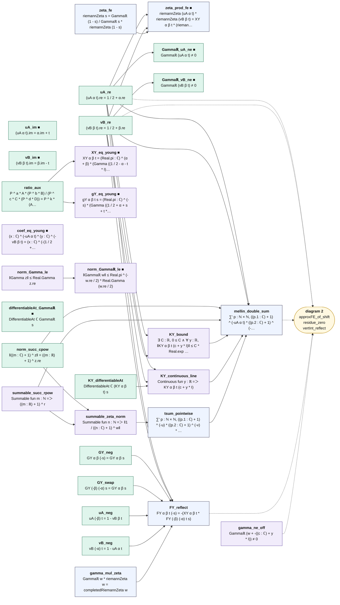
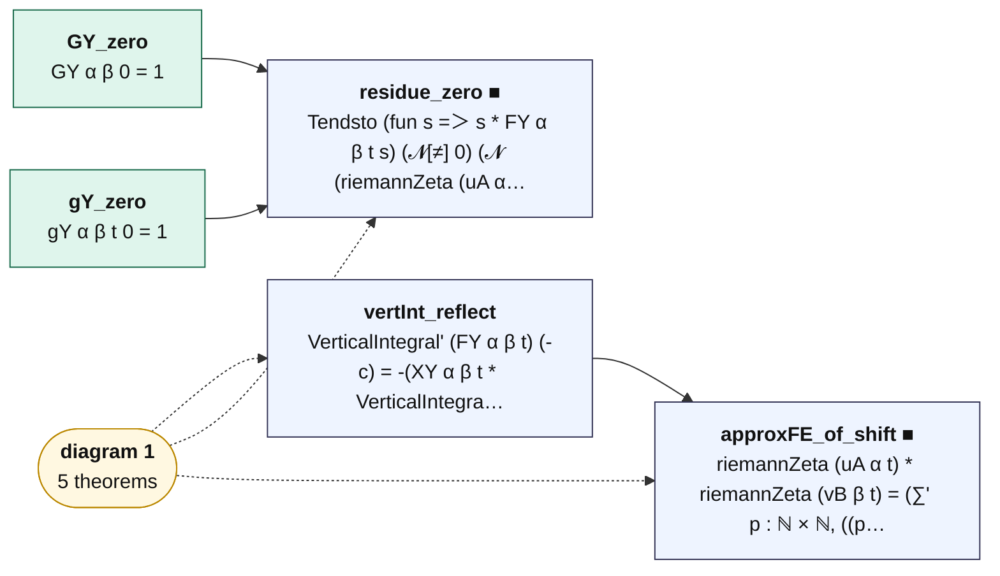

# `lean_stage3/Stage3/ApproxFE.lean`

> **Read from the source text.** This file changed after the last `python3 utilities/lean_map.py --dump`, so the arrows on this page are names occurring in each proof and have not been confirmed by Lean.

# ApproxFE — block S12 of `lean_stage3/design/stencil.md`, piece 1. 2026-11-25. Young's Lemma 4 (arXiv 1002.4403, §4): the approximate functional equation for `ζ(1/2+α+it)·ζ(1/2+β−it)` with the smoothing `G(s) = e^(s²)·p(s)`, `p(s) = ((α+β)² − (2s)²)/(α+β)²`.

35 theorems, 10 definitions, 766 lines. 

**Imports:** nothing in this tree  
**Imported by:** [`Stage3`](../lean_stage3/Stage3.md)

## The picture

### Diagram 1 of 2: `uA_re` to `gamma_ne_off`



### Diagram 2 of 2: `vertInt_reflect` to `approxFE_of_shift`



An arrow A → B reads "A is used in the proof of B". Green: counting, integers only. Violet: shape, analysis with no ζ. Blue: reads ζ. A name ending in ■ is an end: nothing else uses it. Red: contains `sorry`. Yellow: theorems in another file, counted; a dotted arrow crosses files. Definitions are not drawn; they are listed below the diagram.

## Definitions

<a name="ApproxFE-uA"></a>
### `ApproxFE.uA`

def · line 51

- **Is:** `` uA (α : ℂ) (t : ℝ) : ℂ := 1 / 2 + α + t * I noncomputable ``
- **Used by 23:** [`ApproxFE.FY`](#ApproxFE-FY), [`ApproxFE.FY_reflect`](#ApproxFE-FY_reflect), [`ApproxFE.Gammaℝ_uA_ne`](#ApproxFE-Gamma-_uA_ne), [`ApproxFE.KY_bound`](#ApproxFE-KY_bound), [`ApproxFE.KY_continuous_line`](#ApproxFE-KY_continuous_line), [`ApproxFE.KY_differentiableAt`](#ApproxFE-KY_differentiableAt), [`ApproxFE.StmtShift`](#ApproxFE-StmtShift), [`ApproxFE.XY`](#ApproxFE-XY), [`ApproxFE.XY_eq_young`](#ApproxFE-XY_eq_young), [`ApproxFE.approxFE_of_shift`](#ApproxFE-approxFE_of_shift), [`ApproxFE.coef_eq_young`](#ApproxFE-coef_eq_young), [`ApproxFE.gY`](#ApproxFE-gY), [`ApproxFE.gY_eq_young`](#ApproxFE-gY_eq_young), [`ApproxFE.gY_zero`](#ApproxFE-gY_zero), [`ApproxFE.mellin_double_sum`](#ApproxFE-mellin_double_sum), [`ApproxFE.resY`](#ApproxFE-resY), [`ApproxFE.residue_zero`](#ApproxFE-residue_zero), [`ApproxFE.uA_im`](#ApproxFE-uA_im), [`ApproxFE.uA_neg`](#ApproxFE-uA_neg), [`ApproxFE.uA_re`](#ApproxFE-uA_re), [`ApproxFE.vB_neg`](#ApproxFE-vB_neg), [`ApproxFE.vertInt_reflect`](#ApproxFE-vertInt_reflect), [`ApproxFE.zeta_prod_fe`](#ApproxFE-zeta_prod_fe)

<a name="ApproxFE-vB"></a>
### `ApproxFE.vB`

def · line 55

- **Is:** `` vB (β : ℂ) (t : ℝ) : ℂ := 1 / 2 + β - t * I noncomputable ``
- **Used by 23:** [`ApproxFE.FY`](#ApproxFE-FY), [`ApproxFE.FY_reflect`](#ApproxFE-FY_reflect), [`ApproxFE.Gammaℝ_vB_ne`](#ApproxFE-Gamma-_vB_ne), [`ApproxFE.KY_bound`](#ApproxFE-KY_bound), [`ApproxFE.KY_continuous_line`](#ApproxFE-KY_continuous_line), [`ApproxFE.KY_differentiableAt`](#ApproxFE-KY_differentiableAt), [`ApproxFE.StmtShift`](#ApproxFE-StmtShift), [`ApproxFE.XY`](#ApproxFE-XY), [`ApproxFE.XY_eq_young`](#ApproxFE-XY_eq_young), [`ApproxFE.approxFE_of_shift`](#ApproxFE-approxFE_of_shift), [`ApproxFE.coef_eq_young`](#ApproxFE-coef_eq_young), [`ApproxFE.gY`](#ApproxFE-gY), [`ApproxFE.gY_eq_young`](#ApproxFE-gY_eq_young), [`ApproxFE.gY_zero`](#ApproxFE-gY_zero), [`ApproxFE.mellin_double_sum`](#ApproxFE-mellin_double_sum), [`ApproxFE.resY`](#ApproxFE-resY), [`ApproxFE.residue_zero`](#ApproxFE-residue_zero), [`ApproxFE.uA_neg`](#ApproxFE-uA_neg), [`ApproxFE.vB_im`](#ApproxFE-vB_im), [`ApproxFE.vB_neg`](#ApproxFE-vB_neg), [`ApproxFE.vB_re`](#ApproxFE-vB_re), [`ApproxFE.vertInt_reflect`](#ApproxFE-vertInt_reflect), [`ApproxFE.zeta_prod_fe`](#ApproxFE-zeta_prod_fe)

<a name="ApproxFE-XY"></a>
### `ApproxFE.XY`

def · line 59

- **Is:** `` XY (α β : ℂ) (t : ℝ) : ℂ := Gammaℝ (1 - uA α t) * Gammaℝ (1 - vB β t) / (Gammaℝ (uA α t) * Gammaℝ (vB β t)) noncomputable ``
- **Built from:** [`ApproxFE.uA`](#ApproxFE-uA), [`ApproxFE.vB`](#ApproxFE-vB)
- **Used by 5:** [`ApproxFE.FY_reflect`](#ApproxFE-FY_reflect), [`ApproxFE.XY_eq_young`](#ApproxFE-XY_eq_young), [`ApproxFE.approxFE_of_shift`](#ApproxFE-approxFE_of_shift), [`ApproxFE.vertInt_reflect`](#ApproxFE-vertInt_reflect), [`ApproxFE.zeta_prod_fe`](#ApproxFE-zeta_prod_fe)

<a name="ApproxFE-GY"></a>
### `ApproxFE.GY`

def · line 64

- **Is:** `` GY (α β s : ℂ) : ℂ := cexp (s ^ 2) * (((α + β) ^ 2 - (2 * s) ^ 2) / (α + β) ^ 2) noncomputable ``
- **Used by 9:** [`ApproxFE.FY_reflect`](#ApproxFE-FY_reflect), [`ApproxFE.GY_neg`](#ApproxFE-GY_neg), [`ApproxFE.GY_swap`](#ApproxFE-GY_swap), [`ApproxFE.GY_zero`](#ApproxFE-GY_zero), [`ApproxFE.KY`](#ApproxFE-KY), [`ApproxFE.KY_bound`](#ApproxFE-KY_bound), [`ApproxFE.KY_differentiableAt`](#ApproxFE-KY_differentiableAt), [`ApproxFE.resY`](#ApproxFE-resY), [`ApproxFE.residue_zero`](#ApproxFE-residue_zero)

<a name="ApproxFE-gY"></a>
### `ApproxFE.gY`

def · line 68

- **Is:** `` gY (α β : ℂ) (t : ℝ) (s : ℂ) : ℂ := Gammaℝ (uA α t + s) * Gammaℝ (vB β t + s) / (Gammaℝ (uA α t) * Gammaℝ (vB β t)) noncomputable ``
- **Built from:** [`ApproxFE.uA`](#ApproxFE-uA), [`ApproxFE.vB`](#ApproxFE-vB)
- **Used by 7:** [`ApproxFE.FY_reflect`](#ApproxFE-FY_reflect), [`ApproxFE.KY`](#ApproxFE-KY), [`ApproxFE.KY_bound`](#ApproxFE-KY_bound), [`ApproxFE.KY_differentiableAt`](#ApproxFE-KY_differentiableAt), [`ApproxFE.gY_eq_young`](#ApproxFE-gY_eq_young), [`ApproxFE.gY_zero`](#ApproxFE-gY_zero), [`ApproxFE.residue_zero`](#ApproxFE-residue_zero)

<a name="ApproxFE-KY"></a>
### `ApproxFE.KY`

def · line 73

- **Is:** `` KY (α β : ℂ) (t : ℝ) (s : ℂ) : ℂ := GY α β s / s * gY α β t s noncomputable ``
- **Built from:** [`ApproxFE.GY`](#ApproxFE-GY), [`ApproxFE.gY`](#ApproxFE-gY)
- **Used by 8:** [`ApproxFE.FY`](#ApproxFE-FY), [`ApproxFE.FY_reflect`](#ApproxFE-FY_reflect), [`ApproxFE.KY_bound`](#ApproxFE-KY_bound), [`ApproxFE.KY_continuous_line`](#ApproxFE-KY_continuous_line), [`ApproxFE.KY_differentiableAt`](#ApproxFE-KY_differentiableAt), [`ApproxFE.VY`](#ApproxFE-VY), [`ApproxFE.mellin_double_sum`](#ApproxFE-mellin_double_sum), [`ApproxFE.residue_zero`](#ApproxFE-residue_zero)

<a name="ApproxFE-VY"></a>
### `ApproxFE.VY`

def · line 77

- **Is:** `` VY (α β : ℂ) (c x t : ℝ) : ℂ := VerticalIntegral' (fun s => KY α β t s * (x : ℂ) ^ (-s)) c noncomputable ``
- **Built from:** [`ApproxFE.KY`](#ApproxFE-KY)
- **Used by 2:** [`ApproxFE.approxFE_of_shift`](#ApproxFE-approxFE_of_shift), [`ApproxFE.mellin_double_sum`](#ApproxFE-mellin_double_sum)

<a name="ApproxFE-FY"></a>
### `ApproxFE.FY`

def · line 82

- **Is:** `` FY (α β : ℂ) (t : ℝ) (s : ℂ) : ℂ := KY α β t s * (riemannZeta (uA α t + s) * riemannZeta (vB β t + s)) ``
- **Built from:** [`ApproxFE.KY`](#ApproxFE-KY), [`ApproxFE.uA`](#ApproxFE-uA), [`ApproxFE.vB`](#ApproxFE-vB)
- **Used by 5:** [`ApproxFE.FY_reflect`](#ApproxFE-FY_reflect), [`ApproxFE.StmtShift`](#ApproxFE-StmtShift), [`ApproxFE.mellin_double_sum`](#ApproxFE-mellin_double_sum), [`ApproxFE.residue_zero`](#ApproxFE-residue_zero), [`ApproxFE.vertInt_reflect`](#ApproxFE-vertInt_reflect)

<a name="ApproxFE-resY"></a>
### `ApproxFE.resY`

def · line 679

- **Is:** `` resY (α β : ℂ) (t : ℝ) : ℂ := (GY α β (1 - uA α t) / (1 - uA α t) * completedRiemannZeta (vB β t + 1 - uA α t) + GY α β (-uA α t) / uA α t * completedRiemannZeta (vB β t - uA α t) + GY α β (1 - vB β t) / (1 - vB β t) * completedRiemannZeta (uA α t + 1 - vB β t) + GY α β (-vB β t) / vB β t * completedRiemannZeta (uA α t - vB β t)) / (Gammaℝ (uA α t) * Gammaℝ (vB β t)) noncomputable ``
- **Built from:** [`ApproxFE.GY`](#ApproxFE-GY), [`ApproxFE.uA`](#ApproxFE-uA), [`ApproxFE.vB`](#ApproxFE-vB)
- **Used by 2:** [`ApproxFE.StmtShift`](#ApproxFE-StmtShift), [`ApproxFE.approxFE_of_shift`](#ApproxFE-approxFE_of_shift)

<a name="ApproxFE-StmtShift"></a>
### `ApproxFE.StmtShift`

def · line 695

- **Is:** `` StmtShift (α β : ℂ) (t c : ℝ) : Prop := VerticalIntegral' (FY α β t) c - VerticalIntegral' (FY α β t) (-c) = riemannZeta (uA α t) * riemannZeta (vB β t) + resY α β t ``
- **Built from:** [`ApproxFE.FY`](#ApproxFE-FY), [`ApproxFE.resY`](#ApproxFE-resY), [`ApproxFE.uA`](#ApproxFE-uA), [`ApproxFE.vB`](#ApproxFE-vB)
- **Used by 1:** [`ApproxFE.approxFE_of_shift`](#ApproxFE-approxFE_of_shift)

## Theorems

<a name="ApproxFE-uA_re"></a>
### `ApproxFE.uA_re`

line 85 · arrows read from text

**Counting.** Integers only: nothing in its statement or proof, or in anything it rests on, uses analysis or ζ.

**Proves**

```lean
(uA α t).re = 1 / 2 + α.re
```

**Needs** (its hypotheses)

  - `` α : ℂ ``
  - `` t : ℝ ``

**Fed by:** no theorem of this repo; it stands on Mathlib and the definitions below.

**Definitions its proof touches:** [`ApproxFE.uA`](#ApproxFE-uA)

**Feeds** (8 that use it)

  - [`ApproxFE.FY_reflect`](#ApproxFE-FY_reflect) — `` FY α β t (-s) = -(XY α β t * FY (-β) (-α) t s) ``
  - [`ApproxFE.Gammaℝ_uA_ne`](#ApproxFE-Gamma-_uA_ne) — `` Gammaℝ (uA α t) ≠ 0 ``
  - [`ApproxFE.KY_bound`](#ApproxFE-KY_bound) — `` ∃ C : ℝ, 0 ≤ C ∧ ∀ y : ℝ, ‖KY α β t (c + y * I)‖ ≤ C * Real.exp (-(1 / 2) * y ^ 2) ``
  - [`ApproxFE.KY_continuous_line`](#ApproxFE-KY_continuous_line) — `` Continuous fun y : ℝ => KY α β t (c + y * I) ``
  - [`ApproxFE.mellin_double_sum`](#ApproxFE-mellin_double_sum) — `` ∑' p : ℕ × ℕ, ((p.1 : ℂ) + 1) ^ (-uA α t) * ((p.2 : ℂ) + 1) ^ (-vB β t) * VY α β c (((p.1 : ℝ) + 1) * ((p.2 : ℝ) + 1)) t = VerticalIntegral' (FY α β t… ``
  - [`ApproxFE.residue_zero`](#ApproxFE-residue_zero) — `` Tendsto (fun s => s * FY α β t s) (𝓝[≠] 0) (𝓝 (riemannZeta (uA α t) * riemannZeta (vB β t))) ``
  - [`ApproxFE.vertInt_reflect`](#ApproxFE-vertInt_reflect) — `` VerticalIntegral' (FY α β t) (-c) = -(XY α β t * VerticalIntegral' (FY (-β) (-α) t) c) ``
  - [`ApproxFE.zeta_prod_fe`](#ApproxFE-zeta_prod_fe) — `` riemannZeta (uA α t) * riemannZeta (vB β t) = XY α β t * (riemannZeta (1 / 2 - α - t * I) * riemannZeta (1 / 2 - β + t * I)) ``

<a name="ApproxFE-vB_re"></a>
### `ApproxFE.vB_re`

line 88 · arrows read from text

**Counting.** Integers only: nothing in its statement or proof, or in anything it rests on, uses analysis or ζ.

**Proves**

```lean
(vB β t).re = 1 / 2 + β.re
```

**Needs** (its hypotheses)

  - `` β : ℂ ``
  - `` t : ℝ ``

**Fed by:** no theorem of this repo; it stands on Mathlib and the definitions below.

**Definitions its proof touches:** [`ApproxFE.vB`](#ApproxFE-vB)

**Feeds** (8 that use it)

  - [`ApproxFE.FY_reflect`](#ApproxFE-FY_reflect) — `` FY α β t (-s) = -(XY α β t * FY (-β) (-α) t s) ``
  - [`ApproxFE.Gammaℝ_vB_ne`](#ApproxFE-Gamma-_vB_ne) — `` Gammaℝ (vB β t) ≠ 0 ``
  - [`ApproxFE.KY_bound`](#ApproxFE-KY_bound) — `` ∃ C : ℝ, 0 ≤ C ∧ ∀ y : ℝ, ‖KY α β t (c + y * I)‖ ≤ C * Real.exp (-(1 / 2) * y ^ 2) ``
  - [`ApproxFE.KY_continuous_line`](#ApproxFE-KY_continuous_line) — `` Continuous fun y : ℝ => KY α β t (c + y * I) ``
  - [`ApproxFE.mellin_double_sum`](#ApproxFE-mellin_double_sum) — `` ∑' p : ℕ × ℕ, ((p.1 : ℂ) + 1) ^ (-uA α t) * ((p.2 : ℂ) + 1) ^ (-vB β t) * VY α β c (((p.1 : ℝ) + 1) * ((p.2 : ℝ) + 1)) t = VerticalIntegral' (FY α β t… ``
  - [`ApproxFE.residue_zero`](#ApproxFE-residue_zero) — `` Tendsto (fun s => s * FY α β t s) (𝓝[≠] 0) (𝓝 (riemannZeta (uA α t) * riemannZeta (vB β t))) ``
  - [`ApproxFE.vertInt_reflect`](#ApproxFE-vertInt_reflect) — `` VerticalIntegral' (FY α β t) (-c) = -(XY α β t * VerticalIntegral' (FY (-β) (-α) t) c) ``
  - [`ApproxFE.zeta_prod_fe`](#ApproxFE-zeta_prod_fe) — `` riemannZeta (uA α t) * riemannZeta (vB β t) = XY α β t * (riemannZeta (1 / 2 - α - t * I) * riemannZeta (1 / 2 - β + t * I)) ``

<a name="ApproxFE-uA_im"></a>
### `ApproxFE.uA_im`

line 91 · arrows read from text

**Counting.** Integers only: nothing in its statement or proof, or in anything it rests on, uses analysis or ζ.

**Proves**

```lean
(uA α t).im = α.im + t
```

**Needs** (its hypotheses)

  - `` α : ℂ ``
  - `` t : ℝ ``

**Fed by:** no theorem of this repo; it stands on Mathlib and the definitions below.

**Definitions its proof touches:** [`ApproxFE.uA`](#ApproxFE-uA)

**Feeds:** nothing. It is an end.

<a name="ApproxFE-vB_im"></a>
### `ApproxFE.vB_im`

line 94 · arrows read from text

**Counting.** Integers only: nothing in its statement or proof, or in anything it rests on, uses analysis or ζ.

**Proves**

```lean
(vB β t).im = β.im - t
```

**Needs** (its hypotheses)

  - `` β : ℂ ``
  - `` t : ℝ ``

**Fed by:** no theorem of this repo; it stands on Mathlib and the definitions below.

**Definitions its proof touches:** [`ApproxFE.vB`](#ApproxFE-vB)

**Feeds:** nothing. It is an end.

<a name="ApproxFE-zeta_fe"></a>
### `ApproxFE.zeta_fe`

line 100 · arrows read from text

**Reads ζ.** It, or something it rests on, uses the zeta function, its zeros or the Riemann hypothesis.

**Why.** The functional equation in Young's shape: `ζ s = Gammaℝ(1−s)/Gammaℝ s · ζ(1−s)`.

**Proves**

```lean
riemannZeta s = Gammaℝ (1 - s) / Gammaℝ s * riemannZeta (1 - s)
```

**Needs** (its hypotheses)

  - `` hs : Gammaℝ s ≠ 0 ``
  - `` h1 : 0 < (1 - s).re ``

**Fed by:** no theorem of this repo; it stands on Mathlib.

**Feeds** (1 that use it)

  - [`ApproxFE.zeta_prod_fe`](#ApproxFE-zeta_prod_fe) — `` riemannZeta (uA α t) * riemannZeta (vB β t) = XY α β t * (riemannZeta (1 / 2 - α - t * I) * riemannZeta (1 / 2 - β + t * I)) ``

<a name="ApproxFE-zeta_prod_fe"></a>
### `ApproxFE.zeta_prod_fe`

line 117 · arrows read from text

**Reads ζ.** It, or something it rests on, uses the zeta function, its zeros or the Riemann hypothesis.

**Why.** Piece 1. For `Re α, Re β < 1/2`, `ζ(1/2+α+it) ζ(1/2+β−it) = X_{α,β,t} · ζ(1/2−α−it) ζ(1/2−β+it)`.

**Proves**

```lean
riemannZeta (uA α t) * riemannZeta (vB β t) = XY α β t * (riemannZeta (1 / 2 - α - t * I) * riemannZeta (1 / 2 - β + t * I))
```

**Needs** (its hypotheses)

  - `` hα : α.re < 1 / 2 ``
  - `` hβ : β.re < 1 / 2 ``
  - `` hu : Gammaℝ (uA α t) ≠ 0 ``
  - `` hv : Gammaℝ (vB β t) ≠ 0 ``

**Fed by** (3 theorems its proof uses)

  - [`ApproxFE.uA_re`](#ApproxFE-uA_re) — `` (uA α t).re = 1 / 2 + α.re ``
  - [`ApproxFE.vB_re`](#ApproxFE-vB_re) — `` (vB β t).re = 1 / 2 + β.re ``
  - [`ApproxFE.zeta_fe`](#ApproxFE-zeta_fe) — `` riemannZeta s = Gammaℝ (1 - s) / Gammaℝ s * riemannZeta (1 - s) ``

**Definitions its proof touches:** [`ApproxFE.XY`](#ApproxFE-XY), [`ApproxFE.uA`](#ApproxFE-uA), [`ApproxFE.vB`](#ApproxFE-vB)

**Feeds:** nothing. It is an end.

<a name="ApproxFE-Gamma-_uA_ne"></a>
### `ApproxFE.Gammaℝ_uA_ne`

line 141 · arrows read from text

**Counting.** Integers only: nothing in its statement or proof, or in anything it rests on, uses analysis or ζ.

**Why.** `Gammaℝ (uA α t) ≠ 0` once `Re α > −1/2`.

**Proves**

```lean
Gammaℝ (uA α t) ≠ 0
```

**Needs** (its hypotheses)

  - `` t : ℝ ``
  - `` hα : -(1 / 2) < α.re ``

**Fed by** (1 theorem its proof uses)

  - [`ApproxFE.uA_re`](#ApproxFE-uA_re) — `` (uA α t).re = 1 / 2 + α.re ``

**Definitions its proof touches:** [`ApproxFE.uA`](#ApproxFE-uA)

**Feeds:** nothing. It is an end.

<a name="ApproxFE-Gamma-_vB_ne"></a>
### `ApproxFE.Gammaℝ_vB_ne`

line 145 · arrows read from text

**Counting.** Integers only: nothing in its statement or proof, or in anything it rests on, uses analysis or ζ.

**Why.** `Gammaℝ (vB β t) ≠ 0` once `Re β > −1/2`.

**Proves**

```lean
Gammaℝ (vB β t) ≠ 0
```

**Needs** (its hypotheses)

  - `` t : ℝ ``
  - `` hβ : -(1 / 2) < β.re ``

**Fed by** (1 theorem its proof uses)

  - [`ApproxFE.vB_re`](#ApproxFE-vB_re) — `` (vB β t).re = 1 / 2 + β.re ``

**Definitions its proof touches:** [`ApproxFE.vB`](#ApproxFE-vB)

**Feeds:** nothing. It is an end.

<a name="ApproxFE-ratio_aux"></a>
### `ApproxFE.ratio_aux`

line 149 · arrows read from text

**Counting.** Integers only: nothing in its statement or proof, or in anything it rests on, uses analysis or ζ.

**Why.** A ratio of four `π`-powers times Gamma values.

**Proves**

```lean
P ^ a * A * (P ^ b * B) / (P ^ c * C * (P ^ d * D)) = P ^ k * (A * B) / (C * D)
```

**Needs** (its hypotheses)

  - `` P A B C D a b c d k : ℂ ``
  - `` hP : P ≠ 0 ``
  - `` hk : a + b = k + (c + d) ``

**Fed by:** no theorem of this repo; it stands on Mathlib.

**Feeds** (2 that use it)

  - [`ApproxFE.XY_eq_young`](#ApproxFE-XY_eq_young) — `` XY α β t = (Real.pi : ℂ) ^ (α + β) * (Gamma ((1 / 2 - α - t * I) / 2) * Gamma ((1 / 2 - β + t * I) / 2)) / (Gamma ((1 / 2 + α + t * I) / 2) * Gamma ((… ``
  - [`ApproxFE.gY_eq_young`](#ApproxFE-gY_eq_young) — `` gY α β t s = (Real.pi : ℂ) ^ (-s) * (Gamma ((1 / 2 + α + s + t * I) / 2) * Gamma ((1 / 2 + β + s - t * I) / 2)) / (Gamma ((1 / 2 + α + t * I) / 2) * G… ``

<a name="ApproxFE-XY_eq_young"></a>
### `ApproxFE.XY_eq_young`

line 165 · arrows read from text

**Shape.** Uses real or complex analysis; nothing in it or beneath it reads ζ.

**Why.** Young's form of `X_{α,β,t}`: `π^(α+β) Γ((1/2−α−it)/2) Γ((1/2−β+it)/2) / (Γ((1/2+α+it)/2) Γ((1/2+β−it)/2))`.

**Proves**

```lean
XY α β t = (Real.pi : ℂ) ^ (α + β) * (Gamma ((1 / 2 - α - t * I) / 2) * Gamma ((1 / 2 - β + t * I) / 2)) / (Gamma ((1 / 2 + α + t * I) / 2) * Gamma ((1 / 2 + β - t * I) / 2))
```

**Needs** (its hypotheses)

  - `` α β : ℂ ``
  - `` t : ℝ ``

**Fed by** (1 theorem its proof uses)

  - [`ApproxFE.ratio_aux`](#ApproxFE-ratio_aux) — `` P ^ a * A * (P ^ b * B) / (P ^ c * C * (P ^ d * D)) = P ^ k * (A * B) / (C * D) ``

**Definitions its proof touches:** [`ApproxFE.XY`](#ApproxFE-XY), [`ApproxFE.uA`](#ApproxFE-uA), [`ApproxFE.vB`](#ApproxFE-vB)

**Feeds:** nothing. It is an end.

<a name="ApproxFE-gY_eq_young"></a>
### `ApproxFE.gY_eq_young`

line 183 · arrows read from text

**Shape.** Uses real or complex analysis; nothing in it or beneath it reads ζ.

**Why.** Young's form of `g_{α,β}(s,t)`: `π^(−s) Γ((u+s)/2) Γ((v+s)/2) / (Γ(u/2) Γ(v/2))`.

**Proves**

```lean
gY α β t s = (Real.pi : ℂ) ^ (-s) * (Gamma ((1 / 2 + α + s + t * I) / 2) * Gamma ((1 / 2 + β + s - t * I) / 2)) / (Gamma ((1 / 2 + α + t * I) / 2) * Gamma ((1 / 2 + β - t * I) / 2))
```

**Needs** (its hypotheses)

  - `` α β : ℂ ``
  - `` t : ℝ ``
  - `` s : ℂ ``

**Fed by** (1 theorem its proof uses)

  - [`ApproxFE.ratio_aux`](#ApproxFE-ratio_aux) — `` P ^ a * A * (P ^ b * B) / (P ^ c * C * (P ^ d * D)) = P ^ k * (A * B) / (C * D) ``

**Definitions its proof touches:** [`ApproxFE.gY`](#ApproxFE-gY), [`ApproxFE.uA`](#ApproxFE-uA), [`ApproxFE.vB`](#ApproxFE-vB)

**Feeds:** nothing. It is an end.

<a name="ApproxFE-coef_eq_young"></a>
### `ApproxFE.coef_eq_young`

line 201 · arrows read from text

**Shape.** Uses real or complex analysis; nothing in it or beneath it reads ζ.

**Why.** The coefficients in Young's form: for `x, y > 0`, `x^(−u) y^(−v) = x^(−1/2−α) y^(−1/2−β) (x/y)^(−it)`.

**Proves**

```lean
(x : ℂ) ^ (-uA α t) * (y : ℂ) ^ (-vB β t) = (x : ℂ) ^ (-(1 / 2 + α)) * (y : ℂ) ^ (-(1 / 2 + β)) * ((x / y : ℝ) : ℂ) ^ (-(t * I))
```

**Needs** (its hypotheses)

  - `` α β : ℂ ``
  - `` t : ℝ ``
  - `` hx : 0 < x ``
  - `` hy : 0 < y ``

**Fed by:** no theorem of this repo; it stands on Mathlib and the definitions below.

**Definitions its proof touches:** [`ApproxFE.uA`](#ApproxFE-uA), [`ApproxFE.vB`](#ApproxFE-vB)

**Feeds:** nothing. It is an end.

<a name="ApproxFE-norm_Gamma_le"></a>
### `ApproxFE.norm_Gamma_le`

line 219 · arrows read from text

**Shape.** Uses real or complex analysis; nothing in it or beneath it reads ζ.

**Why.** `‖Γ z‖ ≤ Γ(Re z)` right of zero (the Euler integral; PNT+ `norm_le_Gamma_re`).

**Proves**

```lean
‖Gamma z‖ ≤ Real.Gamma z.re
```

**Needs** (its hypotheses)

  - `` hz : 0 < z.re ``

**Fed by:** no theorem of this repo; it stands on Mathlib.

**Feeds** (1 that use it)

  - [`ApproxFE.norm_Gammaℝ_le`](#ApproxFE-norm_Gamma-_le) — `` ‖Gammaℝ w‖ ≤ Real.pi ^ (-w.re / 2) * Real.Gamma (w.re / 2) ``

<a name="ApproxFE-norm_Gamma-_le"></a>
### `ApproxFE.norm_Gammaℝ_le`

line 235 · arrows read from text

**Shape.** Uses real or complex analysis; nothing in it or beneath it reads ζ.

**Why.** `‖Gammaℝ w‖ ≤ π^(−Re w/2) Γ(Re w/2)` right of zero.

**Proves**

```lean
‖Gammaℝ w‖ ≤ Real.pi ^ (-w.re / 2) * Real.Gamma (w.re / 2)
```

**Needs** (its hypotheses)

  - `` hw : 0 < w.re ``

**Fed by** (1 theorem its proof uses)

  - [`ApproxFE.norm_Gamma_le`](#ApproxFE-norm_Gamma_le) — `` ‖Gamma z‖ ≤ Real.Gamma z.re ``

**Feeds:** nothing. It is an end.

<a name="ApproxFE-differentiableAt_Gamma-"></a>
### `ApproxFE.differentiableAt_Gammaℝ`

line 246 · arrows read from text

**Counting.** Integers only: nothing in its statement or proof, or in anything it rests on, uses analysis or ζ.

**Why.** `Gammaℝ` is differentiable wherever it does not vanish.

**Proves**

```lean
DifferentiableAt ℂ Gammaℝ s
```

**Needs** (its hypotheses)

  - `` hs : Gammaℝ s ≠ 0 ``

**Fed by:** no theorem of this repo; it stands on Mathlib.

**Feeds:** nothing. It connects to nothing.

<a name="ApproxFE-norm_succ_cpow"></a>
### `ApproxFE.norm_succ_cpow`

line 254 · arrows read from text

**Counting.** Integers only: nothing in its statement or proof, or in anything it rests on, uses analysis or ζ.

**Why.** The norm of a shifted natural power.

**Proves**

```lean
‖((m : ℂ) + 1) ^ z‖ = ((m : ℝ) + 1) ^ z.re
```

**Needs** (its hypotheses)

  - `` m : ℕ ``
  - `` z : ℂ ``

**Fed by:** no theorem of this repo; it stands on Mathlib.

**Feeds** (2 that use it)

  - [`ApproxFE.mellin_double_sum`](#ApproxFE-mellin_double_sum) — `` ∑' p : ℕ × ℕ, ((p.1 : ℂ) + 1) ^ (-uA α t) * ((p.2 : ℂ) + 1) ^ (-vB β t) * VY α β c (((p.1 : ℝ) + 1) * ((p.2 : ℝ) + 1)) t = VerticalIntegral' (FY α β t… ``
  - [`ApproxFE.summable_zeta_norm`](#ApproxFE-summable_zeta_norm) — `` Summable fun n : ℕ => ‖1 / ((n : ℂ) + 1) ^ w‖ ``

<a name="ApproxFE-summable_succ_rpow"></a>
### `ApproxFE.summable_succ_rpow`

line 260 · arrows read from text

**Shape.** Uses real or complex analysis; nothing in it or beneath it reads ζ.

**Why.** `Σ (m+1)^r` converges for `r < −1`.

**Proves**

```lean
Summable fun m : ℕ => ((m : ℝ) + 1) ^ r
```

**Needs** (its hypotheses)

  - `` hr : r < -1 ``

**Fed by:** no theorem of this repo; it stands on Mathlib.

**Feeds** (2 that use it)

  - [`ApproxFE.mellin_double_sum`](#ApproxFE-mellin_double_sum) — `` ∑' p : ℕ × ℕ, ((p.1 : ℂ) + 1) ^ (-uA α t) * ((p.2 : ℂ) + 1) ^ (-vB β t) * VY α β c (((p.1 : ℝ) + 1) * ((p.2 : ℝ) + 1)) t = VerticalIntegral' (FY α β t… ``
  - [`ApproxFE.summable_zeta_norm`](#ApproxFE-summable_zeta_norm) — `` Summable fun n : ℕ => ‖1 / ((n : ℂ) + 1) ^ w‖ ``

<a name="ApproxFE-summable_zeta_norm"></a>
### `ApproxFE.summable_zeta_norm`

line 268 · arrows read from text

**Shape.** Uses real or complex analysis; nothing in it or beneath it reads ζ.

**Why.** The Dirichlet series of `ζ` converges absolutely for `Re w > 1`.

**Proves**

```lean
Summable fun n : ℕ => ‖1 / ((n : ℂ) + 1) ^ w‖
```

**Needs** (its hypotheses)

  - `` hw : 1 < w.re ``

**Fed by** (2 theorems its proof uses)

  - [`ApproxFE.norm_succ_cpow`](#ApproxFE-norm_succ_cpow) — `` ‖((m : ℂ) + 1) ^ z‖ = ((m : ℝ) + 1) ^ z.re ``
  - [`ApproxFE.summable_succ_rpow`](#ApproxFE-summable_succ_rpow) — `` Summable fun m : ℕ => ((m : ℝ) + 1) ^ r ``

**Feeds** (1 that use it)

  - [`ApproxFE.tsum_pointwise`](#ApproxFE-tsum_pointwise) — `` ∑' p : ℕ × ℕ, ((p.1 : ℂ) + 1) ^ (-u) * ((p.2 : ℂ) + 1) ^ (-v) * (K * ((((p.1 : ℝ) + 1) * ((p.2 : ℝ) + 1) : ℝ) : ℂ) ^ (-s)) = K * (riemannZeta (u + s) … ``

<a name="ApproxFE-KY_bound"></a>
### `ApproxFE.KY_bound`

line 275 · arrows read from text

**Shape.** Uses real or complex analysis; nothing in it or beneath it reads ζ.

**Why.** On `Re s = c > 0` with `Re(u+s), Re(v+s) > 0`, the kernel `G(s)/s·g(s,t)` is at most a constant times `e^(−y²/2)`.

**Proves**

```lean
∃ C : ℝ, 0 ≤ C ∧ ∀ y : ℝ, ‖KY α β t (c + y * I)‖ ≤ C * Real.exp (-(1 / 2) * y ^ 2)
```

**Needs** (its hypotheses)

  - `` hc : 0 < c ``
  - `` hu : 0 < 1 / 2 + α.re + c ``
  - `` hv : 0 < 1 / 2 + β.re + c ``

**Fed by** (2 theorems its proof uses)

  - [`ApproxFE.uA_re`](#ApproxFE-uA_re) — `` (uA α t).re = 1 / 2 + α.re ``
  - [`ApproxFE.vB_re`](#ApproxFE-vB_re) — `` (vB β t).re = 1 / 2 + β.re ``

**Definitions its proof touches:** [`ApproxFE.GY`](#ApproxFE-GY), [`ApproxFE.KY`](#ApproxFE-KY), [`ApproxFE.gY`](#ApproxFE-gY), [`ApproxFE.uA`](#ApproxFE-uA), [`ApproxFE.vB`](#ApproxFE-vB)

**Feeds** (1 that use it)

  - [`ApproxFE.mellin_double_sum`](#ApproxFE-mellin_double_sum) — `` ∑' p : ℕ × ℕ, ((p.1 : ℂ) + 1) ^ (-uA α t) * ((p.2 : ℂ) + 1) ^ (-vB β t) * VY α β c (((p.1 : ℝ) + 1) * ((p.2 : ℝ) + 1)) t = VerticalIntegral' (FY α β t… ``

<a name="ApproxFE-KY_differentiableAt"></a>
### `ApproxFE.KY_differentiableAt`

line 366 · arrows read from text

**Counting.** Integers only: nothing in its statement or proof, or in anything it rests on, uses analysis or ζ.

**Why.** The kernel is differentiable at `s ≠ 0` where `Gammaℝ(u+s), Gammaℝ(v+s) ≠ 0`.

**Proves**

```lean
DifferentiableAt ℂ (KY α β t) s
```

**Needs** (its hypotheses)

  - `` hs : s ≠ 0 ``
  - `` h1 : Gammaℝ (uA α t + s) ≠ 0 ``
  - `` h2 : Gammaℝ (vB β t + s) ≠ 0 ``

**Fed by:** no theorem of this repo; it stands on Mathlib and the definitions below.

**Definitions its proof touches:** [`ApproxFE.GY`](#ApproxFE-GY), [`ApproxFE.KY`](#ApproxFE-KY), [`ApproxFE.gY`](#ApproxFE-gY), [`ApproxFE.uA`](#ApproxFE-uA), [`ApproxFE.vB`](#ApproxFE-vB)

**Feeds** (1 that use it)

  - [`ApproxFE.KY_continuous_line`](#ApproxFE-KY_continuous_line) — `` Continuous fun y : ℝ => KY α β t (c + y * I) ``

<a name="ApproxFE-KY_continuous_line"></a>
### `ApproxFE.KY_continuous_line`

line 383 · arrows read from text

**Shape.** Uses real or complex analysis; nothing in it or beneath it reads ζ.

**Why.** On `Re s = c > 0` with `Re(u+s), Re(v+s) > 0`, the kernel is continuous in `y`.

**Proves**

```lean
Continuous fun y : ℝ => KY α β t (c + y * I)
```

**Needs** (its hypotheses)

  - `` hc : 0 < c ``
  - `` hu : 0 < 1 / 2 + α.re + c ``
  - `` hv : 0 < 1 / 2 + β.re + c ``

**Fed by** (3 theorems its proof uses)

  - [`ApproxFE.KY_differentiableAt`](#ApproxFE-KY_differentiableAt) — `` DifferentiableAt ℂ (KY α β t) s ``
  - [`ApproxFE.uA_re`](#ApproxFE-uA_re) — `` (uA α t).re = 1 / 2 + α.re ``
  - [`ApproxFE.vB_re`](#ApproxFE-vB_re) — `` (vB β t).re = 1 / 2 + β.re ``

**Definitions its proof touches:** [`ApproxFE.KY`](#ApproxFE-KY), [`ApproxFE.uA`](#ApproxFE-uA), [`ApproxFE.vB`](#ApproxFE-vB)

**Feeds** (1 that use it)

  - [`ApproxFE.mellin_double_sum`](#ApproxFE-mellin_double_sum) — `` ∑' p : ℕ × ℕ, ((p.1 : ℂ) + 1) ^ (-uA α t) * ((p.2 : ℂ) + 1) ^ (-vB β t) * VY α β c (((p.1 : ℝ) + 1) * ((p.2 : ℝ) + 1)) t = VerticalIntegral' (FY α β t… ``

<a name="ApproxFE-tsum_pointwise"></a>
### `ApproxFE.tsum_pointwise`

line 402 · arrows read from text

**Reads ζ.** It, or something it rests on, uses the zeta function, its zeros or the Riemann hypothesis.

**Why.** The pointwise sum: `Σ m^(−u) n^(−v) K(s) (mn)^(−s) = K(s) ζ(u+s) ζ(v+s)`.

**Proves**

```lean
∑' p : ℕ × ℕ, ((p.1 : ℂ) + 1) ^ (-u) * ((p.2 : ℂ) + 1) ^ (-v) * (K * ((((p.1 : ℝ) + 1) * ((p.2 : ℝ) + 1) : ℝ) : ℂ) ^ (-s)) = K * (riemannZeta (u + s) * riemannZeta (v + s))
```

**Needs** (its hypotheses)

  - `` h1 : 1 < (u + s).re ``
  - `` h2 : 1 < (v + s).re ``

**Fed by** (1 theorem its proof uses)

  - [`ApproxFE.summable_zeta_norm`](#ApproxFE-summable_zeta_norm) — `` Summable fun n : ℕ => ‖1 / ((n : ℂ) + 1) ^ w‖ ``

**Feeds** (1 that use it)

  - [`ApproxFE.mellin_double_sum`](#ApproxFE-mellin_double_sum) — `` ∑' p : ℕ × ℕ, ((p.1 : ℂ) + 1) ^ (-uA α t) * ((p.2 : ℂ) + 1) ^ (-vB β t) * VY α β c (((p.1 : ℝ) + 1) * ((p.2 : ℝ) + 1)) t = VerticalIntegral' (FY α β t… ``

<a name="ApproxFE-mellin_double_sum"></a>
### `ApproxFE.mellin_double_sum`

line 426 · arrows read from text

**Reads ζ.** It, or something it rests on, uses the zeta function, its zeros or the Riemann hypothesis.

**Why.** Piece 2. For `c > 0` with `c + Re α > 1/2` and `c + Re β > 1/2`, `Σ_{m,n} m^(−1/2−α−it) n^(−1/2−β+it) V_c(mn,t) = (1/2πi) ∫_(c) G(s)/s g(s,t) ζ(u+s) ζ(v+s) ds`.

**Proves**

```lean
∑' p : ℕ × ℕ, ((p.1 : ℂ) + 1) ^ (-uA α t) * ((p.2 : ℂ) + 1) ^ (-vB β t) * VY α β c (((p.1 : ℝ) + 1) * ((p.2 : ℝ) + 1)) t = VerticalIntegral' (FY α β t) c
```

**Needs** (its hypotheses)

  - `` hc : 0 < c ``
  - `` hu : 1 / 2 < c + α.re ``
  - `` hv : 1 / 2 < c + β.re ``

**Fed by** (7 theorems its proof uses)

  - [`ApproxFE.KY_bound`](#ApproxFE-KY_bound) — `` ∃ C : ℝ, 0 ≤ C ∧ ∀ y : ℝ, ‖KY α β t (c + y * I)‖ ≤ C * Real.exp (-(1 / 2) * y ^ 2) ``
  - [`ApproxFE.KY_continuous_line`](#ApproxFE-KY_continuous_line) — `` Continuous fun y : ℝ => KY α β t (c + y * I) ``
  - [`ApproxFE.norm_succ_cpow`](#ApproxFE-norm_succ_cpow) — `` ‖((m : ℂ) + 1) ^ z‖ = ((m : ℝ) + 1) ^ z.re ``
  - [`ApproxFE.summable_succ_rpow`](#ApproxFE-summable_succ_rpow) — `` Summable fun m : ℕ => ((m : ℝ) + 1) ^ r ``
  - [`ApproxFE.tsum_pointwise`](#ApproxFE-tsum_pointwise) — `` ∑' p : ℕ × ℕ, ((p.1 : ℂ) + 1) ^ (-u) * ((p.2 : ℂ) + 1) ^ (-v) * (K * ((((p.1 : ℝ) + 1) * ((p.2 : ℝ) + 1) : ℝ) : ℂ) ^ (-s)) = K * (riemannZeta (u + s) … ``
  - [`ApproxFE.uA_re`](#ApproxFE-uA_re) — `` (uA α t).re = 1 / 2 + α.re ``
  - [`ApproxFE.vB_re`](#ApproxFE-vB_re) — `` (vB β t).re = 1 / 2 + β.re ``

**Definitions its proof touches:** [`ApproxFE.FY`](#ApproxFE-FY), [`ApproxFE.KY`](#ApproxFE-KY), [`ApproxFE.VY`](#ApproxFE-VY), [`ApproxFE.uA`](#ApproxFE-uA), [`ApproxFE.vB`](#ApproxFE-vB)

**Feeds** (1 that use it)

  - [`ApproxFE.approxFE_of_shift`](#ApproxFE-approxFE_of_shift) — `` riemannZeta (uA α t) * riemannZeta (vB β t) = (∑' p : ℕ × ℕ, ((p.1 : ℂ) + 1) ^ (-uA α t) * ((p.2 : ℂ) + 1) ^ (-vB β t) * VY α β c (((p.1 : ℝ) + 1) * (… ``

<a name="ApproxFE-GY_neg"></a>
### `ApproxFE.GY_neg`

line 499 · arrows read from text

**Counting.** Integers only: nothing in its statement or proof, or in anything it rests on, uses analysis or ζ.

**Why.** `G` is even.

**Proves**

```lean
GY α β (-s) = GY α β s
```

**Needs** (its hypotheses)

  - `` α β s : ℂ ``

**Fed by:** no theorem of this repo; it stands on Mathlib and the definitions below.

**Definitions its proof touches:** [`ApproxFE.GY`](#ApproxFE-GY)

**Feeds** (1 that use it)

  - [`ApproxFE.FY_reflect`](#ApproxFE-FY_reflect) — `` FY α β t (-s) = -(XY α β t * FY (-β) (-α) t s) ``

<a name="ApproxFE-GY_swap"></a>
### `ApproxFE.GY_swap`

line 504 · arrows read from text

**Counting.** Integers only: nothing in its statement or proof, or in anything it rests on, uses analysis or ζ.

**Why.** `G` for `(−β,−α)` is `G` for `(α,β)`.

**Proves**

```lean
GY (-β) (-α) s = GY α β s
```

**Needs** (its hypotheses)

  - `` α β s : ℂ ``

**Fed by:** no theorem of this repo; it stands on Mathlib and the definitions below.

**Definitions its proof touches:** [`ApproxFE.GY`](#ApproxFE-GY)

**Feeds** (1 that use it)

  - [`ApproxFE.FY_reflect`](#ApproxFE-FY_reflect) — `` FY α β t (-s) = -(XY α β t * FY (-β) (-α) t s) ``

<a name="ApproxFE-uA_neg"></a>
### `ApproxFE.uA_neg`

line 509 · arrows read from text

**Counting.** Integers only: nothing in its statement or proof, or in anything it rests on, uses analysis or ζ.

**Why.** The swap `(α,β) ↦ (−β,−α)` sends `u` to `1 − v`.

**Proves**

```lean
uA (-β) t = 1 - vB β t
```

**Needs** (its hypotheses)

  - `` β : ℂ ``
  - `` t : ℝ ``

**Fed by:** no theorem of this repo; it stands on Mathlib and the definitions below.

**Definitions its proof touches:** [`ApproxFE.uA`](#ApproxFE-uA), [`ApproxFE.vB`](#ApproxFE-vB)

**Feeds** (1 that use it)

  - [`ApproxFE.FY_reflect`](#ApproxFE-FY_reflect) — `` FY α β t (-s) = -(XY α β t * FY (-β) (-α) t s) ``

<a name="ApproxFE-vB_neg"></a>
### `ApproxFE.vB_neg`

line 514 · arrows read from text

**Counting.** Integers only: nothing in its statement or proof, or in anything it rests on, uses analysis or ζ.

**Why.** The swap `(α,β) ↦ (−β,−α)` sends `v` to `1 − u`.

**Proves**

```lean
vB (-α) t = 1 - uA α t
```

**Needs** (its hypotheses)

  - `` α : ℂ ``
  - `` t : ℝ ``

**Fed by:** no theorem of this repo; it stands on Mathlib and the definitions below.

**Definitions its proof touches:** [`ApproxFE.uA`](#ApproxFE-uA), [`ApproxFE.vB`](#ApproxFE-vB)

**Feeds** (1 that use it)

  - [`ApproxFE.FY_reflect`](#ApproxFE-FY_reflect) — `` FY α β t (-s) = -(XY α β t * FY (-β) (-α) t s) ``

<a name="ApproxFE-gamma_mul_zeta"></a>
### `ApproxFE.gamma_mul_zeta`

line 519 · arrows read from text

**Reads ζ.** It, or something it rests on, uses the zeta function, its zeros or the Riemann hypothesis.

**Why.** `Gammaℝ w · ζ w = Λ w` where `Gammaℝ w ≠ 0`.

**Proves**

```lean
Gammaℝ w * riemannZeta w = completedRiemannZeta w
```

**Needs** (its hypotheses)

  - `` hw : Gammaℝ w ≠ 0 ``

**Fed by:** no theorem of this repo; it stands on Mathlib.

**Feeds** (1 that use it)

  - [`ApproxFE.FY_reflect`](#ApproxFE-FY_reflect) — `` FY α β t (-s) = -(XY α β t * FY (-β) (-α) t s) ``

<a name="ApproxFE-FY_reflect"></a>
### `ApproxFE.FY_reflect`

line 529 · arrows read from text

**Reads ζ.** It, or something it rests on, uses the zeta function, its zeros or the Riemann hypothesis.

**Why.** The left line in terms of the right: `FY(−s) = −X_{α,β,t} · FY_{−β,−α}(s)`.

**Proves**

```lean
FY α β t (-s) = -(XY α β t * FY (-β) (-α) t s)
```

**Needs** (its hypotheses)

  - `` hα : α.re < 1 / 2 ``
  - `` hβ : β.re < 1 / 2 ``
  - `` hu : Gammaℝ (uA α t) ≠ 0 ``
  - `` hv : Gammaℝ (vB β t) ≠ 0 ``
  - `` hs0 : s ≠ 0 ``
  - `` h1 : 0 < (1 - uA α t + s).re ``
  - `` h2 : 0 < (1 - vB β t + s).re ``
  - `` hg1 : Gammaℝ (uA α t + -s) ≠ 0 ``
  - `` hg2 : Gammaℝ (vB β t + -s) ≠ 0 ``

**Fed by** (7 theorems its proof uses)

  - [`ApproxFE.GY_neg`](#ApproxFE-GY_neg) — `` GY α β (-s) = GY α β s ``
  - [`ApproxFE.GY_swap`](#ApproxFE-GY_swap) — `` GY (-β) (-α) s = GY α β s ``
  - [`ApproxFE.gamma_mul_zeta`](#ApproxFE-gamma_mul_zeta) — `` Gammaℝ w * riemannZeta w = completedRiemannZeta w ``
  - [`ApproxFE.uA_neg`](#ApproxFE-uA_neg) — `` uA (-β) t = 1 - vB β t ``
  - [`ApproxFE.uA_re`](#ApproxFE-uA_re) — `` (uA α t).re = 1 / 2 + α.re ``
  - [`ApproxFE.vB_neg`](#ApproxFE-vB_neg) — `` vB (-α) t = 1 - uA α t ``
  - [`ApproxFE.vB_re`](#ApproxFE-vB_re) — `` (vB β t).re = 1 / 2 + β.re ``

**Definitions its proof touches:** [`ApproxFE.FY`](#ApproxFE-FY), [`ApproxFE.GY`](#ApproxFE-GY), [`ApproxFE.KY`](#ApproxFE-KY), [`ApproxFE.XY`](#ApproxFE-XY), [`ApproxFE.gY`](#ApproxFE-gY), [`ApproxFE.uA`](#ApproxFE-uA), [`ApproxFE.vB`](#ApproxFE-vB)

**Feeds** (1 that use it)

  - [`ApproxFE.vertInt_reflect`](#ApproxFE-vertInt_reflect) — `` VerticalIntegral' (FY α β t) (-c) = -(XY α β t * VerticalIntegral' (FY (-β) (-α) t) c) ``

<a name="ApproxFE-gamma_ne_off"></a>
### `ApproxFE.gamma_ne_off`

line 568 · arrows read from text

**Shape.** Uses real or complex analysis; nothing in it or beneath it reads ζ.

**Why.** Off the two heights `y = Im u` and `y = Im v`, the reflection's hypotheses hold on `Re s = c`.

**Proves**

```lean
Gammaℝ (w + -((c : ℂ) + y * I)) ≠ 0
```

**Needs** (its hypotheses)

  - `` hy : y ≠ w.im ``

**Fed by:** no theorem of this repo; it stands on Mathlib.

**Feeds** (1 that use it)

  - [`ApproxFE.vertInt_reflect`](#ApproxFE-vertInt_reflect) — `` VerticalIntegral' (FY α β t) (-c) = -(XY α β t * VerticalIntegral' (FY (-β) (-α) t) c) ``

<a name="ApproxFE-vertInt_reflect"></a>
### `ApproxFE.vertInt_reflect`

line 577 · arrows read from text

**Reads ζ.** It, or something it rests on, uses the zeta function, its zeros or the Riemann hypothesis.

**Why.** The left line: `(1/2πi)∫_(−c) FY = −X_{α,β,t} · (1/2πi)∫_(c) FY_{−β,−α}`.

**Proves**

```lean
VerticalIntegral' (FY α β t) (-c) = -(XY α β t * VerticalIntegral' (FY (-β) (-α) t) c)
```

**Needs** (its hypotheses)

  - `` hc : 0 < c ``
  - `` hα : α.re < 1 / 2 ``
  - `` hβ : β.re < 1 / 2 ``
  - `` hu : Gammaℝ (uA α t) ≠ 0 ``
  - `` hv : Gammaℝ (vB β t) ≠ 0 ``

**Fed by** (4 theorems its proof uses)

  - [`ApproxFE.FY_reflect`](#ApproxFE-FY_reflect) — `` FY α β t (-s) = -(XY α β t * FY (-β) (-α) t s) ``
  - [`ApproxFE.gamma_ne_off`](#ApproxFE-gamma_ne_off) — `` Gammaℝ (w + -((c : ℂ) + y * I)) ≠ 0 ``
  - [`ApproxFE.uA_re`](#ApproxFE-uA_re) — `` (uA α t).re = 1 / 2 + α.re ``
  - [`ApproxFE.vB_re`](#ApproxFE-vB_re) — `` (vB β t).re = 1 / 2 + β.re ``

**Definitions its proof touches:** [`ApproxFE.FY`](#ApproxFE-FY), [`ApproxFE.XY`](#ApproxFE-XY), [`ApproxFE.uA`](#ApproxFE-uA), [`ApproxFE.vB`](#ApproxFE-vB)

**Feeds** (1 that use it)

  - [`ApproxFE.approxFE_of_shift`](#ApproxFE-approxFE_of_shift) — `` riemannZeta (uA α t) * riemannZeta (vB β t) = (∑' p : ℕ × ℕ, ((p.1 : ℂ) + 1) ^ (-uA α t) * ((p.2 : ℂ) + 1) ^ (-vB β t) * VY α β c (((p.1 : ℝ) + 1) * (… ``

<a name="ApproxFE-GY_zero"></a>
### `ApproxFE.GY_zero`

line 613 · arrows read from text

**Counting.** Integers only: nothing in its statement or proof, or in anything it rests on, uses analysis or ζ.

**Why.** `G(0) = 1` once `α + β ≠ 0`.

**Proves**

```lean
GY α β 0 = 1
```

**Needs** (its hypotheses)

  - `` h : α + β ≠ 0 ``

**Fed by:** no theorem of this repo; it stands on Mathlib and the definitions below.

**Definitions its proof touches:** [`ApproxFE.GY`](#ApproxFE-GY)

**Feeds** (1 that use it)

  - [`ApproxFE.residue_zero`](#ApproxFE-residue_zero) — `` Tendsto (fun s => s * FY α β t s) (𝓝[≠] 0) (𝓝 (riemannZeta (uA α t) * riemannZeta (vB β t))) ``

<a name="ApproxFE-gY_zero"></a>
### `ApproxFE.gY_zero`

line 619 · arrows read from text

**Counting.** Integers only: nothing in its statement or proof, or in anything it rests on, uses analysis or ζ.

**Why.** `g(0,t) = 1` once `Gammaℝ u, Gammaℝ v ≠ 0`.

**Proves**

```lean
gY α β t 0 = 1
```

**Needs** (its hypotheses)

  - `` hu : Gammaℝ (uA α t) ≠ 0 ``
  - `` hv : Gammaℝ (vB β t) ≠ 0 ``

**Fed by:** no theorem of this repo; it stands on Mathlib and the definitions below.

**Definitions its proof touches:** [`ApproxFE.gY`](#ApproxFE-gY), [`ApproxFE.uA`](#ApproxFE-uA), [`ApproxFE.vB`](#ApproxFE-vB)

**Feeds** (1 that use it)

  - [`ApproxFE.residue_zero`](#ApproxFE-residue_zero) — `` Tendsto (fun s => s * FY α β t s) (𝓝[≠] 0) (𝓝 (riemannZeta (uA α t) * riemannZeta (vB β t))) ``

<a name="ApproxFE-residue_zero"></a>
### `ApproxFE.residue_zero`

line 627 · arrows read from text

**Reads ζ.** It, or something it rests on, uses the zeta function, its zeros or the Riemann hypothesis.

**Why.** The residue at `s = 0`: `s · FY(s) → ζ(u) ζ(v)`.

**Proves**

```lean
Tendsto (fun s => s * FY α β t s) (𝓝[≠] 0) (𝓝 (riemannZeta (uA α t) * riemannZeta (vB β t)))
```

**Needs** (its hypotheses)

  - `` hαβ : α + β ≠ 0 ``
  - `` hα : α.re < 1 / 2 ``
  - `` hβ : β.re < 1 / 2 ``
  - `` hu : Gammaℝ (uA α t) ≠ 0 ``
  - `` hv : Gammaℝ (vB β t) ≠ 0 ``

**Fed by** (4 theorems its proof uses)

  - [`ApproxFE.GY_zero`](#ApproxFE-GY_zero) — `` GY α β 0 = 1 ``
  - [`ApproxFE.gY_zero`](#ApproxFE-gY_zero) — `` gY α β t 0 = 1 ``
  - [`ApproxFE.uA_re`](#ApproxFE-uA_re) — `` (uA α t).re = 1 / 2 + α.re ``
  - [`ApproxFE.vB_re`](#ApproxFE-vB_re) — `` (vB β t).re = 1 / 2 + β.re ``

**Definitions its proof touches:** [`ApproxFE.FY`](#ApproxFE-FY), [`ApproxFE.GY`](#ApproxFE-GY), [`ApproxFE.KY`](#ApproxFE-KY), [`ApproxFE.gY`](#ApproxFE-gY), [`ApproxFE.uA`](#ApproxFE-uA), [`ApproxFE.vB`](#ApproxFE-vB)

**Feeds:** nothing. It is an end.

<a name="ApproxFE-approxFE_of_shift"></a>
### `ApproxFE.approxFE_of_shift`

line 704 · arrows read from text

**Reads ζ.** It, or something it rests on, uses the zeta function, its zeros or the Riemann hypothesis.

**Why.** Young's Lemma 4, exact, given the shift. For `|Re α|, |Re β| < 1/2`, `c` with `c > 1/2 + |Re α|, 1/2 + |Re β|`: `ζ(1/2+α+it) ζ(1/2+β−it) = Σ_{m,n} m^(−1/2−α−it) n^(−1/2−β+it) V_{α,β}(mn,t) + X_{α,β,t} Σ_{m,n} m^(−1/2+β−it) n^(−1/2+α+it) V_{−β,−α}(mn,t) − resY`, both `V` read on the line `Re s = c`.

**Proves**

```lean
riemannZeta (uA α t) * riemannZeta (vB β t) = (∑' p : ℕ × ℕ, ((p.1 : ℂ) + 1) ^ (-uA α t) * ((p.2 : ℂ) + 1) ^ (-vB β t) * VY α β c (((p.1 : ℝ) + 1) * ((p.2 : ℝ) + 1)) t) + XY α β t * (∑' p : ℕ × ℕ, ((p.1 : ℂ) + 1) ^ (-uA (-β) t) * ((p.2 : ℂ) + 1) ^ (-vB (-α) t) * VY (-β) (-α) c (((p.1 : ℝ) + 1) * ((p.2 : ℝ) + 1)) t) - resY α β t
```

**Needs** (its hypotheses)

  - `` hα : α.re < 1 / 2 ``
  - `` hβ : β.re < 1 / 2 ``
  - `` hα' : -(1 / 2) < α.re ``
  - `` hβ' : -(1 / 2) < β.re ``
  - `` hcα : 1 / 2 + |α.re| < c ``
  - `` hcβ : 1 / 2 + |β.re| < c ``
  - `` hshift : StmtShift α β t c ``

**Fed by** (2 theorems its proof uses)

  - [`ApproxFE.mellin_double_sum`](#ApproxFE-mellin_double_sum) — `` ∑' p : ℕ × ℕ, ((p.1 : ℂ) + 1) ^ (-uA α t) * ((p.2 : ℂ) + 1) ^ (-vB β t) * VY α β c (((p.1 : ℝ) + 1) * ((p.2 : ℝ) + 1)) t = VerticalIntegral' (FY α β t… ``
  - [`ApproxFE.vertInt_reflect`](#ApproxFE-vertInt_reflect) — `` VerticalIntegral' (FY α β t) (-c) = -(XY α β t * VerticalIntegral' (FY (-β) (-α) t) c) ``

**Definitions its proof touches:** [`ApproxFE.StmtShift`](#ApproxFE-StmtShift), [`ApproxFE.VY`](#ApproxFE-VY), [`ApproxFE.XY`](#ApproxFE-XY), [`ApproxFE.resY`](#ApproxFE-resY), [`ApproxFE.uA`](#ApproxFE-uA), [`ApproxFE.vB`](#ApproxFE-vB)

**Feeds:** nothing. It is an end.

