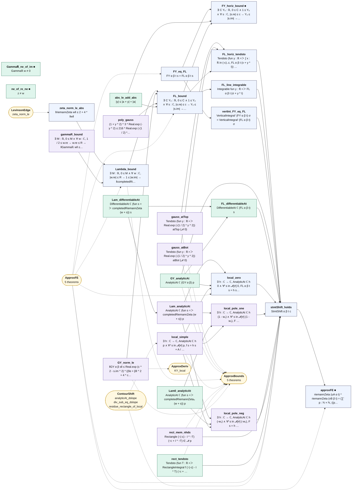

# `lean_stage3/Stage3/ApproxShift.lean`

> **Read from the source text.** This file changed after the last `python3 utilities/lean_map.py --dump`, so the arrows on this page are names occurring in each proof and have not been confirmed by Lean.

# ApproxShift — block S12 of `lean_stage3/design/stencil.md`, the contour shift. 2026-11-25.

29 theorems, 3 definitions, 814 lines. 

**Imports:** [`ApproxFE`](../lean_stage3/ApproxFE.md), [`ContourShift`](../lean_stage3/ContourShift.md), [`LevinsonEdge`](../lean_stage3/LevinsonEdge.md)  
**Imported by:** [`Stage3`](../lean_stage3/Stage3.md), [`ApproxBounds`](../lean_stage3/ApproxBounds.md)

## The picture



An arrow A → B reads "A is used in the proof of B". Green: counting, integers only. Violet: shape, analysis with no ζ. Blue: reads ζ. A name ending in ■ is an end: nothing else uses it. Red: contains `sorry`. Yellow: theorems in another file, counted; a dotted arrow crosses files. Definitions are not drawn; they are listed below the diagram.

## Definitions

<a name="ApproxShift-FL"></a>
### `ApproxShift.FL`

def · line 171

- **Is:** `` FL (α β : ℂ) (t : ℝ) (s : ℂ) : ℂ := GY α β s / s * (completedRiemannZeta (uA α t + s) * completedRiemannZeta (vB β t + s)) / (Gammaℝ (uA α t) * Gammaℝ (vB β t)) ``
- **Built from:** [`ApproxFE.GY`](../lean_stage3/ApproxFE.md#ApproxFE-GY), [`ApproxFE.uA`](../lean_stage3/ApproxFE.md#ApproxFE-uA), [`ApproxFE.vB`](../lean_stage3/ApproxFE.md#ApproxFE-vB)
- **Used by 8:** [`ApproxShift.FL_bound`](#ApproxShift-FL_bound), [`ApproxShift.FL_differentiableAt`](#ApproxShift-FL_differentiableAt), [`ApproxShift.FL_horiz_tendsto`](#ApproxShift-FL_horiz_tendsto), [`ApproxShift.FL_line_integrable`](#ApproxShift-FL_line_integrable), [`ApproxShift.FY_eq_FL`](#ApproxShift-FY_eq_FL), [`ApproxShift.local_zero`](#ApproxShift-local_zero), [`ApproxShift.stmtShift_holds`](#ApproxShift-stmtShift_holds), [`ApproxShift.vertInt_FY_eq_FL`](#ApproxShift-vertInt_FY_eq_FL)

<a name="ApproxShift-poles"></a>
### `ApproxShift.poles`

def · line 540

- **Is:** `` poles (α β : ℂ) (t : ℝ) : Finset ℂ := by classical exact {0, 1 - uA α t, -uA α t, 1 - vB β t, -vB β t} noncomputable ``
- **Built from:** [`ApproxFE.uA`](../lean_stage3/ApproxFE.md#ApproxFE-uA), [`ApproxFE.vB`](../lean_stage3/ApproxFE.md#ApproxFE-vB)
- **Used by 1:** [`ApproxShift.stmtShift_holds`](#ApproxShift-stmtShift_holds)

<a name="ApproxShift-resA"></a>
### `ApproxShift.resA`

def · line 546

- **Is:** `` resA (α β : ℂ) (t : ℝ) (p : ℂ) : ℂ := by classical exact if p = 0 then riemannZeta (uA α t) * riemannZeta (vB β t) else if p = 1 - uA α t then GY α β (1 - uA α t) / (1 - uA α t) * completedRiemannZeta (vB β t + 1 - uA α t) / (Gammaℝ (uA α t) * Gammaℝ (vB β t)) else if p = -uA α t then GY α β (-uA α t) / uA α t * completedRiemannZeta (vB β t - uA α t) / (Gammaℝ (uA α t) * Gammaℝ (vB β t)) else if p = 1 - vB β t then G… ``
- **Built from:** [`ApproxFE.GY`](../lean_stage3/ApproxFE.md#ApproxFE-GY), [`ApproxFE.uA`](../lean_stage3/ApproxFE.md#ApproxFE-uA), [`ApproxFE.vB`](../lean_stage3/ApproxFE.md#ApproxFE-vB)
- **Used by 1:** [`ApproxShift.stmtShift_holds`](#ApproxShift-stmtShift_holds)

## Theorems

<a name="ApproxShift-zeta_norm_le_abs"></a>
### `ApproxShift.zeta_norm_le_abs`

line 58 · arrows read from text

**Reads ζ.** It, or something it rests on, uses the zeta function, its zeros or the Riemann hypothesis.

**Why.** `‖ζ w‖ ≤ 2 + 4‖w‖` for `Re w ≥ 1/4`, `|Im w| ≥ 1` (`LevinsonEdge.zeta_norm_le` and `ζ(conj w) = conj ζ(w)`).

**Proves**

```lean
‖riemannZeta w‖ ≤ 2 + 4 * ‖w‖
```

**Needs** (its hypotheses)

  - `` hre : 1 / 4 ≤ w.re ``
  - `` him : 1 ≤ |w.im| ``

**Fed by** (1 theorem its proof uses)

  - [`LevinsonEdge.zeta_norm_le`](../lean_stage3/LevinsonEdge.md#LevinsonEdge-zeta_norm_le) (LevinsonEdge) — `` ‖riemannZeta u‖ ≤ 2 + 4 * ‖u‖ ``

**Feeds** (1 that use it)

  - [`ApproxShift.Lambda_bound`](#ApproxShift-Lambda_bound) — `` ∃ M : ℝ, 0 ≤ M ∧ ∀ w : ℂ, |w.re| ≤ R → 1 ≤ |w.im| → ‖completedRiemannZeta w‖ ≤ M * (6 + 4 * ‖w‖) ``

<a name="ApproxShift-gammaR_bound"></a>
### `ApproxShift.gammaR_bound`

line 70 · arrows read from text

**Shape.** Uses real or complex analysis; nothing in it or beneath it reads ζ.

**Why.** `‖Gammaℝ w‖` is bounded on `1/2 ≤ Re w ≤ R`.

**Proves**

```lean
∃ M : ℝ, 0 ≤ M ∧ ∀ w : ℂ, 1 / 2 ≤ w.re → w.re ≤ R → ‖Gammaℝ w‖ ≤ M
```

**Needs** (its hypotheses)

  - `` R : ℝ ``

**Fed by:** no theorem of this repo; it stands on Mathlib.

**Feeds** (1 that use it)

  - [`ApproxShift.Lambda_bound`](#ApproxShift-Lambda_bound) — `` ∃ M : ℝ, 0 ≤ M ∧ ∀ w : ℂ, |w.re| ≤ R → 1 ≤ |w.im| → ‖completedRiemannZeta w‖ ≤ M * (6 + 4 * ‖w‖) ``

<a name="ApproxShift-Lambda_bound"></a>
### `ApproxShift.Lambda_bound`

line 94 · arrows read from text

**Reads ζ.** It, or something it rests on, uses the zeta function, its zeros or the Riemann hypothesis.

**Why.** `‖Λ w‖ ≤ M (6 + 4‖w‖)` on `|Re w| ≤ R`, `|Im w| ≥ 1`: the `Gammaℝ` bound and the `ζ` bound right of `1/2`, the functional equation `Λ w = Λ (1 − w)` left of it.

**Proves**

```lean
∃ M : ℝ, 0 ≤ M ∧ ∀ w : ℂ, |w.re| ≤ R → 1 ≤ |w.im| → ‖completedRiemannZeta w‖ ≤ M * (6 + 4 * ‖w‖)
```

**Needs** (its hypotheses)

  - `` R : ℝ ``

**Fed by** (3 theorems its proof uses)

  - [`ApproxFE.gamma_mul_zeta`](../lean_stage3/ApproxFE.md#ApproxFE-gamma_mul_zeta) (ApproxFE) — `` Gammaℝ w * riemannZeta w = completedRiemannZeta w ``
  - [`ApproxShift.gammaR_bound`](#ApproxShift-gammaR_bound) — `` ∃ M : ℝ, 0 ≤ M ∧ ∀ w : ℂ, 1 / 2 ≤ w.re → w.re ≤ R → ‖Gammaℝ w‖ ≤ M ``
  - [`ApproxShift.zeta_norm_le_abs`](#ApproxShift-zeta_norm_le_abs) — `` ‖riemannZeta w‖ ≤ 2 + 4 * ‖w‖ ``

**Feeds** (2 that use it)

  - [`ApproxBounds.resY_small`](../lean_stage3/ApproxBounds.md#ApproxBounds-resY_small) (ApproxBounds) — `` ∃ C : ℝ, 0 ≤ C ∧ ∀ α β : ℂ, ‖α‖ ≤ 1 / 10 → ‖β‖ ≤ 1 / 10 → ∀ t : ℝ, 1 ≤ t → ‖resY α β t‖ ≤ C * (1 + 1 / ‖α + β‖ ^ 2) * Real.exp (-(t ^ 2 / 2)) ``
  - [`ApproxShift.FL_bound`](#ApproxShift-FL_bound) — `` ∃ C Y₀ : ℝ, 0 ≤ C ∧ 1 ≤ Y₀ ∧ ∀ s : ℂ, |s.re| ≤ c → Y₀ ≤ |s.im| → ‖FL α β t s‖ ≤ C * Real.exp (-(1 / 2) * s.im ^ 2) ``

<a name="ApproxShift-GY_norm_le"></a>
### `ApproxShift.GY_norm_le`

line 116 · arrows read from text

**Shape.** Uses real or complex analysis; nothing in it or beneath it reads ζ.

**Why.** `‖G(s)‖ ≤ e^(c² − (Im s)²) · Q · (1 + (Im s)²)` on `|Re s| ≤ c`.

**Proves**

```lean
‖GY α β s‖ ≤ Real.exp (c ^ 2 - s.im ^ 2) * ((‖α + β‖ ^ 2 + 4 * c ^ 2 + 4) / ‖α + β‖ ^ 2 * (1 + s.im ^ 2))
```

**Needs** (its hypotheses)

  - `` hs : |s.re| ≤ c ``

**Fed by:** no theorem of this repo; it stands on Mathlib and the definitions below.

**Definitions its proof touches:** [`ApproxFE.GY`](../lean_stage3/ApproxFE.md#ApproxFE-GY)

**Feeds** (4 that use it)

  - [`ApproxBounds.integrand_bound`](../lean_stage3/ApproxBounds.md#ApproxBounds-integrand_bound) (ApproxBounds) — `` ∃ C : ℝ, 0 ≤ C ∧ ∀ α β : ℂ, ‖α‖ ≤ 1 / 10 → ‖β‖ ≤ 1 / 10 → ∀ t : ℝ, 1 ≤ t → ∀ x : ℝ, 0 < x → ∀ σ y : ℝ, σ₀ ≤ σ → σ ≤ σ₁ → δ ≤ ‖(σ : ℂ) + y * I‖ → ‖KY α… ``
  - [`ApproxBounds.resY_term`](../lean_stage3/ApproxBounds.md#ApproxBounds-resY_term) (ApproxBounds) — `` ‖GY α β s / d * completedRiemannZeta w‖ ≤ Real.exp (1 - (t - 1 / 10) ^ 2) * (9 * (1 + 1 / ‖α + β‖ ^ 2) * (1 + (t + 1 / 10) ^ 2)) * (5 / 2) * (M * (14 … ``
  - [`ApproxDeriv.KY_local`](../lean_stage3/ApproxDeriv.md#ApproxDeriv-KY_local) (ApproxDeriv) — `` ∃ C : ℝ, 0 ≤ C ∧ ∀ t ∈ Metric.closedBall t₀ 1, ∀ y : ℝ, ‖KY α β t (σ + y * I)‖ ≤ C * (Real.exp (-y ^ 2) * (1 + y ^ 2)) ``
  - [`ApproxShift.FL_bound`](#ApproxShift-FL_bound) — `` ∃ C Y₀ : ℝ, 0 ≤ C ∧ 1 ≤ Y₀ ∧ ∀ s : ℂ, |s.re| ≤ c → Y₀ ≤ |s.im| → ‖FL α β t s‖ ≤ C * Real.exp (-(1 / 2) * s.im ^ 2) ``

<a name="ApproxShift-poly_gauss"></a>
### `ApproxShift.poly_gauss`

line 151 · arrows read from text

**Shape.** Uses real or complex analysis; nothing in it or beneath it reads ζ.

**Why.** `(1 + y²)³ e^(−y²) ≤ 216 e^(−y²/2)`.

**Proves**

```lean
(1 + y ^ 2) ^ 3 * Real.exp (-y ^ 2) ≤ 216 * Real.exp (-(1 / 2) * y ^ 2)
```

**Needs** (its hypotheses)

  - `` y : ℝ ``

**Fed by:** no theorem of this repo; it stands on Mathlib.

**Feeds** (1 that use it)

  - [`ApproxShift.FL_bound`](#ApproxShift-FL_bound) — `` ∃ C Y₀ : ℝ, 0 ≤ C ∧ 1 ≤ Y₀ ∧ ∀ s : ℂ, |s.re| ≤ c → Y₀ ≤ |s.im| → ‖FL α β t s‖ ≤ C * Real.exp (-(1 / 2) * s.im ^ 2) ``

<a name="ApproxShift-FY_eq_FL"></a>
### `ApproxShift.FY_eq_FL`

line 175 · arrows read from text

**Reads ζ.** It, or something it rests on, uses the zeta function, its zeros or the Riemann hypothesis.

**Proves**

```lean
FY α β t s = FL α β t s
```

**Needs** (its hypotheses)

  - `` h1 : Gammaℝ (uA α t + s) ≠ 0 ``
  - `` h2 : Gammaℝ (vB β t + s) ≠ 0 ``

**Fed by** (1 theorem its proof uses)

  - [`ApproxFE.gamma_mul_zeta`](../lean_stage3/ApproxFE.md#ApproxFE-gamma_mul_zeta) (ApproxFE) — `` Gammaℝ w * riemannZeta w = completedRiemannZeta w ``

**Definitions its proof touches:** [`ApproxFE.FY`](../lean_stage3/ApproxFE.md#ApproxFE-FY), [`ApproxFE.KY`](../lean_stage3/ApproxFE.md#ApproxFE-KY), [`ApproxFE.gY`](../lean_stage3/ApproxFE.md#ApproxFE-gY), [`ApproxFE.uA`](../lean_stage3/ApproxFE.md#ApproxFE-uA), [`ApproxFE.vB`](../lean_stage3/ApproxFE.md#ApproxFE-vB), [`ApproxShift.FL`](#ApproxShift-FL)

**Feeds** (2 that use it)

  - [`ApproxShift.FY_horiz_bound`](#ApproxShift-FY_horiz_bound) — `` ∃ C Y₀ : ℝ, 0 ≤ C ∧ 1 ≤ Y₀ ∧ ∀ s : ℂ, |s.re| ≤ c → Y₀ ≤ |s.im| → ‖FY α β t s‖ ≤ C * Real.exp (-(1 / 2) * s.im ^ 2) ``
  - [`ApproxShift.vertInt_FY_eq_FL`](#ApproxShift-vertInt_FY_eq_FL) — `` VerticalIntegral' (FY α β t) σ = VerticalIntegral' (FL α β t) σ ``

<a name="ApproxShift-Gamma-_ne_of_im"></a>
### `ApproxShift.Gammaℝ_ne_of_im`

line 182 · arrows read from text

**Counting.** Integers only: nothing in its statement or proof, or in anything it rests on, uses analysis or ζ.

**Why.** `Gammaℝ w ≠ 0` off the real axis.

**Proves**

```lean
Gammaℝ w ≠ 0
```

**Needs** (its hypotheses)

  - `` h : w.im ≠ 0 ``

**Fed by:** no theorem of this repo; it stands on Mathlib.

**Feeds:** nothing. It connects to nothing.

<a name="ApproxShift-abs_le_add_abs"></a>
### `ApproxShift.abs_le_add_abs`

line 190 · arrows read from text

**Counting.** Integers only: nothing in its statement or proof, or in anything it rests on, uses analysis or ζ.

**Why.** `|y| ≤ |a + y| + |a|`.

**Proves**

```lean
|y| ≤ |a + y| + |a|
```

**Needs** (its hypotheses)

  - `` a y : ℝ ``

**Fed by:** no theorem of this repo; it stands on Mathlib.

**Feeds** (2 that use it)

  - [`ApproxShift.FL_bound`](#ApproxShift-FL_bound) — `` ∃ C Y₀ : ℝ, 0 ≤ C ∧ 1 ≤ Y₀ ∧ ∀ s : ℂ, |s.re| ≤ c → Y₀ ≤ |s.im| → ‖FL α β t s‖ ≤ C * Real.exp (-(1 / 2) * s.im ^ 2) ``
  - [`ApproxShift.FY_horiz_bound`](#ApproxShift-FY_horiz_bound) — `` ∃ C Y₀ : ℝ, 0 ≤ C ∧ 1 ≤ Y₀ ∧ ∀ s : ℂ, |s.re| ≤ c → Y₀ ≤ |s.im| → ‖FY α β t s‖ ≤ C * Real.exp (-(1 / 2) * s.im ^ 2) ``

<a name="ApproxShift-FL_bound"></a>
### `ApproxShift.FL_bound`

line 196 · arrows read from text

**Reads ζ.** It, or something it rests on, uses the zeta function, its zeros or the Riemann hypothesis.

**Why.** Target 1 for `FL`: on `|Re s| ≤ c`, `|Im s| ≥ Y₀`, `‖FL s‖ ≤ C e^(−(Im s)²/2)`.

**Proves**

```lean
∃ C Y₀ : ℝ, 0 ≤ C ∧ 1 ≤ Y₀ ∧ ∀ s : ℂ, |s.re| ≤ c → Y₀ ≤ |s.im| → ‖FL α β t s‖ ≤ C * Real.exp (-(1 / 2) * s.im ^ 2)
```

**Needs** (its hypotheses)

  - `` α β : ℂ ``
  - `` t : ℝ ``
  - `` hc : 0 ≤ c ``

**Fed by** (6 theorems its proof uses)

  - [`ApproxFE.uA_re`](../lean_stage3/ApproxFE.md#ApproxFE-uA_re) (ApproxFE) — `` (uA α t).re = 1 / 2 + α.re ``
  - [`ApproxFE.vB_re`](../lean_stage3/ApproxFE.md#ApproxFE-vB_re) (ApproxFE) — `` (vB β t).re = 1 / 2 + β.re ``
  - [`ApproxShift.GY_norm_le`](#ApproxShift-GY_norm_le) — `` ‖GY α β s‖ ≤ Real.exp (c ^ 2 - s.im ^ 2) * ((‖α + β‖ ^ 2 + 4 * c ^ 2 + 4) / ‖α + β‖ ^ 2 * (1 + s.im ^ 2)) ``
  - [`ApproxShift.Lambda_bound`](#ApproxShift-Lambda_bound) — `` ∃ M : ℝ, 0 ≤ M ∧ ∀ w : ℂ, |w.re| ≤ R → 1 ≤ |w.im| → ‖completedRiemannZeta w‖ ≤ M * (6 + 4 * ‖w‖) ``
  - [`ApproxShift.abs_le_add_abs`](#ApproxShift-abs_le_add_abs) — `` |y| ≤ |a + y| + |a| ``
  - [`ApproxShift.poly_gauss`](#ApproxShift-poly_gauss) — `` (1 + y ^ 2) ^ 3 * Real.exp (-y ^ 2) ≤ 216 * Real.exp (-(1 / 2) * y ^ 2) ``

**Definitions its proof touches:** [`ApproxFE.GY`](../lean_stage3/ApproxFE.md#ApproxFE-GY), [`ApproxFE.uA`](../lean_stage3/ApproxFE.md#ApproxFE-uA), [`ApproxFE.vB`](../lean_stage3/ApproxFE.md#ApproxFE-vB), [`ApproxShift.FL`](#ApproxShift-FL)

**Feeds** (3 that use it)

  - [`ApproxShift.FL_horiz_tendsto`](#ApproxShift-FL_horiz_tendsto) — `` Tendsto (fun y : ℝ => ∫ x : ℝ in (-c)..c, FL α β t (x + y * I)) atTop (𝓝 0) ∧ Tendsto (fun y : ℝ => ∫ x : ℝ in (-c)..c, FL α β t (x + y * I)) atBot (𝓝… ``
  - [`ApproxShift.FL_line_integrable`](#ApproxShift-FL_line_integrable) — `` Integrable fun y : ℝ => FL α β t (σ + y * I) ``
  - [`ApproxShift.FY_horiz_bound`](#ApproxShift-FY_horiz_bound) — `` ∃ C Y₀ : ℝ, 0 ≤ C ∧ 1 ≤ Y₀ ∧ ∀ s : ℂ, |s.re| ≤ c → Y₀ ≤ |s.im| → ‖FY α β t s‖ ≤ C * Real.exp (-(1 / 2) * s.im ^ 2) ``

<a name="ApproxShift-FY_horiz_bound"></a>
### `ApproxShift.FY_horiz_bound`

line 280 · arrows read from text

**Reads ζ.** It, or something it rests on, uses the zeta function, its zeros or the Riemann hypothesis.

**Why.** Target 1, for `FY`: on `|Re s| ≤ c`, `|Im s| ≥ Y₀`, `‖FY s‖ ≤ C e^(−(Im s)²/2)`.

**Proves**

```lean
∃ C Y₀ : ℝ, 0 ≤ C ∧ 1 ≤ Y₀ ∧ ∀ s : ℂ, |s.re| ≤ c → Y₀ ≤ |s.im| → ‖FY α β t s‖ ≤ C * Real.exp (-(1 / 2) * s.im ^ 2)
```

**Needs** (its hypotheses)

  - `` α β : ℂ ``
  - `` t : ℝ ``
  - `` hc : 0 ≤ c ``

**Fed by** (3 theorems its proof uses)

  - [`ApproxShift.FL_bound`](#ApproxShift-FL_bound) — `` ∃ C Y₀ : ℝ, 0 ≤ C ∧ 1 ≤ Y₀ ∧ ∀ s : ℂ, |s.re| ≤ c → Y₀ ≤ |s.im| → ‖FL α β t s‖ ≤ C * Real.exp (-(1 / 2) * s.im ^ 2) ``
  - [`ApproxShift.FY_eq_FL`](#ApproxShift-FY_eq_FL) — `` FY α β t s = FL α β t s ``
  - [`ApproxShift.abs_le_add_abs`](#ApproxShift-abs_le_add_abs) — `` |y| ≤ |a + y| + |a| ``

**Definitions its proof touches:** [`ApproxFE.FY`](../lean_stage3/ApproxFE.md#ApproxFE-FY), [`ApproxFE.uA`](../lean_stage3/ApproxFE.md#ApproxFE-uA), [`ApproxFE.vB`](../lean_stage3/ApproxFE.md#ApproxFE-vB)

**Feeds:** nothing. It is an end.

<a name="ApproxShift-gauss_atTop"></a>
### `ApproxShift.gauss_atTop`

line 304 · arrows read from text

**Shape.** Uses real or complex analysis; nothing in it or beneath it reads ζ.

**Why.** `e^(−y²/2) → 0` as `y → +∞`.

**Proves**

```lean
Tendsto (fun y : ℝ => Real.exp (-(1 / 2) * y ^ 2)) atTop (𝓝 0)
```

**Fed by:** no theorem of this repo; it stands on Mathlib.

**Feeds** (3 that use it)

  - [`ApproxBounds.VY_line_eq`](../lean_stage3/ApproxBounds.md#ApproxBounds-VY_line_eq) (ApproxBounds) — `` VY α β c x t = VY α β c' x t ``
  - [`ApproxBounds.VY_residue`](../lean_stage3/ApproxBounds.md#ApproxBounds-VY_residue) (ApproxBounds) — `` VY α β (1 / 4) x t - VY α β (-(1 / 4)) x t = 1 ``
  - [`ApproxShift.FL_horiz_tendsto`](#ApproxShift-FL_horiz_tendsto) — `` Tendsto (fun y : ℝ => ∫ x : ℝ in (-c)..c, FL α β t (x + y * I)) atTop (𝓝 0) ∧ Tendsto (fun y : ℝ => ∫ x : ℝ in (-c)..c, FL α β t (x + y * I)) atBot (𝓝… ``

<a name="ApproxShift-gauss_atBot"></a>
### `ApproxShift.gauss_atBot`

line 309 · arrows read from text

**Shape.** Uses real or complex analysis; nothing in it or beneath it reads ζ.

**Why.** `e^(−y²/2) → 0` as `y → −∞`.

**Proves**

```lean
Tendsto (fun y : ℝ => Real.exp (-(1 / 2) * y ^ 2)) atBot (𝓝 0)
```

**Fed by:** no theorem of this repo; it stands on Mathlib.

**Feeds** (3 that use it)

  - [`ApproxBounds.VY_line_eq`](../lean_stage3/ApproxBounds.md#ApproxBounds-VY_line_eq) (ApproxBounds) — `` VY α β c x t = VY α β c' x t ``
  - [`ApproxBounds.VY_residue`](../lean_stage3/ApproxBounds.md#ApproxBounds-VY_residue) (ApproxBounds) — `` VY α β (1 / 4) x t - VY α β (-(1 / 4)) x t = 1 ``
  - [`ApproxShift.FL_horiz_tendsto`](#ApproxShift-FL_horiz_tendsto) — `` Tendsto (fun y : ℝ => ∫ x : ℝ in (-c)..c, FL α β t (x + y * I)) atTop (𝓝 0) ∧ Tendsto (fun y : ℝ => ∫ x : ℝ in (-c)..c, FL α β t (x + y * I)) atBot (𝓝… ``

<a name="ApproxShift-FL_horiz_tendsto"></a>
### `ApproxShift.FL_horiz_tendsto`

line 313 · arrows read from text

**Reads ζ.** It, or something it rests on, uses the zeta function, its zeros or the Riemann hypothesis.

**Why.** The horizontal edges: `∫_{−c}^{c} FL(x + iy) dx → 0` as `y → ±∞`.

**Proves**

```lean
Tendsto (fun y : ℝ => ∫ x : ℝ in (-c)..c, FL α β t (x + y * I)) atTop (𝓝 0) ∧ Tendsto (fun y : ℝ => ∫ x : ℝ in (-c)..c, FL α β t (x + y * I)) atBot (𝓝 0)
```

**Needs** (its hypotheses)

  - `` α β : ℂ ``
  - `` t : ℝ ``
  - `` hc : 0 ≤ c ``

**Fed by** (3 theorems its proof uses)

  - [`ApproxShift.FL_bound`](#ApproxShift-FL_bound) — `` ∃ C Y₀ : ℝ, 0 ≤ C ∧ 1 ≤ Y₀ ∧ ∀ s : ℂ, |s.re| ≤ c → Y₀ ≤ |s.im| → ‖FL α β t s‖ ≤ C * Real.exp (-(1 / 2) * s.im ^ 2) ``
  - [`ApproxShift.gauss_atBot`](#ApproxShift-gauss_atBot) — `` Tendsto (fun y : ℝ => Real.exp (-(1 / 2) * y ^ 2)) atBot (𝓝 0) ``
  - [`ApproxShift.gauss_atTop`](#ApproxShift-gauss_atTop) — `` Tendsto (fun y : ℝ => Real.exp (-(1 / 2) * y ^ 2)) atTop (𝓝 0) ``

**Definitions its proof touches:** [`ApproxShift.FL`](#ApproxShift-FL)

**Feeds** (1 that use it)

  - [`ApproxShift.stmtShift_holds`](#ApproxShift-stmtShift_holds) — `` StmtShift α β t c ``

<a name="ApproxShift-FL_line_integrable"></a>
### `ApproxShift.FL_line_integrable`

line 341 · arrows read from text

**Reads ζ.** It, or something it rests on, uses the zeta function, its zeros or the Riemann hypothesis.

**Why.** On a vertical line where `FL` is differentiable, `FL` is integrable: continuous, and `≤ C e^(−y²/2)` past `Y₀`.

**Proves**

```lean
Integrable fun y : ℝ => FL α β t (σ + y * I)
```

**Needs** (its hypotheses)

  - `` α β : ℂ ``
  - `` t : ℝ ``
  - `` hc : 0 ≤ c ``
  - `` hσ : |σ| ≤ c ``
  - `` hd : ∀ y : ℝ, DifferentiableAt ℂ (FL α β t) (σ + y * I) ``

**Fed by** (1 theorem its proof uses)

  - [`ApproxShift.FL_bound`](#ApproxShift-FL_bound) — `` ∃ C Y₀ : ℝ, 0 ≤ C ∧ 1 ≤ Y₀ ∧ ∀ s : ℂ, |s.re| ≤ c → Y₀ ≤ |s.im| → ‖FL α β t s‖ ≤ C * Real.exp (-(1 / 2) * s.im ^ 2) ``

**Definitions its proof touches:** [`ApproxShift.FL`](#ApproxShift-FL)

**Feeds** (1 that use it)

  - [`ApproxShift.stmtShift_holds`](#ApproxShift-stmtShift_holds) — `` StmtShift α β t c ``

<a name="ApproxShift-vertInt_FY_eq_FL"></a>
### `ApproxShift.vertInt_FY_eq_FL`

line 375 · arrows read from text

**Reads ζ.** It, or something it rests on, uses the zeta function, its zeros or the Riemann hypothesis.

**Why.** `FY = FL` almost everywhere on every vertical line, so their vertical integrals agree.

**Proves**

```lean
VerticalIntegral' (FY α β t) σ = VerticalIntegral' (FL α β t) σ
```

**Needs** (its hypotheses)

  - `` α β : ℂ ``
  - `` t σ : ℝ ``

**Fed by** (1 theorem its proof uses)

  - [`ApproxShift.FY_eq_FL`](#ApproxShift-FY_eq_FL) — `` FY α β t s = FL α β t s ``

**Definitions its proof touches:** [`ApproxFE.FY`](../lean_stage3/ApproxFE.md#ApproxFE-FY), [`ApproxFE.uA`](../lean_stage3/ApproxFE.md#ApproxFE-uA), [`ApproxFE.vB`](../lean_stage3/ApproxFE.md#ApproxFE-vB), [`ApproxShift.FL`](#ApproxShift-FL)

**Feeds** (1 that use it)

  - [`ApproxShift.stmtShift_holds`](#ApproxShift-stmtShift_holds) — `` StmtShift α β t c ``

<a name="ApproxShift-Lam_differentiableAt"></a>
### `ApproxShift.Lam_differentiableAt`

line 400 · arrows read from text

**Counting.** Integers only: nothing in its statement or proof, or in anything it rests on, uses analysis or ζ.

**Proves**

```lean
DifferentiableAt ℂ (fun s => completedRiemannZeta (w + s)) s
```

**Needs** (its hypotheses)

  - `` h0 : w + s ≠ 0 ``
  - `` h1 : w + s ≠ 1 ``

**Fed by:** no theorem of this repo; it stands on Mathlib.

**Feeds** (2 that use it)

  - [`ApproxShift.FL_differentiableAt`](#ApproxShift-FL_differentiableAt) — `` DifferentiableAt ℂ (FL α β t) s ``
  - [`ApproxShift.Lam_analyticAt`](#ApproxShift-Lam_analyticAt) — `` AnalyticAt ℂ (fun s => completedRiemannZeta (w + s)) p ``

<a name="ApproxShift-Lam_analyticAt"></a>
### `ApproxShift.Lam_analyticAt`

line 404 · arrows read from text

**Shape.** Uses real or complex analysis; nothing in it or beneath it reads ζ.

**Proves**

```lean
AnalyticAt ℂ (fun s => completedRiemannZeta (w + s)) p
```

**Needs** (its hypotheses)

  - `` h0 : w + p ≠ 0 ``
  - `` h1 : w + p ≠ 1 ``

**Fed by** (1 theorem its proof uses)

  - [`ApproxShift.Lam_differentiableAt`](#ApproxShift-Lam_differentiableAt) — `` DifferentiableAt ℂ (fun s => completedRiemannZeta (w + s)) s ``

**Feeds** (3 that use it)

  - [`ApproxShift.local_pole_neg`](#ApproxShift-local_pole_neg) — `` ∃ h : ℂ → ℂ, AnalyticAt ℂ h (-w₁) ∧ ∀ᶠ s in 𝓝[≠] (-w₁), F s = h s + g (-w₁) / w₁ * completedRiemannZeta (w₂ - w₁) / D / (s - -w₁) ``
  - [`ApproxShift.local_pole_one`](#ApproxShift-local_pole_one) — `` ∃ h : ℂ → ℂ, AnalyticAt ℂ h (1 - w₁) ∧ ∀ᶠ s in 𝓝[≠] (1 - w₁), F s = h s + g (1 - w₁) / (1 - w₁) * completedRiemannZeta (w₂ + 1 - w₁) / D / (s - (1 - w… ``
  - [`ApproxShift.local_zero`](#ApproxShift-local_zero) — `` ∃ h : ℂ → ℂ, AnalyticAt ℂ h 0 ∧ ∀ᶠ s in 𝓝[≠] 0, FL α β t s = h s + riemannZeta (uA α t) * riemannZeta (vB β t) / (s - 0) ``

<a name="ApproxShift-Lam0_analyticAt"></a>
### `ApproxShift.Lam0_analyticAt`

line 412 · arrows read from text

**Counting.** Integers only: nothing in its statement or proof, or in anything it rests on, uses analysis or ζ.

**Proves**

```lean
AnalyticAt ℂ (fun s => completedRiemannZeta₀ (w + s)) p
```

**Needs** (its hypotheses)

  - `` w p : ℂ ``

**Fed by:** no theorem of this repo; it stands on Mathlib.

**Feeds** (2 that use it)

  - [`ApproxShift.local_pole_neg`](#ApproxShift-local_pole_neg) — `` ∃ h : ℂ → ℂ, AnalyticAt ℂ h (-w₁) ∧ ∀ᶠ s in 𝓝[≠] (-w₁), F s = h s + g (-w₁) / w₁ * completedRiemannZeta (w₂ - w₁) / D / (s - -w₁) ``
  - [`ApproxShift.local_pole_one`](#ApproxShift-local_pole_one) — `` ∃ h : ℂ → ℂ, AnalyticAt ℂ h (1 - w₁) ∧ ∀ᶠ s in 𝓝[≠] (1 - w₁), F s = h s + g (1 - w₁) / (1 - w₁) * completedRiemannZeta (w₂ + 1 - w₁) / D / (s - (1 - w… ``

<a name="ApproxShift-GY_analyticAt"></a>
### `ApproxShift.GY_analyticAt`

line 418 · arrows read from text

**Counting.** Integers only: nothing in its statement or proof, or in anything it rests on, uses analysis or ζ.

**Proves**

```lean
AnalyticAt ℂ (GY α β) p
```

**Needs** (its hypotheses)

  - `` α β p : ℂ ``

**Fed by:** no theorem of this repo; it stands on Mathlib and the definitions below.

**Definitions its proof touches:** [`ApproxFE.GY`](../lean_stage3/ApproxFE.md#ApproxFE-GY)

**Feeds** (4 that use it)

  - [`ApproxBounds.VY_residue`](../lean_stage3/ApproxBounds.md#ApproxBounds-VY_residue) (ApproxBounds) — `` VY α β (1 / 4) x t - VY α β (-(1 / 4)) x t = 1 ``
  - [`ApproxShift.FL_differentiableAt`](#ApproxShift-FL_differentiableAt) — `` DifferentiableAt ℂ (FL α β t) s ``
  - [`ApproxShift.local_zero`](#ApproxShift-local_zero) — `` ∃ h : ℂ → ℂ, AnalyticAt ℂ h 0 ∧ ∀ᶠ s in 𝓝[≠] 0, FL α β t s = h s + riemannZeta (uA α t) * riemannZeta (vB β t) / (s - 0) ``
  - [`ApproxShift.stmtShift_holds`](#ApproxShift-stmtShift_holds) — `` StmtShift α β t c ``

<a name="ApproxShift-FL_differentiableAt"></a>
### `ApproxShift.FL_differentiableAt`

line 424 · arrows read from text

**Counting.** Integers only: nothing in its statement or proof, or in anything it rests on, uses analysis or ζ.

**Proves**

```lean
DifferentiableAt ℂ (FL α β t) s
```

**Needs** (its hypotheses)

  - `` h0 : s ≠ 0 ``
  - `` hu0 : uA α t + s ≠ 0 ``
  - `` hu1 : uA α t + s ≠ 1 ``
  - `` hv0 : vB β t + s ≠ 0 ``
  - `` hv1 : vB β t + s ≠ 1 ``

**Fed by** (2 theorems its proof uses)

  - [`ApproxShift.GY_analyticAt`](#ApproxShift-GY_analyticAt) — `` AnalyticAt ℂ (GY α β) p ``
  - [`ApproxShift.Lam_differentiableAt`](#ApproxShift-Lam_differentiableAt) — `` DifferentiableAt ℂ (fun s => completedRiemannZeta (w + s)) s ``

**Definitions its proof touches:** [`ApproxFE.GY`](../lean_stage3/ApproxFE.md#ApproxFE-GY), [`ApproxFE.uA`](../lean_stage3/ApproxFE.md#ApproxFE-uA), [`ApproxFE.vB`](../lean_stage3/ApproxFE.md#ApproxFE-vB), [`ApproxShift.FL`](#ApproxShift-FL)

**Feeds** (1 that use it)

  - [`ApproxShift.stmtShift_holds`](#ApproxShift-stmtShift_holds) — `` StmtShift α β t c ``

<a name="ApproxShift-local_simple"></a>
### `ApproxShift.local_simple`

line 433 · arrows read from text

**Shape.** Uses real or complex analysis; nothing in it or beneath it reads ζ.

**Why.** A simple pole from local data: `K (φ + a/(s − p)) = h + (a K p)/(s − p)` near `p`.

**Proves**

```lean
∃ h : ℂ → ℂ, AnalyticAt ℂ h p ∧ ∀ᶠ s in 𝓝[≠] p, f s = h s + A / (s - p)
```

**Needs** (its hypotheses)

  - `` hK : AnalyticAt ℂ K p ``
  - `` hφ : AnalyticAt ℂ φ p ``
  - `` hA : a * K p = A ``
  - `` hf : ∀ s, f s = K s * (φ s + a / (s - p)) ``

**Fed by** (2 theorems its proof uses)

  - [`ContourShift.analyticAt_dslope`](../lean_stage3/ContourShift.md#ContourShift-analyticAt_dslope) (ContourShift) — `` AnalyticAt ℂ (dslope f p) p ``
  - [`ContourShift.div_sub_eq_dslope`](../lean_stage3/ContourShift.md#ContourShift-div_sub_eq_dslope) (ContourShift) — `` f s / (s - p) = f p / (s - p) + dslope f p s ``

**Feeds** (4 that use it)

  - [`ApproxBounds.VY_residue`](../lean_stage3/ApproxBounds.md#ApproxBounds-VY_residue) (ApproxBounds) — `` VY α β (1 / 4) x t - VY α β (-(1 / 4)) x t = 1 ``
  - [`ApproxShift.local_pole_neg`](#ApproxShift-local_pole_neg) — `` ∃ h : ℂ → ℂ, AnalyticAt ℂ h (-w₁) ∧ ∀ᶠ s in 𝓝[≠] (-w₁), F s = h s + g (-w₁) / w₁ * completedRiemannZeta (w₂ - w₁) / D / (s - -w₁) ``
  - [`ApproxShift.local_pole_one`](#ApproxShift-local_pole_one) — `` ∃ h : ℂ → ℂ, AnalyticAt ℂ h (1 - w₁) ∧ ∀ᶠ s in 𝓝[≠] (1 - w₁), F s = h s + g (1 - w₁) / (1 - w₁) * completedRiemannZeta (w₂ + 1 - w₁) / D / (s - (1 - w… ``
  - [`ApproxShift.local_zero`](#ApproxShift-local_zero) — `` ∃ h : ℂ → ℂ, AnalyticAt ℂ h 0 ∧ ∀ᶠ s in 𝓝[≠] 0, FL α β t s = h s + riemannZeta (uA α t) * riemannZeta (vB β t) / (s - 0) ``

<a name="ApproxShift-local_zero"></a>
### `ApproxShift.local_zero`

line 445 · arrows read from text

**Reads ζ.** It, or something it rests on, uses the zeta function, its zeros or the Riemann hypothesis.

**Why.** The pole at `s = 0`: residue `ζ(u) ζ(v)`.

**Proves**

```lean
∃ h : ℂ → ℂ, AnalyticAt ℂ h 0 ∧ ∀ᶠ s in 𝓝[≠] 0, FL α β t s = h s + riemannZeta (uA α t) * riemannZeta (vB β t) / (s - 0)
```

**Needs** (its hypotheses)

  - `` hαβ : α + β ≠ 0 ``
  - `` hu0 : uA α t ≠ 0 ``
  - `` hu1 : uA α t ≠ 1 ``
  - `` hv0 : vB β t ≠ 0 ``
  - `` hv1 : vB β t ≠ 1 ``
  - `` hGu : Gammaℝ (uA α t) ≠ 0 ``
  - `` hGv : Gammaℝ (vB β t) ≠ 0 ``

**Fed by** (5 theorems its proof uses)

  - [`ApproxFE.GY_zero`](../lean_stage3/ApproxFE.md#ApproxFE-GY_zero) (ApproxFE) — `` GY α β 0 = 1 ``
  - [`ApproxFE.gamma_mul_zeta`](../lean_stage3/ApproxFE.md#ApproxFE-gamma_mul_zeta) (ApproxFE) — `` Gammaℝ w * riemannZeta w = completedRiemannZeta w ``
  - [`ApproxShift.GY_analyticAt`](#ApproxShift-GY_analyticAt) — `` AnalyticAt ℂ (GY α β) p ``
  - [`ApproxShift.Lam_analyticAt`](#ApproxShift-Lam_analyticAt) — `` AnalyticAt ℂ (fun s => completedRiemannZeta (w + s)) p ``
  - [`ApproxShift.local_simple`](#ApproxShift-local_simple) — `` ∃ h : ℂ → ℂ, AnalyticAt ℂ h p ∧ ∀ᶠ s in 𝓝[≠] p, f s = h s + A / (s - p) ``

**Definitions its proof touches:** [`ApproxFE.GY`](../lean_stage3/ApproxFE.md#ApproxFE-GY), [`ApproxFE.uA`](../lean_stage3/ApproxFE.md#ApproxFE-uA), [`ApproxFE.vB`](../lean_stage3/ApproxFE.md#ApproxFE-vB), [`ApproxShift.FL`](#ApproxShift-FL)

**Feeds** (1 that use it)

  - [`ApproxShift.stmtShift_holds`](#ApproxShift-stmtShift_holds) — `` StmtShift α β t c ``

<a name="ApproxShift-local_pole_one"></a>
### `ApproxShift.local_pole_one`

line 464 · arrows read from text

**Shape.** Uses real or complex analysis; nothing in it or beneath it reads ζ.

**Why.** The pole at `s = 1 − w₁` of `g(s)/s · Λ(w₁+s) Λ(w₂+s) / D`: residue `g(1−w₁)/(1−w₁) · Λ(w₂+1−w₁) / D`.

**Proves**

```lean
∃ h : ℂ → ℂ, AnalyticAt ℂ h (1 - w₁) ∧ ∀ᶠ s in 𝓝[≠] (1 - w₁), F s = h s + g (1 - w₁) / (1 - w₁) * completedRiemannZeta (w₂ + 1 - w₁) / D / (s - (1 - w₁))
```

**Needs** (its hypotheses)

  - `` hg : ∀ p, AnalyticAt ℂ g p ``
  - `` hF : ∀ s, F s = g s / s * (completedRiemannZeta (w₁ + s) * completedRiemannZeta (w₂ + s)) / D ``
  - `` hp0 : 1 - w₁ ≠ 0 ``
  - `` h0 : w₂ + (1 - w₁) ≠ 0 ``
  - `` h1 : w₂ + (1 - w₁) ≠ 1 ``

**Fed by** (3 theorems its proof uses)

  - [`ApproxShift.Lam0_analyticAt`](#ApproxShift-Lam0_analyticAt) — `` AnalyticAt ℂ (fun s => completedRiemannZeta₀ (w + s)) p ``
  - [`ApproxShift.Lam_analyticAt`](#ApproxShift-Lam_analyticAt) — `` AnalyticAt ℂ (fun s => completedRiemannZeta (w + s)) p ``
  - [`ApproxShift.local_simple`](#ApproxShift-local_simple) — `` ∃ h : ℂ → ℂ, AnalyticAt ℂ h p ∧ ∀ᶠ s in 𝓝[≠] p, f s = h s + A / (s - p) ``

**Feeds** (1 that use it)

  - [`ApproxShift.stmtShift_holds`](#ApproxShift-stmtShift_holds) — `` StmtShift α β t c ``

<a name="ApproxShift-local_pole_neg"></a>
### `ApproxShift.local_pole_neg`

line 483 · arrows read from text

**Shape.** Uses real or complex analysis; nothing in it or beneath it reads ζ.

**Why.** The pole at `s = −w₁` of `g(s)/s · Λ(w₁+s) Λ(w₂+s) / D`: residue `g(−w₁)/w₁ · Λ(w₂−w₁) / D`.

**Proves**

```lean
∃ h : ℂ → ℂ, AnalyticAt ℂ h (-w₁) ∧ ∀ᶠ s in 𝓝[≠] (-w₁), F s = h s + g (-w₁) / w₁ * completedRiemannZeta (w₂ - w₁) / D / (s - -w₁)
```

**Needs** (its hypotheses)

  - `` hg : ∀ p, AnalyticAt ℂ g p ``
  - `` hF : ∀ s, F s = g s / s * (completedRiemannZeta (w₁ + s) * completedRiemannZeta (w₂ + s)) / D ``
  - `` hp0 : -w₁ ≠ 0 ``
  - `` h0 : w₂ + -w₁ ≠ 0 ``
  - `` h1 : w₂ + -w₁ ≠ 1 ``

**Fed by** (3 theorems its proof uses)

  - [`ApproxShift.Lam0_analyticAt`](#ApproxShift-Lam0_analyticAt) — `` AnalyticAt ℂ (fun s => completedRiemannZeta₀ (w + s)) p ``
  - [`ApproxShift.Lam_analyticAt`](#ApproxShift-Lam_analyticAt) — `` AnalyticAt ℂ (fun s => completedRiemannZeta (w + s)) p ``
  - [`ApproxShift.local_simple`](#ApproxShift-local_simple) — `` ∃ h : ℂ → ℂ, AnalyticAt ℂ h p ∧ ∀ᶠ s in 𝓝[≠] p, f s = h s + A / (s - p) ``

**Feeds** (1 that use it)

  - [`ApproxShift.stmtShift_holds`](#ApproxShift-stmtShift_holds) — `` StmtShift α β t c ``

<a name="ApproxShift-ne_of_re_ne"></a>
### `ApproxShift.ne_of_re_ne`

line 502 · arrows read from text

**Counting.** Integers only: nothing in its statement or proof, or in anything it rests on, uses analysis or ζ.

**Why.** `z ≠ w` from their real parts.

**Proves**

```lean
z ≠ w
```

**Needs** (its hypotheses)

  - `` h : z.re < w.re ∨ w.re < z.re ``

**Fed by:** no theorem of this repo; it stands on Mathlib.

**Feeds:** nothing. It connects to nothing.

<a name="ApproxShift-rect_mem_nhds"></a>
### `ApproxShift.rect_mem_nhds`

line 507 · arrows read from text

**Shape.** Uses real or complex analysis; nothing in it or beneath it reads ζ.

**Why.** The rectangle `[−c, c] × [−T, T]` is a neighbourhood of every interior point.

**Proves**

```lean
Rectangle (↑(-c) - I * ↑T) (↑c + I * ↑T) ∈ 𝓝 p
```

**Needs** (its hypotheses)

  - `` h1 : |p.re| < c ``
  - `` h2 : |p.im| < T ``

**Fed by:** no theorem of this repo; it stands on Mathlib.

**Feeds** (2 that use it)

  - [`ApproxBounds.VY_residue`](../lean_stage3/ApproxBounds.md#ApproxBounds-VY_residue) (ApproxBounds) — `` VY α β (1 / 4) x t - VY α β (-(1 / 4)) x t = 1 ``
  - [`ApproxShift.stmtShift_holds`](#ApproxShift-stmtShift_holds) — `` StmtShift α β t c ``

<a name="ApproxShift-rect_tendsto"></a>
### `ApproxShift.rect_tendsto`

line 520 · arrows read from text

**Counting.** Integers only: nothing in its statement or proof, or in anything it rests on, uses analysis or ζ.

**Why.** PNT+'s `RectangleIntegral_tendsTo_VerticalIntegral` (in `PerronFormula`, not built at the pin), re-proved here for `[−c, c]`.

**Proves**

```lean
Tendsto (fun T : ℝ => RectangleIntegral f (↑(-c) - I * T) (↑c + I * T)) atTop (𝓝 (VerticalIntegral f c - VerticalIntegral f (-c)))
```

**Needs** (its hypotheses)

  - `` hbot : Tendsto (fun y : ℝ => ∫ x : ℝ in (-c)..c, f (x + y * I)) atBot (𝓝 0) ``
  - `` htop : Tendsto (fun y : ℝ => ∫ x : ℝ in (-c)..c, f (x + y * I)) atTop (𝓝 0) ``
  - `` hleft : Integrable (fun y : ℝ => f (↑(-c) + y * I)) ``
  - `` hright : Integrable (fun y : ℝ => f (↑c + y * I)) ``

**Fed by:** no theorem of this repo; it stands on Mathlib.

**Feeds** (2 that use it)

  - [`ApproxBounds.VY_residue`](../lean_stage3/ApproxBounds.md#ApproxBounds-VY_residue) (ApproxBounds) — `` VY α β (1 / 4) x t - VY α β (-(1 / 4)) x t = 1 ``
  - [`ApproxShift.stmtShift_holds`](#ApproxShift-stmtShift_holds) — `` StmtShift α β t c ``

<a name="ApproxShift-stmtShift_holds"></a>
### `ApproxShift.stmtShift_holds`

line 566 · arrows read from text

**Reads ζ.** It, or something it rests on, uses the zeta function, its zeros or the Riemann hypothesis.

**Why.** Target 2, the contour shift. For `−1/2 < Re α, Re β < 1/2`, `c > 1/2 + |Re α|, 1/2 + |Re β|`, `α + β ≠ 0` and `u ≠ v` (the five poles distinct): `(1/2πi)∫_(c) FY − (1/2πi)∫_(−c) FY = ζ(u)ζ(v) + resY`.

**Proves**

```lean
StmtShift α β t c
```

**Needs** (its hypotheses)

  - `` hα : α.re < 1 / 2 ``
  - `` hβ : β.re < 1 / 2 ``
  - `` hα' : -(1 / 2) < α.re ``
  - `` hβ' : -(1 / 2) < β.re ``
  - `` hcα : 1 / 2 + |α.re| < c ``
  - `` hcβ : 1 / 2 + |β.re| < c ``
  - `` hαβ : α + β ≠ 0 ``
  - `` huv : uA α t ≠ vB β t ``

**Fed by** (13 theorems its proof uses)

  - [`ApproxFE.uA_re`](../lean_stage3/ApproxFE.md#ApproxFE-uA_re) (ApproxFE) — `` (uA α t).re = 1 / 2 + α.re ``
  - [`ApproxFE.vB_re`](../lean_stage3/ApproxFE.md#ApproxFE-vB_re) (ApproxFE) — `` (vB β t).re = 1 / 2 + β.re ``
  - [`ApproxShift.FL_differentiableAt`](#ApproxShift-FL_differentiableAt) — `` DifferentiableAt ℂ (FL α β t) s ``
  - [`ApproxShift.FL_horiz_tendsto`](#ApproxShift-FL_horiz_tendsto) — `` Tendsto (fun y : ℝ => ∫ x : ℝ in (-c)..c, FL α β t (x + y * I)) atTop (𝓝 0) ∧ Tendsto (fun y : ℝ => ∫ x : ℝ in (-c)..c, FL α β t (x + y * I)) atBot (𝓝… ``
  - [`ApproxShift.FL_line_integrable`](#ApproxShift-FL_line_integrable) — `` Integrable fun y : ℝ => FL α β t (σ + y * I) ``
  - [`ApproxShift.GY_analyticAt`](#ApproxShift-GY_analyticAt) — `` AnalyticAt ℂ (GY α β) p ``
  - [`ApproxShift.local_pole_neg`](#ApproxShift-local_pole_neg) — `` ∃ h : ℂ → ℂ, AnalyticAt ℂ h (-w₁) ∧ ∀ᶠ s in 𝓝[≠] (-w₁), F s = h s + g (-w₁) / w₁ * completedRiemannZeta (w₂ - w₁) / D / (s - -w₁) ``
  - [`ApproxShift.local_pole_one`](#ApproxShift-local_pole_one) — `` ∃ h : ℂ → ℂ, AnalyticAt ℂ h (1 - w₁) ∧ ∀ᶠ s in 𝓝[≠] (1 - w₁), F s = h s + g (1 - w₁) / (1 - w₁) * completedRiemannZeta (w₂ + 1 - w₁) / D / (s - (1 - w… ``
  - [`ApproxShift.local_zero`](#ApproxShift-local_zero) — `` ∃ h : ℂ → ℂ, AnalyticAt ℂ h 0 ∧ ∀ᶠ s in 𝓝[≠] 0, FL α β t s = h s + riemannZeta (uA α t) * riemannZeta (vB β t) / (s - 0) ``
  - [`ApproxShift.rect_mem_nhds`](#ApproxShift-rect_mem_nhds) — `` Rectangle (↑(-c) - I * ↑T) (↑c + I * ↑T) ∈ 𝓝 p ``
  - [`ApproxShift.rect_tendsto`](#ApproxShift-rect_tendsto) — `` Tendsto (fun T : ℝ => RectangleIntegral f (↑(-c) - I * T) (↑c + I * T)) atTop (𝓝 (VerticalIntegral f c - VerticalIntegral f (-c))) ``
  - [`ApproxShift.vertInt_FY_eq_FL`](#ApproxShift-vertInt_FY_eq_FL) — `` VerticalIntegral' (FY α β t) σ = VerticalIntegral' (FL α β t) σ ``
  - [`ContourShift.residue_rectangle_of_local`](../lean_stage3/ContourShift.md#ContourShift-residue_rectangle_of_local) (ContourShift) — `` RectangleIntegral' f z w = ∑ p ∈ P, A p ``

**Definitions its proof touches:** [`ApproxFE.GY`](../lean_stage3/ApproxFE.md#ApproxFE-GY), [`ApproxFE.StmtShift`](../lean_stage3/ApproxFE.md#ApproxFE-StmtShift), [`ApproxFE.resY`](../lean_stage3/ApproxFE.md#ApproxFE-resY), [`ApproxFE.uA`](../lean_stage3/ApproxFE.md#ApproxFE-uA), [`ApproxFE.vB`](../lean_stage3/ApproxFE.md#ApproxFE-vB), [`ApproxShift.FL`](#ApproxShift-FL), [`ApproxShift.poles`](#ApproxShift-poles), [`ApproxShift.resA`](#ApproxShift-resA)

**Feeds** (1 that use it)

  - [`ApproxShift.approxFE`](#ApproxShift-approxFE) — `` riemannZeta (uA α t) * riemannZeta (vB β t) = (∑' p : ℕ × ℕ, ((p.1 : ℂ) + 1) ^ (-uA α t) * ((p.2 : ℂ) + 1) ^ (-vB β t) * VY α β c (((p.1 : ℝ) + 1) * (… ``

<a name="ApproxShift-approxFE"></a>
### `ApproxShift.approxFE`

line 775 · arrows read from text

**Reads ζ.** It, or something it rests on, uses the zeta function, its zeros or the Riemann hypothesis.

**Why.** Target 3. Young's Lemma 4, exact, with the shift discharged: for `−1/2 < Re α, Re β < 1/2`, `c > 1/2 + |Re α|, 1/2 + |Re β|`, `α + β ≠ 0` and `u ≠ v`, `ζ(u) ζ(v) = Σ_{m,n} m^(−u) n^(−v) V_{α,β}(mn,t) + X_{α,β,t} Σ_{m,n} m^(−1/2+β−it) n^(−1/2+α+it) V_{−β,−α}(mn,t) − resY`.

**Proves**

```lean
riemannZeta (uA α t) * riemannZeta (vB β t) = (∑' p : ℕ × ℕ, ((p.1 : ℂ) + 1) ^ (-uA α t) * ((p.2 : ℂ) + 1) ^ (-vB β t) * VY α β c (((p.1 : ℝ) + 1) * ((p.2 : ℝ) + 1)) t) + XY α β t * (∑' p : ℕ × ℕ, ((p.1 : ℂ) + 1) ^ (-uA (-β) t) * ((p.2 : ℂ) + 1) ^ (-vB (-α) t) * VY (-β) (-α) c (((p.1 : ℝ) + 1) * ((p.2 : ℝ) + 1)) t) - resY α β t
```

**Needs** (its hypotheses)

  - `` hα : α.re < 1 / 2 ``
  - `` hβ : β.re < 1 / 2 ``
  - `` hα' : -(1 / 2) < α.re ``
  - `` hβ' : -(1 / 2) < β.re ``
  - `` hcα : 1 / 2 + |α.re| < c ``
  - `` hcβ : 1 / 2 + |β.re| < c ``
  - `` hαβ : α + β ≠ 0 ``
  - `` huv : uA α t ≠ vB β t ``

**Fed by** (2 theorems its proof uses)

  - [`ApproxFE.approxFE_of_shift`](../lean_stage3/ApproxFE.md#ApproxFE-approxFE_of_shift) (ApproxFE) — `` riemannZeta (uA α t) * riemannZeta (vB β t) = (∑' p : ℕ × ℕ, ((p.1 : ℂ) + 1) ^ (-uA α t) * ((p.2 : ℂ) + 1) ^ (-vB β t) * VY α β c (((p.1 : ℝ) + 1) * (… ``
  - [`ApproxShift.stmtShift_holds`](#ApproxShift-stmtShift_holds) — `` StmtShift α β t c ``

**Definitions its proof touches:** [`ApproxFE.VY`](../lean_stage3/ApproxFE.md#ApproxFE-VY), [`ApproxFE.XY`](../lean_stage3/ApproxFE.md#ApproxFE-XY), [`ApproxFE.resY`](../lean_stage3/ApproxFE.md#ApproxFE-resY), [`ApproxFE.uA`](../lean_stage3/ApproxFE.md#ApproxFE-uA), [`ApproxFE.vB`](../lean_stage3/ApproxFE.md#ApproxFE-vB)

**Feeds:** nothing. It is an end.

