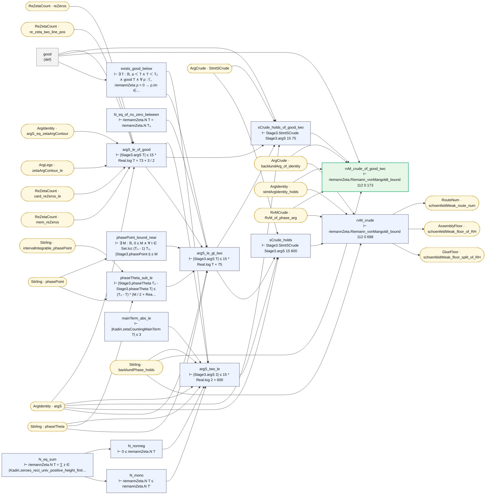

# `lean_stage3/Stage3/ArgCount.lean`

**What it does** (its own header): ArgCount — block `hnt.md#H3` of `lean_stage3/design/hnt.md`, "The assembly: StmtSCrude argS, good heights by the identity, bad heights by a good one beside them".

**Imports:** [`ArgLegs`](../lean_stage3/ArgLegs.md), [`ReZetaCount`](../lean_stage3/ReZetaCount.md).
**Imported by:** [`Stage3`](../lean_stage3/Stage3.md), [`AssemblyFloor`](../lean_stage3/AssemblyFloor.md).

Blue: theorem. Green: a theorem nothing else uses (an end). Dashed white: connects to nothing. Grey: definition. Red: contains `sorry`. Yellow: in another file. An arrow A → B reads "A is used by B".

## Every declaration

| declaration | proves (output) | needs (input) | why (its own docstring) | uses | used by |
|---|---|---|---|---|---|
| `ArgCount.good` def, line 67 | Prop | T : ℝ | A height with no zero of `ζ` of positive real part on it. | — | `ArgCount.argS_le_of_good`, `ArgCount.exists_good_below`, `ArgCount.rvM_crude_of_good_two`, `ArgCount.sCrude_holds_of_good_two` |
| `ArgCount.argS_le_of_good` theorem, line 70 | \|Stage3.argS T\| ≤ 15 * Real.log T + 73 + 3 / 2 | hT : 2 ≤ T; hg : good T | The good heights. The identity plus H1's legs and H2's count. | `ArgCount.good`, `Stage3.argS`, `Stage3.argS_eq_zetaArgContour`, `ArgLegs.zetaArgContour_le`, `ReZetaCount.card_reZeros_le`, `ReZetaCount.mem_reZeros`, `ReZetaCount.reZeros`, `ReZetaCount.re_zeta_two_line_pos` | `ArgCount.argS_le_gt_two`, `ArgCount.argS_two_le`, `ArgCount.sCrude_holds_of_good_two` |
| `ArgCount.N_eq_sum` theorem, line 84 | riemannZeta.N T = ∑ z ∈ (Kadiri.zeroes_rect_univ_positive_height_finite T).toFinset, (1 : ℝ) * (riemannZeta.order z : ℝ) | T : ℝ | `N T` as the finite sum of orders over the zero rectangle. | — | `ArgCount.N_mono`, `ArgCount.N_nonneg` |
| `ArgCount.N_nonneg` theorem, line 93 | 0 ≤ riemannZeta.N T | T : ℝ | Every order is at least one, so the count is nonnegative. | `ArgCount.N_eq_sum` | `ArgCount.argS_two_le` |
| `ArgCount.N_mono` theorem, line 103 | riemannZeta.N T ≤ riemannZeta.N T' | h : T ≤ T' | The count is monotone in the height. | `ArgCount.N_eq_sum` | `ArgCount.argS_two_le` |
| `ArgCount.N_eq_of_no_zero_between` theorem, line 119 | riemannZeta.N T = riemannZeta.N T₀ | hle : T ≤ T₀; hno : ∀ ρ : ℂ, riemannZeta ρ = 0 → ρ.im ∈ Set.Ico T T₀ → False | No zero with imaginary part in `[T, T₀)` means the count does not move. | — | `ArgCount.argS_le_gt_two` |
| `ArgCount.exists_good_below` theorem, line 139 | ∃ T : ℝ, a &lt; T ∧ T &lt; T₀ ∧ good T ∧ ∀ ρ : ℂ, riemannZeta ρ = 0 → ρ.im ∈ Set.Ico T T₀ → False | ha : 0 ≤ a; hlt : a &lt; T₀ | Below any height there is a good height with no zero between the two. | `ArgCount.good` | `ArgCount.argS_le_gt_two`, `ArgCount.argS_two_le` |
| `ArgCount.phasePoint_bound_near` theorem, line 175 | ∃ M : ℝ, 0 ≤ M ∧ ∀ t ∈ Set.Icc (T₀ - 1) T₀, \|Stage3.phasePoint t\| ≤ M | T₀ : ℝ | The phase integrand is bounded on the unit interval below any height. | `Stage3.phasePoint` | `ArgCount.argS_le_gt_two` |
| `ArgCount.phaseTheta_sub_le` theorem, line 185 | \|Stage3.phaseTheta T₀ - Stage3.phaseTheta T\| ≤ (T₀ - T) * (M / 2 + Real.log Real.pi / 2) | hle : T ≤ T₀; h1 : T₀ ≤ T + 1; hM : ∀ t ∈ Set.Icc (T₀ - 1) T₀, \|Stage3.phasePoint t\| ≤ M | The phase moves by at most the length times the integrand bound. | `Stage3.intervalIntegrable_phasePoint`, `Stage3.phasePoint`, `Stage3.phaseTheta` | `ArgCount.argS_le_gt_two` |
| `ArgCount.argS_le_gt_two` theorem, line 216 | \|Stage3.argS T\| ≤ 15 * Real.log T + 75 | hT : 2 &lt; T | The bad heights above 2. A good height just below, with the count equal and the phase moving by at most `π/2`. | `ArgCount.N_eq_of_no_zero_between`, `ArgCount.argS_le_of_good`, `ArgCount.exists_good_below`, `ArgCount.phasePoint_bound_near`, `ArgCount.phaseTheta_sub_le`, `Stage3.argS`, `Stage3.phaseTheta` | `ArgCount.sCrude_holds`, `ArgCount.sCrude_holds_of_good_two` |
| `ArgCount.mainTerm_abs_le` theorem, line 258 | \|Kadiri.zetaCountingMainTerm T\| ≤ 3 | h2 : 2 ≤ T; h3 : T ≤ 3 | The RvM main term is small on `[2, 3]`. | — | `ArgCount.argS_two_le` |
| `ArgCount.argS_two_le` theorem, line 278 | \|Stage3.argS 2\| ≤ 15 * Real.log 2 + 600 | — | The single point `T = 2`. A good height just above, with the count monotone and the Stirling phase bound. | `ArgCount.N_mono`, `ArgCount.N_nonneg`, `ArgCount.argS_le_of_good`, `ArgCount.exists_good_below`, `ArgCount.mainTerm_abs_le`, `Stage3.argS`, `Stage3.backlundPhase_holds`, `Stage3.phaseTheta` | `ArgCount.sCrude_holds` |
| `ArgCount.sCrude_holds_of_good_two` theorem, line 307 | Stage3.StmtSCrude Stage3.argS 15 75 | h2 : good 2 | StmtSCrude under `good 2`: `\|argS T\| ≤ 15 log T + 75`. | `ArgCount.argS_le_gt_two`, `ArgCount.argS_le_of_good`, `ArgCount.good`, `Stage3.StmtSCrude`, `Stage3.argS` | `ArgCount.rvM_crude_of_good_two` |
| `ArgCount.sCrude_holds` theorem, line 315 | Stage3.StmtSCrude Stage3.argS 15 600 | — | StmtSCrude unconditionally: `\|argS T\| ≤ 15 log T + 600`. | `ArgCount.argS_le_gt_two`, `ArgCount.argS_two_le`, `Stage3.StmtSCrude`, `Stage3.argS` | `ArgCount.rvM_crude` |
| `ArgCount.rvM_crude_of_good_two` theorem, line 324 | riemannZeta.Riemann_vonMangoldt_bound 112 0 173 | h2 : good 2 | The crude hNT band under `good 2`. | `ArgCount.good`, `ArgCount.sCrude_holds_of_good_two`, `Stage3.backlundArg_of_identity`, `Stage3.stmtArgIdentity_holds`, `Stage3.RvM_of_phase_arg`, `Stage3.backlundPhase_holds` | — |
| `ArgCount.rvM_crude` theorem, line 332 | riemannZeta.Riemann_vonMangoldt_bound 112 0 698 | — | The crude hNT band, unconditional. | `ArgCount.sCrude_holds`, `Stage3.backlundArg_of_identity`, `Stage3.stmtArgIdentity_holds`, `Stage3.RvM_of_phase_arg`, `Stage3.backlundPhase_holds` | `Stage3.schoenfeldWeak_floor_of_RH`, `Stage3.schoenfeldWeak_floor_split_of_RH`, `Stage3.schoenfeldWeak_route_num` |
