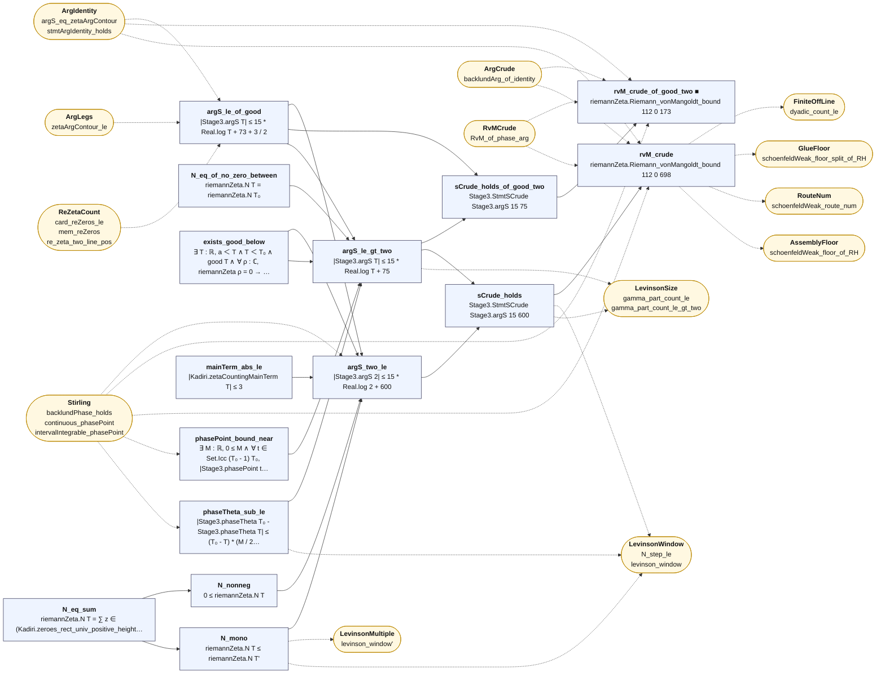

# `lean_stage3/Stage3/ArgCount.lean`

ArgCount — block `hnt.md#H3` of `lean_stage3/design/hnt.md`, "The assembly: StmtSCrude argS, good heights by the identity, bad heights by a good one beside them".

15 theorems, 1 definition, 365 lines. Arrows are Lean's own record of what each proof uses.

**Imports:** [`ArgLegs`](../lean_stage3/ArgLegs.md), [`ReZetaCount`](../lean_stage3/ReZetaCount.md)  
**Imported by:** [`Stage3`](../lean_stage3/Stage3.md), [`AssemblyFloor`](../lean_stage3/AssemblyFloor.md), [`LevinsonSize`](../lean_stage3/LevinsonSize.md)

## The picture



An arrow A → B reads "A is used in the proof of B". Green: counting, integers only. Violet: shape, analysis with no ζ. Blue: reads ζ. A name ending in ■ is an end: nothing else uses it. Red: contains `sorry`. Yellow: theorems in another file, counted; a dotted arrow crosses files. Definitions are not drawn; they are listed below the diagram.

## Definitions

<a name="ArgCount-good"></a>
### `ArgCount.good`

def · line 67

A height with no zero of `ζ` of positive real part on it.

- **Is:** `` good (T : ℝ) : Prop := ∀ ρ : ℂ, riemannZeta ρ = 0 → 0 < ρ.re → ρ.im ≠ T ``
- **Used by 6:** [`ArgCount.argS_le_gt_two`](#ArgCount-argS_le_gt_two), [`ArgCount.argS_le_of_good`](#ArgCount-argS_le_of_good), [`ArgCount.argS_two_le`](#ArgCount-argS_two_le), [`ArgCount.exists_good_below`](#ArgCount-exists_good_below), [`ArgCount.rvM_crude_of_good_two`](#ArgCount-rvM_crude_of_good_two), [`ArgCount.sCrude_holds_of_good_two`](#ArgCount-sCrude_holds_of_good_two)

## Theorems

<a name="ArgCount-argS_le_of_good"></a>
### `ArgCount.argS_le_of_good`

line 70

**Reads ζ.** It, or something it rests on, uses the zeta function, its zeros or the Riemann hypothesis.

**Why.** The good heights. The identity plus H1's legs and H2's count.

**Proves**

```lean
|Stage3.argS T| ≤ 15 * Real.log T + 73 + 3 / 2
```

**Needs** (its hypotheses)

  - `` hT : 2 ≤ T ``
  - `` hg : good T ``

**Stated with:** [`ArgCount.good`](#ArgCount-good), [`Stage3.argS`](../lean_stage3/ArgIdentity.md#Stage3-argS)

**Fed by** (5 theorems its proof uses)

  - [`Stage3.argS_eq_zetaArgContour`](../lean_stage3/ArgIdentity.md#Stage3-argS_eq_zetaArgContour) (ArgIdentity) — `` argS T = zetaArgContour T ``
  - [`ArgLegs.zetaArgContour_le`](../lean_stage3/ArgLegs.md#ArgLegs-zetaArgContour_le) (ArgLegs) — `` |Stage3.zetaArgContour T| ≤ (Z.card : ℝ) + 3 / 2 ``
  - [`ReZetaCount.card_reZeros_le`](../lean_stage3/ReZetaCount.md#ReZetaCount-card_reZeros_le) (ReZetaCount) — `` ((reZeros hT).card : ℝ) ≤ 15 * Real.log T + 73 ``
  - [`ReZetaCount.mem_reZeros`](../lean_stage3/ReZetaCount.md#ReZetaCount-mem_reZeros) (ReZetaCount) — `` x ∈ reZeros hT ↔ x ∈ Set.Ioo (1/2 : ℝ) 2 ∧ (riemannZeta ((x : ℂ) + T * Complex.I)).re = 0 ``
  - [`ReZetaCount.re_zeta_two_line_pos`](../lean_stage3/ReZetaCount.md#ReZetaCount-re_zeta_two_line_pos) (ReZetaCount) — `` 0 < (riemannZeta (2 + (t : ℂ) * Complex.I)).re ``

**Definitions its proof touches:** [`Stage3.zetaArgContour`](../lean_stage3/ArgIdentity.md#Stage3-zetaArgContour), [`ReZetaCount.reZeros`](../lean_stage3/ReZetaCount.md#ReZetaCount-reZeros)

**Feeds** (3 that use it)

  - [`ArgCount.argS_le_gt_two`](#ArgCount-argS_le_gt_two) — `` |Stage3.argS T| ≤ 15 * Real.log T + 75 ``
  - [`ArgCount.argS_two_le`](#ArgCount-argS_two_le) — `` |Stage3.argS 2| ≤ 15 * Real.log 2 + 600 ``
  - [`ArgCount.sCrude_holds_of_good_two`](#ArgCount-sCrude_holds_of_good_two) — `` Stage3.StmtSCrude Stage3.argS 15 75 ``

<a name="ArgCount-N_eq_sum"></a>
### `ArgCount.N_eq_sum`

line 84

**Reads ζ.** It, or something it rests on, uses the zeta function, its zeros or the Riemann hypothesis.

**Why.** `N T` as the finite sum of orders over the zero rectangle.

**Proves**

```lean
riemannZeta.N T = ∑ z ∈ (Kadiri.zeroes_rect_univ_positive_height_finite T).toFinset, (1 : ℝ) * (riemannZeta.order z : ℝ)
```

**Needs** (its hypotheses)

  - `` T : ℝ ``

**Fed by:** no theorem of this repo; it stands on Mathlib.

**Feeds** (2 that use it)

  - [`ArgCount.N_mono`](#ArgCount-N_mono) — `` riemannZeta.N T ≤ riemannZeta.N T' ``
  - [`ArgCount.N_nonneg`](#ArgCount-N_nonneg) — `` 0 ≤ riemannZeta.N T ``

<a name="ArgCount-N_nonneg"></a>
### `ArgCount.N_nonneg`

line 93

**Reads ζ.** It, or something it rests on, uses the zeta function, its zeros or the Riemann hypothesis.

**Why.** Every order is at least one, so the count is nonnegative.

**Proves**

```lean
0 ≤ riemannZeta.N T
```

**Needs** (its hypotheses)

  - `` T : ℝ ``

**Fed by** (1 theorem its proof uses)

  - [`ArgCount.N_eq_sum`](#ArgCount-N_eq_sum) — `` riemannZeta.N T = ∑ z ∈ (Kadiri.zeroes_rect_univ_positive_height_finite T).toFinset, (1 : ℝ) * (riemannZeta.order z : ℝ) ``

**Feeds** (1 that use it)

  - [`ArgCount.argS_two_le`](#ArgCount-argS_two_le) — `` |Stage3.argS 2| ≤ 15 * Real.log 2 + 600 ``

<a name="ArgCount-N_mono"></a>
### `ArgCount.N_mono`

line 103

**Reads ζ.** It, or something it rests on, uses the zeta function, its zeros or the Riemann hypothesis.

**Why.** The count is monotone in the height.

**Proves**

```lean
riemannZeta.N T ≤ riemannZeta.N T'
```

**Needs** (its hypotheses)

  - `` h : T ≤ T' ``

**Fed by** (1 theorem its proof uses)

  - [`ArgCount.N_eq_sum`](#ArgCount-N_eq_sum) — `` riemannZeta.N T = ∑ z ∈ (Kadiri.zeroes_rect_univ_positive_height_finite T).toFinset, (1 : ℝ) * (riemannZeta.order z : ℝ) ``

**Feeds** (3 that use it)

  - [`ArgCount.argS_two_le`](#ArgCount-argS_two_le) — `` |Stage3.argS 2| ≤ 15 * Real.log 2 + 600 ``
  - [`LevinsonMultiple.levinson_window'`](../lean_stage3/LevinsonMultiple.md#LevinsonMultiple-levinson_window-) (LevinsonMultiple) — `` (riemannZeta.N b - riemannZeta.N a) - (1 / (Real.pi * (1 / 2 - σ₀))) * ((b - a) / 2 * Real.log K + windowE M B X T a b) - (134 * Real.log T + 2918) ≤ … ``
  - [`LevinsonWindow.levinson_window`](../lean_stage3/LevinsonWindow.md#LevinsonWindow-levinson_window) (LevinsonWindow) — `` (riemannZeta.N b - riemannZeta.N a) - (1 / (Real.pi * (1 / 2 - σ₀))) * ((b - a) / 2 * Real.log K + windowE M B X T a b) - (134 * Real.log T + 2918) ≤ … ``

<a name="ArgCount-N_eq_of_no_zero_between"></a>
### `ArgCount.N_eq_of_no_zero_between`

line 119

**Reads ζ.** It, or something it rests on, uses the zeta function, its zeros or the Riemann hypothesis.

**Why.** No zero with imaginary part in `[T, T₀)` means the count does not move.

**Proves**

```lean
riemannZeta.N T = riemannZeta.N T₀
```

**Needs** (its hypotheses)

  - `` hle : T ≤ T₀ ``
  - `` hno : ∀ ρ : ℂ, riemannZeta ρ = 0 → ρ.im ∈ Set.Ico T T₀ → False ``

**Fed by:** no theorem of this repo; it stands on Mathlib.

**Feeds** (1 that use it)

  - [`ArgCount.argS_le_gt_two`](#ArgCount-argS_le_gt_two) — `` |Stage3.argS T| ≤ 15 * Real.log T + 75 ``

<a name="ArgCount-exists_good_below"></a>
### `ArgCount.exists_good_below`

line 139

**Reads ζ.** It, or something it rests on, uses the zeta function, its zeros or the Riemann hypothesis.

**Why.** Below any height there is a good height with no zero between the two.

**Proves**

```lean
∃ T : ℝ, a < T ∧ T < T₀ ∧ good T ∧ ∀ ρ : ℂ, riemannZeta ρ = 0 → ρ.im ∈ Set.Ico T T₀ → False
```

**Needs** (its hypotheses)

  - `` ha : 0 ≤ a ``
  - `` hlt : a < T₀ ``

**Stated with:** [`ArgCount.good`](#ArgCount-good)

**Fed by:** no theorem of this repo; it stands on Mathlib and the definitions below.

**Feeds** (2 that use it)

  - [`ArgCount.argS_le_gt_two`](#ArgCount-argS_le_gt_two) — `` |Stage3.argS T| ≤ 15 * Real.log T + 75 ``
  - [`ArgCount.argS_two_le`](#ArgCount-argS_two_le) — `` |Stage3.argS 2| ≤ 15 * Real.log 2 + 600 ``

<a name="ArgCount-phasePoint_bound_near"></a>
### `ArgCount.phasePoint_bound_near`

line 175

**Reads ζ.** It, or something it rests on, uses the zeta function, its zeros or the Riemann hypothesis.

**Why.** The phase integrand is bounded on the unit interval below any height.

**Proves**

```lean
∃ M : ℝ, 0 ≤ M ∧ ∀ t ∈ Set.Icc (T₀ - 1) T₀, |Stage3.phasePoint t| ≤ M
```

**Needs** (its hypotheses)

  - `` T₀ : ℝ ``

**Stated with:** [`Stage3.phasePoint`](../lean_stage3/Stirling.md#Stage3-phasePoint)

**Fed by** (1 theorem its proof uses)

  - [`Stage3.continuous_phasePoint`](../lean_stage3/Stirling.md#Stage3-continuous_phasePoint) (Stirling) — `` Continuous phasePoint ``

**Feeds** (1 that use it)

  - [`ArgCount.argS_le_gt_two`](#ArgCount-argS_le_gt_two) — `` |Stage3.argS T| ≤ 15 * Real.log T + 75 ``

<a name="ArgCount-phaseTheta_sub_le"></a>
### `ArgCount.phaseTheta_sub_le`

line 185

**Reads ζ.** It, or something it rests on, uses the zeta function, its zeros or the Riemann hypothesis.

**Why.** The phase moves by at most the length times the integrand bound.

**Proves**

```lean
|Stage3.phaseTheta T₀ - Stage3.phaseTheta T| ≤ (T₀ - T) * (M / 2 + Real.log Real.pi / 2)
```

**Needs** (its hypotheses)

  - `` hle : T ≤ T₀ ``
  - `` h1 : T₀ ≤ T + 1 ``
  - `` hM : ∀ t ∈ Set.Icc (T₀ - 1) T₀, |Stage3.phasePoint t| ≤ M ``

**Stated with:** [`Stage3.phasePoint`](../lean_stage3/Stirling.md#Stage3-phasePoint), [`Stage3.phaseTheta`](../lean_stage3/Stirling.md#Stage3-phaseTheta)

**Fed by** (1 theorem its proof uses)

  - [`Stage3.intervalIntegrable_phasePoint`](../lean_stage3/Stirling.md#Stage3-intervalIntegrable_phasePoint) (Stirling) — `` IntervalIntegrable phasePoint MeasureTheory.volume a b ``

**Feeds** (2 that use it)

  - [`ArgCount.argS_le_gt_two`](#ArgCount-argS_le_gt_two) — `` |Stage3.argS T| ≤ 15 * Real.log T + 75 ``
  - [`LevinsonWindow.N_step_le`](../lean_stage3/LevinsonWindow.md#LevinsonWindow-N_step_le) (LevinsonWindow) — `` riemannZeta.N u - riemannZeta.N t ≤ 31 * Real.log u + 1250 ``

<a name="ArgCount-argS_le_gt_two"></a>
### `ArgCount.argS_le_gt_two`

line 216

**Reads ζ.** It, or something it rests on, uses the zeta function, its zeros or the Riemann hypothesis.

**Why.** The bad heights above 2. A good height just below, with the count equal and the phase moving by at most `π/2`.

**Proves**

```lean
|Stage3.argS T| ≤ 15 * Real.log T + 75
```

**Needs** (its hypotheses)

  - `` hT : 2 < T ``

**Stated with:** [`Stage3.argS`](../lean_stage3/ArgIdentity.md#Stage3-argS)

**Fed by** (5 theorems its proof uses)

  - [`ArgCount.N_eq_of_no_zero_between`](#ArgCount-N_eq_of_no_zero_between) — `` riemannZeta.N T = riemannZeta.N T₀ ``
  - [`ArgCount.argS_le_of_good`](#ArgCount-argS_le_of_good) — `` |Stage3.argS T| ≤ 15 * Real.log T + 73 + 3 / 2 ``
  - [`ArgCount.exists_good_below`](#ArgCount-exists_good_below) — `` ∃ T : ℝ, a < T ∧ T < T₀ ∧ good T ∧ ∀ ρ : ℂ, riemannZeta ρ = 0 → ρ.im ∈ Set.Ico T T₀ → False ``
  - [`ArgCount.phasePoint_bound_near`](#ArgCount-phasePoint_bound_near) — `` ∃ M : ℝ, 0 ≤ M ∧ ∀ t ∈ Set.Icc (T₀ - 1) T₀, |Stage3.phasePoint t| ≤ M ``
  - [`ArgCount.phaseTheta_sub_le`](#ArgCount-phaseTheta_sub_le) — `` |Stage3.phaseTheta T₀ - Stage3.phaseTheta T| ≤ (T₀ - T) * (M / 2 + Real.log Real.pi / 2) ``

**Definitions its proof touches:** [`ArgCount.good`](#ArgCount-good), [`Stage3.phasePoint`](../lean_stage3/Stirling.md#Stage3-phasePoint), [`Stage3.phaseTheta`](../lean_stage3/Stirling.md#Stage3-phaseTheta)

**Feeds** (3 that use it)

  - [`ArgCount.sCrude_holds`](#ArgCount-sCrude_holds) — `` Stage3.StmtSCrude Stage3.argS 15 600 ``
  - [`ArgCount.sCrude_holds_of_good_two`](#ArgCount-sCrude_holds_of_good_two) — `` Stage3.StmtSCrude Stage3.argS 15 75 ``
  - [`LevinsonSize.gamma_part_count_le_gt_two`](../lean_stage3/LevinsonSize.md#LevinsonSize-gamma_part_count_le_gt_two) (LevinsonSize) — `` |(∫ t in a..b, logDeriv Gammaℝ (1/2 + t * I)).re - Real.pi * (riemannZeta.N b - riemannZeta.N a)| ≤ Real.pi * (30 * Real.log b + 150) ``

<a name="ArgCount-mainTerm_abs_le"></a>
### `ArgCount.mainTerm_abs_le`

line 258

**Reads ζ.** It, or something it rests on, uses the zeta function, its zeros or the Riemann hypothesis.

**Why.** The RvM main term is small on `[2, 3]`.

**Proves**

```lean
|Kadiri.zetaCountingMainTerm T| ≤ 3
```

**Needs** (its hypotheses)

  - `` h2 : 2 ≤ T ``
  - `` h3 : T ≤ 3 ``

**Fed by:** no theorem of this repo; it stands on Mathlib.

**Feeds** (1 that use it)

  - [`ArgCount.argS_two_le`](#ArgCount-argS_two_le) — `` |Stage3.argS 2| ≤ 15 * Real.log 2 + 600 ``

<a name="ArgCount-argS_two_le"></a>
### `ArgCount.argS_two_le`

line 278

**Reads ζ.** It, or something it rests on, uses the zeta function, its zeros or the Riemann hypothesis.

**Why.** The single point `T = 2`. A good height just above, with the count monotone and the Stirling phase bound.

**Proves**

```lean
|Stage3.argS 2| ≤ 15 * Real.log 2 + 600
```

**Stated with:** [`Stage3.argS`](../lean_stage3/ArgIdentity.md#Stage3-argS)

**Fed by** (6 theorems its proof uses)

  - [`ArgCount.N_mono`](#ArgCount-N_mono) — `` riemannZeta.N T ≤ riemannZeta.N T' ``
  - [`ArgCount.N_nonneg`](#ArgCount-N_nonneg) — `` 0 ≤ riemannZeta.N T ``
  - [`ArgCount.argS_le_of_good`](#ArgCount-argS_le_of_good) — `` |Stage3.argS T| ≤ 15 * Real.log T + 73 + 3 / 2 ``
  - [`ArgCount.exists_good_below`](#ArgCount-exists_good_below) — `` ∃ T : ℝ, a < T ∧ T < T₀ ∧ good T ∧ ∀ ρ : ℂ, riemannZeta ρ = 0 → ρ.im ∈ Set.Ico T T₀ → False ``
  - [`ArgCount.mainTerm_abs_le`](#ArgCount-mainTerm_abs_le) — `` |Kadiri.zetaCountingMainTerm T| ≤ 3 ``
  - [`Stage3.backlundPhase_holds`](../lean_stage3/Stirling.md#Stage3-backlundPhase_holds) (Stirling) — `` StmtBacklundPhase phaseTheta 97 98 ``

**Definitions its proof touches:** [`ArgCount.good`](#ArgCount-good), [`Stage3.phaseTheta`](../lean_stage3/Stirling.md#Stage3-phaseTheta)

**Feeds** (1 that use it)

  - [`ArgCount.sCrude_holds`](#ArgCount-sCrude_holds) — `` Stage3.StmtSCrude Stage3.argS 15 600 ``

<a name="ArgCount-sCrude_holds_of_good_two"></a>
### `ArgCount.sCrude_holds_of_good_two`

line 307

**Reads ζ.** It, or something it rests on, uses the zeta function, its zeros or the Riemann hypothesis.

**Why.** StmtSCrude under `good 2`: `|argS T| ≤ 15 log T + 75`.

**Proves**

```lean
Stage3.StmtSCrude Stage3.argS 15 75
```

**Needs** (its hypotheses)

  - `` h2 : good 2 ``

**Stated with:** [`ArgCount.good`](#ArgCount-good), [`Stage3.StmtSCrude`](../lean_stage3/ArgCrude.md#Stage3-StmtSCrude), [`Stage3.argS`](../lean_stage3/ArgIdentity.md#Stage3-argS)

**Fed by** (2 theorems its proof uses)

  - [`ArgCount.argS_le_gt_two`](#ArgCount-argS_le_gt_two) — `` |Stage3.argS T| ≤ 15 * Real.log T + 75 ``
  - [`ArgCount.argS_le_of_good`](#ArgCount-argS_le_of_good) — `` |Stage3.argS T| ≤ 15 * Real.log T + 73 + 3 / 2 ``

**Feeds** (1 that use it)

  - [`ArgCount.rvM_crude_of_good_two`](#ArgCount-rvM_crude_of_good_two) — `` riemannZeta.Riemann_vonMangoldt_bound 112 0 173 ``

<a name="ArgCount-sCrude_holds"></a>
### `ArgCount.sCrude_holds`

line 315

**Reads ζ.** It, or something it rests on, uses the zeta function, its zeros or the Riemann hypothesis.

**Why.** StmtSCrude unconditionally: `|argS T| ≤ 15 log T + 600`.

**Proves**

```lean
Stage3.StmtSCrude Stage3.argS 15 600
```

**Stated with:** [`Stage3.StmtSCrude`](../lean_stage3/ArgCrude.md#Stage3-StmtSCrude), [`Stage3.argS`](../lean_stage3/ArgIdentity.md#Stage3-argS)

**Fed by** (2 theorems its proof uses)

  - [`ArgCount.argS_le_gt_two`](#ArgCount-argS_le_gt_two) — `` |Stage3.argS T| ≤ 15 * Real.log T + 75 ``
  - [`ArgCount.argS_two_le`](#ArgCount-argS_two_le) — `` |Stage3.argS 2| ≤ 15 * Real.log 2 + 600 ``

**Feeds** (3 that use it)

  - [`ArgCount.rvM_crude`](#ArgCount-rvM_crude) — `` riemannZeta.Riemann_vonMangoldt_bound 112 0 698 ``
  - [`LevinsonSize.gamma_part_count_le`](../lean_stage3/LevinsonSize.md#LevinsonSize-gamma_part_count_le) (LevinsonSize) — `` |(∫ t in a..b, logDeriv Gammaℝ (1/2 + t * I)).re - Real.pi * (riemannZeta.N b - riemannZeta.N a)| ≤ Real.pi * (30 * Real.log b + 1200) ``
  - [`LevinsonWindow.N_step_le`](../lean_stage3/LevinsonWindow.md#LevinsonWindow-N_step_le) (LevinsonWindow) — `` riemannZeta.N u - riemannZeta.N t ≤ 31 * Real.log u + 1250 ``

<a name="ArgCount-rvM_crude_of_good_two"></a>
### `ArgCount.rvM_crude_of_good_two`

line 324

**Reads ζ.** It, or something it rests on, uses the zeta function, its zeros or the Riemann hypothesis.

**Why.** The crude hNT band under `good 2`.

**Proves**

```lean
riemannZeta.Riemann_vonMangoldt_bound 112 0 173
```

**Needs** (its hypotheses)

  - `` h2 : good 2 ``

**Stated with:** [`ArgCount.good`](#ArgCount-good)

**Fed by** (5 theorems its proof uses)

  - [`ArgCount.sCrude_holds_of_good_two`](#ArgCount-sCrude_holds_of_good_two) — `` Stage3.StmtSCrude Stage3.argS 15 75 ``
  - [`Stage3.backlundArg_of_identity`](../lean_stage3/ArgCrude.md#Stage3-backlundArg_of_identity) (ArgCrude) — `` StmtBacklundArg θ B₁ B₃ ``
  - [`Stage3.stmtArgIdentity_holds`](../lean_stage3/ArgIdentity.md#Stage3-stmtArgIdentity_holds) (ArgIdentity) — `` StmtArgIdentity phaseTheta argS ``
  - [`Stage3.RvM_of_phase_arg`](../lean_stage3/RvMCrude.md#Stage3-RvM_of_phase_arg) (RvMCrude) — `` riemannZeta.Riemann_vonMangoldt_bound (B₁ + B₁') 0 (B₃ + B₃') ``
  - [`Stage3.backlundPhase_holds`](../lean_stage3/Stirling.md#Stage3-backlundPhase_holds) (Stirling) — `` StmtBacklundPhase phaseTheta 97 98 ``

**Definitions its proof touches:** [`Stage3.argS`](../lean_stage3/ArgIdentity.md#Stage3-argS), [`Stage3.phaseTheta`](../lean_stage3/Stirling.md#Stage3-phaseTheta)

**Feeds:** nothing. It is an end.

<a name="ArgCount-rvM_crude"></a>
### `ArgCount.rvM_crude`

line 332

**Reads ζ.** It, or something it rests on, uses the zeta function, its zeros or the Riemann hypothesis.

**Why.** The crude hNT band, unconditional.

**Proves**

```lean
riemannZeta.Riemann_vonMangoldt_bound 112 0 698
```

**Fed by** (5 theorems its proof uses)

  - [`ArgCount.sCrude_holds`](#ArgCount-sCrude_holds) — `` Stage3.StmtSCrude Stage3.argS 15 600 ``
  - [`Stage3.backlundArg_of_identity`](../lean_stage3/ArgCrude.md#Stage3-backlundArg_of_identity) (ArgCrude) — `` StmtBacklundArg θ B₁ B₃ ``
  - [`Stage3.stmtArgIdentity_holds`](../lean_stage3/ArgIdentity.md#Stage3-stmtArgIdentity_holds) (ArgIdentity) — `` StmtArgIdentity phaseTheta argS ``
  - [`Stage3.RvM_of_phase_arg`](../lean_stage3/RvMCrude.md#Stage3-RvM_of_phase_arg) (RvMCrude) — `` riemannZeta.Riemann_vonMangoldt_bound (B₁ + B₁') 0 (B₃ + B₃') ``
  - [`Stage3.backlundPhase_holds`](../lean_stage3/Stirling.md#Stage3-backlundPhase_holds) (Stirling) — `` StmtBacklundPhase phaseTheta 97 98 ``

**Definitions its proof touches:** [`Stage3.argS`](../lean_stage3/ArgIdentity.md#Stage3-argS), [`Stage3.phaseTheta`](../lean_stage3/Stirling.md#Stage3-phaseTheta)

**Feeds** (4 that use it)

  - [`Stage3.schoenfeldWeak_floor_of_RH`](../lean_stage3/AssemblyFloor.md#Stage3-schoenfeldWeak_floor_of_RH) (AssemblyFloor) — `` ∃ c₁ c₂ : ℝ, 0 ≤ c₁ ∧ 0 ≤ c₂ ∧ ∀ x₀ : ℝ, 16 ≤ x₀ → StmtSchoenfeldWeak (3 * floorConst c₁ c₂ 112 0 698 weightedZeroHeightBucket x₀ + 13) 1 (max (x₀ ^ 2… ``
  - [`FiniteOffLine.dyadic_count_le`](../lean_stage3/FiniteOffLine.md#FiniteOffLine-dyadic_count_le) (FiniteOffLine) — `` ∑ j ∈ range (K + 1), ((2 : ℝ) ^ j)⁻¹ * (2 * |riemannZeta.N ((2 : ℝ) ^ (j + 1))| + weightedZeroHeightBucket) ≤ 3000 * ((K : ℝ) + 2) ^ 2 ``
  - [`Stage3.schoenfeldWeak_floor_split_of_RH`](../lean_stage3/GlueFloor.md#Stage3-schoenfeldWeak_floor_split_of_RH) (GlueFloor) — `` ∃ c₁ c₃ c₄ : ℝ, 0 ≤ c₁ ∧ 0 ≤ c₃ ∧ 0 ≤ c₄ ∧ ∀ x₀ : ℝ, 16 ≤ x₀ → StmtSchoenfeldWeak (3 * floorConstSplit c₁ c₃ c₄ 112 0 698 weightedZeroHeightBucket x₀ … ``
  - [`Stage3.schoenfeldWeak_route_num`](../lean_stage3/RouteNum.md#Stage3-schoenfeldWeak_route_num) (RouteNum) — `` StmtSchoenfeldWeak (routeConst x₀) 1 (max (x₀ ^ 2) 9) (fun x => (Nat.primeCounting ⌊x⌋₊ : ℝ)) Li ``

