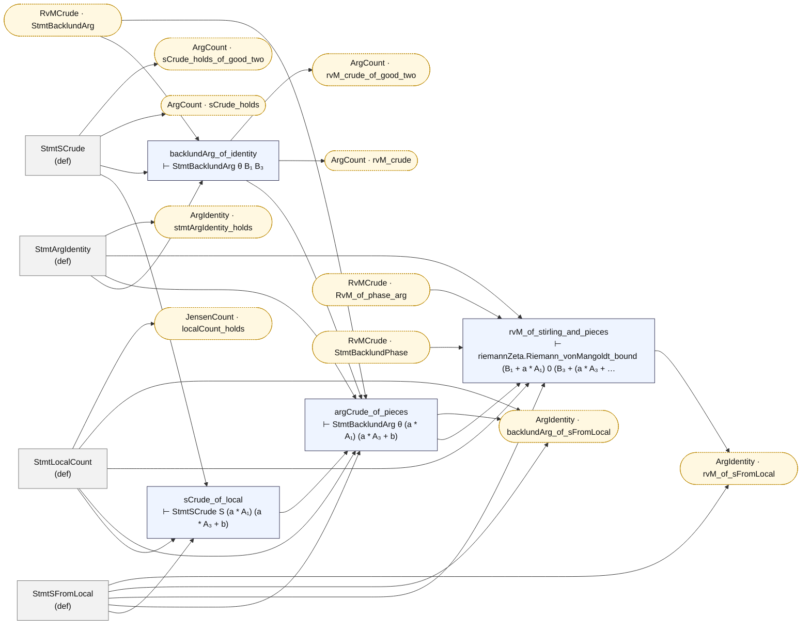

# `lean_stage3/Stage3/ArgCrude.lean`

**What it does** (its own header): ArgCrude — hNT slice 2: the argument-principle half of Backlund, decomposed to the point where the Jensen zero-count is the only analytic content left.

**Imports:** [`RvMCrude`](../lean_stage3/RvMCrude.md).
**Imported by:** [`Stage3`](../lean_stage3/Stage3.md), [`ArgIdentity`](../lean_stage3/ArgIdentity.md), [`JensenCount`](../lean_stage3/JensenCount.md).

Blue: theorem. Green: a theorem nothing else uses (an end). Dashed white: connects to nothing. Grey: definition. Red: contains `sorry`. Yellow: in another file. An arrow A → B reads "A is used by B".

## Every declaration

| declaration | proves (output) | needs (input) | why (its own docstring) | uses | used by |
|---|---|---|---|---|---|
| `Stage3.StmtArgIdentity` def, line 65 | Prop | θ S : ℝ → ℝ | The rectangle identity: the zero count is the phase plus one, plus `S`. Pure argument principle — no bound is asserted here, which is the point of naming it separately. | — | `Stage3.argCrude_of_pieces`, `Stage3.backlundArg_of_identity`, `Stage3.rvM_of_stirling_and_pieces`, `Stage3.stmtArgIdentity_holds` |
| `Stage3.StmtSCrude` def, line 70 | Prop | S : ℝ → ℝ; B₁ B₃ : ℝ | The crude argument bound: `\|S T\| ≤ B₁ log T + B₃`. This is `StmtBacklundArg`'s content once the identity is available. | — | `ArgCount.sCrude_holds`, `ArgCount.sCrude_holds_of_good_two`, `Stage3.backlundArg_of_identity`, `Stage3.sCrude_of_local` |
| `Stage3.StmtLocalCount` def, line 76 | Prop | cnt : ℝ → ℝ; A₁ A₃ : ℝ | The Jensen piece: a local zero count that grows like `log T`. Abstract in `cnt` so the discharge target is a statement, not a construction — upstream `ZerosBound` is what discharges it. | — | `Stage3.argCrude_of_pieces`, `Stage3.rvM_of_stirling_and_pieces`, `Stage3.sCrude_of_local`, `Stage3.backlundArg_of_sFromLocal`, `Stage3.localCount_holds` |
| `Stage3.StmtSFromLocal` def, line 81 | Prop | S cnt : ℝ → ℝ; a b : ℝ | Backlund's step: the argument is controlled by the local count. `a` and `b` are crude by design. | — | `Stage3.argCrude_of_pieces`, `Stage3.rvM_of_stirling_and_pieces`, `Stage3.sCrude_of_local`, `Stage3.backlundArg_of_sFromLocal`, `Stage3.rvM_of_sFromLocal` |
| `Stage3.sCrude_of_local` theorem, line 86 | StmtSCrude S (a * A₁) (a * A₃ + b) | ha : 0 ≤ a; hSF : StmtSFromLocal S cnt a b; hL : StmtLocalCount cnt A₁ A₃ | Count to argument bound. Needs `0 ≤ a`; the count enters positively. | `Stage3.StmtLocalCount`, `Stage3.StmtSCrude`, `Stage3.StmtSFromLocal` | `Stage3.argCrude_of_pieces` |
| `Stage3.backlundArg_of_identity` theorem, line 99 | StmtBacklundArg θ B₁ B₃ | hid : StmtArgIdentity θ S; hS : StmtSCrude S B₁ B₃ | Identity plus bound gives the Arg half. | `Stage3.StmtArgIdentity`, `Stage3.StmtSCrude`, `Stage3.StmtBacklundArg` | `ArgCount.rvM_crude`, `ArgCount.rvM_crude_of_good_two`, `Stage3.argCrude_of_pieces` |
| `Stage3.argCrude_of_pieces` theorem, line 113 | StmtBacklundArg θ (a * A₁) (a * A₃ + b) | ha : 0 ≤ a; hid : StmtArgIdentity θ S; hSF : StmtSFromLocal S cnt a b; hL : StmtLocalCount cnt A₁ A₃ | THE ASSEMBLY. The rectangle identity, the Jensen count and Backlund's step give the argument half of the decomposition, with every constant explicit. What remains open after this module is exactly: the identity, the step, and a concrete `cnt` discharged from upstream `ZerosBound`. | `Stage3.StmtArgIdentity`, `Stage3.StmtLocalCount`, `Stage3.StmtSFromLocal`, `Stage3.backlundArg_of_identity`, `Stage3.sCrude_of_local`, `Stage3.StmtBacklundArg` | `Stage3.rvM_of_stirling_and_pieces`, `Stage3.backlundArg_of_sFromLocal` |
| `Stage3.rvM_of_stirling_and_pieces` theorem, line 124 | riemannZeta.Riemann_vonMangoldt_bound (B₁ + a * A₁) 0 (B₃ + (a * A₃ + b)) | ha : 0 ≤ a; hPhase : StmtBacklundPhase θ B₁ B₃; hid : StmtArgIdentity θ S; hSF : StmtSFromLocal S cnt a b; hL : StmtLocalCount cnt A₁ A₃ | The full hNT band from the two halves, restated through this decomposition. With the Stirling half already discharged (`Stage3.backlundPhase_holds : StmtBacklundPhase phaseTheta 97 98`, entry 140), supplying the three pieces here delivers `Riemann_vonMangoldt_bound`. | `Stage3.StmtArgIdentity`, `Stage3.StmtLocalCount`, `Stage3.StmtSFromLocal`, `Stage3.argCrude_of_pieces`, `Stage3.RvM_of_phase_arg`, `Stage3.StmtBacklundPhase` | `Stage3.rvM_of_sFromLocal` |
