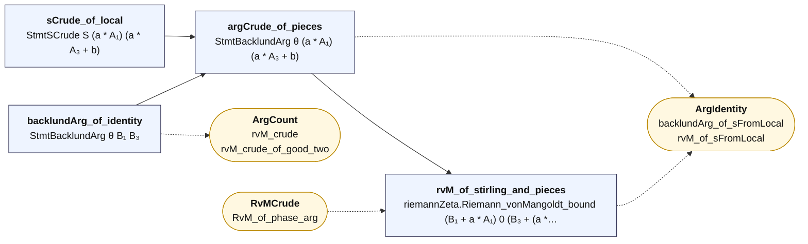

# `lean_stage3/Stage3/ArgCrude.lean`

ArgCrude — hNT slice 2: the argument-principle half of Backlund, decomposed to the point where the Jensen zero-count is the only analytic content left.

4 theorems, 4 definitions, 158 lines. Arrows are Lean's own record of what each proof uses.

**Imports:** [`RvMCrude`](../lean_stage3/RvMCrude.md)  
**Imported by:** [`Stage3`](../lean_stage3/Stage3.md), [`ArgIdentity`](../lean_stage3/ArgIdentity.md), [`JensenCount`](../lean_stage3/JensenCount.md)

## The picture



An arrow A → B reads "A is used in the proof of B". Blue: theorem. Green: a theorem nothing else uses (an end). Dashed: connects to nothing. Red: contains `sorry`. Yellow: theorems in another file, counted; a dotted arrow crosses files. Definitions are not drawn; they are listed below the diagram.

## Definitions

<a name="Stage3-StmtArgIdentity"></a>
### `Stage3.StmtArgIdentity`

def · line 65

The rectangle identity: the zero count is the phase plus one, plus `S`. Pure argument principle — no bound is asserted here, which is the point of naming it separately.

- **Is:** `` StmtArgIdentity (θ S : ℝ → ℝ) : Prop := ∀ T : ℝ, 2 ≤ T → riemannZeta.N T = θ T / Real.pi + 1 + S T ``
- **Used by 4:** [`Stage3.argCrude_of_pieces`](#Stage3-argCrude_of_pieces), [`Stage3.backlundArg_of_identity`](#Stage3-backlundArg_of_identity), [`Stage3.rvM_of_stirling_and_pieces`](#Stage3-rvM_of_stirling_and_pieces), [`Stage3.stmtArgIdentity_holds`](../lean_stage3/ArgIdentity.md#Stage3-stmtArgIdentity_holds)

<a name="Stage3-StmtSCrude"></a>
### `Stage3.StmtSCrude`

def · line 70

The crude argument bound: `|S T| ≤ B₁ log T + B₃`. This is `StmtBacklundArg`'s content once the identity is available.

- **Is:** `` StmtSCrude (S : ℝ → ℝ) (B₁ B₃ : ℝ) : Prop := ∀ T : ℝ, 2 ≤ T → |S T| ≤ B₁ * Real.log T + B₃ ``
- **Used by 4:** [`ArgCount.sCrude_holds`](../lean_stage3/ArgCount.md#ArgCount-sCrude_holds), [`ArgCount.sCrude_holds_of_good_two`](../lean_stage3/ArgCount.md#ArgCount-sCrude_holds_of_good_two), [`Stage3.backlundArg_of_identity`](#Stage3-backlundArg_of_identity), [`Stage3.sCrude_of_local`](#Stage3-sCrude_of_local)

<a name="Stage3-StmtLocalCount"></a>
### `Stage3.StmtLocalCount`

def · line 76

The Jensen piece: a local zero count that grows like `log T`. Abstract in `cnt` so the discharge target is a statement, not a construction — upstream `ZerosBound` is what discharges it.

- **Is:** `` StmtLocalCount (cnt : ℝ → ℝ) (A₁ A₃ : ℝ) : Prop := ∀ T : ℝ, 2 ≤ T → cnt T ≤ A₁ * Real.log T + A₃ ``
- **Used by 5:** [`Stage3.argCrude_of_pieces`](#Stage3-argCrude_of_pieces), [`Stage3.rvM_of_stirling_and_pieces`](#Stage3-rvM_of_stirling_and_pieces), [`Stage3.sCrude_of_local`](#Stage3-sCrude_of_local), [`Stage3.backlundArg_of_sFromLocal`](../lean_stage3/ArgIdentity.md#Stage3-backlundArg_of_sFromLocal), [`Stage3.localCount_holds`](../lean_stage3/JensenCount.md#Stage3-localCount_holds)

<a name="Stage3-StmtSFromLocal"></a>
### `Stage3.StmtSFromLocal`

def · line 81

Backlund's step: the argument is controlled by the local count. `a` and `b` are crude by design.

- **Is:** `` StmtSFromLocal (S cnt : ℝ → ℝ) (a b : ℝ) : Prop := ∀ T : ℝ, 2 ≤ T → |S T| ≤ a * cnt T + b ``
- **Used by 5:** [`Stage3.argCrude_of_pieces`](#Stage3-argCrude_of_pieces), [`Stage3.rvM_of_stirling_and_pieces`](#Stage3-rvM_of_stirling_and_pieces), [`Stage3.sCrude_of_local`](#Stage3-sCrude_of_local), [`Stage3.backlundArg_of_sFromLocal`](../lean_stage3/ArgIdentity.md#Stage3-backlundArg_of_sFromLocal), [`Stage3.rvM_of_sFromLocal`](../lean_stage3/ArgIdentity.md#Stage3-rvM_of_sFromLocal)

## Theorems

<a name="Stage3-sCrude_of_local"></a>
### `Stage3.sCrude_of_local`

line 86

**Why.** Count to argument bound. Needs `0 ≤ a`; the count enters positively.

**Proves**

```lean
StmtSCrude S (a * A₁) (a * A₃ + b)
```

**Needs** (its hypotheses)

  - `` ha : 0 ≤ a ``
  - `` hSF : StmtSFromLocal S cnt a b ``
  - `` hL : StmtLocalCount cnt A₁ A₃ ``

**Stated with:** [`Stage3.StmtLocalCount`](#Stage3-StmtLocalCount), [`Stage3.StmtSCrude`](#Stage3-StmtSCrude), [`Stage3.StmtSFromLocal`](#Stage3-StmtSFromLocal)

**Fed by:** no theorem of this repo; it stands on Mathlib and the definitions below.

**Feeds** (1 that use it)

  - [`Stage3.argCrude_of_pieces`](#Stage3-argCrude_of_pieces) — `` StmtBacklundArg θ (a * A₁) (a * A₃ + b) ``

<a name="Stage3-backlundArg_of_identity"></a>
### `Stage3.backlundArg_of_identity`

line 99

**Why.** Identity plus bound gives the Arg half.

**Proves**

```lean
StmtBacklundArg θ B₁ B₃
```

**Needs** (its hypotheses)

  - `` hid : StmtArgIdentity θ S ``
  - `` hS : StmtSCrude S B₁ B₃ ``

**Stated with:** [`Stage3.StmtArgIdentity`](#Stage3-StmtArgIdentity), [`Stage3.StmtSCrude`](#Stage3-StmtSCrude), [`Stage3.StmtBacklundArg`](../lean_stage3/RvMCrude.md#Stage3-StmtBacklundArg)

**Fed by:** no theorem of this repo; it stands on Mathlib and the definitions below.

**Feeds** (3 that use it)

  - [`ArgCount.rvM_crude`](../lean_stage3/ArgCount.md#ArgCount-rvM_crude) (ArgCount) — `` riemannZeta.Riemann_vonMangoldt_bound 112 0 698 ``
  - [`ArgCount.rvM_crude_of_good_two`](../lean_stage3/ArgCount.md#ArgCount-rvM_crude_of_good_two) (ArgCount) — `` riemannZeta.Riemann_vonMangoldt_bound 112 0 173 ``
  - [`Stage3.argCrude_of_pieces`](#Stage3-argCrude_of_pieces) — `` StmtBacklundArg θ (a * A₁) (a * A₃ + b) ``

<a name="Stage3-argCrude_of_pieces"></a>
### `Stage3.argCrude_of_pieces`

line 113

**Why.** THE ASSEMBLY. The rectangle identity, the Jensen count and Backlund's step give the argument half of the decomposition, with every constant explicit. What remains open after this module is exactly: the identity, the step, and a concrete `cnt` discharged from upstream `ZerosBound`.

**Proves**

```lean
StmtBacklundArg θ (a * A₁) (a * A₃ + b)
```

**Needs** (its hypotheses)

  - `` ha : 0 ≤ a ``
  - `` hid : StmtArgIdentity θ S ``
  - `` hSF : StmtSFromLocal S cnt a b ``
  - `` hL : StmtLocalCount cnt A₁ A₃ ``

**Stated with:** [`Stage3.StmtArgIdentity`](#Stage3-StmtArgIdentity), [`Stage3.StmtLocalCount`](#Stage3-StmtLocalCount), [`Stage3.StmtSFromLocal`](#Stage3-StmtSFromLocal), [`Stage3.StmtBacklundArg`](../lean_stage3/RvMCrude.md#Stage3-StmtBacklundArg)

**Fed by** (2 theorems its proof uses)

  - [`Stage3.backlundArg_of_identity`](#Stage3-backlundArg_of_identity) — `` StmtBacklundArg θ B₁ B₃ ``
  - [`Stage3.sCrude_of_local`](#Stage3-sCrude_of_local) — `` StmtSCrude S (a * A₁) (a * A₃ + b) ``

**Feeds** (2 that use it)

  - [`Stage3.rvM_of_stirling_and_pieces`](#Stage3-rvM_of_stirling_and_pieces) — `` riemannZeta.Riemann_vonMangoldt_bound (B₁ + a * A₁) 0 (B₃ + (a * A₃ + b)) ``
  - [`Stage3.backlundArg_of_sFromLocal`](../lean_stage3/ArgIdentity.md#Stage3-backlundArg_of_sFromLocal) (ArgIdentity) — `` StmtBacklundArg phaseTheta (a * A₁) (a * A₃ + b) ``

<a name="Stage3-rvM_of_stirling_and_pieces"></a>
### `Stage3.rvM_of_stirling_and_pieces`

line 124

**Why.** The full hNT band from the two halves, restated through this decomposition. With the Stirling half already discharged (`Stage3.backlundPhase_holds : StmtBacklundPhase phaseTheta 97 98`, entry 140), supplying the three pieces here delivers `Riemann_vonMangoldt_bound`.

**Proves**

```lean
riemannZeta.Riemann_vonMangoldt_bound (B₁ + a * A₁) 0 (B₃ + (a * A₃ + b))
```

**Needs** (its hypotheses)

  - `` ha : 0 ≤ a ``
  - `` hPhase : StmtBacklundPhase θ B₁ B₃ ``
  - `` hid : StmtArgIdentity θ S ``
  - `` hSF : StmtSFromLocal S cnt a b ``
  - `` hL : StmtLocalCount cnt A₁ A₃ ``

**Stated with:** [`Stage3.StmtArgIdentity`](#Stage3-StmtArgIdentity), [`Stage3.StmtLocalCount`](#Stage3-StmtLocalCount), [`Stage3.StmtSFromLocal`](#Stage3-StmtSFromLocal), [`Stage3.StmtBacklundPhase`](../lean_stage3/RvMCrude.md#Stage3-StmtBacklundPhase)

**Fed by** (2 theorems its proof uses)

  - [`Stage3.argCrude_of_pieces`](#Stage3-argCrude_of_pieces) — `` StmtBacklundArg θ (a * A₁) (a * A₃ + b) ``
  - [`Stage3.RvM_of_phase_arg`](../lean_stage3/RvMCrude.md#Stage3-RvM_of_phase_arg) (RvMCrude) — `` riemannZeta.Riemann_vonMangoldt_bound (B₁ + B₁') 0 (B₃ + B₃') ``

**Feeds** (1 that use it)

  - [`Stage3.rvM_of_sFromLocal`](../lean_stage3/ArgIdentity.md#Stage3-rvM_of_sFromLocal) (ArgIdentity) — `` riemannZeta.Riemann_vonMangoldt_bound (97 + a * 15) 0 (98 + (a * 73 + b)) ``

