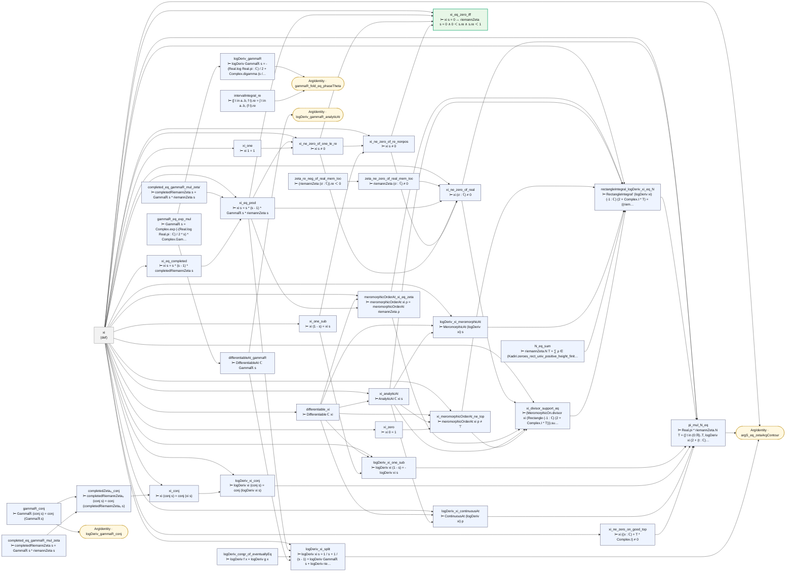
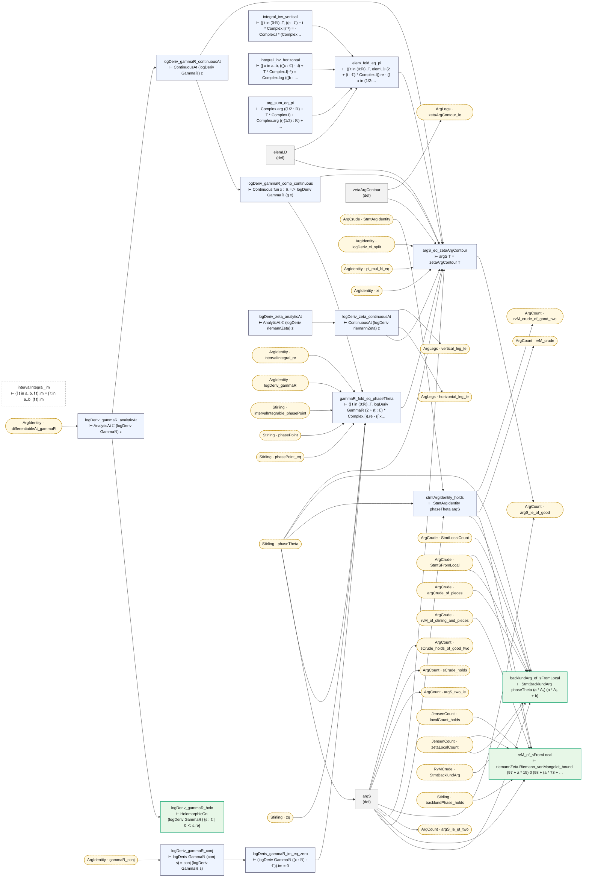

# `lean_stage3/Stage3/ArgIdentity.lean`

**What it does** (its own header): ArgIdentity — StmtArgIdentity discharged, and the contour machinery the remaining bound will need.

**Imports:** [`ArgCrude`](../lean_stage3/ArgCrude.md), [`JensenCount`](../lean_stage3/JensenCount.md), [`Stirling`](../lean_stage3/Stirling.md).
**Imported by:** [`Stage3`](../lean_stage3/Stage3.md), [`ArgLegs`](../lean_stage3/ArgLegs.md).

### Diagram 1 of 2

### Diagram 2 of 2

Blue: theorem. Green: a theorem nothing else uses (an end). Dashed white: connects to nothing. Grey: definition. Red: contains `sorry`. Yellow: in another file. An arrow A → B reads "A is used by B".

## Every declaration

| declaration | proves (output) | needs (input) | why (its own docstring) | uses | used by |
|---|---|---|---|---|---|
| `Stage3.xi` def, line 104 | ℂ | s : ℂ | The entire completion: `xi s = s(s−1)Λ₀(s) + 1`. Away from `{0,1}` this is `s(s−1)Λ(s)`; at `0` and `1` it is `1`. | — | `Stage3.argS_eq_zetaArgContour`, `Stage3.differentiable_xi`, `Stage3.logDeriv_xi_conj`, `Stage3.logDeriv_xi_continuousAt`, `Stage3.logDeriv_xi_meromorphicAt`, `Stage3.logDeriv_xi_one_sub`, `Stage3.logDeriv_xi_split`, `Stage3.meromorphicOrderAt_xi_eq_zeta`, `Stage3.pi_mul_N_eq`, `Stage3.rectangleIntegral_logDeriv_xi_eq_N`, `Stage3.xi_analyticAt`, `Stage3.xi_conj`, `Stage3.xi_divisor_support_eq`, `Stage3.xi_eq_completed`, `Stage3.xi_eq_prod`, `Stage3.xi_eq_zero_iff`, `Stage3.xi_meromorphicOrderAt_ne_top`, `Stage3.xi_ne_zero_of_one_le_re`, `Stage3.xi_ne_zero_of_re_nonpos`, `Stage3.xi_ne_zero_of_real`, `Stage3.xi_ne_zero_on_good_top`, `Stage3.xi_one`, `Stage3.xi_one_sub`, `Stage3.xi_zero` |
| `Stage3.differentiable_xi` theorem, line 106 | Differentiable ℂ xi | — | — | `Stage3.xi` | `Stage3.logDeriv_xi_continuousAt`, `Stage3.logDeriv_xi_meromorphicAt`, `Stage3.logDeriv_xi_one_sub`, `Stage3.meromorphicOrderAt_xi_eq_zeta`, `Stage3.xi_analyticAt`, `Stage3.xi_meromorphicOrderAt_ne_top` |
| `Stage3.xi_zero` theorem, line 110 | xi 0 = 1 | — | — | `Stage3.xi` | `Stage3.xi_meromorphicOrderAt_ne_top` |
| `Stage3.xi_one` theorem, line 112 | xi 1 = 1 | — | — | `Stage3.xi` | `Stage3.xi_ne_zero_of_one_le_re` |
| `Stage3.xi_eq_completed` theorem, line 115 | xi s = s * (s - 1) * completedRiemannZeta s | hs : s ≠ 0; hs1 : s ≠ 1 | Off the two former poles, `xi` is the classical `s(s−1)Λ(s)`. | `Stage3.xi` | `Stage3.xi_eq_prod` |
| `Stage3.xi_one_sub` theorem, line 123 | xi (1 - s) = xi s | s : ℂ | The functional equation on `xi`, from `Λ₀`'s: pure algebra. | `Stage3.xi` | `Stage3.logDeriv_xi_one_sub`, `Stage3.xi_ne_zero_of_re_nonpos` |
| `Stage3.gammaR_conj` theorem, line 134 | Gammaℝ (conj s) = conj (Gammaℝ s) | s : ℂ | `Γℝ` commutes with conjugation. | — | `Stage3.completedZeta₀_conj`, `Stage3.logDeriv_gammaR_conj` |
| `Stage3.completed_eq_gammaR_mul_zeta` theorem, line 155 | completedRiemannZeta s = Gammaℝ s * riemannZeta s | hre : 1 &lt; s.re | On `Re s &gt; 1` the completed zeta factors as `Γℝ · ζ`. | — | `Stage3.completedZeta₀_conj` |
| `Stage3.completedZeta₀_conj` theorem, line 170 | completedRiemannZeta₀ (conj s) = conj (completedRiemannZeta₀ s) | s : ℂ | `Λ₀` commutes with conjugation. Both sides are entire; they agree on the open half-plane `1 &lt; Re s` through the Euler-product region's `ζ`-symmetry; the identity theorem does the rest. | `Stage3.completed_eq_gammaR_mul_zeta`, `Stage3.gammaR_conj` | `Stage3.xi_conj` |
| `Stage3.xi_conj` theorem, line 241 | xi (conj s) = conj (xi s) | s : ℂ | The reflection symmetry on `xi`. | `Stage3.completedZeta₀_conj`, `Stage3.xi` | `Stage3.logDeriv_xi_conj` |
| `Stage3.zeta_re_neg_of_real_mem_Ioo` theorem, line 251 | (riemannZeta (σ : ℂ)).re &lt; 0 | h0 : 0 &lt; σ; h1 : σ &lt; 1 | The real zeta is strictly negative on `(0,1)`. From `ZetaAltFormula`: `ζ(σ) = 1 + 1/(σ−1) − σ·J` with `J ≥ 0` real, and `1 + 1/(σ−1) = σ/(σ−1) &lt; 0`. | — | `Stage3.zeta_ne_zero_of_real_mem_Ioo` |
| `Stage3.zeta_ne_zero_of_real_mem_Ioo` theorem, line 297 | riemannZeta (σ : ℂ) ≠ 0 | h0 : 0 &lt; σ; h1 : σ &lt; 1 | Hence `ζ` does not vanish on the real interval `(0,1)`. | `Stage3.zeta_re_neg_of_real_mem_Ioo` | `Stage3.xi_ne_zero_of_real` |
| `Stage3.completed_eq_gammaR_mul_zeta'` theorem, line 308 | completedRiemannZeta s = Gammaℝ s * riemannZeta s | h0 : 0 &lt; s.re | `Λ = Γℝ · ζ` on the whole right half-plane `Re s &gt; 0`. | — | `Stage3.xi_eq_prod` |
| `Stage3.xi_eq_prod` theorem, line 317 | xi s = s * (s - 1) * Gammaℝ s * riemannZeta s | h0 : 0 &lt; s.re; hs1 : s ≠ 1 | The factorised form of `xi` on the right half-plane. | `Stage3.completed_eq_gammaR_mul_zeta'`, `Stage3.xi`, `Stage3.xi_eq_completed` | `Stage3.logDeriv_xi_split`, `Stage3.meromorphicOrderAt_xi_eq_zeta`, `Stage3.xi_eq_zero_iff`, `Stage3.xi_ne_zero_of_one_le_re`, `Stage3.xi_ne_zero_of_real` |
| `Stage3.xi_ne_zero_of_one_le_re` theorem, line 325 | xi s ≠ 0 | h : 1 ≤ s.re | `xi` does not vanish on `Re s ≥ 1`. | `Stage3.xi`, `Stage3.xi_eq_prod`, `Stage3.xi_one` | `Stage3.xi_eq_zero_iff`, `Stage3.xi_ne_zero_of_re_nonpos`, `Stage3.xi_ne_zero_of_real` |
| `Stage3.xi_ne_zero_of_re_nonpos` theorem, line 335 | xi s ≠ 0 | h : s.re ≤ 0 | `xi` does not vanish on `Re s ≤ 0`, by the functional equation. | `Stage3.xi`, `Stage3.xi_ne_zero_of_one_le_re`, `Stage3.xi_one_sub` | `Stage3.xi_eq_zero_iff`, `Stage3.xi_ne_zero_of_real` |
| `Stage3.xi_ne_zero_of_real` theorem, line 344 | xi (σ : ℂ) ≠ 0 | σ : ℝ | `xi` does not vanish anywhere on the real axis — the rectangle's bottom edge. The interval `(0,1)` is slice 2A's negativity; the rest is the two half-plane lemmas and the values at `0` and `1`. | `Stage3.xi`, `Stage3.xi_eq_prod`, `Stage3.xi_ne_zero_of_one_le_re`, `Stage3.xi_ne_zero_of_re_nonpos`, `Stage3.zeta_ne_zero_of_real_mem_Ioo` | `Stage3.pi_mul_N_eq`, `Stage3.xi_divisor_support_eq` |
| `Stage3.xi_eq_zero_iff` theorem, line 363 | xi s = 0 ↔ riemannZeta s = 0 ∧ 0 &lt; s.re ∧ s.re &lt; 1 | — | The zero set. `xi` vanishes exactly at ζ's nontrivial zeros. | `Stage3.xi`, `Stage3.xi_eq_prod`, `Stage3.xi_ne_zero_of_one_le_re`, `Stage3.xi_ne_zero_of_re_nonpos` | — |
| `Stage3.meromorphicOrderAt_xi_eq_zeta` theorem, line 392 | meromorphicOrderAt xi ρ = meromorphicOrderAt riemannZeta ρ | h0 : 0 &lt; ρ.re; h1 : ρ.re &lt; 1 | Orders match. At a strip point, `xi` and `ζ` have the same meromorphic order: `ζ = B · xi` near the point with `B` analytic and nonvanishing there. | `Stage3.differentiable_xi`, `Stage3.xi`, `Stage3.xi_eq_prod` | `Stage3.rectangleIntegral_logDeriv_xi_eq_N`, `Stage3.xi_divisor_support_eq` |
| `Stage3.xi_analyticAt` theorem, line 447 | AnalyticAt ℂ xi s | s : ℂ | — | `Stage3.differentiable_xi`, `Stage3.xi` | `Stage3.logDeriv_xi_continuousAt`, `Stage3.logDeriv_xi_meromorphicAt`, `Stage3.rectangleIntegral_logDeriv_xi_eq_N`, `Stage3.xi_divisor_support_eq`, `Stage3.xi_meromorphicOrderAt_ne_top` |
| `Stage3.xi_meromorphicOrderAt_ne_top` theorem, line 452 | meromorphicOrderAt xi p ≠ ⊤ | p : ℂ | `xi` is nowhere locally zero: its order is finite everywhere, because `xi 0 = 1` and `ℂ` is connected. | `Stage3.differentiable_xi`, `Stage3.xi`, `Stage3.xi_analyticAt`, `Stage3.xi_zero` | `Stage3.rectangleIntegral_logDeriv_xi_eq_N`, `Stage3.xi_divisor_support_eq` |
| `Stage3.logDeriv_xi_meromorphicAt` theorem, line 468 | MeromorphicAt (logDeriv xi) s | s : ℂ | — | `Stage3.differentiable_xi`, `Stage3.xi`, `Stage3.xi_analyticAt` | `Stage3.rectangleIntegral_logDeriv_xi_eq_N` |
| `Stage3.N_eq_sum` theorem, line 475 | riemannZeta.N T = ∑ ρ ∈ (Kadiri.zeroes_rect_univ_positive_height_finite T).toFinset, (riemannZeta.order ρ : ℝ) | T : ℝ | `N` as a finite sum over the (finite) set of zeros with imaginary part in `(0, T)`. | — | `Stage3.rectangleIntegral_logDeriv_xi_eq_N` |
| `Stage3.xi_divisor_support_eq` theorem, line 495 | (MeromorphicOn.divisor xi (Rectangle (-1 : ℂ) (2 + Complex.I * T))).support = riemannZeta.zeroes_rect (Set.univ : Set ℝ) (Set.Ioo 0 T) | hT : 2 ≤ T; hgood : ∀ ρ : ℂ, riemannZeta ρ = 0 → 0 &lt; ρ.re → ρ.im ≠ T; hf : MeromorphicOn xi (Rectangle (-1 : ℂ) (2 + Complex.I * T)) | The divisor support of `xi` on the rectangle is exactly the zeros counted by `N T`, at a good height. | `Stage3.meromorphicOrderAt_xi_eq_zeta`, `Stage3.xi`, `Stage3.xi_analyticAt`, `Stage3.xi_meromorphicOrderAt_ne_top`, `Stage3.xi_ne_zero_of_real` | `Stage3.rectangleIntegral_logDeriv_xi_eq_N` |
| `Stage3.rectangleIntegral_logDeriv_xi_eq_N` theorem, line 581 | RectangleIntegral' (logDeriv xi) (-1 : ℂ) (2 + Complex.I * T) = ((riemannZeta.N T : ℝ) : ℂ) | hT : 2 ≤ T; hgood : ∀ ρ : ℂ, riemannZeta ρ = 0 → 0 &lt; ρ.re → ρ.im ≠ T | THE COUNT BRIDGE. At a good height, the normalised rectangle integral of `logDeriv xi` over `[−1,2] × [0,T]` is the zero count. | `Stage3.N_eq_sum`, `Stage3.logDeriv_xi_meromorphicAt`, `Stage3.meromorphicOrderAt_xi_eq_zeta`, `Stage3.xi`, `Stage3.xi_analyticAt`, `Stage3.xi_divisor_support_eq`, `Stage3.xi_meromorphicOrderAt_ne_top` | `Stage3.pi_mul_N_eq` |
| `Stage3.logDeriv_xi_one_sub` theorem, line 669 | logDeriv xi (1 - s) = -logDeriv xi s | s : ℂ | The functional equation on the logarithmic derivative. Holds everywhere — at zeros of `xi` both sides are matching junk. | `Stage3.differentiable_xi`, `Stage3.xi`, `Stage3.xi_one_sub` | `Stage3.pi_mul_N_eq` |
| `Stage3.logDeriv_xi_conj` theorem, line 685 | logDeriv xi (conj s) = conj (logDeriv xi s) | s : ℂ | The reflection symmetry on the logarithmic derivative. | `Stage3.xi`, `Stage3.xi_conj` | `Stage3.pi_mul_N_eq` |
| `Stage3.logDeriv_xi_continuousAt` theorem, line 696 | ContinuousAt (logDeriv xi) p | hp : xi p ≠ 0 | `logDeriv xi` is continuous wherever `xi` does not vanish. | `Stage3.differentiable_xi`, `Stage3.xi`, `Stage3.xi_analyticAt` | `Stage3.pi_mul_N_eq` |
| `Stage3.xi_ne_zero_on_good_top` theorem, line 704 | xi ((x : ℂ) + T * Complex.I) ≠ 0 | hgood : ∀ ρ : ℂ, riemannZeta ρ = 0 → 0 &lt; ρ.re → ρ.im ≠ T; _hT : 0 &lt; T; x : ℝ | `xi` does not vanish anywhere on a good-height top edge. | `Stage3.xi` | `Stage3.pi_mul_N_eq` |
| `Stage3.pi_mul_N_eq` theorem, line 717 | Real.pi * riemannZeta.N T = (∫ t in (0:ℝ)..T, logDeriv xi (2 + (t : ℂ) * Complex.I)).re - (∫ x in (1/2:ℝ)..2, logDeriv xi ((x : ℂ) + T * Complex.I)).im | hT : 2 ≤ T; hgood : ∀ ρ : ℂ, riemannZeta ρ = 0 → 0 &lt; ρ.re → ρ.im ≠ T | THE FOLD. At a good height, `π · N T = Re W − Im U`, where `W` is the right-edge integral and `U` the top-right-half integral of `logDeriv xi`. The bottom edge cancels itself around `1/2`; the left edge and the top-left half fold onto their right partners through the two symmetries. | `Stage3.logDeriv_xi_conj`, `Stage3.logDeriv_xi_continuousAt`, `Stage3.logDeriv_xi_one_sub`, `Stage3.rectangleIntegral_logDeriv_xi_eq_N`, `Stage3.xi`, `Stage3.xi_ne_zero_of_real`, `Stage3.xi_ne_zero_on_good_top` | `Stage3.argS_eq_zetaArgContour` |
| `Stage3.logDeriv_congr_of_eventuallyEq` theorem, line 880 | logDeriv f x = logDeriv g x | h : f =ᶠ[nhds x] g | `logDeriv` only sees the germ. | — | `Stage3.logDeriv_xi_split` |
| `Stage3.gammaR_eq_exp_mul` theorem, line 885 | Gammaℝ s = Complex.exp (-(Real.log Real.pi : ℂ) / 2 * s) * Complex.Gamma (s / 2) | s : ℂ | The exponential factor of `Γℝ`, as an explicit exponential. | — | `Stage3.differentiableAt_gammaR`, `Stage3.logDeriv_gammaR` |
| `Stage3.differentiableAt_gammaR` theorem, line 895 | DifferentiableAt ℂ Gammaℝ s | h0 : 0 &lt; s.re | — | `Stage3.gammaR_eq_exp_mul` | `Stage3.logDeriv_gammaR_analyticAt`, `Stage3.logDeriv_xi_split` |
| `Stage3.logDeriv_gammaR` theorem, line 915 | logDeriv Gammaℝ s = -(Real.log Real.pi : ℂ) / 2 + Complex.digamma (s / 2) / 2 | h0 : 0 &lt; s.re | `logDeriv Γℝ` is the phase derivative: `−(log π)/2 + ψ(s/2)/2` on the right half-plane. | `Stage3.gammaR_eq_exp_mul` | `Stage3.gammaR_fold_eq_phaseTheta` |
| `Stage3.logDeriv_xi_split` theorem, line 974 | logDeriv xi s = 1 / s + 1 / (s - 1) + logDeriv Gammaℝ s + logDeriv riemannZeta s | h0 : 0 &lt; s.re; h1 : s ≠ 1; hζ : riemannZeta s ≠ 0 | The four-term split of `logDeriv xi`, valid wherever `Re s &gt; 0`, `s ≠ 1` and `ζ s ≠ 0` — both surviving contour edges qualify. | `Stage3.differentiableAt_gammaR`, `Stage3.logDeriv_congr_of_eventuallyEq`, `Stage3.xi`, `Stage3.xi_eq_prod` | `Stage3.argS_eq_zetaArgContour` |
| `Stage3.intervalIntegral_re` theorem, line 1030 | (∫ t in a..b, f t).re = ∫ t in a..b, (f t).re | hf : IntervalIntegrable f MeasureTheory.volume a b | Real part passes through the interval integral. | — | `Stage3.gammaR_fold_eq_phaseTheta` |
| `Stage3.intervalIntegral_im` theorem, line 1042 | (∫ t in a..b, f t).im = ∫ t in a..b, (f t).im | hf : IntervalIntegrable f MeasureTheory.volume a b | Imaginary part passes through the interval integral. | — | — |
| `Stage3.logDeriv_gammaR_conj` theorem, line 1055 | logDeriv Gammaℝ (conj s) = conj (logDeriv Gammaℝ s) | s : ℂ | `Γℝ`'s logarithmic derivative reflects: needed for the bottom edge of the Cauchy sub-rectangle to be real. | `Stage3.gammaR_conj` | `Stage3.logDeriv_gammaR_im_eq_zero` |
| `Stage3.logDeriv_gammaR_im_eq_zero` theorem, line 1067 | (logDeriv Gammaℝ ((x : ℝ) : ℂ)).im = 0 | x : ℝ | On the positive real axis, `logDeriv Γℝ` is real. | `Stage3.logDeriv_gammaR_conj` | `Stage3.gammaR_fold_eq_phaseTheta` |
| `Stage3.integral_inv_vertical` theorem, line 1076 | (∫ t in (0:ℝ)..T, ((c : ℂ) + t * Complex.I)⁻¹) = -Complex.I * (Complex.log ((c : ℂ) + T * Complex.I) - Complex.log (c : ℂ)) | hc : 0 &lt; c; T : ℝ | The vertical FTC: `∫₀ᵀ (c + ti)⁻¹ dt = −i·(log(c+iT) − log c)` for `c &gt; 0`. | — | `Stage3.elem_fold_eq_pi` |
| `Stage3.integral_inv_horizontal` theorem, line 1125 | (∫ x in a..b, (((x : ℂ) - d) + T * Complex.I)⁻¹) = Complex.log (((b : ℂ) - d) + T * Complex.I) - Complex.log (((a : ℂ) - d) + T * Complex.I) | d a b : ℝ; hT : 0 &lt; T | The horizontal FTC: `∫ₐᵇ ((x−d) + Ti)⁻¹ dx = log((b−d)+iT) − log((a−d)+iT)` for `T &gt; 0`. | — | `Stage3.elem_fold_eq_pi` |
| `Stage3.arg_sum_eq_pi` theorem, line 1166 | Complex.arg ((1/2 : ℝ) + T * Complex.I) + Complex.arg ((-(1/2) : ℝ) + T * Complex.I) = Real.pi | hT : 0 &lt; T | The two boundary arguments sum to `π`: the arcsines cancel. | — | `Stage3.elem_fold_eq_pi` |
| `Stage3.elemLD` def, line 1200 | ℂ | s : ℂ | The elementary factor's logarithmic derivative. | — | `Stage3.argS_eq_zetaArgContour`, `Stage3.elem_fold_eq_pi` |
| `Stage3.elem_fold_eq_pi` theorem, line 1205 | (∫ t in (0:ℝ)..T, elemLD (2 + (t : ℂ) * Complex.I)).re - (∫ x in (1/2:ℝ)..2, elemLD ((x : ℂ) + T * Complex.I)).im = Real.pi | hT : 0 &lt; T | The elementary term contributes exactly `π`. All four FTC log differences cancel except `arg(1/2+iT) + arg(−1/2+iT)`, which is `arg_sum_eq_pi`. This is where the `+1` of the identity comes from. | `Stage3.arg_sum_eq_pi`, `Stage3.elemLD`, `Stage3.integral_inv_horizontal`, `Stage3.integral_inv_vertical` | `Stage3.argS_eq_zetaArgContour` |
| `Stage3.logDeriv_gammaR_analyticAt` theorem, line 1296 | AnalyticAt ℂ (logDeriv Gammaℝ) z | hz : 0 &lt; z.re | `logDeriv Γℝ` is analytic on the open right half-plane. | `Stage3.differentiableAt_gammaR` | `Stage3.logDeriv_gammaR_continuousAt`, `Stage3.logDeriv_gammaR_holo` |
| `Stage3.logDeriv_gammaR_continuousAt` theorem, line 1308 | ContinuousAt (logDeriv Gammaℝ) z | hz : 0 &lt; z.re | — | `Stage3.logDeriv_gammaR_analyticAt` | `Stage3.argS_eq_zetaArgContour`, `Stage3.logDeriv_gammaR_comp_continuous` |
| `Stage3.logDeriv_gammaR_holo` theorem, line 1312 | HolomorphicOn (logDeriv Gammaℝ) {s : ℂ \| 0 &lt; s.re} | — | — | `Stage3.logDeriv_gammaR_analyticAt` | — |
| `Stage3.logDeriv_gammaR_comp_continuous` theorem, line 1318 | Continuous fun x : ℝ =&gt; logDeriv Gammaℝ (g x) | hg : Continuous g; hpos : ∀ x : ℝ, 0 &lt; (g x).re | Continuity of `logDeriv Γℝ` along a real-parametrised path staying in the right half-plane. | `Stage3.logDeriv_gammaR_continuousAt` | `Stage3.argS_eq_zetaArgContour`, `Stage3.gammaR_fold_eq_phaseTheta` |
| `Stage3.gammaR_fold_eq_phaseTheta` theorem, line 1331 | (∫ t in (0:ℝ)..T, logDeriv Gammaℝ (2 + (t : ℂ) * Complex.I)).re - (∫ x in (1/2:ℝ)..2, logDeriv Gammaℝ ((x : ℂ) + T * Complex.I)).im = phaseTheta T | hT : 0 &lt; T | The `Γℝ` term contributes exactly `phaseTheta T`. Cauchy moves the path onto the critical vertical: the bottom edge is real (`logDeriv_gammaR_im_eq_zero`) so contributes nothing to the imaginary part, and on `s = 1/2 + it` the digamma argument is `1/4 + it/2`, which is `Stirling.zq t`, so the real part is `−(log π)/2 + phasePoint t / 2` — `phaseTheta`'s inte… | `Stage3.intervalIntegral_re`, `Stage3.logDeriv_gammaR`, `Stage3.logDeriv_gammaR_comp_continuous`, `Stage3.logDeriv_gammaR_im_eq_zero`, `Stage3.intervalIntegrable_phasePoint`, `Stage3.phasePoint`, `Stage3.phasePoint_eq`, `Stage3.phaseTheta`, `Stage3.zq` | `Stage3.argS_eq_zetaArgContour` |
| `Stage3.argS` def, line 1437 | ℝ | T : ℝ | `S(T)`, defined as the residual of the count against the phase main term. | `Stage3.phaseTheta` | `ArgCount.argS_le_gt_two`, `ArgCount.argS_le_of_good`, `ArgCount.argS_two_le`, `ArgCount.sCrude_holds`, `ArgCount.sCrude_holds_of_good_two`, `Stage3.argS_eq_zetaArgContour`, `Stage3.backlundArg_of_sFromLocal`, `Stage3.rvM_of_sFromLocal`, `Stage3.stmtArgIdentity_holds` |
| `Stage3.stmtArgIdentity_holds` theorem, line 1441 | StmtArgIdentity phaseTheta argS | — | THE IDENTITY, DISCHARGED. `StmtArgIdentity phaseTheta argS` holds — the rectangle identity in the shape `ArgCrude` consumes. | `Stage3.StmtArgIdentity`, `Stage3.argS`, `Stage3.phaseTheta` | `ArgCount.rvM_crude`, `ArgCount.rvM_crude_of_good_two`, `Stage3.backlundArg_of_sFromLocal`, `Stage3.rvM_of_sFromLocal` |
| `Stage3.backlundArg_of_sFromLocal` theorem, line 1450 | StmtBacklundArg phaseTheta (a * A₁) (a * A₃ + b) | ha : 0 ≤ a; hSF : StmtSFromLocal argS zetaLocalCount a b; hL : StmtLocalCount zetaLocalCount A₁ A₃ | The leaf, in the form `ArgCrude.argCrude_of_pieces` wants. Supplying `StmtSFromLocal argS zetaLocalCount a b` — the remaining analytic obligation — now yields `StmtBacklundArg` and hence, with entry 140's Stirling half, the full `Riemann_vonMangoldt_bound`. | `Stage3.StmtLocalCount`, `Stage3.StmtSFromLocal`, `Stage3.argCrude_of_pieces`, `Stage3.argS`, `Stage3.stmtArgIdentity_holds`, `Stage3.zetaLocalCount`, `Stage3.StmtBacklundArg`, `Stage3.phaseTheta` | — |
| `Stage3.rvM_of_sFromLocal` theorem, line 1461 | riemannZeta.Riemann_vonMangoldt_bound (97 + a * 15) 0 (98 + (a * 73 + b)) | ha : 0 ≤ a; hSF : StmtSFromLocal argS zetaLocalCount a b | hNT from one remaining bound. With the Stirling half already a theorem (`backlundPhase_holds : StmtBacklundPhase phaseTheta 97 98`, entry 140) and the Jensen count discharged (`localCount_holds : StmtLocalCount zetaLocalCount 15 73`, entry 156), the whole Riemann–von Mangoldt band follows from `StmtSFromLocal` alone. | `Stage3.StmtSFromLocal`, `Stage3.rvM_of_stirling_and_pieces`, `Stage3.argS`, `Stage3.stmtArgIdentity_holds`, `Stage3.localCount_holds`, `Stage3.zetaLocalCount`, `Stage3.backlundPhase_holds` | — |
| `Stage3.logDeriv_zeta_analyticAt` theorem, line 1476 | AnalyticAt ℂ (logDeriv riemannZeta) z | hz1 : z ≠ 1; hzζ : riemannZeta z ≠ 0 | `logDeriv ζ` is analytic wherever `ζ` is analytic and nonzero. | — | `Stage3.logDeriv_zeta_continuousAt` |
| `Stage3.logDeriv_zeta_continuousAt` theorem, line 1487 | ContinuousAt (logDeriv riemannZeta) z | hz1 : z ≠ 1; hzζ : riemannZeta z ≠ 0 | — | `Stage3.logDeriv_zeta_analyticAt` | `Stage3.argS_eq_zetaArgContour`, `ArgLegs.horizontal_leg_le`, `ArgLegs.vertical_leg_le` |
| `Stage3.zetaArgContour` def, line 1493 | ℝ | T : ℝ | The `ζ`-part of the folded functional, normalised: the classical `S(T)` as an argument variation. | — | `Stage3.argS_eq_zetaArgContour`, `ArgLegs.zetaArgContour_le` |
| `Stage3.argS_eq_zetaArgContour` theorem, line 1501 | argS T = zetaArgContour T | hT : 2 ≤ T; hgood : ∀ ρ : ℂ, riemannZeta ρ = 0 → 0 &lt; ρ.re → ρ.im ≠ T | `argS` is the contour argument variation, at every good height. The residual defined against the phase and the integral of `logDeriv ζ` along the right-half path are the same number — this is the argument principle, and it is what a bound on `S` will be proved about. | `Stage3.argS`, `Stage3.elemLD`, `Stage3.elem_fold_eq_pi`, `Stage3.gammaR_fold_eq_phaseTheta`, `Stage3.logDeriv_gammaR_comp_continuous`, `Stage3.logDeriv_gammaR_continuousAt`, `Stage3.logDeriv_xi_split`, `Stage3.logDeriv_zeta_continuousAt`, `Stage3.pi_mul_N_eq`, `Stage3.xi`, `Stage3.zetaArgContour`, `Stage3.phaseTheta` | `ArgCount.argS_le_of_good` |
