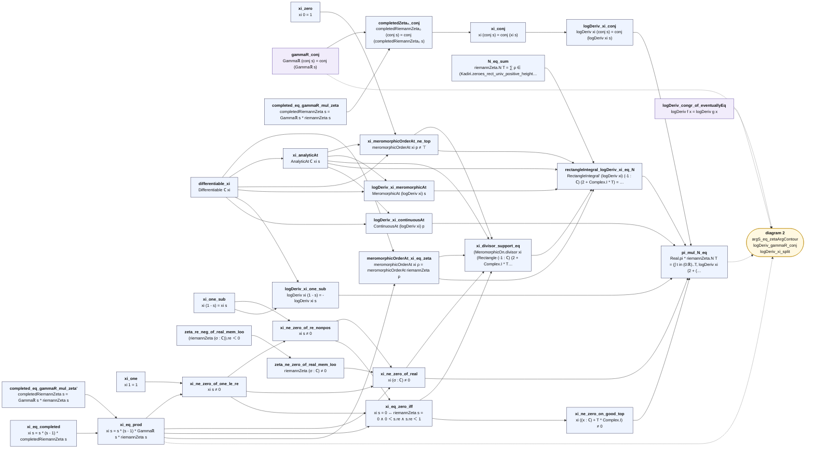
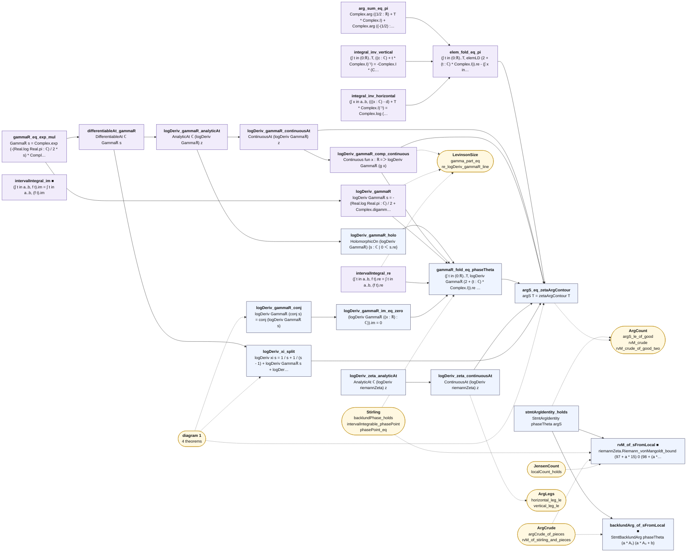

# `lean_stage3/Stage3/ArgIdentity.lean`

ArgIdentity — StmtArgIdentity discharged, and the contour machinery the remaining bound will need.

53 theorems, 4 definitions, 1756 lines. Arrows are Lean's own record of what each proof uses.

**Imports:** [`ArgCrude`](../lean_stage3/ArgCrude.md), [`JensenCount`](../lean_stage3/JensenCount.md), [`Stirling`](../lean_stage3/Stirling.md)  
**Imported by:** [`Stage3`](../lean_stage3/Stage3.md), [`ArgLegs`](../lean_stage3/ArgLegs.md)

## The picture

### Diagram 1 of 2: `differentiable_xi` to `logDeriv_congr_of_eventuallyEq`



### Diagram 2 of 2: `gammaR_eq_exp_mul` to `argS_eq_zetaArgContour`



An arrow A → B reads "A is used in the proof of B". Green: counting, integers only. Violet: shape, analysis with no ζ. Blue: reads ζ. A name ending in ■ is an end: nothing else uses it. Red: contains `sorry`. Yellow: theorems in another file, counted; a dotted arrow crosses files. Definitions are not drawn; they are listed below the diagram.

## Definitions

<a name="Stage3-xi"></a>
### `Stage3.xi`

def · line 104

The entire completion: `xi s = s(s−1)Λ₀(s) + 1`. Away from `{0,1}` this is `s(s−1)Λ(s)`; at `0` and `1` it is `1`.

- **Is:** `` xi (s : ℂ) : ℂ := s * (s - 1) * completedRiemannZeta₀ s + 1 ``
- **Used by 24:** [`Stage3.argS_eq_zetaArgContour`](#Stage3-argS_eq_zetaArgContour), [`Stage3.differentiable_xi`](#Stage3-differentiable_xi), [`Stage3.logDeriv_xi_conj`](#Stage3-logDeriv_xi_conj), [`Stage3.logDeriv_xi_continuousAt`](#Stage3-logDeriv_xi_continuousAt), [`Stage3.logDeriv_xi_meromorphicAt`](#Stage3-logDeriv_xi_meromorphicAt), [`Stage3.logDeriv_xi_one_sub`](#Stage3-logDeriv_xi_one_sub), [`Stage3.logDeriv_xi_split`](#Stage3-logDeriv_xi_split), [`Stage3.meromorphicOrderAt_xi_eq_zeta`](#Stage3-meromorphicOrderAt_xi_eq_zeta), [`Stage3.pi_mul_N_eq`](#Stage3-pi_mul_N_eq), [`Stage3.rectangleIntegral_logDeriv_xi_eq_N`](#Stage3-rectangleIntegral_logDeriv_xi_eq_N), [`Stage3.xi_analyticAt`](#Stage3-xi_analyticAt), [`Stage3.xi_conj`](#Stage3-xi_conj), [`Stage3.xi_divisor_support_eq`](#Stage3-xi_divisor_support_eq), [`Stage3.xi_eq_completed`](#Stage3-xi_eq_completed), [`Stage3.xi_eq_prod`](#Stage3-xi_eq_prod), [`Stage3.xi_eq_zero_iff`](#Stage3-xi_eq_zero_iff), [`Stage3.xi_meromorphicOrderAt_ne_top`](#Stage3-xi_meromorphicOrderAt_ne_top), [`Stage3.xi_ne_zero_of_one_le_re`](#Stage3-xi_ne_zero_of_one_le_re), [`Stage3.xi_ne_zero_of_re_nonpos`](#Stage3-xi_ne_zero_of_re_nonpos), [`Stage3.xi_ne_zero_of_real`](#Stage3-xi_ne_zero_of_real), [`Stage3.xi_ne_zero_on_good_top`](#Stage3-xi_ne_zero_on_good_top), [`Stage3.xi_one`](#Stage3-xi_one), [`Stage3.xi_one_sub`](#Stage3-xi_one_sub), [`Stage3.xi_zero`](#Stage3-xi_zero)

<a name="Stage3-elemLD"></a>
### `Stage3.elemLD`

def · line 1206

The elementary factor's logarithmic derivative.

- **Is:** `` elemLD (s : ℂ) : ℂ := 1 / s + 1 / (s - 1) ``
- **Used by 2:** [`Stage3.argS_eq_zetaArgContour`](#Stage3-argS_eq_zetaArgContour), [`Stage3.elem_fold_eq_pi`](#Stage3-elem_fold_eq_pi)

<a name="Stage3-argS"></a>
### `Stage3.argS`

def · line 1445

`S(T)`, defined as the residual of the count against the phase main term.

- **Is:** `` argS (T : ℝ) : ℝ := riemannZeta.N T - (phaseTheta T / Real.pi + 1) ``
- **Built from:** [`Stage3.phaseTheta`](../lean_stage3/Stirling.md#Stage3-phaseTheta)
- **Used by 15:** [`ArgCount.argS_le_gt_two`](../lean_stage3/ArgCount.md#ArgCount-argS_le_gt_two), [`ArgCount.argS_le_of_good`](../lean_stage3/ArgCount.md#ArgCount-argS_le_of_good), [`ArgCount.argS_two_le`](../lean_stage3/ArgCount.md#ArgCount-argS_two_le), [`ArgCount.rvM_crude`](../lean_stage3/ArgCount.md#ArgCount-rvM_crude), [`ArgCount.rvM_crude_of_good_two`](../lean_stage3/ArgCount.md#ArgCount-rvM_crude_of_good_two), [`ArgCount.sCrude_holds`](../lean_stage3/ArgCount.md#ArgCount-sCrude_holds), [`ArgCount.sCrude_holds_of_good_two`](../lean_stage3/ArgCount.md#ArgCount-sCrude_holds_of_good_two), [`Stage3.argS_eq_zetaArgContour`](#Stage3-argS_eq_zetaArgContour), [`Stage3.backlundArg_of_sFromLocal`](#Stage3-backlundArg_of_sFromLocal), [`Stage3.rvM_of_sFromLocal`](#Stage3-rvM_of_sFromLocal), [`Stage3.stmtArgIdentity_holds`](#Stage3-stmtArgIdentity_holds), [`LevinsonSize.gamma_part_count_le`](../lean_stage3/LevinsonSize.md#LevinsonSize-gamma_part_count_le), [`LevinsonSize.gamma_part_count_le_gt_two`](../lean_stage3/LevinsonSize.md#LevinsonSize-gamma_part_count_le_gt_two), [`LevinsonSize.gamma_part_eq_count`](../lean_stage3/LevinsonSize.md#LevinsonSize-gamma_part_eq_count), [`LevinsonWindow.N_step_le`](../lean_stage3/LevinsonWindow.md#LevinsonWindow-N_step_le)

<a name="Stage3-zetaArgContour"></a>
### `Stage3.zetaArgContour`

def · line 1503

The `ζ`-part of the folded functional, normalised: the classical `S(T)` as an argument variation.

- **Is:** `` zetaArgContour (T : ℝ) : ℝ := (1 / Real.pi) * ((∫ t in (0:ℝ)..T, logDeriv riemannZeta (2 + (t : ℂ) * Complex.I)).re - (∫ x in (1/2:ℝ)..2, logDeriv riemannZeta ((x : ℂ) + T * Complex.I)).im) ``
- **Used by 3:** [`ArgCount.argS_le_of_good`](../lean_stage3/ArgCount.md#ArgCount-argS_le_of_good), [`Stage3.argS_eq_zetaArgContour`](#Stage3-argS_eq_zetaArgContour), [`ArgLegs.zetaArgContour_le`](../lean_stage3/ArgLegs.md#ArgLegs-zetaArgContour_le)

## Theorems

<a name="Stage3-differentiable_xi"></a>
### `Stage3.differentiable_xi`

line 107

**Reads ζ.** It, or something it rests on, uses the zeta function, its zeros or the Riemann hypothesis.

**Why.** The completion `xi` is differentiable on all of `ℂ`.

**Proves**

```lean
Differentiable ℂ xi
```

**Stated with:** [`Stage3.xi`](#Stage3-xi)

**Fed by:** no theorem of this repo; it stands on Mathlib and the definitions below.

**Feeds** (6 that use it)

  - [`Stage3.logDeriv_xi_continuousAt`](#Stage3-logDeriv_xi_continuousAt) — `` ContinuousAt (logDeriv xi) p ``
  - [`Stage3.logDeriv_xi_meromorphicAt`](#Stage3-logDeriv_xi_meromorphicAt) — `` MeromorphicAt (logDeriv xi) s ``
  - [`Stage3.logDeriv_xi_one_sub`](#Stage3-logDeriv_xi_one_sub) — `` logDeriv xi (1 - s) = -logDeriv xi s ``
  - [`Stage3.meromorphicOrderAt_xi_eq_zeta`](#Stage3-meromorphicOrderAt_xi_eq_zeta) — `` meromorphicOrderAt xi ρ = meromorphicOrderAt riemannZeta ρ ``
  - [`Stage3.xi_analyticAt`](#Stage3-xi_analyticAt) — `` AnalyticAt ℂ xi s ``
  - [`Stage3.xi_meromorphicOrderAt_ne_top`](#Stage3-xi_meromorphicOrderAt_ne_top) — `` meromorphicOrderAt xi p ≠ ⊤ ``

<a name="Stage3-xi_zero"></a>
### `Stage3.xi_zero`

line 112

**Reads ζ.** It, or something it rests on, uses the zeta function, its zeros or the Riemann hypothesis.

**Why.** The completion `xi` takes the value `1` at `s = 0`.

**Proves**

```lean
xi 0 = 1
```

**Stated with:** [`Stage3.xi`](#Stage3-xi)

**Fed by:** no theorem of this repo; it stands on Mathlib and the definitions below.

**Feeds** (1 that use it)

  - [`Stage3.xi_meromorphicOrderAt_ne_top`](#Stage3-xi_meromorphicOrderAt_ne_top) — `` meromorphicOrderAt xi p ≠ ⊤ ``

<a name="Stage3-xi_one"></a>
### `Stage3.xi_one`

line 115

**Reads ζ.** It, or something it rests on, uses the zeta function, its zeros or the Riemann hypothesis.

**Why.** The completion `xi` takes the value `1` at `s = 1`.

**Proves**

```lean
xi 1 = 1
```

**Stated with:** [`Stage3.xi`](#Stage3-xi)

**Fed by:** no theorem of this repo; it stands on Mathlib and the definitions below.

**Feeds** (1 that use it)

  - [`Stage3.xi_ne_zero_of_one_le_re`](#Stage3-xi_ne_zero_of_one_le_re) — `` xi s ≠ 0 ``

<a name="Stage3-xi_eq_completed"></a>
### `Stage3.xi_eq_completed`

line 118

**Reads ζ.** It, or something it rests on, uses the zeta function, its zeros or the Riemann hypothesis.

**Why.** Off the two former poles, `xi` is the classical `s(s−1)Λ(s)`.

**Proves**

```lean
xi s = s * (s - 1) * completedRiemannZeta s
```

**Needs** (its hypotheses)

  - `` hs : s ≠ 0 ``
  - `` hs1 : s ≠ 1 ``

**Stated with:** [`Stage3.xi`](#Stage3-xi)

**Fed by:** no theorem of this repo; it stands on Mathlib and the definitions below.

**Feeds** (1 that use it)

  - [`Stage3.xi_eq_prod`](#Stage3-xi_eq_prod) — `` xi s = s * (s - 1) * Gammaℝ s * riemannZeta s ``

<a name="Stage3-xi_one_sub"></a>
### `Stage3.xi_one_sub`

line 126

**Reads ζ.** It, or something it rests on, uses the zeta function, its zeros or the Riemann hypothesis.

**Why.** The functional equation on `xi`, from `Λ₀`'s: pure algebra.

**Proves**

```lean
xi (1 - s) = xi s
```

**Needs** (its hypotheses)

  - `` s : ℂ ``

**Stated with:** [`Stage3.xi`](#Stage3-xi)

**Fed by:** no theorem of this repo; it stands on Mathlib and the definitions below.

**Feeds** (2 that use it)

  - [`Stage3.logDeriv_xi_one_sub`](#Stage3-logDeriv_xi_one_sub) — `` logDeriv xi (1 - s) = -logDeriv xi s ``
  - [`Stage3.xi_ne_zero_of_re_nonpos`](#Stage3-xi_ne_zero_of_re_nonpos) — `` xi s ≠ 0 ``

<a name="Stage3-gammaR_conj"></a>
### `Stage3.gammaR_conj`

line 137

**Shape.** Uses real or complex analysis; nothing in it or beneath it reads ζ.

**Why.** `Γℝ` commutes with conjugation.

**Proves**

```lean
Gammaℝ (conj s) = conj (Gammaℝ s)
```

**Needs** (its hypotheses)

  - `` s : ℂ ``

**Fed by:** no theorem of this repo; it stands on Mathlib.

**Feeds** (2 that use it)

  - [`Stage3.completedZeta₀_conj`](#Stage3-completedZeta-_conj) — `` completedRiemannZeta₀ (conj s) = conj (completedRiemannZeta₀ s) ``
  - [`Stage3.logDeriv_gammaR_conj`](#Stage3-logDeriv_gammaR_conj) — `` logDeriv Gammaℝ (conj s) = conj (logDeriv Gammaℝ s) ``

<a name="Stage3-completed_eq_gammaR_mul_zeta"></a>
### `Stage3.completed_eq_gammaR_mul_zeta`

line 158

**Reads ζ.** It, or something it rests on, uses the zeta function, its zeros or the Riemann hypothesis.

**Why.** On `Re s > 1` the completed zeta factors as `Γℝ · ζ`.

**Proves**

```lean
completedRiemannZeta s = Gammaℝ s * riemannZeta s
```

**Needs** (its hypotheses)

  - `` hre : 1 < s.re ``

**Fed by:** no theorem of this repo; it stands on Mathlib.

**Feeds** (1 that use it)

  - [`Stage3.completedZeta₀_conj`](#Stage3-completedZeta-_conj) — `` completedRiemannZeta₀ (conj s) = conj (completedRiemannZeta₀ s) ``

<a name="Stage3-completedZeta-_conj"></a>
### `Stage3.completedZeta₀_conj`

line 173

**Reads ζ.** It, or something it rests on, uses the zeta function, its zeros or the Riemann hypothesis.

**Why.** `Λ₀` commutes with conjugation. Both sides are entire; they agree on the open half-plane `1 < Re s` through the Euler-product region's `ζ`-symmetry; the identity theorem does the rest.

**Proves**

```lean
completedRiemannZeta₀ (conj s) = conj (completedRiemannZeta₀ s)
```

**Needs** (its hypotheses)

  - `` s : ℂ ``

**Fed by** (2 theorems its proof uses)

  - [`Stage3.completed_eq_gammaR_mul_zeta`](#Stage3-completed_eq_gammaR_mul_zeta) — `` completedRiemannZeta s = Gammaℝ s * riemannZeta s ``
  - [`Stage3.gammaR_conj`](#Stage3-gammaR_conj) — `` Gammaℝ (conj s) = conj (Gammaℝ s) ``

**Feeds** (1 that use it)

  - [`Stage3.xi_conj`](#Stage3-xi_conj) — `` xi (conj s) = conj (xi s) ``

<a name="Stage3-xi_conj"></a>
### `Stage3.xi_conj`

line 244

**Reads ζ.** It, or something it rests on, uses the zeta function, its zeros or the Riemann hypothesis.

**Why.** The reflection symmetry on `xi`.

**Proves**

```lean
xi (conj s) = conj (xi s)
```

**Needs** (its hypotheses)

  - `` s : ℂ ``

**Stated with:** [`Stage3.xi`](#Stage3-xi)

**Fed by** (1 theorem its proof uses)

  - [`Stage3.completedZeta₀_conj`](#Stage3-completedZeta-_conj) — `` completedRiemannZeta₀ (conj s) = conj (completedRiemannZeta₀ s) ``

**Feeds** (1 that use it)

  - [`Stage3.logDeriv_xi_conj`](#Stage3-logDeriv_xi_conj) — `` logDeriv xi (conj s) = conj (logDeriv xi s) ``

<a name="Stage3-zeta_re_neg_of_real_mem_Ioo"></a>
### `Stage3.zeta_re_neg_of_real_mem_Ioo`

line 254

**Reads ζ.** It, or something it rests on, uses the zeta function, its zeros or the Riemann hypothesis.

**Why.** The real zeta is strictly negative on `(0,1)`. From `ZetaAltFormula`: `ζ(σ) = 1 + 1/(σ−1) − σ·J` with `J ≥ 0` real, and `1 + 1/(σ−1) = σ/(σ−1) < 0`.

**Proves**

```lean
(riemannZeta (σ : ℂ)).re < 0
```

**Needs** (its hypotheses)

  - `` h0 : 0 < σ ``
  - `` h1 : σ < 1 ``

**Fed by:** no theorem of this repo; it stands on Mathlib.

**Feeds** (1 that use it)

  - [`Stage3.zeta_ne_zero_of_real_mem_Ioo`](#Stage3-zeta_ne_zero_of_real_mem_Ioo) — `` riemannZeta (σ : ℂ) ≠ 0 ``

<a name="Stage3-zeta_ne_zero_of_real_mem_Ioo"></a>
### `Stage3.zeta_ne_zero_of_real_mem_Ioo`

line 300

**Reads ζ.** It, or something it rests on, uses the zeta function, its zeros or the Riemann hypothesis.

**Why.** Hence `ζ` does not vanish on the real interval `(0,1)`.

**Proves**

```lean
riemannZeta (σ : ℂ) ≠ 0
```

**Needs** (its hypotheses)

  - `` h0 : 0 < σ ``
  - `` h1 : σ < 1 ``

**Fed by** (1 theorem its proof uses)

  - [`Stage3.zeta_re_neg_of_real_mem_Ioo`](#Stage3-zeta_re_neg_of_real_mem_Ioo) — `` (riemannZeta (σ : ℂ)).re < 0 ``

**Feeds** (1 that use it)

  - [`Stage3.xi_ne_zero_of_real`](#Stage3-xi_ne_zero_of_real) — `` xi (σ : ℂ) ≠ 0 ``

<a name="Stage3-completed_eq_gammaR_mul_zeta-"></a>
### `Stage3.completed_eq_gammaR_mul_zeta'`

line 311

**Reads ζ.** It, or something it rests on, uses the zeta function, its zeros or the Riemann hypothesis.

**Why.** `Λ = Γℝ · ζ` on the whole right half-plane `Re s > 0`.

**Proves**

```lean
completedRiemannZeta s = Gammaℝ s * riemannZeta s
```

**Needs** (its hypotheses)

  - `` h0 : 0 < s.re ``

**Fed by:** no theorem of this repo; it stands on Mathlib.

**Feeds** (1 that use it)

  - [`Stage3.xi_eq_prod`](#Stage3-xi_eq_prod) — `` xi s = s * (s - 1) * Gammaℝ s * riemannZeta s ``

<a name="Stage3-xi_eq_prod"></a>
### `Stage3.xi_eq_prod`

line 320

**Reads ζ.** It, or something it rests on, uses the zeta function, its zeros or the Riemann hypothesis.

**Why.** The factorised form of `xi` on the right half-plane.

**Proves**

```lean
xi s = s * (s - 1) * Gammaℝ s * riemannZeta s
```

**Needs** (its hypotheses)

  - `` h0 : 0 < s.re ``
  - `` hs1 : s ≠ 1 ``

**Stated with:** [`Stage3.xi`](#Stage3-xi)

**Fed by** (2 theorems its proof uses)

  - [`Stage3.completed_eq_gammaR_mul_zeta'`](#Stage3-completed_eq_gammaR_mul_zeta-) — `` completedRiemannZeta s = Gammaℝ s * riemannZeta s ``
  - [`Stage3.xi_eq_completed`](#Stage3-xi_eq_completed) — `` xi s = s * (s - 1) * completedRiemannZeta s ``

**Feeds** (5 that use it)

  - [`Stage3.logDeriv_xi_split`](#Stage3-logDeriv_xi_split) — `` logDeriv xi s = 1 / s + 1 / (s - 1) + logDeriv Gammaℝ s + logDeriv riemannZeta s ``
  - [`Stage3.meromorphicOrderAt_xi_eq_zeta`](#Stage3-meromorphicOrderAt_xi_eq_zeta) — `` meromorphicOrderAt xi ρ = meromorphicOrderAt riemannZeta ρ ``
  - [`Stage3.xi_eq_zero_iff`](#Stage3-xi_eq_zero_iff) — `` xi s = 0 ↔ riemannZeta s = 0 ∧ 0 < s.re ∧ s.re < 1 ``
  - [`Stage3.xi_ne_zero_of_one_le_re`](#Stage3-xi_ne_zero_of_one_le_re) — `` xi s ≠ 0 ``
  - [`Stage3.xi_ne_zero_of_real`](#Stage3-xi_ne_zero_of_real) — `` xi (σ : ℂ) ≠ 0 ``

<a name="Stage3-xi_ne_zero_of_one_le_re"></a>
### `Stage3.xi_ne_zero_of_one_le_re`

line 328

**Reads ζ.** It, or something it rests on, uses the zeta function, its zeros or the Riemann hypothesis.

**Why.** `xi` does not vanish on `Re s ≥ 1`.

**Proves**

```lean
xi s ≠ 0
```

**Needs** (its hypotheses)

  - `` h : 1 ≤ s.re ``

**Stated with:** [`Stage3.xi`](#Stage3-xi)

**Fed by** (2 theorems its proof uses)

  - [`Stage3.xi_eq_prod`](#Stage3-xi_eq_prod) — `` xi s = s * (s - 1) * Gammaℝ s * riemannZeta s ``
  - [`Stage3.xi_one`](#Stage3-xi_one) — `` xi 1 = 1 ``

**Feeds** (3 that use it)

  - [`Stage3.xi_eq_zero_iff`](#Stage3-xi_eq_zero_iff) — `` xi s = 0 ↔ riemannZeta s = 0 ∧ 0 < s.re ∧ s.re < 1 ``
  - [`Stage3.xi_ne_zero_of_re_nonpos`](#Stage3-xi_ne_zero_of_re_nonpos) — `` xi s ≠ 0 ``
  - [`Stage3.xi_ne_zero_of_real`](#Stage3-xi_ne_zero_of_real) — `` xi (σ : ℂ) ≠ 0 ``

<a name="Stage3-xi_ne_zero_of_re_nonpos"></a>
### `Stage3.xi_ne_zero_of_re_nonpos`

line 338

**Reads ζ.** It, or something it rests on, uses the zeta function, its zeros or the Riemann hypothesis.

**Why.** `xi` does not vanish on `Re s ≤ 0`, by the functional equation.

**Proves**

```lean
xi s ≠ 0
```

**Needs** (its hypotheses)

  - `` h : s.re ≤ 0 ``

**Stated with:** [`Stage3.xi`](#Stage3-xi)

**Fed by** (2 theorems its proof uses)

  - [`Stage3.xi_ne_zero_of_one_le_re`](#Stage3-xi_ne_zero_of_one_le_re) — `` xi s ≠ 0 ``
  - [`Stage3.xi_one_sub`](#Stage3-xi_one_sub) — `` xi (1 - s) = xi s ``

**Feeds** (2 that use it)

  - [`Stage3.xi_eq_zero_iff`](#Stage3-xi_eq_zero_iff) — `` xi s = 0 ↔ riemannZeta s = 0 ∧ 0 < s.re ∧ s.re < 1 ``
  - [`Stage3.xi_ne_zero_of_real`](#Stage3-xi_ne_zero_of_real) — `` xi (σ : ℂ) ≠ 0 ``

<a name="Stage3-xi_ne_zero_of_real"></a>
### `Stage3.xi_ne_zero_of_real`

line 347

**Reads ζ.** It, or something it rests on, uses the zeta function, its zeros or the Riemann hypothesis.

**Why.** `xi` does not vanish anywhere on the real axis — the rectangle's bottom edge. The interval `(0,1)` is slice 2A's negativity; the rest is the two half-plane lemmas and the values at `0` and `1`.

**Proves**

```lean
xi (σ : ℂ) ≠ 0
```

**Needs** (its hypotheses)

  - `` σ : ℝ ``

**Stated with:** [`Stage3.xi`](#Stage3-xi)

**Fed by** (4 theorems its proof uses)

  - [`Stage3.xi_eq_prod`](#Stage3-xi_eq_prod) — `` xi s = s * (s - 1) * Gammaℝ s * riemannZeta s ``
  - [`Stage3.xi_ne_zero_of_one_le_re`](#Stage3-xi_ne_zero_of_one_le_re) — `` xi s ≠ 0 ``
  - [`Stage3.xi_ne_zero_of_re_nonpos`](#Stage3-xi_ne_zero_of_re_nonpos) — `` xi s ≠ 0 ``
  - [`Stage3.zeta_ne_zero_of_real_mem_Ioo`](#Stage3-zeta_ne_zero_of_real_mem_Ioo) — `` riemannZeta (σ : ℂ) ≠ 0 ``

**Feeds** (2 that use it)

  - [`Stage3.pi_mul_N_eq`](#Stage3-pi_mul_N_eq) — `` Real.pi * riemannZeta.N T = (∫ t in (0:ℝ)..T, logDeriv xi (2 + (t : ℂ) * Complex.I)).re - (∫ x in (1/2:ℝ)..2, logDeriv xi ((x : ℂ) + T * Complex.I)).i… ``
  - [`Stage3.xi_divisor_support_eq`](#Stage3-xi_divisor_support_eq) — `` (MeromorphicOn.divisor xi (Rectangle (-1 : ℂ) (2 + Complex.I * T))).support = riemannZeta.zeroes_rect (Set.univ : Set ℝ) (Set.Ioo 0 T) ``

<a name="Stage3-xi_eq_zero_iff"></a>
### `Stage3.xi_eq_zero_iff`

line 366

**Reads ζ.** It, or something it rests on, uses the zeta function, its zeros or the Riemann hypothesis.

**Why.** The zero set. `xi` vanishes exactly at ζ's nontrivial zeros.

**Proves**

```lean
xi s = 0 ↔ riemannZeta s = 0 ∧ 0 < s.re ∧ s.re < 1
```

**Stated with:** [`Stage3.xi`](#Stage3-xi)

**Fed by** (3 theorems its proof uses)

  - [`Stage3.xi_eq_prod`](#Stage3-xi_eq_prod) — `` xi s = s * (s - 1) * Gammaℝ s * riemannZeta s ``
  - [`Stage3.xi_ne_zero_of_one_le_re`](#Stage3-xi_ne_zero_of_one_le_re) — `` xi s ≠ 0 ``
  - [`Stage3.xi_ne_zero_of_re_nonpos`](#Stage3-xi_ne_zero_of_re_nonpos) — `` xi s ≠ 0 ``

**Feeds** (2 that use it)

  - [`Stage3.xi_divisor_support_eq`](#Stage3-xi_divisor_support_eq) — `` (MeromorphicOn.divisor xi (Rectangle (-1 : ℂ) (2 + Complex.I * T))).support = riemannZeta.zeroes_rect (Set.univ : Set ℝ) (Set.Ioo 0 T) ``
  - [`Stage3.xi_ne_zero_on_good_top`](#Stage3-xi_ne_zero_on_good_top) — `` xi ((x : ℂ) + T * Complex.I) ≠ 0 ``

<a name="Stage3-meromorphicOrderAt_xi_eq_zeta"></a>
### `Stage3.meromorphicOrderAt_xi_eq_zeta`

line 395

**Reads ζ.** It, or something it rests on, uses the zeta function, its zeros or the Riemann hypothesis.

**Why.** Orders match. At a strip point, `xi` and `ζ` have the same meromorphic order: `ζ = B · xi` near the point with `B` analytic and nonvanishing there.

**Proves**

```lean
meromorphicOrderAt xi ρ = meromorphicOrderAt riemannZeta ρ
```

**Needs** (its hypotheses)

  - `` h0 : 0 < ρ.re ``
  - `` h1 : ρ.re < 1 ``

**Stated with:** [`Stage3.xi`](#Stage3-xi)

**Fed by** (2 theorems its proof uses)

  - [`Stage3.differentiable_xi`](#Stage3-differentiable_xi) — `` Differentiable ℂ xi ``
  - [`Stage3.xi_eq_prod`](#Stage3-xi_eq_prod) — `` xi s = s * (s - 1) * Gammaℝ s * riemannZeta s ``

**Feeds** (2 that use it)

  - [`Stage3.rectangleIntegral_logDeriv_xi_eq_N`](#Stage3-rectangleIntegral_logDeriv_xi_eq_N) — `` RectangleIntegral' (logDeriv xi) (-1 : ℂ) (2 + Complex.I * T) = ((riemannZeta.N T : ℝ) : ℂ) ``
  - [`Stage3.xi_divisor_support_eq`](#Stage3-xi_divisor_support_eq) — `` (MeromorphicOn.divisor xi (Rectangle (-1 : ℂ) (2 + Complex.I * T))).support = riemannZeta.zeroes_rect (Set.univ : Set ℝ) (Set.Ioo 0 T) ``

<a name="Stage3-xi_analyticAt"></a>
### `Stage3.xi_analyticAt`

line 451

**Reads ζ.** It, or something it rests on, uses the zeta function, its zeros or the Riemann hypothesis.

**Why.** The completion `xi` is analytic at every point of `ℂ`.

**Proves**

```lean
AnalyticAt ℂ xi s
```

**Needs** (its hypotheses)

  - `` s : ℂ ``

**Stated with:** [`Stage3.xi`](#Stage3-xi)

**Fed by** (1 theorem its proof uses)

  - [`Stage3.differentiable_xi`](#Stage3-differentiable_xi) — `` Differentiable ℂ xi ``

**Feeds** (5 that use it)

  - [`Stage3.logDeriv_xi_continuousAt`](#Stage3-logDeriv_xi_continuousAt) — `` ContinuousAt (logDeriv xi) p ``
  - [`Stage3.logDeriv_xi_meromorphicAt`](#Stage3-logDeriv_xi_meromorphicAt) — `` MeromorphicAt (logDeriv xi) s ``
  - [`Stage3.rectangleIntegral_logDeriv_xi_eq_N`](#Stage3-rectangleIntegral_logDeriv_xi_eq_N) — `` RectangleIntegral' (logDeriv xi) (-1 : ℂ) (2 + Complex.I * T) = ((riemannZeta.N T : ℝ) : ℂ) ``
  - [`Stage3.xi_divisor_support_eq`](#Stage3-xi_divisor_support_eq) — `` (MeromorphicOn.divisor xi (Rectangle (-1 : ℂ) (2 + Complex.I * T))).support = riemannZeta.zeroes_rect (Set.univ : Set ℝ) (Set.Ioo 0 T) ``
  - [`Stage3.xi_meromorphicOrderAt_ne_top`](#Stage3-xi_meromorphicOrderAt_ne_top) — `` meromorphicOrderAt xi p ≠ ⊤ ``

<a name="Stage3-xi_meromorphicOrderAt_ne_top"></a>
### `Stage3.xi_meromorphicOrderAt_ne_top`

line 456

**Reads ζ.** It, or something it rests on, uses the zeta function, its zeros or the Riemann hypothesis.

**Why.** `xi` is nowhere locally zero: its order is finite everywhere, because `xi 0 = 1` and `ℂ` is connected.

**Proves**

```lean
meromorphicOrderAt xi p ≠ ⊤
```

**Needs** (its hypotheses)

  - `` p : ℂ ``

**Stated with:** [`Stage3.xi`](#Stage3-xi)

**Fed by** (3 theorems its proof uses)

  - [`Stage3.differentiable_xi`](#Stage3-differentiable_xi) — `` Differentiable ℂ xi ``
  - [`Stage3.xi_analyticAt`](#Stage3-xi_analyticAt) — `` AnalyticAt ℂ xi s ``
  - [`Stage3.xi_zero`](#Stage3-xi_zero) — `` xi 0 = 1 ``

**Feeds** (2 that use it)

  - [`Stage3.rectangleIntegral_logDeriv_xi_eq_N`](#Stage3-rectangleIntegral_logDeriv_xi_eq_N) — `` RectangleIntegral' (logDeriv xi) (-1 : ℂ) (2 + Complex.I * T) = ((riemannZeta.N T : ℝ) : ℂ) ``
  - [`Stage3.xi_divisor_support_eq`](#Stage3-xi_divisor_support_eq) — `` (MeromorphicOn.divisor xi (Rectangle (-1 : ℂ) (2 + Complex.I * T))).support = riemannZeta.zeroes_rect (Set.univ : Set ℝ) (Set.Ioo 0 T) ``

<a name="Stage3-logDeriv_xi_meromorphicAt"></a>
### `Stage3.logDeriv_xi_meromorphicAt`

line 473

**Reads ζ.** It, or something it rests on, uses the zeta function, its zeros or the Riemann hypothesis.

**Why.** The logarithmic derivative of `xi` is meromorphic at every point of `ℂ`.

**Proves**

```lean
MeromorphicAt (logDeriv xi) s
```

**Needs** (its hypotheses)

  - `` s : ℂ ``

**Stated with:** [`Stage3.xi`](#Stage3-xi)

**Fed by** (2 theorems its proof uses)

  - [`Stage3.differentiable_xi`](#Stage3-differentiable_xi) — `` Differentiable ℂ xi ``
  - [`Stage3.xi_analyticAt`](#Stage3-xi_analyticAt) — `` AnalyticAt ℂ xi s ``

**Feeds** (1 that use it)

  - [`Stage3.rectangleIntegral_logDeriv_xi_eq_N`](#Stage3-rectangleIntegral_logDeriv_xi_eq_N) — `` RectangleIntegral' (logDeriv xi) (-1 : ℂ) (2 + Complex.I * T) = ((riemannZeta.N T : ℝ) : ℂ) ``

<a name="Stage3-N_eq_sum"></a>
### `Stage3.N_eq_sum`

line 480

**Reads ζ.** It, or something it rests on, uses the zeta function, its zeros or the Riemann hypothesis.

**Why.** `N` as a finite sum over the (finite) set of zeros with imaginary part in `(0, T)`.

**Proves**

```lean
riemannZeta.N T = ∑ ρ ∈ (Kadiri.zeroes_rect_univ_positive_height_finite T).toFinset, (riemannZeta.order ρ : ℝ)
```

**Needs** (its hypotheses)

  - `` T : ℝ ``

**Fed by:** no theorem of this repo; it stands on Mathlib.

**Feeds** (1 that use it)

  - [`Stage3.rectangleIntegral_logDeriv_xi_eq_N`](#Stage3-rectangleIntegral_logDeriv_xi_eq_N) — `` RectangleIntegral' (logDeriv xi) (-1 : ℂ) (2 + Complex.I * T) = ((riemannZeta.N T : ℝ) : ℂ) ``

<a name="Stage3-xi_divisor_support_eq"></a>
### `Stage3.xi_divisor_support_eq`

line 500

**Reads ζ.** It, or something it rests on, uses the zeta function, its zeros or the Riemann hypothesis.

**Why.** The divisor support of `xi` on the rectangle is exactly the zeros counted by `N T`, at a good height.

**Proves**

```lean
(MeromorphicOn.divisor xi (Rectangle (-1 : ℂ) (2 + Complex.I * T))).support = riemannZeta.zeroes_rect (Set.univ : Set ℝ) (Set.Ioo 0 T)
```

**Needs** (its hypotheses)

  - `` hT : 2 ≤ T ``
  - `` hgood : ∀ ρ : ℂ, riemannZeta ρ = 0 → 0 < ρ.re → ρ.im ≠ T ``
  - `` hf : MeromorphicOn xi (Rectangle (-1 : ℂ) (2 + Complex.I * T)) ``

**Stated with:** [`Stage3.xi`](#Stage3-xi)

**Fed by** (5 theorems its proof uses)

  - [`Stage3.meromorphicOrderAt_xi_eq_zeta`](#Stage3-meromorphicOrderAt_xi_eq_zeta) — `` meromorphicOrderAt xi ρ = meromorphicOrderAt riemannZeta ρ ``
  - [`Stage3.xi_analyticAt`](#Stage3-xi_analyticAt) — `` AnalyticAt ℂ xi s ``
  - [`Stage3.xi_eq_zero_iff`](#Stage3-xi_eq_zero_iff) — `` xi s = 0 ↔ riemannZeta s = 0 ∧ 0 < s.re ∧ s.re < 1 ``
  - [`Stage3.xi_meromorphicOrderAt_ne_top`](#Stage3-xi_meromorphicOrderAt_ne_top) — `` meromorphicOrderAt xi p ≠ ⊤ ``
  - [`Stage3.xi_ne_zero_of_real`](#Stage3-xi_ne_zero_of_real) — `` xi (σ : ℂ) ≠ 0 ``

**Feeds** (1 that use it)

  - [`Stage3.rectangleIntegral_logDeriv_xi_eq_N`](#Stage3-rectangleIntegral_logDeriv_xi_eq_N) — `` RectangleIntegral' (logDeriv xi) (-1 : ℂ) (2 + Complex.I * T) = ((riemannZeta.N T : ℝ) : ℂ) ``

<a name="Stage3-rectangleIntegral_logDeriv_xi_eq_N"></a>
### `Stage3.rectangleIntegral_logDeriv_xi_eq_N`

line 586

**Reads ζ.** It, or something it rests on, uses the zeta function, its zeros or the Riemann hypothesis.

**Why.** THE COUNT BRIDGE. At a good height, the normalised rectangle integral of `logDeriv xi` over `[−1,2] × [0,T]` is the zero count.

**Proves**

```lean
RectangleIntegral' (logDeriv xi) (-1 : ℂ) (2 + Complex.I * T) = ((riemannZeta.N T : ℝ) : ℂ)
```

**Needs** (its hypotheses)

  - `` hT : 2 ≤ T ``
  - `` hgood : ∀ ρ : ℂ, riemannZeta ρ = 0 → 0 < ρ.re → ρ.im ≠ T ``

**Stated with:** [`Stage3.xi`](#Stage3-xi)

**Fed by** (6 theorems its proof uses)

  - [`Stage3.N_eq_sum`](#Stage3-N_eq_sum) — `` riemannZeta.N T = ∑ ρ ∈ (Kadiri.zeroes_rect_univ_positive_height_finite T).toFinset, (riemannZeta.order ρ : ℝ) ``
  - [`Stage3.logDeriv_xi_meromorphicAt`](#Stage3-logDeriv_xi_meromorphicAt) — `` MeromorphicAt (logDeriv xi) s ``
  - [`Stage3.meromorphicOrderAt_xi_eq_zeta`](#Stage3-meromorphicOrderAt_xi_eq_zeta) — `` meromorphicOrderAt xi ρ = meromorphicOrderAt riemannZeta ρ ``
  - [`Stage3.xi_analyticAt`](#Stage3-xi_analyticAt) — `` AnalyticAt ℂ xi s ``
  - [`Stage3.xi_divisor_support_eq`](#Stage3-xi_divisor_support_eq) — `` (MeromorphicOn.divisor xi (Rectangle (-1 : ℂ) (2 + Complex.I * T))).support = riemannZeta.zeroes_rect (Set.univ : Set ℝ) (Set.Ioo 0 T) ``
  - [`Stage3.xi_meromorphicOrderAt_ne_top`](#Stage3-xi_meromorphicOrderAt_ne_top) — `` meromorphicOrderAt xi p ≠ ⊤ ``

**Feeds** (1 that use it)

  - [`Stage3.pi_mul_N_eq`](#Stage3-pi_mul_N_eq) — `` Real.pi * riemannZeta.N T = (∫ t in (0:ℝ)..T, logDeriv xi (2 + (t : ℂ) * Complex.I)).re - (∫ x in (1/2:ℝ)..2, logDeriv xi ((x : ℂ) + T * Complex.I)).i… ``

<a name="Stage3-logDeriv_xi_one_sub"></a>
### `Stage3.logDeriv_xi_one_sub`

line 674

**Reads ζ.** It, or something it rests on, uses the zeta function, its zeros or the Riemann hypothesis.

**Why.** The functional equation on the logarithmic derivative. Holds everywhere — at zeros of `xi` both sides are matching junk.

**Proves**

```lean
logDeriv xi (1 - s) = -logDeriv xi s
```

**Needs** (its hypotheses)

  - `` s : ℂ ``

**Stated with:** [`Stage3.xi`](#Stage3-xi)

**Fed by** (2 theorems its proof uses)

  - [`Stage3.differentiable_xi`](#Stage3-differentiable_xi) — `` Differentiable ℂ xi ``
  - [`Stage3.xi_one_sub`](#Stage3-xi_one_sub) — `` xi (1 - s) = xi s ``

**Feeds** (1 that use it)

  - [`Stage3.pi_mul_N_eq`](#Stage3-pi_mul_N_eq) — `` Real.pi * riemannZeta.N T = (∫ t in (0:ℝ)..T, logDeriv xi (2 + (t : ℂ) * Complex.I)).re - (∫ x in (1/2:ℝ)..2, logDeriv xi ((x : ℂ) + T * Complex.I)).i… ``

<a name="Stage3-logDeriv_xi_conj"></a>
### `Stage3.logDeriv_xi_conj`

line 690

**Reads ζ.** It, or something it rests on, uses the zeta function, its zeros or the Riemann hypothesis.

**Why.** The reflection symmetry on the logarithmic derivative.

**Proves**

```lean
logDeriv xi (conj s) = conj (logDeriv xi s)
```

**Needs** (its hypotheses)

  - `` s : ℂ ``

**Stated with:** [`Stage3.xi`](#Stage3-xi)

**Fed by** (1 theorem its proof uses)

  - [`Stage3.xi_conj`](#Stage3-xi_conj) — `` xi (conj s) = conj (xi s) ``

**Feeds** (1 that use it)

  - [`Stage3.pi_mul_N_eq`](#Stage3-pi_mul_N_eq) — `` Real.pi * riemannZeta.N T = (∫ t in (0:ℝ)..T, logDeriv xi (2 + (t : ℂ) * Complex.I)).re - (∫ x in (1/2:ℝ)..2, logDeriv xi ((x : ℂ) + T * Complex.I)).i… ``

<a name="Stage3-logDeriv_xi_continuousAt"></a>
### `Stage3.logDeriv_xi_continuousAt`

line 701

**Reads ζ.** It, or something it rests on, uses the zeta function, its zeros or the Riemann hypothesis.

**Why.** `logDeriv xi` is continuous wherever `xi` does not vanish.

**Proves**

```lean
ContinuousAt (logDeriv xi) p
```

**Needs** (its hypotheses)

  - `` hp : xi p ≠ 0 ``

**Stated with:** [`Stage3.xi`](#Stage3-xi)

**Fed by** (2 theorems its proof uses)

  - [`Stage3.differentiable_xi`](#Stage3-differentiable_xi) — `` Differentiable ℂ xi ``
  - [`Stage3.xi_analyticAt`](#Stage3-xi_analyticAt) — `` AnalyticAt ℂ xi s ``

**Feeds** (1 that use it)

  - [`Stage3.pi_mul_N_eq`](#Stage3-pi_mul_N_eq) — `` Real.pi * riemannZeta.N T = (∫ t in (0:ℝ)..T, logDeriv xi (2 + (t : ℂ) * Complex.I)).re - (∫ x in (1/2:ℝ)..2, logDeriv xi ((x : ℂ) + T * Complex.I)).i… ``

<a name="Stage3-xi_ne_zero_on_good_top"></a>
### `Stage3.xi_ne_zero_on_good_top`

line 709

**Reads ζ.** It, or something it rests on, uses the zeta function, its zeros or the Riemann hypothesis.

**Why.** `xi` does not vanish anywhere on a good-height top edge.

**Proves**

```lean
xi ((x : ℂ) + T * Complex.I) ≠ 0
```

**Needs** (its hypotheses)

  - `` hgood : ∀ ρ : ℂ, riemannZeta ρ = 0 → 0 < ρ.re → ρ.im ≠ T ``
  - `` _hT : 0 < T ``
  - `` x : ℝ ``

**Stated with:** [`Stage3.xi`](#Stage3-xi)

**Fed by** (1 theorem its proof uses)

  - [`Stage3.xi_eq_zero_iff`](#Stage3-xi_eq_zero_iff) — `` xi s = 0 ↔ riemannZeta s = 0 ∧ 0 < s.re ∧ s.re < 1 ``

**Feeds** (1 that use it)

  - [`Stage3.pi_mul_N_eq`](#Stage3-pi_mul_N_eq) — `` Real.pi * riemannZeta.N T = (∫ t in (0:ℝ)..T, logDeriv xi (2 + (t : ℂ) * Complex.I)).re - (∫ x in (1/2:ℝ)..2, logDeriv xi ((x : ℂ) + T * Complex.I)).i… ``

<a name="Stage3-pi_mul_N_eq"></a>
### `Stage3.pi_mul_N_eq`

line 722

**Reads ζ.** It, or something it rests on, uses the zeta function, its zeros or the Riemann hypothesis.

**Why.** THE FOLD. At a good height, `π · N T = Re W − Im U`, where `W` is the right-edge integral and `U` the top-right-half integral of `logDeriv xi`. The bottom edge cancels itself around `1/2`; the left edge and the top-left half fold onto their right partners through the two symmetries.

**Proves**

```lean
Real.pi * riemannZeta.N T = (∫ t in (0:ℝ)..T, logDeriv xi (2 + (t : ℂ) * Complex.I)).re - (∫ x in (1/2:ℝ)..2, logDeriv xi ((x : ℂ) + T * Complex.I)).im
```

**Needs** (its hypotheses)

  - `` hT : 2 ≤ T ``
  - `` hgood : ∀ ρ : ℂ, riemannZeta ρ = 0 → 0 < ρ.re → ρ.im ≠ T ``

**Stated with:** [`Stage3.xi`](#Stage3-xi)

**Fed by** (6 theorems its proof uses)

  - [`Stage3.logDeriv_xi_conj`](#Stage3-logDeriv_xi_conj) — `` logDeriv xi (conj s) = conj (logDeriv xi s) ``
  - [`Stage3.logDeriv_xi_continuousAt`](#Stage3-logDeriv_xi_continuousAt) — `` ContinuousAt (logDeriv xi) p ``
  - [`Stage3.logDeriv_xi_one_sub`](#Stage3-logDeriv_xi_one_sub) — `` logDeriv xi (1 - s) = -logDeriv xi s ``
  - [`Stage3.rectangleIntegral_logDeriv_xi_eq_N`](#Stage3-rectangleIntegral_logDeriv_xi_eq_N) — `` RectangleIntegral' (logDeriv xi) (-1 : ℂ) (2 + Complex.I * T) = ((riemannZeta.N T : ℝ) : ℂ) ``
  - [`Stage3.xi_ne_zero_of_real`](#Stage3-xi_ne_zero_of_real) — `` xi (σ : ℂ) ≠ 0 ``
  - [`Stage3.xi_ne_zero_on_good_top`](#Stage3-xi_ne_zero_on_good_top) — `` xi ((x : ℂ) + T * Complex.I) ≠ 0 ``

**Feeds** (1 that use it)

  - [`Stage3.argS_eq_zetaArgContour`](#Stage3-argS_eq_zetaArgContour) — `` argS T = zetaArgContour T ``

<a name="Stage3-logDeriv_congr_of_eventuallyEq"></a>
### `Stage3.logDeriv_congr_of_eventuallyEq`

line 885

**Shape.** Uses real or complex analysis; nothing in it or beneath it reads ζ.

**Why.** `logDeriv` only sees the germ.

**Proves**

```lean
logDeriv f x = logDeriv g x
```

**Needs** (its hypotheses)

  - `` h : f =ᶠ[nhds x] g ``

**Fed by:** no theorem of this repo; it stands on Mathlib.

**Feeds** (1 that use it)

  - [`Stage3.logDeriv_xi_split`](#Stage3-logDeriv_xi_split) — `` logDeriv xi s = 1 / s + 1 / (s - 1) + logDeriv Gammaℝ s + logDeriv riemannZeta s ``

<a name="Stage3-gammaR_eq_exp_mul"></a>
### `Stage3.gammaR_eq_exp_mul`

line 890

**Shape.** Uses real or complex analysis; nothing in it or beneath it reads ζ.

**Why.** The exponential factor of `Γℝ`, as an explicit exponential.

**Proves**

```lean
Gammaℝ s = Complex.exp (-(Real.log Real.pi : ℂ) / 2 * s) * Complex.Gamma (s / 2)
```

**Needs** (its hypotheses)

  - `` s : ℂ ``

**Fed by:** no theorem of this repo; it stands on Mathlib.

**Feeds** (2 that use it)

  - [`Stage3.differentiableAt_gammaR`](#Stage3-differentiableAt_gammaR) — `` DifferentiableAt ℂ Gammaℝ s ``
  - [`Stage3.logDeriv_gammaR`](#Stage3-logDeriv_gammaR) — `` logDeriv Gammaℝ s = -(Real.log Real.pi : ℂ) / 2 + Complex.digamma (s / 2) / 2 ``

<a name="Stage3-differentiableAt_gammaR"></a>
### `Stage3.differentiableAt_gammaR`

line 901

**Shape.** Uses real or complex analysis; nothing in it or beneath it reads ζ.

**Why.** For `Re s > 0`, the archimedean factor `Γℝ` is complex differentiable at `s`.

**Proves**

```lean
DifferentiableAt ℂ Gammaℝ s
```

**Needs** (its hypotheses)

  - `` h0 : 0 < s.re ``

**Fed by** (1 theorem its proof uses)

  - [`Stage3.gammaR_eq_exp_mul`](#Stage3-gammaR_eq_exp_mul) — `` Gammaℝ s = Complex.exp (-(Real.log Real.pi : ℂ) / 2 * s) * Complex.Gamma (s / 2) ``

**Feeds** (2 that use it)

  - [`Stage3.logDeriv_gammaR_analyticAt`](#Stage3-logDeriv_gammaR_analyticAt) — `` AnalyticAt ℂ (logDeriv Gammaℝ) z ``
  - [`Stage3.logDeriv_xi_split`](#Stage3-logDeriv_xi_split) — `` logDeriv xi s = 1 / s + 1 / (s - 1) + logDeriv Gammaℝ s + logDeriv riemannZeta s ``

<a name="Stage3-logDeriv_gammaR"></a>
### `Stage3.logDeriv_gammaR`

line 921

**Shape.** Uses real or complex analysis; nothing in it or beneath it reads ζ.

**Why.** `logDeriv Γℝ` is the phase derivative: `−(log π)/2 + ψ(s/2)/2` on the right half-plane.

**Proves**

```lean
logDeriv Gammaℝ s = -(Real.log Real.pi : ℂ) / 2 + Complex.digamma (s / 2) / 2
```

**Needs** (its hypotheses)

  - `` h0 : 0 < s.re ``

**Fed by** (1 theorem its proof uses)

  - [`Stage3.gammaR_eq_exp_mul`](#Stage3-gammaR_eq_exp_mul) — `` Gammaℝ s = Complex.exp (-(Real.log Real.pi : ℂ) / 2 * s) * Complex.Gamma (s / 2) ``

**Feeds** (2 that use it)

  - [`Stage3.gammaR_fold_eq_phaseTheta`](#Stage3-gammaR_fold_eq_phaseTheta) — `` (∫ t in (0:ℝ)..T, logDeriv Gammaℝ (2 + (t : ℂ) * Complex.I)).re - (∫ x in (1/2:ℝ)..2, logDeriv Gammaℝ ((x : ℂ) + T * Complex.I)).im = phaseTheta T ``
  - [`LevinsonSize.re_logDeriv_gammaR_line`](../lean_stage3/LevinsonSize.md#LevinsonSize-re_logDeriv_gammaR_line) (LevinsonSize) — `` (logDeriv Gammaℝ (1/2 + y * I)).re = -(Real.log Real.pi) / 2 + Stage3.phasePoint y / 2 ``

<a name="Stage3-logDeriv_xi_split"></a>
### `Stage3.logDeriv_xi_split`

line 980

**Reads ζ.** It, or something it rests on, uses the zeta function, its zeros or the Riemann hypothesis.

**Why.** The four-term split of `logDeriv xi`, valid wherever `Re s > 0`, `s ≠ 1` and `ζ s ≠ 0` — both surviving contour edges qualify.

**Proves**

```lean
logDeriv xi s = 1 / s + 1 / (s - 1) + logDeriv Gammaℝ s + logDeriv riemannZeta s
```

**Needs** (its hypotheses)

  - `` h0 : 0 < s.re ``
  - `` h1 : s ≠ 1 ``
  - `` hζ : riemannZeta s ≠ 0 ``

**Stated with:** [`Stage3.xi`](#Stage3-xi)

**Fed by** (3 theorems its proof uses)

  - [`Stage3.differentiableAt_gammaR`](#Stage3-differentiableAt_gammaR) — `` DifferentiableAt ℂ Gammaℝ s ``
  - [`Stage3.logDeriv_congr_of_eventuallyEq`](#Stage3-logDeriv_congr_of_eventuallyEq) — `` logDeriv f x = logDeriv g x ``
  - [`Stage3.xi_eq_prod`](#Stage3-xi_eq_prod) — `` xi s = s * (s - 1) * Gammaℝ s * riemannZeta s ``

**Feeds** (1 that use it)

  - [`Stage3.argS_eq_zetaArgContour`](#Stage3-argS_eq_zetaArgContour) — `` argS T = zetaArgContour T ``

<a name="Stage3-intervalIntegral_re"></a>
### `Stage3.intervalIntegral_re`

line 1036

**Shape.** Uses real or complex analysis; nothing in it or beneath it reads ζ.

**Why.** Real part passes through the interval integral.

**Proves**

```lean
(∫ t in a..b, f t).re = ∫ t in a..b, (f t).re
```

**Needs** (its hypotheses)

  - `` hf : IntervalIntegrable f MeasureTheory.volume a b ``

**Fed by:** no theorem of this repo; it stands on Mathlib.

**Feeds** (2 that use it)

  - [`Stage3.gammaR_fold_eq_phaseTheta`](#Stage3-gammaR_fold_eq_phaseTheta) — `` (∫ t in (0:ℝ)..T, logDeriv Gammaℝ (2 + (t : ℂ) * Complex.I)).re - (∫ x in (1/2:ℝ)..2, logDeriv Gammaℝ ((x : ℂ) + T * Complex.I)).im = phaseTheta T ``
  - [`LevinsonSize.gamma_part_eq`](../lean_stage3/LevinsonSize.md#LevinsonSize-gamma_part_eq) (LevinsonSize) — `` (∫ t in a..b, logDeriv Gammaℝ (1/2 + t * I)).re = Stage3.phaseTheta b - Stage3.phaseTheta a ``

<a name="Stage3-intervalIntegral_im"></a>
### `Stage3.intervalIntegral_im`

line 1048

**Shape.** Uses real or complex analysis; nothing in it or beneath it reads ζ.

**Why.** Imaginary part passes through the interval integral.

**Proves**

```lean
(∫ t in a..b, f t).im = ∫ t in a..b, (f t).im
```

**Needs** (its hypotheses)

  - `` hf : IntervalIntegrable f MeasureTheory.volume a b ``

**Fed by:** no theorem of this repo; it stands on Mathlib.

**Feeds:** nothing. It connects to nothing.

<a name="Stage3-logDeriv_gammaR_conj"></a>
### `Stage3.logDeriv_gammaR_conj`

line 1061

**Reads ζ.** It, or something it rests on, uses the zeta function, its zeros or the Riemann hypothesis.

**Why.** `Γℝ`'s logarithmic derivative reflects: needed for the bottom edge of the Cauchy sub-rectangle to be real.

**Proves**

```lean
logDeriv Gammaℝ (conj s) = conj (logDeriv Gammaℝ s)
```

**Needs** (its hypotheses)

  - `` s : ℂ ``

**Fed by** (1 theorem its proof uses)

  - [`Stage3.gammaR_conj`](#Stage3-gammaR_conj) — `` Gammaℝ (conj s) = conj (Gammaℝ s) ``

**Feeds** (1 that use it)

  - [`Stage3.logDeriv_gammaR_im_eq_zero`](#Stage3-logDeriv_gammaR_im_eq_zero) — `` (logDeriv Gammaℝ ((x : ℝ) : ℂ)).im = 0 ``

<a name="Stage3-logDeriv_gammaR_im_eq_zero"></a>
### `Stage3.logDeriv_gammaR_im_eq_zero`

line 1073

**Reads ζ.** It, or something it rests on, uses the zeta function, its zeros or the Riemann hypothesis.

**Why.** On the positive real axis, `logDeriv Γℝ` is real.

**Proves**

```lean
(logDeriv Gammaℝ ((x : ℝ) : ℂ)).im = 0
```

**Needs** (its hypotheses)

  - `` x : ℝ ``

**Fed by** (1 theorem its proof uses)

  - [`Stage3.logDeriv_gammaR_conj`](#Stage3-logDeriv_gammaR_conj) — `` logDeriv Gammaℝ (conj s) = conj (logDeriv Gammaℝ s) ``

**Feeds** (1 that use it)

  - [`Stage3.gammaR_fold_eq_phaseTheta`](#Stage3-gammaR_fold_eq_phaseTheta) — `` (∫ t in (0:ℝ)..T, logDeriv Gammaℝ (2 + (t : ℂ) * Complex.I)).re - (∫ x in (1/2:ℝ)..2, logDeriv Gammaℝ ((x : ℂ) + T * Complex.I)).im = phaseTheta T ``

<a name="Stage3-integral_inv_vertical"></a>
### `Stage3.integral_inv_vertical`

line 1082

**Shape.** Uses real or complex analysis; nothing in it or beneath it reads ζ.

**Why.** The vertical FTC: `∫₀ᵀ (c + ti)⁻¹ dt = −i·(log(c+iT) − log c)` for `c > 0`.

**Proves**

```lean
(∫ t in (0:ℝ)..T, ((c : ℂ) + t * Complex.I)⁻¹) = -Complex.I * (Complex.log ((c : ℂ) + T * Complex.I) - Complex.log (c : ℂ))
```

**Needs** (its hypotheses)

  - `` hc : 0 < c ``
  - `` T : ℝ ``

**Fed by:** no theorem of this repo; it stands on Mathlib.

**Feeds** (1 that use it)

  - [`Stage3.elem_fold_eq_pi`](#Stage3-elem_fold_eq_pi) — `` (∫ t in (0:ℝ)..T, elemLD (2 + (t : ℂ) * Complex.I)).re - (∫ x in (1/2:ℝ)..2, elemLD ((x : ℂ) + T * Complex.I)).im = Real.pi ``

<a name="Stage3-integral_inv_horizontal"></a>
### `Stage3.integral_inv_horizontal`

line 1131

**Shape.** Uses real or complex analysis; nothing in it or beneath it reads ζ.

**Why.** The horizontal FTC: `∫ₐᵇ ((x−d) + Ti)⁻¹ dx = log((b−d)+iT) − log((a−d)+iT)` for `T > 0`.

**Proves**

```lean
(∫ x in a..b, (((x : ℂ) - d) + T * Complex.I)⁻¹) = Complex.log (((b : ℂ) - d) + T * Complex.I) - Complex.log (((a : ℂ) - d) + T * Complex.I)
```

**Needs** (its hypotheses)

  - `` d a b : ℝ ``
  - `` hT : 0 < T ``

**Fed by:** no theorem of this repo; it stands on Mathlib.

**Feeds** (1 that use it)

  - [`Stage3.elem_fold_eq_pi`](#Stage3-elem_fold_eq_pi) — `` (∫ t in (0:ℝ)..T, elemLD (2 + (t : ℂ) * Complex.I)).re - (∫ x in (1/2:ℝ)..2, elemLD ((x : ℂ) + T * Complex.I)).im = Real.pi ``

<a name="Stage3-arg_sum_eq_pi"></a>
### `Stage3.arg_sum_eq_pi`

line 1172

**Shape.** Uses real or complex analysis; nothing in it or beneath it reads ζ.

**Why.** The two boundary arguments sum to `π`: the arcsines cancel.

**Proves**

```lean
Complex.arg ((1/2 : ℝ) + T * Complex.I) + Complex.arg ((-(1/2) : ℝ) + T * Complex.I) = Real.pi
```

**Needs** (its hypotheses)

  - `` hT : 0 < T ``

**Fed by:** no theorem of this repo; it stands on Mathlib.

**Feeds** (1 that use it)

  - [`Stage3.elem_fold_eq_pi`](#Stage3-elem_fold_eq_pi) — `` (∫ t in (0:ℝ)..T, elemLD (2 + (t : ℂ) * Complex.I)).re - (∫ x in (1/2:ℝ)..2, elemLD ((x : ℂ) + T * Complex.I)).im = Real.pi ``

<a name="Stage3-elem_fold_eq_pi"></a>
### `Stage3.elem_fold_eq_pi`

line 1211

**Shape.** Uses real or complex analysis; nothing in it or beneath it reads ζ.

**Why.** The elementary term contributes exactly `π`. All four FTC log differences cancel except `arg(1/2+iT) + arg(−1/2+iT)`, which is `arg_sum_eq_pi`. This is where the `+1` of the identity comes from.

**Proves**

```lean
(∫ t in (0:ℝ)..T, elemLD (2 + (t : ℂ) * Complex.I)).re - (∫ x in (1/2:ℝ)..2, elemLD ((x : ℂ) + T * Complex.I)).im = Real.pi
```

**Needs** (its hypotheses)

  - `` hT : 0 < T ``

**Stated with:** [`Stage3.elemLD`](#Stage3-elemLD)

**Fed by** (3 theorems its proof uses)

  - [`Stage3.arg_sum_eq_pi`](#Stage3-arg_sum_eq_pi) — `` Complex.arg ((1/2 : ℝ) + T * Complex.I) + Complex.arg ((-(1/2) : ℝ) + T * Complex.I) = Real.pi ``
  - [`Stage3.integral_inv_horizontal`](#Stage3-integral_inv_horizontal) — `` (∫ x in a..b, (((x : ℂ) - d) + T * Complex.I)⁻¹) = Complex.log (((b : ℂ) - d) + T * Complex.I) - Complex.log (((a : ℂ) - d) + T * Complex.I) ``
  - [`Stage3.integral_inv_vertical`](#Stage3-integral_inv_vertical) — `` (∫ t in (0:ℝ)..T, ((c : ℂ) + t * Complex.I)⁻¹) = -Complex.I * (Complex.log ((c : ℂ) + T * Complex.I) - Complex.log (c : ℂ)) ``

**Feeds** (1 that use it)

  - [`Stage3.argS_eq_zetaArgContour`](#Stage3-argS_eq_zetaArgContour) — `` argS T = zetaArgContour T ``

<a name="Stage3-logDeriv_gammaR_analyticAt"></a>
### `Stage3.logDeriv_gammaR_analyticAt`

line 1302

**Shape.** Uses real or complex analysis; nothing in it or beneath it reads ζ.

**Why.** `logDeriv Γℝ` is analytic on the open right half-plane.

**Proves**

```lean
AnalyticAt ℂ (logDeriv Gammaℝ) z
```

**Needs** (its hypotheses)

  - `` hz : 0 < z.re ``

**Fed by** (1 theorem its proof uses)

  - [`Stage3.differentiableAt_gammaR`](#Stage3-differentiableAt_gammaR) — `` DifferentiableAt ℂ Gammaℝ s ``

**Feeds** (2 that use it)

  - [`Stage3.logDeriv_gammaR_continuousAt`](#Stage3-logDeriv_gammaR_continuousAt) — `` ContinuousAt (logDeriv Gammaℝ) z ``
  - [`Stage3.logDeriv_gammaR_holo`](#Stage3-logDeriv_gammaR_holo) — `` HolomorphicOn (logDeriv Gammaℝ) {s : ℂ | 0 < s.re} ``

<a name="Stage3-logDeriv_gammaR_continuousAt"></a>
### `Stage3.logDeriv_gammaR_continuousAt`

line 1315

**Shape.** Uses real or complex analysis; nothing in it or beneath it reads ζ.

**Why.** For `Re z > 0`, the logarithmic derivative of `Γℝ` is continuous at `z`.

**Proves**

```lean
ContinuousAt (logDeriv Gammaℝ) z
```

**Needs** (its hypotheses)

  - `` hz : 0 < z.re ``

**Fed by** (1 theorem its proof uses)

  - [`Stage3.logDeriv_gammaR_analyticAt`](#Stage3-logDeriv_gammaR_analyticAt) — `` AnalyticAt ℂ (logDeriv Gammaℝ) z ``

**Feeds** (2 that use it)

  - [`Stage3.argS_eq_zetaArgContour`](#Stage3-argS_eq_zetaArgContour) — `` argS T = zetaArgContour T ``
  - [`Stage3.logDeriv_gammaR_comp_continuous`](#Stage3-logDeriv_gammaR_comp_continuous) — `` Continuous fun x : ℝ => logDeriv Gammaℝ (g x) ``

<a name="Stage3-logDeriv_gammaR_holo"></a>
### `Stage3.logDeriv_gammaR_holo`

line 1320

**Reads ζ.** It, or something it rests on, uses the zeta function, its zeros or the Riemann hypothesis.

**Why.** The logarithmic derivative of `Γℝ` is holomorphic on the right half-plane `Re s > 0`.

**Proves**

```lean
HolomorphicOn (logDeriv Gammaℝ) {s : ℂ | 0 < s.re}
```

**Fed by** (1 theorem its proof uses)

  - [`Stage3.logDeriv_gammaR_analyticAt`](#Stage3-logDeriv_gammaR_analyticAt) — `` AnalyticAt ℂ (logDeriv Gammaℝ) z ``

**Feeds** (1 that use it)

  - [`Stage3.gammaR_fold_eq_phaseTheta`](#Stage3-gammaR_fold_eq_phaseTheta) — `` (∫ t in (0:ℝ)..T, logDeriv Gammaℝ (2 + (t : ℂ) * Complex.I)).re - (∫ x in (1/2:ℝ)..2, logDeriv Gammaℝ ((x : ℂ) + T * Complex.I)).im = phaseTheta T ``

<a name="Stage3-logDeriv_gammaR_comp_continuous"></a>
### `Stage3.logDeriv_gammaR_comp_continuous`

line 1326

**Shape.** Uses real or complex analysis; nothing in it or beneath it reads ζ.

**Why.** Continuity of `logDeriv Γℝ` along a real-parametrised path staying in the right half-plane.

**Proves**

```lean
Continuous fun x : ℝ => logDeriv Gammaℝ (g x)
```

**Needs** (its hypotheses)

  - `` hg : Continuous g ``
  - `` hpos : ∀ x : ℝ, 0 < (g x).re ``

**Fed by** (1 theorem its proof uses)

  - [`Stage3.logDeriv_gammaR_continuousAt`](#Stage3-logDeriv_gammaR_continuousAt) — `` ContinuousAt (logDeriv Gammaℝ) z ``

**Feeds** (3 that use it)

  - [`Stage3.argS_eq_zetaArgContour`](#Stage3-argS_eq_zetaArgContour) — `` argS T = zetaArgContour T ``
  - [`Stage3.gammaR_fold_eq_phaseTheta`](#Stage3-gammaR_fold_eq_phaseTheta) — `` (∫ t in (0:ℝ)..T, logDeriv Gammaℝ (2 + (t : ℂ) * Complex.I)).re - (∫ x in (1/2:ℝ)..2, logDeriv Gammaℝ ((x : ℂ) + T * Complex.I)).im = phaseTheta T ``
  - [`LevinsonSize.gamma_part_eq`](../lean_stage3/LevinsonSize.md#LevinsonSize-gamma_part_eq) (LevinsonSize) — `` (∫ t in a..b, logDeriv Gammaℝ (1/2 + t * I)).re = Stage3.phaseTheta b - Stage3.phaseTheta a ``

<a name="Stage3-gammaR_fold_eq_phaseTheta"></a>
### `Stage3.gammaR_fold_eq_phaseTheta`

line 1339

**Reads ζ.** It, or something it rests on, uses the zeta function, its zeros or the Riemann hypothesis.

**Why.** The `Γℝ` term contributes exactly `phaseTheta T`. Cauchy moves the path onto the critical vertical: the bottom edge is real (`logDeriv_gammaR_im_eq_zero`) so contributes nothing to the imaginary part, and on `s = 1/2 + it` the digamma argument is `1/4 + it/2`, which is `Stirling.zq t`, so the real part is `−(log π)/2 + phasePoint t / 2` — `phaseTheta`'s integrand.

**Proves**

```lean
(∫ t in (0:ℝ)..T, logDeriv Gammaℝ (2 + (t : ℂ) * Complex.I)).re - (∫ x in (1/2:ℝ)..2, logDeriv Gammaℝ ((x : ℂ) + T * Complex.I)).im = phaseTheta T
```

**Needs** (its hypotheses)

  - `` hT : 0 < T ``

**Stated with:** [`Stage3.phaseTheta`](../lean_stage3/Stirling.md#Stage3-phaseTheta)

**Fed by** (7 theorems its proof uses)

  - [`Stage3.intervalIntegral_re`](#Stage3-intervalIntegral_re) — `` (∫ t in a..b, f t).re = ∫ t in a..b, (f t).re ``
  - [`Stage3.logDeriv_gammaR`](#Stage3-logDeriv_gammaR) — `` logDeriv Gammaℝ s = -(Real.log Real.pi : ℂ) / 2 + Complex.digamma (s / 2) / 2 ``
  - [`Stage3.logDeriv_gammaR_comp_continuous`](#Stage3-logDeriv_gammaR_comp_continuous) — `` Continuous fun x : ℝ => logDeriv Gammaℝ (g x) ``
  - [`Stage3.logDeriv_gammaR_holo`](#Stage3-logDeriv_gammaR_holo) — `` HolomorphicOn (logDeriv Gammaℝ) {s : ℂ | 0 < s.re} ``
  - [`Stage3.logDeriv_gammaR_im_eq_zero`](#Stage3-logDeriv_gammaR_im_eq_zero) — `` (logDeriv Gammaℝ ((x : ℝ) : ℂ)).im = 0 ``
  - [`Stage3.intervalIntegrable_phasePoint`](../lean_stage3/Stirling.md#Stage3-intervalIntegrable_phasePoint) (Stirling) — `` IntervalIntegrable phasePoint MeasureTheory.volume a b ``
  - [`Stage3.phasePoint_eq`](../lean_stage3/Stirling.md#Stage3-phasePoint_eq) (Stirling) — `` phasePoint t = (Complex.digamma (zq t)).re ``

**Definitions its proof touches:** [`Stage3.phasePoint`](../lean_stage3/Stirling.md#Stage3-phasePoint), [`Stage3.zq`](../lean_stage3/Stirling.md#Stage3-zq)

**Feeds** (1 that use it)

  - [`Stage3.argS_eq_zetaArgContour`](#Stage3-argS_eq_zetaArgContour) — `` argS T = zetaArgContour T ``

<a name="Stage3-stmtArgIdentity_holds"></a>
### `Stage3.stmtArgIdentity_holds`

line 1449

**Reads ζ.** It, or something it rests on, uses the zeta function, its zeros or the Riemann hypothesis.

**Why.** THE IDENTITY, DISCHARGED. `StmtArgIdentity phaseTheta argS` holds — the rectangle identity in the shape `ArgCrude` consumes.

**Proves**

```lean
StmtArgIdentity phaseTheta argS
```

**Stated with:** [`Stage3.StmtArgIdentity`](../lean_stage3/ArgCrude.md#Stage3-StmtArgIdentity), [`Stage3.argS`](#Stage3-argS), [`Stage3.phaseTheta`](../lean_stage3/Stirling.md#Stage3-phaseTheta)

**Fed by:** no theorem of this repo; it stands on Mathlib and the definitions below.

**Feeds** (4 that use it)

  - [`ArgCount.rvM_crude`](../lean_stage3/ArgCount.md#ArgCount-rvM_crude) (ArgCount) — `` riemannZeta.Riemann_vonMangoldt_bound 112 0 698 ``
  - [`ArgCount.rvM_crude_of_good_two`](../lean_stage3/ArgCount.md#ArgCount-rvM_crude_of_good_two) (ArgCount) — `` riemannZeta.Riemann_vonMangoldt_bound 112 0 173 ``
  - [`Stage3.backlundArg_of_sFromLocal`](#Stage3-backlundArg_of_sFromLocal) — `` StmtBacklundArg phaseTheta (a * A₁) (a * A₃ + b) ``
  - [`Stage3.rvM_of_sFromLocal`](#Stage3-rvM_of_sFromLocal) — `` riemannZeta.Riemann_vonMangoldt_bound (97 + a * 15) 0 (98 + (a * 73 + b)) ``

<a name="Stage3-backlundArg_of_sFromLocal"></a>
### `Stage3.backlundArg_of_sFromLocal`

line 1458

**Reads ζ.** It, or something it rests on, uses the zeta function, its zeros or the Riemann hypothesis.

**Why.** The leaf, in the form `ArgCrude.argCrude_of_pieces` wants. Supplying `StmtSFromLocal argS zetaLocalCount a b` — the remaining analytic obligation — now yields `StmtBacklundArg` and hence, with entry 140's Stirling half, the full `Riemann_vonMangoldt_bound`.

**Proves**

```lean
StmtBacklundArg phaseTheta (a * A₁) (a * A₃ + b)
```

**Needs** (its hypotheses)

  - `` ha : 0 ≤ a ``
  - `` hSF : StmtSFromLocal argS zetaLocalCount a b ``
  - `` hL : StmtLocalCount zetaLocalCount A₁ A₃ ``

**Stated with:** [`Stage3.StmtLocalCount`](../lean_stage3/ArgCrude.md#Stage3-StmtLocalCount), [`Stage3.StmtSFromLocal`](../lean_stage3/ArgCrude.md#Stage3-StmtSFromLocal), [`Stage3.argS`](#Stage3-argS), [`Stage3.zetaLocalCount`](../lean_stage3/JensenCount.md#Stage3-zetaLocalCount), [`Stage3.StmtBacklundArg`](../lean_stage3/RvMCrude.md#Stage3-StmtBacklundArg), [`Stage3.phaseTheta`](../lean_stage3/Stirling.md#Stage3-phaseTheta)

**Fed by** (2 theorems its proof uses)

  - [`Stage3.argCrude_of_pieces`](../lean_stage3/ArgCrude.md#Stage3-argCrude_of_pieces) (ArgCrude) — `` StmtBacklundArg θ (a * A₁) (a * A₃ + b) ``
  - [`Stage3.stmtArgIdentity_holds`](#Stage3-stmtArgIdentity_holds) — `` StmtArgIdentity phaseTheta argS ``

**Feeds:** nothing. It is an end.

<a name="Stage3-rvM_of_sFromLocal"></a>
### `Stage3.rvM_of_sFromLocal`

line 1469

**Reads ζ.** It, or something it rests on, uses the zeta function, its zeros or the Riemann hypothesis.

**Why.** hNT from one remaining bound. With the Stirling half already a theorem (`backlundPhase_holds : StmtBacklundPhase phaseTheta 97 98`, entry 140) and the Jensen count discharged (`localCount_holds : StmtLocalCount zetaLocalCount 15 73`, entry 156), the whole Riemann–von Mangoldt band follows from `StmtSFromLocal` alone.

**Proves**

```lean
riemannZeta.Riemann_vonMangoldt_bound (97 + a * 15) 0 (98 + (a * 73 + b))
```

**Needs** (its hypotheses)

  - `` ha : 0 ≤ a ``
  - `` hSF : StmtSFromLocal argS zetaLocalCount a b ``

**Stated with:** [`Stage3.StmtSFromLocal`](../lean_stage3/ArgCrude.md#Stage3-StmtSFromLocal), [`Stage3.argS`](#Stage3-argS), [`Stage3.zetaLocalCount`](../lean_stage3/JensenCount.md#Stage3-zetaLocalCount)

**Fed by** (4 theorems its proof uses)

  - [`Stage3.rvM_of_stirling_and_pieces`](../lean_stage3/ArgCrude.md#Stage3-rvM_of_stirling_and_pieces) (ArgCrude) — `` riemannZeta.Riemann_vonMangoldt_bound (B₁ + a * A₁) 0 (B₃ + (a * A₃ + b)) ``
  - [`Stage3.stmtArgIdentity_holds`](#Stage3-stmtArgIdentity_holds) — `` StmtArgIdentity phaseTheta argS ``
  - [`Stage3.localCount_holds`](../lean_stage3/JensenCount.md#Stage3-localCount_holds) (JensenCount) — `` StmtLocalCount zetaLocalCount 15 73 ``
  - [`Stage3.backlundPhase_holds`](../lean_stage3/Stirling.md#Stage3-backlundPhase_holds) (Stirling) — `` StmtBacklundPhase phaseTheta 97 98 ``

**Definitions its proof touches:** [`Stage3.phaseTheta`](../lean_stage3/Stirling.md#Stage3-phaseTheta)

**Feeds:** nothing. It is an end.

<a name="Stage3-logDeriv_zeta_analyticAt"></a>
### `Stage3.logDeriv_zeta_analyticAt`

line 1484

**Reads ζ.** It, or something it rests on, uses the zeta function, its zeros or the Riemann hypothesis.

**Why.** `logDeriv ζ` is analytic wherever `ζ` is analytic and nonzero.

**Proves**

```lean
AnalyticAt ℂ (logDeriv riemannZeta) z
```

**Needs** (its hypotheses)

  - `` hz1 : z ≠ 1 ``
  - `` hzζ : riemannZeta z ≠ 0 ``

**Fed by:** no theorem of this repo; it stands on Mathlib.

**Feeds** (1 that use it)

  - [`Stage3.logDeriv_zeta_continuousAt`](#Stage3-logDeriv_zeta_continuousAt) — `` ContinuousAt (logDeriv riemannZeta) z ``

<a name="Stage3-logDeriv_zeta_continuousAt"></a>
### `Stage3.logDeriv_zeta_continuousAt`

line 1497

**Reads ζ.** It, or something it rests on, uses the zeta function, its zeros or the Riemann hypothesis.

**Why.** For `z ≠ 1` with `ζ(z) ≠ 0`, the logarithmic derivative of `riemannZeta` is continuous at `z`.

**Proves**

```lean
ContinuousAt (logDeriv riemannZeta) z
```

**Needs** (its hypotheses)

  - `` hz1 : z ≠ 1 ``
  - `` hzζ : riemannZeta z ≠ 0 ``

**Fed by** (1 theorem its proof uses)

  - [`Stage3.logDeriv_zeta_analyticAt`](#Stage3-logDeriv_zeta_analyticAt) — `` AnalyticAt ℂ (logDeriv riemannZeta) z ``

**Feeds** (3 that use it)

  - [`Stage3.argS_eq_zetaArgContour`](#Stage3-argS_eq_zetaArgContour) — `` argS T = zetaArgContour T ``
  - [`ArgLegs.horizontal_leg_le`](../lean_stage3/ArgLegs.md#ArgLegs-horizontal_leg_le) (ArgLegs) — `` |(∫ x in (1/2:ℝ)..2, logDeriv riemannZeta ((x : ℂ) + T * Complex.I)).im| ≤ Real.pi * ((Z.card : ℝ) + 1) ``
  - [`ArgLegs.vertical_leg_le`](../lean_stage3/ArgLegs.md#ArgLegs-vertical_leg_le) (ArgLegs) — `` |(∫ t in (0:ℝ)..T, logDeriv riemannZeta (2 + (t : ℂ) * Complex.I)).re| ≤ Real.pi / 2 ``

<a name="Stage3-argS_eq_zetaArgContour"></a>
### `Stage3.argS_eq_zetaArgContour`

line 1511

**Reads ζ.** It, or something it rests on, uses the zeta function, its zeros or the Riemann hypothesis.

**Why.** `argS` is the contour argument variation, at every good height. The residual defined against the phase and the integral of `logDeriv ζ` along the right-half path are the same number — this is the argument principle, and it is what a bound on `S` will be proved about.

**Proves**

```lean
argS T = zetaArgContour T
```

**Needs** (its hypotheses)

  - `` hT : 2 ≤ T ``
  - `` hgood : ∀ ρ : ℂ, riemannZeta ρ = 0 → 0 < ρ.re → ρ.im ≠ T ``

**Stated with:** [`Stage3.argS`](#Stage3-argS), [`Stage3.zetaArgContour`](#Stage3-zetaArgContour)

**Fed by** (7 theorems its proof uses)

  - [`Stage3.elem_fold_eq_pi`](#Stage3-elem_fold_eq_pi) — `` (∫ t in (0:ℝ)..T, elemLD (2 + (t : ℂ) * Complex.I)).re - (∫ x in (1/2:ℝ)..2, elemLD ((x : ℂ) + T * Complex.I)).im = Real.pi ``
  - [`Stage3.gammaR_fold_eq_phaseTheta`](#Stage3-gammaR_fold_eq_phaseTheta) — `` (∫ t in (0:ℝ)..T, logDeriv Gammaℝ (2 + (t : ℂ) * Complex.I)).re - (∫ x in (1/2:ℝ)..2, logDeriv Gammaℝ ((x : ℂ) + T * Complex.I)).im = phaseTheta T ``
  - [`Stage3.logDeriv_gammaR_comp_continuous`](#Stage3-logDeriv_gammaR_comp_continuous) — `` Continuous fun x : ℝ => logDeriv Gammaℝ (g x) ``
  - [`Stage3.logDeriv_gammaR_continuousAt`](#Stage3-logDeriv_gammaR_continuousAt) — `` ContinuousAt (logDeriv Gammaℝ) z ``
  - [`Stage3.logDeriv_xi_split`](#Stage3-logDeriv_xi_split) — `` logDeriv xi s = 1 / s + 1 / (s - 1) + logDeriv Gammaℝ s + logDeriv riemannZeta s ``
  - [`Stage3.logDeriv_zeta_continuousAt`](#Stage3-logDeriv_zeta_continuousAt) — `` ContinuousAt (logDeriv riemannZeta) z ``
  - [`Stage3.pi_mul_N_eq`](#Stage3-pi_mul_N_eq) — `` Real.pi * riemannZeta.N T = (∫ t in (0:ℝ)..T, logDeriv xi (2 + (t : ℂ) * Complex.I)).re - (∫ x in (1/2:ℝ)..2, logDeriv xi ((x : ℂ) + T * Complex.I)).i… ``

**Definitions its proof touches:** [`Stage3.elemLD`](#Stage3-elemLD), [`Stage3.xi`](#Stage3-xi), [`Stage3.phaseTheta`](../lean_stage3/Stirling.md#Stage3-phaseTheta)

**Feeds** (1 that use it)

  - [`ArgCount.argS_le_of_good`](../lean_stage3/ArgCount.md#ArgCount-argS_le_of_good) (ArgCount) — `` |Stage3.argS T| ≤ 15 * Real.log T + 73 + 3 / 2 ``

