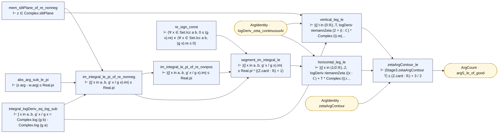

# `lean_stage3/Stage3/ArgLegs.lean`

**What it does** (its own header): ArgLegs — block H1 of `lean_stage3/design/hnt.md`, "The two contour legs". The count-to-argument step needs `|zetaArgContour T|` bounded by the number of zeros of `Re ζ` on the horizontal cut plus a constant. This module is the geometric half: on a segment where a path `g` avoids `0`, the imaginary part of `∫ g'/g` is a difference of two arguments, and on a piece where `Re g` does not change sign those arguments lie in `[−π/2, π/2]`, so the piece contributes at most `π`. Splitting at the zeros of `Re g` gives `π(|Z…

**Imports:** [`ArgIdentity`](../lean_stage3/ArgIdentity.md).
**Imported by:** [`Stage3`](../lean_stage3/Stage3.md), [`ArgCount`](../lean_stage3/ArgCount.md).

Blue: theorem. Green: a theorem nothing else uses (an end). Dashed white: connects to nothing. Grey: definition. Red: contains `sorry`. Yellow: in another file. An arrow A → B reads "A is used by B".

## Every declaration

| declaration | proves (output) | needs (input) | why (its own docstring) | uses | used by |
|---|---|---|---|---|---|
| `ArgLegs.abs_arg_sub_le_pi` theorem, line 56 | \|z.arg - w.arg\| ≤ Real.pi | hz : 0 ≤ z.re; hw : 0 ≤ w.re | Two points of the closed right half-plane have arguments within `π`. | — | `ArgLegs.im_integral_le_pi_of_re_nonneg` |
| `ArgLegs.mem_slitPlane_of_re_nonneg` theorem, line 64 | z ∈ Complex.slitPlane | hz : 0 ≤ z.re; hne : z ≠ 0 | A nonzero point of the closed right half-plane lies in the slit plane. | — | `ArgLegs.im_integral_le_pi_of_re_nonneg`, `ArgLegs.vertical_leg_le` |
| `ArgLegs.integral_logDeriv_eq_log_sub` theorem, line 74 | ∫ x in a..b, g' x / g x = Complex.log (g b) - Complex.log (g a) | hab : a ≤ b; hd : ∀ x ∈ Set.Icc a b, HasDerivAt g (g' x) x; hs : ∀ x ∈ Set.Icc a b, g x ∈ Complex.slitPlane; hc : ContinuousOn (fun x =&gt; g' x / g x) (Set.Icc a b) | The fundamental theorem of calculus for `g'/g` in the slit plane. | — | `ArgLegs.im_integral_le_pi_of_re_nonneg`, `ArgLegs.vertical_leg_le` |
| `ArgLegs.im_integral_le_pi_of_re_nonneg` theorem, line 89 | \|(∫ x in a..b, g' x / g x).im\| ≤ Real.pi | hab : a ≤ b; hd : ∀ x ∈ Set.Icc a b, HasDerivAt g (g' x) x; hne : ∀ x ∈ Set.Icc a b, g x ≠ 0; hre : ∀ x ∈ Set.Icc a b, 0 ≤ (g x).re; hc : ContinuousOn (fun x =&gt; g' x / g x) (Set.Icc a b) | One piece, `Re g ≥ 0`: the imaginary part of `∫ g'/g` moves by at most `π`. | `ArgLegs.abs_arg_sub_le_pi`, `ArgLegs.integral_logDeriv_eq_log_sub`, `ArgLegs.mem_slitPlane_of_re_nonneg` | `ArgLegs.im_integral_le_pi_of_re_nonpos`, `ArgLegs.segment_im_integral_le` |
| `ArgLegs.im_integral_le_pi_of_re_nonpos` theorem, line 102 | \|(∫ x in a..b, g' x / g x).im\| ≤ Real.pi | hab : a ≤ b; hd : ∀ x ∈ Set.Icc a b, HasDerivAt g (g' x) x; hne : ∀ x ∈ Set.Icc a b, g x ≠ 0; hre : ∀ x ∈ Set.Icc a b, (g x).re ≤ 0; hc : ContinuousOn (fun x =&gt; g' x / g x) (Set.Icc a b) | One piece, `Re g ≤ 0`: the same bound, applied at `-g`. | `ArgLegs.im_integral_le_pi_of_re_nonneg` | `ArgLegs.segment_im_integral_le` |
| `ArgLegs.re_sign_const` theorem, line 117 | (∀ x ∈ Set.Icc a b, 0 ≤ (g x).re) ∨ (∀ x ∈ Set.Icc a b, (g x).re ≤ 0) | hcg : ContinuousOn g (Set.Icc a b); hne : ∀ x ∈ Set.Ioo a b, (g x).re ≠ 0 | With no zero of `Re g` inside `(a, b)`, the sign of `Re g` is constant on `[a, b]`. | — | `ArgLegs.segment_im_integral_le` |
| `ArgLegs.segment_im_integral_le` theorem, line 147 | \|(∫ x in a..b, g' x / g x).im\| ≤ Real.pi * ((Z.card : ℝ) + 1) | hab : a ≤ b; hd : ∀ x ∈ Set.Icc a b, HasDerivAt g (g' x) x; hne : ∀ x ∈ Set.Icc a b, g x ≠ 0; hc : ContinuousOn (fun x =&gt; g' x / g x) (Set.Icc a b); hcg : ContinuousOn g (Set.Icc a b); Z : Finset ℝ; hZ : ∀ x ∈ Set.Ioo a b, (g x).re = 0 → x ∈ Z | The segment bound: one piece per zero of `Re g` inside `(a, b)`, plus one. | `ArgLegs.im_integral_le_pi_of_re_nonneg`, `ArgLegs.im_integral_le_pi_of_re_nonpos`, `ArgLegs.re_sign_const` | `ArgLegs.horizontal_leg_le` |
| `ArgLegs.vertical_leg_le` theorem, line 211 | \|(∫ t in (0:ℝ)..T, logDeriv riemannZeta (2 + (t : ℂ) * Complex.I)).re\| ≤ Real.pi / 2 | hT : 2 ≤ T; hpos : ∀ t ∈ Set.Icc (0:ℝ) T, 0 &lt; (riemannZeta (2 + (t : ℂ) * Complex.I)).re | The vertical leg at `Re s = 2`, where `Re ζ &gt; 0`, costs at most `π/2`. | `Stage3.logDeriv_zeta_continuousAt`, `ArgLegs.integral_logDeriv_eq_log_sub`, `ArgLegs.mem_slitPlane_of_re_nonneg` | `ArgLegs.zetaArgContour_le` |
| `ArgLegs.horizontal_leg_le` theorem, line 292 | \|(∫ x in (1/2:ℝ)..2, logDeriv riemannZeta ((x : ℂ) + T * Complex.I)).im\| ≤ Real.pi * ((Z.card : ℝ) + 1) | hT : 2 ≤ T; hgood : ∀ x ∈ Set.Icc (1/2:ℝ) 2, riemannZeta ((x : ℂ) + T * Complex.I) ≠ 0; Z : Finset ℝ; hZ : ∀ x ∈ Set.Ioo (1/2:ℝ) 2, (riemannZeta ((x : ℂ) + T * Complex.I)).re = 0 → x ∈ Z | The horizontal leg on `[1/2, 2]` at height `T`, one piece per zero of `Re ζ`. | `Stage3.logDeriv_zeta_continuousAt`, `ArgLegs.segment_im_integral_le` | `ArgLegs.zetaArgContour_le` |
| `ArgLegs.zetaArgContour_le` theorem, line 354 | \|Stage3.zetaArgContour T\| ≤ (Z.card : ℝ) + 3 / 2 | hT : 2 ≤ T; hpos : ∀ t ∈ Set.Icc (0:ℝ) T, 0 &lt; (riemannZeta (2 + (t : ℂ) * Complex.I)).re; hgood : ∀ x ∈ Set.Icc (1/2:ℝ) 2, riemannZeta ((x : ℂ) + T * Complex.I) ≠ 0; Z : Finset ℝ; hZ : ∀ x ∈ Set.Ioo (1/2:ℝ) 2, (riemannZeta ((x : ℂ) + T * Complex.I)).re = 0 → x ∈ Z | The two legs together: `\|zetaArgContour T\| ≤ q + 3/2` with `q = \|Z\|`. | `Stage3.zetaArgContour`, `ArgLegs.horizontal_leg_le`, `ArgLegs.vertical_leg_le` | `ArgCount.argS_le_of_good` |
