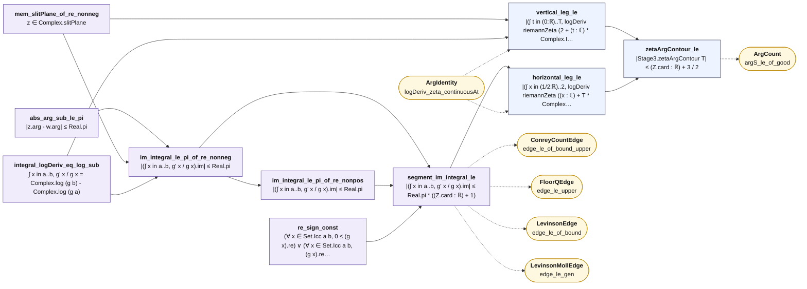

# `lean_stage3/Stage3/ArgLegs.lean`

ArgLegs — block H1 of `lean_stage3/design/hnt.md`, "The two contour legs". The count-to-argument step needs `|zetaArgContour T|` bounded by the number of zeros of `Re ζ` on the horizontal cut plus a constant. This module is the geometric half: on a segment where a path `g` avoids `0`, the imaginary part of `∫ g'/g` is a difference of two arguments, and on a piece where `Re g` does not change sign those arguments lie in `[−π/2, π/2]`, so the piece contributes at most `π`. Splitting at the zeros of `Re g` gives `π(|Z…

10 theorems, 0 definitions, 394 lines. Arrows are Lean's own record of what each proof uses.

**Imports:** [`ArgIdentity`](../lean_stage3/ArgIdentity.md)  
**Imported by:** [`Stage3`](../lean_stage3/Stage3.md), [`ArgCount`](../lean_stage3/ArgCount.md)

## The picture



An arrow A → B reads "A is used in the proof of B". Green: counting, integers only. Violet: shape, analysis with no ζ. Blue: reads ζ. A name ending in ■ is an end: nothing else uses it. Red: contains `sorry`. Yellow: theorems in another file, counted; a dotted arrow crosses files. Definitions are not drawn; they are listed below the diagram.

## Theorems

<a name="ArgLegs-abs_arg_sub_le_pi"></a>
### `ArgLegs.abs_arg_sub_le_pi`

line 56

**Shape.** Uses real or complex analysis; nothing in it or beneath it reads ζ.

**Why.** Two points of the closed right half-plane have arguments within `π`.

**Proves**

```lean
|z.arg - w.arg| ≤ Real.pi
```

**Needs** (its hypotheses)

  - `` hz : 0 ≤ z.re ``
  - `` hw : 0 ≤ w.re ``

**Fed by:** no theorem of this repo; it stands on Mathlib.

**Feeds** (1 that use it)

  - [`ArgLegs.im_integral_le_pi_of_re_nonneg`](#ArgLegs-im_integral_le_pi_of_re_nonneg) — `` |(∫ x in a..b, g' x / g x).im| ≤ Real.pi ``

<a name="ArgLegs-mem_slitPlane_of_re_nonneg"></a>
### `ArgLegs.mem_slitPlane_of_re_nonneg`

line 64

**Shape.** Uses real or complex analysis; nothing in it or beneath it reads ζ.

**Why.** A nonzero point of the closed right half-plane lies in the slit plane.

**Proves**

```lean
z ∈ Complex.slitPlane
```

**Needs** (its hypotheses)

  - `` hz : 0 ≤ z.re ``
  - `` hne : z ≠ 0 ``

**Fed by:** no theorem of this repo; it stands on Mathlib.

**Feeds** (2 that use it)

  - [`ArgLegs.im_integral_le_pi_of_re_nonneg`](#ArgLegs-im_integral_le_pi_of_re_nonneg) — `` |(∫ x in a..b, g' x / g x).im| ≤ Real.pi ``
  - [`ArgLegs.vertical_leg_le`](#ArgLegs-vertical_leg_le) — `` |(∫ t in (0:ℝ)..T, logDeriv riemannZeta (2 + (t : ℂ) * Complex.I)).re| ≤ Real.pi / 2 ``

<a name="ArgLegs-integral_logDeriv_eq_log_sub"></a>
### `ArgLegs.integral_logDeriv_eq_log_sub`

line 74

**Shape.** Uses real or complex analysis; nothing in it or beneath it reads ζ.

**Why.** The fundamental theorem of calculus for `g'/g` in the slit plane.

**Proves**

```lean
∫ x in a..b, g' x / g x = Complex.log (g b) - Complex.log (g a)
```

**Needs** (its hypotheses)

  - `` hab : a ≤ b ``
  - `` hd : ∀ x ∈ Set.Icc a b, HasDerivAt g (g' x) x ``
  - `` hs : ∀ x ∈ Set.Icc a b, g x ∈ Complex.slitPlane ``
  - `` hc : ContinuousOn (fun x => g' x / g x) (Set.Icc a b) ``

**Fed by:** no theorem of this repo; it stands on Mathlib.

**Feeds** (2 that use it)

  - [`ArgLegs.im_integral_le_pi_of_re_nonneg`](#ArgLegs-im_integral_le_pi_of_re_nonneg) — `` |(∫ x in a..b, g' x / g x).im| ≤ Real.pi ``
  - [`ArgLegs.vertical_leg_le`](#ArgLegs-vertical_leg_le) — `` |(∫ t in (0:ℝ)..T, logDeriv riemannZeta (2 + (t : ℂ) * Complex.I)).re| ≤ Real.pi / 2 ``

<a name="ArgLegs-im_integral_le_pi_of_re_nonneg"></a>
### `ArgLegs.im_integral_le_pi_of_re_nonneg`

line 89

**Shape.** Uses real or complex analysis; nothing in it or beneath it reads ζ.

**Why.** One piece, `Re g ≥ 0`: the imaginary part of `∫ g'/g` moves by at most `π`.

**Proves**

```lean
|(∫ x in a..b, g' x / g x).im| ≤ Real.pi
```

**Needs** (its hypotheses)

  - `` hab : a ≤ b ``
  - `` hd : ∀ x ∈ Set.Icc a b, HasDerivAt g (g' x) x ``
  - `` hne : ∀ x ∈ Set.Icc a b, g x ≠ 0 ``
  - `` hre : ∀ x ∈ Set.Icc a b, 0 ≤ (g x).re ``
  - `` hc : ContinuousOn (fun x => g' x / g x) (Set.Icc a b) ``

**Fed by** (3 theorems its proof uses)

  - [`ArgLegs.abs_arg_sub_le_pi`](#ArgLegs-abs_arg_sub_le_pi) — `` |z.arg - w.arg| ≤ Real.pi ``
  - [`ArgLegs.integral_logDeriv_eq_log_sub`](#ArgLegs-integral_logDeriv_eq_log_sub) — `` ∫ x in a..b, g' x / g x = Complex.log (g b) - Complex.log (g a) ``
  - [`ArgLegs.mem_slitPlane_of_re_nonneg`](#ArgLegs-mem_slitPlane_of_re_nonneg) — `` z ∈ Complex.slitPlane ``

**Feeds** (2 that use it)

  - [`ArgLegs.im_integral_le_pi_of_re_nonpos`](#ArgLegs-im_integral_le_pi_of_re_nonpos) — `` |(∫ x in a..b, g' x / g x).im| ≤ Real.pi ``
  - [`ArgLegs.segment_im_integral_le`](#ArgLegs-segment_im_integral_le) — `` |(∫ x in a..b, g' x / g x).im| ≤ Real.pi * ((Z.card : ℝ) + 1) ``

<a name="ArgLegs-im_integral_le_pi_of_re_nonpos"></a>
### `ArgLegs.im_integral_le_pi_of_re_nonpos`

line 102

**Shape.** Uses real or complex analysis; nothing in it or beneath it reads ζ.

**Why.** One piece, `Re g ≤ 0`: the same bound, applied at `-g`.

**Proves**

```lean
|(∫ x in a..b, g' x / g x).im| ≤ Real.pi
```

**Needs** (its hypotheses)

  - `` hab : a ≤ b ``
  - `` hd : ∀ x ∈ Set.Icc a b, HasDerivAt g (g' x) x ``
  - `` hne : ∀ x ∈ Set.Icc a b, g x ≠ 0 ``
  - `` hre : ∀ x ∈ Set.Icc a b, (g x).re ≤ 0 ``
  - `` hc : ContinuousOn (fun x => g' x / g x) (Set.Icc a b) ``

**Fed by** (1 theorem its proof uses)

  - [`ArgLegs.im_integral_le_pi_of_re_nonneg`](#ArgLegs-im_integral_le_pi_of_re_nonneg) — `` |(∫ x in a..b, g' x / g x).im| ≤ Real.pi ``

**Feeds** (1 that use it)

  - [`ArgLegs.segment_im_integral_le`](#ArgLegs-segment_im_integral_le) — `` |(∫ x in a..b, g' x / g x).im| ≤ Real.pi * ((Z.card : ℝ) + 1) ``

<a name="ArgLegs-re_sign_const"></a>
### `ArgLegs.re_sign_const`

line 117

**Shape.** Uses real or complex analysis; nothing in it or beneath it reads ζ.

**Why.** With no zero of `Re g` inside `(a, b)`, the sign of `Re g` is constant on `[a, b]`.

**Proves**

```lean
(∀ x ∈ Set.Icc a b, 0 ≤ (g x).re) ∨ (∀ x ∈ Set.Icc a b, (g x).re ≤ 0)
```

**Needs** (its hypotheses)

  - `` hcg : ContinuousOn g (Set.Icc a b) ``
  - `` hne : ∀ x ∈ Set.Ioo a b, (g x).re ≠ 0 ``

**Fed by:** no theorem of this repo; it stands on Mathlib.

**Feeds** (1 that use it)

  - [`ArgLegs.segment_im_integral_le`](#ArgLegs-segment_im_integral_le) — `` |(∫ x in a..b, g' x / g x).im| ≤ Real.pi * ((Z.card : ℝ) + 1) ``

<a name="ArgLegs-segment_im_integral_le"></a>
### `ArgLegs.segment_im_integral_le`

line 147

**Shape.** Uses real or complex analysis; nothing in it or beneath it reads ζ.

**Why.** The segment bound: one piece per zero of `Re g` inside `(a, b)`, plus one.

**Proves**

```lean
|(∫ x in a..b, g' x / g x).im| ≤ Real.pi * ((Z.card : ℝ) + 1)
```

**Needs** (its hypotheses)

  - `` hab : a ≤ b ``
  - `` hd : ∀ x ∈ Set.Icc a b, HasDerivAt g (g' x) x ``
  - `` hne : ∀ x ∈ Set.Icc a b, g x ≠ 0 ``
  - `` hc : ContinuousOn (fun x => g' x / g x) (Set.Icc a b) ``
  - `` hcg : ContinuousOn g (Set.Icc a b) ``
  - `` Z : Finset ℝ ``
  - `` hZ : ∀ x ∈ Set.Ioo a b, (g x).re = 0 → x ∈ Z ``

**Fed by** (3 theorems its proof uses)

  - [`ArgLegs.im_integral_le_pi_of_re_nonneg`](#ArgLegs-im_integral_le_pi_of_re_nonneg) — `` |(∫ x in a..b, g' x / g x).im| ≤ Real.pi ``
  - [`ArgLegs.im_integral_le_pi_of_re_nonpos`](#ArgLegs-im_integral_le_pi_of_re_nonpos) — `` |(∫ x in a..b, g' x / g x).im| ≤ Real.pi ``
  - [`ArgLegs.re_sign_const`](#ArgLegs-re_sign_const) — `` (∀ x ∈ Set.Icc a b, 0 ≤ (g x).re) ∨ (∀ x ∈ Set.Icc a b, (g x).re ≤ 0) ``

**Feeds** (5 that use it)

  - [`ArgLegs.horizontal_leg_le`](#ArgLegs-horizontal_leg_le) — `` |(∫ x in (1/2:ℝ)..2, logDeriv riemannZeta ((x : ℂ) + T * Complex.I)).im| ≤ Real.pi * ((Z.card : ℝ) + 1) ``
  - [`ConreyCount.edge_le_of_bound_upper`](../lean_stage3/ConreyCountEdge.md#ConreyCount-edge_le_of_bound_upper) (ConreyCountEdge) — `` |(∫ x in (1/2:ℝ)..3, logDeriv G (↑x + ↑T * I)).im| ≤ Real.pi * (21 * Real.log (3 * M) + 1) ``
  - [`FloorQ.edge_le_upper`](../lean_stage3/FloorQEdge.md#FloorQ-edge_le_upper) (FloorQEdge) — `` |edgeH F X T σ| ≤ Real.pi * ((8 * X - 1) * Real.log (2 * Mf) + 1) ``
  - [`LevinsonEdge.edge_le_of_bound`](../lean_stage3/LevinsonEdge.md#LevinsonEdge-edge_le_of_bound) (LevinsonEdge) — `` |(∫ x in (1/2:ℝ)..3, logDeriv G (↑x + ↑T * I)).im| ≤ Real.pi * (21 * Real.log (3 * M) + 1) ``
  - [`LevinsonMollEdge.edge_le_gen`](../lean_stage3/LevinsonMollEdge.md#LevinsonMollEdge-edge_le_gen) (LevinsonMollEdge) — `` |edgeH F X T σ| ≤ Real.pi * ((8 * X - 1) * Real.log (2 * Mf) + 1) ``

<a name="ArgLegs-vertical_leg_le"></a>
### `ArgLegs.vertical_leg_le`

line 211

**Reads ζ.** It, or something it rests on, uses the zeta function, its zeros or the Riemann hypothesis.

**Why.** The vertical leg at `Re s = 2`, where `Re ζ > 0`, costs at most `π/2`.

**Proves**

```lean
|(∫ t in (0:ℝ)..T, logDeriv riemannZeta (2 + (t : ℂ) * Complex.I)).re| ≤ Real.pi / 2
```

**Needs** (its hypotheses)

  - `` hT : 2 ≤ T ``
  - `` hpos : ∀ t ∈ Set.Icc (0:ℝ) T, 0 < (riemannZeta (2 + (t : ℂ) * Complex.I)).re ``

**Fed by** (3 theorems its proof uses)

  - [`Stage3.logDeriv_zeta_continuousAt`](../lean_stage3/ArgIdentity.md#Stage3-logDeriv_zeta_continuousAt) (ArgIdentity) — `` ContinuousAt (logDeriv riemannZeta) z ``
  - [`ArgLegs.integral_logDeriv_eq_log_sub`](#ArgLegs-integral_logDeriv_eq_log_sub) — `` ∫ x in a..b, g' x / g x = Complex.log (g b) - Complex.log (g a) ``
  - [`ArgLegs.mem_slitPlane_of_re_nonneg`](#ArgLegs-mem_slitPlane_of_re_nonneg) — `` z ∈ Complex.slitPlane ``

**Feeds** (1 that use it)

  - [`ArgLegs.zetaArgContour_le`](#ArgLegs-zetaArgContour_le) — `` |Stage3.zetaArgContour T| ≤ (Z.card : ℝ) + 3 / 2 ``

<a name="ArgLegs-horizontal_leg_le"></a>
### `ArgLegs.horizontal_leg_le`

line 292

**Reads ζ.** It, or something it rests on, uses the zeta function, its zeros or the Riemann hypothesis.

**Why.** The horizontal leg on `[1/2, 2]` at height `T`, one piece per zero of `Re ζ`.

**Proves**

```lean
|(∫ x in (1/2:ℝ)..2, logDeriv riemannZeta ((x : ℂ) + T * Complex.I)).im| ≤ Real.pi * ((Z.card : ℝ) + 1)
```

**Needs** (its hypotheses)

  - `` hT : 2 ≤ T ``
  - `` hgood : ∀ x ∈ Set.Icc (1/2:ℝ) 2, riemannZeta ((x : ℂ) + T * Complex.I) ≠ 0 ``
  - `` Z : Finset ℝ ``
  - `` hZ : ∀ x ∈ Set.Ioo (1/2:ℝ) 2, (riemannZeta ((x : ℂ) + T * Complex.I)).re = 0 → x ∈ Z ``

**Fed by** (2 theorems its proof uses)

  - [`Stage3.logDeriv_zeta_continuousAt`](../lean_stage3/ArgIdentity.md#Stage3-logDeriv_zeta_continuousAt) (ArgIdentity) — `` ContinuousAt (logDeriv riemannZeta) z ``
  - [`ArgLegs.segment_im_integral_le`](#ArgLegs-segment_im_integral_le) — `` |(∫ x in a..b, g' x / g x).im| ≤ Real.pi * ((Z.card : ℝ) + 1) ``

**Feeds** (1 that use it)

  - [`ArgLegs.zetaArgContour_le`](#ArgLegs-zetaArgContour_le) — `` |Stage3.zetaArgContour T| ≤ (Z.card : ℝ) + 3 / 2 ``

<a name="ArgLegs-zetaArgContour_le"></a>
### `ArgLegs.zetaArgContour_le`

line 354

**Reads ζ.** It, or something it rests on, uses the zeta function, its zeros or the Riemann hypothesis.

**Why.** The two legs together: `|zetaArgContour T| ≤ q + 3/2` with `q = |Z|`.

**Proves**

```lean
|Stage3.zetaArgContour T| ≤ (Z.card : ℝ) + 3 / 2
```

**Needs** (its hypotheses)

  - `` hT : 2 ≤ T ``
  - `` hpos : ∀ t ∈ Set.Icc (0:ℝ) T, 0 < (riemannZeta (2 + (t : ℂ) * Complex.I)).re ``
  - `` hgood : ∀ x ∈ Set.Icc (1/2:ℝ) 2, riemannZeta ((x : ℂ) + T * Complex.I) ≠ 0 ``
  - `` Z : Finset ℝ ``
  - `` hZ : ∀ x ∈ Set.Ioo (1/2:ℝ) 2, (riemannZeta ((x : ℂ) + T * Complex.I)).re = 0 → x ∈ Z ``

**Stated with:** [`Stage3.zetaArgContour`](../lean_stage3/ArgIdentity.md#Stage3-zetaArgContour)

**Fed by** (2 theorems its proof uses)

  - [`ArgLegs.horizontal_leg_le`](#ArgLegs-horizontal_leg_le) — `` |(∫ x in (1/2:ℝ)..2, logDeriv riemannZeta ((x : ℂ) + T * Complex.I)).im| ≤ Real.pi * ((Z.card : ℝ) + 1) ``
  - [`ArgLegs.vertical_leg_le`](#ArgLegs-vertical_leg_le) — `` |(∫ t in (0:ℝ)..T, logDeriv riemannZeta (2 + (t : ℂ) * Complex.I)).re| ≤ Real.pi / 2 ``

**Feeds** (1 that use it)

  - [`ArgCount.argS_le_of_good`](../lean_stage3/ArgCount.md#ArgCount-argS_le_of_good) (ArgCount) — `` |Stage3.argS T| ≤ 15 * Real.log T + 73 + 3 / 2 ``

